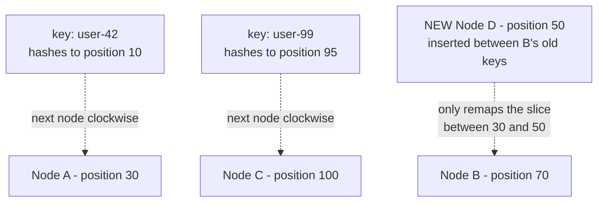
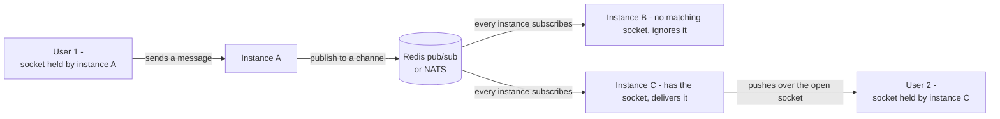

# Networking — from DNS to the packet

The topic where local-market interviews stop earliest and international loops dig hardest. Everything here is answerable from first principles; a candidate who has only ever used `fetch` will stall at L2.

---

## 1. "You type the URL and press enter." — the full path

The classic opener. Depth is scored by how many of these the candidate produces **unprompted**:

1. **DNS resolution** — browser cache → OS cache → recursive resolver (ISP/8.8.8.8/1.1.1.1) → root → TLD (`.com`) → authoritative nameserver → A/AAAA record. Cached at every layer by TTL. Root and public resolvers are reached by **anycast**: the same IP announced from many locations, BGP routes you to the nearest.
2. **TCP handshake** — SYN → SYN-ACK → ACK. **One full round trip before a single byte of your request.**
3. **TLS handshake** — TLS 1.3 is **1-RTT** (TLS 1.2 was 2). ALPN inside the handshake negotiates HTTP/2 vs 1.1. SNI tells the server which certificate to send. ECDHE gives forward secrecy — stealing the private key later doesn't decrypt yesterday's traffic.
4. **Request** — HTTP/2 binary frames on a multiplexed stream, headers compressed with HPACK.
5. **Server side** — load balancer → TLS termination → app → DB/cache.
6. **Response** → parse HTML → discover subresources → repeat (or not, if the CDN already has them).

**The number that matters:** on a cold connection to a distant origin, you pay DNS + TCP + TLS ≈ **3 round trips before the request is even sent**. At 150ms RTT (Jakarta → US East) that's ~450ms of nothing. This is why connection reuse, keep-alive, and edge PoPs exist. **A candidate who can say this sentence has passed the networking round.**

---

## 2. TCP — what a senior must know

- **Three-way handshake**, then data. Connection setup is not free, which is why HTTP keep-alive and connection pools exist at all.
- **Congestion control:** a new connection starts in **slow start** with a small congestion window and doubles per RTT. So the first ~10 packets (~14KB) go out, then it waits for ACKs. **This is why a 200KB bundle takes many round trips even on a fast link** — bandwidth isn't the constraint, the window ramp is. Linux defaults to **CUBIC**; **BBR** models bandwidth and RTT instead of treating loss as congestion, and helps a lot on lossy long-haul links.
- **Head-of-line blocking:** TCP guarantees in-order delivery, so one lost packet stalls *everything* behind it in that connection — including unrelated HTTP/2 streams sharing it.
- **`TIME_WAIT`:** the side that closes first holds the socket ~2×MSL (60s on Linux) to absorb stray packets. A service making huge numbers of short outbound connections exhausts ephemeral ports — the fix is connection reuse, not tuning the timeout.
- **MTU 1500 / MSS ~1460.** Larger payloads are segmented. A broken path-MTU-discovery (ICMP blocked) gives the maddening symptom: small requests work, large ones hang forever.
- **Nagle + delayed ACK** can interact to add ~40ms to small request/response pairs — the reason `TCP_NODELAY` exists.

**L4 probe:** "A request succeeds from your laptop and times out from the server. Name five causes." (DNS split-horizon, security group/firewall, NAT idle timeout, MTU/PMTU black hole, IPv6 vs IPv4 resolution order, proxy env vars.)

---

## 3. TLS

- **1.3 vs 1.2:** fewer round trips (1 vs 2), removed the broken ciphers (RSA key exchange, CBC modes, renegotiation), forward secrecy mandatory.
- **0-RTT resumption** sends application data in the first flight — and is **replayable by an attacker**, so it's only safe for idempotent requests. A genuinely sharp thing to know.
- **Certificate chain:** leaf → intermediate → root in the trust store. The classic production outage is **a server that forgets to send the intermediate** — works in browsers (which cache intermediates), fails in Node/curl/mobile.
- **mTLS:** client presents a certificate too — how services authenticate each other inside a mesh, instead of shared secrets.
- **Where TLS terminates matters:** if it ends at the load balancer, traffic behind it is plaintext unless you re-encrypt. Interviewers ask this to see if you think about the trust boundary.

---

## 4. HTTP/1.1 → 2 → 3

| | **HTTP/1.1** | **HTTP/2** | **HTTP/3** |
|---|---|---|---|
| Transport | TCP | TCP | **QUIC over UDP** |
| Concurrency | ~6 connections per origin; one request at a time each | Many streams multiplexed on **one** connection | Same, but streams are independent **at the transport layer** |
| Head-of-line blocking | Per connection, at HTTP level | Fixed at HTTP level, **still present at TCP level on packet loss** | **Solved** — a lost packet only stalls its own stream |
| Headers | Plaintext, repeated every request | HPACK compression | QPACK |
| Setup | TCP + TLS | TCP + TLS | **Crypto is built in; 1-RTT, or 0-RTT on resumption** |
| Extra | Pipelining never worked | Server push — shipped, then abandoned (browsers removed it; early hints `103` replaced it) | **Connection migration**: connection IDs survive an IP change, so a phone moving from wifi to 5G keeps the connection |

**The interview answer for "why HTTP/3?"**: HTTP/2 fixed application-layer HOL blocking but inherited TCP's. On a lossy mobile network that's the dominant cost — so QUIC reimplemented streams, loss recovery and encryption over UDP to make loss recovery per-stream. The cost: UDP is sometimes blocked or deprioritized, and it uses more CPU because it's in userspace rather than the kernel.

**Domain sharding and image spriting were HTTP/1.1 workarounds and are actively harmful under HTTP/2+** — a nice test of whether their knowledge is current or copied from a 2014 blog post.

---

## 5. Load balancers, proxies, CDNs

- **L4 (transport)** forwards TCP/UDP — fast, protocol-blind, can't read a path or retry a request. **L7 (application)** understands HTTP — path routing, header-based routing, retries, TLS termination, per-request load balancing (essential for HTTP/2, where one connection carries everything).
- **Algorithms:** round robin (assumes equal work), **least connections** (better with varied request cost), **consistent hashing** (session/cache affinity — see below), power-of-two-choices (near-optimal, cheap).
- **Consistent hashing:** nodes and keys are placed on a ring; a key belongs to the next node clockwise. Adding or removing a node only remaps **1/n of the keys** instead of everything (which a plain `hash % n` would do). **Virtual nodes** (each physical node placed many times) fix uneven distribution. This is the mechanism behind Cassandra's ring, memcached client sharding, and CDN cache routing — a top-tier L3 question.

Caption: with plain `hash(key) % n`, adding one node reshuffles almost every key. On the ring, Node D only steals the keys between itself and the next node counter-clockwise — everything else stays put.

- **The naive alternative, for contrast:** `hash(key) % n` remaps close to 100% of keys whenever `n` changes, because the modulus changes for nearly everything. That's the exact problem the ring solves.
- **Health checks and draining:** passive vs active checks; connection draining on deploy so in-flight requests finish. Without draining, every deploy is a burst of 502s.
- **CDN:** PoP close to the user; the **cache key** is the thing to reason about (URL + selected headers + `Vary`) — getting `Vary: Cookie` wrong destroys your hit rate; ignoring `Vary: Origin` on a CORS response serves one origin's headers to another. `stale-while-revalidate` serves the stale copy instantly and refreshes behind it. **Origin shield** stops a cold cache from stampeding your origin.

---

## 6. Real-time transport: WebSocket vs SSE vs polling

| | **WebSocket** | **SSE** | **Long polling** |
|---|---|---|---|
| Direction | Full duplex | Server → client only | Client-initiated |
| Protocol | HTTP `Upgrade` → `101`, then its own framing | Plain HTTP, `text/event-stream` | Plain HTTP |
| Reconnect | **You implement it** | **Built in**, with `Last-Event-ID` for resume | Natural |
| Payload | Text or binary | UTF-8 text only | Anything |
| Proxy/infra friendliness | Sometimes blocked; needs sticky routing | Passes anywhere HTTP does | Passes anywhere |
| Cost | A held connection per client | A held connection per client | Request churn |

- **Scaling either one out:** connections are stateful and pinned to one process, so a message published on instance A must reach the socket held by instance C — via **Redis pub/sub, NATS, or a managed service**. "How does the message reach the right server?" is the question that separates people who've shipped this from people who've read about it.

Caption: instance A never talks to instance C directly — it doesn't know where the recipient's socket lives. Every instance subscribes to the same channel, and only the one holding the right socket acts on the message.
- **SSE under HTTP/1.1 is limited by the ~6-connections-per-origin cap** across tabs — a real bug people hit; HTTP/2 multiplexing removes it.
- **Chosen per problem:** chat → WebSocket; live dashboard or LLM token stream → SSE; a notification every few minutes → polling is fine and far cheaper to operate.

---

## 7. Latency budgets — the numbers to reason with

Rough, order-of-magnitude, and enough to win any estimation question:

| Operation | Time |
|---|---|
| L1/L2 cache reference | ~1–10 ns |
| Main memory read | ~100 ns |
| NVMe SSD random read | ~50–150 µs |
| Round trip, same datacenter | ~0.5 ms |
| Postgres simple indexed query (warm) | ~1 ms |
| Round trip, cross-region (US East ↔ EU) | ~70–90 ms |
| Round trip, Jakarta ↔ US East | ~200+ ms |
| Disk seek (spinning) | ~10 ms |

**Derived truths worth saying out loud:** memory is ~1000× faster than SSD and ~1,000,000× faster than a cross-region round trip. Light in fiber covers ~200 km/ms, so **physics alone puts a floor under cross-continent latency** — no amount of optimization beats moving the data closer. Three serial cross-region calls = 600ms before any work happens; the fix is to parallelize them, batch them, or not make them.

---

## 8. The timeout and retry bugs that actually page you

Strong L4 territory — these are experience questions:

- **Idle timeout mismatch.** A load balancer closes idle connections at 60s while your Node agent keeps them pooled for longer → the LB sends FIN, you send a request into a closing socket → intermittent `502`/`ECONNRESET` under low traffic. Fix: keep the client's keep-alive timeout **below** the LB's.
- **No timeout at all.** Node's default `fetch`/http client will happily wait a very long time. One slow dependency then holds every worker → the whole service dies from a partial outage. Every outbound call gets a timeout.
- **Retry storms.** The dependency wobbles, everyone retries 3×, effective load triples exactly when it's weakest. Fix: **exponential backoff with jitter**, retry budgets (cap retries at a % of traffic), and circuit breakers.
- **Retrying non-idempotent calls.** A timeout doesn't mean it didn't happen. Retrying `POST /payments` without an **idempotency key** charges twice.
- **Deadline propagation.** If the client gave up at 2s, the downstream services should know and stop working. Without it you burn capacity computing results nobody will read.
- **DNS TTL ignored by the client.** Long-lived processes that resolve once never see a failover.

---

## Rapid-fire L3 probes

- "What's the difference between a CNAME and an A record, and why can't you CNAME the apex domain?" (RFC: no other records may coexist with a CNAME at the apex; providers fake it with ALIAS/ANAME)
- "Explain a CORS preflight — what triggers it and what stops it?" (non-simple method/headers/content-type; `Access-Control-Max-Age` caches the preflight)
- "Can a cookie be shared across subdomains? How, and what does that cost you?"
- "`SameSite=Lax` vs `Strict` vs `None` — what actually breaks with each?"
- "What is an idempotent HTTP method and why do proxies care?"
- "Where would you set `Cache-Control` for a hashed JS bundle vs an HTML page?" (`immutable, max-age=31536000` vs `no-cache` + revalidate)
- "gRPC — why HTTP/2, and what does protobuf buy over JSON?" (multiplexed streams, binary, schema + codegen, smaller payloads; cost: not browser-native without a proxy)
- "How would you debug 'it's slow' with no APM?" (`curl -w` timing breakdown, `dig`, `traceroute`/`mtr`, `ss -s`, browser waterfall, server-side timing headers)
