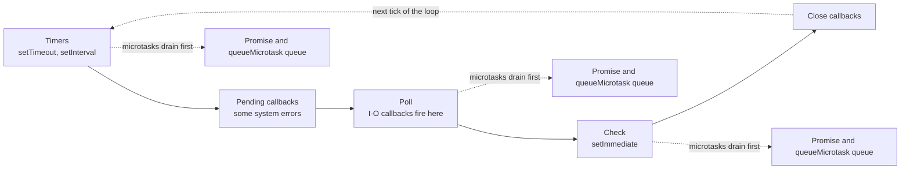
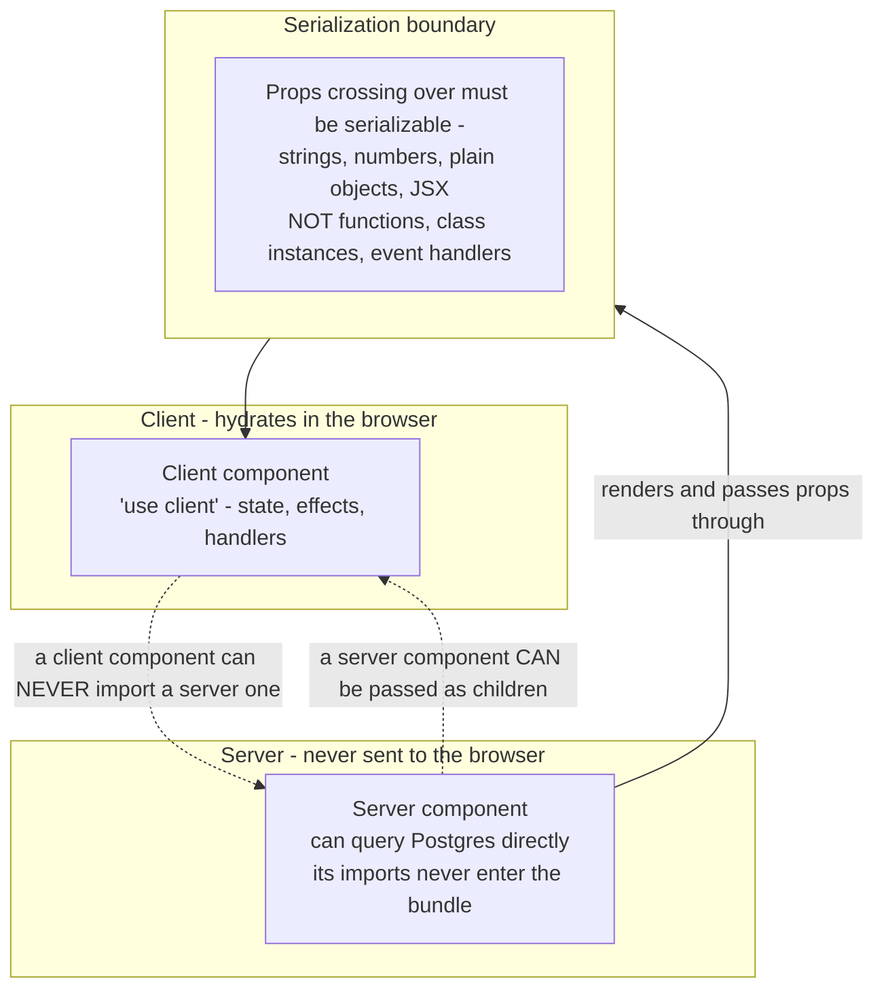
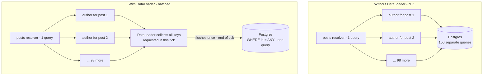

# Tool Theory — "you use it every day; what's inside it?"

The candidate's own stack, one layer down. This is where a strong practitioner either shows a real mental model or reveals they've only ever read the docs.

**Version warning:** anything about a specific release (React, Next.js, Prisma, Postgres) changes fast. Verify with web search before asserting it in feedback. The mechanisms below are stable; the product details are not.

---

## 1. V8 and the Node event loop

**L3** "Node is single-threaded. So how does it handle 10,000 concurrent connections?"

- One thread runs **your JavaScript**. I/O is not done on that thread — it's handed to the OS (epoll/kqueue) or to **libuv's thread pool**, and a callback is queued when it completes. Concurrency comes from never blocking while waiting.
- **libuv's thread pool defaults to 4 threads** (`UV_THREADPOOL_SIZE`) and serves filesystem, DNS (`dns.lookup`), `zlib` and `crypto` work — **not** network sockets, which are handled by the OS event notification mechanism directly. "Why did 5 concurrent `bcrypt` calls get slow?" lands here.
- **Event loop phases**, in order: timers (`setTimeout`) → pending callbacks → poll (I/O) → check (`setImmediate`) → close. **Microtasks (promises, `queueMicrotask`) drain completely between every phase and after every callback** — which is why `Promise.resolve().then()` runs before `setTimeout(…, 0)`, and why an infinite microtask chain starves the loop entirely.

Caption: the microtask queue empties completely after every single callback, in every phase — not just once per loop. That is why a chain of `.then()` calls can starve timers and I/O forever.
- **`process.nextTick` runs before other microtasks** — a Node-specific queue, and how DataLoader-style batching gets its "end of tick" hook.
- **CPU-bound work blocks everything.** A 200ms synchronous loop adds 200ms to every other in-flight request. Fixes: `worker_threads` (real threads, message passing), a separate service, or chunking the work. `cluster`/multiple processes scale across cores but don't help one slow request.
- **V8 specifics worth one sentence each:** JIT compilation with hidden classes (why objects with a consistent shape are faster, and why mutating shapes deoptimizes); generational GC — a cheap scavenge for the young generation, expensive mark-sweep-compact for the old one, so **allocation churn shows up as GC pauses in p99**, not p50.

---

## 2. React internals

**L3** "What does React actually do when state changes?"

- **Fiber** is a linked-list tree of units of work that makes rendering **interruptible**. Render phase: build the new tree, diff it, no DOM touched, no side effects — can be paused, resumed, or thrown away. Commit phase: apply DOM changes synchronously and run effects.
- **Reconciliation:** same type at the same position → update in place; different type → unmount and rebuild the whole subtree. **Keys** identify siblings across renders — index keys break on reorder/insert because React matches the wrong elements and state follows the key, not the data.
- **Hooks are a linked list on the fiber, matched by call order.** That is the entire reason for the rules of hooks — a conditional hook shifts every subsequent hook's position.
- **Concurrent rendering:** updates are assigned priority lanes; urgent input beats a transition. `useTransition` marks a render interruptible; `useDeferredValue` lets an expensive subtree lag behind.
- **`useMemo`/`useCallback` are not free** — they cost memory and a dependency comparison. The senior answer is that they matter for referential stability across a memo boundary and for genuinely expensive computation, not as a blanket habit.
- **Common L4:** "the list re-renders on every keystroke — find it." (new object/array/function identity in props, context value not memoized, state lifted too high, missing memo boundary.)

---

## 3. Next.js rendering and React Server Components

**L3** "What's physically different about a server component?"

- **It never ships to the browser.** It runs on the server, and its output is serialized into a special stream (not HTML) that the client React runtime merges into the tree. So a server component can query the database directly, and its dependencies stay out of the bundle — that's the actual win, alongside data-fetching-without-a-waterfall.

Caption: the arrow only goes one way in imports. A client component can receive a server component as `children`, but it can never import one directly — that import boundary is where most "why won't this compile" RSC errors come from.

- The **serialization boundary** is the thing to reason about: props crossing server → client must be serializable. Functions, class instances and event handlers can't cross. Client components can be imported by server ones, not the reverse (though a server component can be passed as `children`).
- **Hydration** is React attaching listeners and rebuilding state on top of server-rendered HTML. A mismatch (`Date.now()`, `window`, locale formatting, random ids) means React discards and re-renders — the cause of most hydration errors.
- **Streaming SSR + Suspense:** the shell is flushed immediately and slow parts arrive later, so time-to-first-byte stops being gated by the slowest query.
- **Rendering strategies and the honest tradeoff:** static (fastest, stale), ISR/revalidation (fast, eventually fresh, cache invalidation is now your problem), server-rendered per request (fresh, costs latency and server CPU), client-fetched (fast shell, waterfall + spinner). A senior picks per route, not per app, and can say **why this route is different**.

---

## 4. GraphQL execution

- The server parses the query, validates it against the schema, and **executes the resolver tree**, breadth-first per level. That execution model is precisely why the **N+1** problem exists: `posts` returns 100 items and the `author` resolver fires 100 times.

Caption: same 100 resolver calls either way — the difference is whether they turn into 100 round trips or 1. DataLoader works because Node's microtask queue drains fully before the batch fires (see the event loop diagram above).

- **DataLoader** collects the keys requested during one tick, then flushes them on the microtask/next-tick boundary as a single batched call (`WHERE id = ANY($1)`). Two requirements people get wrong: the batch function must **return results in the same order as the keys** (with `null` for misses), and the cache must be **per request** — a process-wide loader cache serves stale and cross-user data.
- **Why GraphQL is hard to cache at the edge:** one POST endpoint, body-dependent responses. Mitigations: persisted queries (hash → server-side query, GET-able, cacheable), or response caching keyed by query hash + variables + auth scope.
- **Security/perf controls a senior mentions unprompted:** query depth and complexity limits, disabling introspection in production, pagination caps, and timeouts. Without them, one nested query is a denial of service.
- **REST vs GraphQL, honestly:** GraphQL wins with many clients and varied data needs; it costs you caching simplicity, observability (every query looks the same in your metrics), and rate limiting by cost rather than by request count.

---

## 5. ORMs and query layers

- An ORM's job is mapping rows to objects and generating SQL. The senior question is **what SQL it generates and when**: does `include` produce a join or separate queries? Does the lazy relation you touched in a loop just become N+1? **`EXPLAIN` the generated query — don't trust the abstraction.**
- **Migrations** are the part that bites: a naive `ALTER TABLE` can take a long lock. Safe patterns to name — `CREATE INDEX CONCURRENTLY`, adding a nullable column then backfilling in batches, expand/contract for renames (add new, dual-write, backfill, switch reads, drop old), and never deploying a schema change and the code that requires it in the same instant.
- **Hasura-style engines** compile GraphQL straight into a single SQL query with authorization pushed into the `WHERE` clause via row-level permissions. That's the real advantage — no resolver round trips, no N+1 by construction — and the cost is that your authorization logic lives in a config layer that's harder to unit test.

---

## 6. Auth — the crypto and the tradeoffs

- **JWT:** base64url `header.payload.signature`. **Signed, not encrypted — the payload is readable by anyone.** `HS256` is a shared secret (anyone who can verify can also mint); `RS256`/`ES256` is a private/public key pair, so many services verify without the ability to issue. Verifying means recomputing the signature and checking `exp`, `iss`, `aud`.
- **The real tradeoff:** stateless verification (no DB hit) vs **no revocation**. A stolen token is valid until expiry. Mitigations: short-lived access tokens + rotating refresh tokens, a revocation list for the few that matter, and a `jti`/version claim you can invalidate.
- **Storage:** `localStorage` is readable by any XSS on the page. **`httpOnly`, `Secure`, `SameSite` cookies** are immune to that but need CSRF protection (SameSite=Lax covers most cases; a token for the rest).
- **OAuth 2.0 authorization code + PKCE** is the current default for both SPAs and mobile — the code verifier/challenge stops an intercepted authorization code from being redeemed. Implicit flow is deprecated. **OIDC** adds the `id_token` (identity) on top of OAuth (authorization). A candidate who can explain *why PKCE exists* is well above average.
- **Passwords:** bcrypt/scrypt/argon2 — deliberately slow with a tunable cost factor, salted per user. "Why not SHA-256?" → it's fast, which is exactly wrong for password hashing.

---

## 7. Containers and orchestration

- **A container is a process** with **namespaces** (pid, net, mnt, uts, ipc, user — its own view of the system) and **cgroups** (limits on CPU, memory, I/O). Not a VM: same kernel, no hypervisor, which is why startup is milliseconds and isolation is weaker.
- **Images are stacked read-only layers** with a copy-on-write writable layer on top. Layer caching is why **dependency install goes before source copy** in a Dockerfile — reorder those two lines and every build reinstalls everything. Multi-stage builds keep the toolchain out of the final image.
- **Memory limits and Node:** the container limit and V8's heap limit are different things. Exceed the cgroup limit and the kernel **OOM-kills** you with no JS stack trace — a confusing production symptom worth recognizing.
- **Kubernetes is a reconciliation loop:** you declare desired state, controllers continuously drive actual state toward it. Everything else (Deployments, ReplicaSets, HPA) is that pattern repeated. Liveness probe = restart me; readiness probe = stop sending traffic. **Getting liveness wrong turns a slow dependency into a restart loop.**

---

## 8. Caching — the layer everyone claims and few can defend

- **Where:** browser → CDN → reverse proxy → application memory → Redis → database buffer cache. Each has a different invalidation story; "we'd cache it" without saying *which layer* is a non-answer.
- **Patterns:** cache-aside (read through your code — most common), write-through (consistent, slower writes), write-behind (fast, can lose data).
- **Invalidation:** TTL (simple, stale window) vs explicit invalidation on write (fresh, easy to miss a path) vs versioned keys (`user:123:v7` — no deletes needed, old versions expire naturally).
- **What makes a good cache key** and why including auth scope matters — the cache leak where one user is served another's response starts here.
- **The questions that separate people:** "what's your hit rate, and what would you *do* about 40%?" · "what happens the moment Redis restarts empty?" (stampede — see the distributed-systems file) · "what should you never cache?"
