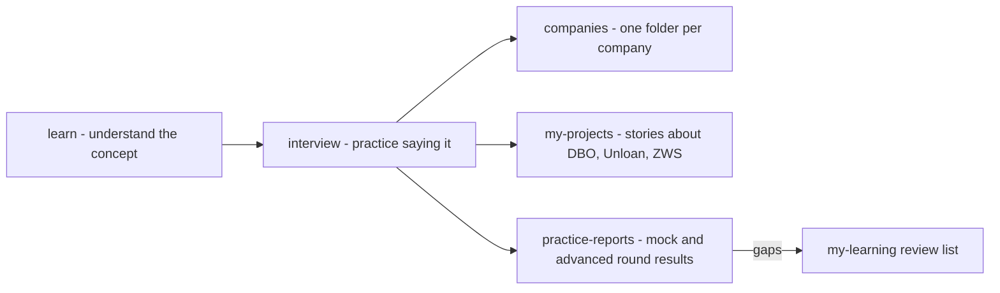

# Interview

This folder is only for **interview preparation**. Concepts are learned in [`../learn/`](../learn/README.md). This folder is where you practice saying them under pressure.

| Folder | What goes here |
|---|---|
| `companies/<company>/` | Everything for one company: prep notes, its cheatsheet, and its mock interview reports. Now: `bank-mandiri`, `skyworx`, `paypay`, `parable-health`. |
| `my-projects/` | Your real project stories: the decision, why you chose it, what you gave up. [DBO case study](my-projects/dbo-b2b-platform-system-design-case-study.md). `/project-story` saves your rehearsed stories to `my-projects/my-project-stories.md`. |
| `practice-reports/` | Reports from general mock interviews, live coding and advanced rounds that are not for one company. |

## Tools for this folder

| Command | Use it for |
|---|---|
| `/mock-interview <topic or company>` | A spoken style mock interview, one question at a time, scorecard at the end |
| `/live-coding <pattern or company>` | You write code, Claude pushes on complexity and edge cases |
| `/advanced-interview <topic>` | Hard senior rounds that go down to internals |
| `/project-story <project>` | Build and rehearse the why behind your project decisions |
| `mock-interviewer` agent | A written exam to answer at your own pace, then graded |
