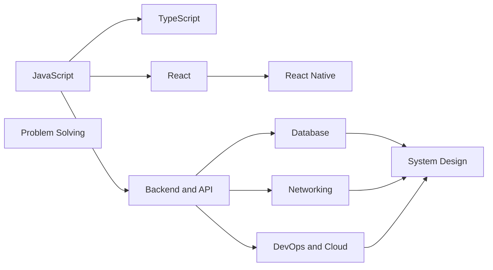

# Learn

This folder is for **understanding concepts**, one subject per folder. Interview prep for a specific company lives in [`../interview/`](../interview/README.md).



| Subject | What is inside | Start here |
|---|---|---|
| [JavaScript](javascript/README.md) | variables, functions, closures, this, prototypes, event loop, promises, async | 18 lessons planned |
| [TypeScript](typescript/README.md) | types, unions, generics, utility types, typing API data | 11 lessons planned |
| [React](react/README.md) | rendering, hooks, data fetching, performance, Next.js | main guide, hooks workbook, cheatsheet |
| [React Native](react-native/README.md) | architecture, lists, Hermes, Expo, OTA | guide and cheatsheet |
| [Backend and API](backend-api/README.md) | HTTP, REST, Express, GraphQL, auth, Hasura | tutorial, cheat sheet, 2 example apps |
| [Database](database/README.md) | SQL, joins, indexes, transactions, isolation, MVCC | guide, cheatsheet, Postgres practice |
| [System Design](system-design/README.md) | building blocks, framework, classic designs | 5 guides, 2 cheatsheets |
| [Networking](networking/README.md) | DNS, TCP, TLS, HTTP versions, CORS, browser | URL to page guide and cheatsheet |
| [DevOps and Cloud](devops-cloud/README.md) | Docker, Kubernetes, CI/CD, serverless | 3 guides, 2 examples |
| [Problem Solving](problem-solving/README.md) | pattern based coding practice with tests | 12 problems ready |
| [Other Stacks](other-stacks/README.md) | .NET and Java Spring from a TypeScript view | 2 guides, 2 cheatsheets |

## How each subject folder is laid out

```
learn/<subject>/
├── README.md              the map, the lesson list with status, links
├── 01-<concept>.md        one concept per file, made from templates/lesson-template.md
├── 02-<concept>.md
├── <older-guide>.md       longer guides that cover many concepts
├── <guide>-cheatsheet.html  visual one page cheatsheets
├── practice/              small runnable exercises for the lessons
└── examples/              bigger example projects
```

## How to study one lesson

1. Open the lesson and look at **the picture** first.
2. Open the **watch and play** links. Step through the code in the visualizer.
3. Do the **practice**. Predict before you open the answer.
4. Close the file and **explain it back**. Write your version in the lesson, then run `/explain-check <concept>` or ask the `explain-coach` agent.
5. The review questions come back on day 1, 3, 7 and 21 through `/daily-review`.

Read [how I learn](../my-learning/learner-profile.md) and [the study method](../my-learning/study-method-and-weekly-plan.md) for the why behind this.
