# 01. HTTP basics

> **Subject:** Backend and API · **Lesson:** 01 · **Made:** 2026-10-22 · **Remade in short cards:** 2026-10-29 · **Status:** ready
>
> **You will be able to:** read a request and a response line by line, pick the right status code, and say why 401 and 403 are different.
>
> **Before this:** [Backend and API lessons](README.md) · **Next:** [REST API design](02-rest-api-design.md)
>
> **How to read it:** one card is one idea. Look at the picture, guess, then press the orange bar to check. The blue bars (📖 More detail) hold the longer explanation. Skip them on the first read, and open them when you want more. About 15 minutes for the cards.

## 1. The idea: a paper slip at a counter

At a warehouse counter you write a slip. The top line says what you want: "get product 41". Below it are small lines, like your member card. The clerk answers with a slip too. Its top line is a number that says how it went. HTTP is the same, only as text.

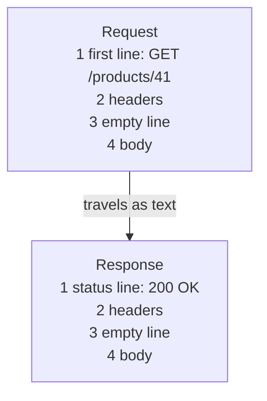

Notice: both messages have the same four parts. Only the first line is different.

<details class="guess"><summary>🤔 Guess: Ana's app gets the answer back. What should it read first, the status line or the body? Press to check.</summary>

The status line. It says how it went. Read the number first, then decide what to do with the body.

</details>

> **Remember:** a request and an answer both have four parts: a first line, headers, an empty line, a body.

<details class="more"><summary>📖 More detail: the real text, four new words, and where the slip picture stops</summary>

**Why you need it.**

- Ana opens product 41 in the shop app.
- Her phone and your server are two different machines. They may run different languages.
- They need one shared way to say "give me product 41" and "here it is".
- They also need a way to say "that went wrong", and how it went wrong.
- HTTP is that shared way. It is plain text with a fixed shape.

**The exact text, both ways.**

This is the exact text Ana's app sends:

```http
GET /products/41 HTTP/1.1
Host: shop.example.com
Accept: application/json
Authorization: Bearer tok_ana

```

And this is the exact text the server sends back:

```http
HTTP/1.1 200 OK
Content-Type: application/json

{"id":41,"name":"Rice 5 kg","price":65000}
```

Both have the same four parts: a first line, some `Name: value` lines, an empty line, then the data.

**Four new words.**

- **Method:** the first word of the request. It says what you want to do, like `GET` (read) or `DELETE` (remove). (Interview word: HTTP method, sometimes "verb".)
- **Status code:** the 3 digit number in the first line of the answer. It says how it went. `200` means it worked.
- **Header:** one `Name: value` line with extra facts about the message, like who you are or what format the data is in.
- **Body:** the data after the empty line, usually JSON. A `GET` has none. (Interview word: body, or payload.)

The first line has a name too. In a request it is the request line. In an answer it is the status line.

**What each part holds.**

| Part | In the request | In the response | Who reads it |
|---|---|---|---|
| First line | method, path, version | version, status code, a short label | the other side, first |
| Headers | `Host`, `Accept`, `Authorization` | `Content-Type`, `Cache-Control` | the other side and every tool in the middle |
| Empty line | "headers over" | "headers over" | the reader, to know where the body starts |
| Body | the new data for `POST`, `PUT`, `PATCH` | the data or the error details | your code |

**The big picture.** Only text travels. The app and the server never share memory.

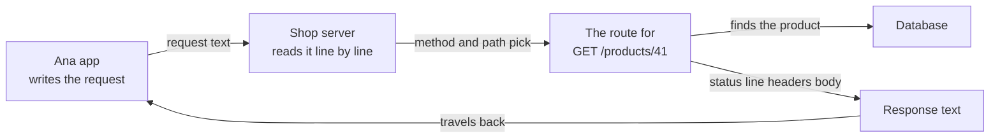

**The same request over time.** The app reads the status before the body.

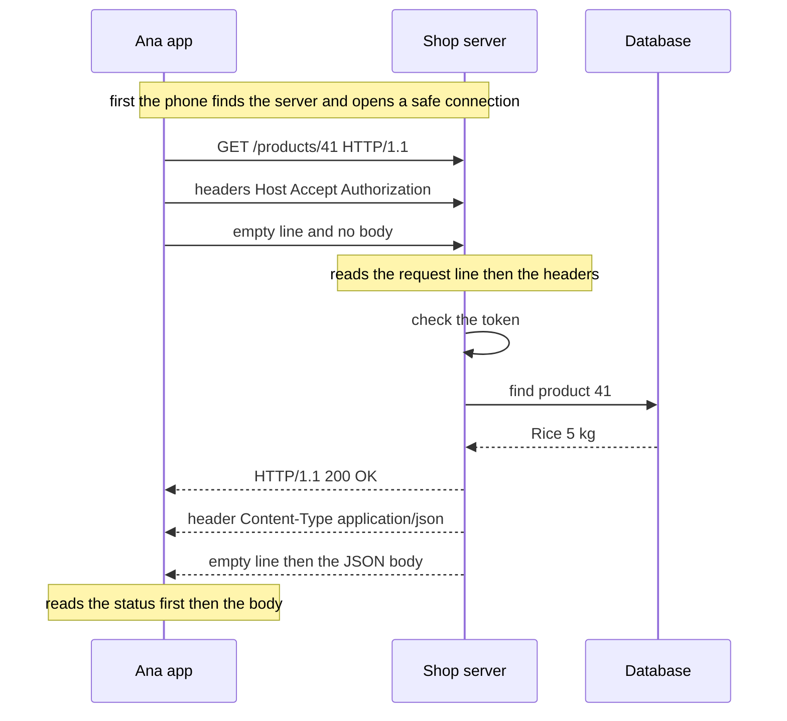

The first note hides three steps: find the address, open a connection, make it secret (DNS, TCP and TLS). [From URL to page, step by step](../networking/networking-url-to-page-step-by-step.md) shows them.

**Headers worth knowing.**

| Header | Sent by | What it says |
|---|---|---|
| `Content-Type` | both | the format of the body, like `application/json` |
| `Accept` | app | the format the app wants back |
| `Authorization` | app | who you are, usually `Bearer <token>` |
| `Set-Cookie` and `Cookie` | server, then browser | the server sets a small value. The browser sends it back on every request |
| `Cache-Control` | mostly server | how long a copy may be kept, like `max-age=60` ([lesson 04](../system-design/04-caching.md)) |
| `Retry-After` | server | with 429 or 503: how many seconds to wait |
| `Location` | server | with 201 or 3xx: where the new thing or new address is |

**Where the slip picture stops.**

Ordering with a paper slip at a warehouse counter.

- You write a slip. The top line says "GET product 41". That is the method and the path.
- Below it you stamp small lines: "Member card: Ana 7", "Reply in: English". Those are headers.
- Then a gap. Then the order details, if there are any. That is the body.
- The clerk answers with a slip. Its top line has a number. 200 here it is. 404 no such item. 401 show your card. 403 your card does not allow this. 500 our machine broke.
- The clerk forgets you when you walk away. So every slip needs your card.

Where it stops being true: a real clerk could remember your face, but a server forgets on purpose. That way any of many server copies can take your next slip. And a clerk can ask you a question. A server cannot, so the slip must be complete.

</details>

## 2. Methods: what you ask for

The first word of a request says what you want to do. Learn these five.

| Method | Asks the server to | Body? | Safe to repeat? |
|---|---|---|---|
| `GET` | read something | no | yes |
| `POST` | make something new | yes | no |
| `PUT` | replace the whole thing | yes | yes |
| `PATCH` | change some fields | yes | not promised |
| `DELETE` | remove it | usually no | yes |

"Safe to repeat" means that sending it twice leaves the server the same as sending it once.

<details class="guess"><summary>🤔 Guess: the phone loses signal right after `POST /orders`. The app sends it again. How many orders does Ana have? Press to check.</summary>

Two. `POST` makes something new every time. A `DELETE` sent twice is fine, because the product is gone after the first one.

</details>

> **Remember:** `GET` reads. `POST` makes. A repeated `POST` makes a second thing.

<details class="more"><summary>📖 More detail: the shop examples, and the retry problem</summary>

- `GET /products/41` reads a product.
- `POST /orders` makes an order.
- `PUT /products/41` with the full product replaces it.
- `PATCH /products/41` with `{"price":60000}` changes one field.
- `DELETE /products/41` removes it.

"Safe to repeat" means sending it twice leaves the server the same as sending it once. Two `POST /orders` make two orders. That matters when an app tries again after a timeout. [Idempotency and retries](../system-design/13-idempotency-and-retries.md) covers it fully.

</details>

## 3. Status codes: five families

The first digit tells you the family. Learn the families first. Then single codes are easy.

| Family | Means |
|---|---|
| 1xx | wait, more is coming |
| 2xx | it worked |
| 3xx | look somewhere else |
| 4xx | your request is wrong |
| 5xx | the server broke |

<details class="guess"><summary>🤔 Guess: the app gets a 503. Should it change its request, or try again later? Press to check.</summary>

Try again later. A 5xx says the server has the problem. A 4xx says to change your request, because trying the same request again gets the same answer.

</details>

> **Remember:** 4xx means "change your request". 5xx means "not your fault, maybe try later".

<details class="more"><summary>📖 More detail: when you see each family, and the codes worth knowing</summary>

| Family | Means | You see it when |
|---|---|---|
| 1xx | wait, more is coming | rarely, you can skip it |
| 2xx | it worked | most of the time |
| 3xx | look somewhere else | a page moved, or "your saved copy is still good" |
| 4xx | your request is wrong | no token, not allowed, not found, bad data |
| 5xx | the server broke | a bug, or a server behind it is down |

The most useful split is 4xx against 5xx. 4xx says "change your request". 5xx says "not your fault, maybe try later".

**The status codes worth knowing.**

A gateway below means a server in front of yours, like nginx or a load balancer.

| Code | Name | Send it when | In the shop |
|---|---|---|---|
| 200 | OK | it worked and there is a body | `GET /products/41` |
| 201 | Created | a new thing was made. Add a `Location` header with its path | `POST /orders` |
| 204 | No Content | it worked and there is nothing to send | `DELETE /products/41` |
| 301 / 302 | Moved Permanently / Found | the thing lives at another address, for good or for now | an old link to `/item/41` |
| 304 | Not Modified | "your saved copy is still good", no body | the app asks again for an image it has |
| 400 | Bad Request | I cannot read your request | broken JSON |
| 401 | Unauthorized | I do not know who you are | no token, or a token that is too old |
| 403 | Forbidden | I know you, and you may not | a buyer tries to delete a product |
| 404 | Not Found | the thing is not there | `GET /products/999` |
| 409 | Conflict | it clashes with what is already there | sign up with a taken email |
| 422 | Unprocessable Content | I can read it, but it breaks a rule | a price below 0 |
| 429 | Too Many Requests | slow down. Add `Retry-After` | 100 logins in a minute ([lesson 09](../system-design/09-design-a-rate-limiter.md)) |
| 500 | Internal Server Error | my code broke | an uncaught error in a route |
| 502 | Bad Gateway | the gateway got a broken answer from your server | your Node app crashed mid answer |
| 503 | Service Unavailable | down for now, on purpose or overloaded | a deploy or maintenance |
| 504 | Gateway Timeout | the gateway waited too long for your server | a slow database query |

</details>

## 4. 401 against 403: two questions, in order

The server asks two questions, always in this order. 401 means the first one failed. 403 means the first passed and the second failed.

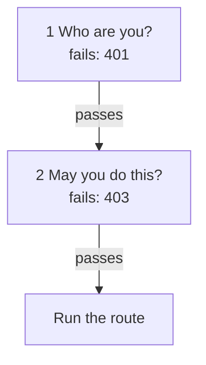

<details class="guess"><summary>🤔 Guess: Ana is logged in as a buyer. She calls `DELETE /products/41`, and only admins may delete. What does she get? And what if she sends no token? Press to check.</summary>

Logged in as a buyer: **403**. The server knows her, but she may not do it. With no token: **401**, because the server does not know who she is. Logging in again does not fix a 403.

</details>

> **Remember:** 401 is "who are you". 403 is "I know you, and no".

<details class="more"><summary>📖 More detail: the full picture, why the name is confusing, and the mistake in code</summary>

**The two questions drawn with Ana.** Notice that 403 can only happen after question 1 passed.

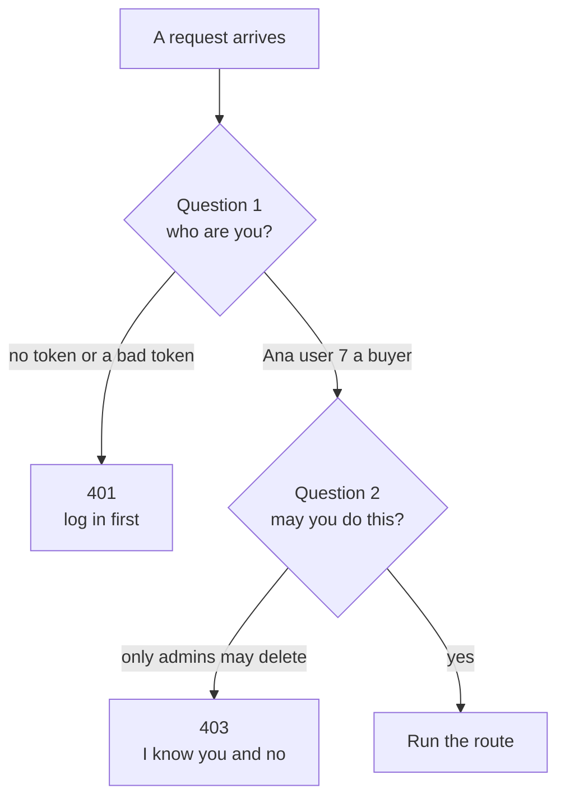

- **401** fails question 1. The label says "Unauthorized", but it really means "not logged in". The fix is to log in, or get a new token.
- **403** passes question 1 and fails question 2. Logging in again does not help. The same token will get the same 403.

**The mistake in code.**

**Wrong:** send 403 when there is no token, or 401 when the user is known but not allowed.

**Right:**

```js
// sketch, not run here (Express, after a middleware that sets req.user from the token)
if (!req.user) return res.status(401).json({ error: "log in first" });
if (req.user.role !== "admin") return res.status(403).json({ error: "only admins can delete products" });
```

**Why:** on 401 the app logs in again. On 403 logging in again does not help, so it should show "you cannot do this".

</details>

## 5. Which status code do I send?

Ask the questions in this order and stop at the first "yes" or "no" that gives a code.

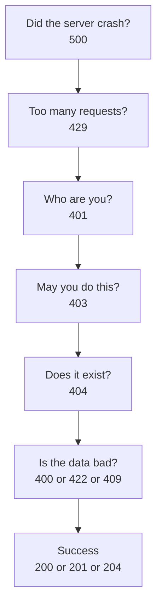

<details class="guess"><summary>🤔 Guess: the user is logged in and allowed, the product exists, the JSON is readable, but the price is -5. Which code? Press to check.</summary>

**422**. The server can read the request, but it breaks a rule. Many teams send 400 here. That is fine, if you pick one way and use it everywhere.

</details>

> **Remember:** crash first, then who, then may you, then does it exist, then the data, then success.

<details class="more"><summary>📖 More detail: the full decision picture</summary>

Notice the order. Server problems first, then "who are you", then "what did you send", then success.

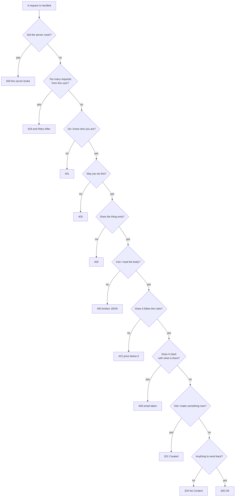

Many teams send 400 for both "cannot read it" and "breaks a rule". That is fine. Pick one way and use it everywhere. Practice C uses this exact order.

</details>

## 6. The server does not remember you

HTTP keeps no memory between two requests (interview word: stateless). So "who you are" must ride along every time.

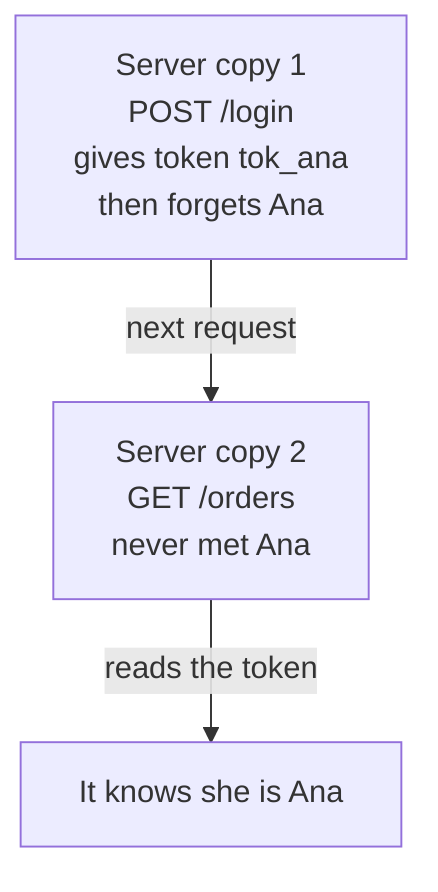

<details class="guess"><summary>🤔 Guess: server copy 2 never met Ana. How does it know who she is? Press to check.</summary>

From the token. The app sends it in the `Authorization` header on every request, or the browser sends a `Cookie` header by itself. Any server copy can read it.

</details>

> **Remember:** the server forgets you on purpose. The token tells it who you are, every time.

<details class="more"><summary>📖 More detail: the same story over time</summary>

Notice that server copy 2 never met Ana. Only the token tells it who she is.

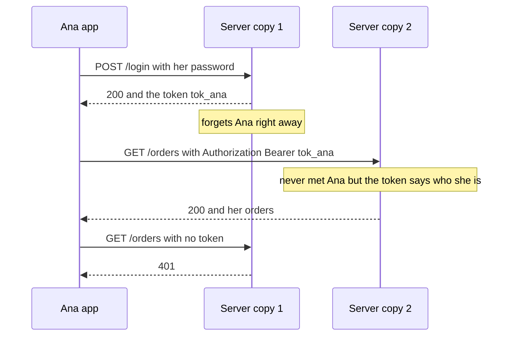

HTTP keeps no memory between two requests (interview word: stateless). So "who you are" must ride along every time. It goes in the `Authorization` header, or in a `Cookie` header that the browser adds by itself. The good side: any server copy can answer any request.

</details>

## 7. The smallest code that shows it

One server and one `fetch`. Run it and look at both sides.

```js
const http = require("node:http");
const s = http.createServer((q, r) => {
  console.log("server:", q.method, q.url);
  r.writeHead(200, {
    "Content-Type": "application/json" });
  r.end('{"id":41}');
});
s.listen(3000, async () => {
  const r = await fetch(
    "http://localhost:3000/products/41");
  console.log("app:", r.status, r.ok);
  s.close();
});
```

<details class="guess"><summary>🤔 Guess: what do the server and the app print? Press to check.</summary>

```
server: GET /products/41
app: 200 true
```

The server never sees your JavaScript objects. `fetch` turned the call into text, and Node read the text back into `q.method` and `q.url`.

</details>

> **Remember:** the status goes out first, and the app can read it before the body.

<details class="more"><summary>📖 More detail: the longer program, and every step on the wire</summary>

**The longer program** (it also sends an `Accept` header).

```js
const http = require("node:http");
const server = http.createServer((req, res) => {                  // runs once per request
  console.log("server got:", req.method, req.url, "accept =", req.headers.accept);
  res.writeHead(200, { "Content-Type": "application/json" });      // status line and headers
  res.end(JSON.stringify({ id: 41, name: "Rice 5 kg" }));          // the body
});
server.listen(3000, async () => {
  const res = await fetch("http://localhost:3000/products/41", { headers: { Accept: "application/json" } });
  console.log("app got:", res.status, res.statusText, res.headers.get("content-type"));
  console.log("body:", await res.json());
  server.close();
});
```

**Output:**

**Output:**

```
server got: GET /products/41 accept = application/json
app got: 200 OK application/json
body: { id: 41, name: 'Rice 5 kg' }
```

Checked on 2026-10-22 with Node 24.

The server never sees your JavaScript objects. `fetch` turned them into the text from section 1. Node read that text back into `req.method`, `req.url` and `req.headers`. Header names come out in lowercase, so you read `req.headers.accept`.

**The same program, one request, step by step.**

| Step | Who | What happens | Text on the wire | What is known now |
|---|---|---|---|---|
| 1 | app | `fetch` writes the request line | `GET /products/41 HTTP/1.1` | nothing is sent yet |
| 2 | app | adds headers: `Host` from the URL, `Accept` from your code | `Host: localhost:3000`, `Accept: application/json` | |
| 3 | app | adds the empty line. A `GET` has no body | (empty line) | |
| 4 | wire | the text leaves for the server | the whole request | the server knows nothing yet |
| 5 | server | Node reads the request line | | `req.method` is `GET`, `req.url` is `/products/41` |
| 6 | server | Node reads headers until the empty line | | `req.headers.accept` is `application/json` |
| 7 | server | nothing comes after the empty line, so there is no body | | |
| 8 | server | your function runs and finds product 41 | | the server has the answer |
| 9 | server | `writeHead(200, ...)` writes the status line and headers | `HTTP/1.1 200 OK`, `Content-Type: application/json` | |
| 10 | server | `end(...)` writes the empty line and the body | `{"id":41,"name":"Rice 5 kg"}` | the answer is complete |
| 11 | app | `await fetch` finishes as soon as the status line and headers arrive | | `res.status` is 200, `res.ok` is true |
| 12 | app | `res.json()` reads the body and turns it into an object | | `{ id: 41, name: 'Rice 5 kg' }` |

**What to see.**

What to see:

- Steps 5 to 7: the server always knows the method and the path before it reads a body.
- Step 9: the status goes out first. Once the body has started, you cannot change the status.
- Step 11: the app gets the status before the body. So check the status first.

**Step through it yourself:** [open the stepper](visuals/01-http-basics.html). It has three stories: a normal `GET`, no token against the wrong person, and `fetch` on a 404.

</details>

## 8. Mistake 1: a 200 with an error inside

The server cannot find product 999, but it still answers 200 and puts the error in the body.

| | Wrong | Right |
|---|---|---|
| Server sends | `200` and `{"error":"not found"}` | `404` and `{"error":"not found"}` |
| The app reads `res.ok` | `true` | `false` |
| The screen shows | `undefined` | Product not found |

<details class="guess"><summary>🤔 Guess: why does the screen show `undefined` on the wrong side? Press to check.</summary>

The app checks the status first. 200 says "it worked", so the app reads `name` from the body. The body is the error object, which has no `name`. A cache would also keep the error, and retry code would never retry the crash.

</details>

> **Remember:** choose the status from what happened. Never send 200 for an error.

<details class="more"><summary>📖 More detail: the problem drawn, and the code fix</summary>

**The problem, drawn.** Four different results look the same to the app.

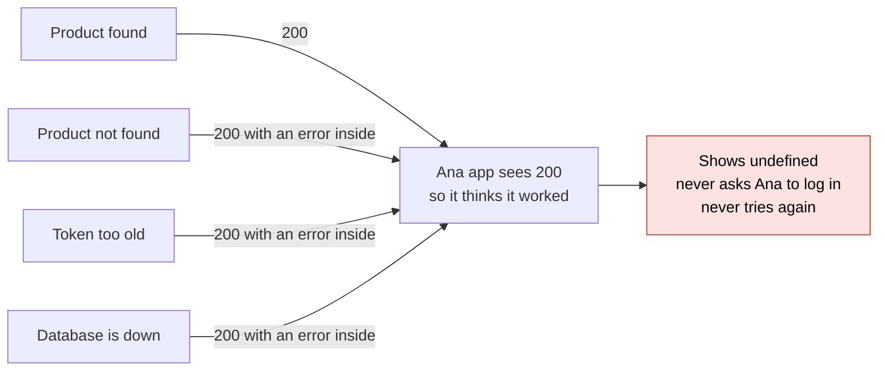

Without real status codes, the app must open every body and guess. Tools in the middle only read the status line. A cache would keep the error. Retry code would never retry the crash.

**Right against wrong.**

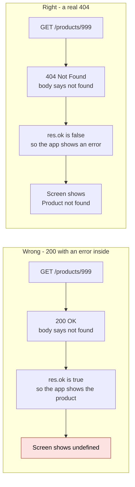

**The mistake in code.**

**Wrong:** send 200 with an error inside.

```js
// sketch, not run here (Express)
res.status(200).json({ error: "product not found" });
```

**Right:**

```js
res.status(404).json({ error: "product not found" });
```

**Why:** the app and every tool in the middle read the status first. Practice B shows the bug running.

</details>

## 9. Mistake 2: `fetch` does not throw on a 404

You expect a 404 or a 500 to jump into your `catch`. It does not.

```js
const res = await fetch(url);
console.log(res.status, res.ok);
const p = await res.json();
console.log(p.name);
```

With a server that answers 404 and `{"error":"no product 999"}`, this prints:

```
404 false
undefined
```

<details class="guess"><summary>🤔 Guess: does a `catch` block around this ever run? Press to check.</summary>

No. `fetch` throws only when no answer comes back at all, like a dropped network. A 404 is a real answer, so `fetch` hands it to you. Check `res.ok`, which is true only for 200 to 299.

</details>

> **Remember:** after every `fetch`, check `res.ok` before you read the body.

<details class="more"><summary>📖 More detail: the wrong code and the right code</summary>

**Wrong:** expect `fetch` to throw on 404 or 500.

```js
try {
  const product = await (await fetch("/products/999")).json();   // a 404 does not throw
  show(product.name);                                             // shows undefined
} catch (e) { showError(e.message); }                             // never runs
```

**Right:**

```js
const res = await fetch("/products/999");
if (!res.ok) throw new Error("HTTP " + res.status);   // res.ok is true only for 200 to 299
const product = await res.json();
```

**Why:** `fetch` throws only when no answer comes back at all, like a dropped network. A 404 is a real answer. Practice A shows it running.

Practice A and B below run this for real.

</details>

## 10. Mistake 3: JSON without a Content-Type

`fetch` labels a text body as plain text. The server then does not know it is JSON.

```js
await fetch("/products", {
  method: "POST",
  body: JSON.stringify({ name: "Rice" }),
});
```

The server sees `content-type: text/plain;charset=UTF-8`. With `headers: { "Content-Type": "application/json" }` it sees `content-type: application/json`.

<details class="guess"><summary>🤔 Guess: `express.json()` only reads `application/json`. What happens to the body above? Press to check.</summary>

It is skipped. In Express 5, `req.body` is `undefined`, and `req.body.name` throws, so the app gets a 500. The server picks how to read the body from `Content-Type`.

</details>

> **Remember:** always send `Content-Type: application/json` with a JSON body.

<details class="more"><summary>📖 More detail: the right code, and a body on GET</summary>

**Wrong:** send JSON without saying it is JSON.

```js
await fetch("/products", { method: "POST", body: JSON.stringify({ name: "Rice" }) });
```

`fetch` labels a text body `Content-Type: text/plain;charset=UTF-8`. Express's `express.json()` only reads `application/json`, so it skips the body. In Express 5, `req.body` is `undefined`, and `req.body.name` throws. The app gets a 500.

**Right:**

```js
await fetch("/products", {
  method: "POST",
  headers: { "Content-Type": "application/json" },
  body: JSON.stringify({ name: "Rice" }),
});
```

**Why:** the server picks how to read the body from `Content-Type`. Checked on 2026-10-22 with Node 24 and Express 5.

**Another mistake: a body with `GET`.**

**Wrong:** send a body with `GET`.

```js
await fetch("/products", { method: "GET", body: JSON.stringify({ shop: 7 }) });
// TypeError: Request with GET/HEAD method cannot have body.
```

**Right:** put filters in the path after `?`: `GET /products?shop=7&q=rice`.

**Why:** a `GET` body has no agreed meaning, so many servers and tools drop it. `fetch` refuses it. Checked on 2026-10-22 with Node 24.

</details>

## 11. Why it matters and what it costs

- **Without it:** every app and server would invent their own message shape. Nothing in the middle could help, because nothing could read it.
- **With it:** one fixed shape (method, path, headers, body) and one set of status codes. Browsers, caches, load balancers and retry code read the status line without knowing your app.
- **The cost:** headers repeat on every request, so the token travels every time, and the server checks it every time. A status code is also rough. You still need an error body that says exactly what was wrong.

<details class="more"><summary>📖 More detail: if you freeze in the interview</summary>

**If you freeze:**

1. "A request is text: method and path, headers, an empty line, a body."
2. "The answer starts with a status. 2 worked, 4 your fault, 5 my fault."
3. "401 is who are you, 403 is I know you and no. fetch does not throw on 404, so check res.ok."

</details>

## 12. Watch and play

All links checked on 2026-10-22.

- **Video:** [HTTP Status Codes Explained In 5 Minutes](https://www.youtube.com/watch?v=qmpUfWN7hh4) ByteByteGo, 5 min - the five families with pictures.
- **Video:** [HTTP Crash Course & Exploration](https://www.youtube.com/watch?v=iYM2zFP3Zn0) Traversy Media, 38 min - the request and response cycle, headers, body and status codes, then real ones in the browser.
- **Play with it:** [the stepper in this folder](visuals/01-http-basics.html) - guess first, then press Next.
- **Play with it:** [httpbin.org](https://httpbin.org/) - open `https://httpbin.org/headers` to see the headers your browser sends. Open `https://httpbin.org/status/404` with the Network tab open.
- **Play with it:** [Chrome DevTools: Inspect network activity](https://developer.chrome.com/docs/devtools/network) - open any site, click one request, read its Headers and Response tabs.
- **Read:** [MDN: Overview of HTTP](https://developer.mozilla.org/en-US/docs/Web/HTTP/Guides/Overview) - diagrams of one request and one response, and "HTTP is stateless, but not sessionless".
- **Read:** [MDN: HTTP response status codes](https://developer.mozilla.org/en-US/docs/Web/HTTP/Reference/Status) - every code, grouped by family.

<details><summary>Go deeper (optional)</summary>

**See the real text with curl.** `curl -v` prints what it sends (lines with `>`) and what comes back (lines with `<`). Against the server from section 4:

```
$ curl -sv -H "Accept: application/json" -H "Authorization: Bearer abc123" http://localhost:3005/products/41
> GET /products/41 HTTP/1.1
> Host: localhost:3005
> User-Agent: curl/8.7.1
> Accept: application/json
> Authorization: Bearer abc123
>
< HTTP/1.1 200 OK
< Content-Type: application/json
< Date: Thu, 22 Oct 2026 04:34:15 GMT
< Connection: keep-alive
< Keep-Alive: timeout=5
< Transfer-Encoding: chunked
<
{"id":41,"name":"Rice 5 kg"}
```

(A few `*` lines about the connection are left out.) Node added `Date`, `Connection`, `Keep-Alive` and `Transfer-Encoding` by itself. `Transfer-Encoding: chunked` means the body is sent in pieces, each with its size, because the code did not set `Content-Length`. Checked on 2026-10-22 with curl 8.7.1 and Node 24.

**What `fetch` adds by itself.** A raw TCP server in Node 24 caught this from `fetch(url, { method: "POST", body: JSON.stringify({ name: "Rice" }) })`: `host`, `connection: keep-alive`, `content-type: text/plain;charset=UTF-8`, `accept: */*`, `accept-language: *`, `sec-fetch-mode: cors`, `user-agent: node`, `accept-encoding: gzip, deflate` and `content-length: 15`. That `text/plain` is the reason for the Content-Type mistake in section 7.

**Header names ignore case.** `Content-Type` and `content-type` are the same header ([RFC 9110, section 5.1](https://www.rfc-editor.org/rfc/rfc9110.html#name-field-names)). Node gives you `req.headers` with lowercase keys. In HTTP/2 and HTTP/3 the names are always sent in lowercase.

**HTTP/2 and HTTP/3.** The parts stay the same: method, path, headers, status, body. But they travel as small binary pieces, not text lines, and repeated headers are squeezed. Many requests share one connection. Your Express code does not change. The networking subject has a planned lesson on this ([networking lessons](../networking/README.md)).

**More on 401 and 403.** [RFC 9110, section 15.5.2](https://www.rfc-editor.org/rfc/rfc9110.html#name-401-unauthorized) says a 401 must carry a `WWW-Authenticate` header that says how to log in, for example `WWW-Authenticate: Bearer`. Section 15.5.4 says a server may answer 404 instead of 403 to hide that the thing exists. GitHub does this for private repositories you cannot see.

**Why no body on GET.** [RFC 9110, section 9.3.1](https://www.rfc-editor.org/rfc/rfc9110.html#name-get) says a body on a GET has no agreed meaning, and a client should not send one. Some servers even close the connection.

**Express 4 against Express 5.** When no body reader matches, `req.body` is `{}` in Express 4 and `undefined` in Express 5. So the Content-Type mistake fails quietly in Express 4 (`req.body.name` is `undefined`) and loudly in Express 5 (a 500). Checked on 2026-10-22 with Express 4.22 and 5.3.

**axios is different from fetch.** axios throws for any status outside 200 to 299 by default ("Request failed with status code 404"). Checked on 2026-10-22. If you move code between them, the error handling changes.

**Redirects.** 301 and 302 let old clients change a `POST` into a `GET` on the next request. 307 and 308 promise to keep the same method and body. `fetch` follows redirects by itself, so you usually see the final status, not the 3xx.

**304 and saved copies.** The app sends `If-None-Match` with the version tag (`ETag`) it saved last time. If nothing changed, the server answers 304 with no body. See [Caching](../system-design/04-caching.md).

**HEAD and OPTIONS.** `HEAD` is a `GET` that returns only the status and headers. Browsers send `OPTIONS` before some cross-site requests to ask "may I?". That is CORS, in the networking subject.

**Names in RFC 9110.** 422 is called "Unprocessable Content" there. Older pages say "Unprocessable Entity". 429 comes from a separate document, RFC 6585.

**GraphQL over HTTP.** GraphQL usually sends every query as a `POST` to one path, `/graphql`. The [GraphQL over HTTP spec](https://graphql.github.io/graphql-over-http/draft/) is still a draft. It allows `GET` for queries only, and it adds a new response type, `application/graphql-response+json`, so servers can answer 4xx for a broken request. With plain `application/json`, many servers answer 200 even when the body has an `errors` list. A test with GraphQL Yoga 5.24 on 2026-10-22: a field function that throws gave 200 with `errors` for both response types. A query for a field that does not exist gave 200 with `Accept: application/json`, and 400 with `Accept: application/graphql-response+json`. So for GraphQL, always read the `errors` list, not only `res.ok`.

**More to read:** [MDN: HTTP messages](https://developer.mozilla.org/en-US/docs/Web/HTTP/Guides/Messages) (every part of the text, with examples), [MDN: Using the Fetch API](https://developer.mozilla.org/en-US/docs/Web/API/Fetch_API/Using_Fetch) (the `res.ok` check), [RFC 9110](https://www.rfc-editor.org/rfc/rfc9110.html) (the rules themselves), and [HTTP Cats](https://http.cat/) (a cat photo for every status code, a fun way to remember them).

**Checked on:** 2026-10-22.

</details>

## 13. Practice

**A. Predict the output** (write your answer before opening)

```js
const http = require("node:http");
const server = http.createServer((req, res) => {
  res.writeHead(404, { "Content-Type": "application/json" });
  res.end(JSON.stringify({ error: "no product 999" }));
});
server.listen(3000, async () => {
  try {
    const res = await fetch("http://localhost:3000/products/999");
    console.log("status:", res.status, "ok:", res.ok);
    const product = await res.json();
    console.log("name:", product.name);
  } catch (e) {
    console.log("catch:", e.message);
  }
  server.close();
});
```

Then: is `res.ok` true for a 201? For a 204? For a 304?

<details><summary>Answer</summary>

```
status: 404 ok: false
name: undefined
```

The `catch` never runs. A 404 is a real answer, so `fetch` hands it back. The body is `{ error: "no product 999" }`, which has no `name`.

`res.ok` is true for 201 and 204, and false for 304. It is true only for 200 to 299. (Both checked on 2026-10-22 with Node 24.)

</details>

**B. Fix the bug**

The app asks for a deleted product. Run it in your head, then fix the server.

```js
const http = require("node:http");
const products = { 41: { name: "Rice 5 kg" } };
const server = http.createServer((req, res) => {
  const product = products[req.url.split("/")[2]];       // "/products/999" -> "999"
  res.writeHead(200, { "Content-Type": "application/json" });
  res.end(JSON.stringify(product || { error: "not found" }));
});
server.listen(3000, async () => {
  const res = await fetch("http://localhost:3000/products/999");
  if (res.ok) console.log("show product:", (await res.json()).name);
  else console.log("show error:", res.status);
  server.close();
});
```

<details><summary>Answer</summary>

It prints:

```
show product: undefined
```

The app does the right thing: it checks `res.ok`. But the server says 200 for a missing product, so the app believes it.

Fix: choose the status from what happened.

```js
  res.writeHead(product ? 200 : 404, { "Content-Type": "application/json" });
```

It now prints:

```
show error: 404
```

(Both outputs checked on 2026-10-22 with Node 24.)

</details>

**C. Write it yourself**

Open `learn/backend-api/practice/01-http-basics.js`. `parseRequest` is picture 2d: it reads raw request text into its parts. `pickStatus` is picture 2h. `family` is the five families table. The comment at the top lists every rule. Then run:

```
node --test learn/backend-api/practice/01-http-basics.test.js
```

<details><summary>One possible answer</summary>

Replace the three functions and `module.exports` under the comment with this:

```js
function parseRequest(rawText) {
  const lines = rawText.split(/\r?\n/);                     // "\r\n" or "\n"
  const [method, target] = lines[0].split(" ");             // "GET /products/41 HTTP/1.1"
  const [path, search = ""] = target.split("?");
  const query = Object.fromEntries(new URLSearchParams(search));

  const headers = {};
  let i = 1;
  for (; i < lines.length && lines[i] !== ""; i++) {        // stop at the empty line
    const at = lines[i].indexOf(":");                       // the FIRST colon only
    headers[lines[i].slice(0, at).trim().toLowerCase()] = lines[i].slice(at + 1).trim();
  }

  const text = i < lines.length ? lines.slice(i + 1).join("\n") : "";
  let body = text === "" ? null : text;
  if (body !== null && (headers["content-type"] || "").startsWith("application/json")) {
    body = JSON.parse(body);
  }
  return { method, path, query, headers, body };
}

function pickStatus({
  crashed = false, tooMany = false, loggedIn = true, allowed = true, found = true,
  readable = true, valid = true, conflict = false, created = false, empty = false,
} = {}) {
  if (crashed) return 500;
  if (tooMany) return 429;
  if (!loggedIn) return 401;                                // who are you?
  if (!allowed) return 403;                                 // I know you, but no
  if (!found) return 404;
  if (!readable) return 400;
  if (!valid) return 422;
  if (conflict) return 409;
  if (created) return 201;
  if (empty) return 204;
  return 200;
}

function family(code) {
  if (!Number.isInteger(code) || code < 100 || code > 599) return "unknown";
  return ["info", "worked", "look elsewhere", "your request is wrong", "server broke"][Math.floor(code / 100) - 1];
}

module.exports = { parseRequest, pickStatus, family };
```

Checked on 2026-10-22 with Node 24: the 20 tests fail on the empty stub and all 20 pass with this answer. A real server reads the text as it arrives, in pieces, and uses `Content-Length` to know where the body ends. Node's `http` module does that work for you.

</details>

## 14. Interview question

**Q:** "Walk me through what is inside an HTTP request and response. When do you return 401, and when 403?"

A common follow-up: "What status code does your GraphQL API return when a query fails?" The GraphQL part of the Go deeper box is the answer.

<details><summary>A strong answer, in four parts</summary>

1. **Problem:** a client and a server are separate programs, often in different languages. They need one shared shape for "what I want" and "how it went". Tools in the middle, like browsers, caches, load balancers and retry code, also need to understand the result without knowing my app.
2. **How it works:** a request is a request line (method, path, version), headers, an empty line and an optional body. A response is a status line (version and status code), headers, an empty line and a body. The method says the intent: `GET` reads, `POST` creates, `PUT` replaces, `PATCH` changes some fields, `DELETE` removes. `GET`, `PUT` and `DELETE` are safe to repeat. The status code's first digit is the family: 2xx worked, 3xx look elsewhere, 4xx the client must change the request, 5xx the server failed. 401 means the server does not know who you are: no token, or a bad or old one. It must send `WWW-Authenticate`, and the client should log in again. 403 means the server knows you, and you may not do this. Sending the same token again will not help. HTTP is stateless, so the token rides in `Authorization` or a cookie on every request. That is also why any server copy can answer. On the client, `fetch` only throws when no answer comes back, so I check `res.ok` before reading the body.
3. **Tradeoff:** a status code is rough, so I also send an error body with a clear code and message. Headers and the token repeat on every request. Sometimes I answer 404 instead of 403, so a stranger cannot learn that the thing exists. Teams disagree on 400 against 422. I pick one rule and write it down.
4. **My example:**
   - **Fact:** in DBO the API service is GraphQL with Nexus and Prisma. It serves the mobile app and the admin CMS.
   - **Fact:** a separate Auth service handles login and WhatsApp OTP and issues the JWTs. The API service checks the JWT before it serves a request. So every request carries the token, which is the stateless picture 2g.
   - **Fact:** DBO also talks to three outside systems over HTTP. TADA (points) and Manager (the order backend) send webhook events to our API. The Auth service calls Jatis to send WhatsApp OTP.
   - **General GraphQL fact, not specific to DBO:** GraphQL usually sends queries as `POST` to one path, `/graphql`. A field that fails often comes back as 200 with an `errors` list, so the client must read the body. The repo example [express-graphql-auth](examples/express-graphql-auth/src/server.ts) has the same shape: `GET /health` returns JSON, and everything else goes to `/graphql`.
   - **Idea, not a fact:** for webhook endpoints, a provider decides from the status code whether to send again. So I would answer 2xx only after the event is safely stored, and 401 for a bad signature. I do not claim DBO's endpoints worked this way.

</details>

## 15. Explain it back

Close this file. Explain HTTP basics out loud to a new junior, in 4 parts (problem, how, tradeoff, my example). Use Ana's request for product 41, then her Delete button that gets 401 and then 403. Write it below, then run `/explain-check http basics`.

### My explanation

<write here>

### Coach feedback

<the explain-coach agent writes here>

## 16. Review questions (day 1, 3, 7, 21)

1. Name the four parts of a request and the four parts of a response.
2. Ana is logged in as a buyer and calls `DELETE /products/41`. Only admins may delete. Which code does she get? And with no token?
3. Your `fetch` gets a 500. Does the `catch` block run? What should your code do?
4. Draw pictures 2d and 2f from memory: the parts of a message, and the two questions behind 401 and 403.

<details><summary>Answers</summary>

1. Request: the request line (method, path, version), headers, an empty line, the body. Response: the status line (version, status code, label), headers, an empty line, the body.
2. As a buyer: 403, because the server knows her but she may not delete. With no token: 401, because the server does not know who she is. 401 is checked first.
3. No. `fetch` throws only when no answer comes back. Check `res.ok` (true only for 200 to 299) and throw or show an error yourself. A 5xx may pass, so a safe request can be tried again later.
4. 2d: request line, headers, empty line, body, the same shape for the response with a status line on top. 2f: "who are you?" fails gives 401. It passes, then "may you do this?" fails gives 403. Both pass, the route runs.

</details>

## Connected lessons

- [Backend and API lessons](README.md) - before this. The map of the subject.
- [REST API design](02-rest-api-design.md) - next. Naming paths and choosing methods for a whole API.
- [Idempotency and retries](../system-design/13-idempotency-and-retries.md) - which methods are safe to repeat, and how to make a `POST` safe.
- [From URL to page, step by step](../networking/networking-url-to-page-step-by-step.md) - what happens before the first line of the request is sent.
- [Design a rate limiter](../system-design/09-design-a-rate-limiter.md) - where 429 and `Retry-After` come from.
- [Caching](../system-design/04-caching.md) - `Cache-Control`, `ETag` and 304.
- [Cheat sheet: API request, JWT, microservices](cheatsheet-api-auth-microservice.md) - a status code table and a JWT middleware in Express.
- [Express, GraphQL and Prisma with real auth](express-graphql-auth-tutorial.md) - the same ideas in a full app.
- [DBO case study](../../interview/my-projects/dbo-b2b-platform-system-design-case-study.md) - the API, Auth service and webhooks in DBO.
