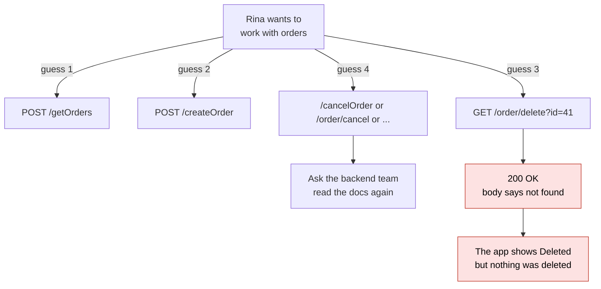
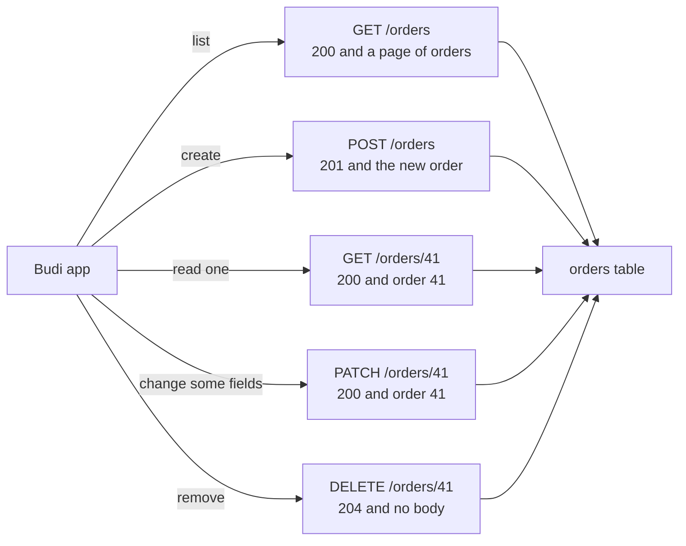
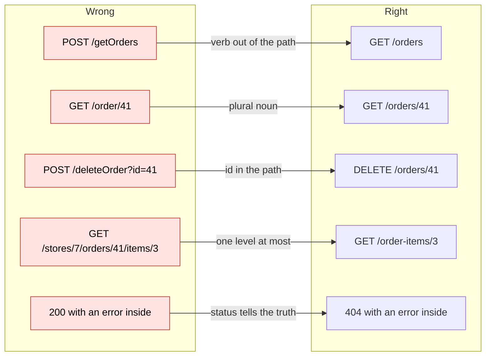
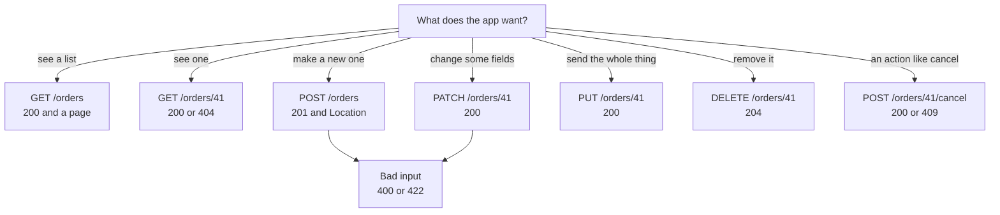
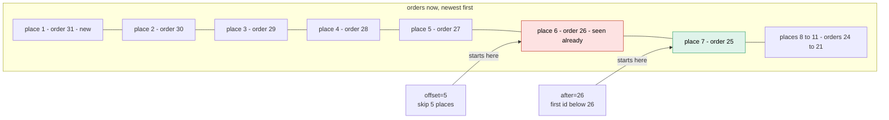
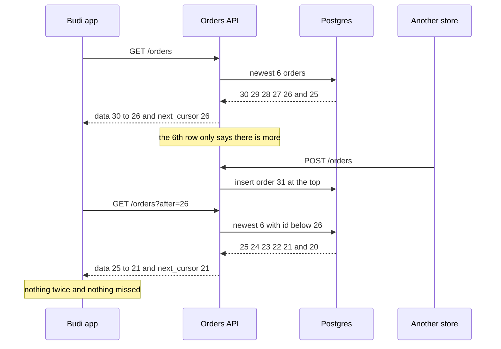
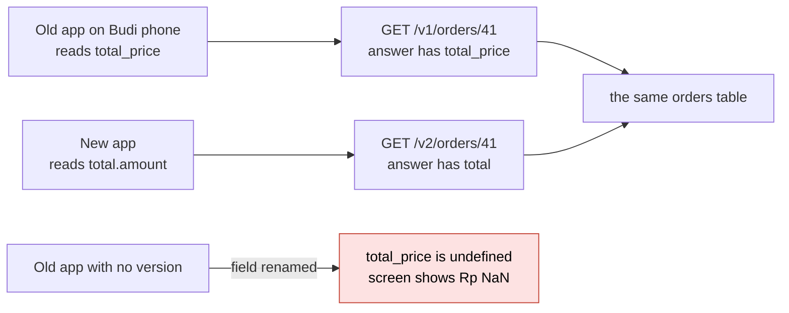

# 02. REST API design

> **Subject:** Backend and API · **Lesson:** 02 · **Made:** 2026-10-22 · **Remade in short cards:** 2026-10-29 · **Status:** ready
>
> **You will be able to:** name the method, path and status for any action on a resource, and explain why cursor paging does not show an order twice when offset paging does.
>
> **Before this:** [HTTP basics](01-http-basics.md) · **Next:** [Express middleware](03-express-middleware.md)
>
> **How to read it:** one card is one idea. Look at the picture, guess, then press the orange bar to check. The blue bars (📖 More detail) hold the longer explanation. Skip them on the first read, and open them when you want more. About 15 minutes for the cards.

## 1. The idea: street addresses

A street address looks the same in every town: "Orders Street, number 41". What you do there is the verb. REST does the same. The path is a **noun** (`/orders`, `/orders/41`). The HTTP method is the **verb**.

| The app wants to | Method and path | Success |
|---|---|---|
| see the list | `GET /orders` | `200` |
| see one | `GET /orders/41` | `200` |
| make a new one | `POST /orders` | `201` |
| change some fields | `PATCH /orders/41` | `200` |
| remove it | `DELETE /orders/41` | `204` |

<details class="guess"><summary>🤔 Guess: the app wants to remove order 41. Which method, which path and which success status? Press to check.</summary>

`DELETE /orders/41`, and the server answers `204` with no body. The word "delete" is the method, so it never goes in the path.

</details>

> **Remember:** nouns in the path. The method is the verb.

<details class="more"><summary>📖 More detail: the problem, four new words, and the full picture</summary>

**Why you need it.**

- Rina builds the React Native app. She calls `POST /getOrders`, `POST /createOrder`, `GET /order/delete?id=41`.
- Now she must cancel an order. `/cancelOrder`? `/order/cancel`? She has to ask.
- Worse: a missing order comes back as `200 OK` with `{ "error": "not found" }`. Her `if (res.ok)` says it worked.

REST is a set of habits that fixes this, using the methods and status codes from [lesson 01](01-http-basics.md).

**Four new words.**

- **Resource:** one kind of thing your API keeps, named by a plural noun. `/orders` is the list, `/orders/41` is one order. (Interview words: resource, collection.)
- **Paging:** sending a long list in small pieces. The simple kind says how many rows to skip. (Interview words: pagination, offset.)
- **Cursor:** a bookmark, the id of the last item the app saw. The next page starts after it. (Interview words: cursor or keyset pagination.)
- **Version:** a name like `v1` for one shape of your answers. Old apps keep the old shape. (Interview word: API versioning.)

**The problem, drawn.** Every call is its own guess, and even the error says 200.



**The big picture.** One noun, `orders`, and five verbs.



**The table to know.**

| What the app wants | Method and path | Success answer |
|---|---|---|
| See the list | `GET /orders` | `200` and one page |
| See one | `GET /orders/41` | `200` |
| Make a new one | `POST /orders` | `201`, plus a `Location: /orders/42` header that says where it lives |
| Replace all of it | `PUT /orders/41` | `200` |
| Change some fields | `PATCH /orders/41` | `200` |
| Remove it | `DELETE /orders/41` | `204`, no body |

**Where the street picture stops.**

**Names:** street addresses. "Orders Street, number 41" follows the same pattern in every town. The method is what you do there.

</details>

## 2. URL habits: right against wrong

Every fix moves the verb out of the path.

| Wrong | Right | The habit |
|---|---|---|
| `POST /getOrders` | `GET /orders` | verb out of the path |
| `GET /order/41` | `GET /orders/41` | plural noun |
| `POST /deleteOrder?id=41` | `DELETE /orders/41` | id in the path |
| `GET /stores/7/orders/41/items/3` | `GET /order-items/3` | one level at most |

<details class="guess"><summary>🤔 Guess: where does the filter "only paid orders" go? Press to check.</summary>

In the query string: `/orders?status=paid`. The path names the thing. The query string narrows it down.

</details>

> **Remember:** plural nouns, lowercase, the id in the path, one level of nesting at most.

<details class="more"><summary>📖 More detail: the habits, the picture, and the mistake in code</summary>

The URL habits:

- Plural nouns, lowercase: `/orders`, `/order-items`.
- The id goes in the path: `/orders/41`.
- Nest one level at most: `/stores/7/orders`.
- Filters go in the query string: `/orders?status=paid`.

**Right against wrong, drawn.**

Notice that every fix moves the verb out of the path and into the method.



**The mistake in code.**

**Wrong:** verbs in the path, and every call a `POST`.

```js
// sketch, not run here
app.post("/getOrders", listOrders);
app.post("/deleteOrder", deleteOrder);              // the id is somewhere in the body
```

**Right:**

```js
// sketch, not run here
app.get("/orders", listOrders);
app.delete("/orders/:id", deleteOrder);             // the id is in the path
```

**Why:** the method already is the verb. Caches, retries and logs all read the method.

</details>

## 3. Status codes tell the truth

An error must not hide inside a `200`. When it fails, pick the status from what went wrong.

| What went wrong | Status |
|---|---|
| Order 41 is not there | `404` |
| The body is not valid JSON | `400` |
| The JSON is fine but breaks a rule, like quantity `-3` | `422` |
| It clashes with the current state, like cancelling a shipped order | `409` |

<details class="guess"><summary>🤔 Guess: the app sends `{"quantity": -3}`. The JSON is valid. Which status? Press to check.</summary>

`422`. The server can read it, but it breaks a rule. Some teams use `400` here. Pick one and keep it everywhere.

</details>

> **Remember:** `res.ok`, retries and alerts all read the status, not your body.

<details class="more"><summary>📖 More detail: which method and status, and the mistake in code</summary>

**Which method and status?** The first question is "what does the app want?", not "which method do I like?".



**When it fails.**

| What went wrong | Status |
|---|---|
| Order 41 is not there | `404` |
| The body is not valid JSON | `400` |
| The JSON is fine but breaks a rule, like quantity `-3` | `422` (some teams use `400`; pick one and keep it) |
| It clashes with the order's current state, like cancelling a shipped order | `409` |

**The mistake in code.**

**Wrong:** `200` for everything.

```js
// sketch, not run here
if (!order) return res.status(200).json({ error: "not found" });
```

**Right:**

```js
// sketch, not run here
if (!order) return res.status(404).json({ error: "order 41 not found" });
```

**Why:** `res.ok`, retries and alerts all read the status, not your body.

</details>

## 4. Actions that do not fit: cancel, pay, ship

Not every action is a noun. "Cancel order 41" does more than change one field: it refunds money and sends an email. There are two common ways.

| Way | Example | Good | Bad |
|---|---|---|---|
| An action path | `POST /orders/41/cancel` | one place for the rules, the refund and the email | a verb in the path |
| Change a field | `PATCH /orders/41` with `{ "status": "cancelled" }` | pure nouns | the server must spot the change and run the same rules |

<details class="guess"><summary>🤔 Guess: which way do you pick for "cancel"? And for "change the delivery note"? Press to check.</summary>

Cancel: the **action path**, because it does more than change one field. Delivery note: **`PATCH`**, because it is a plain edit.

</details>

> **Remember:** an action path when the action does more than change one field. `PATCH` for a plain edit.

<details class="more"><summary>📖 More detail: the verdict as it was written</summary>

Cancel, pay, ship. Two common ways:

Verdict: an action path when the action does more than change one field. `PATCH` for a plain edit.

</details>

## 5. Paging: offset or cursor?

Budi scrolls his order history. Orders 30 to 26 are on page 1. Then a new order, 31, arrives. What does page 2 show?

| Page 2 asks | Rows back | Budi sees |
|---|---|---|
| `?limit=5&offset=5` | 26, 25, 24, 23, 22 | order 26 **twice** |
| `?limit=5&after=26` | 25, 24, 23, 22, 21 | each order once |

Offset counts **places**. A new row moves every place. A cursor remembers an **id**, and ids do not move.

<details class="guess"><summary>🤔 Guess: why is order 26 on page 2 with offset? Press to check.</summary>

Order 31 took place 1, so everything moved down by one. Place 6 is now order 26. A cursor says "ids below 26", so it does not care where rows moved.

</details>

> **Remember:** offset counts places. A cursor remembers an id.

<details class="more"><summary>📖 More detail: the notice board, the table and the story over time</summary>

**The notice board.**

**Paging:** a notice board with the newest note pinned on top.

- Offset: "I read 5 notes, so next time I skip 5." A new note on top means the 5th is one I read already.
- Cursor: "I stopped at Dewi's note. Next time I start after Dewi." A new note does not move Dewi's note.

Where it stops being true: a cursor needs a clear order with no ties, like the id. And a bookmark cannot jump to "page 9".

**What is in the table right now.**

Order 31 is new. Budi already saw orders 30 to 26. Notice where each page 2 starts.



**What page 2 asks, and what Postgres runs.**

| Page 2 asks | Postgres runs | Rows back | Budi sees |
|---|---|---|---|
| `?limit=5&offset=5` | `ORDER BY id DESC LIMIT 5 OFFSET 5` | 26, 25, 24, 23, 22 | order 26 twice |
| `?limit=5&after=26` | `WHERE id < 26 ORDER BY id DESC LIMIT 6` | 25, 24, 23, 22, 21 (and 20 as a peek) | each order once |

Offset counts places. A new row moves every place. A cursor remembers an id, and ids do not move.

**How paging works over time.**

Notice that page 2 carries the bookmark `26`. A new order arrives in the middle, and nothing goes wrong. A page is 5 orders here to keep it small.



</details>

## 6. The smallest code that shows it

Ten orders, newest first. Two ways to take page 2 after a new order arrives.

```js
let o = [30, 29, 28, 27, 26, 25, 24, 23, 22, 21];
const off = (i, n) => o.slice(i, i + n);
const cur = (a, n) =>
  o.filter((id) => id < a).slice(0, n);
const c1 = cur(Infinity, 5);  // 30 to 26
o = [31, ...o];               // a new order
console.log("offset:", off(5, 5));
console.log("cursor:", cur(c1.at(-1), 5));
```

<details class="guess"><summary>🤔 Guess: what do the two lines print? Press to check.</summary>

```
offset: [ 26, 25, 24, 23, 22 ]
cursor: [ 25, 24, 23, 22, 21 ]
```

`slice` plays `LIMIT 5 OFFSET 5`. `filter((id) => id < a)` plays `WHERE id < 26`.

</details>

> **Remember:** a cursor page starts after an id, so a new row at the top changes nothing.

<details class="more"><summary>📖 More detail: the longer program, and every request and SQL step</summary>

**The longer program.**

```js
let orders = [30, 29, 28, 27, 26, 25, 24, 23, 22, 21];        // newest first
const byOffset = (offset, limit) => orders.slice(offset, offset + limit);
const byCursor = (after, limit) => orders.filter((id) => id < after).slice(0, limit);

const offPage1 = byOffset(0, 5);                               // page 1, skip 0
const curPage1 = byCursor(Infinity, 5);                        // page 1, no bookmark yet
orders = [31, ...orders];                                      // a new order arrives at the top
const offPage2 = byOffset(5, 5);                               // page 2, skip 5
const curPage2 = byCursor(curPage1.at(-1), 5);                 // page 2, after the last id we saw

console.log("offset:", offPage1, offPage2);
console.log("cursor:", curPage1, curPage2);
```

**Output:**

```
offset: [ 30, 29, 28, 27, 26 ] [ 26, 25, 24, 23, 22 ]
cursor: [ 30, 29, 28, 27, 26 ] [ 25, 24, 23, 22, 21 ]
```

Checked on 2026-10-22 with Node 24.

`orders.slice` plays `LIMIT 5 OFFSET 5`. `filter((id) => id < after)` plays `WHERE id < 26`.

**Budi scrolls his order history. Cursor paging, page size 5.**

| Step | What happens | Request | SQL the server runs | Rows back | Answer to the app |
|---|---|---|---|---|---|
| 1 | Budi opens order history | `GET /orders?limit=5` | `SELECT * FROM orders ORDER BY id DESC LIMIT 6` | 30, 29, 28, 27, 26, 25 | `data` 30 to 26, `next_cursor: "26"`, `has_more: true` |
| 2 | Another store orders | `POST /orders` | `INSERT INTO orders ...` gives id 31 | none | to that store: `201`, `Location: /orders/31` |
| 3 | Budi scrolls down | `GET /orders?limit=5&after=26` | `... WHERE id < 26 ORDER BY id DESC LIMIT 6` | 25, 24, 23, 22, 21, 20 | `data` 25 to 21, `next_cursor: "21"`, `has_more: true` |
| 4 | Budi keeps going, near the end | `GET /orders?limit=5&after=6` | `... WHERE id < 6 ORDER BY id DESC LIMIT 6` | 5, 4, 3, 2, 1 | `data` 5 to 1, `next_cursor: null`, `has_more: false` |
| 5 | The app reads `has_more: false` | no request | none | none | the app shows "No more orders" |
| 6 | Budi pulls to refresh | `GET /orders?limit=5` | same as step 1 | 31, 30, 29, 28, 27, 26 | `data` 31 to 27: the new order is on top |

**The same story with offset.**

| Step | Request | SQL | Rows back | Budi sees |
|---|---|---|---|---|
| 1 | `GET /orders?limit=5&offset=0` | `ORDER BY id DESC LIMIT 5 OFFSET 0` | 30 to 26 | 30 to 26 |
| 2 | order 31 arrives | `INSERT` | none | nothing changes yet |
| 3 | `GET /orders?limit=5&offset=5` | `ORDER BY id DESC LIMIT 5 OFFSET 5` | 26, 25, 24, 23, 22 | **26 twice** |

**What to see.**

What to see:

- Step 1: the server asks for 6 rows but sends 5. The 6th only says "there is more".
- Step 3: `WHERE id < 26` does not care where rows moved.
- Offset step 3: Postgres counts places, not ids. It also reads the skipped rows, so deep pages are slow.

**Step through it yourself:** [open the stepper](visuals/02-rest-api-design.html). Story 3 shows the other offset bug.

</details>

## 7. Which one do I pick?

Use the table. The verdict is short: cursor for anything a user scrolls. Offset is fine for a small admin table.

| | Offset | Cursor |
|---|---|---|
| Jump to page 9 | yes | no, only next |
| Deep pages | slower every page | the same speed |
| A new row while scrolling | shows a row twice | fine |
| Good for | admin tables with page numbers | feeds, order history |

<details class="guess"><summary>🤔 Guess: an admin table needs a "page 9" button. Offset or cursor? Press to check.</summary>

Offset. A cursor only knows "next", so it cannot jump to page 9.

</details>

> **Remember:** cursor for things people scroll. Offset when people need page numbers.

<details class="more"><summary>📖 More detail: the full comparison</summary>

| | Offset: `?page=3&limit=20` | Cursor: `?after=26&limit=20` |
|---|---|---|
| Jump to page 9 | yes | no, only next |
| Deep pages | slower every page | the same speed every page |
| A new row while scrolling | shows a row twice | fine |
| A row leaves while scrolling | skips a row | fine |
| Good for | admin tables with page numbers | feeds, infinite scroll, order history |

Verdict: cursor for anything a user scrolls. Offset is fine for a small admin table.

</details>

## 8. Mistake 1: a bare array with no limit

A route that returns every row, as a bare array, breaks in two ways. One `?limit=100000` can tire out the database. And a bare array cannot grow a `next_cursor` later.

Always answer with an object, and cap the limit:

```json
{ "data": [{ "id": 30 }, { "id": 29 }],
  "next_cursor": "29",
  "has_more": true }
```

<details class="guess"><summary>🤔 Guess: the server asks for `limit + 1` rows but sends only `limit`. Why? Press to check.</summary>

The extra row only answers "is there more?". If it exists, `has_more` is true. If not, `has_more` is false and `next_cursor` is `null`.

</details>

> **Remember:** cap the limit, ask for one extra row, answer with an object.

<details class="more"><summary>📖 More detail: the wrong code and the right code (a sketch)</summary>

**Wrong:** a bare array with no limit.

```js
// sketch, not run here
app.get("/orders", async (req, res) => res.json(await prisma.order.findMany()));   // every row, forever
```

**Right:** cap the limit, ask for one extra row, answer with an object.

```js
// sketch, not run here
app.get("/orders", async (req, res) => {
  const limit = Math.min(Number(req.query.limit) || 20, 100);          // never more than 100
  const after = req.query.after ? Number(req.query.after) : null;
  const rows = await prisma.order.findMany({
    where: { storeId: req.user.storeId, ...(after ? { id: { lt: after } } : {}) },
    orderBy: { id: "desc" },
    take: limit + 1,                                                    // one extra: is there more?
  });
  const has_more = rows.length > limit;
  const data = rows.slice(0, limit);
  res.json({ data, next_cursor: has_more ? String(data.at(-1).id) : null, has_more });
});
```

**Why:** one `?limit=100000` can tire out the database, and a bare array cannot grow a `next_cursor`.

Always answer with an object, never a bare array, so you can add fields later:

```json
{ "data": [{ "id": 30, "status": "paid" }, { "id": 29, "status": "shipped" }], "next_cursor": "29", "has_more": true }
```

</details>

## 9. Mistake 2: renaming a field and shipping

Old app builds stay on phones for months. If you rename `total_price` to `totalPrice`, last month's app reads `undefined` and shows "Rp NaN".

| Change | Needs a new version? |
|---|---|
| add a field or an endpoint | no, old apps ignore it |
| remove a field, rename it, or change its type | **yes** (a breaking change) |

<details class="guess"><summary>🤔 Guess: where does the version go: in the path, or in a header? Press to check.</summary>

Both work. In the path (`/v1/orders/41`) it is easy to see and to try in a browser. In a header (`Api-Version`) the URL stays the same, but it is easier to forget.

</details>

> **Remember:** add fields freely. Remove or rename only in a new version.

<details class="more"><summary>📖 More detail: the versions picture, the table and the rule</summary>

**Old apps keep working.** You cannot force everyone to update.



**Where the version goes.**

Old app builds stay on phones for months.

| Where the version goes | Example | Good | Bad |
|---|---|---|---|
| In the path | `GET /v1/orders/41` | easy to see and to try in a browser | the URL changes for the same order |
| In a header | `Api-Version: 2024-06-01` | one URL for one order | easy to forget, harder to try by hand |

**The rule.**

The rule:

- **Safe without a new version:** add a field or an endpoint. Old apps ignore what they do not know.
- **Needs a new version:** remove a field, rename it, or change its type. That is a breaking change.

**The mistake in one line.**

**Wrong:** rename `total_price` to `totalPrice` and ship. **Right:** add the new field and keep the old one, or make `/v2`. **Why:** last month's app still reads `total_price`.

</details>

## 10. Why it matters and what it costs

- **Without it:** every endpoint is a guess, errors hide inside `200`, and big lists are slow or wrong.
- **With it:** nouns, methods, honest status codes, and pages with a bookmark.
- **The cost:** some actions do not fit. Cursors cannot jump to page 9. Old versions are old code to keep.

<details class="more"><summary>📖 More detail: safe to repeat, and if you freeze in the interview</summary>

**Safe to repeat.**

`GET`, `PUT` and `DELETE` are safe to repeat. `POST` is not: two taps can make two orders. Give create `POST`s an `Idempotency-Key` header, as in [system design lesson 13](../system-design/13-idempotency-and-retries.md).

**If you freeze.**

**If you freeze:**

1. "Nouns in the path, the method is the verb, the status tells the truth."
2. "Lists come in pages: `{ data, next_cursor, has_more }`, with a cap on the limit."
3. "Add fields freely. Remove or rename only in a new version."

</details>

## 11. Watch and play

All links checked on 2026-10-22.

- **Video:** [What Is REST API? Examples And How To Use It](https://www.youtube.com/watch?v=-mN3VyJuCjM) ByteByteGo, 5 min.
- **Video:** [API Pagination: Making Billions of Products Scrolling Possible](https://www.youtube.com/watch?v=14K_a2kKTxU) ByteByteGo, 3 min.
- **Play with it:** [the stepper in this folder](visuals/02-rest-api-design.html) - guess first, then press Next.
- **Play with it:** [JSONPlaceholder](https://jsonplaceholder.typicode.com/) - a fake REST API. Try `/posts/1/comments` and `/posts?_page=2&_limit=3`.
- **Play with it:** [GitHub issues, page 2](https://api.github.com/repos/nodejs/node/issues?per_page=2&page=2) - find `rel="next"` in the `link` header.
- **Read:** [Microsoft: Web API design best practices](https://learn.microsoft.com/en-us/azure/architecture/best-practices/api-design).
- **Read:** [Stripe: Pagination](https://docs.stripe.com/api/pagination) - a real cursor API.

<details><summary>Go deeper (optional)</summary>

**Stripe as a model.** From [Stripe: Pagination](https://docs.stripe.com/api/pagination): list endpoints return `{ "object": "list", "url": ..., "has_more": ..., "data": [...] }`, newest first. `starting_after` is "an object ID that defines your place in the list", and `ending_before` goes the other way. `limit` is 1 to 100, and the default is 10. Stripe puts `/v1/` in the path and also uses a date-named version in the `Stripe-Version` header, like `2026-09-30.endive`. Without the header, your account's default version is used ([Stripe: Versioning](https://docs.stripe.com/api/versioning), [Stripe: Upgrades](https://docs.stripe.com/upgrades)).

**GitHub as a model.** From [GitHub: Using pagination in the REST API](https://docs.github.com/en/rest/using-the-rest-api/using-pagination-in-the-rest-api): the next page's URL comes in a `link` header with `rel="next"`, `"prev"`, `"first"` and `"last"`. You choose `per_page` (most endpoints allow up to 100) and `page`. Some endpoints use `before` and `after` cursors instead. On 2026-10-22, even `?per_page=2&page=2` on nodejs/node issues answered with a next link carrying `after=Y3Vyc29yOnYy...`, which is base64 for `cursor:v2:...`. Versions go in the `X-GitHub-Api-Version` header, like `2022-11-28` or `2026-03-10`. With no header you get `2022-11-28`, and old versions are kept for at least 24 months ([GitHub: API versions](https://docs.github.com/en/rest/about-the-rest-api/api-versions)).

**Make the cursor a closed box.** Send `"next_cursor": "MjY"` instead of `26`. The app must pass it back without reading it. Then you can change what is inside later, for example to `created_at` plus `id`, without breaking apps. Base64 of a small JSON object is the usual trick. It is not a secret: anyone can decode it, so still check the user may see those rows.

**Sorting by time, not id.** If you sort by `created_at`, two orders can have the same time. Then `WHERE created_at < $1` skips the twin. Use both: `WHERE (created_at, id) < ($1, $2) ORDER BY created_at DESC, id DESC`, with an index on those two columns. See [Advanced SQL workbook, Exercise 19](../database/advanced-sql-workbook.md#exercise-19-keyset-pagination) and [the keyset section](../database/postgresql-queries-interview-guide.md#keyset-pagination-vs-offset) of the queries guide.

**Total counts cost money.** "Page 3 of 1,204" needs `COUNT(*)`, which reads the whole matching set on every request. Feeds skip it and only say `has_more`.

**Too big a limit.** Microsoft's guide says a server can either cut the limit down to its maximum or answer `400`. This lesson's practice cuts it down. Say which one in your docs.

**PUT against PATCH.** `PUT` sends the whole order, and the server makes it look exactly like that. So sending it twice is harmless. `PATCH` sends only the changed fields. The HTTP rules do not promise that `PATCH` is safe to repeat, because a patch can say "add 1".

**The same ideas in GraphQL.** GraphQL has one URL, so names live in the schema instead. Lists often use the Relay "connection" shape: `orders(first: 20, after: "...")` returns `edges` and `pageInfo { hasNextPage endCursor }`. That is cursor paging with other names. GraphQL usually skips `/v2`: you add fields, and mark old ones with `@deprecated`.

**Checked on:** 2026-10-22.

</details>

## 12. Practice

**A. Predict the output** (write your answer before opening)

Order 28 is cancelled between page 1 and page 2, and the list hides cancelled orders.

```js
let orders = [30, 29, 28, 27, 26, 25, 24, 23, 22, 21];
const page1 = orders.slice(0, 5);                              // offset 0, limit 5
orders = orders.filter((id) => id !== 28);                     // order 28 leaves the list
const page2 = orders.slice(5, 10);                             // offset 5, limit 5
console.log("page 1:", page1);
console.log("page 2:", page2);
console.log("never shown:", orders.filter((id) => !page1.includes(id) && !page2.includes(id)));
```

Then: what would page 2 be with `after=26`?

<details><summary>Answer</summary>

```
page 1: [ 30, 29, 28, 27, 26 ]
page 2: [ 24, 23, 22, 21 ]
never shown: [ 25 ]
```

Order 28 left, so every row below it moved up one place. Order 25 slid into place 5, which offset 5 skips. Nothing looks wrong on screen, so nobody notices.

With `after=26`, page 2 is `25, 24, 23, 22, 21`. The bookmark does not care that 28 left. (Checked on 2026-10-22 with Node 24.)

</details>

**B. Fix the bug**

Run it in your head first. Which order shows twice, and why?

```js
const orders = [30, 29, 28, 27, 26, 25, 24, 23, 22, 21];
function listOrders({ after = Infinity, limit = 5 } = {}) {
  const data = orders.filter((id) => id <= after).slice(0, limit);
  return { data, next_cursor: data.at(-1) };
}
const p1 = listOrders();
const p2 = listOrders({ after: p1.next_cursor });
console.log(p1.data, p2.data);
```

<details><summary>Answer</summary>

It prints:

```
[ 30, 29, 28, 27, 26 ] [ 26, 25, 24, 23, 22 ]
```

The cursor is the last order the app already has. `<=` asks for it again. Use `<`: "strictly after the bookmark".

```js
const data = orders.filter((id) => id < after).slice(0, limit);
```

It now prints:

```
[ 30, 29, 28, 27, 26 ] [ 25, 24, 23, 22, 21 ]
```

(Both checked on 2026-10-22 with Node 24.) A real version also caps `limit` and returns `has_more`, as in Part 1 below.

</details>

**C. Write it yourself**

Open `learn/backend-api/practice/02-rest-api-design.js`. Part 1 is cursor paging, Part 2 is the table from 2a, Part 3 is the version rule. The top comment lists every rule. Then run:

```
node --test learn/backend-api/practice/02-rest-api-design.test.js
```

<details><summary>One possible answer</summary>

Replace the three functions and `module.exports` under the comment with this:

```js
function cursorPage(items, { after, limit = 20, maxLimit = 100 } = {}) {
  if (limit < 1) throw new RangeError("limit must be 1 or more");
  const size = Math.min(limit, maxLimit);                   // never more than maxLimit
  const start = after == null ? 0 : items.findIndex((item) => item.id < after);
  if (start === -1) return { data: [], next_cursor: null, has_more: false };
  const data = items.slice(start, start + size);            // slice makes a copy
  const has_more = start + size < items.length;
  return { data, next_cursor: has_more ? data[data.length - 1].id : null, has_more };
}

function routeFor({ action, resource, id, parent }) {
  if (!resource.endsWith("s")) throw new Error("use a plural noun: " + resource + "s");
  if (action === "list" || action === "create") {
    const path = (parent ? "/" + parent.resource + "/" + parent.id : "") + "/" + resource;
    return action === "list" ? { method: "GET", path, status: 200 } : { method: "POST", path, status: 201 };
  }
  if (id == null) throw new Error(action + " needs an id");
  const path = "/" + resource + "/" + id;                    // one item: its own short path
  const table = {
    read: ["GET", 200], replace: ["PUT", 200], update: ["PATCH", 200], delete: ["DELETE", 204],
  };
  if (table[action]) return { method: table[action][0], path, status: table[action][1] };
  return { method: "POST", path: path + "/" + action, status: 200 };   // cancel, pay, ...
}

function isBreakingChange(oldFields, newFields) {
  return oldFields.some((field) => !newFields.includes(field));
}

module.exports = { cursorPage, routeFor, isBreakingChange };
```

Checked on 2026-10-22 with Node 24.15.0: the 22 tests fail on the empty stub and all 22 pass with this answer. `findIndex` finds the first item below the bookmark, so it still works when the bookmark order itself has left the list.

</details>

## 13. Interview question

**Q:** "Design the REST endpoints for a shop's orders. How do you page the order history, and how do you change the API later without breaking old mobile apps?"

A common follow-up: "Why not `?page=3`?" Use picture 2d.

<details><summary>A strong answer, in four parts</summary>

1. **Problem:** clients must guess URLs, read errors, and scroll long lists. Without habits, every endpoint is a new guess. Without paging, one request can return a million rows. Mobile apps stay old for months, so a renamed field breaks real users.
2. **How it works:** one resource, `orders`. `GET /orders` lists, `POST /orders` creates with `201` and a `Location` header, `GET`, `PATCH` and `DELETE /orders/41` work on one. A store's orders are `/stores/7/orders`, one level deep. Filters go in the query string. Cancel is `POST /orders/41/cancel`, because it refunds and notifies, and answers `409` if the order already shipped. The list answers `{ data, next_cursor, has_more }`. The server runs `WHERE id < $cursor ORDER BY id DESC LIMIT n + 1`, with the limit capped at 100. For changes I only add fields. A remove or rename goes into `/v2`, and `/v1` keeps running until old apps are gone. Create `POST`s take an `Idempotency-Key`, so a retry cannot make two orders.
3. **Tradeoff:** a cursor cannot jump to page 9, so admin screens with page numbers may still use offset on small tables. A cursor on `created_at` needs `id` as a tie-break. Old versions mean old code to keep and test.
4. **My example:**
   - **Fact:** in DBO, the React Native app and the CMS talk to one GraphQL API, built with Nexus and Prisma. So the client API was not REST.
   - **Fact:** TADA, for points, and Manager, the order backend, send webhooks to DBO's API service as plain HTTP `POST` requests. Order history and shipping status in DBO come from Manager's webhooks.
   - **Idea, not a fact:** if order history were a REST endpoint, I would use cursor paging. New orders arrive while a store owner scrolls, so offset would show orders twice.
   - **Idea, not a fact:** GraphQL handles old apps by adding fields and marking old ones `@deprecated`, which is the same "add, never remove" rule.

</details>

## 14. Explain it back

Close this file. Explain REST API design out loud in 4 parts (problem, how, tradeoff, my example). Use Rina's guessing game and Budi's order 26. Write it below, then run `/explain-check REST API design`.

### My explanation

<write here>

### Coach feedback

<the explain-coach agent writes here>

## 15. Review questions (day 1, 3, 7, 21)

1. Give the method, path and success status for: make a new order, change one field of order 41, remove order 41.
2. Why can offset paging show the same order twice, and why does a cursor not?
3. Which changes can ship without a new version, and which need one?
4. Draw picture 2d from memory: the table after order 31 arrives, and where `offset=5` and `after=26` start.

<details><summary>Answers</summary>

1. `POST /orders`, `201` with a `Location` header. `PATCH /orders/41`, `200`. `DELETE /orders/41`, `204` with no body.
2. Offset counts places. A new row on top pushes every row down one place, so the last row of page 1 becomes the first row of page 2. A cursor asks for ids below the last one seen, and ids do not move.
3. Adding a field or an endpoint is safe, because old apps ignore what they do not know. Removing, renaming or changing the type of a field needs a new version.
4. Order 31 in place 1, then 30 to 27, then 26 in place 6. `offset=5` starts at place 6, which is order 26, already seen. `after=26` starts at order 25.

</details>

## Connected lessons

- [HTTP basics](01-http-basics.md) - before this.
- [Express middleware](03-express-middleware.md) - next.
- [Idempotency and retries](../system-design/13-idempotency-and-retries.md) - the `Idempotency-Key`.
- [Advanced SQL workbook, Exercise 19](../database/advanced-sql-workbook.md#exercise-19-keyset-pagination) - cursor paging in SQL.
- [PostgreSQL queries guide: keyset against OFFSET](../database/postgresql-queries-interview-guide.md#keyset-pagination-vs-offset) - why deep pages are slow.
- [Express, GraphQL and Prisma with real auth](express-graphql-auth-tutorial.md) - the same stack with GraphQL.
- [DBO case study](../../interview/my-projects/dbo-b2b-platform-system-design-case-study.md) - the GraphQL API and the webhooks.
