# 03. Express middleware

> **Subject:** Backend and API · **Lesson:** 03 · **Made:** 2026-10-22 · **Remade in short cards:** 2026-10-29 · **Status:** ready
>
> **You will be able to:** walk one request through an Express app, say what `next()` does, and explain how one error middleware catches errors from every route.
>
> **Before this:** [REST API design](02-rest-api-design.md) · **Next:** [GraphQL basics](04-graphql-basics.md)
>
> **How to read it:** one card is one idea. Look at the picture, guess, then press the orange bar to check. The blue bars (📖 More detail) hold the longer explanation. Skip them on the first read, and open them when you want more. About 15 minutes for the cards.

## 1. The idea: an airport line

At an airport you walk a line: check-in, bag scan, passport desk, gate. Each desk does one job and waves you on. Express is the same. Every request walks a **line of small functions**, in the order you added them. Each function either passes the request on, or sends the answer.

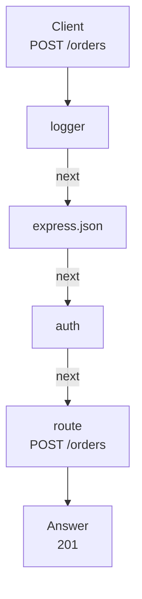

<details class="guess"><summary>🤔 Guess: a teammate adds route 31, `DELETE /orders/:id`, below the `auth` function. Does the route need its own token check? Press to check.</summary>

No. Every request walks the line from the top, so route 31 is already behind `auth`. That is the point: write each job once, and a new route cannot forget it.

</details>

> **Remember:** a request walks the line from the top, in the order you added the functions.

<details class="more"><summary>📖 More detail: the problem, four new words, and the full picture</summary>

**Why you need it.**

- Your shop API has 30 routes. Each needs the same jobs: log, read the body, check the token, catch errors.
- So you copy those jobs into all 30 routes.
- A teammate adds route 31, `DELETE /orders/:id`, and forgets the token check. Anyone can delete orders.
- The fix: write each job once and put it in a line that every request walks.

**Four new words.**

- **Middleware:** a function that runs before your route, does one job, then passes the request on. (Interview word: middleware.)
- **The line:** all your middleware and routes, in the order you added them. Each request walks it from the top. (Interview words: middleware pipeline, or middleware chain.)
- **next:** a function Express gives you. Calling it means "I am done, run the next one". (Interview word: `next()`.)
- **Error middleware:** a middleware with four parameters, `(err, req, res, next)`. It only runs when something failed. (Interview word: error-handling middleware.)

In Express, `req` is the request as an object, and `res` is how you send the answer ([HTTP basics](01-http-basics.md)). This lesson is what happens between them.

**The problem, drawn.** Every route carries its own copy of the checks. Route 31 forgot one.

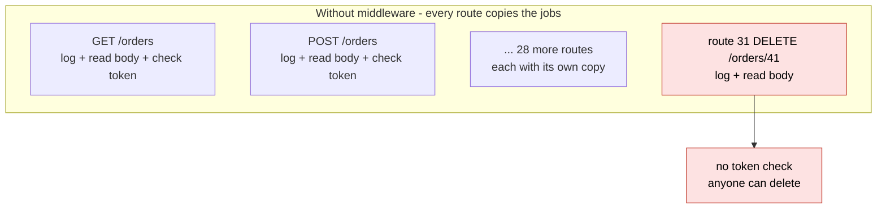

**The big picture.** A normal request walks the top row, and an error jumps straight to the end.

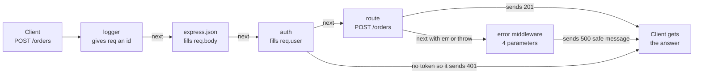

**Where the airport picture stops.**

Where it stops being true: in an airport you can see the line. In Express, the order is only the order of your code, and nothing warns you when it is wrong.

</details>

## 2. How a middleware can end

A middleware has one job to finish: **call `next()`, or send an answer**. Pick one.

| It does | Result | Allowed? |
|---|---|---|
| calls `next()` | the next function runs | yes |
| sends an answer, and returns | the line stops, the client has its answer | yes |
| calls `next(err)`, or throws | jumps to the error middleware | yes |
| does neither | the request hangs | **bug** |
| sends **and** calls `next()` | "Cannot set headers" error | **bug** |

<details class="guess"><summary>🤔 Guess: a logger prints a line, but never calls `next()` and never sends. What happens to the request? Press to check.</summary>

It hangs until the client gives up. Express waits for `next()` or a send. Neither comes, and **no error is printed**.

</details>

> **Remember:** every middleware calls `next()` or sends. Never neither, never both.

<details class="more"><summary>📖 More detail: the picture, the airport desks, and the mistake in code</summary>

**How a middleware can end, drawn.** Only the first three are allowed.

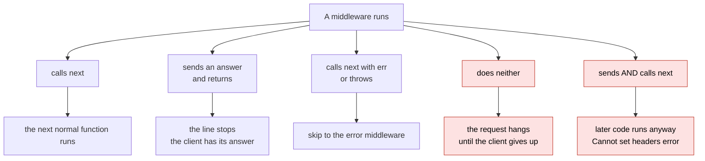

**The airport again.**

- You walk from check-in, to the bag scan, to the passport desk, to the gate. Each desk does one job.
- A desk writes on your boarding pass and waves you on. That is `next()`.
- The passport desk can send you home before the gate. That is a 401.
- If something breaks, staff walk you to the help desk at the end. That is the error middleware.
- If an officer walks away without waving you on, you stand there forever. That is a hang.

**Mistake: forget `next()`.**

**Wrong:** forget `next()`.

```js
app.use((req, res, next) => {
  console.log(req.method, req.path);                   // no next(), no send
});
```

**Right:** `console.log(...); next();`

**Why:** Express waits for `next()` or a send. Neither comes, so the request hangs, and no error is printed.

</details>

## 3. `req` is one shared object

`req` is one object. Every function in the line gets the **same one**. That is how `auth` "talks" to the route: it puts `req.user` on it, and the route reads it.

| Field | Who put it there | Before that function ran |
|---|---|---|
| `req.method`, `req.path` | Express, from the HTTP text | (always there) |
| `req.id` | logger | `undefined` |
| `req.body` | `express.json()` | `undefined` |
| `req.user` | auth | `undefined` |

<details class="guess"><summary>🤔 Guess: the route reads `req.user.id`. Who put `user` on `req`: the route, or a function before it? Press to check.</summary>

A function before it: `auth`. The route did none of this work. It only reads what three functions before it filled in.

</details>

> **Remember:** each function adds one thing to the same `req`. The route only reads.

<details class="more"><summary>📖 More detail: what is on `req`, and the request over time</summary>

**What is on `req` right now.**

The moment the route starts, for the good request. Notice that the route did none of this work. Three functions before it filled `req`.

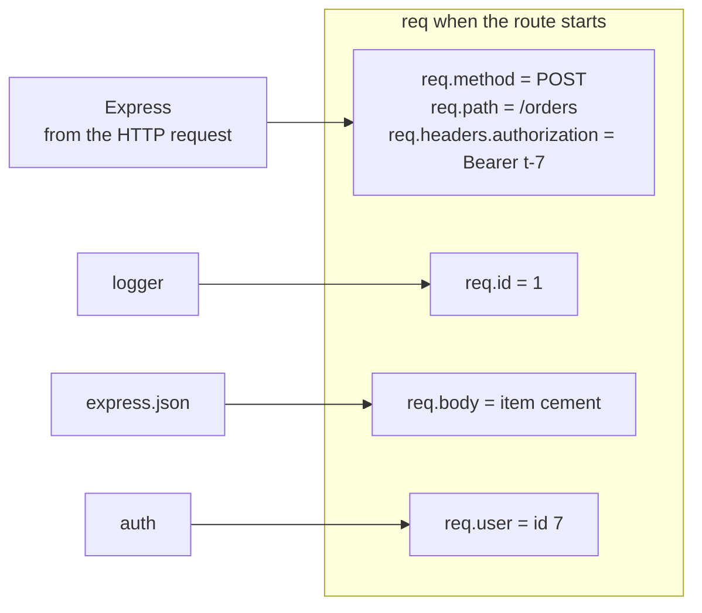

`req` is one object. Every function in the line gets the same one. That is how auth "talks" to the route.

**How it works over time.** Each function hands over by calling `next`. The route sends, and nobody calls `next` after it.

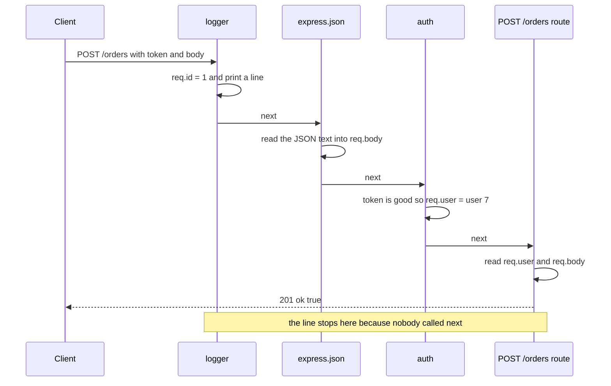

</details>

## 4. The order matters

The code is the same. Only the order of the lines changes. Top to bottom:

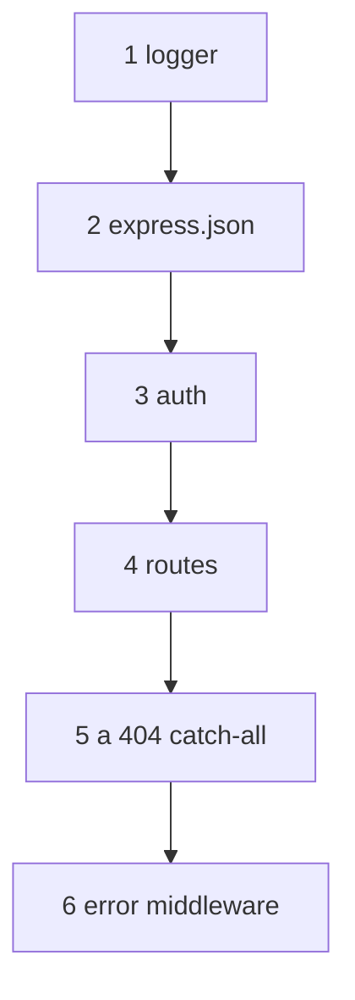

<details class="guess"><summary>🤔 Guess: `app.use(express.json())` comes **after** the route that reads `req.body.item`. What does the client get? Press to check.</summary>

A **500**. `req.body` is still `undefined`, so `req.body.item` throws `TypeError: Cannot read properties of undefined (reading 'item')`. Checked with Express 5.3.0 on 2026-10-29.

</details>

> **Remember:** `express.json()` goes above every route that reads `req.body`. Error middleware goes last.

<details class="more"><summary>📖 More detail: right against wrong, drawn, and the mistake in code</summary>

**Right against wrong: the order.**

Notice that the code is the same. Only the order of the lines changed.

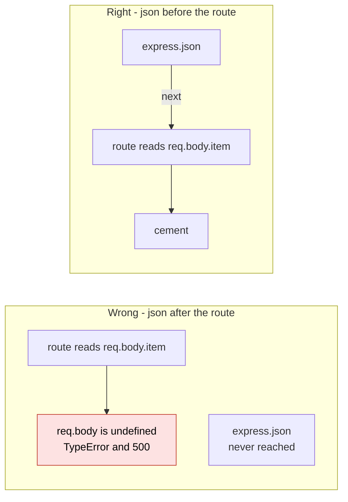

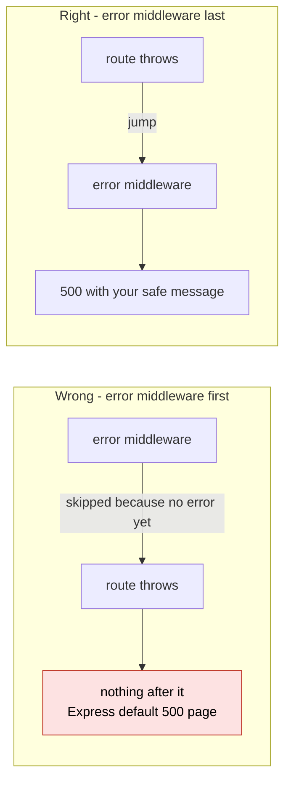

The order to remember, top to bottom: logger, `express.json()`, auth, routes, a 404 catch-all, error middleware.

**Mistake: `express.json()` after the route.**

**Wrong:** `express.json()` after the route.

```js
app.post("/orders", (req, res) => res.status(201).json({ item: req.body.item }));
app.use(express.json());
```

**Right:** `app.use(express.json())` above every route that reads `req.body`.

**Why:** `req.body` is still `undefined`, so `req.body.item` throws a `TypeError`. The client gets a 500.

**Mistake: error middleware at the top.**

**Wrong:** error middleware at the top. **Right:** at the very bottom. **Why:** `next(err)` only looks forward.

</details>

## 5. Error middleware: four parameters, added last

When a route throws, or calls `next(err)`, Express **skips every normal function** and jumps to a function with four parameters: `(err, req, res, next)`. One of them at the bottom gives every route the same safe answer.

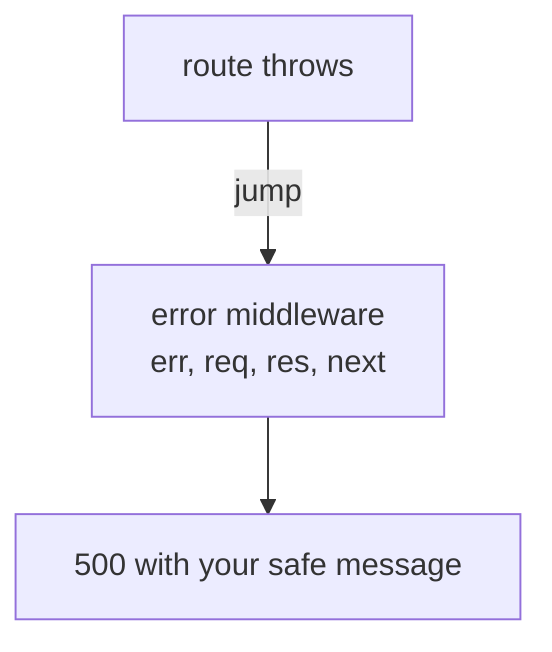

<details class="guess"><summary>🤔 Guess: you write the error middleware with only three parameters, `(err, req, res)`. What does the client get? Press to check.</summary>

The default Express error page, not your message. Express counts the parameters. With three, it is not an error middleware, so errors skip it. Checked with Express 5.3.0 on 2026-10-29.

</details>

> **Remember:** four parameters, even if you never use `next`.

<details class="more"><summary>📖 More detail: the mistake in code</summary>

**Wrong:** an error middleware with three parameters.

```js
app.use((err, req, res) => res.status(500).json({ error: "something went wrong" }));
```

**Right:** `app.use((err, req, res, next) => ...)`, even if you never use `next`.

**Why:** Express counts the parameters. With three, errors skip it, and the client gets the default 500 page.

</details>

## 6. Errors in `async` code: Express 4 against Express 5

A route is often `async`. What happens when it throws depends on the version.

| | Express 4 | Express 5 (current) |
|---|---|---|
| `throw` in a normal function | error middleware | error middleware |
| `next(err)` | error middleware | error middleware |
| `throw` in an `async` route | **not caught: Node stops the server** | error middleware |
| What you had to write | `try/catch` and `next(err)` | nothing extra |

<details class="guess"><summary>🤔 Guess: in Express 4, one `async` route throws and nothing catches it. Who is affected? Press to check.</summary>

Every user. Express 4 ignores the failed promise, so Node stops the whole server with exit code 1. One bad request takes it down.

</details>

> **Remember:** Express 5 sends a thrown `async` error to your error middleware. Express 4 did not.

<details class="more"><summary>📖 More detail: the mistake in code</summary>

**Wrong (Express 4 only):** an `async` route that throws, with nothing to catch it.

```js
app.get("/boom", async (req, res) => { throw new Error("database is down"); });
```

**Right in Express 4:** `try { ... } catch (err) { next(err); }`. **Right in Express 5:** the code above already works.

**Why:** Express 4 ignores the failed promise, so Node stops the whole server with exit code 1. One bad request takes it down for every user.

</details>

## 7. Where a middleware runs

You choose how wide a middleware reaches.

| Code | Runs for |
|---|---|
| `app.use(fn)` | every request |
| `app.use("/admin", fn)` | paths that start with `/admin` |
| `app.get("/orders", auth, handler)` | this one route |
| `app.use((err, req, res, next) => ...)` last | errors from anything above |

<details class="guess"><summary>🤔 Guess: `app.get("/orders", auth, handler)`. Does `auth` run for `POST /orders`? Press to check.</summary>

No. It runs for `GET /orders` only. Use this for a check that only some routes need.

</details>

> **Remember:** `app.use` is wide. A route with its own function is narrow.

<details class="more"><summary>📖 More detail: where to put a middleware</summary>

**Where it runs, drawn.**

Notice that you choose how wide a middleware reaches.

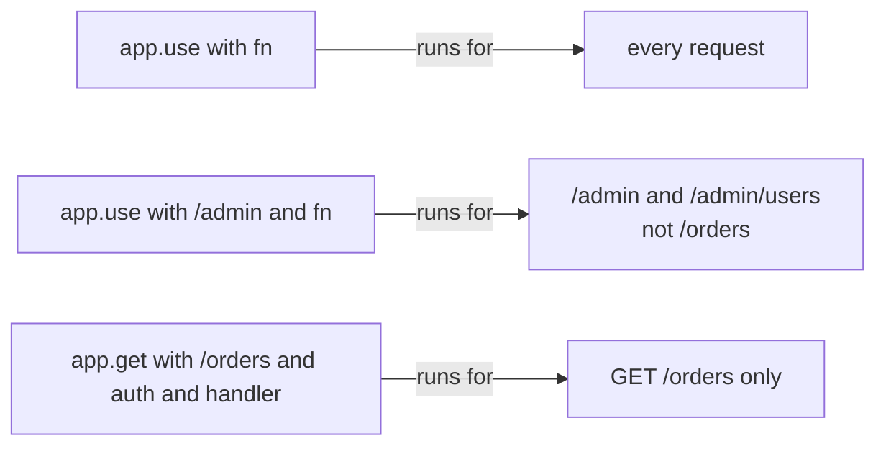

**What to use each one for.**

| Code | Runs for | Use it for |
|---|---|---|
| `app.use(fn)` | every request | logging, request id, `express.json()` |
| `app.use("/admin", fn)` | paths that start with `/admin` | "admins only" for a whole area |
| `app.get("/orders", auth, handler)` | this one route | a check only some routes need |
| `app.use((err, req, res, next) => ...)` last | errors from anything above | one safe error answer |

</details>

## 8. The smallest code that shows it

One middleware, one route, and a tiny client in the same file. Run `npm i express` first (version 5).

```js
const app = require("express")();
app.use((req, res, next) => {
  console.log("1 logger", req.path);
  next();
});
app.get("/hi", (req, res) => {
  console.log("2 route");
  res.send("hello");
});
const s = app.listen(0, async () => {
  const r = await fetch(
    `http://localhost:${s.address().port}/hi`);
  console.log("3 answer:", await r.text());
  s.close();
});
```

<details class="guess"><summary>🤔 Guess: what do the three lines print, and in what order? Press to check.</summary>

```
1 logger /hi
2 route
3 answer: hello
```

The logger runs first because it was added first. It calls `next()`, so the route runs and sends.

</details>

> **Remember:** the logger passes the request on with `next()`. The route sends, and the line stops.

<details class="more"><summary>📖 More detail: the longer program, and every step</summary>

Save it as `middleware.js` in an empty folder outside this repo. Run `npm i express`, then `node middleware.js`.

```js
const express = require("express");                    // needs: npm i express (version 5)
const app = express();
let count = 0;

app.use((req, res, next) => {                          // 1. logger
  req.id = ++count;
  console.log(req.id, "logger", req.method, req.path);
  next();
});
app.use(express.json());                               // 2. reads the JSON body into req.body
app.use((req, res, next) => {                          // 3. auth
  if (req.get("authorization") !== "Bearer t-7") {
    console.log(req.id, "auth: no token, stop here");
    return res.status(401).json({ error: "log in first" });
  }
  req.user = { id: 7 };
  next();
});
app.post("/orders", (req, res) => {                     // 4. a route
  console.log(req.id, "route: user", req.user.id, "orders", req.body.item);
  res.status(201).json({ ok: true });
});
app.get("/boom", async (req, res) => {                  // 5. a route that fails
  throw new Error("database is down");
});
app.use((err, req, res, next) => {                     // 6. error middleware: 4 parameters, added last
  console.log(req.id, "error middleware:", err.message);
  res.status(500).json({ error: "something went wrong" });
});

// A tiny client in the same file: start on any free port, send 3 requests, stop.
const server = app.listen(0, async () => {
  const url = "http://localhost:" + server.address().port;
  const call = async (path, init) => {
    const r = await fetch(url + path, init);
    console.log("  answer:", r.status, await r.text());
  };
  const headers = { authorization: "Bearer t-7", "content-type": "application/json" };
  await call("/orders", { method: "POST", headers, body: JSON.stringify({ item: "cement" }) });
  await call("/orders", { method: "POST" });           // no token
  await call("/boom", { headers });
  server.close();
});
```

**Output:**

```
1 logger POST /orders
1 route: user 7 orders cement
  answer: 201 {"ok":true}
2 logger POST /orders
2 auth: no token, stop here
  answer: 401 {"error":"log in first"}
3 logger GET /boom
3 error middleware: database is down
  answer: 500 {"error":"something went wrong"}
```

Checked on 2026-10-22 with Node 24.15.0 and Express 5.3.0.

Three requests, three endings: the route sent, auth stopped the line, the error middleware caught the throw.

**The three requests, step by step.**

Request 1: `POST /orders` with a good token and the body `{"item":"cement"}`.

| Step | Which function | What it reads | What it adds to `req`, or sends | Next step |
|---|---|---|---|---|
| 1 | Express | the HTTP text | makes `req` and `res`. `req.method` is `POST`, `req.path` is `/orders` | first function |
| 2 | logger | `req.method`, `req.path` | `req.id = 1`, prints `1 logger POST /orders` | `next()` |
| 3 | `express.json()` | the body text and the `Content-Type` header | `req.body = { item: "cement" }` | `next()` |
| 4 | auth | `req.headers.authorization` | it is `Bearer t-7`, so `req.user = { id: 7 }` | `next()` |
| 5 | `POST /orders` | `req.user.id`, `req.body.item` | sends `201 {"ok":true}` | none, the line stops |
| 6 | `GET /boom`, error middleware | | never run | |

Request 2: no token.

| Step | Which function | What it reads | What it adds to `req`, or sends | Next step |
|---|---|---|---|---|
| 7 | logger | | `req.id = 2` | `next()` |
| 8 | `express.json()` | no JSON body | nothing, `req.body` stays `undefined` | `next()` |
| 9 | auth | no `Authorization` header | sends `401`, with `return` | none, the line stops |
| 10 | the route | | never runs. No order is saved | |

Request 3: `GET /boom`, the error path.

| Step | Which function | What it reads | What it adds to `req`, or sends | Next step |
|---|---|---|---|---|
| 11 | logger, `express.json()`, auth | | `req.id = 3`, `req.user` | `next()` three times |
| 12 | `POST /orders` | the method and path | skipped: it is not `GET /boom` | Express looks further |
| 13 | `GET /boom` | | throws. The `async` function gives back a failed (rejected) promise | Express 5 calls `next(err)` for you |
| 14 | error middleware | `err.message` | prints the real message, sends a safe `500` | none |

**What to see.**

What to see:

- Steps 2 to 4: each function adds one thing to the same `req`. The route only reads.
- Step 9: auth sends and does not call `next()`. That is the only way to stop the line.
- Step 12: routes are in the line too. One that does not match is skipped.
- Step 13: `next(err)` skips every normal function and jumps to a function with four parameters.

**Step through it yourself:** [open the stepper](visuals/03-express-middleware.html). It has the three requests above, plus a fourth where the logger forgets `next()`.

</details>

## 9. Mistake 1: send without `return`

`auth` sends a 401, but the function goes on and calls `next()` anyway.

```js
app.use((req, res, next) => {
  if (!req.get("authorization")) {
    res.status(401).json({ error: "log in first" });
  }
  next();                    // still runs
});
```

The client gets `401 {"error":"log in first"}`. But the route runs anyway.

<details class="guess"><summary>🤔 Guess: the route also calls `res.json(...)`. What does the server print? Press to check.</summary>

`route ran`, and then `Error [ERR_HTTP_HEADERS_SENT]: Cannot set headers after they are sent to the client`. Sending does not end your function. Checked with Express 5.3.0 on 2026-10-29.

</details>

> **Remember:** `return res.status(401).json(...)`. Always `return` when you send.

<details class="more"><summary>📖 More detail: the wrong code and the right code</summary>

**Wrong:** send without `return`.

```js
if (!token) {
  res.status(401).json({ error: "log in first" });     // sends...
}
req.user = { id: 7 };
next();                                                // ...and still goes on
```

**Right:** `return res.status(401).json({ error: "log in first" });`

**Why:** sending does not end your function. The route still runs, then fails with `Cannot set headers after they are sent to the client`.

</details>

## 10. Why it matters and what it costs

- **Without it:** the same checks are copied into every route, and one forgotten copy is a security hole.
- **With it:** each job is written once and put in the line. A route added later is behind the same checks, because it sits lower in the line.
- **The cost:** the order is hidden in setup code, and a wrong order fails quietly. A route file does not show what ran before it. Every request pays for every global middleware.

<details class="more"><summary>📖 More detail: if you freeze in the interview</summary>

**If you freeze:**

1. "A request walks a line of functions, in the order I added them."
2. "Each one calls `next()` or sends. Neither means a hang. Both means a bug."
3. "`next(err)` jumps to the 4-parameter error middleware, which I add last."

All mistakes checked on 2026-10-22 with Node 24.15.0 and Express 5.3.0. The Express 4 one with Express 4.22.3.

</details>

## 11. Watch and play

All links checked on 2026-10-22.

- **Video:** [Learn Express Middleware In 14 Minutes](https://www.youtube.com/watch?v=lY6icfhap2o) Web Dev Simplified, 15 min - builds a logger and an auth middleware. Made for Express 4.
- **Play with it:** [the stepper in this folder](visuals/03-express-middleware.html) - guess first, then press Next. Try "Forgot next()".
- **Play with it:** [StackBlitz Express project](https://stackblitz.com/edit/express-simple) - Express in the browser. Paste section 4 in, move one line, see what breaks.
- **Read:** [Express: Writing middleware](https://expressjs.com/en/guide/writing-middleware/) - the `next()` rules and why order matters.
- **Read:** [Express: Using middleware](https://expressjs.com/en/guide/using-middleware/) - app level, router level and route level, with examples.
- **Read:** [Express: Error handling](https://expressjs.com/en/guide/error-handling/) - four parameters, `next(err)`, and async errors.
- **Read:** [Express: Upgrade to Express v5](https://expressjs.com/en/guide/migrating-5/) - the section "Rejected promises handled from middleware and handlers".

<details><summary>Go deeper (optional)</summary>

**Code after `next()` still runs.** `next()` is a normal function call. When it returns, your function continues. But "after `next()`" does not mean "after the route". It depends on whether something in the line waits.

```js
app.use((req, res, next) => {
  console.log("logger: before next");
  res.on("finish", () => console.log("logger: response sent", res.statusCode));
  next();
  console.log("logger: after next");
});
app.use(express.json());
```

For `GET /health`, with no body, the whole line runs inside `next()`:

```
logger: before next
route
logger: after next
logger: response sent 200
```

For `POST /orders` with a JSON body, `express.json()` waits for the body to arrive, so `next()` returns early:

```
logger: before next
logger: after next
route
logger: response sent 201
```

So to run code after the answer, like timing a request, use `res.on("finish", ...)`. Checked on 2026-10-22 with Node 24.15.0 and Express 5.3.0.

**The default error handler.** If an error reaches the end with no error middleware, Express sends a 500 HTML page. With `NODE_ENV=development` the page shows the stack trace. With `NODE_ENV=production` it only says `Internal Server Error`. A request that matches no route gets a 404 page, `Cannot GET /nope`. Your own JSON 404 is a normal middleware with no path, placed after all routes: `app.use((req, res) => res.status(404).json({ error: "not found" }))`.

**When the answer was already sent.** If an error happens after `res.json(...)`, your error middleware cannot send again. The Express docs say to check `if (res.headersSent) return next(err);` so the default handler can close the connection.

**Express 5 changed wildcard paths.** `app.all("*", ...)` now throws `Missing parameter name at index 1`. Write `/*splat`, or use `app.use(fn)` with no path for a catch-all.

**`req.body` without a parser.** With no body parser, `req.body` is `undefined` in Express 5. The migration guide says Express 4 gave `{}`. In a quick check with Express 4.22.3 and no parser at all, it was also `undefined`. Do not rely on either. Add `express.json()`.

**Express 4 helpers.** Before Express 5, people wrapped async routes in a small helper, or added the `express-async-errors` package, to send failed promises to `next(err)`. With Express 5 you can delete those.

**`next("route")`.** Inside a route with several functions, `next("route")` skips the rest of that route's functions and goes to the next matching route. It is rare. Any other value passed to `next` counts as an error.

**`express.Router()`.** A router is a smaller line you can mount: `const admin = express.Router(); admin.use(requireAdmin); app.use("/admin", admin)`. Inside it, `req.path` has `/admin` cut off. A request for `/admin/users` shows `req.path` as `/users`.

**TypeScript and `req.user`.** Express's types do not know about `req.user`. You add it once with a `declare global { namespace Express { interface Request { user?: { id: number } } } }` block, so every route sees the field.

**GraphQL is one middleware.** In this repo's [example app](examples/express-graphql-auth/src/server.ts), `app.use(yoga.graphqlEndpoint, yoga)` mounts all of GraphQL Yoga as one middleware on `/graphql`, next to a plain `app.get("/health")` route. All GraphQL calls share one route, so route-level auth cannot tell `login` from `myNotes`. That is why the token is read in GraphQL's context instead. The [tutorial](express-graphql-auth-tutorial.md) explains it.

**More to watch and read:** [What is Middleware in Express JS?](https://www.youtube.com/watch?v=y18ubz7gOsQ) by Dave Gray, 35 min, covers built-in, third party and custom middleware. [MDN: Express/Node introduction](https://developer.mozilla.org/en-US/docs/Learn_web_development/Extensions/Server-side/Express_Nodejs/Introduction) has a "Using middleware" and a "Handling errors" section.

**Checked on:** 2026-10-22.

</details>

## 12. Practice

**A. Predict the output** (write your answer before opening)

```js
const express = require("express");
const app = express();
app.use((req, res, next) => { console.log("A"); next(); });
app.use((err, req, res, next) => { console.log("E1"); next(err); });
app.get("/x", (req, res, next) => { console.log("route"); next(new Error("boom")); });
app.use((req, res, next) => { console.log("B"); next(); });
app.use((err, req, res, next) => {
  console.log("E2", err.message);
  res.status(500).json({ error: "something went wrong" });
});
const server = app.listen(0, async () => {
  const r = await fetch("http://localhost:" + server.address().port + "/x");
  console.log(r.status, await r.text());
  server.close();
});
```

<details><summary>Answer</summary>

```
A
route
E2 boom
500 {"error":"something went wrong"}
```

`E1` is skipped: there is no error yet, so error middleware does not run. `B` is skipped: after `next(new Error(...))`, Express skips every normal function. (Checked on 2026-10-22 with Node 24.15.0 and Express 5.3.0.)

</details>

**B. Fix the bug**

The client sends `POST /orders` with no token. Run it in your head. How many orders are saved?

```js
const express = require("express");
const app = express();
const orders = [];
app.use((req, res, next) => {                              // auth
  if (req.get("authorization") !== "Bearer t-7") {
    res.status(401).json({ error: "log in first" });
  }
  req.user = { id: 7 };
  next();
});
app.post("/orders", (req, res) => {
  orders.push({ user: req.user.id });
  console.log("orders saved:", orders.length);
  res.status(201).json({ ok: true });
});
const server = app.listen(0, async () => {
  const r = await fetch("http://localhost:" + server.address().port + "/orders", { method: "POST" });
  console.log(r.status, await r.text());
  server.close();
});
```

<details><summary>Answer</summary>

It prints (stack trace lines cut):

```
orders saved: 1
401 {"error":"log in first"}
Error [ERR_HTTP_HEADERS_SENT]: Cannot set headers after they are sent to the client
```

The client sees 401 and thinks it was refused. But the order was saved, for user 7, by someone with no token. Auth sent the 401 and then kept going: it set `req.user` and called `next()`.

Fix: add `return`, so the function ends when it sends.

```js
  if (req.get("authorization") !== "Bearer t-7") {
    return res.status(401).json({ error: "log in first" });
  }
```

It now prints only `401 {"error":"log in first"}`, and no order is saved. (Both outputs checked on 2026-10-22 with Node 24.15.0 and Express 5.3.0.)

</details>

**C. Write it yourself**

Build a tiny copy of Express's line, with no npm install. Open `learn/backend-api/practice/03-express-middleware.js`. `createResponse` is a small `res`. `createApp` gives `use(fn)` and `handle(req)`. The comment at the top lists every rule. Then run:

```
node --test learn/backend-api/practice/03-express-middleware.test.js
```

<details><summary>One possible answer</summary>

Replace the two functions and `module.exports` under the comment with this:

```js
function createResponse() {
  return {
    statusCode: 200,
    body: undefined,
    headersSent: false,
    status(code) {
      if (!this.headersSent) this.statusCode = code;      // after a send, the answer is fixed
      return this;                                        // so res.status(401).json(...) works
    },
    json(body) {
      return this.send(body);
    },
    send(body) {
      if (this.headersSent) throw new Error("Cannot set headers after they are sent to the client");
      this.body = body;
      this.headersSent = true;
      return this;
    },
  };
}

function createApp() {
  const line = [];                                        // the functions, in the order of use()

  return {
    use(fn) {
      line.push(fn);
    },
    handle(req) {
      const res = createResponse();
      let i = 0;                                          // the next function to look at

      function next(err) {
        while (i < line.length) {
          const fn = line[i++];
          const isErrorFn = fn.length === 4;
          if (err ? !isErrorFn : isErrorFn) continue;     // no error: skip error functions. error: skip normal ones
          try {
            if (err) fn(err, req, res, next);
            else fn(req, res, next);
          } catch (thrown) {
            next(thrown);                                 // a throw is the same as next(err)
          }
          return;                                         // this function decides what happens next
        }
        if (res.headersSent) return;                      // past the end: keep what was sent
        if (err) res.status(500).send({ error: "Internal Server Error" });
        else res.status(404).send({ error: "Not Found" });
      }

      next();
      if (!res.headersSent) return "hang";
      return { status: res.statusCode, body: res.body };
    },
  };
}

module.exports = { createResponse, createApp };
```

Checked on 2026-10-22 with Node 24.15.0: the 17 tests fail on the empty stub and all 17 pass with this answer. The key line is `fn.length === 4`. That is really how Express tells an error middleware apart: it counts the parameters.

</details>

## 13. Interview question

**Q:** "Walk me through what happens when a request hits an Express app. How do you handle errors in one place?"

A common follow-up: "Your auth middleware sends a 401, but the order was still created. Why?" Practice B is the answer.

<details><summary>A strong answer, in four parts</summary>

1. **Problem:** many routes need the same jobs: logging, body parsing, auth, error handling. Copying them into each route means one forgotten check is a hole, and errors come back in different shapes.
2. **How it works:** Express keeps one line of functions, in the order of `app.use` and the route calls. For each request it creates one `req` and one `res` and walks the line. Each middleware gets `(req, res, next)`. It either calls `next()` to pass on, or sends a response to stop. If it does neither, the request hangs. Middleware share data on `req`: auth sets `req.user`, the route reads it. Routes are in the same line and only run when the method and path match. For errors I add one function with four parameters, `(err, req, res, next)`, at the very end. `next(err)` or a throw skips all normal functions and lands there. In Express 5 a rejected promise from an `async` handler goes there too. In Express 4 you needed `try/catch` and `next(err)`. The error middleware logs the real error and sends a safe 500.
3. **Tradeoff:** the order is hidden in setup code, and a wrong order fails quietly. Global middleware runs on every request, so I scope heavy ones with a path, like `app.use("/admin", requireAdmin)`, or on one route. Sending does not end my function, so I always `return res.status(...)`.
4. **My example:**
   - **Fact:** in this repo's example app, `app.use(yoga.graphqlEndpoint, yoga)` mounts GraphQL Yoga as one Express middleware on `/graphql`, next to a plain `/health` route.
   - **Fact:** DBO's API service is GraphQL with Nexus and Prisma, on Node and TypeScript. A separate Auth service issues the JWTs, and the API validates the JWT with the Auth service.
   - **Idea, not a fact:** the case study suggests verifying the JWT locally with a shared public key, so there is no network call per request. In an Express app that check is one auth middleware that sets `req.user`. I do not claim DBO was built that way.
   - **Idea, not a fact:** a request id middleware at the top of the line is the cheapest first step for tracing. The DBO case study lists `X-Request-Id` as an improvement, not as something built.

</details>

## 14. Explain it back

Close this file. Explain Express middleware out loud to a new junior, in 4 parts (problem, how, tradeoff, my example). Use the three requests from section 4: the good one, the one with no token, and the one that throws. Write it below, then run `/explain-check express middleware`.

### My explanation

<write here>

### Coach feedback

<the explain-coach agent writes here>

## 15. Review questions (day 1, 3, 7, 21)

1. A middleware must end in one of two ways. Which two, and what happens if it does neither?
2. Why must `express.json()` come before your routes, and the error middleware after them?
3. How does Express know a function is error middleware, and what does `next(err)` skip?
4. Draw picture 2a from memory, with the error path.

<details><summary>Answers</summary>

1. It calls `next()` to pass the request on, or it sends a response (with `return`) to stop the line. If it does neither, the request hangs until the client gives up, and no error is printed.
2. Express runs functions in the order you added them. If `express.json()` comes after the route, `req.body` is still `undefined` when the route reads it. `next(err)` only looks forward, so an error middleware above the routes never sees their errors.
3. It counts the parameters: exactly four, `(err, req, res, next)`. `next(err)`, or a throw, skips every normal middleware and route after it and runs the next error middleware. In Express 5 a rejected promise from an `async` route does the same.
4. Client, then logger, `express.json`, auth, route, each joined by `next`. The route sends 201 back. Auth can send 401 back without calling `next`. From the route, `next(err)` or a throw goes to the error middleware, which sends a safe 500.

</details>

## Connected lessons

- [REST API design](02-rest-api-design.md) - before this. The routes at the end of the line.
- [HTTP basics](01-http-basics.md) - what `req` and `res` are made from.
- [GraphQL basics](04-graphql-basics.md) - next. GraphQL is one middleware on one route.
- [Authentication: sessions vs JWT](06-authentication-sessions-vs-jwt.md) - what the auth middleware really checks.
- [Validation and error handling](10-validation-and-error-handling.md) - one error shape, built on error middleware.
- [Rate limiting](11-rate-limiting.md) - another job that lives in a middleware.
- [Express, GraphQL and Prisma with real auth](express-graphql-auth-tutorial.md) - auth moves from middleware into GraphQL context.
- [Observability](../system-design/14-observability.md) - request ids, often the first middleware.
