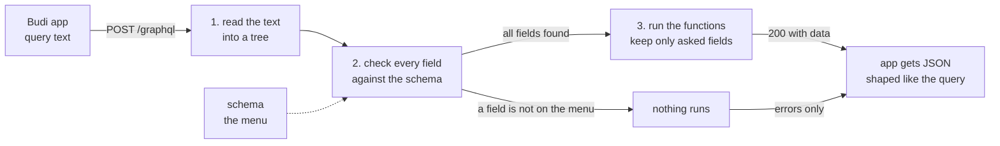
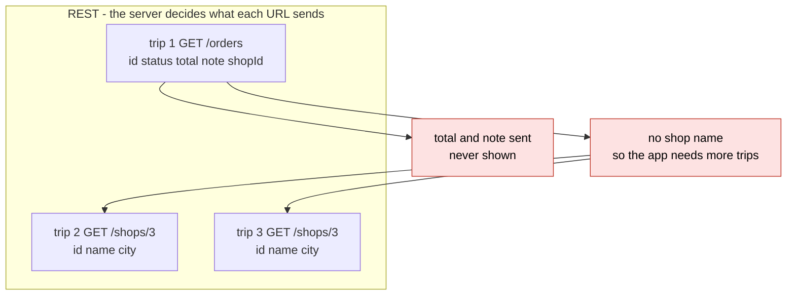
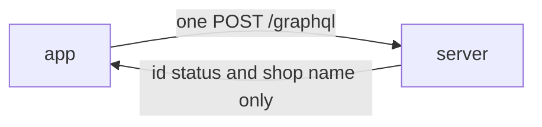
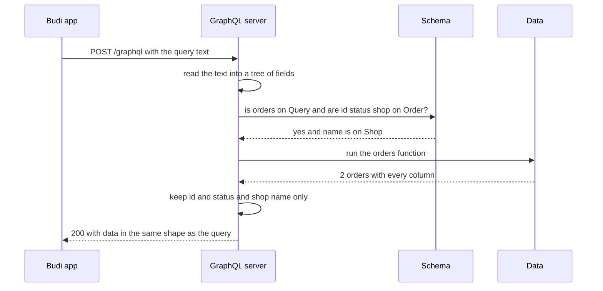
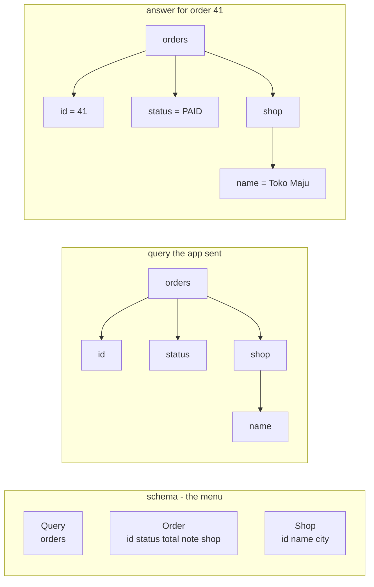
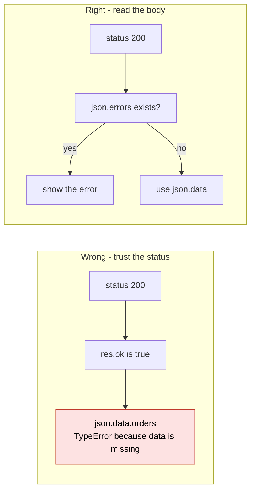
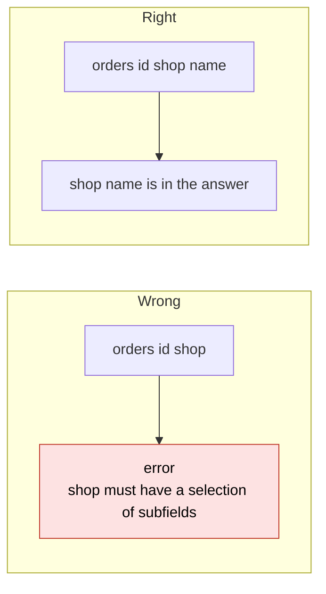
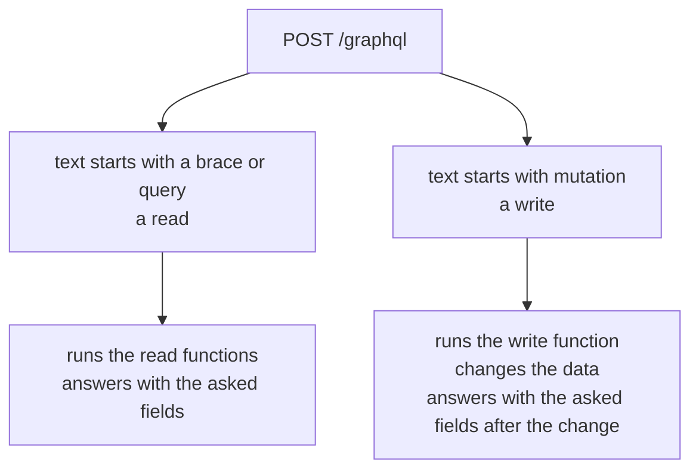

# 04. GraphQL basics

> **Subject:** Backend and API · **Lesson:** 04 · **Made:** 2026-10-22 · **Status:** ready
> **You will be able to:** read a schema, write a query and a mutation, say what the server does with them step by step, and explain when GraphQL beats REST and when it does not.
> **Before this:** [Express middleware](03-express-middleware.md) · **Next:** [Resolvers and the N+1 problem](05-resolvers-and-the-n-1-problem.md)

## 1. The idea in one sentence

The app sends one text that lists exactly the fields it wants, always to the same URL, and the server answers with that shape and nothing more.

Why you need it:

- The Budi app shows a list of orders. Each row needs three things: the order id, its status, and the shop name.
- With the REST API from [lesson 02](02-rest-api-design.md), `GET /orders` sends every field of every order: id, status, total, note, shopId. The screen uses two.
- The list has `shopId: 3`, not the shop name. A simple app makes one extra request per order. With 20 orders, that could mean 21 trips.
- The admin website (CMS) needs other fields from the same orders. So the backend adds `/orders/mobile-list`, then `/orders/cms-list`, then more.
- The fix: let the app say which fields it wants, in one request.

New words (four):

- **Schema:** the menu. A written list of every type the server has and the fields on each type. (Interview words: schema, types, SDL.)
- **Query:** a read. A text that lists the fields you want, nested like the data. (Interview words: query, selection set.)
- **Mutation:** a write. It starts with the word `mutation`, changes data, then answers with the fields you list.
- **Over-fetching and under-fetching:** getting fields you never show, and not getting enough so you need another trip. These are the two REST problems GraphQL is known for fixing.

## 2. The pictures

### 2a. The big picture

Notice that the server checks the whole query before it runs anything. A wrong field stops everything.



### 2b. The problem, drawn

Notice the three trips, and the fields that travel but are never shown.



The same screen with GraphQL is one trip:



### 2c. How it works over time

Notice that the server talks to the data only after the check passes. One function call gets both orders.



### 2d. What the server holds at one moment

The moment before the answer is sent, for the first query. Notice that the query and the answer have the same shape. The schema has more fields than either.



| On the menu for Order | Asked? | In the answer? |
|---|---|---|
| `id` | yes | yes |
| `status` | yes | yes |
| `total` | no | no |
| `note` | no | no |
| `shop` | yes, with `name` inside | yes, only `name` |

### 2e. Right against wrong

Notice that a GraphQL error often comes with status `200`. Only the body tells the truth.



Notice that an object field needs its own list of fields. There is no "give me everything".



### 2f. Query against mutation

Notice that both go to the same URL. The first word of the text decides, not the HTTP method or the path.



## 3. Real life analogy

A restaurant with a menu and an order slip.

- The **menu** is the schema. It lists every dish and every side.
- Your **order slip** is the query. You write exactly what you want: "rice, chicken, no soup".
- REST is like **set meals**. Set A comes with soup you do not eat. The drink is at another counter, so you queue again.
- The waiter **checks the slip against the menu** before the kitchen starts. A dish that is not on the menu? The slip comes back. Nothing is cooked.

Where it stops being true: a real waiter would cook the rest of your order. GraphQL rejects the whole slip if one field is wrong. But once cooking starts, some dishes can still arrive even if one fails (practice A shows this).

## 4. The smallest code that shows it

Save it as `basics.js` in an empty folder outside this repo. Run `npm i graphql`, then `node basics.js`. There is no web server here: `graphql()` is the part that reads, checks and runs. A server like GraphQL Yoga puts it behind `POST /graphql`.

```js
const { buildSchema, graphql } = require("graphql");    // needs: npm i graphql

const schema = buildSchema(`
  type Shop  { id: ID!, name: String!, city: String! }
  type Order { id: ID!, status: String!, total: Int!, note: String, shop: Shop! }
  type Query    { orders: [Order!]! }
  type Mutation { cancelOrder(id: ID!): Order! }
`);

const shops = { 3: { id: "3", name: "Toko Maju", city: "Bandung" } };
const orders = [
  { id: "41", status: "PAID", total: 250000, note: "leave at gate", shopId: 3 },
  { id: "42", status: "NEW",  total: 90000,  note: null,            shopId: 3 },
];
const withShop = (o) => ({ ...o, shop: shops[o.shopId] });
const rootValue = {
  orders: () => { console.log("  orders function runs"); return orders.map(withShop); },
  cancelOrder: ({ id }) => {
    console.log("  cancelOrder function runs for", id);
    const o = orders.find((o) => o.id === id);
    o.status = "CANCELLED";
    return withShop(o);
  },
};

async function ask(source) {
  console.log(source);
  const result = await graphql({ schema, source, rootValue });
  console.log(JSON.stringify(result));
}

(async () => {
  await ask(`{ orders { id status shop { name } } }`);
  await ask(`mutation { cancelOrder(id: "42") { id status } }`);
  await ask(`{ orders { id price } }`);
})();
```

How to read the schema:

- `type Order { ... }` is one type and its fields. `String`, `Int` and `ID` are plain values.
- `!` means "never null". `note: String` has no `!`, so a note can be `null`.
- `[Order!]!` means a list of orders. The list is never null, and no item in it is null.
- `Query` and `Mutation` are the doors in. Every read starts at a field on `Query`, every write at a field on `Mutation`.

**Output:**

```
{ orders { id status shop { name } } }
  orders function runs
{"data":{"orders":[{"id":"41","status":"PAID","shop":{"name":"Toko Maju"}},{"id":"42","status":"NEW","shop":{"name":"Toko Maju"}}]}}
mutation { cancelOrder(id: "42") { id status } }
  cancelOrder function runs for 42
{"data":{"cancelOrder":{"id":"42","status":"CANCELLED"}}}
{ orders { id price } }
{"errors":[{"message":"Cannot query field \"price\" on type \"Order\".","locations":[{"line":1,"column":15}]}]}
```

Checked on 2026-10-22 with Node 24.15.0 and graphql 17.0.2.

Three texts, three endings: data with only the asked fields, a change plus its new value, and errors with no function run.

## 5. What really happens, step by step

Text 1: `{ orders { id status shop { name } } }`.

| Step | Who | What it does | State after |
|---|---|---|---|
| 1 | `graphql()` | reads the text and turns it into a tree: `orders`, inside it `id`, `status`, `shop`, inside `shop` the field `name` | a tree, nothing checked yet |
| 2 | `graphql()` | checks `orders` on `Query`. It returns `[Order!]!`, so the fields inside must be on `Order` | ok |
| 3 | `graphql()` | checks `id`, `status`, `shop` on `Order`. `shop` is a `Shop`, so `name` must be on `Shop`. It is | the whole query is fine |
| 4 | `rootValue.orders` | runs once. Prints `orders function runs`. Returns 2 orders with every field, and the shop inside each | 2 full orders in the server's hands |
| 5 | `graphql()` | for order 41, keeps `id` and `status`, goes into `shop`, keeps `name`. Drops `total`, `note`, `shopId`, `city` | `{ id: "41", status: "PAID", shop: { name: "Toko Maju" } }` |
| 6 | `graphql()` | the same for order 42 | both items built |
| 7 | `graphql()` | wraps it all in `data` | `{"data":{"orders":[...]}}` |

Text 2: `mutation { cancelOrder(id: "42") { id status } }`.

| Step | Who | What it does | State after |
|---|---|---|---|
| 8 | `graphql()` | reads the text. The first word is `mutation`, so it starts at `Mutation` | a tree |
| 9 | `graphql()` | checks `cancelOrder` on `Mutation`, and that the needed `id` argument is there. Checks `id` and `status` on `Order` | fine |
| 10 | `rootValue.cancelOrder` | runs with `{ id: "42" }`. Changes order 42 from `NEW` to `CANCELLED` | the data really changed |
| 11 | `graphql()` | keeps `id` and `status` from the returned order | `{"data":{"cancelOrder":{"id":"42","status":"CANCELLED"}}}` |

Text 3: `{ orders { id price } }`.

| Step | Who | What it does | State after |
|---|---|---|---|
| 12 | `graphql()` | reads the text | a tree |
| 13 | `graphql()` | `orders` is fine. `id` is fine. `price` is not on `Order` | one error message |
| 14 | `graphql()` | stops. Step 3, the running part, is skipped | `orders function runs` is **not** printed |
| 15 | `graphql()` | answers with `errors` only, with the line and column of `price` | no `data` key at all |

What to see:

- Steps 2, 3 and 13: the check happens before any data work. The schema is a contract the server enforces.
- Steps 4 and 5: the function returns more than was asked. GraphQL cuts it down to the query's shape.
- Step 4: the shop came in the same trip. That is the under-fetching fix.
- Step 14: one wrong field stops the good fields too.

**Step through it yourself:** [open the stepper](visuals/04-graphql-basics.html). It has the three texts above, plus a fourth story: the same screen built with REST, three trips.

## 6. Why it exists and what it costs

- **Problem without it:** with REST, the server decides what each URL sends. Screens get fields they do not use, need extra trips for related data, and every new screen asks for a new endpoint.
- **How it solves it:** one URL, a schema that lists everything, and a query where the client picks the fields. Related data comes nested in the same answer.
- **Cost or tradeoff:** more moving parts. A smaller response does not automatically mean less database work. REST can also include related data or let clients choose fields.

| | REST | GraphQL |
|---|---|---|
| URLs | many, one per resource | one, usually `/graphql` |
| Who picks the fields | the server | the client |
| Related data | often another trip | nested in the same query |
| Errors | the status code (404, 400, 500) | an `errors` list in the body, often with status 200 |
| HTTP caching by URL | easy, `GET /orders/41` | hard, most requests are `POST` to the same URL |
| A client can ask for something very heavy | only what the endpoints allow | yes, a deep nested query. You need depth and cost limits |
| Getting started | a route and a handler | a schema, functions per field, a server library |

When to pick which:

- **GraphQL:** several clients (mobile app, admin website) that need different fields from the same data, or screens with lots of nested data.
- **REST:** simple create, read, update, delete; public APIs where HTTP caching matters; file uploads; calls between your own backend services.

## 7. Common mistakes

**Wrong:** check only the status.

```js
if (!res.ok) throw new Error("request failed " + res.status);
const json = await res.json();
return json.data.orders;
```

**Right:** check `json.errors` too.

```js
const json = await res.json();
if (json.errors) throw new Error(json.errors.map((e) => e.message).join("; "));
return json.data.orders;
```

**Why:** many servers send `200` even when the query was rejected. Then `json.data` is missing, and `json.data.orders` throws a `TypeError`.

**Wrong:** `{ orders { id shop } }`

**Right:** `{ orders { id shop { name } } }`

**Why:** `shop` is an object type. GraphQL wants you to name its fields. The error says `Field "shop" of type "Shop!" must have a selection of subfields.`

**Wrong:** look for a "give me all fields" option, like `SELECT *`.

**Right:** list every field the screen needs.

**Why:** there is no wildcard. Adding a server field does not silently add it to every client's response. Before removing a field, check which clients still use it.

**Wrong:** think a wrong field comes back as `null`.

**Right:** a wrong field rejects the whole query. Nothing runs.

**Why:** the check happens before any function runs (step 14). Only errors that happen *while running* give partial data.

**Wrong:** send a mutation with `GET /graphql?query=mutation...`.

**Right:** send mutations with `POST`.

**Why:** `GET` is for reads only. GraphQL Yoga answers `405` with `Can only perform a mutation operation from a POST request.`

**If you freeze:**

1. "The schema is the menu. A query lists the fields I want. A mutation is a write."
2. "Everything goes to one URL. The server checks every field first, then runs, then sends only what I asked."
3. "Errors come in the body, often with status 200, so I check `errors`."

Checked on 2026-10-22 with Node 24.15.0, graphql 17.0.2, GraphQL Yoga 5.24.6 and Express 5.3.0.

## 8. Watch and play

All links opened and checked on 2026-10-22.

- **Video:** [What is GraphQL?](https://www.youtube.com/watch?v=c8VWxuAtVek) IBM Technology, 3 min - schema, query, the answer in the same shape, and over-fetching drawn on a board.
- **Video:** [GraphQL Explained in 100 Seconds](https://www.youtube.com/watch?v=eIQh02xuVw4) Fireship, 2 min - fast recap of queries and mutations against REST.
- **Play with it:** [the stepper in this folder](visuals/04-graphql-basics.html) - guess first, then press Next. Try story 3, "A wrong field".
- **Play with it:** [Countries GraphQL API](https://countries.trevorblades.com/) - a live GraphiQL page, no sign up. Type `{ country(code: "ID") { name capital currency } }`. Then add `price` and read the error. Open the Docs panel to see the schema.
- **Play with it:** [SWAPI GraphQL](https://graphql.org/swapi-graphql) - Star Wars data. Ask for a film's title, then add the characters inside it, in one query.
- **Read:** [GraphQL: Queries](https://graphql.org/learn/queries/) - fields, nesting, arguments, with live examples.
- **Read:** [GraphQL: Schemas and Types](https://graphql.org/learn/schema/) - types, `!`, lists, and the `Query` and `Mutation` types.

<details><summary>Go deeper (optional)</summary>

**Status codes, the full story.** Checked on 2026-10-22 with GraphQL Yoga 5.24.6:

| What happened | Client sends `Accept: application/json` (or nothing) | Client sends `Accept: application/graphql-response+json` |
|---|---|---|
| Good query | 200, `data` | 200, `data` |
| Wrong field | 200, `errors` only | 400, `errors` only |
| A function throws while running | 200, `data` with that field `null`, plus `errors` | |
| Mutation sent with `GET` | 405 | |

The rules are moving. The [graphql.org Serving over HTTP page](https://graphql.org/learn/serving-over-http/) says a server should typically send `400` for a validation error, and that legacy `application/json` servers may send `2xx`. The current [GraphQL over HTTP draft](https://http-spec.graphql.org/draft/) says `422` for a validation error and `400` for text it cannot read. So in an interview say: "it depends on the server and the Accept header, so the client always reads the `errors` list."

**Yoga hides error messages.** When a function throws `database is down`, Yoga sends `"message":"Unexpected error."` with the code `INTERNAL_SERVER_ERROR`. The real message stays in the server logs. That is the same idea as the safe 500 in [lesson 03](03-express-middleware.md). Plain `graphql()` does not hide it, which is why practice A shows the real message.

**Variables.** Real apps send values separately instead of gluing them into the query text: `{"query":"mutation Cancel($id: ID!) { cancelOrder(id: $id) { id status } }","variables":{"id":"42"}}`. A value cannot change the query's structure. The server still needs permission checks and safe database queries.

**Mutations run one at a time.** If one mutation text has two top-level fields, the spec says they run in order, one after another. Top-level query fields may run at the same time.

**The third operation.** Besides `query` and `mutation`, there is `subscription`: the server pushes new data when something changes, usually over WebSockets.

**Aliases and fragments.** `a: order(id: "41") { id } b: order(id: "42") { id }` asks the same field twice with different names. A fragment is a named list of fields you can reuse in many queries.

**Schema-first or code-first.** This repo's [example app](examples/express-graphql-auth/src/schema.ts) writes the schema as text (schema-first, also called SDL-first). Nexus, used in DBO, builds the schema from TypeScript code (code-first). Both end up with the same schema.

**Asking the schema about itself.** GraphQL supports questions about its own schema (interview word: introspection). That is how GraphiQL shows the Docs panel. Servers can disable it. That does not replace authentication or permission checks.

**Order of fields.** The spec says the answer keeps the order of the query, and graphql-js does. Some servers, like the Countries API, send the keys in another order. Code should read by name, never by position.

**Where the function for a field comes from.** In section 4, `withShop` puts the shop inside each order before GraphQL sees it. Real servers give the `shop` field its own function (interview word: resolver). That is [lesson 05](05-resolvers-and-the-n-1-problem.md), and it is where the N+1 problem comes from.

**More to read:** [GraphQL: Mutations](https://graphql.org/learn/mutations/), [GraphQL: Execution](https://graphql.org/learn/execution/), and the Apollo blog post [GraphQL vs. REST](https://www.apollographql.com/blog/graphql-vs-rest), which draws the REST round trips. Longer video: [GraphQL Crash Course #1](https://www.youtube.com/watch?v=xMCnDesBggM) by Net Ninja, 11 min.

**Checked on:** 2026-10-22.

</details>

## 9. Practice

**A. Predict the output** (write your answer before opening)

```js
const { buildSchema, graphql } = require("graphql");
const schema = buildSchema(`
  type Order { id: ID!, status: String! }
  type Query { orders: [Order!]!, unreadCount: Int }
`);
const rootValue = {
  orders: () => [{ id: "41", status: "PAID" }],
  unreadCount: () => { throw new Error("notification service is down"); },
};
graphql({ schema, source: "{ unreadCount orders { id } }", rootValue })
  .then((result) => console.log(JSON.stringify(result)));
```

<details><summary>Answer</summary>

```
{"errors":[{"message":"notification service is down","locations":[{"line":1,"column":3}],"path":["unreadCount"]}],"data":{"unreadCount":null,"orders":[{"id":"41"}]}}
```

The orders still come back. `unreadCount` failed while running, so only that field is `null`, and the reason is in `errors` with a `path` that says which field. This is partial data: `data` and `errors` together. It is different from a wrong field, which stops everything before anything runs. It works because `unreadCount: Int` has no `!`, so it is allowed to be `null`. (Checked on 2026-10-22 with Node 24.15.0 and graphql 17.0.2.)

</details>

**B. Fix the bug**

The server is GraphQL Yoga on `/graphql`. `Order` has `id`, `status` and `total`. The app calls `loadOrders()`. What happens?

```js
async function loadOrders(url) {
  const res = await fetch(url, {
    method: "POST",
    headers: { "content-type": "application/json" },
    body: JSON.stringify({ query: "{ orders { id price } }" }),
  });
  if (!res.ok) throw new Error("request failed " + res.status);
  const json = await res.json();
  return json.data.orders;
}
```

<details><summary>Answer</summary>

It throws:

```
TypeError: Cannot read properties of undefined (reading 'orders')
```

There are two bugs. `price` is not on `Order`, so the server rejects the query. But Yoga still sends status `200`, so `res.ok` is true. The body is `{"errors":[...]}` with no `data`, so `json.data.orders` crashes with an error that hides the real reason.

Fix both: ask for `total`, and read `errors`.

```js
  const json = await res.json();
  if (json.errors) throw new Error(json.errors.map((e) => e.message).join("; "));
  return json.data.orders;
```

With `price` still in the query, it now throws `Error: Cannot query field "price" on type "Order".`, which tells you what to fix. With `total`, it returns `[ { id: '41', total: 250000 }, { id: '42', total: 90000 } ]`. (Both checked on 2026-10-22 with Node 24.15.0, GraphQL Yoga 5.24.6 and Express 5.3.0.)

</details>

**C. Write it yourself**

Build a tiny copy of what a GraphQL server does with one query, with no npm install. Open `learn/backend-api/practice/04-graphql-basics.js`. The query comes already turned into an object, like `{ orders: { id: true, shop: { name: true } } }`. You write `validate` (check every field against the schema), `execute` (keep only the asked fields) and `run` (check first, and run nothing if the check fails). The comment at the top lists every rule. Then run:

```
node --test learn/backend-api/practice/04-graphql-basics.test.js
```

<details><summary>One possible answer</summary>

Replace the three functions and `module.exports` under the comment with this:

```js
const SCALARS = ["ID", "String", "Int", "Boolean"];
const inner = (type) => type.replace(/^\[|\]$/g, "");    // "[Order]" -> "Order"

function validate(schema, selection, typeName = "Query") {
  const messages = [];
  for (const [field, sub] of Object.entries(selection)) {
    const type = schema[typeName][field];
    if (!type) {
      messages.push(`Cannot query field "${field}" on type "${typeName}".`);
      continue;
    }
    const isScalar = SCALARS.includes(inner(type));
    if (!isScalar && sub === true) {
      messages.push(`Field "${field}" of type "${type}" must have a selection of subfields.`);
    } else if (isScalar && sub !== true) {
      messages.push(`Field "${field}" must not have a selection since type "${type}" has no subfields.`);
    } else if (!isScalar) {
      messages.push(...validate(schema, sub, inner(type)));   // go inside the object type
    }
  }
  return messages;
}

function execute(schema, parent, selection, typeName = "Query") {
  const data = {};
  for (const [field, sub] of Object.entries(selection)) {    // only asked fields, in the query's order
    const type = schema[typeName][field];
    let value = parent[field];
    if (typeof value === "function") value = value();         // a tiny resolver
    const one = (v) => (v == null ? null : sub === true ? v : execute(schema, v, sub, inner(type)));
    if (value == null) data[field] = null;
    else if (type.startsWith("[")) data[field] = value.map(one);
    else data[field] = one(value);
  }
  return data;
}

function run(schema, root, selection) {
  const messages = validate(schema, selection);
  if (messages.length) return { errors: messages.map((message) => ({ message })) };  // nothing runs
  return { data: execute(schema, root, selection) };
}

module.exports = { validate, execute, run };
```

Checked on 2026-10-22 with Node 24.15.0: the 17 tests fail on the empty stub and all 17 pass with this answer. The key line is in `run`: `validate` finishes before `execute` starts. That is why a wrong field never touches the data.

</details>

## 10. Interview question

**Q:** "What is GraphQL, and how is it different from REST? When would you not use it?"

A common follow-up: "Your GraphQL call failed but the status was 200. How did the client miss it?" Practice B is the answer.

<details><summary>A strong answer, in four parts</summary>

1. **Problem:** with REST the server decides what each URL sends. A mobile screen gets fields it never shows (over-fetching), and has to make extra calls for related data (under-fetching). Each new screen tends to need a new endpoint.
2. **How it works:** the server publishes a schema, a typed list of every type and field. The client sends a query to one endpoint, usually `POST /graphql`, listing exactly the fields it wants, nested like the data. The server first checks every field against the schema. If one is wrong, nothing runs and it returns `errors`. If all are fine, it runs the function behind each field and returns `data` in the same shape as the query. Reads are queries, writes are mutations, both on the same URL. Errors live in the body, often with status 200, so clients check `errors`.
3. **Tradeoff:** HTTP caching by URL is mostly lost, because requests are `POST` to one URL. Status codes no longer tell you what failed. Clients can send very deep or heavy queries, so you need depth and cost limits. Nested fields can cause the N+1 problem, which DataLoader fixes. It is more setup than a route. I would not use it for simple create, read, update, delete, for public cached APIs, for file uploads, or between my own backend services.
4. **My example:**
   - **Fact:** at DBO, one GraphQL API service, built with Nexus and Prisma, served both the React Native app and the admin CMS.
   - **Fact:** at DBO, the calls between backend services were GraphQL too.
   - **Idea, not a fact:** the DBO case study suggests keeping GraphQL at the edge for the app and the CMS, and using queue events or plain internal REST between services, because services do not need to pick fields. I do not claim DBO was changed that way.
   - **Fact:** this repo's example app mounts GraphQL Yoga as one Express middleware on `/graphql`, which is why every query and mutation shares one URL.

</details>

## 11. Explain it back

Close this file. Explain GraphQL basics out loud to a new junior, in 4 parts (problem, how, tradeoff, my example). Use the three texts from section 4: the query, the mutation, and the wrong field. Say what the server does with each one. Write it below, then run `/explain-check graphql basics`.

### My explanation

<write here>

### Coach feedback

<the explain-coach agent writes here>

## 12. Review questions (day 1, 3, 7, 21)

1. Name the two REST problems GraphQL is known for fixing, using the Budi orders screen as the example.
2. A query asks for a field that is not in the schema. What runs, what comes back, and what status code might the client see?
3. What is the difference between a query and a mutation, and how does the server tell them apart if both go to `POST /graphql`?
4. Draw picture 2a from memory, with the error path.

<details><summary>Answers</summary>

1. Over-fetching: `GET /orders` sends total and note, which the screen never shows. Under-fetching: the list has only `shopId`, so the app calls `GET /shops/3` once per order to get the shop name. With GraphQL, one query asks for `id`, `status` and `shop { name }`, in one trip.
2. Nothing runs. The server checks every field before it runs any function, so it stops at the check. The answer has an `errors` list with the message and the line and column, and no `data` key. The status depends on the server and the Accept header: Yoga sends 200 for plain `application/json`, and 400 for `application/graphql-response+json`. So the client must read `errors`.
3. A query reads. A mutation writes, then answers with the fields you list, after the change. The server reads the first word of the text: `mutation` starts at the `Mutation` type, and `{` or `query` starts at the `Query` type. The URL and method are the same.
4. App sends the query text with `POST /graphql`. The server reads it into a tree, then checks every field against the schema. If all are found, it runs the functions, keeps only the asked fields, and sends 200 with `data`. If a field is not on the menu, nothing runs and it sends `errors` only.

</details>

## Connected lessons

- [Express middleware](03-express-middleware.md) - before this. GraphQL Yoga is one middleware on `/graphql`.
- [REST API design](02-rest-api-design.md) - the REST way this lesson compares against.
- [HTTP basics](01-http-basics.md) - why "status 200 with errors" surprises people.
- [Resolvers and the N+1 problem](05-resolvers-and-the-n-1-problem.md) - next. The function behind each field, and why nested fields can make 21 database calls.
- [Authentication: sessions vs JWT](06-authentication-sessions-vs-jwt.md) - how a GraphQL server knows who is asking.
- [Express, GraphQL and Prisma with real auth](express-graphql-auth-tutorial.md) - a real schema, queries and mutations with login.
- [Hasura: what it is and when to choose it](hasura-guide.md) - a GraphQL schema made from your database tables.
