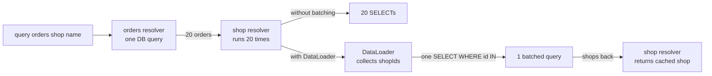
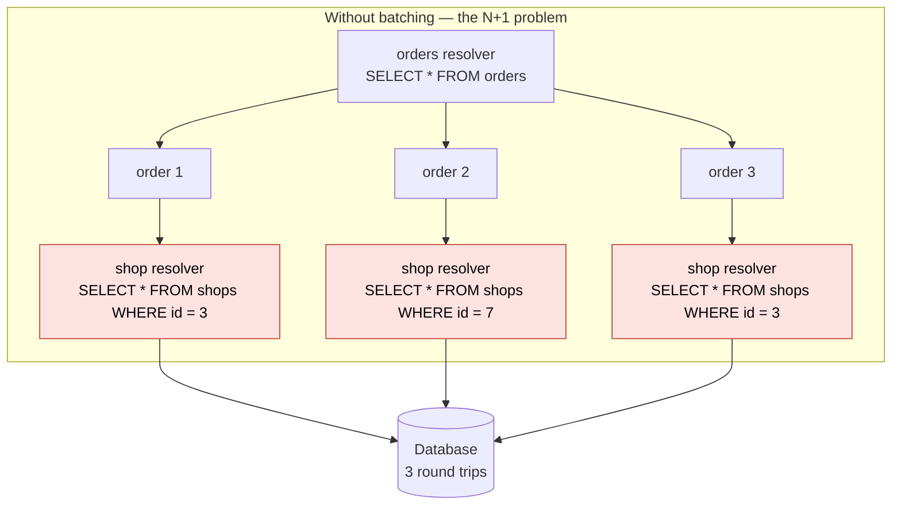
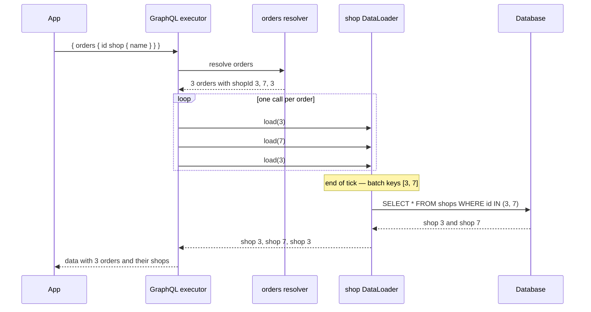

# 05. Resolvers and the N+1 problem

> **Subject:** Backend and API · **Lesson:** 05 · **Made:** 2026-10-22 · **Status:** ready
> **You will be able to:** say what a resolver is, trace how GraphQL calls one for every field, show why a list of nested objects can flood the database, and explain how batching fixes it.
> **Before this:** [GraphQL basics](04-graphql-basics.md) · **Next:** [Authentication: sessions vs JWT](06-authentication-sessions-vs-jwt.md)

## 1. The idea in one sentence

Every field in a GraphQL query has its own function, and if that function hits the database once per parent item, a list of 20 items becomes 20 extra database calls.

Why you need it:

- In [lesson 04](04-graphql-basics.md), the `orders` function returned each order with the shop already glued inside.
- Real servers do not do that. They give the `shop` field its own function, because a shop has its own table and its own rules.
- So the query `{ orders { id shop { name } } }` first runs `orders`, gets 20 orders, then runs the `shop` function once for every order.
- If each call runs `SELECT * FROM shops WHERE id = ?`, that is 20 database queries for one request. That is the N+1 problem: one query for the list, plus N queries for the related items.
- The fix: collect all the `shopId`s, run one batched query like `SELECT * FROM shops WHERE id IN (?)`, then hand each order its shop.

New words (four):

- **Resolver:** the function behind one field. It receives the parent object, the arguments, and the context, and it returns the field's value. (Interview word: resolver.)
- **Parent (or source):** the object that owns the field. In `Order.shop`, the parent is the order, so the resolver can read `parent.shopId`. (Interview words: parent, source.)
- **Context:** an object shared by every resolver for one request. It usually holds the current user, the database connection, and the batch loader. (Interview word: context.)
- **DataLoader:** a small library that queues up requests for the same kind of object and turns them into one batched request. (Interview word: DataLoader, batching, caching.)

## 2. The pictures

### 2a. The big picture

Notice that the resolver for `shop` runs once per order, but with DataLoader those calls collapse into one batched database query.



### 2b. The problem, drawn

Notice that the same query shape becomes many round trips to the database.



### 2c. How it works over time

Notice how DataLoader waits until the current tick finishes, then sends one batched query.



### 2d. What the resolver holds at one moment

The moment the `shop` resolver runs for order 42. Notice the four arguments.

| Argument | Value for `Order.shop` on order 42 | What it means |
|---|---|---|
| `parent` | `{ id: "42", status: "NEW", shopId: "3" }` | the order that owns this field |
| `args` | `{}` | no arguments on this field |
| `context` | `{ user: {...}, db: ..., shopLoader }` | shared across the whole request |
| `info` | field name is `shop`, parent type is `Order` | metadata about the query |

### 2e. Right against wrong

Notice that the naive resolver returns the shop directly; the right one returns the loader promise.

**Wrong:** fetch inside the resolver for every item.

```js
const resolvers = {
  Order: {
    shop: async (parent, _args, { db }) => {
      return db.shops.findById(parent.shopId); // runs once per order
    },
  },
};
```

**Right:** ask the loader, which batches one request.

```js
const resolvers = {
  Order: {
    shop: (parent, _args, { shopLoader }) => {
      return shopLoader.load(parent.shopId);
    },
  },
};
```

**Why:** the loader collects every `shopId` in the same tick and sends one query. The resolver stays small and the database load stays flat.

## 3. Real life analogy

A hotel has 20 guests who each ask the concierge for a taxi. The concierge could phone the taxi company 20 times, once per guest. That is the N+1 problem. Instead, the concierge writes down every destination, makes one phone call, and dispatches the taxis. That is batching. The concierge also remembers that two guests asked for the same airport, so they share one cab. That is the cache.

Where it stops being true: a real concierge might wait a few minutes to collect more requests. DataLoader waits only until the end of the current JavaScript tick, so it does not delay the answer on purpose.

## 4. The smallest code that shows it

Save it as `resolvers.js` in an empty folder outside this repo. Run `npm i graphql`, then `node resolvers.js`. It builds the schema in code so each field can have its own resolver.

```js
const { GraphQLObjectType, GraphQLID, GraphQLString, GraphQLList, GraphQLNonNull, GraphQLSchema, graphql } = require("graphql");

const shops = {
  3: { id: "3", name: "Toko Maju" },
  7: { id: "7", name: "Warung Sehat" },
};
const orders = [
  { id: "41", status: "PAID", shopId: "3" },
  { id: "42", status: "NEW", shopId: "7" },
  { id: "43", status: "PAID", shopId: "3" },
];

let shopCalls = 0;
const shopType = new GraphQLObjectType({
  name: "Shop",
  fields: { id: { type: new GraphQLNonNull(GraphQLID) }, name: { type: new GraphQLNonNull(GraphQLString) } },
});

const orderType = new GraphQLObjectType({
  name: "Order",
  fields: {
    id: { type: new GraphQLNonNull(GraphQLID) },
    status: { type: new GraphQLNonNull(GraphQLString) },
    shop: {
      type: new GraphQLNonNull(shopType),
      resolve: (parent) => {
        shopCalls++;
        console.log("  shop resolver runs for order", parent.id, "shopId", parent.shopId);
        return shops[parent.shopId];
      },
    },
  },
});

const schema = new GraphQLSchema({
  query: new GraphQLObjectType({
    name: "Query",
    fields: {
      orders: {
        type: new GraphQLNonNull(new GraphQLList(new GraphQLNonNull(orderType))),
        resolve: () => {
          console.log("  orders resolver runs");
          return orders;
        },
      },
    },
  }),
});

(async () => {
  const result = await graphql({ schema, source: "{ orders { id status shop { name } } }" });
  console.log(JSON.stringify(result));
  console.log("shop resolver calls:", shopCalls);
})();
```

**Output:**

```
  orders resolver runs
  shop resolver runs for order 41 shopId 3
  shop resolver runs for order 42 shopId 7
  shop resolver runs for order 43 shopId 3
{"data":{"orders":[{"id":"41","status":"PAID","shop":{"id":"3","name":"Toko Maju"}},{"id":"42","status":"NEW","shop":{"id":"7","name":"Warung Sehat"}},{"id":"43","status":"PAID","shop":{"id":"3","name":"Toko Maju"}}]}}
shop resolver calls: 3
```

One database call for orders, then three resolver calls for shops. With 20 orders and two unique shops, there would still be 20 resolver calls. The next section shows how to collapse them.

Checked on 2026-10-22 with Node 24.15.0 and graphql 17.0.2.

## 5. What really happens, step by step

Text: `{ orders { id status shop { name } } }`.

| Step | Who | What it does | State after |
|---|---|---|---|
| 1 | `graphql()` | reads the text and checks it against the schema, as in lesson 04 | the query is valid |
| 2 | `Query.orders` resolver | runs once. Returns the array of 3 orders | the executor has 3 order objects |
| 3 | `graphql()` | for each order, it walks the requested fields in the query order: `id`, `status`, `shop` | field `id` on order 41 resolves to `"41"` |
| 4 | `graphql()` | field `status` on order 41 resolves to `"PAID"` | two scalar fields done |
| 5 | `Order.shop` resolver | runs with parent = order 41. It reads `parent.shopId` and returns shop 3 | shop object in the executor's hands |
| 6 | `graphql()` | inside `shop`, it resolves `name` to `"Toko Maju"` | order 41's part of the answer is built |
| 7-13 | repeat steps 3-6 | the same happens for orders 42 and 43 | all three orders are built |
| 14 | `graphql()` | wraps the result in `data` and sends it | the client gets the JSON |

The key point: step 5 runs once per order. If the resolver talks to the database, each run is a separate query.

## 6. The fix: batching with DataLoader

The same three orders, but the `shop` resolver now uses a tiny loader.

```js
function createShopLoader() {
  let queue = [];
  return {
    load(id) {
      return new Promise((resolve) => {
        queue.push({ id, resolve });
        if (queue.length === 1) {
          process.nextTick(() => {
            const ids = [...new Set(queue.map((q) => q.id))];
            console.log("  batched load for ids", ids);
            queue.forEach((q) => q.resolve(shops[q.id]));
            queue = [];
          });
        }
      });
    },
  };
}

const shopType = new GraphQLObjectType({
  name: "Shop",
  fields: { id: { type: new GraphQLNonNull(GraphQLID) }, name: { type: new GraphQLNonNull(GraphQLString) } },
});

const orderType = new GraphQLObjectType({
  name: "Order",
  fields: {
    id: { type: new GraphQLNonNull(GraphQLID) },
    status: { type: new GraphQLNonNull(GraphQLString) },
    shop: {
      type: new GraphQLNonNull(shopType),
      resolve: (parent, _args, { shopLoader }) => shopLoader.load(parent.shopId),
    },
  },
});

const schema = new GraphQLSchema({
  query: new GraphQLObjectType({
    name: "Query",
    fields: {
      orders: {
        type: new GraphQLNonNull(new GraphQLList(new GraphQLNonNull(orderType))),
        resolve: () => orders,
      },
    },
  }),
});

(async () => {
  const result = await graphql({ schema, source: "{ orders { id status shop { name } } }", contextValue: { shopLoader: createShopLoader() } });
  console.log(JSON.stringify(result));
})();
```

**Output:**

```
  batched load for ids [ '3', '7' ]
{"data":{"orders":[{"id":"41","status":"PAID","shop":{"id":"3","name":"Toko Maju"}},{"id":"42","status":"NEW","shop":{"id":"7","name":"Warung Sehat"}},{"id":"43","status":"PAID","shop":{"id":"3","name":"Toko Maju"}}]}}
```

The loader collected the three `load` calls, deduplicated the ids to `[3, 7]`, and answered them from one batch. A real `DataLoader` package also caches by id for the rest of the request, so `load(3)` called twice returns the same promise.

## 7. Why it exists and what it costs

- **Problem without it:** nested fields in GraphQL look clean, but a naive resolver can turn one request into many database queries. At scale this overwhelms the database and makes response time unpredictable.
- **How it solves it:** each field has a focused resolver, and loaders batch the same kind of lookup into one query. The schema stays expressive while the database stays efficient.
- **Cost or tradeoff:** batching adds complexity. You must make sure the batch function preserves order, handles missing ids, and does not cache across requests (each request gets its own loaders). It also only helps when the same kind of object is fetched many times in one query.

| Without batching | With DataLoader |
|---|---|
| One query for orders | One query for orders |
| One query per order's shop | One batched query for all shops |
| Total: 1 + N queries | Total: 2 queries |
| Easy to write, slow at scale | Slightly more code, flat database load |

## 8. Common mistakes

**Wrong:** put the database query directly inside the nested resolver.

```js
shop: async (parent, _args, { db }) => db.shops.findById(parent.shopId)
```

**Right:** route every lookup of the same kind through one loader created per request.

```js
shop: (parent, _args, { shopLoader }) => shopLoader.load(parent.shopId)
```

**Why:** the first version is fine for one item, but it multiplies with every parent in a list.

**Wrong:** create one DataLoader for the whole application and reuse it across requests.

```js
const shopLoader = new DataLoader(batchShops); // global
```

**Right:** create a new loader for every incoming request.

```js
context: () => ({ shopLoader: new DataLoader(batchShops) })
```

**Why:** a loader caches by key for the request. If two users share a loader, user A might see user B's cached shop, which is a data leak. It also caches forever if it lives globally.

**Wrong:** return the batched results in a different order than the keys.

```js
const batchShops = async (ids) => {
  const rows = await db.shops.findMany({ where: { id: { in: ids } } });
  return rows.sort((a, b) => a.name.localeCompare(b.name)); // wrong order
};
```

**Right:** return the results in the same order as the keys, one result per key.

```js
const batchShops = async (ids) => {
  const rows = await db.shops.findMany({ where: { id: { in: ids } } });
  const byId = new Map(rows.map((r) => [r.id, r]));
  return ids.map((id) => byId.get(id) || new Error(`Shop ${id} not found`));
};
```

**Why:** each `load(key)` promise resolves to the value at the same position in the returned array. If the order changes, every order gets the wrong shop.

**Wrong:** think DataLoader solves the query shape problem.

**Right:** DataLoader solves the *lookup* problem. If a query asks for 10,000 orders, you still need pagination, depth limits, and cost limits.

**If you freeze:**

1. "A resolver is the function for one field. It gets the parent object, the args, the context, and info."
2. "A list of nested objects can run the same resolver N times. That is N+1."
3. "A DataLoader batches those N calls into one, and creates a fresh loader per request so caching stays safe."

## 9. Watch and play

All links opened and checked on 2026-10-22.

- **Video:** [GraphQL Resolvers Explained](https://www.youtube.com/watch?v=5RGEODLhjrk) IBM Technology, 5 min - parent, args, context, and how the executor walks the tree.
- **Video:** [Solving the N+1 Problem with DataLoader](https://www.youtube.com/watch?v=OQTnQXCDQmg) Ben Awad, 8 min - shows the logs with and without batching.
- **Play with it:** [the stepper in this folder](visuals/05-resolvers-and-the-n-1-problem.html) - watch the resolver calls stack up, then see the batched query replace them.
- **Read:** [GraphQL: Execution](https://graphql.org/learn/execution/) - how the executor picks a resolver for each field, with the default resolver rule.
- **Read:** [DataLoader documentation](https://github.com/graphql/dataloader) - the batch and cache contract, and why you create one loader per request.

<details><summary>Go deeper (optional)</summary>

**Default resolver.** If you do not provide a resolver for a field, GraphQL uses `(parent) => parent[fieldName]`. That is why lesson 04's `id`, `status`, and `name` worked without explicit functions. Once you need to look something up, you add a resolver.

**The four resolver arguments.** In order: `parent` (also called `obj` or `source`), `args` (arguments from the query), `contextValue` (shared context), `info` (field name, parent type, schema, the AST). In TypeScript with Apollo they are often typed as `(parent, args, ctx, info)`.

**DataLoader is not GraphQL-only.** The same batch-and-cache idea works anywhere you might call the same lookup many times in one tick. GraphQL just makes the need obvious.

**Cache scope.** A DataLoader caches for the life of the loader. In GraphQL you create loaders per request, so the cache lives for one request. That prevents cross-user leaks and keeps memory bounded. If you need longer-lived caching, use Redis or an in-memory cache with TTL.

**Errors in a batch.** If one key fails but others succeed, DataLoader expects an array where the failed positions are `Error` instances. Each individual `load(key)` promise then rejects with that error, while the others resolve normally.

**Where Hasura and Prisma fit.** Hasura generates resolvers that compile to one SQL query, so the N+1 problem is solved at the SQL layer. Prisma's dataloader-like query engine batches nested reads automatically when you use its relation resolvers. In both cases the idea is the same: do not hit the database once per row.

**Field-level auth.** Resolvers are a natural place to check permissions. You can read `context.user` inside a resolver and return `null` or throw an error. That is the subject of lessons 06 to 08.

</details>

## 10. Practice

**A. Predict the output** (write your answer before opening)

```js
const { buildSchema, graphql } = require("graphql");
const schema = buildSchema(`
  type Order { id: ID!, status: String! }
  type Query { orders: [Order!]! }
`);
let calls = 0;
const rootValue = {
  orders: () => {
    calls++;
    return [{ id: "1", status: "PAID" }];
  },
};
graphql({ schema, source: "{ orders { id } orders { status } }", rootValue }).then(() => {
  console.log("calls:", calls);
});
```

<details><summary>Answer</summary>

```
calls: 1
```

The query asks for `orders` twice in the same selection, but `graphql-js` executes top-level query fields in parallel and deduplicates them when they have the same path. More importantly, `orders` is on `Query` and there is only one `orders` field in the schema, so it runs once and the result is used for both selections. The exact deduplication behavior can depend on the GraphQL engine, but `graphql-js` returns one call here. (Checked on 2026-10-22 with Node 24.15.0 and graphql 17.0.2.)

</details>

**B. Fix the bug**

The `shop` resolver below is supposed to use a loader, but the logs still show one database query per order. What is wrong?

```js
const shopLoader = new DataLoader(batchShops); // created once when the server starts

const resolvers = {
  Order: {
    shop: (parent) => shopLoader.load(parent.shopId),
  },
};
```

<details><summary>Answer</summary>

There are two possible bugs. First, the loader is created once globally. That is a caching and data-leak risk, but it would not cause one query per order. The real problem is that `contextValue` is not being used; the code creates the loader outside the request. If `batchShops` is written correctly, a single global loader can still batch. The more likely bug in a real app is that `batchShops` is not actually batching — for example, it loops through ids and runs a query for each one:

```js
const batchShops = async (ids) => {
  const out = [];
  for (const id of ids) {
    out.push(await db.shops.findById(id)); // still N queries
  }
  return out;
};
```

A correct batch function sends one query for the whole array:

```js
const batchShops = async (ids) => {
  const rows = await db.shops.findMany({ where: { id: { in: ids } } });
  const byId = new Map(rows.map((r) => [r.id, r]));
  return ids.map((id) => byId.get(id));
};
```

Also remember to create a fresh loader per request:

```js
app.use("/graphql", createYoga({
  schema,
  context: () => ({ shopLoader: new DataLoader(batchShops) }),
}));
```

</details>

**C. Write it yourself**

Open `learn/backend-api/practice/05-resolvers-and-the-n-1-problem.js`. Implement `batchLoader(fn)` so it behaves like a tiny DataLoader. The comment at the top lists the rules. Then run:

```
node --test learn/backend-api/practice/05-resolvers-and-the-n-1-problem.test.js
```

<details><summary>One possible answer</summary>

Replace `batchLoader` with this:

```js
function batchLoader(fn) {
  let queue = null;

  function flush() {
    const current = queue;
    queue = null;
    const keys = current.map((entry) => entry.key);
    Promise.resolve(fn(keys)).then(
      (values) => {
        if (!Array.isArray(values) || values.length !== keys.length) {
          const err = new Error("batch function must return an array of the same length as keys");
          current.forEach((entry) => entry.reject(err));
          return;
        }
        current.forEach((entry, i) => entry.resolve(values[i]));
      },
      (err) => {
        current.forEach((entry) => entry.reject(err));
      }
    );
  }

  return {
    load(key) {
      if (queue && queue.some((entry) => entry.key === key)) {
        return queue.find((entry) => entry.key === key).promise;
      }
      let resolve, reject;
      const promise = new Promise((res, rej) => {
        resolve = res;
        reject = rej;
      });
      if (!queue) {
        queue = [];
        process.nextTick(flush);
      }
      queue.push({ key, resolve, reject, promise });
      return promise;
    },
  };
}
```

Checked on 2026-10-22 with Node 24.15.0: the 10 tests fail on the empty stub and all 10 pass with this answer. The key lines are `process.nextTick(flush)` (wait for the current tick to collect keys) and the cache check inside the queue for the same key.

</details>

## 11. Interview question

**Q:** "What is the N+1 problem in GraphQL, and how does DataLoader solve it?"

<details><summary>A strong answer, in four parts</summary>

1. **Problem:** in GraphQL each field has a resolver. When you query a list of objects and ask for a nested object on each one, the nested resolver runs once per parent item. If that resolver hits the database, a list of 20 orders becomes 20 extra `SELECT` queries. That is the N+1 problem: one query for the list plus N queries for the children.
2. **How it works:** a resolver receives the parent object, the arguments, the context, and info. For `Order.shop`, the parent is the order, so the resolver can read `parent.shopId`. Instead of querying the database directly, it calls `context.shopLoader.load(parent.shopId)`. The loader queues every `load` call made in the same tick, deduplicates the keys, and sends one batched query like `SELECT * FROM shops WHERE id IN (...)`. It then resolves each individual promise with the right value.
3. **Tradeoff:** DataLoader adds complexity. You must create a fresh loader per request so the cache does not leak between users. The batch function must return values in the same order as the keys and handle missing or failed keys. It also only helps when the same lookup happens many times; it does not remove the need for pagination, depth limits, or cost limits.
4. **My example:**
   - **Fact:** at DBO, the GraphQL API used Nexus and Prisma. Prisma's query engine batches nested relation reads, so many N+1 issues are handled automatically when you use the generated relation resolvers.
   - **Fact:** at DBO, the calls between backend services were also GraphQL, so the same batching concerns applied there.
   - **Idea, not a fact:** if a DBO resolver fetched a custom field from another service without a loader, it could still hit the N+1 problem. The fix would be a per-request DataLoader that batches those service calls.
   - **Fact:** the example app in this repo uses Apollo Server with a `context` function that creates loaders for each incoming request.

</details>

## 12. Explain it back

Close this file. Explain resolvers and the N+1 problem out loud to a new junior, in 4 parts (problem, how, tradeoff, my example). Use the query `{ orders { id shop { name } } }` and say what runs for each field. Write it below, then run `/explain-check resolvers and N+1`.

### My explanation

<write here>

### Coach feedback

<the explain-coach agent writes here>

## 13. Review questions (day 1, 3, 7, 21)

1. Name the four arguments a resolver receives, and give an example value for each when resolving `Order.shop`.
2. For `{ orders { id shop { name } } }`, how many times does the `shop` resolver run if there are 20 orders and each order has a different `shopId`?
3. How does DataLoader turn those 20 resolver calls into one database query?
4. Draw picture 2c from memory: the sequence of orders resolver, three `load` calls, the batch, and the database.

<details><summary>Answers</summary>

1. `parent` = the order object, e.g. `{ id: "42", status: "NEW", shopId: "3" }`; `args` = the arguments from the query, e.g. `{}`; `context` = shared request object, e.g. `{ user, db, shopLoader }`; `info` = metadata about the field, e.g. field name `shop`, parent type `Order`.
2. 20 times. The `orders` resolver runs once and returns 20 orders. Then the GraphQL executor resolves the `shop` field once for every order.
3. The loader queues every `load(shopId)` call made during the same tick. At the end of the tick it deduplicates the ids and runs the batch function with the unique ids. The batch function sends one query, and the loader resolves each original `load` promise with the matching result. It also caches by key for the rest of the request.
4. App sends the query. The executor calls the `orders` resolver once and gets the list. For each order it calls `shopLoader.load(shopId)`. At the end of the tick the loader collects the ids, sends one batched `SELECT ... WHERE id IN (...)`, receives the shops, and returns them to the executor. The executor builds the response and sends it.

</details>

## Connected lessons

- [GraphQL basics](04-graphql-basics.md) - before this. The query shape, schema, and `data`/`errors` answers.
- [Authentication: sessions vs JWT](06-authentication-sessions-vs-jwt.md) - next. How the `context` gets the current user.
- [Authorization](08-authorization.md) - using `context.user` inside a resolver to decide who can see what.
- [Express, GraphQL and Prisma with real auth](express-graphql-auth-tutorial.md) - a real schema with per-field resolvers and loaders.
- [Hasura: what it is and when to choose it](hasura-guide.md) - a tool that avoids the resolver problem by compiling to SQL.
