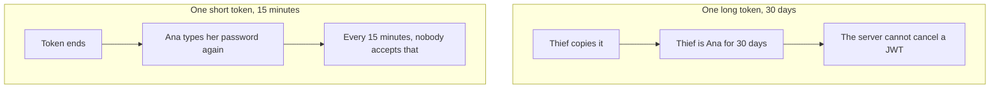
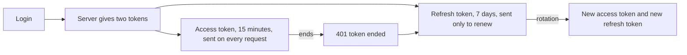
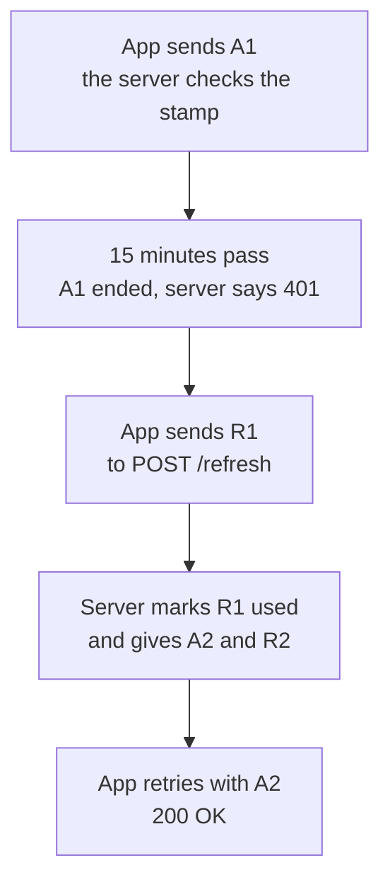
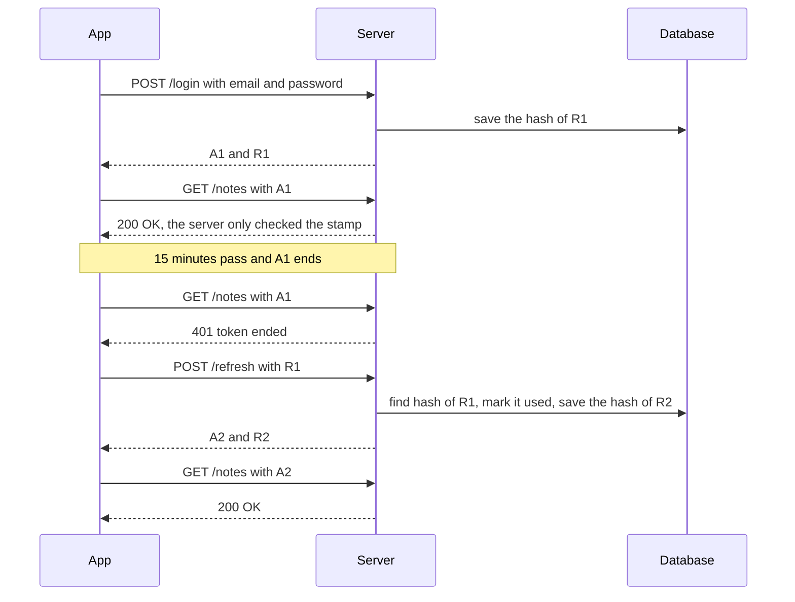
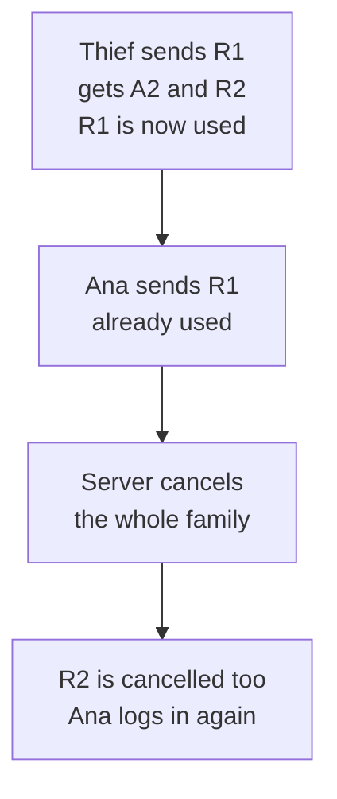
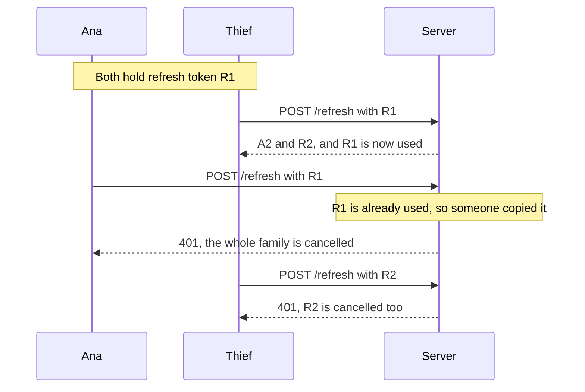
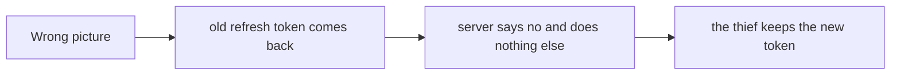
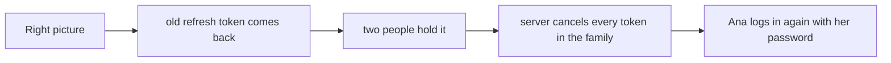
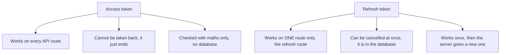

# 07. Access and refresh tokens

> **Subject:** Backend and API · **Lesson:** 07 · **Made:** 2026-10-23 · **Remade in short cards:** 2026-10-29 · **Status:** ready
>
> **You will be able to:** say why a login uses two tokens, draw the refresh flow with rotation, say what happens when an old refresh token comes back, and say where to keep each token.
>
> **Before this:** [Authentication: sessions vs JWT](06-authentication-sessions-vs-jwt.md) · **Next:** [Authorization](08-authorization.md)
>
> **How to read it:** one card is one idea. Look at the picture, guess, then press the orange bar to check. The blue bars (📖 More detail) hold the longer explanation. Skip them on the first read, and open them when you want more. About 15 minutes for the cards.

## 1. The idea: a day pass and a membership card

At a gym, a **day pass** opens the door and ends tonight. A **membership card** is shown only at the front desk, to get a new day pass. A login works the same way, with **two tokens**.

| | Access token (day pass) | Refresh token (membership card) |
|---|---|---|
| Lives | about 15 minutes | about 7 days |
| Sent | with every request | only to get a new pair |
| Checked | with maths only | in the database |

<details class="guess"><summary>🤔 Guess: a thief copies the access token. How long can the thief use it? Press to check.</summary>

About 15 minutes, until it ends. A thief who copies a 30 day token would be Ana for 30 days, and the server cannot cancel a JWT. With two tokens, theft of the access token hurts only for minutes.

</details>

> **Remember:** the access token is used often and ends fast. The refresh token is used rarely, lives in the database, and works once.

<details class="more"><summary>📖 More detail: four new words, the problem, and the full picture</summary>

**New words.**

- **Access token:** the short-lived token you send with every request. It is usually a JWT (lesson 06).
- **Refresh token:** a long random string you send only to get a new pair of tokens. The server keeps its hash in the database, so the server can cancel it.
- **Rotation:** every time you use a refresh token, the server marks it used and gives you a new one. A refresh token works once.
- **HttpOnly cookie:** a cookie that JavaScript on the page cannot read. The browser still sends it by itself.

The rule to remember: **the access token is used often and ends fast. The refresh token is used rarely, lives in the database, and works once.**

**The problem, drawn.** With one token you must pick a bad choice. Notice what each choice costs.



**The big picture.** The refresh token appears only when the access token has ended.



**The gym again.**

A **day pass** and a **membership card** at a gym.

- The **day pass** opens the door. It ends tonight. The guard only looks at the date. This is the access token.
- The **membership card** is shown only at the front desk, to get a new day pass. This is the refresh token.
- The desk writes in a book each time. It gives you a **new card** and crosses out the old one (rotation).
- If a crossed-out card shows up again, the desk knows someone copied it. It cancels the membership and asks you to come with your ID (reuse detection, and your password).

Where the analogy stops: a gym day pass is checked by a person. An access token is checked by maths, and it cannot be cancelled before it ends.

</details>

## 2. The refresh flow

When the access token ends, the server says 401. The app sends the refresh token to one route and gets a new pair.



<details class="guess"><summary>🤔 Guess: on a normal request with a good access token, does the server use the database? Press to check.</summary>

No. It only checks the stamp and the time. The database is used only when the access token has ended and the app sends the refresh token.

</details>

> **Remember:** the database is touched only at the refresh step.

<details class="more"><summary>📖 More detail: the story over time, and every step</summary>

**The normal story over time.** Notice that the database is used only when the access token has ended.



**Every step.**

| Step | Who | What happens | Database after |
|---|---|---|---|
| 1 | App | `POST /login`. The password is right. | empty |
| 2 | Server | Makes access token A1 (ends in 15 minutes). Makes refresh token R1. Saves the **hash** of R1. | R1: active |
| 3 | Server | Sends A1 and R1 to the app. | R1: active |
| 4 | App | `GET /notes` with A1. The server checks the stamp and the time. **No database.** | R1: active |
| 5 | App | 15 minutes later, A1 has ended. The server says **401**. | R1: active |
| 6 | App | `POST /refresh` with R1. | R1: active |
| 7 | Server | Hashes R1 and finds the row. It is active and not too old. | R1: active |
| 8 | Server | **Rotation.** Marks R1 as used. | R1: **used** |
| 9 | Server | Makes A2 and R2. Saves the hash of R2 in the same family. | R1: used, R2: active |
| 10 | App | Replaces A1 and R1 with A2 and R2. Retries `GET /notes` with A2. It works. | same |
| 11 | Thief | Sends the old R1. | same |
| 12 | Server | Finds R1, sees it is **used**. This is reuse. Cancels the whole family. | R1: revoked, R2: **revoked** |
| 13 | Ana | Her next refresh with R2 fails. She logs in again with her password. | new family F2 |

**Step through it yourself:** [open the access and refresh tokens stepper](visuals/07-access-and-refresh-tokens.html). It has four stories: normal use, a thief copies the access token, a thief copies the refresh token, and logout. Guess first, then press Next.

</details>

## 3. Rotation: a refresh token works once

Every time you use a refresh token, the server marks it **used** and gives you a new one. The old row is not deleted. The table after the first refresh:

| Hash of the token | User | Family | Status |
|---|---|---|---|
| `7c3f…` (R1) | 7 | F1 | **used** |
| `b81e…` (R2) | 7 | F1 | active |

<details class="guess"><summary>🤔 Guess: R1 was used. Why does the server keep its row, and not delete it? Press to check.</summary>

To remember it. If R1 ever comes back, the server sees "used" and knows that someone copied it. The table holds only the **hash** of each token, never the token.

</details>

> **Remember:** the server keeps the used row. That is how it spots an old token that comes back.

<details class="more"><summary>📖 More detail: the database snapshot, family, and hash</summary>

A snapshot after the first refresh in the normal story. Notice that the old row is not deleted. It stays as `used`. That is how the server knows if the old token ever comes back.

- **Family:** all the refresh tokens that came from one login. If one is reused, the server cancels the whole family.
- The database holds the **hash** of each refresh token, never the token. If the table leaks, the hashes cannot be used to refresh.

</details>

## 4. Reuse: a used token that comes back is a warning

A thief copied R1 and uses it first. Later Ana uses R1 too. The server sees that R1 is already used, so two people hold it. It cancels the **whole family**.



<details class="guess"><summary>🤔 Guess: who is locked out in the end, the thief or Ana? Press to check.</summary>

**Both.** The thief's R2 is cancelled too. Ana must type her password again. That is a small price, because the thief is out.

</details>

> **Remember:** a used refresh token that comes back means two people hold it. Cancel the whole family.

<details class="more"><summary>📖 More detail: the attack over time, and wrong picture against right picture</summary>

**The attack over time.** Notice who gets locked out in the end.



**Wrong picture and right picture.**

**Wrong picture:** "A used refresh token is just ignored."



**Right picture:** a used token that comes back is a **warning**. Cancel the whole family.



</details>

## 5. The smallest code that shows it

A tiny version of the server. It stores only the hash, rotates on each use, and kills the user's tokens on reuse.

```js
const { randomBytes, createHash } =
  require("node:crypto");
const db = new Map();
const sha = (t) => createHash("sha256")
  .update(t).digest("hex");
function issue(userId) {
  const t = randomBytes(32).toString("base64url");
  db.set(sha(t), { userId, used: false });
  return t;
}
function refresh(t) {
  const row = db.get(sha(t));
  if (!row) return "rejected: unknown";
  if (row.used) {
    for (const [k, r] of db)
      if (r.userId === row.userId) db.delete(k);
    return "rejected: reuse";
  }
  row.used = true;
  return issue(row.userId);
}
const t1 = issue(7);
const t2 = refresh(t1);
console.log(typeof t2);
console.log(refresh(t1));
console.log(refresh(t2));
```

<details class="guess"><summary>🤔 Guess: what do the three `console.log` lines print? Press to check.</summary>

```
string
rejected: reuse
rejected: unknown
```

Rotation gave a new token. The replay of `t1` is the reuse. Ana's newest token `t2` is gone too, so she must log in again.

</details>

> **Remember:** store the hash, mark the token used, rotate, and cancel on reuse.

<details class="more"><summary>📖 More detail: the same code with comments, and the output</summary>

```js
const { randomBytes, createHash } = require("node:crypto");
const db = new Map();                              // hash of token -> { userId, used }
const sha = (t) => createHash("sha256").update(t).digest("hex");

function issue(userId) {
  const token = randomBytes(32).toString("base64url");
  db.set(sha(token), { userId, used: false });     // store only the hash
  return token;
}
function refresh(token) {
  const row = db.get(sha(token));
  if (!row) return "rejected: unknown";
  if (row.used) {                                  // a used token came back
    for (const [k, r] of db) if (r.userId === row.userId) db.delete(k);
    return "rejected: reuse, all tokens of this user are dead";
  }
  row.used = true;
  return issue(row.userId);                        // rotation: a new one each time
}
const t1 = issue(7);
const t2 = refresh(t1);
console.log(typeof t2);
console.log(refresh(t1));                          // the thief replays the old token
console.log(refresh(t2));                          // Ana's newest token, also cancelled
```

**Output:**

```
string
rejected: reuse, all tokens of this user are dead
rejected: unknown
```

The first line shows that rotation gave a new token. The second line is the reuse. The third line shows that Ana's newest token is gone too. She must log in again. (This small version cancels all tokens of the user. A real app cancels one family, so other devices keep working.)

</details>

## 6. Where to keep each token

| | Web app | React Native app |
|---|---|---|
| Access token | in memory (a JavaScript variable) | in memory |
| Refresh token | an `HttpOnly`, `Secure`, `SameSite` cookie, sent only to the refresh route | the phone's secure storage (Keychain on iOS, Keystore on Android) |
| Never | `localStorage` | `AsyncStorage` (not encrypted) |

<details class="guess"><summary>🤔 Guess: where does a React Native app keep the refresh token? Press to check.</summary>

In the phone's secure storage: the Keychain on iOS, the Keystore on Android (for example `expo-secure-store`). Not in `AsyncStorage`, because it is not encrypted.

</details>

> **Remember:** access token in memory. Refresh token in an `HttpOnly` cookie, or the Keychain or Keystore.

<details class="more"><summary>📖 More detail: what each token can do, and the mistake as written</summary>

**What each token can and cannot do.**



**Mistake: both tokens in `localStorage`.**

**Wrong:** both tokens in `localStorage` (or `AsyncStorage` in React Native).

**Right:** access token in memory. Refresh token in an `HttpOnly` cookie (web) or in the Keychain or Keystore (phone).

**Why:** the React Native docs call `AsyncStorage` unencrypted and list token storage under "don't use". On the web, a script injected by XSS can read `localStorage`.

</details>

## 7. Mistake 1: a refresh token that never changes

```js
// POST /refresh (a sketch)
const row = db.find(sha(token));
if (row) return { accessToken: signJwt(row.userId) };
// same refresh token, forever
```

<details class="guess"><summary>🤔 Guess: a thief copies this token. Will you ever notice? Press to check.</summary>

No. The token works for its whole life, and the server sees nothing wrong. **Rotate** on every use and watch for reuse.

</details>

> **Remember:** rotate on every use, and watch for reuse.

<details class="more"><summary>📖 More detail: the wrong code and the right code</summary>

**Wrong:** a refresh token that never changes.

```js
// POST /refresh
const row = db.find(sha(token));
if (row) return { accessToken: signJwt(row.userId) };   // same refresh token forever
```

**Right:** rotate on every use, and watch for reuse.

```js
if (!row) return reject();
if (row.status !== "active") return cancelFamily(row.familyId);   // reuse
row.status = "used";
return issuePair(row.userId, row.familyId);
```

**Why:** a stolen token that never changes works for its whole life, and nobody ever finds out.

</details>

## 8. Mistake 2: saving the refresh token itself

```js
// wrong: the token itself
db.insert({ token: refresh, userId });
// right: only the hash
db.insert({ hash: sha256(refresh), userId,
  status: "active" });
```

<details class="guess"><summary>🤔 Guess: the table leaks. What can the attacker do in each case? Press to check.</summary>

With the **token** saved, the attacker has working refresh tokens and can log in as your users. With only the **hash** saved, the attacker has nothing to send. A refresh token is already 256 random bits, so a fast hash such as SHA-256 is enough.

</details>

> **Remember:** store the hash of the refresh token, never the token.

<details class="more"><summary>📖 More detail: the wrong code and the right code</summary>

**Wrong:** saving the refresh token itself in the database.

```js
db.insert({ token: refresh, userId });
```

**Right:**

```js
db.insert({ hash: sha256(refresh), userId, status: "active" });
```

**Why:** a leaked table would give the attacker working tokens.

</details>

## 9. Mistake 3: two refreshes at the same moment

Two tabs, or two requests, send the **same** refresh token at the same moment. The first one wins. The second one looks like reuse, so the server cancels the family and the user is logged out.

<details class="guess"><summary>🤔 Guess: how do you stop your own app from doing this? Press to check.</summary>

On the client, keep **one refresh in flight**. The other requests wait for it and reuse the result. Or give the server a short grace time for the old token.

</details>

> **Remember:** one refresh at a time on the client.

<details class="more"><summary>📖 More detail: the mistake as written, and a 30 day access token</summary>

**Wrong:** two requests refresh at the same time with the same token, and the user is logged out.

**Right:** on the client, keep one refresh in flight. The other requests wait for it and reuse the result.

**Another mistake:** making the access token last 30 days "so users do not log in again".

**Wrong:** making the access token last 30 days "so users do not log in again".

**Right:** about 15 minutes, and let the refresh token do the long work.

</details>

## 10. Why it matters and what it costs

- **Without it:** one token is either too long (a thief gets many days and you cannot cancel) or too short (users log in all day).
- **With it:** the access token ends fast, so theft hurts only for minutes. The refresh token lives in the database, so you can cancel it. Rotation turns a stolen refresh token into a trap.
- **The cost:** more moving parts (a refresh route, a table, client code that retries after a 401). An access token cannot be cancelled before it ends. And two requests can race.

<details class="more"><summary>📖 More detail: the cost and the source, as they were written</summary>

- **Problem without it:** one token is either too long (a thief gets many days and you cannot cancel) or too short (users log in all day).
- **How it solves it:** the access token ends fast, so theft hurts only for minutes. The refresh token lives in the database, so you can cancel it. Rotation turns a stolen refresh token into a trap. RFC 9700 (the OAuth security best practices from January 2025) says refresh tokens for "public clients" (apps that cannot keep a secret, such as browser and phone apps) must be sender-constrained or use rotation. It also says the server must be able to detect when a refresh token is replayed, and then revoke the active refresh token.
- **Cost:**
  - **More moving parts.** A refresh route, a database table, and client code that retries after a 401.
  - **Cannot cancel an access token.** After logout it still works until it ends. You choose the life: shorter means safer and more refresh traffic.
  - **Races.** Two tabs or two requests may refresh at the same moment with the same token. The second one looks like reuse and logs the user out. Fix it on the client (only one refresh at a time) or give the server a short grace time.
  - **Cancel one family, not all devices.** If you cancel every token of the user, a thief on one phone logs Ana out of all her devices.

</details>

## 11. Watch and play

Links checked on 2026-10-23. I opened every page, and I checked each video's title and channel. I did not watch the videos, so I did not check their length.

- **Video:** [Refresh Token Rotation and Reuse Detection in Node.js JWT Authentication](https://www.youtube.com/watch?v=s-4k5TcGKHg) by Dave Gray. The title says it shows rotation and reuse detection in Node. Watch it after the stepper, and compare its steps with the trace in section 5.
- **Play with it:** [The access and refresh tokens stepper](visuals/07-access-and-refresh-tokens.html) in this folder. Run the "thief copies the refresh token" story twice, and say out loud who is locked out and why.
- **Play with it:** [jwt.io debugger](https://jwt.io/). Paste the access token from your own app. Read the `exp` claim. It is a number of seconds since 1970. Check that it is about 15 minutes after `iat`.
- **Read:** [Auth0, Refresh token rotation](https://auth0.com/docs/secure/tokens/refresh-tokens/refresh-token-rotation). It explains rotation and automatic reuse detection in plain words.
- **Read:** [Auth0, Token storage](https://auth0.com/docs/secure/security-guidance/data-security/token-storage). It says the most secure place for tokens in a browser app is memory, and warns about `localStorage`.
- **Read:** [React Native, Security](https://reactnative.dev/docs/security). It says `AsyncStorage` is unencrypted and points to Keychain and Keystore wrappers such as `expo-secure-store`.
- **Read:** [RFC 9700, OAuth 2.0 Security Best Current Practice](https://www.rfc-editor.org/rfc/rfc9700.html). Search the page for "Refresh Token Protection" (section 4.14).

<details><summary>More links (optional)</summary>

- **Read:** [MDN, Set-Cookie](https://developer.mozilla.org/en-US/docs/Web/HTTP/Reference/Headers/Set-Cookie). Covers `HttpOnly`, `Secure`, `SameSite`, `Max-Age` and the `__Host-` prefix.
- **Read:** [OWASP Session Management Cheat Sheet](https://cheatsheetseries.owasp.org/cheatsheets/Session_Management_Cheat_Sheet.html). It says not to keep session ids or JWTs in `localStorage` or `sessionStorage`.
- **Read:** [RFC 6750, Bearer Token Usage](https://www.rfc-editor.org/rfc/rfc6750.html). How `Authorization: Bearer` works, and why tokens must be protected.
- **Read:** [expo-secure-store](https://docs.expo.dev/versions/latest/sdk/securestore/). Uses the Keychain on iOS and the Keystore on Android.
- **Code in this repo:** [the Express and GraphQL auth tutorial](express-graphql-auth-tutorial.md) and [its example app](examples/express-graphql-auth/). It has 15 minute access tokens and single-use refresh tokens saved as hashes.

</details>

## 12. Practice

**A. Predict the output** (write your answer before opening)

```js
// the database after: login, refresh (R1 used, R2 made), then R1 is sent again
const rows = [
  { token: "R1", status: "used" },
  { token: "R2", status: "active" },
];
const sentAgain = "R1";
const row = rows.find((r) => r.token === sentAgain);
console.log(row.status === "active" ? "refresh ok" : "cancel the family");
```

<details><summary>Answer</summary>

`cancel the family`

R1 is `used`, so it is not `active`. A used token that comes back means two people hold it. The server cancels the family, including R2.

</details>

**B. Fix the bug**

```js
function refresh(refreshToken) {
  const row = db.get(sha(refreshToken));
  if (!row) return null;
  return issuePair(row.userId);          // same user, a new pair
}
```

What is wrong? There are two problems.

<details><summary>Answer</summary>

1. The old refresh token is **not marked as used**, so it works again and again. This is not rotation.
2. A refresh token that is already used, revoked, or too old is **not checked**.

```js
function refresh(refreshToken) {
  const row = db.get(sha(refreshToken));
  if (!row || row.expiresAt <= now()) return null;
  if (row.status !== "active") { cancelFamily(row.familyId); return null; }   // reuse
  row.status = "used";                                                       // rotation
  return issuePair(row.userId, row.familyId);
}
```

</details>

**C. Write it yourself**

Open `practice/07-access-and-refresh-tokens.js`. You write four things inside a small auth service: `issuePair`, `verifyAccess`, `refresh` (with rotation and reuse detection) and `logout`. A JWT helper is already given. The test moves a fake clock, so you can see tokens run out.

```
node --test learn/backend-api/practice/07-access-and-refresh-tokens.test.js
```

<details><summary>One possible answer</summary>

```js
function issuePair(userId, familyId) {
  const accessToken = signJwt({ sub: String(userId) }, secret, { expiresInSeconds: accessTtlSeconds, now });
  const refreshToken = randomBytes(32).toString("base64url");
  rows.set(sha256(refreshToken), {
    userId, familyId, status: "active", expiresAt: now() + refreshTtlSeconds * 1000,
  });
  return { accessToken, refreshToken };
}

function verifyAccess(token) {
  return verifyJwt(token, secret, { now });
}

function refresh(refreshToken) {
  if (typeof refreshToken !== "string") return null;
  const row = rows.get(sha256(refreshToken));
  if (!row) return null;
  if (row.status !== "active") {                 // used or revoked, so it came back
    for (const r of rows.values()) if (r.familyId === row.familyId) r.status = "revoked";
    return null;
  }
  if (now() >= row.expiresAt) return null;       // too old
  row.status = "used";                           // rotation
  return issuePair(row.userId, row.familyId);
}

function logout(refreshToken) {
  const row = typeof refreshToken === "string" ? rows.get(sha256(refreshToken)) : null;
  if (!row) return;
  for (const r of rows.values()) if (r.familyId === row.familyId) r.status = "revoked";
}
```

Notice that `logout` and the reuse branch do the same thing: cancel the family. Also notice that after `logout`, `verifyAccess` still works until the access token ends. A test checks this on purpose, so you see the cost with your own eyes.

</details>

## 13. Interview question

**Q:** "Why do we use both an access token and a refresh token? What is rotation, and where do you store them?"

<details><summary>A strong answer, in four parts</summary>

1. **Problem:** one token is a bad deal. If it lives long, a stolen one works for days and a JWT cannot be cancelled. If it lives short, users must log in all the time.
2. **How it works:** the **access token** is a short JWT (about 15 minutes) sent on every request, and checked with no database. The **refresh token** is a long random string, sent only to a refresh route, and saved as a hash in the database. When the access token ends, the app sends the refresh token and gets a new pair. That is **rotation**: the old refresh token is marked used. If a used token comes back, two people hold it, so the server cancels the whole family and the user logs in again.
3. **Tradeoff:** more parts to build (a table, a route, client retry code). Access tokens still cannot be cancelled before they end, so the life is a choice. Parallel refreshes can look like reuse and need care. I store the access token in memory and the refresh token in an `HttpOnly` cookie on the web, or in the Keychain or Keystore on a phone, never in `localStorage` or `AsyncStorage`.
4. **My example:** *This part is an idea, not a fact.* You build React Native apps (for example ZWS) and DBO has an Auth service that issues JWTs. Your notes do not say how long tokens last or whether refresh tokens are used. If DBO does use refresh tokens, say how long they last and where the phone keeps them. If it does not, say what you would add: a hashed refresh table with rotation, and the phone's secure storage for the refresh token.

</details>

## 14. Explain it back

Close this file. Press the **Record my explanation** button under this heading and explain it out loud, like to a new junior, in 4 parts: problem, how it works, tradeoff, my example. Use the words "day pass", "membership card" and "family". Then save the transcript into `my-learning/recordings/`, or write your best version below. Run `/explain-check refresh tokens` or ask the `explain-coach` agent to review it.

### My explanation

<write here>

### Coach feedback

<the explain-coach agent writes here>

## 15. Review questions (day 1, 3, 7, 21)

1. Why not use one token that lasts 30 days?
2. What is rotation? What does the server do when a used refresh token comes back, and why?
3. After logout, which token still works, and for how long? Why?
4. Draw the picture from section 2c from memory: both time lines, normal and thief.

<details><summary>Answers</summary>

1. A stolen token would work for 30 days, and a JWT cannot be cancelled. A short access token limits the damage to minutes. The refresh token, which lives in the database, can be cancelled.
2. Rotation means a refresh token works once. The server marks it used and gives a new one. If a used token comes back, two people hold it. The server cancels the whole family, so the thief's newest token dies too. The real user logs in again with the password.
3. The access token still works until its time ends (for example 15 minutes), because the server checks it with maths and no database. The refresh token is cancelled at once, so no new access token can be made.
4. Normal: login gives A1 and R1. A request with A1 works. A1 ends, the app sends R1 to refresh, and gets A2 and R2. Thief: the thief uses R1 first and gets A2 and R2. Ana's app sends R1 and the server sees it is used, so it cancels the family. R2 is dead too.

</details>

## 16. Go deeper (optional)

Open these when you are ready. None of them is needed for the cards above.

<details><summary>The details interviewers ask</summary>

**Why an opaque refresh token.** The refresh token here is a random string, not a JWT. The server must look it up anyway to check its status, so a JWT adds nothing. Random bytes (32 bytes is plenty) are simple and safe.

**Why store the hash.** Same idea as passwords, but a fast hash (SHA-256) is fine. A refresh token is already 256 random bits, so nobody can guess it. A slow hash is only needed for human passwords (lesson 09).

**Sender-constrained tokens.** RFC 9700 offers another way for refresh tokens: bind the token to the client with a cryptographic key, so a copied token is useless. Rotation is the simpler choice that most apps use.

**What Auth0 does.** Auth0 documents "automatic reuse detection": when a used refresh token comes back, it invalidates the whole family, including the newest token, and the user must log in again.

**Bearer tokens.** RFC 6750 says anyone who holds a bearer token can use it, so it must be protected in storage and in transport. Always use HTTPS.

**Where the cookie goes.** Give the refresh cookie `Path=/auth/refresh` (or similar) so the browser sends it only to that route. Add `SameSite` and `Secure`. Because a cookie is sent by the browser by itself, protect the refresh route from CSRF as well (OWASP says `SameSite` is not a full replacement for CSRF tokens).

**Lifetimes.** There is no law. A common choice is access 5 to 30 minutes and refresh 7 to 30 days. Say the tradeoff, then commit to a number.

</details>

## Connected lessons

- [Authentication: sessions vs JWT](06-authentication-sessions-vs-jwt.md): the access token is the JWT from that lesson. This lesson fixes its biggest problem, that you cannot cancel it.
- [Authorization](08-authorization.md): the next lesson. The token proves who you are. The server still has to decide what you may do.
- [Password hashing](09-password-hashing.md): the password is checked at login. After that, the refresh token does the work.
- [Rate limiting](11-rate-limiting.md): protect the login and refresh routes from guessing.
- [Hasura: when and when not](14-hasura-when-and-when-not.md): Hasura checks the access token on each request.
