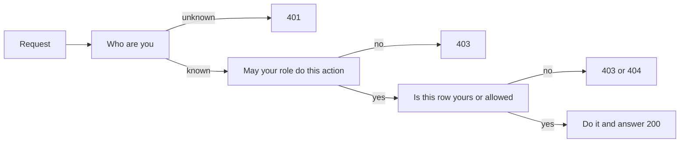
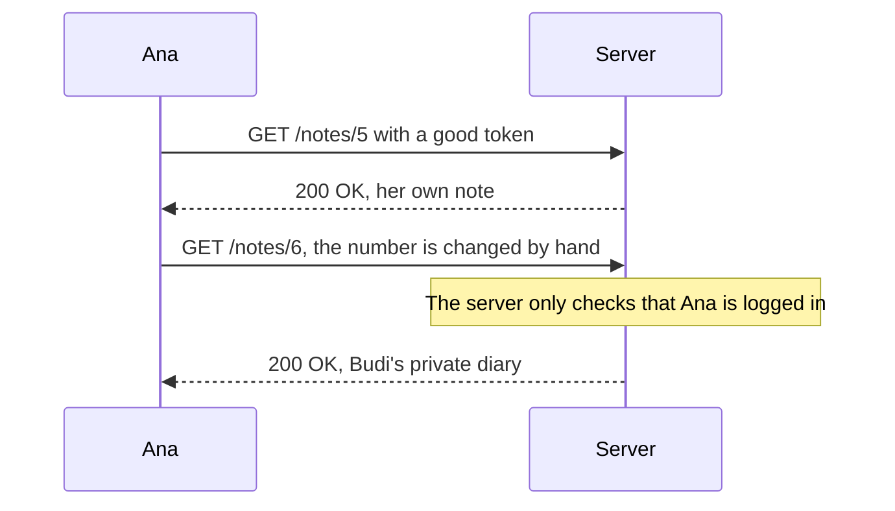
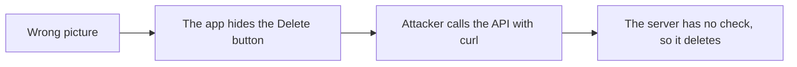
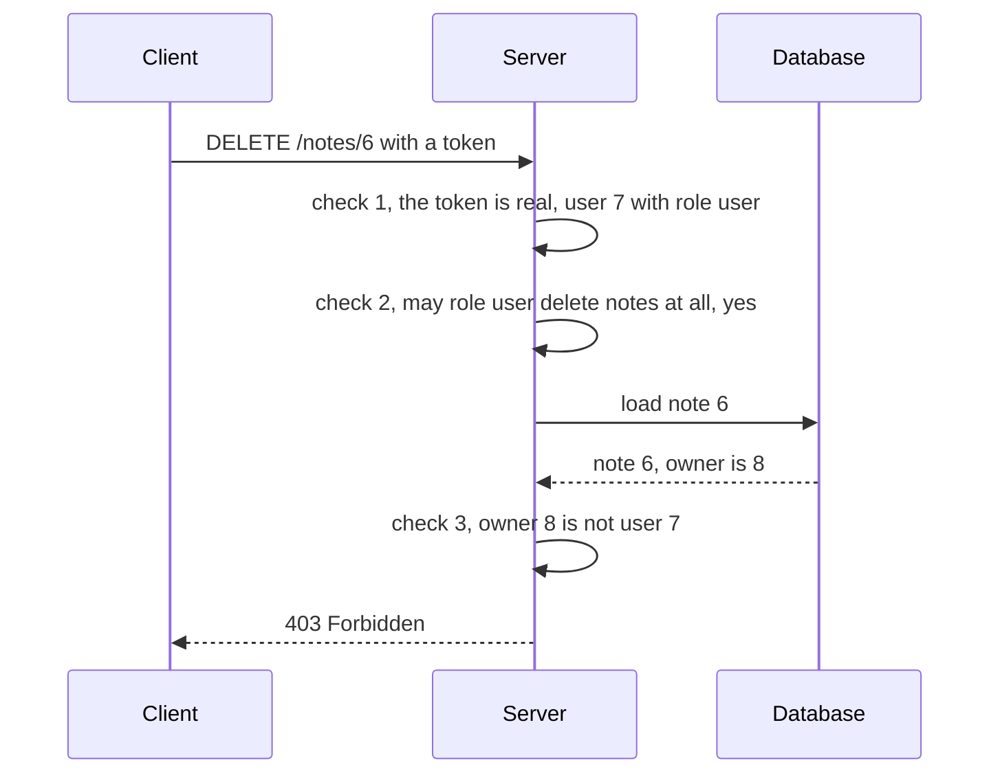
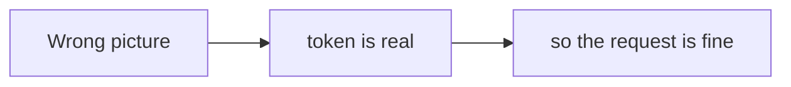
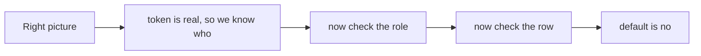
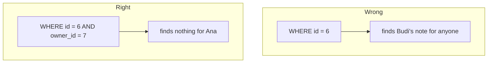
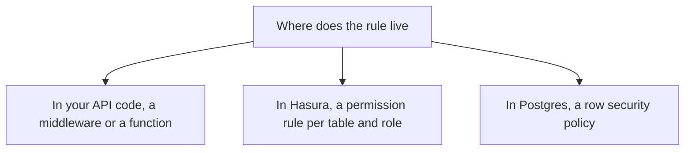

# 08. Authorization

> **Subject:** Backend and API · **Lesson:** 08 · **Made:** 2026-10-23 · **Status:** ready
> **You will be able to:** say the difference between authentication and authorization, write the role check and the owner check on the server, and explain what IDOR is and how to stop it.
> **Before this:** [Access and refresh tokens](07-access-and-refresh-tokens.md) · **Next:** [Password hashing](09-password-hashing.md)

## 1. The idea in one sentence

**Authorization** means deciding what a logged-in user may do. Authentication told the server **who** you are. Authorization decides **what you may do**, and the server must check it on every request, and say no unless a rule says yes.

New words:

- **Role:** a label on a user, such as `admin` or `user`. A role decides which actions are possible.
- **Permission:** one thing a role may do, such as "delete a note".
- **Row-level rule:** a rule about which rows you may touch, such as "only your own notes". A row is one record in the database.
- **IDOR:** you change an id in the URL and see another person's record, because the server never checked who owns it. (Interview words: *Insecure Direct Object Reference*. OWASP's API list calls it *BOLA*, broken object level authorization.)

The rule to remember: **three questions, in this order. Who are you? May your role do this action? Is this your row? The default answer is no.**

## 2. The pictures

### 2a. The big picture

Notice that each question can stop the request with its own status code.



### 2b. The problem, drawn

A good token is not enough. Notice that the server checks the login and nothing else.



A second way to fail: the check lives only in the app.



### 2c. How it works over time

One request, three checks. Notice that the owner is known only after the database answers.



### 2d. What is in the tables right now

Three people and three notes. Notice that the owner is a column on each note. That column is what makes the row rule possible.

| users.id | name | role |
|---|---|---|
| 7 | Ana | user |
| 8 | Budi | user |
| 1 | Siti | admin |

| notes.id | owner_id | title |
|---|---|---|
| 5 | 7 | shopping list |
| 6 | 8 | private diary |
| 9 | 7 | ideas |

What each person gets when they **delete note 6**:

| Who | Role check | Row check | Answer |
|---|---|---|---|
| nobody (no token) | stops here | | **401** |
| Ana (user 7) | passes | owner is 8, not 7 | **403** (or 404 to hide it) |
| Budi (user 8) | passes | owner is 8, yes | **200** |
| Siti (admin) | passes | admins may touch any row | **200** |

### 2e. Right against wrong

**Wrong picture:** "A logged-in user is a trusted user."



**Right picture:** a real token only answers question one.



**Wrong:** ask the database for the note by id only. **Right:** put the owner in the question.



### 2f. Where can the rule live?

Pick **one main place**, so nobody forgets it. Notice that all three can work.



## 3. Real life analogy

A **hotel**. At check-in, the desk looks at your passport (authentication). Then it gives you a **key card**.

- The card opens **your room** and no other room. This is the **row rule**.
- It opens the gym because you are a guest, but not the staff room. This is the **role rule**.
- Staff cards open many rooms. This is an **admin**.
- Every door checks the card **at the door**. The lift button you did not press does not matter. A door that does not check is open to everyone.

Where the analogy stops: a hotel lock is built into the door, so you cannot forget it. In software, **you write the check in every route**. One forgotten route is an open door. That is why OWASP says to write the rule once and reuse it.

## 4. The smallest code that shows it

```js
function deleteStatus(user, note) {
  if (!user) return 401;                         // not logged in
  if (user.role === "admin") return 200;         // rule 1: the role
  if (note.ownerId === user.id) return 200;      // rule 2: it is your row
  return 403;                                    // everything else: no
}
const note = { id: 5, ownerId: 7 };
console.log(deleteStatus(null, note));
console.log(deleteStatus({ id: 7, role: "user" }, note));
console.log(deleteStatus({ id: 8, role: "user" }, note));
console.log(deleteStatus({ id: 1, role: "admin" }, note));
```

**Output:**

```
401
200
403
200
```

Read the last line of the function. The default is **403**. The function says yes only when a rule says yes. This is called **deny by default**.

## 5. What really happens, step by step

Ana sends `DELETE /notes/6`. The server runs these steps in this order.

| Step | What the server does | Result so far |
|---|---|---|
| 1 | Reads the token. Checks the stamp and the time (lesson 06). | user 7, role user. No good token would stop here with **401**. |
| 2 | Role check: may the role `user` delete notes? Looks in the role table. | Yes. An unknown role or action would stop here with **403** (deny by default). |
| 3 | Loads note 6 from the database. | Note 6 exists, owner is 8. A missing note would stop here with **404**. |
| 4 | Row check: is owner 8 equal to user 7? | No. |
| 5 | Chooses the answer: **403**, or **404** if the server prefers to hide that note 6 exists. | The note stays. |
| 6 | Writes a log line: user 7 was denied on note 6. (OWASP asks to log access control failures and alert when they repeat.) | A script that tries ids 1, 2, 3, ... becomes visible. |

**Step through it yourself:** [open the authorization stepper](visuals/08-authorization.html). It has five stories: Ana reads her own note, Ana changes the id (IDOR, with a buggy and a fixed server), an admin deletes any note, 401 against 403 against 404, and the same rule inside Hasura. Guess first, then press Next.

## 6. Why it exists and what it costs

- **Problem without it:** a real token only proves who you are. With no authorization, every logged-in user can read and change everything. OWASP puts **broken access control** at number 1 in its Top 10 for 2025 (A01), and says every application it tested had some form of it.
- **How it solves it:** you check at the server, on every request, in this order: who, which action, which row. You answer no unless a rule says yes. Roles alone cannot say "only your own notes", so you add a **row rule** (the owner column).
- **Cost:**
  - **A check in every route.** Forget one and you have a hole. Write the rule **once** (a function, a middleware, or a database rule) and reuse it.
  - **Roles grow.** `admin`, `editor`, `viewer`, `editor-but-only-for-team-A`... This is called role explosion. Rules based on data (owner, team, status) fit better than more roles.
  - **Extra database work.** You need the owner of the row. Put it in the query (`WHERE id = $1 AND owner_id = $2`) so it costs no extra trip.
  - **Hidden answers are a choice.** 404 hides that a record exists. 403 is more honest. MDN says servers may send 404 instead of 403 when they do not want to admit a resource exists.

<details><summary>Go deeper (optional): models, the database, and the OWASP list</summary>

**RBAC, ABAC, ReBAC.** RBAC (role-based) gives permissions to roles. ABAC (attribute-based) decides from facts about the user, the thing and the situation, for example "the note is public" or "the order belongs to your store". ReBAC (relationship-based) decides from links, for example "member of the team that owns the project". The OWASP Authorization Cheat Sheet says ABAC and ReBAC should typically be preferred for application development, because RBAC struggles with object-level decisions, multi-tenancy and role explosion.

**OWASP's prevention list for A01:2025** (shortened):

- Deny by default, except for public resources.
- Implement access control once and reuse it.
- Enforce record ownership. Do not let a user create, read, update or delete any record they like.
- Log access control failures, and alert admins when they repeat.
- Rate-limit API access to slow down scripts.
- Keep stateless JWTs short-lived, and use refresh tokens for longer sessions.
- Test access control in unit and integration tests.

**API1:2023 (BOLA) in the OWASP API list.** The API accepts an object id and does not check that the logged-in user may use that object. The prevention advice is to check, in every function that uses an id from the client, whether the user may do the action on that record. Random ids such as UUIDs make guessing harder. They do **not** replace the check.

**Postgres row level security.** The database itself can hold the row rule. From the PostgreSQL docs:

```sql
CREATE TABLE accounts (manager text, company text, contact_email text);
ALTER TABLE accounts ENABLE ROW LEVEL SECURITY;
CREATE POLICY account_managers ON accounts TO managers
    USING (manager = current_user);
```

Once row security is on, a table with no policy shows no rows (deny by default). Superusers always bypass it. Table owners bypass it too, unless you use `FORCE ROW LEVEL SECURITY`.

**Hasura.** A permission rule belongs to one table, one role and one action. A row filter such as `owner_id: { _eq: X-Hasura-User-Id }` takes the user id from the JWT claim `x-hasura-user-id` and is added to the SQL query. The role comes from `x-hasura-default-role` and `x-hasura-allowed-roles` in the token, and the `admin` role can do anything. Because the rule sits in one place, every query from the role is filtered.

**Authorization in GraphQL.** Check in the resolver or, better, in one shared layer (a directive or a middleware). Checking only at the top query is a common hole, because a nested field can reach other people's data.

</details>

## 7. Common mistakes

**Wrong:** only checking the login.

```js
app.get("/notes/:id", requireLogin, async (req, res) => {
  const note = await db.note.findUnique({ where: { id: Number(req.params.id) } });
  res.json(note);
});
```

**Right:** the owner is part of the question.

```js
app.get("/notes/:id", requireLogin, async (req, res) => {
  const where = req.user.role === "admin"
    ? { id: Number(req.params.id) }
    : { id: Number(req.params.id), ownerId: req.user.id };
  const note = await db.note.findFirst({ where });
  if (!note) return res.sendStatus(404);
  res.json(note);
});
```

**Why:** this is IDOR. `findUnique` by id finds anyone's note.

**Wrong:** hiding the Delete button and calling that security.

**Right:** the button may be hidden to help the user, but the **server** checks every request. Treat the app as an attacker's tool. Anyone can call your API with `curl`.

**Wrong:** trusting a role sent by the client.

```js
const role = req.body.role;              // the client says it is an admin. Believe it?
```

**Right:** take the role from the **signed token** or from your database, never from the request body.

**Wrong:** the same answer for everything.

```js
return res.sendStatus(401);              // for "no token" and for "not allowed"
```

**Right:** 401 means "who are you?" and 403 means "I know you, and no". A client can use the difference: on 401 it may refresh the token or show a login. On 403 it should show "you may not do this".

**Wrong:** many routes, each with its own copy of the check.

**Right:** one function (`can(user, action, resource)`) or one middleware, used everywhere. **Why:** the one you forget is the one that gets attacked.

## 8. Watch and play

Links checked on 2026-10-23. I opened every page, and I checked each video's title and channel. I did not watch the video, so I did not check its length.

- **Video:** [IDOR Explained: The Most Common Web App Vulnerability](https://www.youtube.com/watch?v=vliEtDxQWNc) by Aikido Security. The title says it explains IDOR. Watch it after the stepper, and compare it with story 2.
- **Play with it:** [The authorization stepper](visuals/08-authorization.html) in this folder. In the IDOR story, say out loud which line of the buggy server is missing.
- **Play with it:** [PortSwigger Web Security Academy, Access control](https://portswigger.net/web-security/access-control). It explains vertical, horizontal and context-dependent access control, and links to hands-on labs. Try one lab on IDOR. I did not check whether the labs are free for you.
- **Read:** [OWASP Top 10:2025, A01 Broken Access Control](https://top10.owasp.org/2025/A01_2025-Broken_Access_Control). The prevention list is short and worth reading in full.
- **Read:** [OWASP API Security, API1:2023 BOLA](https://api-security.owasp.org/editions/2023/en/0xa1-broken-object-level-authorization). The API version of IDOR, with an example.
- **Read:** [OWASP Authorization Cheat Sheet](https://cheatsheetseries.owasp.org/cheatsheets/Authorization_Cheat_Sheet.html). Deny by default, least privilege, check on every request.
- **Read:** [Hasura, Row level permissions](https://hasura.io/docs/2.0/auth/authorization/permissions/row-level-permissions/). The same rule as in story 5, with a YAML example.

<details><summary>More links (optional)</summary>

- **Read:** [PostgreSQL, Row security policies](https://www.postgresql.org/docs/current/ddl-rowsecurity.html). `ENABLE ROW LEVEL SECURITY`, `CREATE POLICY`, and who can bypass it.
- **Read:** [Hasura, JWT authentication](https://hasura.io/docs/2.0/auth/authentication/jwt/). How the `x-hasura-*` claims in a JWT become session variables.
- **Read:** [Hasura, Roles and session variables](https://hasura.io/docs/2.0/auth/authorization/roles-variables/). The `admin` role and `X-Hasura-User-Id`.
- **Read:** [MDN, 403 Forbidden](https://developer.mozilla.org/en-US/docs/Web/HTTP/Reference/Status/403). 401 against 403, and the note about sending 404 to hide a resource.

</details>

## 9. Practice

**A. Predict the output** (write your answer before opening)

```js
const notes = [
  { id: 5, ownerId: 7 },
  { id: 6, ownerId: 8 },
];
const ana = { id: 7, role: "user" };
const mine = notes.filter((n) => n.ownerId === ana.id);
console.log(mine.length, mine[0].id);
console.log(notes.find((n) => n.id === 6 && n.ownerId === ana.id));
```

<details><summary>Answer</summary>

```
1 5
undefined
```

The first line keeps only Ana's notes: one note, with id 5. The second line asks for note 6 **with owner 7**, and finds nothing. That is the fix for IDOR: the owner is part of the question.

</details>

**B. Fix the bug**

```js
function getNote(user, id, db) {
  if (!user) return { status: 401 };
  const note = db.notes.find((n) => n.id === id);
  if (!note) return { status: 404 };
  return { status: 200, note };
}
```

<details><summary>Answer</summary>

There is no row check. Any logged-in user can read any note. Use one shared rule function, and give the same 404 for "not yours" and "does not exist":

```js
function getNote(user, id, db) {
  if (!user) return { status: 401 };
  const note = db.notes.find((n) => n.id === id);
  if (!note) return { status: 404 };
  if (statusFor(user, "read", note) !== 200) return { status: 404 };   // hide it
  return { status: 200, note };
}
```

</details>

**C. Write it yourself**

Open `practice/08-authorization.js`. There are five small tasks: a deny-by-default role table (`can`), the full rule function (`statusFor`), fix the IDOR bug (`getNote`), filter a list (`listNotesFor`), and write down the right status code for four cases.

```
node --test learn/backend-api/practice/08-authorization.test.js
```

At the start, 4 tests already pass. The buggy `getNote` works for the easy cases (no user, your own note, a public note, an admin). The test that fails is the IDOR one: Ana asks for Budi's private note.

<details><summary>One possible answer</summary>

```js
function can(role, action) {
  const allowed = PERMISSIONS[role];                 // an unknown role gives undefined
  return Array.isArray(allowed) && allowed.includes(action);
}

function statusFor(user, action, note) {
  if (!user) return 401;
  if (!can(user.role, action)) return 403;
  if (action === "create") return 200;
  if (user.role === "admin") return 200;
  if (action === "read" && note.isPublic) return 200;
  if (note.ownerId === user.id) return 200;
  return 403;                                        // deny by default
}

function getNote(user, id, db) {
  if (!user) return { status: 401 };
  const note = db.notes.find((n) => n.id === id);
  if (!note) return { status: 404 };
  if (statusFor(user, "read", note) !== 200) return { status: 404 };
  return { status: 200, note };
}

function listNotesFor(user, notes) {
  if (!user || !can(user.role, "read")) return [];
  if (user.role === "admin") return [...notes];      // a new array, the input is not changed
  return notes.filter((n) => n.ownerId === user.id || n.isPublic);
}

const codes = { noToken: 401, viewerTriesToDelete: 403, privateNoteOfSomeoneElseHidden: 404, noteDoesNotExist: 404 };
```

Notice the order inside `statusFor`: who, then which action, then which row. A `viewer` is stopped by the role table. A `user` passes the role table and is stopped by the row check.

</details>

## 10. Interview question

**Q:** "How do you do authorization in an API? What is IDOR, and how do you prevent it?"

<details><summary>A strong answer, in four parts</summary>

1. **Problem:** authentication only says who the caller is. Without authorization, every logged-in user could read and change everything. **IDOR** (or BOLA) is when a user changes an id in the request and gets another user's record, because the server checked the login but not the owner. OWASP lists broken access control as number 1 in the Top 10 for 2025.
2. **How it works:** on the server, on every request, in this order: who are you (the token), may your role do this action (a role and permission table), and is this your row (an owner check). The default is no. I put the owner into the database question (`WHERE id = $1 AND owner_id = $2`), write the rule once as a function or middleware, and return 401 for "who are you", 403 for "no", and sometimes 404 to hide that a record exists. I log denials.
3. **Tradeoff:** roles are simple but cannot say "only your own", and they grow into role explosion, so I add row rules based on data (owner, team). Rules in my own code are flexible but easy to forget in one route. Rules in Hasura or Postgres row security sit in one place and cover every query, but they are harder to test and to read for complex logic. I do not hide a button and call it security, and random ids are not a replacement for the check.
4. **My example:** your profile lists Hasura, so you can say that a Hasura permission rule such as `owner_id _eq X-Hasura-User-Id` does the row check in one place. A fact from your DBO notes: DBO has store owners in the mobile app and admins in the CMS and a verification admin UI, so there are at least two kinds of users with different powers. *Idea, not a fact:* a store owner should see only the orders of their own store, and an admin sees all. Your notes do not say how DBO enforces this. Fill in what you really did (your own code, or database rules) before the interview.

</details>

## 11. Explain it back

Close this file. Press the **Record my explanation** button under this heading and explain it out loud, like to a new junior, in 4 parts: problem, how it works, tradeoff, my example. Use the words "role check", "row check" and "deny by default". Then save the transcript into `my-learning/recordings/`, or write your best version below. Run `/explain-check authorization` or ask the `explain-coach` agent to review it.

### My explanation

<write here>

### Coach feedback

<the explain-coach agent writes here>

## 12. Review questions (day 1, 3, 7, 21)

1. What is the difference between authentication and authorization? Give one example of each.
2. What is IDOR? Show the one-line change that stops it.
3. When do you return 401, 403 and 404?
4. Draw the picture from section 2a from memory: the three questions, and which status code each one can return.

<details><summary>Answers</summary>

1. Authentication checks **who** you are (a password, then a token). Authorization decides **what you may do** (role check, row check). Example: the token says user 7 (authentication). The server decides that user 7 may not delete note 6 (authorization).
2. IDOR is when changing an id in the request shows another person's record, because the server never checked the owner. The fix is to put the owner in the question: `WHERE id = 6 AND owner_id = 7` instead of `WHERE id = 6`.
3. 401: I do not know who you are (no good token). 403: I know who you are, and the answer is no. 404: it does not exist, or I choose to hide that it exists from you.
4. Request, then "who are you" (unknown gives 401), then "may your role do this action" (no gives 403), then "is this row yours or allowed" (no gives 403 or 404), then "do it and answer 200".

</details>

## Connected lessons

- [Authentication: sessions vs JWT](06-authentication-sessions-vs-jwt.md): the token and its signed role are what the checks read.
- [Access and refresh tokens](07-access-and-refresh-tokens.md): the token proves who you are. This lesson decides what you may do.
- [Password hashing](09-password-hashing.md): the next lesson. How the password at the start of everything is stored safely.
- [Hasura guide](hasura-guide.md): Hasura permissions in the bigger picture.
- [Hasura: when and when not](14-hasura-when-and-when-not.md): where Hasura rules stop being enough.
- [Validation and error handling](10-validation-and-error-handling.md): the shape of the 401, 403 and 404 answers.
