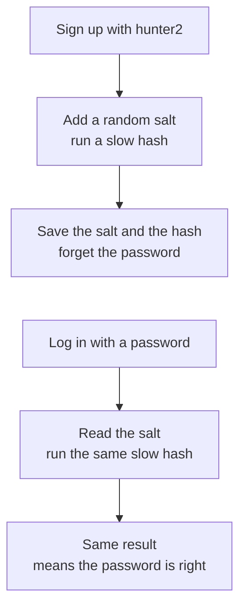
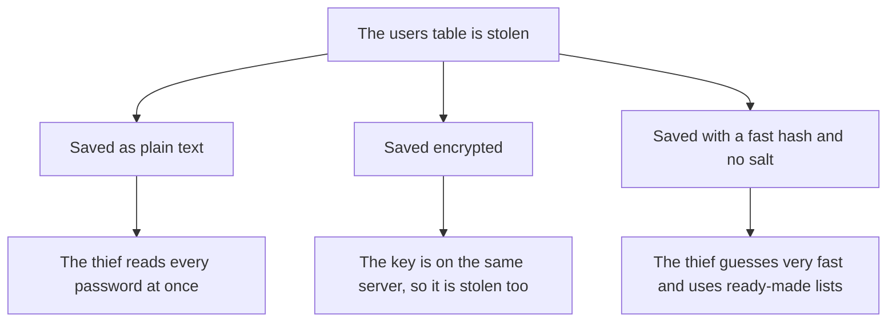
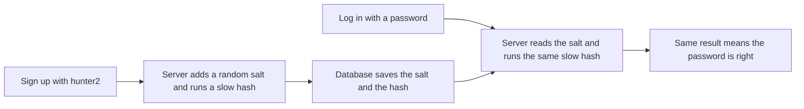
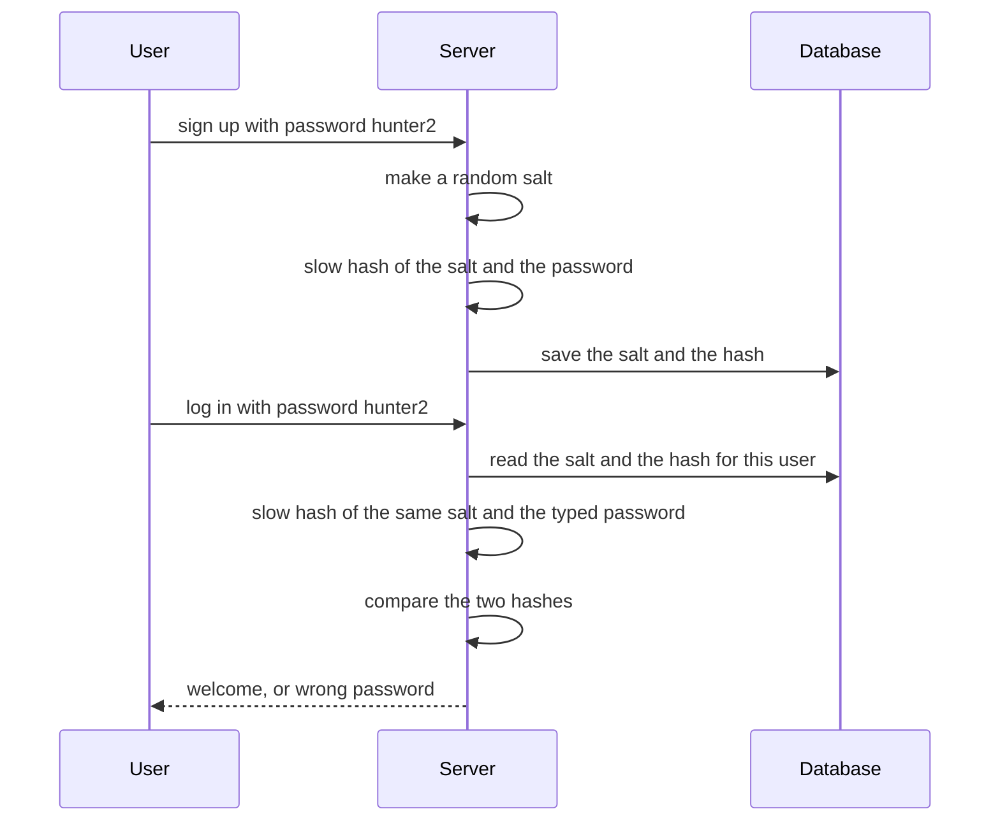
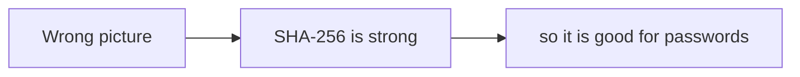
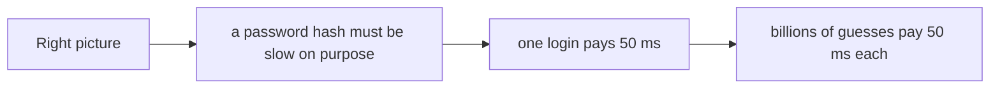
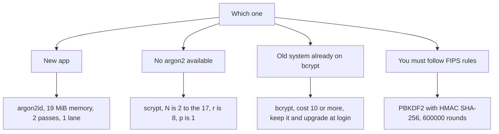
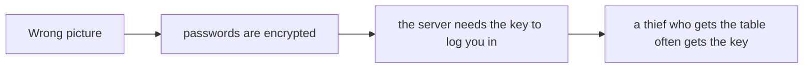
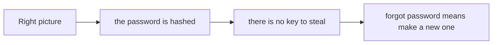

# 09. Password hashing

> **Subject:** Backend and API · **Lesson:** 09 · **Made:** 2026-10-23 · **Remade in short cards:** 2026-10-29 · **Status:** ready
>
> **You will be able to:** say why a server never stores a password, why a plain hash is not enough, what salt and cost do, and which algorithm to pick.
>
> **Before this:** [Authorization](08-authorization.md) · **Next:** [Validation and error handling](10-validation-and-error-handling.md)
>
> **How to read it:** one card is one idea. Look at the picture, guess, then press the orange bar to check. The blue bars (📖 More detail) hold the longer explanation. Skip them on the first read, and open them when you want more. About 15 minutes for the cards.

## 1. The idea: a blender

Put the password in a blender, with a pinch of random seasoning (the **salt**), and blend for a long time (the **cost**). You get a drink (the **hash**). You cannot turn the drink back into fruit. To check a login, blend what the user typed with the same seasoning, and see if the drink tastes the same.



<details class="guess"><summary>🤔 Guess: Ana and Budi both use the password `hunter2`. Do they get the same saved hash? Press to check.</summary>

No. Each gets a different random salt, so the two hashes are different. A thief cannot even see that they share a password.

</details>

> **Remember:** one-way, salted, slow. Never plain text, never encryption, never a fast hash.

<details class="more"><summary>📖 More detail: four new words, the problem, and the full picture</summary>

**New words.**

- **Hash:** a one-way scramble. The same input always gives the same result. You cannot turn the result back into the password.
- **Salt:** random text, new for each password. It is saved next to the hash. It makes two equal passwords give two different hashes.
- **Cost:** how slow the hash is on purpose. (Interview word: *work factor*.) One login can wait 50 ms. A thief who needs billions of guesses cannot.
- **Brute force:** trying guess after guess until one fits.

The rule to remember: **one-way, salted, slow. Never plain text, never encryption, never a fast hash.**

**The problem, drawn.** Databases get stolen. Notice what the thief can do in each case.



**The big picture.** The password is never saved, and login does the same work again.



**Sign up, then log in over time.** The server does the **same** steps both times.



**The blender again.**

A **blender**.

- You put the password in a blender with a pinch of random seasoning (the **salt**) and blend for a long time (the **cost**). You get a drink (the **hash**).
- You cannot turn the drink back into fruit. It is **one-way**.
- To check you, the server blends what you typed, with the same seasoning, for the same time. If the drink tastes the same, you know the password.
- A thief with the drink cannot get the fruit. A thief can only blend guesses one by one. The long blend time is the wall.

Where the analogy stops: a real blender gives a slightly different drink every time. A hash gives **exactly** the same result for the same input. That is what makes the login check work.

</details>

## 2. Salt: the same password, a different hash

Two users with the same password `hunter2`. These are real values made with Node's scrypt.

| email | salt | hash |
|---|---|---|
| ana@example.com | `obLD1OX2BxgpOktcbX6PkA` | `NMkrDYAyXIYnEJlVHJXzkvgEkZSUlsixxzfHhvGBYYk` |
| budi@example.com | `Dx4tPEtaaXiHlqW0w9Lh8A` | `ONb0M2MHd9_hmDZjwbBUyfomNK4qQiuFdLzTkLDKmU4` |

<details class="guess"><summary>🤔 Guess: with **no salt**, the SHA-256 of `hunter2` is the same for everyone. What can a thief do with that? Press to check.</summary>

Use a ready-made list of hashes for common passwords, and see everyone who shares one. A new random salt for every password stops both.

</details>

> **Remember:** a new random salt for every password, saved next to the hash.

<details class="more"><summary>📖 More detail: the unsalted hash, and the string real apps save</summary>

Compare with a hash that has **no salt**. The SHA-256 of `hunter2` is `f52fbd32b2b3b86ff88ef6c490628285f482af15ddcb29541f94bcf526a3f6c7` for **everyone** who uses that password.

In real apps the algorithm, the cost, the salt and the hash are saved in **one string**. This one was made with Node's `argon2Sync` and the OWASP minimum cost:

```
$argon2id$v=19$m=19456,t=2,p=1$ASNFZ4mrze8BI0VniavN7w$EKGBopU32AoyyER/n4paaG6OZn9IGLOwM+JAuiw5PzI
```

| Piece | Meaning |
|---|---|
| `argon2id` | the algorithm |
| `v=19` | the version of Argon2 |
| `m=19456,t=2,p=1` | the cost: 19,456 KiB of memory (19 MiB), 2 passes, 1 lane |
| `ASNFZ4mr…` | the salt (the demo used a fixed salt. Never reuse a salt.) |
| `EKGBopU3…` | the hash |

**Mistake: one salt for the whole app, or the username as the salt.**

**Wrong:** one salt for the whole app, or the username as the salt.

**Right:** a new random salt for every password. The libraries do this for you.

</details>

## 3. Slow on purpose

SHA-256 is strong, but **fast**. For passwords, fast is bad, because the thief gets fast guesses too. One login can wait 50 ms. Billions of guesses cannot. Real numbers from one laptop core (not a benchmark):

| How the password is hashed | Time for one guess | Guesses per second |
|---|---|---|
| SHA-256 (called from Node) | about 1 microsecond | about 960,000 |
| scrypt, N = 2^14 | about 40 ms | about 25 |
| argon2id, 19 MiB, 2 passes (OWASP minimum) | about 45 ms | about 22 |
| scrypt, N = 2^17 (OWASP minimum for scrypt) | about 330 ms | about 3 |

<details class="guess"><summary>🤔 Guess: how many more guesses per second does SHA-256 allow than scrypt at N = 2^14? Press to check.</summary>

About **40,000 times** more (960,000 against 25 per second). That gap is what a slow hash buys you.

</details>

> **Remember:** a password hash must be slow on purpose. One login pays 50 ms, and a thief pays 50 ms for every guess.

<details class="more"><summary>📖 More detail: how the numbers were made, and the mistake of a fast hash</summary>

**How slow is slow?** These are real numbers from one laptop core (Apple M1 Pro, Node v24.15.0, 2026-10-23). They are not a benchmark. They show the size of the gap.

SHA-256 tries about **40,000 times more guesses** than scrypt at N = 2^14. A thief also does not use a laptop. A graphics card tries far more fast-hash guesses, which is one reason the memory-hungry algorithms (scrypt, argon2) exist. I did not measure graphics cards.

**Wrong picture 2 and right picture 2.**

**Wrong picture 2:** "SHA-256 is a strong hash, so it is good for passwords."



**Right picture 2:** SHA-256 is strong **and fast**. For passwords, fast is bad, because the thief also gets fast guesses.



**Mistake: a fast hash, with or without a salt.**

**Wrong:** a fast hash, with or without a salt.

```js
const hash = createHash("sha256").update(salt + password).digest("hex");
```

**Right:** a slow password hash such as argon2id, scrypt or bcrypt.

**Why:** a salt stops ready-made lists, but the guesses are still very fast.

</details>

## 4. Which algorithm do I pick?

OWASP's Password Storage Cheat Sheet gives this order.

| Case | Pick |
|---|---|
| A new app | **argon2id**: 19 MiB of memory, 2 passes, 1 lane |
| No argon2 available | scrypt: N = 2^17, r = 8, p = 1 |
| An old system on bcrypt | bcrypt, cost 10 or more. Keep it, upgrade at login |
| You must follow FIPS rules | PBKDF2 with HMAC SHA-256, 600,000 rounds |

<details class="guess"><summary>🤔 Guess: you start a new Node app today. Which one do you pick? Press to check.</summary>

**argon2id**. Node 24.7.0 and newer have it built in (`crypto.argon2`). The details and settings are in the Go deeper card at the end of this lesson.

</details>

> **Remember:** argon2id first. Then scrypt, then bcrypt for old systems.

<details class="more"><summary>📖 More detail: the picture</summary>



</details>

## 5. The smallest code that shows it

A hash and a check, with Node's built-in scrypt. A new random salt is made each time.

```js
const { scryptSync, randomBytes,
  timingSafeEqual } = require("node:crypto");
function hashPassword(plain) {
  const salt = randomBytes(16);
  const hash = scryptSync(plain, salt, 32);
  return salt.toString("hex") + ":" +
    hash.toString("hex");
}
function verifyPassword(plain, stored) {
  const [s, h] = stored.split(":");
  const again = scryptSync(
    plain, Buffer.from(s, "hex"), 32);
  return timingSafeEqual(
    again, Buffer.from(h, "hex"));
}
const a = hashPassword("hunter2");
const b = hashPassword("hunter2");
console.log(a === b);
console.log(verifyPassword("hunter2", a),
  verifyPassword("hunter3", a));
```

<details class="guess"><summary>🤔 Guess: what do the two `console.log` lines print? Press to check.</summary>

```
false
true false
```

The same password gives two different saved strings, because of the salt. Both still verify, because each string carries its own salt. A wrong letter fails.

</details>

> **Remember:** the salt is saved inside the string. Verify = hash again with that salt, then compare.

<details class="more"><summary>📖 More detail: the code with comments, and every step</summary>

```js
const { scryptSync, randomBytes, timingSafeEqual } = require("node:crypto");

function hashPassword(plain) {
  const salt = randomBytes(16);                        // new random salt every time
  const hash = scryptSync(plain, salt, 32);            // slow on purpose
  return salt.toString("hex") + ":" + hash.toString("hex");
}
function verifyPassword(plain, stored) {
  const [salt, hash] = stored.split(":");
  const again = scryptSync(plain, Buffer.from(salt, "hex"), 32);
  return timingSafeEqual(again, Buffer.from(hash, "hex"));
}
const a = hashPassword("hunter2"), b = hashPassword("hunter2");
console.log(a === b);                                  // same password, different result
console.log(verifyPassword("hunter2", a), verifyPassword("hunter3", a));
```

**Output:**

```
false
true false
```

The first line is the salt at work: the same password gives two different saved strings. Both still verify, because each string carries its own salt. (This uses the sync function to stay short. In a server, use the async one. See section 7.)

**One sign up and one login, step by step.**

| Step | Who | What happens | Database after |
|---|---|---|---|
| 1 | User | Sends email and password `hunter2` over HTTPS. | empty |
| 2 | Server | Makes a random salt, 16 bytes. | empty |
| 3 | Server | Runs the slow hash on the salt and the password. About 40 ms here. | empty |
| 4 | Server | Saves email, salt and hash. **Forgets** the password. | one row |
| 5 | User | Later sends email and password `hunter2` to log in. | one row |
| 6 | Server | Finds the row. Reads the salt. | one row |
| 7 | Server | Runs the **same** slow hash on the saved salt and the typed password. | one row |
| 8 | Server | Compares the two hashes with `timingSafeEqual`. Equal means welcome. | one row |
| 9 | Server | A wrong password, even one letter off, gives a completely different hash. The answer is 401. | one row |

**Step through it yourself:** [open the password hashing stepper](visuals/09-password-hashing.html). It has five stories: sign up, log in (right and wrong password), two users with the same password, the table is stolen (three ways to save), and raising the cost later. Guess first, then press Next. The salts and hashes in it are real.

</details>

## 6. Mistake 1: plain text, or a reversible way

| Saved as | What a thief gets |
|---|---|
| plain text | every password at once |
| encrypted | the key is often on the same server, so the thief gets that too |
| hashed with a salt | nothing to read, and no key to steal |

<details class="guess"><summary>🤔 Guess: support asks you to encrypt passwords, so they can read a forgotten one. Is that OK? Press to check.</summary>

No. A hash has no key and no way back. If a user forgets the password, you **reset** it with a new one. Nobody reads the old one.

</details>

> **Remember:** a forgotten password is reset, never read.

<details class="more"><summary>📖 More detail: the wrong pictures, and the mistake in code</summary>

**Wrong picture 1 and right picture 1.**

**Wrong picture 1:** "Encryption is safer, because I can decrypt for support."



**Right picture 1:** a hash has no key and no way back. Forgot your password? You **reset** it. Nobody reads the old one.



**The mistake in code.**

**Wrong:** plain text, or a reversible way.

```js
db.insert({ email, password });                          // plain text
db.insert({ email, password: encrypt(password, KEY) });  // encryption
```

**Right:**

```js
db.insert({ email, stored: await hashPassword(password) });
```

**Why:** both wrong ways let a thief (or your own support staff) get the passwords back.

</details>

## 7. Mistake 2: the sync function in a request handler

`scryptSync` blocks the **whole server** while it runs, because Node has one main thread. In a handler, use the **async** function. I hashed 4 passwords with scrypt N = 2^15 and a 10 ms timer running:

```
sync  ~320 ms, timer ticks: 0
async ~85 ms, timer ticks: 7
```

<details class="guess"><summary>🤔 Guess: why did the timer tick 0 times with the sync version? Press to check.</summary>

Node has one main thread. `scryptSync` kept it busy for the whole 320 ms, so no other request, and no timer, could run. The async version works on helper threads. Measured twice on this laptop on 2026-10-29 with Node 26.12.1. Numbers change by machine.

</details>

> **Remember:** in a request handler, always use the async hash.

<details class="more"><summary>📖 More detail: the first measurement, and the wrong code and the right code</summary>

**The Node trap.** `scryptSync` blocks the **whole server** while it runs, because Node has one main thread. I tried four hashes of scrypt N = 2^15 on this laptop. The sync version blocked for about 330 ms, and a 10 ms timer ticked once. The async version took about 90 ms (the work ran in parallel on helper threads), and the same timer ticked 8 times. So in a request handler, always use the **async** version (`crypto.scrypt`, or the async function of the library you use).

**Wrong:** the sync function inside a request handler.

```js
app.post("/login", (req, res) => {
  const ok = verifyPasswordSync(req.body.password, row.stored);   // blocks every other request
```

**Right:**

```js
app.post("/login", async (req, res) => {
  const ok = await verifyPassword(req.body.password, row.stored);   // runs on helper threads
```

</details>

## 8. Mistake 3: comparing with `===`, and a helpful error message

```js
// wrong: a helpful message
return res.status(401).json(
  { error: "no user with that email" });
// right: the same answer for both
return res.status(401).json(
  { error: "wrong email or password" });
```

<details class="guess"><summary>🤔 Guess: why is "no user with that email" a bad answer? Press to check.</summary>

It tells an attacker which emails have an account. Say "wrong email or password" for both cases. Also compare hashes with `timingSafeEqual`, not `===`, which can stop at the first different byte.

</details>

> **Remember:** the same 401 answer for a wrong email and a wrong password. Compare in constant time.

<details class="more"><summary>📖 More detail: the wrong code and the right code</summary>

**Wrong:** comparing the hashes with `===`, or telling the user which part was wrong.

```js
if (hash === row.hash) { ... }
return res.status(401).json({ error: "no user with that email" });
```

**Right:**

```js
if (!timingSafeEqual(hash, row.hash)) { ... }                    // equal lengths first
return res.status(401).json({ error: "wrong email or password" });   // same answer for both
```

</details>

## 9. Mistake 4: the password in your logs

```js
// wrong: the password is in the log
console.log("login body", req.body);
```

<details class="guess"><summary>🤔 Guess: where else can a password end up by accident? Press to check.</summary>

In error messages, and in monitoring tools. Never log request bodies of login and signup routes, and leave the password out of every message.

</details>

> **Remember:** never write a password anywhere, even by accident.

<details class="more"><summary>📖 More detail: the mistake as written</summary>

**Wrong:** writing the password anywhere by accident.

```js
console.log("login body", req.body);        // the password is in the log
```

**Right:** never log request bodies of login and signup routes. Leave the password out of error messages and monitoring tools too.

</details>

## 10. Why it matters and what it costs

- **Without it:** tables get stolen, and people reuse passwords, so one leak opens their accounts on other sites too.
- **With it:** one-way means the thief cannot read the passwords. A salt per password stops ready-made lists. A slow cost makes every guess expensive.
- **The cost:** every login does real work (about 50 ms of CPU, and with argon2id about 19 MiB of memory), so add rate limiting. A slow hash does not save a weak password. And you can only upgrade the cost when a user logs in.

<details class="more"><summary>📖 More detail: the problem and the costs, as they were written</summary>

- **Problem without it:** tables get stolen. People reuse passwords, so one leak opens their accounts on other sites too. OWASP's Top 10 for 2025 lists weak hashing under A04, Cryptographic Failures, and tells you to avoid old hashes such as MD5 and SHA1.
- **How it solves it:** one-way means the thief cannot read the passwords. A salt per password stops ready-made lists and hides who shares a password. A slow cost makes every guess expensive.
- **Cost:**
  - **Every login does real work.** About 50 ms of CPU, and with argon2id about 19 MiB of memory. A login route is a good target for people who want to slow your server. Add **rate limiting** (lesson 11).
  - **It blocks the server if you use the wrong function.** See below.
  - **No "forgot password" by reading it.** You send a reset link. That is the right behavior.
  - **A slow hash does not save a weak password.** `password123` is in the first guesses of every list. It buys time for strong passwords.
  - **Upgrading is slow.** You can only rehash when the user logs in, because only then do you have the password.

</details>

## 11. Watch and play

Links checked on 2026-10-23. I opened every page, and I checked each video's title and channel. I did not watch the video, so I did not check its length.

- **Video:** [How NOT to Store Passwords!](https://www.youtube.com/watch?v=8ZtInClXe1Q) by Computerphile. A classic from 2013. It shows why plain text and plain hashes are weak. It is old, so use it for the **why**, and use OWASP for the **current settings**.
- **Play with it:** [The password hashing stepper](visuals/09-password-hashing.html) in this folder. In "The table is stolen", say out loud why 40,000 times fewer guesses matters.
- **Play with it:** [argon2.online](https://argon2.online/). Type a password, then change memory, iterations and parallelism, and see the hash change. The page does not show the time, so use `practice/09-password-hashing.js` to feel the time yourself.
- **Read:** [OWASP Password Storage Cheat Sheet](https://cheatsheetseries.owasp.org/cheatsheets/Password_Storage_Cheat_Sheet.html). The current minimum settings, salts, peppers and upgrading.
- **Read:** [Node.js crypto documentation](https://nodejs.org/api/crypto.html). Search the page for `argon2Sync` (added in v24.7.0), `scrypt` and `timingSafeEqual`.
- **Read:** [OWASP Top 10:2025, A04 Cryptographic Failures](https://top10.owasp.org/2025/A04_2025-Cryptographic_Failures). It tells you to store passwords with a work factor and to avoid MD5 and SHA1.
- **Code in this repo:** [the Express and GraphQL auth tutorial](express-graphql-auth-tutorial.md). Its example app uses bcrypt with cost 12.

<details><summary>More links (optional)</summary>

- **Read:** [RFC 9106, Argon2](https://www.rfc-editor.org/rfc/rfc9106.html). The standard. Its abstract calls Argon2 a memory-hard function for password hashing.
- **Read:** [OWASP Session Management Cheat Sheet](https://cheatsheetseries.owasp.org/cheatsheets/Session_Management_Cheat_Sheet.html). What to do after the password is right: make a new session id.

</details>

## 12. Practice

**A. Predict the output** (write your answer before opening)

```js
const { createHash } = require("node:crypto");
const h = (s) => createHash("sha256").update(s).digest("hex").slice(0, 8);
console.log(h("hunter2") === h("hunter2"));
console.log(h("salt1" + "hunter2") === h("salt2" + "hunter2"));
console.log(h("hunter2").length);
```

<details><summary>Answer</summary>

```
true
false
8
```

The same input always gives the same hash. A different salt gives a different hash. `slice(0, 8)` keeps 8 letters.

</details>

**B. Fix the bug**

```js
const { createHash } = require("node:crypto");

function signUp(email, password) {
  const hash = createHash("md5").update(password).digest("hex");
  db.insert({ email, hash });
}
function login(email, password) {
  const row = db.find(email);
  return createHash("md5").update(password).digest("hex") === row.hash;
}
```

What is wrong? There are four problems.

<details><summary>Answer</summary>

1. **MD5 is fast and old.** A thief tries billions of guesses. OWASP says to avoid MD5 and SHA1.
2. **No salt.** Two users with the same password have the same hash, and ready-made lists work.
3. **`===` compares in a way that can leak timing.** Use `timingSafeEqual` or the `verify` function of the library.
4. **It does not say how to upgrade later.** Nothing in the saved string tells you the algorithm or the cost.

```js
async function signUp(email, password) {
  await db.insert({ email, stored: await hashPassword(password) });   // salt and cost inside
}
async function login(email, password) {
  const row = await db.find(email);
  return row ? await verifyPassword(password, row.stored) : false;
}
```

</details>

**C. Write it yourself**

Open `practice/09-password-hashing.js`. You write `hashPassword`, `verifyPassword` and `needsRehash` with the async `crypto.scrypt`, and a small table that says which ways of saving are good or bad. The tests also check that your functions return a Promise, so the server is never blocked.

```
node --test learn/backend-api/practice/09-password-hashing.test.js
```

<details><summary>One possible answer</summary>

```js
async function hashPassword(plain, { N = 16384, r = 8, p = 1 } = {}) {
  const salt = randomBytes(16);
  const hash = await derive(plain, salt, { N, r, p });
  return ["scrypt", N, r, p, salt.toString("base64url"), hash.toString("base64url")].join("$");
}

function parse(stored) {
  if (typeof stored !== "string") return null;
  const parts = stored.split("$");
  if (parts.length !== 6 || parts[0] !== "scrypt") return null;
  const [N, r, p] = [Number(parts[1]), Number(parts[2]), Number(parts[3])];
  if (![N, r, p].every((n) => Number.isInteger(n) && n > 0)) return null;
  return { N, r, p, salt: Buffer.from(parts[4], "base64url"), hash: Buffer.from(parts[5], "base64url") };
}

async function verifyPassword(plain, stored) {
  const row = parse(stored);
  if (!row || row.hash.length !== 32 || typeof plain !== "string") return false;   // the hash is always 32 bytes
  try {
    const again = await derive(plain, row.salt, row);
    return timingSafeEqual(again, row.hash);       // both are 32 bytes, so it cannot throw
  } catch {
    return false;
  }
}

function needsRehash(stored, wanted = { N: 16384, r: 8, p: 1 }) {
  const row = parse(stored);
  if (!row) return true;
  return row.N < wanted.N || row.r < wanted.r || row.p < wanted.p;
}

const verdict = {
  plainText: "bad", encrypted: "bad", md5WithSalt: "bad", sha256NoSalt: "bad",
  bcryptCost12: "good", scryptSalted: "good", argon2id: "good",
};
```

Notice four things. The cost (`N`, `r`, `p`) is saved **in the string**, so `verifyPassword` always uses the cost the hash was made with. `verifyPassword` never throws: a broken string just gives `false`. `needsRehash` treats a string it cannot read as "needs a new hash". And `verifyPassword` insists that the saved hash is exactly 32 bytes. Do not trust the saved length: scrypt's short output is only the **start** of its long output, so a cut hash saved by mistake (or by an attacker) would match a short guess. A test in this lesson caught exactly this bug in my first solution.

</details>

## 13. Interview question

**Q:** "How do you store passwords? Why not just SHA-256? What are salt and cost?"

<details><summary>A strong answer, in four parts</summary>

1. **Problem:** databases get stolen. If passwords are plain text, the thief has them at once, and people reuse passwords on other sites. Encryption needs a key, and the key is usually on the same server. A fast hash such as SHA-256 or MD5 lets the thief try billions of guesses, and equal passwords give equal hashes.
2. **How it works:** I save a **one-way, salted, slow hash**. At sign up I make a random salt for that password and run a password hash (argon2id first, or scrypt, or bcrypt for old systems). I save the salt, the cost and the hash together in one string. At login I run the same hash on what the user typed, with the saved salt and cost, and compare in constant time. I use the async version so I do not block Node, and I say the same error for a wrong email and a wrong password.
3. **Tradeoff:** every login costs about 50 ms of CPU, and about 19 MiB of memory for argon2id at the OWASP minimum. So I rate-limit login. A slow hash buys time but does not save a weak password. The cost must be raised over time, and I do that at login, when I have the password. bcrypt is still fine for old systems but only reads 72 bytes.
4. **My example:** your DBO notes say the **Auth service** owns login, forgot-password and OTP by WhatsApp, and issues the JWT. That is a good place to say that the password hashing lives in that one service, so the smallest piece of code holds the most sensitive data. *Your notes do not say which algorithm DBO uses.* The auth tutorial in this repo uses bcrypt with cost 12. Check which one your real projects use before you claim it.

</details>

## 14. Explain it back

Close this file. Press the **Record my explanation** button under this heading and explain it out loud, like to a new junior, in 4 parts: problem, how it works, tradeoff, my example. Use the words "salt", "slow on purpose" and "one-way". Then save the transcript into `my-learning/recordings/`, or write your best version below. Run `/explain-check password hashing` or ask the `explain-coach` agent to review it.

### My explanation

<write here>

### Coach feedback

<the explain-coach agent writes here>

## 15. Review questions (day 1, 3, 7, 21)

1. Why do we save a hash and not the password? Why not encrypt it?
2. What does a salt do? What does cost do? Which one is secret?
3. A user logs in. Walk through what the server does, step by step. Why does it not need to reverse the hash?
4. Draw the picture from section 2c from memory: sign up and login, with the salt and the database.

<details><summary>Answers</summary>

1. A hash is one-way, so a thief who steals the table cannot read the passwords. Encryption can be reversed with a key, and the server needs that key at login, so a thief who breaks in often gets the key too.
2. A **salt** is random text, new for each password, saved next to the hash. It makes equal passwords give different hashes, which stops ready-made lists and hides who shares a password. The **cost** makes each guess slow, so billions of guesses become too expensive. **Neither is secret.** The secret is the password. (A pepper is secret, but that is a different thing.)
3. The server finds the row, reads the saved salt and cost, runs the same hash on the typed password, and compares the result with the saved hash in constant time. Equal means the password is right. It never reverses anything. It only repeats the work.
4. Sign up: user sends the password, the server makes a salt, runs the slow hash, saves salt and hash. Login: user sends the password, the server reads salt and hash from the database, runs the same hash on the typed password, compares, and answers.

</details>

## 16. Go deeper (optional)

Open these when you are ready. None of them is needed for the cards above.

<details><summary>Settings, bcrypt, peppers and compare time</summary>

**OWASP settings (Password Storage Cheat Sheet, checked 2026-10-23):**

| Algorithm | Minimum | Note |
|---|---|---|
| argon2id | m = 19456 KiB (19 MiB), t = 2, p = 1 | The first choice. Other equal choices trade more passes for less memory, for example m = 47104, t = 1. |
| scrypt | N = 2^17, r = 8, p = 1 | If argon2id is not available. |
| bcrypt | cost 10 or more | Only for old systems. Maximum password length is 72 bytes. |
| PBKDF2 | HMAC-SHA-256, 600,000 rounds | Only if you must follow FIPS-140. |

**Node built-ins.** Node has `crypto.scrypt` for a long time. Node **24.7.0** added `crypto.argon2` and `crypto.argon2Sync`, with the names `argon2id`, `argon2i` and `argon2d`. The inputs are `message` (the password), `nonce` (the salt, at least 8 bytes, 16 or more is recommended), `parallelism`, `tagLength`, `memory` (in KiB) and `passes`. So on a new Node you need no package for argon2id. On older Node, use a library.

**bcrypt in one minute.** bcrypt is older and very common in Node apps (`bcrypt`, `bcryptjs`). It makes its own salt and saves it inside the output string. It reads only the first **72 bytes** of the password. OWASP warns that pre-hashing a long password to get around this is dangerous (a null byte can cut the input, and a trick called "password shucking" becomes possible). If you must pre-hash, OWASP shows a safe form with an HMAC and a pepper.

**Pepper.** A pepper is one extra secret shared by all passwords, kept **outside** the database (for example in a secrets vault). It adds defense in depth. It is not a replacement for salt. If it leaks, you must force password resets.

**Compare in constant time.** `===` on two strings can stop at the first different byte. `crypto.timingSafeEqual` takes the same time either way. It throws if the lengths differ, so check the lengths first. Many libraries do this for you in their `verify` function. Use that.

**Upgrade at login.** OWASP: store the algorithm and the cost with each hash (the PHC string format does this). When a user logs in, check the cost. If it is lower than today's, hash again and save. For very old hashes such as MD5, rehash at login too, and consider expiring the old password.

**The standard.** Argon2 is described in RFC 9106 (September 2021), "Argon2 Memory-Hard Function for Password Hashing and Proof-of-Work Applications".

</details>

## Connected lessons

- [Authentication: sessions vs JWT](06-authentication-sessions-vs-jwt.md): what the server makes after the password is right.
- [Access and refresh tokens](07-access-and-refresh-tokens.md): the refresh token is also saved as a hash. A fast hash is fine there, because the token is 256 random bits and nobody can guess it.
- [Authorization](08-authorization.md): the step after "who are you".
- [Express GraphQL auth tutorial](express-graphql-auth-tutorial.md): a full app with bcrypt, JWT and refresh tokens.
- [Rate limiting](11-rate-limiting.md): protect the login route from guessing and from being used to overload the server.
- [Validation and error handling](10-validation-and-error-handling.md): the next lesson in this folder. Keep the same answer for a wrong email and a wrong password.
