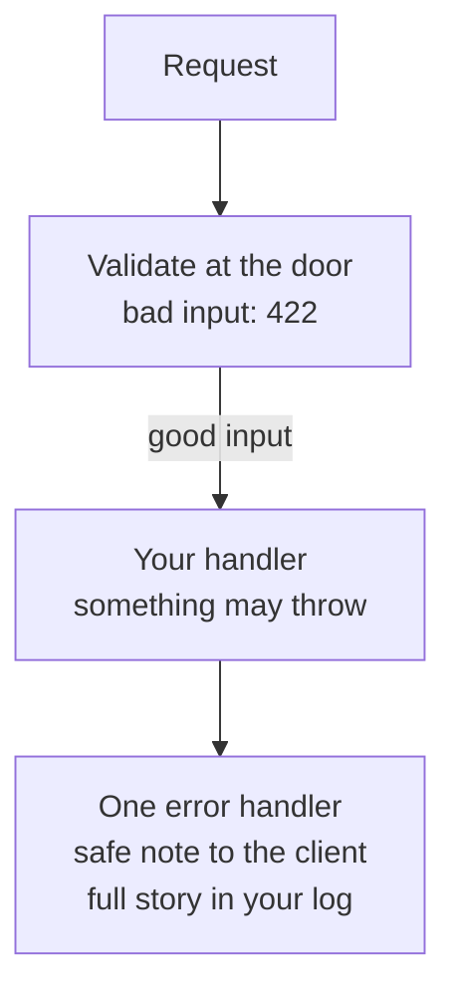
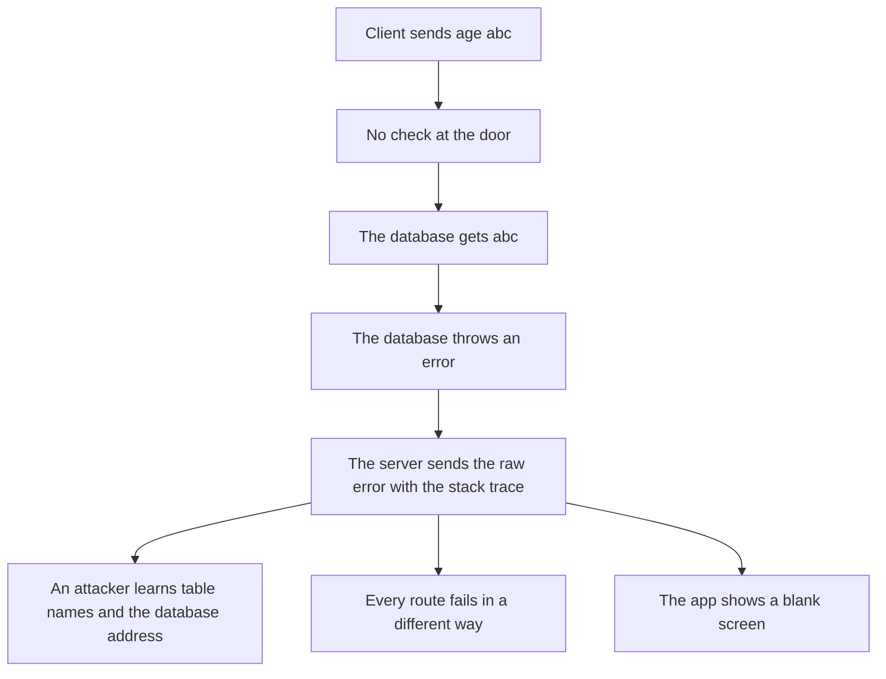
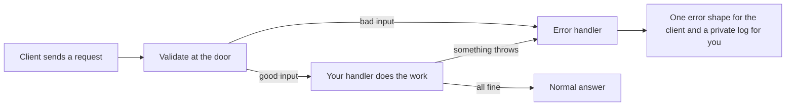
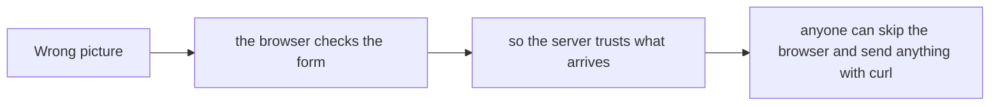
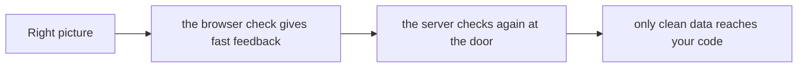
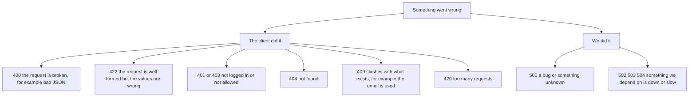
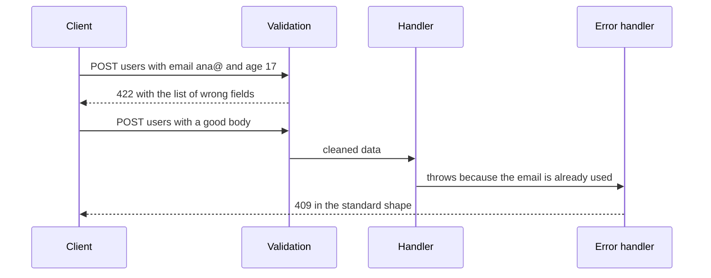
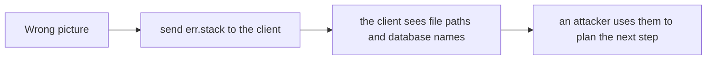
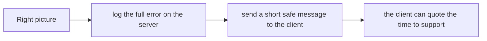

# 10. Validation and error handling

> **Subject:** Backend and API · **Lesson:** 10 · **Made:** 2026-10-23 · **Remade in short cards:** 2026-10-29 · **Status:** ready
>
> **You will be able to:** say why the server checks every input at the door, which status to send for each kind of problem, and how to send every error in one shape without leaking secrets.
>
> **Before this:** [Password hashing](09-password-hashing.md) · **Next:** [Rate limiting](11-rate-limiting.md)
>
> **How to read it:** one card is one idea. Look at the picture, guess, then press the orange bar to check. The blue bars (📖 More detail) hold the longer explanation. Skip them on the first read, and open them when you want more. About 15 minutes for the cards.

## 1. The idea: a host at the door and a complaints desk

A restaurant has a **host at the door**. No booking, no table, so the kitchen never sees guests who should not be there. And it has **one complaints desk**. Every problem goes there. The desk writes the full story in a private book (the log) and gives the guest a short, polite note. The note always has the same form.



<details class="guess"><summary>🤔 Guess: the client sends `age: "abc"`, and there is no check at the door. Where does it break? Press to check.</summary>

Deep inside: the database gets `abc` and throws. If the server sends that raw error, the client sees the stack trace, with table names and the database address. Every route would also fail in its own way.

</details>

> **Remember:** never trust the input, never show the insides.

<details class="more"><summary>📖 More detail: four new words, the problem, and the full picture</summary>

**New words.**

- **Validation:** checking the input before your code uses it. Is it the right type? Is the number in range?
- **Schema:** a written rule for what good input looks like. One line per field.
- **Error handler:** one function at the end of the pipeline. Every error ends up there, and it builds the answer. (Interview word: *error middleware*.)
- **Problem Details:** a standard shape for error answers. It has the fields `type`, `title`, `status` and `detail`. (Its name in the standards list is RFC 9457.)

The rule to remember: **never trust the input, never show the insides.**

**The problem, drawn.** Without a check at the door, bad input travels deep into your system before it breaks.



**The big picture.** Every path that goes wrong ends in the same place: the error handler.



**Wrong picture 1 and right picture 1.**

**Wrong picture 1:** "The form in the browser already checks the input, so the server can relax."



**Right picture 1:** the browser check is for comfort. The server check is for safety.



**The restaurant again.**

A restaurant with a **host at the door** and a **complaints desk**.

- The host checks the booking before anyone sits down. No booking, no table. The kitchen (your handler) never sees guests who should not be there.
- When something goes wrong inside, the waiter does not shout it across the room. Every problem goes to **one desk**. The desk writes the full story in a private book (the log) and gives the guest a short, polite note.
- The note always has the same form, so every guest can read it.

Where the analogy stops: the host can only check what is on the booking. He cannot know if the table is already taken by someone else. In code that is the "email already used" case. Only the database knows, so that error comes later, from inside.

</details>

## 2. Check the input with a schema

A **schema** is a written rule for what good input looks like, one line per field. This one uses Zod. Run `npm i zod` first.

```js
const { z } = require("zod");
const User = z.object({
  email: z.email(),
  age: z.coerce.number().int().min(18),
});
const bad = User.safeParse(
  { email: "ana@", age: "17" });
console.log(bad.success);
console.log(z.flattenError(bad.error).fieldErrors);
const good = User.safeParse({
  email: "ana@example.com",
  age: "30", admin: true });
console.log(good.success, good.data);
```

<details class="guess"><summary>🤔 Guess: what do the three `console.log` lines print? Press to check.</summary>

```
false
{
  email: [ 'Invalid email address' ],
  age: [ 'Too small: expected number to be >=18' ]
}
true { email: 'ana@example.com', age: 30 }
```

`safeParse` never throws. Both wrong fields are reported at once. The good result has `age: 30` as a number, and `admin` is gone.

</details>

> **Remember:** the schema is the one door for input. It reports every wrong field at once, and gives you clean data.

<details class="more"><summary>📖 More detail: the same code with comments</summary>

```js
const { z } = require("zod");
const User = z.object({
  email: z.email(),
  age: z.coerce.number().int().min(18),
});
const bad = User.safeParse({ email: "ana@", age: "17" });
console.log(bad.success);
console.log(z.flattenError(bad.error).fieldErrors);
const good = User.safeParse({ email: "ana@example.com", age: "30", admin: true });
console.log(good.success, good.data);
```

**Output:**

```
false
{
  email: [ 'Invalid email address' ],
  age: [ 'Too small: expected number to be >=18' ]
}
true { email: 'ana@example.com', age: 30 }
```

Three things to notice. `safeParse` never throws, it gives you `success`. Both wrong fields are reported at once, not only the first. And the good result has `age: 30` as a number, with `admin` removed.

</details>

## 3. Use the cleaned data, not `req.body`

Ana sends an extra field, `admin: true`. Notice what the server keeps after validation.

| | What the client sent (`req.body`) | After validation (`r.data`) |
|---|---|---|
| `email` | `"ana@example.com"` | `"ana@example.com"` |
| `age` | `"30"` (a string) | `30` (a number) |
| `admin` | `true` | **gone** |

<details class="guess"><summary>🤔 Guess: you validated, then wrote `db.user.create({ data: req.body })`. What gets saved? Press to check.</summary>

Everything the client sent, including `admin: true`. People call this **mass assignment**. The whole point of the schema is that your code gets the cleaned data, so use `r.data`.

</details>

> **Remember:** after you validate, use `r.data`. Never use `req.body` again.

<details class="more"><summary>📖 More detail: the table, and the wrong code and the right code</summary>

The handler must use the right-hand column. Never use `req.body` after you validated.

**Wrong:** using the raw body after validating.

```js
const r = Signup.safeParse(req.body);
if (!r.success) return res.status(422).json(problem(r));
await db.user.create({ data: req.body });       // admin: true is still in here
```

**Right:**

```js
await db.user.create({ data: r.data });         // only the cleaned fields
```

**Why:** the whole point of the schema is that your code gets the cleaned data.

</details>

## 4. Whose fault is it? Pick the status

The status code answers one question: who must change something?

| Who did it | Status | When |
|---|---|---|
| The client | `400` | the request is broken, like bad JSON |
| The client | `422` | well formed, but the values are wrong |
| The client | `401` or `403` | not logged in, or not allowed |
| The client | `404` | not found |
| The client | `409` | clashes with what exists, like a used email |
| The client | `429` | too many requests |
| We did | `500` | a bug, or something unknown |
| We did | `502` `503` `504` | something we depend on is down or slow |

<details class="guess"><summary>🤔 Guess: valid JSON, but `age` is 17 and the minimum is 18. Which status? Press to check.</summary>

`422`, because the request is well formed but the value is wrong. Many teams send `400` for this. That is fine, if you pick one rule and use it on every route.

</details>

> **Remember:** 4xx means the client must change something. 5xx means we have the problem.

<details class="more"><summary>📖 More detail: the picture</summary>

The status code answers one question: who must change something? Notice the split.



</details>

## 5. One error handler, one safe answer

Every error ends in one function with **four inputs**: `(err, req, res, next)`. It writes the full error to your log, and sends a short safe answer.

```js
app.use((err, req, res, next) => {
  console.error("LOG:", err.message);
  res.status(500).json({
    title: "Internal Server Error",
    detail: "Something went wrong.",
  });
});
```

<details class="guess"><summary>🤔 Guess: the database is down and throws an error that holds its address and a password. What does the client see? Press to check.</summary>

Only the safe answer: `500` and `"Something went wrong. Try again later."`. The address and the password reach only your log. Checked with Express 5.3.0 on 2026-10-29.

</details>

> **Remember:** the client gets a short safe message. You get the details.

<details class="more"><summary>📖 More detail: the whole app, every step, and the real answers</summary>

**Who reads a crash.** Notice that only one reader may see the details.

And a crash has two readers. Notice that only one of them may see the details.

| Who reads it | What they get |
|---|---|
| The client | `500` and "Something went wrong. Try again later." |
| You, in the log | the full message, the stack, the time, the user id |

**A bad request and a crash over time.**



**The whole thing in Express 5.** The `db` is a stand-in for your database.

Here is the whole thing in Express 5. The `db` is a stand-in for your database.

```js
const express = require("express");
const { z } = require("zod");
const app = express();
app.use(express.json());

const Signup = z.object({ email: z.email(), age: z.coerce.number().int().min(18) });

app.post("/users", async (req, res) => {
  const r = Signup.safeParse(req.body);
  if (!r.success) {
    return res.status(422).type("application/problem+json").json({
      type: "about:blank", title: "Invalid input", status: 422,
      errors: z.flattenError(r.error).fieldErrors,
    });
  }
  const user = await db.user.create({ data: r.data });   // r.data, not req.body
  res.status(201).json(user);
});

app.use((err, req, res, next) => {          // four inputs: Express knows this is the error handler
  console.error(err);                       // the full details stay here
  const known = err.expose === true && err.status < 500;
  const status = known ? err.status : 500;
  res.status(status).type("application/problem+json").json({
    type: "about:blank",
    title: known ? err.title ?? "Bad request" : "Internal Server Error",
    status,
    detail: known ? err.message : "Something went wrong. Try again later.",
  });
});
```

**A bad request, step by step.**

A bad request, step by step:

| Step | Who | What happens | Client sees |
|---|---|---|---|
| 1 | Client | Sends `POST /users` with `{ "email": "ana@", "age": "17" }`. | nothing yet |
| 2 | Express | `express.json()` turns the text into an object. Broken JSON stops here with `400`. | nothing yet |
| 3 | Your code | `safeParse` checks every field. It does not stop at the first mistake. | nothing yet |
| 4 | Your code | Two fields failed. It sends `422` with the list, and uses `return`. The database line never runs. | `422` and the list |

**A crash, step by step.**

A crash, step by step:

| Step | Who | What happens | Client sees |
|---|---|---|---|
| 1 | Handler | Calls the database. The database is down and throws. | nothing yet |
| 2 | Express 5 | Catches the thrown error, also from an `async` function. It skips every normal handler and jumps to the error handler. | nothing yet |
| 3 | Error handler | Writes the full error to the log. | nothing yet |
| 4 | Error handler | The error does not say `expose = true`, so it is unknown. It sends `500` and a safe message. | `500` and a safe message |

**The real answers from running that app.**

These are the real answers from running that app (checked on 2026-10-23 with Express 5.3.0, Zod 4.6.7 and Node 24.15.0). The crash was a made-up error that held a database address and a password:

| Request | Status | Body |
|---|---|---|
| good body | `201` | `{"id":1,"email":"ana@example.com"}` |
| `ana@` and `17` | `422` | `{"type":"about:blank","title":"Invalid input","status":422,"errors":{"email":["Invalid email address"],"age":["Too small: expected number to be >=18"]}}` |
| email already used | `409` | `{"type":"about:blank","title":"Email already used","status":409,"detail":"That email is already used."}` |
| the database crashes | `500` | `{"type":"about:blank","title":"Internal Server Error","status":500,"detail":"Something went wrong. Try again later."}` |
| broken JSON | `400` | `{"type":"about:blank","title":"Bad request","status":400,"detail":"Unexpected end of JSON input"}` |

Notice that the crash row shows nothing about the database. The address and the password reached only the log.

**Step through it yourself:** [open the validation and errors stepper](visuals/10-validation-and-error-handling.html). It has five stories: a good request, bad input, a known error (email used), a crash (wrong way, then right way), and broken JSON. Guess first, then press Next.

**Mistake: an error handler with three inputs, or placed before the routes.**

**Wrong:** an error handler with three inputs, or placed before the routes.

```js
app.use((err, req, res) => { ... });            // three inputs: Express does not see it as an error handler
```

**Right:** `(err, req, res, next)`, written after all routes.

**Why:** Express counts the inputs to decide what kind of function this is.

</details>

## 6. Mistake 1: forgetting `return` after the error answer

```js
const r = Signup.safeParse(req.body);
if (!r.success)
  res.status(422).json({ title: "Invalid input" });
await db.user.create({ data: r.data });
```

<details class="guess"><summary>🤔 Guess: the client sends a bad body. It gets a 422. What else happens on the server? Press to check.</summary>

The handler goes on. It saves the bad data, then tries to answer a second time, and Express logs `Error [ERR_HTTP_HEADERS_SENT]: Cannot set headers after they are sent to the client`. The fix is `return res.status(422).json(...)`. Checked with Express 5.3.0 on 2026-10-29.

</details>

> **Remember:** `return` when you send an error.

<details class="more"><summary>📖 More detail: the wrong code and the right code</summary>

**Wrong:** forgetting `return` after the error answer.

```js
if (!r.success) res.status(422).json(problem(r));   // the code below still runs
await db.user.create({ data: r.data });
```

**Right:** `return res.status(422).json(...)`.

**Why:** without `return`, the handler continues, saves bad data and then tries to answer a second time.

</details>

## 7. Mistake 2: sending the stack trace

```js
// wrong: the stack holds paths and secrets
res.status(500).json({ error: err.stack });
```

<details class="guess"><summary>🤔 Guess: only one kind of error may send its own message to the client. Which one? Press to check.</summary>

An error **you wrote yourself and marked safe** (`expose`), like "That email is already used." For every unknown error, log it and send a safe message.

</details>

> **Remember:** log the full error, send a safe message.

<details class="more"><summary>📖 More detail: wrong picture 2, and the mistake as written</summary>

**Wrong picture 2 and right picture 2.**

**Wrong picture 2:** "Send the real error message so the client can debug."



**Right picture 2:** the client gets a short safe message. You get the details.



**The mistake.**

**Wrong:** sending the stack trace, or the message of an unknown error.

```js
res.status(500).json({ error: err.stack });
```

**Right:** log `err`, send a safe message. Only send `err.message` when you wrote the error yourself and marked it safe (`expose`).

**Why:** the stack holds file paths, library names and sometimes passwords from the connection string.

</details>

## 8. Mistake 3: `200 OK` with `success: false`, and a new shape on every route

A client written once should work for every route. That needs a real error status, and **one shape** from one error handler.

```json
{ "type": "about:blank",
  "title": "Invalid input",
  "status": 422 }
```

<details class="guess"><summary>🤔 Guess: why is `200 OK` with `{ success: false }` a bad answer? Press to check.</summary>

Caches, monitoring and retry logic all read the status code. A 200 tells them everything went fine. The standard shape for errors is called **Problem Details** (`application/problem+json`, RFC 9457).

</details>

> **Remember:** a real error status, and one error shape.

<details class="more"><summary>📖 More detail: the two mistakes as written</summary>

**Wrong:** `200 OK` with `{ success: false }`.

**Right:** a real error status. Caches, monitoring and retry logic all read the status code.

**Wrong:** a different error shape on every route.

**Right:** one shape from one error handler. A client written once then works for every route.

</details>

## 9. Why it matters and what it costs

- **Without it:** bad data gets saved, an extra field like `admin: true` slips in, errors leak table names and addresses, and every route sends errors in its own form.
- **With it:** the schema is the single door for input. The error handler is the single exit for problems. Clients learn one shape.
- **The cost:** you write and keep schemas. A schema checks shape, not truth, so add a `UNIQUE` rule in the database and turn that error into a `409`. And safe messages are less helpful, on purpose.

<details class="more"><summary>📖 More detail: the problem and the costs, as they were written</summary>

- **Problem without it:** bad data gets saved. A field like `admin: true` slips in (people call this *mass assignment*). Errors leak table names and addresses. Every route sends errors in its own form, so the app cannot show them well.
- **How it solves it:** the schema is the single door for input. The error handler is the single exit for problems. Clients learn one shape and read all errors the same way.
- **Cost:**
  - **You write and keep schemas.** If the database changes and the schema does not, they disagree. Share the types when you can.
  - **A schema checks shape, not truth.** It cannot know that an email is already used. Put a `UNIQUE` rule in the database too, and turn that error into a `409`.
  - **The error handler only catches what reaches it.** In Express 5 a rejected `async` handler is sent to it for you. In Express 4 you had to call `next(err)` yourself, or the request hung.
  - **Safe messages are less helpful.** That is on purpose. Give the client a way to quote the time, and keep the details in the log.

</details>

## 10. Watch and play

Links checked on 2026-10-23. I opened every page. For the video I checked only the title and the channel, not the content, so treat it as a beginner view.

- **Video:** [Error Handling in Express.js: The Ultimate Guide for Beginners](https://www.youtube.com/watch?v=-OjIF9Zympo) by CodeLucky. A beginner walk through of the four-input handler. Express 5 now catches async errors for you, so use the Express guide for that part.
- **Play with it:** [The validation and errors stepper](visuals/10-validation-and-error-handling.html) in this folder. In "A crash", say out loud why the first answer is dangerous.
- **Read:** [Express error handling guide](https://expressjs.com/en/guide/error-handling.html). Search for "four arguments" and for "async".
- **Read:** [Zod: formatting errors](https://zod.dev/error-formatting). Try the three functions on your own schema.
- **Read:** [RFC 9457, Problem Details for HTTP APIs](https://www.rfc-editor.org/rfc/rfc9457.html). Read the first example. It is short.
- **Read:** [OWASP Input Validation Cheat Sheet](https://cheatsheetseries.owasp.org/cheatsheets/Input_Validation_Cheat_Sheet.html). The "allow list" idea.
- **Read:** [OWASP Error Handling Cheat Sheet](https://cheatsheetseries.owasp.org/cheatsheets/Error_Handling_Cheat_Sheet.html). Generic message for the client, details in the log.

<details><summary>More links (optional)</summary>

- **Read:** [OWASP Top 10:2025, A10 Mishandling of Exceptional Conditions](https://top10.owasp.org/2025/A10_2025-Mishandling_of_Exceptional_Conditions/).
- **Read:** [MDN: 422 Unprocessable Content](https://developer.mozilla.org/en-US/docs/Web/HTTP/Reference/Status/422).
- **Code in this repo:** [the Express and GraphQL auth tutorial](express-graphql-auth-tutorial.md).

</details>

## 11. Practice

**A. Predict the output** (write your answer before opening)

```js
const { z } = require("zod");
const Age = z.object({ age: z.coerce.number().int().min(18) });
console.log(Age.safeParse({ age: "18" }).success);
console.log(Age.safeParse({ age: 17.5 }).success);
console.log(Age.safeParse({ age: "18", role: "admin" }).data);
```

<details><summary>Answer</summary>

```
true
false
{ age: 18 }
```

`"18"` becomes the number 18, and 18 is allowed. 17.5 is not a whole number and is under 18. The `role` field is not in the schema, so it is dropped.

</details>

**B. Fix the bug**

```js
app.post("/notes", async (req, res) => {
  try {
    const note = await db.note.create({ data: req.body });
    res.json({ success: true, note });
  } catch (err) {
    res.json({ success: false, error: err.stack });
  }
});
```

What is wrong? There are four problems.

<details><summary>Answer</summary>

1. **No validation.** The body goes straight into the database, with any extra field.
2. **Status `200` for a failure.** Monitoring and retries think it worked.
3. **The stack trace goes to the client.** It shows paths and database details.
4. **The try/catch is in every route.** In Express 5 you can let it throw, and one error handler answers for all routes.

```js
app.post("/notes", async (req, res) => {
  const r = NoteSchema.safeParse(req.body);
  if (!r.success) return res.status(422).json(problemFrom(r.error));
  const note = await db.note.create({ data: r.data });
  res.status(201).json(note);
});
// errors that are thrown go to the one error handler at the end
```

</details>

**C. Write it yourself**

Open `practice/10-validation-and-error-handling.js`. You write `validateSignup`, an `AppError` class, `toProblem` (turns any error into a safe answer), and `makeErrorHandler`. The tests check that unknown errors never leak their message.

```
node --test learn/backend-api/practice/10-validation-and-error-handling.test.js
```

<details><summary>One possible answer</summary>

```js
const TITLES = { 400: "Bad Request", 401: "Unauthorized", 403: "Forbidden", 404: "Not Found",
  409: "Conflict", 422: "Unprocessable Content", 429: "Too Many Requests", 500: "Internal Server Error" };

function toAge(v) {
  if (typeof v === "number") return v;
  if (typeof v === "string" && /^\s*\d+\s*$/.test(v)) return Number(v);
  return NaN;
}

function validateSignup(body) {
  if (body === null || typeof body !== "object" || Array.isArray(body)) {
    return { ok: false, errors: { body: ["Body must be an object"] } };
  }
  const errors = {};
  const name = typeof body.name === "string" ? body.name.trim() : "";
  if (name.length < 1 || name.length > 50) errors.name = ["Name must be 1 to 50 characters"];
  const email = typeof body.email === "string" ? body.email.trim().toLowerCase() : "";
  if (!/^[^\s@]+@[^\s@]+\.[^\s@]+$/.test(email)) errors.email = ["Email is not valid"];
  const age = toAge(body.age);
  if (!Number.isInteger(age) || age < 18 || age > 120) errors.age = ["Age must be a whole number from 18 to 120"];
  if (Object.keys(errors).length) return { ok: false, errors };
  return { ok: true, value: { name, email, age } };
}

class AppError extends Error {
  constructor(status, message) {
    super(message);
    this.status = status;
    this.expose = status < 500;
  }
}

function toProblem(err) {
  const known = err != null && err.expose === true && Number.isInteger(err.status) && err.status >= 400 && err.status < 500;
  if (known) {
    return { status: err.status, body: { type: "about:blank", title: TITLES[err.status] ?? "Error", status: err.status, detail: String(err.message) } };
  }
  return { status: 500, body: { type: "about:blank", title: "Internal Server Error", status: 500, detail: "Something went wrong. Try again later." } };
}

function makeErrorHandler(log) {
  return function errorHandler(err, req, res, next) {
    log(err);
    if (res.headersSent) return next(err);
    const { status, body } = toProblem(err);
    res.status(status).type("application/problem+json").json(body);
  };
}
```

Notice three things. `toProblem` only trusts an error that says `expose === true`. Everything else is treated as unknown and gets the safe message. It never reads `err.message` for an unknown error. And if the answer already started (`res.headersSent`), the handler passes the error on instead of trying to answer twice.

</details>

## 12. Interview question

**Q:** "How do you handle validation and errors in an API? What do you send to the client when something crashes?"

<details><summary>A strong answer, in four parts</summary>

1. **Problem:** input comes from outside, so it cannot be trusted. Without checks, bad or extra fields get saved. Without one error path, every route fails in its own way, and raw errors leak table names, paths and secrets.
2. **How it works:** I validate at the door with a schema (for example Zod), and my code uses only the cleaned data, so unknown fields are dropped. Expected problems get a clear status: 400 for broken requests, 422 for wrong values, 409 for clashes. Everything that is thrown goes to one error handler at the end. It logs the full error and sends one shape, Problem Details (RFC 9457). Unknown errors become a plain 500 with a safe message.
3. **Tradeoff:** schemas must be kept in step with the database, and they cannot know about clashes, so I also use database rules like `UNIQUE`. Safe messages are less helpful, so I log a request id and tell the client to quote it. Validation does not stop injection by itself. I still use parameterized queries.
4. **My example:** your DBO notes say the API is GraphQL with Nexus and Prisma. A GraphQL schema checks types for you, but not rules like "age 18 or more". *Your notes do not say how DBO checks values or shapes errors.* Look in your real code first, then say exactly what you find. Do not claim a pattern you did not build.

</details>

## 13. Explain it back

Close this file. Press the **Record my explanation** button under this heading and explain it out loud, like to a new junior, in 4 parts: problem, how it works, tradeoff, my example. Use the words "at the door", "one shape" and "private log". Then save the transcript into `my-learning/recordings/`, or write your best version below. Run `/explain-check validation` or ask the `explain-coach` agent to review it.

### My explanation

<write here>

### Coach feedback

<the explain-coach agent writes here>

## 14. Review questions (day 1, 3, 7, 21)

1. Why must the server validate when the browser already does?
2. After `safeParse` works, which object does your code use, and why?
3. What does the client get when the database crashes? Where do the details go?
4. Draw the picture from section 2a from memory: the door, the handler and the error handler.

<details><summary>Answers</summary>

1. The browser check is only for comfort. Anyone can skip the browser and send anything with curl. The server check is the one that protects you.
2. `r.data`, the cleaned copy. It has the right types, and the fields that are not in the schema (like `admin`) are gone. `req.body` still holds everything the client sent.
3. A `500` in the standard shape with a safe message such as "Something went wrong. Try again later." The full error, the stack and the context go to the private log.
4. Client sends a request. It meets validation. Good input goes to the handler. Bad input goes to the error handler. If the handler throws, that also goes to the error handler. The error handler sends one shape to the client and writes the details to the log.

</details>

## 15. Go deeper (optional)

Open these when you are ready. None of them is needed for the cards above.

<details><summary>400 or 422, Problem Details and the OWASP view</summary>

**400 or 422?** Both are fine. RFC 9110 calls 422 "Unprocessable Content": the request is well formed, but the values are wrong. 400 means the request itself is broken, like bad JSON. Many teams send 400 for everything. Pick one rule and use it on every route. Checked on 2026-10-23 on the MDN page for 422.

**Problem Details (RFC 9457, July 2023).** It replaced RFC 7807. The media type is `application/problem+json`. The standard fields are `type` (a URI, default `about:blank`), `title`, `status`, `detail` and `instance`. You may add your own fields, like `errors` in the example above, and clients must ignore the ones they do not know. `status` is only a hint. The real status is the one on the response.

**Express 4 and 5.** The Express 5 guide says that a handler that returns a Promise calls `next(err)` for you when it rejects or throws. Error handlers must have four inputs and must come last, after all `app.use()` and routes. If a response already started, the default handler closes the connection. Without your own handler, Express hides the stack trace when `NODE_ENV` is `production`.

**Validation is not an injection fix.** The OWASP Input Validation Cheat Sheet says validation lowers risk but does not stop injection. Use parameterized queries for SQL and output encoding for pages. It also says to allow only what you expect, instead of listing bad strings, and to do the check on the server even when the browser checks too.

**OWASP Top 10:2025, A10.** The new A10 is "Mishandling of Exceptional Conditions". It covers error messages that reveal details, systems that fail open, and half-finished transactions. It asks for one global handler as a backstop.

**Zod 4 names.** `z.flattenError(err)` gives `{ formErrors, fieldErrors }`. `z.treeifyError(err)` gives a nested object. `z.prettifyError(err)` gives text. By default `z.object` drops fields it does not know. If you want to reject them instead, use a strict object.

**GraphQL.** The GraphQL schema already checks types (a string where a number is wanted fails). It does not check your rules, like "age 18 or more". Check those in the resolver or in a shared schema.

</details>

## Connected lessons

- [Password hashing](09-password-hashing.md): the login route should say the same thing for a wrong email and a wrong password. That is an error-handling rule too.
- [Authorization](08-authorization.md): 401, 403 and 404 are part of the same status code map in section 2f.
- [Express middleware](03-express-middleware.md): how `next()` and the error handler fit in the pipeline.
- [Rate limiting](11-rate-limiting.md): the next lesson. A `429` is also an error in the same shape.
- [Webhooks and idempotency](13-webhooks-and-idempotency.md): a webhook that fails validation should get a `4xx`, and one that crashed should get a `5xx` so the sender tries again.
