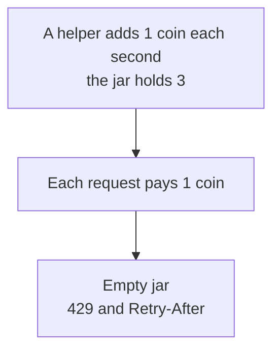
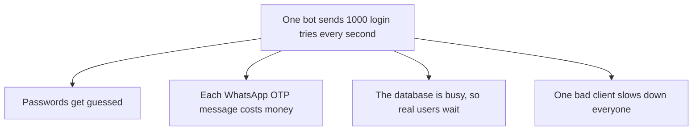
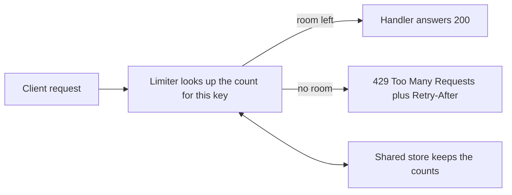
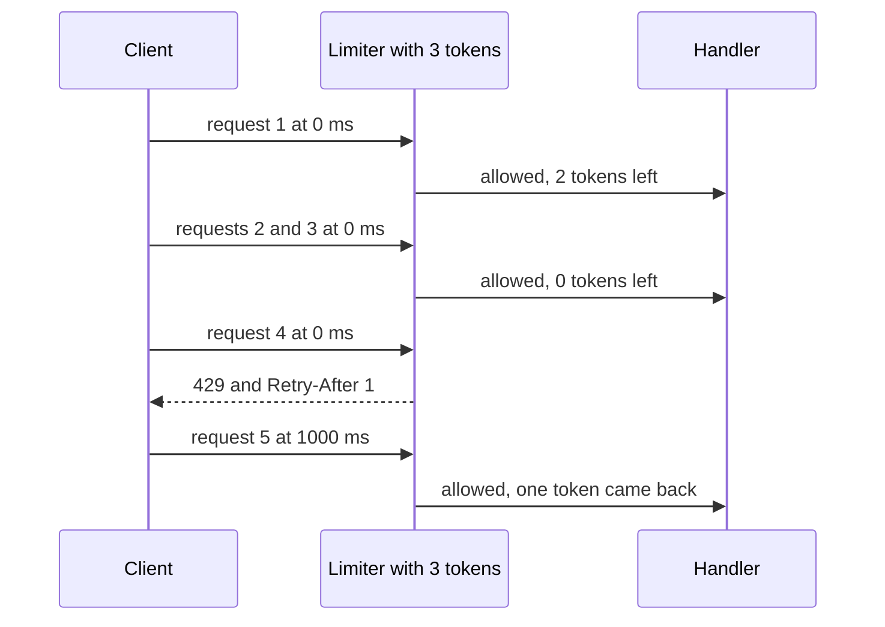
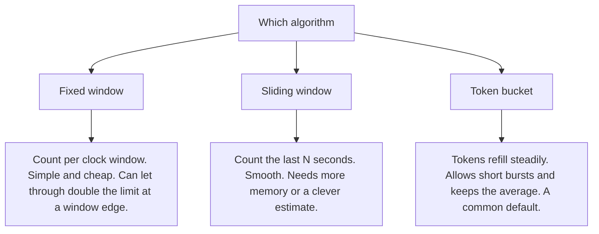
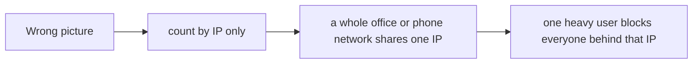
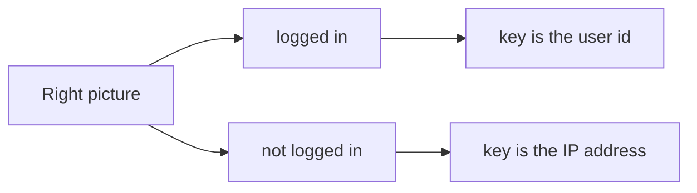
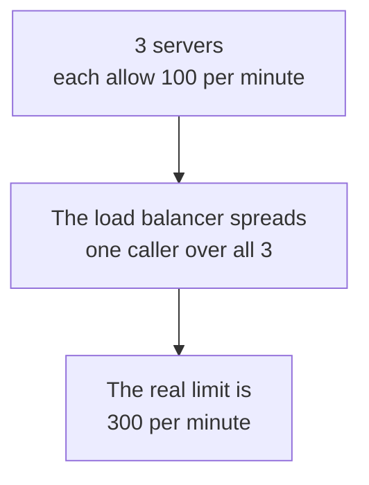
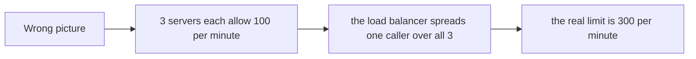
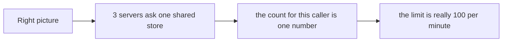

# 11. Rate limiting

> **Subject:** Backend and API · **Lesson:** 11 · **Made:** 2026-10-23 · **Remade in short cards:** 2026-10-29 · **Status:** ready
>
> **You will be able to:** say why an API limits how fast one caller can go, explain fixed window, sliding window and token bucket, and say what changes when you run more than one server.
>
> **Before this:** [Validation and error handling](10-validation-and-error-handling.md) · **Next:** [Caching in APIs](12-caching-in-apis.md)
>
> **How to read it:** one card is one idea. Look at the picture, guess, then press the orange bar to check. The blue bars (📖 More detail) hold the longer explanation. Skip them on the first read, and open them when you want more. About 15 minutes for the cards.

## 1. The idea: a jar of coins with a helper

A jar holds 3 coins at most. A helper drops in one new coin every second. To get through the door, you pay one coin. No coin, no entry: you wait for the helper. This is a **token bucket**. The server keeps one jar for each caller, and answers `429` when the jar is empty.



<details class="guess"><summary>🤔 Guess: a caller sends 4 requests at the same moment to a jar of 3 coins. What happens to the 4th? Press to check.</summary>

It is refused with `429 Too Many Requests` and `Retry-After: 1`, because the jar is empty. One second later the helper has dropped in a new coin.

</details>

> **Remember:** count the requests of each caller. Over the limit: answer `429` and say when to try again.

<details class="more"><summary>📖 More detail: four new words, the problem, and the full picture</summary>

**New words.**

- **Rate limit:** the most requests one caller may send in a stretch of time.
- **Key:** what you count by. The user id, the IP address or the API key.
- **Window:** the stretch of time you count in, for example one minute.
- **Token bucket:** a bucket that fills with tokens at a steady speed. Each request takes one token. An empty bucket means wait.

The rule to remember: **count by who, over a stretch of time, share the count between servers, answer 429 with Retry-After.**

**The problem, drawn.** One caller can hurt everyone, or cost you money.



**The big picture.** The limiter sits in front of the handler and keeps its counts in a store that every server can reach.



**A token bucket over time.** Notice that the fourth request is refused, and that time brings a token back.

A token bucket that holds 3 tokens. Notice that the fourth request is refused, and that time brings a token back.



**The jar again.**

A **jar of coins with a helper**.

- The jar holds 3 coins at most. A helper drops in one new coin every second. If the jar is full, the extra coin is thrown away.
- To get through the door, you pay one coin. No coin, no entry. You wait until the helper brings one.
- You can spend all 3 coins at once (a burst). But over a long time you can only go as fast as the helper.

Where the analogy stops: the jar is in one place. With many servers, you need **one jar that all of them share**. If every server has its own jar, a caller gets coins from all of them.

</details>

## 2. The bucket in numbers

A bucket of 3 tokens, 1 token back each second, one caller. These are real runs of the code in the blue bar.

| Time | Tokens when the request arrives | Result |
|---|---|---|
| 0 ms | 3 | allowed, 2 left |
| 0 ms | 2 | allowed, 1 left |
| 0 ms | 1 | allowed, 0 left |
| 0 ms | 0 | **refused**, try again in 1 s |
| 500 ms | 0.5 | **refused**, try again in 1 s |
| 1000 ms | 1.0 | allowed, 0 left |
| 1000 ms | 0 | **refused** |

<details class="guess"><summary>🤔 Guess: at 500 ms the bucket has 0.5 tokens. Is the request allowed? Press to check.</summary>

No. A request needs **1 whole token**. At 500 ms the bucket has only 0.5, so the answer is "refused, try again in 1 s". At 1000 ms it has 1.0, and the request is allowed.

</details>

> **Remember:** a bucket fills steadily, so a short burst is fine, and the average speed is limited.

<details class="more"><summary>📖 More detail: the code, and what it prints</summary>

The clock is a parameter (`nowMs`), so you can test the limiter without waiting.

```js
function makeBucket({ capacity, refillPerSec }) {
  let tokens = capacity, last = 0;
  return function take(nowMs) {
    tokens = Math.min(capacity, tokens + ((nowMs - last) / 1000) * refillPerSec);
    last = nowMs;
    if (tokens >= 1) { tokens -= 1; return { ok: true, left: tokens }; }
    return { ok: false, retryAfterSec: Math.ceil((1 - tokens) / refillPerSec) };
  };
}
const take = makeBucket({ capacity: 3, refillPerSec: 1 });
for (const t of [0, 0, 0, 0, 500, 1000, 1000]) console.log(String(t).padStart(4), "ms", take(t));
```

**Output:**

```
   0 ms { ok: true, left: 2 }
   0 ms { ok: true, left: 1 }
   0 ms { ok: true, left: 0 }
   0 ms { ok: false, retryAfterSec: 1 }
 500 ms { ok: false, retryAfterSec: 1 }
1000 ms { ok: true, left: 0 }
1000 ms { ok: false, retryAfterSec: 1 }
```

This matches the first table in section 2d. The clock is a parameter (`nowMs`), so you can test the limiter without waiting.

</details>

## 3. Fixed window and its edge

A fixed window counts per clock window, for example 5 requests per 10 seconds. It is simple and cheap. But look at the edge.

| Requests at | In window | Result |
|---|---|---|
| 9.0 to 9.4 s | 1 (0 to 10 s) | 5 allowed. The window is full. |
| 10.0 to 10.4 s | 2 (10 to 20 s) | 5 allowed. The new window starts empty. |

<details class="guess"><summary>🤔 Guess: the limit is 5 per 10 seconds. How many requests got through in about 1.5 seconds? Press to check.</summary>

**10.** Both windows said yes, but the two groups were only a moment apart. A sliding window or a token bucket does not have this edge. Checked with a small simulation on 2026-10-29: the 11th request, at 10.5 s, was refused.

</details>

> **Remember:** a fixed window can let through double the limit at a window edge.

<details class="more"><summary>📖 More detail: the edge as written, and which algorithm is good at what</summary>

**A fixed window** (5 requests per 10 seconds). Notice the edge. Five requests at 9.0 to 9.4 seconds use up window 1. Five more at 10.0 to 10.4 seconds fall into window 2, which starts empty:

```
ok ok ok ok ok | ok ok ok ok ok NO
 window 1 (0 to 10 s) | window 2 (10 to 20 s)
```

That is 10 requests in 1.5 seconds, with a limit of 5 per 10 seconds. Both windows said yes.

**Which algorithm?** Notice what each one is good at.



</details>

## 4. Which algorithm do I pick?

| Algorithm | How it counts | Good at | Weak at |
|---|---|---|---|
| Fixed window | per clock window | simple and cheap | double the limit at the edge |
| Sliding window | the last N seconds | smooth | more memory, or an estimate |
| Token bucket | tokens refill steadily | short bursts, steady average | a bit more code |

<details class="guess"><summary>🤔 Guess: which one allows a short burst and still keeps the average speed? Press to check.</summary>

The **token bucket**. It is a common default. Stripe describes using a token bucket for its request rate limiter.

</details>

> **Remember:** token bucket is a common default.

## 5. Who do I count by? The key

| The caller | Count by |
|---|---|
| logged in | the user id |
| not logged in | the IP address |
| the login route | the IP plus the account name |

<details class="guess"><summary>🤔 Guess: a whole office shares one IP address. You count only by IP. What goes wrong? Press to check.</summary>

One heavy user blocks everyone behind that IP. So use the **user id** when you know the user, and the IP only for callers who are not logged in.

</details>

> **Remember:** count by the user when you know the user. Use the IP only when you do not.

<details class="more"><summary>📖 More detail: the pictures, and the cost as written</summary>

**Wrong picture 2 and right picture 2.**

**Wrong picture 2:** "Always count by IP address."



**Right picture 2:** count by the user when you know the user. Use the IP only for callers who are not logged in.



**The mistake.**

**Wrong:** only counting by IP.

**Right:** user id when you know the user. IP, or IP plus account name, when you do not.

**Choosing the key is hard.**

  - **Choosing the key is hard.** IP counts punish shared networks. User counts do not protect the login route, where nobody is logged in yet. A common answer is IP plus the account name for login.

</details>

## 6. Many servers: one shared store

If every server keeps its own counter, a caller gets coins from all of them.



<details class="guess"><summary>🤔 Guess: how do you make the limit really 100 per minute with 3 servers? Press to check.</summary>

Keep the count in **one shared store**, such as Redis. Then the count for a caller is one number, and every server reads and updates the same one.

</details>

> **Remember:** more than one server needs a shared store for the counts.

<details class="more"><summary>📖 More detail: wrong picture 1 and right picture 1, and the mistake as written</summary>

**Wrong picture 1 and right picture 1.**

**Wrong picture 1:** "Each server keeps its own counter."



**Right picture 1:** one shared store, so the count is one number.



**The mistake.**

**Wrong:** a counter in server memory, with more than one server.

```js
const hits = {};                      // lives in this one process
```

**Right:** keep the count in a shared store such as Redis.

**Why:** with 3 servers, the real limit is 3 times what you wrote.

</details>

## 7. The limiter in Express

The package `express-rate-limit` does the counting for one process. Run `npm i express-rate-limit`.

```js
const { rateLimit } =
  require("express-rate-limit");
app.use(rateLimit({
  windowMs: 60_000, limit: 2,
  standardHeaders: "draft-7",
  legacyHeaders: false,
}));
```

Three requests from the same caller came back like this (checked on 2026-10-29 with express-rate-limit 8.7.1 and Express 5.3.0):

| Request | Status | Headers that matter |
|---|---|---|
| 1 | `200` | `ratelimit: limit=2, remaining=1, reset=60` |
| 2 | `200` | `ratelimit: limit=2, remaining=0, reset=60` |
| 3 | `429` | `retry-after: 60`, and the same `ratelimit` header |

<details class="guess"><summary>🤔 Guess: on the third request, does your route handler run? Press to check.</summary>

No. The limiter answers `429` before the handler, with the body `Too many requests, please try again later.` A well-behaved client waits for `retry-after`.

</details>

> **Remember:** the limiter sits in front of the handler. A refused request never reaches it.

<details class="more"><summary>📖 More detail: the steps, and what each header tells the client</summary>

The limiter in Express. The package `express-rate-limit` does the counting for one process:

```js
const { rateLimit } = require("express-rate-limit");
app.use(rateLimit({ windowMs: 60_000, limit: 2, standardHeaders: "draft-7", legacyHeaders: false }));
```

Three requests from the same caller, as they really came back (checked on 2026-10-23 with express-rate-limit 8.7.1 and Express 5.3.0):

| Step | Who | What happens | Status | Headers that matter |
|---|---|---|---|---|
| 1 | Limiter | Finds the key for this caller (the IP, by default). Count is 0. Adds one. | `200` | `ratelimit: limit=2, remaining=1, reset=60` |
| 2 | Limiter | Count becomes 2. Still within the limit. | `200` | `ratelimit: limit=2, remaining=0, reset=60` |
| 3 | Limiter | Count would be 3. Over the limit. The handler does **not** run. | `429` | `retry-after: 60` and the same `ratelimit` header |

The body of the third answer was `Too many requests, please try again later.` The first two bodies were the normal answer of the route.

**What each header tells the client.**

What each header tells the client:

- `ratelimit: limit=2, remaining=1, reset=60` means "you may send 2, you have 1 left, the window resets in 60 seconds".
- `retry-after: 60` means "do not try again for 60 seconds". It is a real standard header. Well-behaved clients wait for it.

**Step through it yourself.**

**Step through it yourself:** [open the rate limiting stepper](visuals/11-rate-limiting.html). It has four stories: a token bucket filling and emptying, a fixed window and its edge, three servers with their own counters against one shared store, and the choice of key. Guess first, then press Next.

</details>

## 8. Mistake 1: a counter that never resets, and the wrong status

```js
// wrong: no window, and a 500
hits[req.ip] = (hits[req.ip] || 0) + 1;
if (hits[req.ip] > 100)
  return res.status(500).send("slow down");
```

<details class="guess"><summary>🤔 Guess: why is `429` better than `500` here? Press to check.</summary>

A `500` looks like **our** bug, and retry tools treat it differently. `429` says "the client sent too many". Also, a counter with no window blocks the caller for ever. Count inside a window, answer `429`, and add `Retry-After`.

</details>

> **Remember:** count inside a window. Answer `429` with `Retry-After`.

<details class="more"><summary>📖 More detail: the wrong code and the right code</summary>

**Wrong:** a counter that never resets, and the wrong status.

```js
hits[req.ip] = (hits[req.ip] || 0) + 1;
if (hits[req.ip] > 100) return res.status(500).send("slow down");
```

**Right:** count inside a window, answer `429`, and add `Retry-After`.

```js
res.set("Retry-After", String(secondsToWait)).status(429).json(problem);
```

**Why:** a counter without a window blocks the caller for ever. A `500` looks like our bug, not like the client's fault, and retry tools will treat it differently.

</details>

## 9. Mistake 2: the limiter after the slow work

```js
// wrong: the password check is the slow part
app.post("/login",
  checkPasswordInDatabase, limiter, handler);
```

<details class="guess"><summary>🤔 Guess: where does the limiter go in this list? Press to check.</summary>

**First.** The whole point is to skip the expensive part. Also, do not use one limit for the whole API: be generous for reads, and strict for login and OTP.

</details>

> **Remember:** put the limiter first.

<details class="more"><summary>📖 More detail: the two mistakes as written</summary>

**Wrong:** the limiter placed after the slow work.

```js
app.post("/login", checkPasswordInDatabase, limiter, handler);
```

**Right:** put the limiter first.

**Why:** the whole point is to skip the expensive part.

**Wrong:** one limit for the whole API.

**Right:** a generous limit for reads, a strict one for login and OTP, and a separate one for each key type.

</details>

## 10. Why it matters and what it costs

- **Without it:** one caller can guess passwords, run up your bill (a text or WhatsApp message costs money each time), or use all the database time. Real users pay for it.
- **With it:** a small check in front of the work. Cheap to run, and it stops the expensive part.
- **The cost:** you need a shared store with more than one server, and you must decide what happens when it is down. Choosing the key is hard. It can block real users. It does not stop a large attack from many IPs. And different routes need different limits.

<details class="more"><summary>📖 More detail: the problem and the costs, as they were written</summary>

- **Problem without it:** one caller can guess passwords, run up your bill (a text or WhatsApp message costs money each time), or use all the database time. Real users pay for it.
- **How it solves it:** a small check in front of the work. Cheap to run, and it stops the expensive part.
- **Cost:**
  - **It needs a shared store when you run more than one server.** The store (often Redis) is one more part that can fail. Decide what happens when it is down. *Fail open* lets every request through. *Fail closed* refuses them. Fail open is kinder to users. For a route like OTP, where each request costs money, many teams choose fail closed.
  - **Choosing the key is hard.** IP counts punish shared networks. User counts do not protect the login route, where nobody is logged in yet. A common answer is IP plus the account name for login.
  - **It can block real users.** A phone app that retries fast can hit a limit by itself. Send `Retry-After`, and make your own clients wait.
  - **It does not stop a large attack.** Many different IPs, each under the limit, still add up. That needs a firewall or a CDN in front.
  - **Different routes need different limits.** Reading a list can be generous. Login and OTP must be strict.

</details>

## 11. Watch and play

Links checked on 2026-10-23. I opened every page. For the video I checked only the title and the channel, not the content.

- **Play with it:** [Visualizing algorithms for rate limiting](https://smudge.ai/blog/ratelimit-algorithms) by smudge.ai. It has a **Hit** button. It covers fixed windows, sliding windows and token buckets. Press Hit at the end of a window and watch the edge problem.
- **Play with it:** [The rate limiting stepper](visuals/11-rate-limiting.html) in this folder. In "Fixed window and its edge", say out loud why 10 requests got through.
- **Video:** [Five Rate Limiting Algorithms ~ Key Concepts in System Design](https://www.youtube.com/watch?v=mQCJJqUfn9Y) by Hello Byte. A short tour of the common algorithms. I did not watch it, so use it as a second view after the stepper.
- **Read:** [Stripe: Scaling your API with rate limiters](https://stripe.com/blog/rate-limiters). The four limiters. Read the token bucket part.
- **Read:** [MDN: 429 Too Many Requests](https://developer.mozilla.org/en-US/docs/Web/HTTP/Reference/Status/429). The status and the `Retry-After` header.
- **Read:** [Redis: rate limiter](https://redis.io/docs/latest/develop/use-cases/rate-limiter). Why local counters break behind a load balancer.
- **Read:** [express-rate-limit on GitHub](https://github.com/express-rate-limit/express-rate-limit). The options `windowMs`, `limit`, `standardHeaders` and `store`.

<details><summary>More links (optional)</summary>

- **Read:** [IETF draft: RateLimit header fields for HTTP](https://datatracker.ietf.org/doc/draft-ietf-httpapi-ratelimit-headers/). Still a draft on 2026-10-23.
- **Code in this repo:** [DBO case study, rate limiting and gateway section](../../interview/my-projects/dbo-b2b-platform-system-design-case-study.md). Your own notes, with a table of limits per route.

</details>

## 12. Practice

**A. Predict the output** (write your answer before opening)

```js
const take = makeBucket({ capacity: 2, refillPerSec: 1 });   // makeBucket from section 4
console.log([0, 0, 0, 1500].map((t) => take(t).ok));
```

<details><summary>Answer</summary>

```
[ true, true, false, true ]
```

Two tokens, so two requests pass at time 0. The third has no token. At 1500 ms, 1.5 tokens have come back (1 per second), so one request passes and 0.5 is left.

</details>

**B. Fix the bug**

```js
const hits = {};
app.use((req, res, next) => {
  hits[req.ip] = (hits[req.ip] || 0) + 1;
  if (hits[req.ip] > 100) return res.status(500).send("slow down");
  next();
});
```

What is wrong? There are four problems.

<details><summary>Answer</summary>

1. **No window.** The count never goes back to 0. After 100 requests in total, the caller is blocked for ever.
2. **Wrong status.** It should be `429`, and it should send `Retry-After`.
3. **It lives in one process.** With more servers, each has its own count. Use a shared store.
4. **The object grows for ever.** Every new IP adds a key that is never removed. A store with expiry (like Redis with `EXPIRE`) cleans itself.

</details>

**C. Write it yourself**

Open `practice/11-rate-limiting.js`. You write a token bucket limiter and a fixed window limiter (each with one bucket per key), the headers for a refused request, the key choice, and five short answers. One test proves the edge problem of the fixed window on your own code.

```
node --test learn/backend-api/practice/11-rate-limiting.test.js
```

<details><summary>One possible answer</summary>

```js
function createTokenBucketLimiter({ capacity, refillPerSec }) {
  const buckets = new Map();
  return {
    check(key, nowMs) {
      let b = buckets.get(key);
      if (!b) { b = { tokens: capacity, last: nowMs }; buckets.set(key, b); }
      const elapsed = Math.max(0, nowMs - b.last);                // time never goes backward
      b.tokens = Math.min(capacity, b.tokens + (elapsed / 1000) * refillPerSec);
      b.last = Math.max(b.last, nowMs);
      if (b.tokens >= 1) {
        b.tokens -= 1;
        return { allowed: true, remaining: Math.floor(b.tokens), retryAfterSec: 0 };
      }
      return { allowed: false, remaining: 0, retryAfterSec: Math.ceil((1 - b.tokens) / refillPerSec) };
    },
  };
}

function createFixedWindowLimiter({ limit, windowMs }) {
  const counts = new Map();                                       // key -> { window, count }
  return {
    check(key, nowMs) {
      const window = Math.floor(nowMs / windowMs);
      let c = counts.get(key);
      if (!c || c.window !== window) { c = { window, count: 0 }; counts.set(key, c); }   // old window is forgotten
      c.count += 1;
      if (c.count <= limit) return { allowed: true, remaining: limit - c.count, retryAfterSec: 0 };
      const windowEnd = (window + 1) * windowMs;
      return { allowed: false, remaining: 0, retryAfterSec: Math.ceil((windowEnd - nowMs) / 1000) };
    },
  };
}

function statusFor(result) {
  return result.allowed ? 200 : 429;
}

function rateLimitHeaders(result) {
  return result.allowed ? {} : { "Retry-After": String(result.retryAfterSec) };
}

function keyFor(req) {
  if (req && req.user && req.user.id != null) return `user:${req.user.id}`;
  if (req && req.ip) return `ip:${req.ip}`;
  return "anonymous";
}

const answers = {
  burstFriendlyAlgorithm: "token bucket",
  edgeProblemAlgorithm: "fixed window",
  statusWhenBlocked: 429,
  headerThatSaysWhenToRetry: "Retry-After",
  whereToKeepCountsWithThreeServers: "shared store",
};
```

Notice three things. The fixed window limiter keeps only the current window for each key, so old windows do not pile up in memory. The token bucket never lets time go backward. And in the bucket, a refused request takes no token: the bucket keeps its fraction and fills on.

</details>

## 13. Interview question

**Q:** "How would you add rate limiting to an API? Which algorithm? What changes when you run several servers?"

<details><summary>A strong answer, in four parts</summary>

1. **Problem:** one caller can guess passwords, run up costs (SMS or WhatsApp messages), or use up the database for everyone. I want a cheap check in front of the expensive work.
2. **How it works:** I choose a **key** (user id when known, IP otherwise, IP plus account name for login) and count requests for that key. I use a **token bucket**: tokens refill at a steady rate, a request takes one, so short bursts pass but the average stays under the limit. When a caller is over, I answer `429` in the standard error shape and send `Retry-After`. The counts live in a **shared store such as Redis**, with the check done in one atomic step (a Lua script), because a counter in one process does not work with several servers.
3. **Tradeoff:** fixed window is the simplest but lets 2 times the limit through at a window edge. Sliding window is smoother but uses more memory or an estimate. Token bucket allows bursts. A shared store adds a part that can fail, so I decide fail open or fail closed per route, for example fail closed on OTP. IP keys block shared networks. Rate limiting does not stop a wide attack from many IPs, so a CDN or firewall sits in front too.
4. **My example:** your DBO notes say login and OTP go through the Auth service, OTP is sent by WhatsApp, and you already run Redis for BullMQ. They say each OTP message costs money, so that route is the first to limit. *The notes do not say that DBO already has rate limiting. They list it as something to add.* Say "what I would add and why" unless you remember building it.

</details>

## 14. Explain it back

Close this file. Press the **Record my explanation** button under this heading and explain it out loud, like to a new junior, in 4 parts: problem, how it works, tradeoff, my example. Use the words "key", "token bucket" and "shared store". Then save the transcript into `my-learning/recordings/`, or write your best version below. Run `/explain-check rate limiting` or ask the `explain-coach` agent to review it.

### My explanation

<write here>

### Coach feedback

<the explain-coach agent writes here>

## 15. Review questions (day 1, 3, 7, 21)

1. What does a limiter count by, and why is "IP only" not enough?
2. A token bucket has capacity 5 and refills 1 token per second. A caller sends 5 requests at once, then 1 more right after. What happens, and when is the next one allowed?
3. Why can a fixed window let 10 requests through when the limit is 5 per 10 seconds?
4. Draw the picture from section 2e from memory: three servers, wrong way and right way.

<details><summary>Answers</summary>

1. It counts by a **key**: the user id, the IP or the API key. IP only blocks everyone behind one shared address (an office, a phone network), and one heavy user can use up the limit for all of them. Count by user when you know the user, and by IP only when you do not.
2. The first 5 pass and the bucket is empty. The sixth is refused with `429` and `Retry-After: 1`. After 1 second one token has come back, so the next request passes.
3. The windows are cut by the clock. Five requests at the end of window 1 and five at the start of window 2 are each under the limit of their own window, so all ten pass in about a second. A sliding window or a token bucket does not have this edge.
4. Wrong: three servers, each with its own counter, so a caller can get 3 times the limit. Right: three servers all ask one shared store (Redis), so there is one count.

</details>

## 16. Go deeper (optional)

Open these when you are ready. None of them is needed for the cards above.

<details><summary>Redis, other limiters, headers and proxies</summary>

**Redis for the shared count.** The Redis docs say `INCR` and `EXPIRE` give you atomic fixed-window counters that clean themselves up. For a token bucket, a Lua script keeps "read the tokens, decide, write the tokens" as one step, so two requests at the same moment cannot spend the same token. Their rate limiter guide builds a token bucket this way.

**Stripe uses four limiters, not one.** Stripe's blog describes: a request rate limiter (token bucket, kept in Redis), a concurrent requests limiter (how many at the same time), a fleet usage load shedder (keeps room for critical requests) and a worker utilization load shedder (drops low-priority traffic when workers are busy). The lesson: "requests per second" is only one of the things to limit.

**Header names are still moving.** `Retry-After` is a settled standard. The `RateLimit` and `RateLimit-Policy` headers are still an IETF draft (draft-ietf-httpapi-ratelimit-headers-11, dated 23 May 2026, still an Internet-Draft on 2026-10-23). `express-rate-limit` lets you choose which draft to follow with `standardHeaders: "draft-6"`, `"draft-7"` or `"draft-8"`, which is why the output above has the `ratelimit` form.

**Sliding window, two kinds.** A *log* keeps the time of every request and counts those in the last N seconds. It is exact but uses memory. A *counter* mixes the count of the current window with a part of the count of the previous window. It is cheap and a little off.

**Behind a proxy.** The IP that Express sees is the proxy's IP, unless you tell Express how many proxies you have (`app.set("trust proxy", n)`). Set it to the number you really have. If you trust every `X-Forwarded-For` header, a caller can write any IP they like and skip the limit.

**GraphQL.** One request can ask for a huge nested result. Limit the depth and the cost of the query too. Hasura has depth, node, time and rate limits, but only on its paid and Enterprise plans (lesson 14).

</details>

## Connected lessons

- [Validation and error handling](10-validation-and-error-handling.md): a `429` should use the same error shape as every other error.
- [Password hashing](09-password-hashing.md): a slow hash makes every login expensive, which is one more reason to limit login.
- [Authentication: sessions vs JWT](06-authentication-sessions-vs-jwt.md): the user id from the token is the best key once the caller is logged in.
- [Caching in APIs](12-caching-in-apis.md): the next lesson. A cache is the other way to protect the database from too many requests.
- [Webhooks and idempotency](13-webhooks-and-idempotency.md): a sender that gets `429` or `5xx` from you will try again, so be ready for repeats.
- [Hasura: when and when not](14-hasura-when-and-when-not.md): Hasura has its own API limits, on paid plans.
