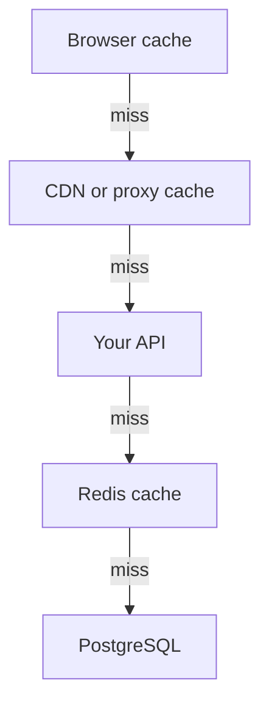
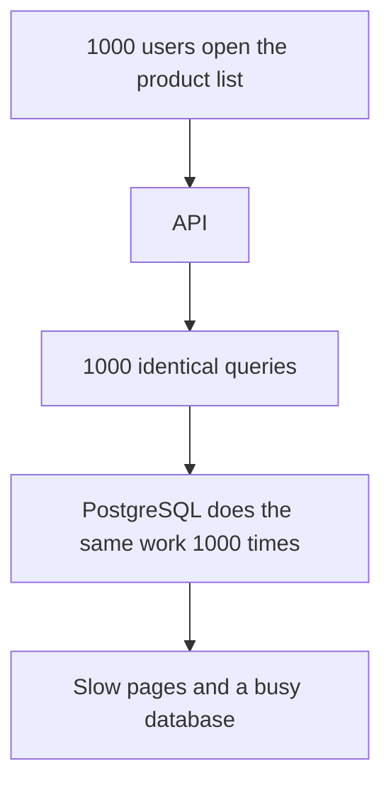
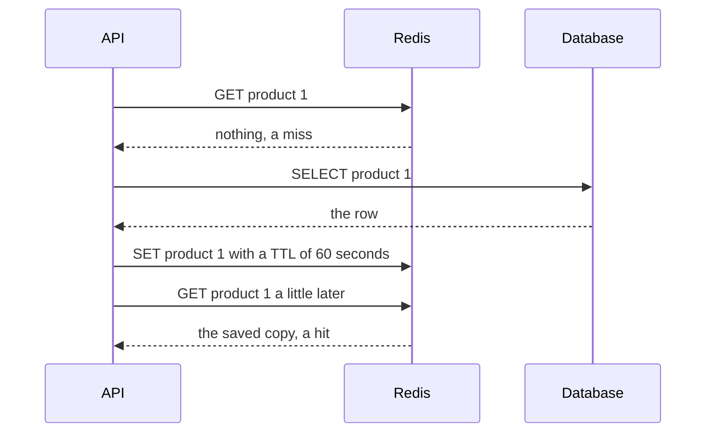
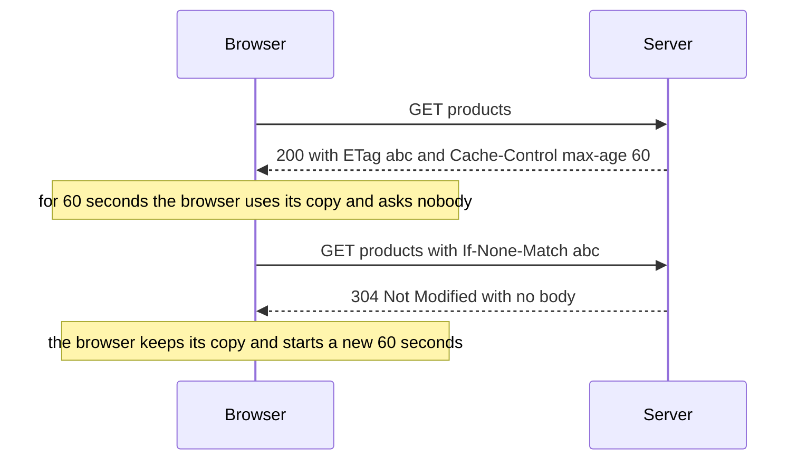
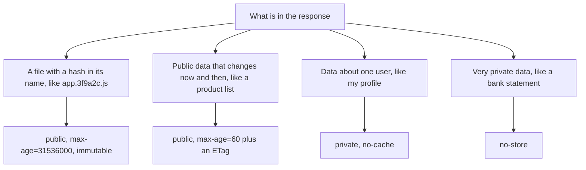
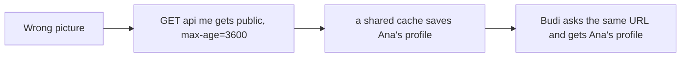
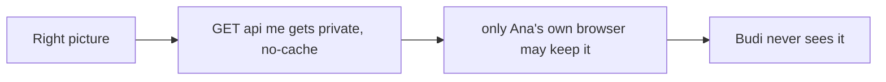
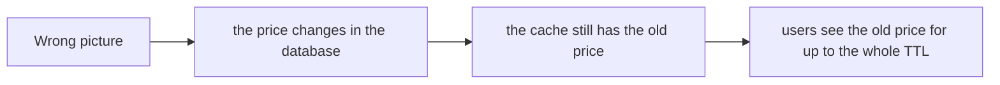
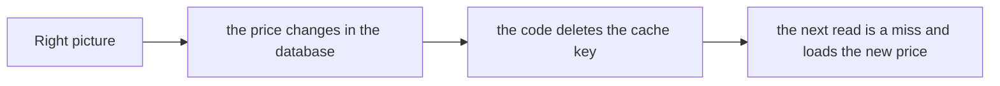

# 12. Caching in APIs

> **Subject:** Backend and API · **Lesson:** 12 · **Made:** 2026-10-23 · **Remade in short cards:** 2026-10-29 · **Status:** ready
>
> **You will be able to:** say where a cache can live in an API, what `Cache-Control` and `ETag` do, how a Redis cache with a TTL works, and why changing data is the hard part.
>
> **Before this:** [Rate limiting](11-rate-limiting.md) · **Next:** [Webhooks and idempotency](13-webhooks-and-idempotency.md)
>
> **How to read it:** one card is one idea. Look at the picture, guess, then press the orange bar to check. The blue bars (📖 More detail) hold the longer explanation. Skip them on the first read, and open them when you want more. About 15 minutes for the cards.

## 1. The idea: a fridge at home and the shop

The shop (the database) has everything, but the trip takes time. The fridge (the cache) holds copies of what you use every day. Milk has a date on it. That is the **TTL**: after the date, you throw it away and go to the shop again. A request can be answered at any of these places. Closer to the user is faster, and harder to change.



<details class="guess"><summary>🤔 Guess: 1000 users open the product list, and there is no cache. How many identical queries does the database run? Press to check.</summary>

**1000.** The same work, again and again. Pages are slow and the database is busy. With a cache, it can be one.

</details>

> **Remember:** a cache buys speed and pays with old data. Decide how old is fine.

<details class="more"><summary>📖 More detail: new words, the problem, and the fridge again</summary>

**New words.**

- **Cache:** a saved copy of an answer, so you do not repeat the slow work.
- **TTL:** how many seconds the saved copy is trusted. After that it is thrown away. (Interview words: *time to live*.)
- **ETag:** a short tag for one version of an answer. Same tag means nothing changed.
- **Cache-aside:** your code checks the cache first. If the copy is not there (a *miss*), it reads the database and saves the result. If it is there (a *hit*), it uses the copy.

Two more ideas, said in plain words where they come up: an **old copy** is a saved answer that may no longer be true. To **delete the copy** when the data changes is called *invalidation*.

The rule to remember: **a cache buys speed and pays with old data. Decide how old is fine.**

**The problem, drawn.** The same question, asked again and again, makes the database do the same work again and again.



**The fridge again.**

A **fridge at home** and **the shop**.

- The shop (the database) has everything, but the trip takes time. The fridge (the cache) holds copies of what you use every day.
- Milk has a date on it. That is the **TTL**. After the date, you throw it away and go to the shop again.
- A tag on the milk says which batch it is. You phone the shop and ask, "Is batch 28 still the current one?" If yes, you keep your milk. That is the **ETag**: one short question instead of a whole trip.
- If the shop changes the recipe tomorrow, your fridge does not know. You have **old milk** until the date, or until you throw it out yourself.

Where the analogy stops: a shop cannot tell you about a change by itself. In code you can. When you write new data, your code can delete the saved copy at the same moment.

</details>

## 2. Cache-aside with a TTL

Your code checks the cache first. A **miss**: read the database and save the copy. A **hit**: use the copy. The copy is trusted for a TTL of 60 seconds. The clock is a parameter, so you can test without waiting.

```js
function makeCache(ttlMs) {
  const store = new Map();
  return async (key, load, now) => {
    const hit = store.get(key);
    if (hit && hit.expires > now)
      return "cache";
    const value = await load();
    store.set(key,
      { value, expires: now + ttlMs });
    return "database";
  };
}
let dbCalls = 0;
const load = async () => {
  dbCalls++;
  return { id: 1, price: 65000 };
};
(async () => {
  const get = makeCache(60_000);
  for (const t of [0, 1000, 59_000, 61_000])
    console.log(t, await get(
      "product:1", load, t), dbCalls);
})();
```

<details class="guess"><summary>🤔 Guess: what do the four lines print? Press to check.</summary>

```
0 database 1
1000 cache 1
59000 cache 1
61000 database 2
```

At 61,000 ms the copy has run out (TTL 60 s), so the code asks the database again. In a real app the store is Redis, and `SET key value EX 60` does the expiry for you.

</details>

> **Remember:** a hit uses the copy. A miss asks the database and saves the answer with a TTL.

<details class="more"><summary>📖 More detail: the longer program, the story over time, and the table</summary>

**The longer program** (with a `del` for the cache).

```js
function makeCache(ttlMs) {
  const store = new Map();
  return {
    async getOrLoad(key, load, now) {
      const hit = store.get(key);
      if (hit && hit.expires > now) return { value: hit.value, from: "cache" };
      const value = await load();
      store.set(key, { value, expires: now + ttlMs });
      return { value, from: "database" };
    },
    del(key) { store.delete(key); },
  };
}
let dbCalls = 0;
const loadProduct = async () => { dbCalls++; return { id: 1, price: 65000 }; };
(async () => {
  const cache = makeCache(60_000);
  for (const t of [0, 1000, 59_000, 61_000]) {
    const r = await cache.getOrLoad("product:1", loadProduct, t);
    console.log(String(t).padStart(6), "ms", r.from.padEnd(8), "database calls so far:", dbCalls);
  }
})();
```

**Output:**

```
     0 ms database database calls so far: 1
  1000 ms cache    database calls so far: 1
 59000 ms cache    database calls so far: 1
 61000 ms database database calls so far: 2
```

The clock (`now`) is a parameter, so you can test it without waiting a minute. In a real app the store is Redis, and `SET key value EX 60` does the expiry for you.

**Cache-aside with Redis over time.** Notice that the database is asked only once.

**Part 2: cache-aside with Redis.** Notice that the database is asked only once.



**What is saved right now.**

The cache-aside code from section 4, a TTL of 60 seconds. Notice when the database is asked:

| Time | Where the answer came from | Database calls so far |
|---|---|---|
| 0 ms | the database (a miss) | 1 |
| 1,000 ms | the cache | 1 |
| 59,000 ms | the cache | 1 |
| 61,000 ms | the database (the copy ran out) | 2 |

</details>

## 3. The browser copy and the ETag

Two headers make browser caching work.

| Header | Value | Meaning |
|---|---|---|
| `Cache-Control` | `public, max-age=60` | anyone may keep this for 60 seconds |
| `ETag` | `W/"28-/pt9wzI95rrElbHhOaaOcdSPEQE"` | the tag of this version of the body |

For 60 seconds the browser uses its copy and asks nobody. After that, it asks again and sends the saved tag in `If-None-Match`.

<details class="guess"><summary>🤔 Guess: the browser asks with the saved tag, and the data has not changed. What does the server send? Press to check.</summary>

`304 Not Modified` with **no body**. The browser keeps its copy and starts a new 60 seconds. Checked with Express 5.3.0 on 2026-10-29: `200` the first time, `304` with a body length of 0 with the saved tag, and `200` with a different tag.

</details>

> **Remember:** the ETag saves bandwidth. A `304` has no body.

<details class="more"><summary>📖 More detail: the story over time, the curl run, and every step</summary>

**The browser and the ETag over time.** Notice that the second request has no body in the answer.



**A real Express 5 route, and three requests made with `curl`.**

```js
app.get("/products", (req, res) => {
  res.set("Cache-Control", "public, max-age=60");
  res.json([{ id: 1, name: "Cement", price: 65000 }]);     // Express adds the ETag
});
```

```
$ curl -i http://localhost:4311/products
HTTP/1.1 200 OK
Cache-Control: public, max-age=60
ETag: W/"28-/pt9wzI95rrElbHhOaaOcdSPEQE"
Content-Length: 40

[{"id":1,"name":"Cement","price":65000}]

$ curl -i -H 'If-None-Match: W/"28-/pt9wzI95rrElbHhOaaOcdSPEQE"' http://localhost:4311/products
HTTP/1.1 304 Not Modified
Cache-Control: public, max-age=60
ETag: W/"28-/pt9wzI95rrElbHhOaaOcdSPEQE"

$ curl -i -H 'If-None-Match: "other"' http://localhost:4311/products
HTTP/1.1 200 OK
```

(Headers I did not need are left out. The `304` had no body at all.)

**Every step.**

| Step | Who | What happens |
|---|---|---|
| 1 | Browser | Asks for `/products`. It has no copy. |
| 2 | Express | Runs your route. `res.json` makes a tag from the body (the `ETag`) and sends `200` with the body. |
| 3 | Browser | Saves the body and the tag. For the next 60 seconds the copy is *fresh*. |
| 4 | Browser | Inside the 60 seconds, the user opens the page again. The browser uses the copy. **No request leaves the computer.** |
| 5 | Browser | After 60 seconds the copy is old. The browser asks again and sends the saved tag in `If-None-Match`. |
| 6 | Express | Runs your route again and makes a new tag. The tag is the same, so it sends `304 Not Modified` and **no body**. |
| 7 | Browser | Uses its saved body, and starts a new 60 seconds. |
| 8 | (later) | If the data had changed, the tag would be different, and Express would send `200` with the new body. |

Notice step 6. Express **ran your route** to find out if anything changed. So the ETag saved the *bandwidth*, not the database work. To save the database work too, check a cheap version first (for example the row's `updated_at`) and answer `304` before you run the big query.

**A note on `fetch`.** When I set `If-None-Match` with Node's `fetch` on 2026-10-29, Express answered `200`, not `304`. Plain `http.get` and `curl` gave the real `304`. So use `curl` to see the `304`.

**Step through it yourself.**

**Step through it yourself:** [open the caching stepper](visuals/12-caching-in-apis.html). It has five stories: the browser copy and the ETag, cache-aside with Redis, a write that must delete the copy, many requests at the moment the copy expires, and who may share a copy. Guess first, then press Next.

</details>

## 4. Which header for which answer?

| What is in the response | Header |
|---|---|
| a file with a hash in its name, like `app.3f9a2c.js` | `public, max-age=31536000, immutable` |
| public data that changes now and then, like a product list | `public, max-age=60` plus an ETag |
| data about one user, like my profile | `private, no-cache` |
| very private data, like a bank statement | `no-store` |

<details class="guess"><summary>🤔 Guess: `no-cache` or `no-store` for a bank statement? Press to check.</summary>

`no-store`. `no-cache` does **not** mean "do not save". It means "may be saved, but check with the server before each use". `no-store` means do not save it at all.

</details>

> **Remember:** `no-cache` = check before use. `no-store` = never save.

<details class="more"><summary>📖 More detail: the picture, and the mistake as written</summary>



**Mistake: thinking `no-cache` means "do not save".**

**Wrong:** thinking `no-cache` means "do not save".

```js
res.set("Cache-Control", "no-cache");     // the browser still saves it
```

**Right:** `no-store` for data that must never be saved. `no-cache` when it may be saved but must be checked first.

**Why:** the names are confusing, and the mistake leaks data that you wanted to hide.

</details>

## 5. Mistake 1: a shared cache saves one person's data

```js
// wrong: a profile, marked public
res.set("Cache-Control", "public, max-age=3600");
```

| | Wrong | Right |
|---|---|---|
| `GET /api/me` gets | `public, max-age=3600` | `private, no-cache` |
| A shared cache | saves Ana's profile | never saves it |
| Budi asks the same URL | gets **Ana's profile** | never sees it |

<details class="guess"><summary>🤔 Guess: the same mistake in Redis: one key `cache:orders` for every user. What happens? Press to check.</summary>

Budi gets Ana's orders. Put the user id in the key: `` `cache:orders:user:${user.id}` ``. This is the Redis version of the `public` mistake.

</details>

> **Remember:** data about one person is private. Put the user id in the cache key.

<details class="more"><summary>📖 More detail: wrong picture 1 and right picture 1, and the Redis key mistake</summary>

**Wrong picture 1 and right picture 1.**

**Wrong picture 1:** "Cache every answer for an hour, and mark it public."



**Right picture 1:** data about one person is private, and is asked again before every use.



**The Redis key mistake.**

**Wrong:** one Redis key for answers that depend on the user.

```js
const key = "cache:orders";                 // Ana and Budi share it
```

**Right:**

```js
const key = `cache:orders:user:${user.id}`;
```

**Why:** the first one shows Ana's orders to Budi. This is the Redis version of the `public` mistake.

</details>

## 6. Mistake 2: writing the database and never deleting the copy

```js
await db.product.update(
  { where: { id }, data: { price } });
// the next line is the fix
await redis.del(`cache:product:${id}`);
```

<details class="guess"><summary>🤔 Guess: the price changes in the database, and the code never deletes the copy. How long do users see the old price? Press to check.</summary>

Up to the whole TTL. After the `del`, the next read is a miss, and it loads the new price. Keep a short TTL as a safety net, in case one path forgets the delete.

</details>

> **Remember:** write the database, then delete the copy.

<details class="more"><summary>📖 More detail: wrong picture 2 and right picture 2, and the mistake as written</summary>

**Wrong picture 2 and right picture 2.**

**Wrong picture 2:** "Save it, and never touch it again until the TTL ends."



**Right picture 2:** write to the database, then delete the copy. Keep a short TTL as a safety net.



**The mistake.**

**Wrong:** writing the database and never deleting the copy.

```js
await db.product.update({ where: { id }, data: { price } });
```

**Right:**

```js
await db.product.update({ where: { id }, data: { price } });
await redis.del(`cache:product:${id}`);        // the next read loads the new price
```

**Why:** without the delete, users see the old price until the TTL ends.

</details>

## 7. Mistake 3: saving a failed answer

```js
const value = await db.find(id).catch(() => null);
await redis.set(key, JSON.stringify(value),
  "EX", 3600);
```

<details class="guess"><summary>🤔 Guess: the database has a short problem and the code saves `null`. What do users see? Press to check.</summary>

"Not found" for a whole hour. Save only a real answer. If the database had an error, save nothing. Also give **every** key a TTL, even a long one, or the cache grows until it is full.

</details>

> **Remember:** cache only real answers, and give every key a TTL.

<details class="more"><summary>📖 More detail: the two mistakes as written</summary>

**Wrong:** saving a failed answer.

```js
const value = await db.find(id).catch(() => null);
await redis.set(key, JSON.stringify(value), "EX", 3600);   // "not found" for an hour
```

**Right:** save only a real answer. If the database had an error, do not save anything.

**Why:** a short database problem becomes an hour of "not found".

**Wrong:** no TTL.

**Right:** every key gets a TTL, even a long one.

**Why:** a key with no TTL lives for ever, and the cache grows until it is full.

</details>

## 8. Why it matters and what it costs

- **Without it:** the same slow work is done again for every request. Pages are slow and the database is busy.
- **With it:** keep the answer closer to the user, or in something faster than the database, for a short time.
- **The cost:** old data (the real price), deleting the copy is hard, private data can leak, a crowd of requests can miss at expiry, and it is one more part to run.

<details class="more"><summary>📖 More detail: the costs as they were written</summary>

- **Problem without it:** the same slow work is done again for every request. Pages are slow and the database is busy.
- **How it solves it:** keep the answer closer to the user, or in something faster than the database, for a short time.
- **Cost:**
  - **Old data.** This is the real price. Every cache can show something that is no longer true. Ask: how old is fine for this answer? A product list for 60 seconds is fine. An account balance is not.
  - **Deleting the copy is hard.** You must delete it on every path that changes the data: your API, the admin site, background jobs, and someone running SQL by hand. One missed path means old data until the TTL ends.
  - **Private data can leak.** A shared cache (a CDN, a proxy) must never hold what belongs to one person. Also put the user id in a Redis key if the answer depends on the user.
  - **The crowd at expiry.** When a popular copy runs out, many requests can miss at once and all ask the database. See the Go deeper box.
  - **One more part.** If Redis is down, the app should still work by asking the database. But then the database gets the full load at once.

</details>

## 9. Watch and play

Links checked on 2026-10-23. I opened every page. For the video I checked only the title and the channel, not the content.

- **Play with it:** [The caching stepper](visuals/12-caching-in-apis.html) in this folder. In "Many requests at the moment the copy expires", say out loud why 100 queries become 1.
- **Try it:** open any website in your browser, then **DevTools > Network**. Reload twice. Look for a status `304`, and for "(disk cache)" in the Size column. These are the pictures from section 2c, live.
- **Video:** [HTTP Caching with E-Tags (Explained by Example)](https://www.youtube.com/watch?v=TgZnpp5wJWU) by Hussein Nasser. The ETag flow, with examples. I did not watch it, so use it as a second view after section 5.
- **Read:** [MDN: HTTP caching](https://developer.mozilla.org/en-US/docs/Web/HTTP/Guides/Caching). Fresh, old and validation, with the 304 flow.
- **Read:** [MDN: Cache-Control](https://developer.mozilla.org/en-US/docs/Web/HTTP/Reference/Headers/Cache-Control). Every directive, with examples for files and for APIs.
- **Read:** [web.dev: Prevent unnecessary network requests with the HTTP Cache](https://web.dev/articles/http-cache). Short and visual. Read the part about versioned URLs.
- **Read:** [Redis: cache-aside](https://redis.io/docs/latest/develop/use-cases/cache-aside). A TTL, delete on write, and the stampede.

<details><summary>More links (optional)</summary>

- **Read:** [RFC 9111: HTTP Caching](https://www.rfc-editor.org/rfc/rfc9111.html). The standard (June 2022).
- **Video:** [Everything you need to know about HTTP Caching](https://www.youtube.com/watch?v=HiBDZgTNpXY) by the roadmap. Title and channel checked only.

</details>

## 10. Practice

**A. Predict the output** (write your answer before opening)

```js
const cache = makeCache(10_000);                 // makeCache from section 4
let calls = 0;
const load = async () => ++calls;
(async () => {
  console.log((await cache.getOrLoad("k", load, 0)).from);
  console.log((await cache.getOrLoad("k", load, 9_999)).from);
  console.log((await cache.getOrLoad("k", load, 10_000)).from);
  console.log(calls);
})();
```

<details><summary>Answer</summary>

```
database
cache
database
2
```

The copy is saved with `expires = 0 + 10000`. At 9,999 ms, `expires > now` is true, so it is a hit. At exactly 10,000 ms, `expires > now` is false, so the copy has run out and the database is asked again. Two database calls in all.

</details>

**B. Fix the bug**

```js
app.get("/api/me", async (req, res) => {
  res.set("Cache-Control", "public, max-age=3600");
  const key = "cache:me";
  const hit = await redis.get(key);
  if (hit) return res.json(JSON.parse(hit));
  const me = await db.user.findUnique({ where: { id: req.user.id } });
  await redis.set(key, JSON.stringify(me));
  res.json(me);
});
```

What is wrong? There are four problems.

<details><summary>Answer</summary>

1. **`public` on personal data.** A CDN or proxy can give Ana's profile to Budi. Use `private, no-cache` (or `no-store`).
2. **One key for everyone.** `cache:me` is the same for every user, so Budi gets Ana's profile from Redis. Use `` `cache:me:${req.user.id}` ``.
3. **No TTL.** The key lives for ever. Use `EX 60` or similar.
4. **Nobody deletes the copy when the profile changes.** The update route must `DEL` the key.

```js
res.set("Cache-Control", "private, no-cache");
const key = `cache:me:${req.user.id}`;
// ... on a miss:
await redis.set(key, JSON.stringify(me), "EX", 60);
```

</details>

**C. Write it yourself**

Open `practice/12-caching-in-apis.js`. You write `makeEtag`, `conditionalGet` (200 or 304), a cache-aside with a TTL, delete and **single flight**, the right `Cache-Control` for four kinds of answer, and some short answers.

```
node --test learn/backend-api/practice/12-caching-in-apis.test.js
```

<details><summary>One possible answer</summary>

```js
const { createHash } = require("node:crypto");

function makeEtag(body) {
  return `"${createHash("sha256").update(body).digest("hex").slice(0, 16)}"`;
}

function conditionalGet(requestHeaders, body) {
  const etag = makeEtag(body);
  const sent = String(requestHeaders["if-none-match"] ?? "");
  const tags = sent.split(",").map((t) => t.trim().replace(/^W\//, "")).filter(Boolean);
  if (tags.includes("*") || tags.includes(etag)) return { status: 304, headers: { ETag: etag } };
  return { status: 200, headers: { ETag: etag }, body };
}

function createCacheAside({ ttlMs }) {
  const store = new Map();                 // key -> { value, expires }
  const loading = new Map();               // key -> Promise (the load that is running now)
  return {
    async getOrLoad(key, loader, nowMs) {
      const hit = store.get(key);
      if (hit && hit.expires > nowMs) return { value: hit.value, from: "cache" };
      if (!loading.has(key)) {
        const p = Promise.resolve()
          .then(loader)
          .then((value) => { store.set(key, { value, expires: nowMs + ttlMs }); return value; })
          .finally(() => loading.delete(key));          // a failed load is not saved and is not stuck
        loading.set(key, p);
      }
      return { value: await loading.get(key), from: "database" };
    },
    del(key) { store.delete(key); },
  };
}

function cacheControlFor(kind) {
  switch (kind) {
    case "fingerprinted-file": return "public, max-age=31536000, immutable";
    case "public-list": return "public, max-age=60";
    case "my-profile": return "private, no-cache";
    default: return "no-store";                         // bank-statement, and anything unknown
  }
}

const answers = {
  noCacheMeans: "save it but check with the server before each use",
  noStoreMeans: "never save it",
  statusWhenTagMatches: 304,
  headerThatCarriesTheSavedTag: "If-None-Match",
  afterAWriteDoThis: "delete the cache key",
};
```

Notice four things. `makeEtag` hashes the body, so the same body always gives the same tag. `conditionalGet` ignores the `W/` mark and understands a list and `*`. In `getOrLoad`, the second caller finds the running load in `loading` and waits for the same Promise, so the loader runs once. And a failed load is not saved: `.finally` removes it from `loading`, so the next call tries again.

</details>

## 11. Interview question

**Q:** "How do you add caching to an API? What are the risks? How do you keep the data fresh?"

<details><summary>A strong answer, in four parts</summary>

1. **Problem:** the same slow answer is asked for again and again. The database repeats the same work, pages are slow and the load grows.
2. **How it works:** I use **layers**. First HTTP caching: `Cache-Control` to say how long a client may reuse the answer, and an `ETag` so a client can ask "has it changed?" and get a `304` with no body. Fingerprinted files get a one-year `immutable`. Personal data gets `private` or `no-store`. Behind the API I use **cache-aside** in Redis: check Redis, on a miss read PostgreSQL and save with a **TTL**. After a write I **delete the key**, so the next read loads the new data.
3. **Tradeoff:** the price is old data, so I decide how old is fine for each answer. Deleting the copy is the hard part, because every write path must do it. A short TTL is the safety net. Shared caches can leak personal data, so the key and the header must include who the answer is for. When a popular key runs out, many requests can hit the database together, so I use single flight or randomised TTLs. An ETag saves bandwidth but still runs my code, so for expensive routes I check a cheap version first.
4. **My example:** your DBO notes say you already run Redis for BullMQ and that heavy reads (CMS reports, order history) are a case for read replicas later. *The notes do not say that DBO caches anything.* If asked, say what you would try first: a public, slow-changing list with a 60 second TTL, and no cache at all for points balances, where old data costs money. Do not claim you built a cache you did not build.

</details>

## 12. Explain it back

Close this file. Press the **Record my explanation** button under this heading and explain it out loud, like to a new junior, in 4 parts: problem, how it works, tradeoff, my example. Use the words "TTL", "old data" and "delete the copy". Then save the transcript into `my-learning/recordings/`, or write your best version below. Run `/explain-check caching` or ask the `explain-coach` agent to review it.

### My explanation

<write here>

### Coach feedback

<the explain-coach agent writes here>

## 13. Review questions (day 1, 3, 7, 21)

1. What is the difference between `no-cache` and `no-store`?
2. A browser has a copy that ran out. What does it send, and what can the server answer? What is saved by the short answer?
3. You update a product price. Walk through what must happen so that users do not see the old price for an hour.
4. Draw the picture from section 2c part 2 from memory: API, Redis, database, and the order of the calls.

<details><summary>Answers</summary>

1. `no-cache`: the copy may be saved, but it must be checked with the server before each use. `no-store`: do not save it anywhere.
2. It sends the request with `If-None-Match` and the saved tag. The server can answer `304 Not Modified` (keep your copy) or `200` with a new body. The `304` saves the body, so bandwidth. It does not save the work your code did to find out.
3. Write the new price to the database. Then delete the cache key for that product, so the next read is a miss and loads the new price. Keep a short TTL as the safety net for any path that forgot to delete.
4. API asks Redis, gets a miss. API asks the database and gets the row. API saves it in Redis with a TTL. Next time, API asks Redis and gets a hit. The database is not asked.

</details>

## 14. Go deeper (optional)

Open these when you are ready. None of them is needed for the cards above.

<details><summary>The crowd at expiry, headers and the cache key</summary>

**The crowd at expiry (cache stampede).** A popular key runs out. In the same moment, 100 requests miss and 100 queries hit the database. The Redis docs call this a stampede. A simple fix is *single flight*: the first request starts the load and keeps its Promise in a map. The other 99 wait for the same Promise. One query, 100 answers. Other fixes: refresh a little before the TTL ends, or add some random time to each TTL so keys do not all end together.

**`no-cache` and `no-store` are not the same.** `no-cache` means the copy may be saved but must be checked with the server before each use. `no-store` means do not save it at all. People mix them up often. (MDN, checked 2026-10-23.)

**`private`, `public` and `s-maxage`.** `private` means only the user's own browser may save it. `public` lets a shared cache save it, even when the request has an `Authorization` header. `s-maxage` sets the time for shared caches (a CDN) only, and wins over `max-age` there.

**`stale-while-revalidate`.** After `max-age` ends, a cache may still use the old copy for N more seconds while it asks for a fresh one in the background. For example `max-age=60, stale-while-revalidate=300`. The user never waits.

**`immutable`.** For files whose name changes when the content changes (a hash in the name), `public, max-age=31536000, immutable` tells caches never to ask again. The HTML page that points to them should use `no-cache`, so a deploy shows the new file names.

**Weak and strong tags.** A tag that starts with `W/` is *weak*: "the same in meaning". Express makes weak tags by default. For `If-None-Match`, the check ignores the `W/`.

**`Last-Modified`.** Browsers and servers also have `Last-Modified` with `If-Modified-Since`. It is the older way and works in whole seconds. When both are sent, `If-None-Match` wins.

**The cache key.** The key must hold every part of the question. `products?page=2` needs a different key from `products?page=1`. An answer that depends on the role or the user needs the role or the user id in the key.

**Redis.** Use `SET key value EX 60` to save with a TTL, and `DEL key` after a write. Redis's own cache-aside guide describes this: a TTL keeps old data inside a known limit, and a delete on write keeps it small.

**Standards.** HTTP caching is RFC 9111 (June 2022), which replaced RFC 7234.

**GraphQL.** Browsers and CDNs do not cache a `POST` by default, and most GraphQL calls are `POST`. Cache on the server (per field or per query), or use persisted `GET` queries so a CDN can help.

</details>

## Connected lessons

- [Rate limiting](11-rate-limiting.md): the other way to protect the database from too many requests. A cache removes work, a limiter refuses work.
- [Authorization](08-authorization.md): never cache what depends on who is asking in a place that is shared by everyone.
- [Validation and error handling](10-validation-and-error-handling.md): do not cache an error answer as if it were a real one.
- [Webhooks and idempotency](13-webhooks-and-idempotency.md): the next lesson. "Do it twice, same result" is the safe-retry idea. A cache that is deleted twice is also fine.
- [Hasura: when and when not](14-hasura-when-and-when-not.md): a generated API still needs a plan for old data.
- Database lessons in `learn/database/`: indexes and `EXPLAIN` come first. A cache is not a fix for a missing index.
