# 13. Webhooks and idempotency

> **Subject:** Backend and API · **Lesson:** 13 · **Made:** 2026-10-23 · **Remade in short cards:** 2026-10-29 · **Status:** ready
>
> **You will be able to:** receive a webhook safely (verify it, skip repeats, answer fast, do the work later), say why the same event can arrive twice, and make your own POST routes safe to retry.
>
> **Before this:** [Caching in APIs](12-caching-in-apis.md) · **Next:** [Hasura: when and when not](14-hasura-when-and-when-not.md)
>
> **How to read it:** one card is one idea. Look at the picture, guess, then press the orange bar to check. The blue bars (📖 More detail) hold the longer explanation. Skip them on the first read, and open them when you want more. About 15 minutes for the cards.

## 1. The idea: a courier rings the bell

A **webhook** is another service calling a URL of yours when something happens, like a payment. It is like a courier. If nobody opens the door in 10 seconds, he comes back later with the **same parcel**. The parcel has a wax **seal** only the real shop can make, and a **number**. You check the seal, write the number in a log book, sign at the door, and unpack later.

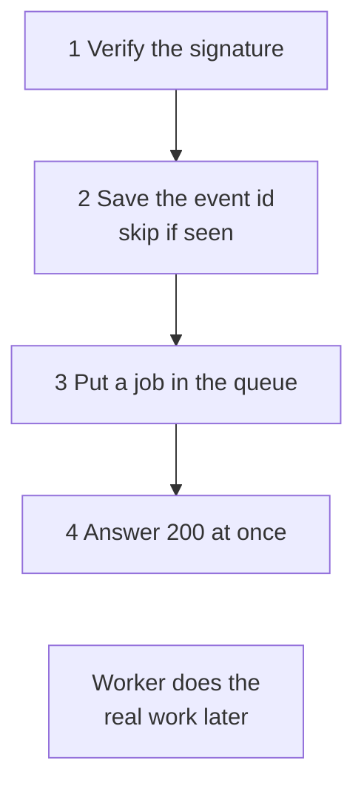

<details class="guess"><summary>🤔 Guess: the courier comes back with the same parcel. What does that mean for your webhook endpoint? Press to check.</summary>

The **same event can reach you more than once**. Senders keep trying until you answer `2xx` (they call it at-least-once delivery). That is the deal, not a bug. So make the work safe to repeat.

</details>

> **Remember:** verify, save the id, answer fast, work later, make the work safe to repeat.

<details class="more"><summary>📖 More detail: four new words, the problem, and the full picture</summary>

**New words.**

- **Webhook:** another service calls a URL of yours when something happens, like a payment or a shipment.
- **Signature:** a code the sender makes from the message and a secret you both know. Only the real sender can make a code that matches. (Interview word: *HMAC*.)
- **Idempotent:** doing it twice has the same result as doing it once.
- **Idempotency key:** a unique id for one action, so you can spot a repeat.

One more idea, in plain words: senders use **at-least-once delivery**. They keep trying until you answer `2xx`. So the same event can reach you more than once. That is the deal, not a bug.

The rule to remember: **verify, save the id, answer fast, work later, make the work safe to repeat.**

**The problem, drawn.** Two things go wrong when you skip the steps: repeats, and fakes.

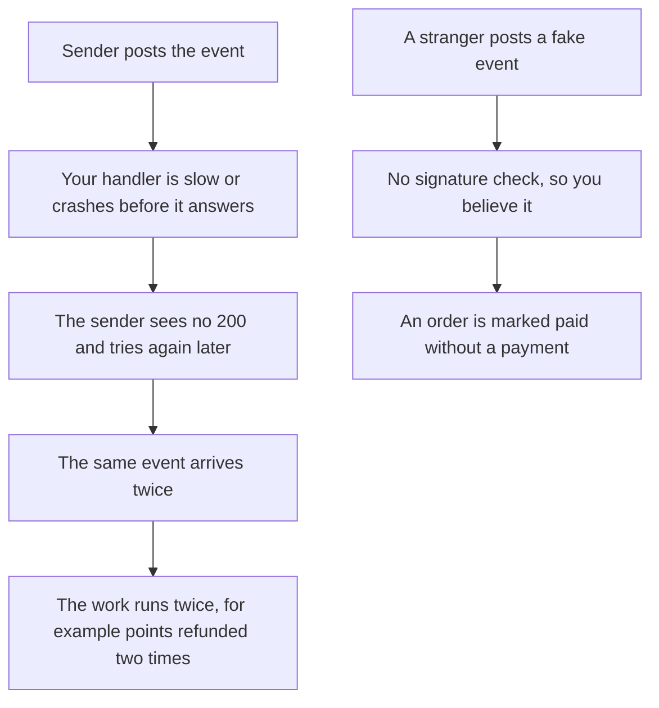

**The big picture.** Notice that the real work happens after the answer.

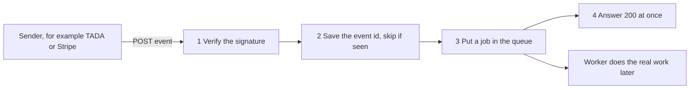

**The courier again.**

A **courier** who brings a parcel and rings the bell.

- If nobody opens the door in 10 seconds, he thinks you were not home, and he comes back later with the **same parcel**. That is a retry.
- The parcel has a **wax seal** that only the real shop can make (the signature). You check the seal before you open it.
- Each parcel has a **number**. You keep a log book at the door. If the number is in the book, you say "I already have this one" and send him away happy.
- You sign for the parcel **at the door** (the `200`), then carry it to the back office (the queue). You do not make him wait while you unpack it.

Where the analogy stops: a courier brings the same parcel only if you did not sign. A webhook sender may also send it twice when you **did** answer, for example when their own system retried at the same time. So you must expect copies even then.

</details>

## 2. The signature belongs to the exact bytes

The sender makes a code from the message and a secret you both know. You make the same code and compare. The code belongs to the **exact bytes** of the body. The same JSON with different spaces has a different code.

```js
const { createHmac } = require("node:crypto");
const sign = (t, body) => createHmac(
  "sha256", "whsec_test")
  .update(`${t}.${body}`).digest("hex");
const raw = '{ "id": "evt_1" }';
const header = sign(1000, raw);
const again = JSON.stringify(
  JSON.parse(raw));
console.log(sign(1000, raw) === header);
console.log(sign(1000, again) === header);
```

<details class="guess"><summary>🤔 Guess: `again` is the same JSON after parse and stringify, with only the spaces removed. Does the code still match? Press to check.</summary>

```
true
false
```

No. The spaces changed the bytes, so the code does not match, and good events would be refused. Keep the **raw body** (`express.raw`), check the code on it, and only then parse the JSON.

</details>

> **Remember:** check the signature on the raw bytes first. Parse the JSON after.

<details class="more"><summary>📖 More detail: the full check with a time limit, and the mistakes</summary>

**What the signature header looks like.**

The signature header is a timestamp and a code. These are real values from the code in section 4 (the secret was `whsec_test`):

```
t=1000,v1=0d6ad67886695b09bcdf96b5fce4b65694bd16faa4e6ae9c0daed287c1c2ab6a
```

The sender signs the text `1000.` followed by the **exact bytes** of the body. You make the same code and compare.

**The full check: a changed body, an old message, and the parse trap.**

```js
const { createHmac, timingSafeEqual } = require("node:crypto");
const SECRET = "whsec_test";
const sign = (t, body) => createHmac("sha256", SECRET).update(`${t}.${body}`).digest("hex");
function verify(header, body, nowSec, toleranceSec = 300) {
  const t = Number(/t=(\d+)/.exec(header)?.[1]);
  const v1 = /v1=([0-9a-f]+)/.exec(header)?.[1] ?? "";
  const good = Buffer.from(sign(t, body)), got = Buffer.from(v1);
  if (good.length !== got.length || !timingSafeEqual(good, got)) return "bad signature";
  return Math.abs(nowSec - t) > toleranceSec ? "too old" : "ok";
}
const body = '{"id":"evt_1","type":"order.shipped"}';
const header = `t=1000,v1=${sign(1000, body)}`;
console.log("untouched body             ", verify(header, body, 1010));
console.log("body changed in transit    ", verify(header, body.replace("shipped", "paid"), 1010));
console.log("same message, 70 min later ", verify(header, body, 5200));
const spaced = '{ "id": "evt_1", "type": "order.shipped" }';
const h2 = `t=1000,v1=${sign(1000, spaced)}`;
console.log("raw bytes                  ", verify(h2, spaced, 1010));
console.log("after parse and stringify  ", verify(h2, JSON.stringify(JSON.parse(spaced)), 1010));
```

**Output:**

```
untouched body              ok
body changed in transit     bad signature
same message, 70 min later  too old
raw bytes                   ok
after parse and stringify   bad signature
```

Three things to notice. Changing one word breaks the code. A correct old message is refused (the timestamp is part of what is signed, so a thief cannot change it). And the last line is the trap from picture 2e: the same JSON, with different spaces, no longer matches. Lengths are checked before `timingSafeEqual`, because it throws on different lengths.

**Wrong picture 1 and right picture 1.**

**Wrong picture 1:** "Parse the JSON first, then check the signature on the object."

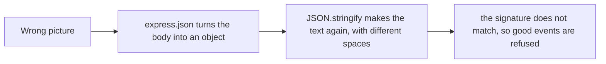

**Right picture 1:** the signature belongs to the exact bytes. Check those first, then parse.

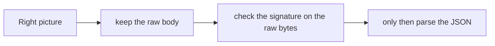

**Mistake: parsing first, checking the signature on the object.**

**Wrong:** parsing first, checking the signature on the object.

```js
app.use(express.json());                                   // the body is already an object
app.post("/webhooks", (req, res) => {
  verify(req.get("X-Signature"), JSON.stringify(req.body)) // different bytes from what was signed
```

**Right:** keep the raw bytes for this route.

```js
app.post("/webhooks", express.raw({ type: "application/json" }), handler);
```

**Why:** the signature belongs to the exact bytes. A change in spaces breaks it.

**Mistake: comparing signatures with `===`, or skipping the time check.**

**Wrong:** comparing signatures with `===`, or skipping the time check.

**Right:** `timingSafeEqual`, with equal lengths first, and a tolerance on the timestamp.

**Why:** the first leaks timing. Without the second, someone can send an old message again.

</details>

## 3. Skip repeats: let the database decide

Save the event id with a **unique rule**, and let the database say if you are the first. `INSERT ... ON CONFLICT DO NOTHING` tells you how many rows went in.

| provider | event_id | Rows inserted | What you do |
|---|---|---|---|
| tada | evt_1 | **1** | new: do the work |
| tada | evt_1 (a retry) | **0** | seen before: skip |
| tada | evt_2 | **1** | new |

<details class="guess"><summary>🤔 Guess: two copies of `evt_1` arrive at the same moment. Copy 1 asks "already done?" and so does copy 2, before either has written. What goes wrong? Press to check.</summary>

Both answer "no", so **both do the work**, and the points are added twice. "Check, then act" has a gap between the check and the act, and two copies fit in the gap. An `INSERT` with a unique rule lets only one copy in. Checked on PGlite (Postgres 17) on 2026-10-29: 1, 0 and 1 rows.

</details>

> **Remember:** write first, and let the database say if you are the first.

<details class="more"><summary>📖 More detail: the good flow, two copies, and the mistake in code</summary>

**The good flow.** Notice that the retry gets `200` too, and nothing more happens.

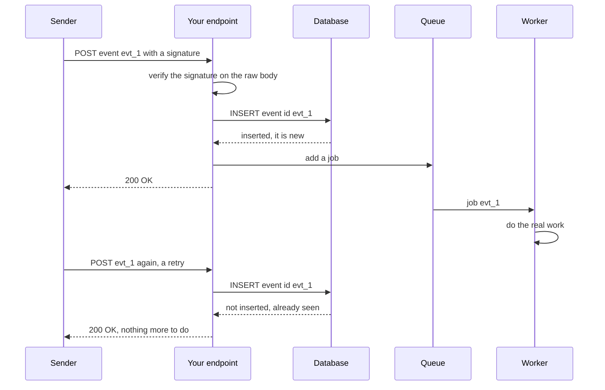

**Two copies at the same moment.** This is the incident from your DBO notes, drawn. Notice that both copies ask "already done?" before either has written.

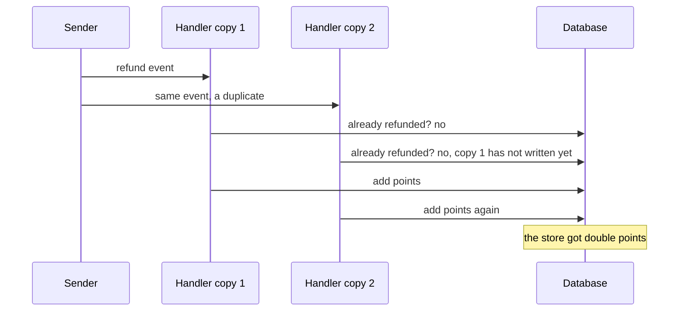

**Wrong picture 2 and right picture 2.**

**Wrong picture 2:** "Check if we did it, and if not, do it."

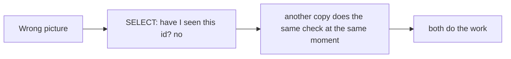

**Right picture 2:** let the database decide, in one step.

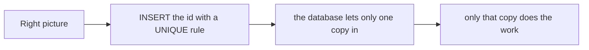

**The mistake in code.**

**Wrong:** check first, then write.

```js
const done = await db.event.findUnique({ where: { id } });
if (!done) { await refund(); await db.event.create({ data: { id } }); }   // two copies both see "not done"
```

**Right:** write first, and let the database say if you are the first.

```js
const inserted = await insertEventIdIfNew(id);              // INSERT ... ON CONFLICT DO NOTHING
if (inserted) await queue.add("refund", event);
```

**Why:** "check then act" has a gap between the check and the act. Two copies fit in the gap.

</details>

## 4. Answer fast, work later

If your handler takes 30 seconds, the sender gives up and sends the event again. Now two copies run at the same time.

| | Wrong | Right |
|---|---|---|
| The handler | does the work, then answers | saves the id, queues a job, answers |
| The answer takes | 30 seconds | milliseconds |
| The sender | gives up, and retries | stops retrying |

<details class="guess"><summary>🤔 Guess: the sender waits 10 seconds, and your handler needs 30. What does the sender do? Press to check.</summary>

It decides the delivery failed, and sends the same event again. Save the event, queue the job, answer `200`, and let a **worker** take as long as it needs.

</details>

> **Remember:** a slow answer looks like a failure to the sender.

<details class="more"><summary>📖 More detail: the pictures, the route in Express, and every step</summary>

**Wrong picture 3 and right picture 3.**

**Wrong picture 3:** "Do the work, then answer."

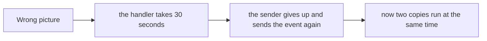

**Right picture 3:** save the event, queue the job, answer. The work takes as long as it takes, away from the sender's clock.

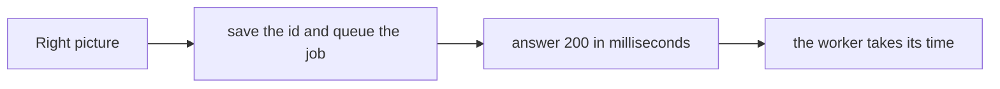

**The route in Express.**

The route in Express. The database and queue lines are a sketch, and `verify` is the function from section 4. I ran the Express and signature parts in a lab with a fake store and a fake queue (checked on 2026-10-23, Express 5.3.0, Node 24.15.0): first delivery `200`, the same event again `200`, a wrong signature `400`, and one job queued in all.

```js
app.post("/webhooks/tada", express.raw({ type: "application/json" }), async (req, res) => {
  // req.body is a Buffer: the exact bytes the sender signed
  if (!verify(req.get("X-Signature"), req.body, nowSec())) return res.sendStatus(400);

  const event = JSON.parse(req.body.toString("utf8"));
  const inserted = await prisma.$executeRaw`
    INSERT INTO webhook_events (provider, event_id) VALUES ('tada', ${event.id})
    ON CONFLICT DO NOTHING`;                          // 1 if new, 0 if we saw it before
  if (inserted === 1) await queue.add("handle-event", event, { jobId: `tada-${event.id}` });

  res.sendStatus(200);                                // fast; the worker does the real work
});
```

| Step | Who | What happens | Why |
|---|---|---|---|
| 1 | Express | `express.raw` keeps the body as bytes. | The signature is about bytes. |
| 2 | Your code | Checks the signature and the time. Wrong: `400`, stop. | A stranger cannot make a matching code. |
| 3 | Your code | Parses the JSON. | Only after the check. |
| 4 | Database | `INSERT` the event id. The rule on `(provider, event_id)` lets one copy in. | The database decides, in one step. |
| 5 | Your code | Inserted? Add a job to the queue. Not inserted? Skip. | A repeat does nothing. |
| 6 | Your code | Answers `200`. | The sender stops retrying. |
| 7 | Worker | Does the real work, later. | A slow job cannot cause a timeout. |

**Step through it yourself:** [open the webhooks stepper](visuals/13-webhooks-and-idempotency.html). It has five stories: a good delivery, a fake caller, two copies at the same moment (wrong, then right), a slow handler that makes the sender retry, and an `Idempotency-Key` on your own POST route. Guess first, then press Next.

**Mistake: doing the slow work before answering.**

**Wrong:** doing the slow work before answering.

**Right:** save, queue, answer `200`, and let a worker do the work.

**Why:** a slow answer looks like a failure to the sender, so it sends the event again.

</details>

## 5. Which status do I send?

The status is the only thing the sender reads. `200` says "stop". `5xx` says "come back".

| A webhook arrives | Send |
|---|---|
| the signature is wrong | `400` or `401`. Do not process it. |
| valid and new | `200`, after saving the id and queueing the job |
| valid but already seen | `200`, so they stop retrying |
| valid, but we crashed or the database is down | `500`, so they try again later |
| valid, but a type of event we do not use | `200`. Ignore it. |

<details class="guess"><summary>🤔 Guess: a valid event of a type you do not use. `200` or `500`? Press to check.</summary>

`200`. Do not make the sender retry for ever for something you will never use. Send `5xx` only when you want a retry.

</details>

> **Remember:** `200` for repeats and unused events. `5xx` only when you want a retry.

<details class="more"><summary>📖 More detail: the picture, and the mistake as written</summary>

Notice that a repeat and an event you do not use both get `200`. Only a crash gets `5xx`, because then you want the sender to try again.

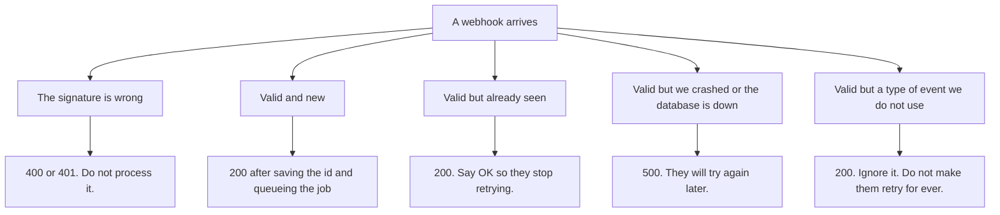

**Mistake: answering `500` for an event you ignore, or `200` when you crashed.**

**Wrong:** answering `500` for an event you decided to ignore, or `200` when you crashed.

**Right:** `200` for repeats and for events you do not use. `5xx` only when you want a retry.

**Why:** the status is the only thing the sender reads. `200` says "stop". `5xx` says "come back".

</details>

## 6. The same idea on your own POST routes

A client sends `POST /payments`, the connection drops, and it does not know if the payment happened. If it tries again, it may pay twice. The fix is an **idempotency key**: a unique id the client sends in the `Idempotency-Key` header.

| What happens | What the server does |
|---|---|
| first request with key `K` | does the work, saves the status and body under `K`, answers |
| a retry with the same key and body | does **not** work again, sends the saved answer |
| the same key with a different body | refuses. A key is for one action only. |

<details class="guess"><summary>🤔 Guess: the client retries `POST /payments` with the same key. Does the customer pay twice? Press to check.</summary>

No. The server sends back the saved answer, and does not do the work again. This is how Stripe works. It keeps keys only for a limited time (it may remove them after 24 hours).

</details>

> **Remember:** one idempotency key for one action. A retry gets the saved answer.

<details class="more"><summary>📖 More detail: the idea as it was written</summary>

A client has the same problem as a webhook sender: it sends `POST /payments`, the connection drops, and it does not know if the payment happened. If it tries again, it may pay twice.

The fix is an **idempotency key**. The client makes a unique id (a UUID) for each action and sends it in a header, `Idempotency-Key`. The server saves the answer under that key.

This is how Stripe works: it saves the status code and body of the first request, and a retry gets the same answer, even a `500`. Stripe only keeps keys for a limited time (it may remove them after 24 hours).

</details>

## 7. The gap between "saved the id" and "queued the job"

You save the event id, and then the queue is down. The sender retries, and now it looks like a repeat. The event is **lost**.

<details class="guess"><summary>🤔 Guess: how do you avoid losing the event? Press to check.</summary>

Answer `500` and remove the id, so the sender retries. Or save the id and queue the job in **one database transaction**. Also use layers: the event-id table at the door, a `jobId` in the queue, and a check inside the work itself.

</details>

> **Remember:** an id saved without a queued job is a lost event.

<details class="more"><summary>📖 More detail: all the costs as they were written</summary>

- **Cost:**
  - **More parts.** A table for event ids, a queue and a worker. The work is not done when you answer, so a failure later is invisible to the sender. You need alerts on the queue.
  - **A gap between "saved the id" and "queued the job".** If you save the id and then the queue is down, a retry will look like a repeat and the event is lost. Answer `500` and remove the id, or save the id and queue the job in one database transaction.
  - **Secrets and clocks.** You must keep the signing secret safe, change it now and then, and keep your server clock close to correct.
  - **The id table grows.** Delete old ids after the longest retry time (days, not minutes).
  - **No order.** You cannot rely on events arriving in the order they happened.

</details>

## 8. Why it matters and what it costs

- **Without it:** repeats do the work twice (two refunds, two emails, two shipments). Fakes do the work for a stranger. A slow handler makes the sender retry, which makes more repeats.
- **With it:** the signature proves who sent it. The unique event id removes repeats at the door. The fast `200` stops the retry storm. The queue gives the real work all the time it needs.
- **The cost:** more parts (an id table, a queue, a worker), a gap between saving the id and queueing the job, secrets and clocks to look after, a table that grows, and no promise about the order of events.

<details class="more"><summary>📖 More detail: the problem and how it solves it, as written</summary>

- **Problem without it:** repeats do the work twice (two refunds, two emails, two shipments). Fakes do the work for a stranger. A slow handler makes the sender retry, which makes more repeats.
- **How it solves it:** the signature proves who sent it. The unique event id removes repeats at the door. The fast `200` stops the retry storm. The queue gives the real work all the time it needs.

</details>

## 9. Watch and play

Links checked on 2026-10-23. I opened every page. For the video I checked only the title and the channel, not the content.

- **Play with it:** [The webhooks stepper](visuals/13-webhooks-and-idempotency.html) in this folder. In "Two copies at the same moment", say out loud why the SELECT version fails.
- **Play with it:** [webhook.site](https://webhook.site/). It gives you a URL and shows every request sent to it. Send a `curl -X POST` with a body and read the headers. This is how you see what a sender really sends.
- **Video:** [Webhooks at scale: best practices and lessons learned](https://www.youtube.com/watch?v=u2O-QS-A7jo) by Stripe Developers. I did not watch it, so use it as a second view after section 5.
- **Read:** [Stripe: receive events in your webhook endpoint](https://docs.stripe.com/webhooks). Signature, raw body, quick `2xx`, duplicates, retries.
- **Read:** [Stripe: idempotent requests](https://docs.stripe.com/api/idempotent_requests). The key, the saved response and the 24 hours.
- **Read:** [Standard Webhooks spec](https://github.com/standard-webhooks/standard-webhooks/blob/main/spec/standard-webhooks.md). The three headers and what the status codes mean.
- **Read:** [GitHub: validating webhook deliveries](https://docs.github.com/en/webhooks/using-webhooks/validating-webhook-deliveries). The `sha256=` header and `timingSafeEqual`.

<details><summary>More links (optional)</summary>

- **Read:** [BullMQ: job ids](https://docs.bullmq.io/guide/jobs/job-ids). A repeated `jobId` is ignored.
- **Read:** [IETF draft: The Idempotency-Key HTTP header field](https://datatracker.ietf.org/doc/draft-ietf-httpapi-idempotency-key-header/). Still a draft.
- **Code in this repo:** [DBO case study, webhooks section and Incident 1](../../interview/my-projects/dbo-b2b-platform-system-design-case-study.md). Your own notes on the TADA double refund.

</details>

## 10. Practice

**A. Predict the output** (write your answer before opening)

```js
const seen = new Set();
const receive = (id) => (seen.has(id) ? 200 : (seen.add(id), 202));
console.log(receive("evt_1"), receive("evt_1"), receive("evt_2"), seen.size);
```

<details><summary>Answer</summary>

```
202 200 202 2
```

The first `evt_1` is new (202). The second is a repeat (200, nothing happens). `evt_2` is new. Two ids were saved. Real code uses a database rule instead of a `Set`, so that two servers share it.

</details>

**B. Fix the bug**

```js
app.use(express.json());
app.post("/webhooks/tada", async (req, res) => {
  const event = req.body;
  const done = await db.refund.findUnique({ where: { eventId: event.id } });
  if (!done) {
    await addPoints(event.storeId, event.points);
    await db.refund.create({ data: { eventId: event.id } });
  }
  res.sendStatus(200);
});
```

What is wrong? There are four problems.

<details><summary>Answer</summary>

1. **No signature check.** Anyone can post a fake refund.
2. **The body is already parsed.** Even if you added a check, you would have lost the exact bytes. Use `express.raw` on this route.
3. **Check then act.** Two copies at the same moment both see "not done", and both add the points. This is the TADA incident. Insert the event id first with a `UNIQUE` rule, and only the first copy goes on.
4. **The work happens before the answer.** A slow `addPoints` makes the sender retry. Queue a job and answer first.

(A fifth, smaller one: `addPoints` should be safe to repeat too, for example by recording the event id with the points change in the same transaction.)

</details>

**C. Write it yourself**

Open `practice/13-webhooks-and-idempotency.js`. You write `sign` and `verifySignature`, a `receive` function with the event-id check and a queue, `applyRefund` (the second guard), a `withIdempotencyKey` helper, and the status codes. The tests include the two copies at the same moment, and a queue that is down.

```
node --test learn/backend-api/practice/13-webhooks-and-idempotency.test.js
```

<details><summary>One possible answer</summary>

```js
const { createHmac, timingSafeEqual } = require("node:crypto");

function sign(secret, timestamp, rawBody) {
  return createHmac("sha256", secret).update(`${timestamp}.`).update(rawBody).digest("hex");
}

function verifySignature({ secret, header, rawBody, nowSec, toleranceSec = 300 }) {
  try {
    if (typeof header !== "string" || (typeof rawBody !== "string" && !Buffer.isBuffer(rawBody))) return false;
    const parts = header.split(",").map((p) => p.trim().split("="));
    const t = Number(parts.find(([k]) => k === "t")?.[1]);
    if (!Number.isFinite(t) || Math.abs(nowSec - t) > toleranceSec) return false;
    const expected = Buffer.from(sign(secret, t, rawBody));
    return parts
      .filter(([k]) => k === "v1")                      // other schemes (like v0) are ignored
      .some(([, v]) => {
        const got = Buffer.from(String(v ?? ""));
        return got.length === expected.length && timingSafeEqual(got, expected);
      });
  } catch {
    return false;
  }
}

function createWebhookReceiver({ secret, store, queue }) {
  return {
    async receive({ headers, rawBody, nowSec }) {
      if (!verifySignature({ secret, header: headers["x-signature"], rawBody, nowSec })) return { status: 400 };
      let event;
      try { event = JSON.parse(Buffer.from(rawBody).toString("utf8")); } catch { return { status: 400 }; }
      if (!event || typeof event.id !== "string") return { status: 400 };
      if (!store.insertIfNew(event.id)) return { status: 200 };          // a repeat: say OK, do nothing
      try {
        await queue.add(event);
      } catch {
        store.remove(event.id);                                          // let the sender's retry through
        return { status: 500 };
      }
      return { status: 200 };
    },
  };
}

function applyRefund(state, event) {
  if (state.applied.has(event.id)) return false;
  state.applied.add(event.id);
  state.points += event.points;
  return true;
}

function withIdempotencyKey(store, key, bodyText, handler) {
  if (!key) return { ...handler(), replayed: false };
  const saved = store.get(key);
  if (saved) {
    if (saved.fingerprint !== bodyText) {
      return { status: 422, body: { title: "Idempotency-Key was used with a different request" }, replayed: false };
    }
    return { ...saved.response, replayed: true };
  }
  const response = handler();
  store.set(key, { fingerprint: bodyText, response });
  return { ...response, replayed: false };
}

const statuses = {
  badSignature: 400,
  firstDelivery: 200,
  duplicateDelivery: 200,
  ourDatabaseIsDown: 500,
  eventTypeWeDoNotUse: 200,
};
```

Notice four things. `verifySignature` accepts the message if **any** `v1` matches, which is what you need while a secret is being changed, and it ignores other schemes. `receive` saves the id first and removes it again if the queue fails, so a retry is not lost. A repeat gets `200`, not an error. And `withIdempotencyKey` compares the body, so a key cannot be reused for a different action.

</details>

## 11. Interview question

**Q:** "How do you handle webhooks? What if the same event arrives twice, or out of order? What does idempotent mean?"

<details><summary>A strong answer, in four parts</summary>

1. **Problem:** senders use at-least-once delivery. They retry until they get a `2xx`, so the same event can arrive more than once, at the same moment, and in the wrong order. Anyone can also post to a public URL. Without care, work runs twice and fakes are believed.
2. **How it works:** I verify the **signature** on the raw body (HMAC with a shared secret, constant-time compare, and a time limit against replays). I save the **event id** with a unique rule, so only the first copy continues. I put a job in a **queue** and answer `200` fast. A worker does the real work, and the work itself is **idempotent**: doing it twice gives the same result as once. For my own POST routes I accept an `Idempotency-Key` and return the saved answer on a retry.
3. **Tradeoff:** more parts (an id table, a queue, a worker). The gap between saving the id and queueing the job must be handled, or an event can be lost. I cannot rely on order, so state changes move one way only. Events can be missed, so a repeating job asks the provider for recent events and fills gaps. I use layers, because any single guard can have a gap.
4. **My example:** your DBO notes tell a real incident. TADA sent the same refund event twice, almost at the same moment. Both copies asked "already refunded?", both got "no", and stores got double points. You corrected the balances with a script, and you shipped a **row lock** (`SELECT ... FOR UPDATE`) so the check and the write happen in one transaction. *The notes list a unique event-id table and a points ledger as what you would add. They do not say you built them.* Say that clearly. The one-line lesson in your notes: duplicate delivery is not the sender's bug, it is the contract.

</details>

## 12. Explain it back

Close this file. Press the **Record my explanation** button under this heading and explain it out loud, like to a new junior, in 4 parts: problem, how it works, tradeoff, my example. Use the words "signature", "event id" and "safe to repeat". Then save the transcript into `my-learning/recordings/`, or write your best version below. Run `/explain-check webhooks` or ask the `explain-coach` agent to review it.

### My explanation

<write here>

### Coach feedback

<the explain-coach agent writes here>

## 13. Review questions (day 1, 3, 7, 21)

1. Why can the same webhook arrive twice? Is that the sender's bug?
2. Why must the signature be checked on the raw body, not on the parsed JSON?
3. Two copies of one event arrive at the same moment. Why does "SELECT, then INSERT" fail, and what works?
4. Draw the picture from section 2a from memory: the four steps before the `200`, and where the real work happens.

<details><summary>Answers</summary>

1. The sender promises to deliver at least once. If your answer is slow, lost or not `2xx`, it sends the event again. Sometimes its own system sends two at once. It is the deal, not a bug, so the receiver must handle repeats.
2. The sender signed the exact bytes. If you parse and write the JSON again, the spaces or the order of keys can change, and the code no longer matches. Keep the raw bytes, check, then parse.
3. Both copies run the SELECT before either has written, so both see "not seen" and both do the work. `INSERT` the id with a `UNIQUE` rule instead. The database lets one copy in, and the other gets "0 rows inserted".
4. Verify the signature. Save the event id (skip if seen). Put a job in the queue. Answer `200`. After the answer, a worker does the real work.

</details>

## 14. Go deeper (optional)

Open these when you are ready. None of them is needed for the cards above.

<details><summary>Real sender rules, ordering and BullMQ</summary>

**Stripe (docs checked 2026-10-23).** The header is `Stripe-Signature`, with `t=` (the time) and one or more `v1=` codes. The signed text is the time, a dot, then the raw body. Their libraries refuse messages more than 5 minutes old, and you must not set the tolerance to 0 (that turns the check off). Retries for live events go on for up to three days with exponential back off. Events may arrive **out of order**, and the `created` time cannot tell you the order. Track event ids to find duplicates. Their advice is to return `2xx` first, before any complex logic, and to handle events with a queue. When you change a secret, both can be active for up to 24 hours, and Stripe sends one signature per active secret, so accept a message if **any** `v1` matches.

**Standard Webhooks (the open spec).** The headers are `webhook-id` (the same on every retry), `webhook-timestamp` (Unix seconds) and `webhook-signature` (one or more signatures, marked `v1` for a shared-secret HMAC-SHA256). The signed text is the id, the timestamp and the payload, joined with dots. Receivers should use `webhook-id` as the idempotency key. Only `2xx` is success. A `3xx` counts as a failure. `410` means "stop sending to this URL", and `429`, `502`, `504` mean "slow down".

**GitHub.** The header is `X-Hub-Signature-256`, and the value starts with `sha256=` followed by a hex HMAC. GitHub's docs tell you to compare with a constant-time function such as `crypto.timingSafeEqual`, not with `===`.

**Why `timingSafeEqual`.** A plain `===` can stop at the first different letter. That takes slightly less time when the first letters differ, which can help a patient attacker guess a code letter by letter. `timingSafeEqual` takes the same time either way.

**Ordering.** "Shipped" can arrive after "delivered". Make state changes **one way only**: never move an order back to an older status because a late event came in.

**Webhooks for speed, polling for truth.** Events get lost, on their side or yours. A repeating job that asks the provider for recent events and fills the gaps is the usual safety net. Your DBO notes use this phrase.

**BullMQ job ids.** If you add a job with a custom `jobId` that already exists in the queue, the new job is ignored. But a job that was removed (for example by `removeOnComplete`) no longer counts, so the same id can be added again. The id may not contain `:` and may not be only digits. So a `jobId` is a good **second** guard, not the only one.

**More than one guard.** Use layers: the event-id table at the door, a `jobId` in the queue, and a check inside the work itself (for example "has this refund already been applied?"). Any one layer can have a gap.

**The idempotency header is still a draft.** The IETF document `draft-ietf-httpapi-idempotency-key-header` was at version 08 (22 October 2026), still an Internet-Draft. It suggests a UUID for the key, `422` when the same key comes with a different body, and `409` when the first request is still running.

</details>

## Connected lessons

- [Validation and error handling](10-validation-and-error-handling.md): a webhook with a bad signature or a broken body gets a `4xx`. A crash gets a `5xx`, so the sender tries again.
- [Rate limiting](11-rate-limiting.md): a sender that gets `429` or `5xx` will retry, so repeats can pile up.
- [Caching in APIs](12-caching-in-apis.md): "delete the copy twice" is safe, like "apply the event twice".
- [Password hashing](09-password-hashing.md): the same constant-time compare (`timingSafeEqual`) is used there, for the same reason.
- [Hasura: when and when not](14-hasura-when-and-when-not.md): the next lesson. Hasura event triggers are also at-least-once, so the same rules apply.
- Database lessons in `learn/database/`: the `SELECT ... FOR UPDATE` lock and transactions are the second guard.
