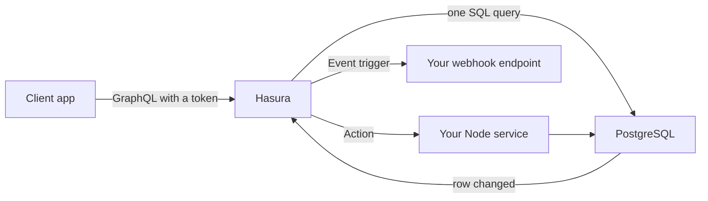
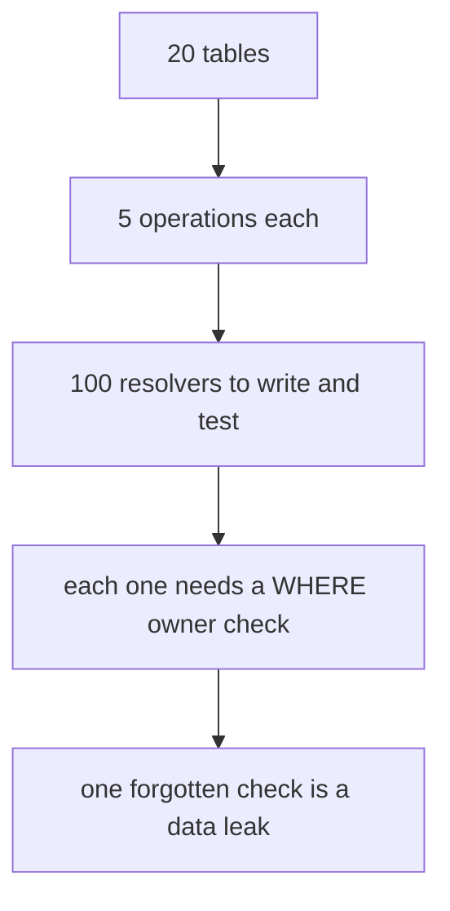
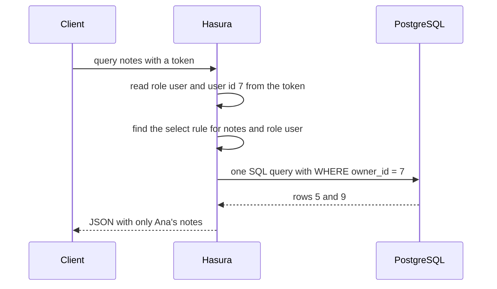
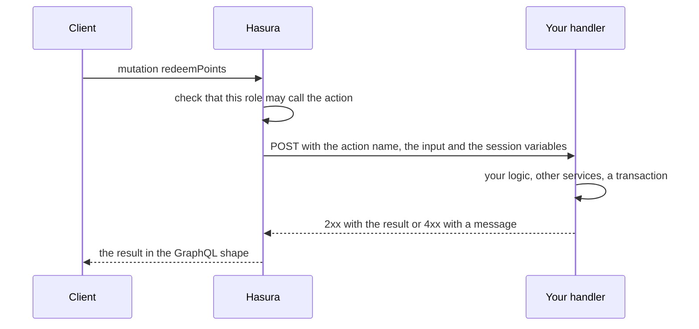
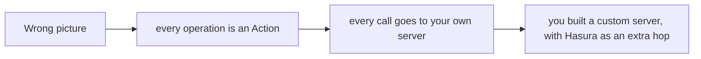
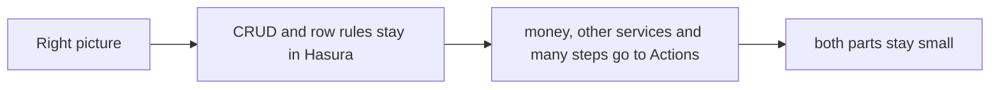
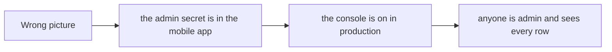
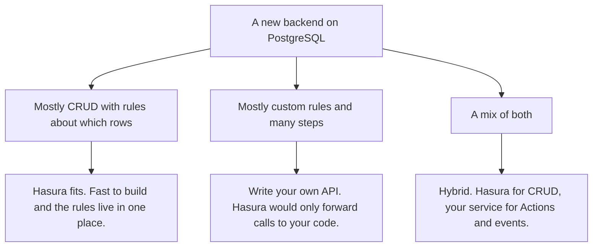

# 14. Hasura: when and when not

> **Subject:** Backend and API · **Lesson:** 14 · **Made:** 2026-10-23 · **Status:** ready
> **You will be able to:** say what Hasura does for you, how its permission rules work, where your own code goes (Actions and event triggers), and when to choose it or not.
> **Before this:** [Webhooks and idempotency](13-webhooks-and-idempotency.md) · **Next:** back to the [lesson list](README.md). This is the last lesson of the Senior level group.

## 1. The idea in one sentence

Hasura turns your PostgreSQL tables into a GraphQL API and applies your access rules inside every query. Your own code does only the parts that are not plain create, read, update and delete.

New words:

- **Hasura:** a server that sits in front of Postgres. It reads your tables and gives you a GraphQL API without you writing resolvers.
- **Permission rule:** for one role, one table and one action (select, insert, update or delete): a filter on the rows and a list of columns. The rule can use facts from the token, such as the user id. Hasura calls those facts *session variables*.
- **Action:** an operation you add to the Hasura API, whose code is your own server. Hasura passes the call to it.
- **Event trigger:** Hasura calls your webhook when a row is inserted, updated or deleted.

The rule to remember: **let Hasura do the boring CRUD and the row filters. Keep your rules about money, other services and many steps in your own code.**

## 2. The pictures

### 2a. The big picture

Notice that Hasura sits between the app and Postgres, and that your own server hangs off the side.



### 2b. The problem, drawn

Hand-written APIs repeat the same code, and every copy can forget the owner check.



### 2c. How it works over time

**Part 1: a query.** Notice that the client never writes the filter.



**Part 2: an Action.** Notice that your code does the real work, and Hasura only forwards.



### 2d. What the rules look like right now

A table of rules is a grid: a role, a table and an action give one cell. Here is the grid for a `notes` table. Notice that a cell can be empty, and that an empty cell means no access.

| Role | select | insert | update | delete |
|---|---|---|---|---|
| `admin` | everything | everything | everything | everything |
| `user` | rows where `owner_id` = my id | only with `owner_id` = my id | my rows | my rows |
| `viewer` | all rows, columns `id` and `title` | no rule | no rule | no rule |
| `anonymous` | no rule | no rule | no rule | no rule |

And roughly what one cell looks like in Hasura's metadata files (the select rule for `user`, then the insert rule):

```yaml
select_permissions:
  - role: user
    permission:
      columns: [id, title, owner_id]
      filter:
        owner_id:
          _eq: X-Hasura-User-Id
      limit: 100                      # never more than 100 rows at once
insert_permissions:
  - role: user
    permission:
      check:
        owner_id:
          _eq: X-Hasura-User-Id       # the new row must be mine
      set:
        owner_id: X-Hasura-User-Id    # a preset: Hasura writes it, the client cannot choose
      columns: [title]
```

### 2e. Right against wrong

**Wrong picture 1:** "Everything is an Action."



**Right picture 1:** plain CRUD stays in Hasura. Only the special things are Actions.



**Wrong picture 2:** "Hasura has its own security, so I do not need to think about it."



**Right picture 2:** the admin secret lives only on servers. The console is off in production. Every role has only the rules it needs.


### 2f. Should I use Hasura?

Notice the third answer. Most real projects are a mix.



## 3. Real life analogy

A **waiter who has learned the whole menu**.

- The waiter serves any dish on the menu at once (CRUD). You did not teach him dish by dish.
- He carries a **card for each kind of guest** (the permission rules). "This guest may only see their own bill." He follows the card on every order, without being reminded.
- For a special order ("make it without sugar, and call the supplier"), he walks to the **kitchen** (your Action). The kitchen does the careful work.
- When a table is cleared, a bell rings in the back office (an event trigger).

Where the analogy stops: a waiter can be talked into things. Hasura cannot. It puts the card's rule into the database query itself, so the guest has no way to argue with it.

## 4. The smallest code that shows it

This is a tiny version of what Hasura does with one rule: take the session variable and keep only the matching rows.

```js
const notes = [
  { id: 5, owner_id: 7, title: "shopping list" },
  { id: 6, owner_id: 8, title: "private diary" },
  { id: 9, owner_id: 7, title: "ideas" },
];
function matches(row, filter, session) {
  return Object.entries(filter).every(([col, cond]) => {
    const [op, want] = Object.entries(cond)[0];
    const value = String(want).toLowerCase().startsWith("x-hasura-") ? session[String(want).toLowerCase()] : want;
    return op === "_eq" && String(row[col]) === String(value);
  });
}
const rule = { owner_id: { _eq: "X-Hasura-User-Id" } };
const session = { "x-hasura-role": "user", "x-hasura-user-id": "7" };
console.log(notes.filter((n) => matches(n, rule, session)).map((n) => n.id));
```

**Output:**

```
[ 5, 9 ]
```

Ana (user 7) gets notes 5 and 9. Note 6 is Budi's, and it is not in the answer, and not in an error either. It is simply not there. Real Hasura does not filter in JavaScript. It writes the rule into the SQL as a `WHERE`, so the database never even reads the other rows. The practice file asks you to build a bigger version of this.

## 5. What really happens, step by step

One query from the app of Ana (user 7, role `user`):

```graphql
query { notes { id title } }
```

| Step | Who | What happens | Result so far |
|---|---|---|---|
| 1 | App | Sends the query with `Authorization: Bearer <token>`. It writes **no** filter. | the query |
| 2 | Hasura | Checks the token. Reads the role and the user id from its claims. These become the session variables `x-hasura-role` and `x-hasura-user-id`. | role `user`, id 7 |
| 3 | Hasura | Looks for a select rule for table `notes` and role `user`. If there is none, the answer is an error. | rule found |
| 4 | Hasura | Puts the rule into **one** SQL query, roughly `SELECT id, title FROM notes WHERE owner_id = 7`. | one query |
| 5 | Postgres | Runs it. Only rows 5 and 9 can come back. | 2 rows |
| 6 | Hasura | Makes the JSON and answers. | 200, two notes |

Try it for real: the folder `examples/hasura-todo/` in this repo runs Hasura and Postgres with Docker, and its README walks through a row rule. In the **API** tab, press **Analyze** to see the SQL that Hasura made. (I did not start Docker in this session, so I did not run that example today.)

**Step through it yourself:** [open the Hasura stepper](visuals/14-hasura-when-and-when-not.html). It has five stories: a select with a row rule, an insert (wrong, then with a check and a preset), an Action for the logic, an event trigger that arrives twice, and a "should I use Hasura?" check on three projects. Guess first, then press Next.

## 6. Why it exists and what it costs

- **Problem without it:** the same list, get, create, update and delete code for every table, and an owner check in every copy. One forgotten check leaks data.
- **How it solves it:** the API is generated from the tables. The row rules are config that the engine adds to every query. Your guide note adds that Hasura turns one GraphQL query into one SQL query, so the "one query plus N more" problem (called N+1) does not appear.
- **Cost, and where it stops being a good fit:**
  - **Your own rules do not fit in a filter.** Money, calls to other services and flows with many steps need real code. If you make everything an Action, you wrote a custom server with an extra hop.
  - **The rules are config, and config needs care.** Keep the metadata in git, review it like code, and never edit a production console by hand. An empty filter (`{}`) means every row.
  - **The free self-hosted version has no API limits.** Rate, depth, node and time limits are on the paid and Enterprise plans. On the free version, put limits in front (lesson 11) and use the allow list.
  - **The database shape becomes the API shape.** Renaming a column changes the API that your clients use.
  - **One more service to run.** It is Postgres-first, and you must follow its versions (see Go deeper).
  - **Event triggers are at-least-once.** The same event can come twice (lesson 13).

<details><summary>Go deeper (optional): versions, limits, Actions, events and the production list</summary>

**Which Hasura? (checked 2026-10-23).** The v2 line is still released: the GitHub API shows **v2.51.2**, published today. The example in this repo pins the older `hasura/graphql-engine:v2.44.0`, so check the release notes before you move it. Hasura's newer product is **DDN** (version 3). A Hasura blog post suggests that people on v2 Cloud move to DDN, and PromptQL is built on DDN. The DDN docs say there is no built-in admin role there: a role exists only once you define it. Your own guide (2026-07-06) says self-hosters stay on v2, and that the DDN CLI and console are proprietary. I did not re-check those two claims today.

**Roles and session variables.** The request names its role in `X-Hasura-Role`, or lists `X-Hasura-Allowed-Roles` and `X-Hasura-Default-Role`. Hasura only reads session variables that start with `X-Hasura-`, and the names are not case sensitive. The built-in `admin` role can do anything on any table. I did not find one sentence in the docs that says "a role with no rule gets no access" in those words. The behavior is the one in your todo example: a new role sees nothing until you give it a permission. Try it.

**Where the token facts come from.** The user id and role come from a JWT (Hasura checks the signature and reads a claims block) or from an auth webhook that you write. Hasura does not do login. Your auth service does (lessons 06 and 07).

**What a permission cell can hold.** Row filters for all four actions. Column lists for select, insert and update. For select: aggregation permission, a row fetch limit and root field visibility. For insert and update: column presets and "backend only" mutations. For delete: backend only.

**Admin skips everything.** The admin secret makes a caller `admin`, and the admin role skips every permission and every limit. Test as the real role, never only as admin.

**API limits (docs checked 2026-10-23).** Rate limits (a sliding window, with Redis for Enterprise), depth limits, node limits, time limits and batch limits. They are listed for Cloud Professional, Cloud Enterprise and Self-Hosted Enterprise.

**Allow list.** A list of approved operations. Off by default. Turn it on with `HASURA_GRAPHQL_ENABLE_ALLOWLIST=true`. Admin is exempt. In the open source version, the role-based entries are ignored.

**Production checklist (docs checked 2026-10-23).** `HASURA_GRAPHQL_ADMIN_SECRET` set to a long value. `HASURA_GRAPHQL_ENABLE_CONSOLE=false`. `HASURA_GRAPHQL_DEV_MODE=false` so errors do not leak internals. `HASURA_GRAPHQL_CORS_DOMAIN` to your own domains (the default allows all). `HASURA_GRAPHQL_ENABLED_APIS=graphql` turns off the metadata, pgdump and config APIs.

**What an Action handler gets.** A `POST` with a body that holds `action` (with `name`), `input`, `session_variables` (names in lower case) and `request_query`. On success, answer with a `2xx` and the output type. On a refusal, answer with a `4xx` and a body with `message` and, if you like, `extensions` with a `code`.

**What an event trigger sends.** A payload with `id` (a UUID for this invocation), `table`, `trigger`, `event.op` (INSERT, UPDATE, DELETE or MANUAL), `event.data.old` and `.new`, `delivery_info` (`current_retry` and `max_retries`) and `created_at`. The docs say delivery is at least once and can be out of order. Retry settings default to 0 retries, 10 seconds between tries and a 60 second timeout. A non-2xx answer is a failure, and a `Retry-After` header on it is respected. The docs call `id` "a UUID for the invocation". They do **not** say whether a retry keeps the same `id`. So do not trust it as your dedupe key until you have tested it: make your handler fail once, and compare the `id` of the two deliveries. A safer key is one you build from your own data. For an INSERT trigger, the primary key of the new row (for example the order id) can only be inserted once.

**Rules that look at other tables.** A rule can reach into a related table (for example "I am a member of this company"). That adds a join or an `EXISTS` to every query. This is my reading, not a quote from the docs: index the columns that the rule uses.

</details>

## 7. Common mistakes

**Wrong:** the admin secret in a client.

```js
const client = new ApolloClient({ headers: { "x-hasura-admin-secret": "myadminsecret" } });   // in the mobile app
```

**Right:** the app sends the user's token. Only your servers know the admin secret.

**Why:** the admin role skips every rule. Anyone who opens the app files can read the secret.

**Wrong:** an empty filter, or all columns.

```yaml
select_permissions:
  - role: user
    permission: { columns: "*", filter: {} }
```

**Right:** a real filter, a list of columns and a row limit.

**Why:** `{}` means every row. `"*"` also shows every column you add later, even a private one.

**Wrong:** an insert rule that lets the client pick the owner.

```yaml
insert_permissions:
  - role: user
    permission: { check: {}, columns: [title, owner_id] }
```

**Right:** a `check` on the owner and a preset for it, and leave `owner_id` out of the columns.

**Why:** with the wrong rule, Ana can create notes that belong to Budi.

**Wrong:** testing only as admin.

**Right:** test every role with its own headers (the **API** tab lets you set `x-hasura-role` and `x-hasura-user-id`).

**Why:** admin sees everything, so a broken rule looks fine.

**Wrong:** editing permissions on a production console.

**Right:** change them in your project (metadata files in git), review them, and apply them from CI.

**Why:** rules are security code. They need review, history and a way back.

**Wrong:** one Action for every table.

**Right:** CRUD stays in Hasura. An Action only where there is real logic.

**Why:** otherwise you have a custom server plus Hasura, with the costs of both.

## 8. Watch and play

Links checked on 2026-10-23. I opened every page. For the video I checked only the title and the channel, not the content.

- **Play with it:** [The Hasura stepper](visuals/14-hasura-when-and-when-not.html) in this folder. In "Should I use Hasura?", decide before you press Next.
- **Play with it:** the example `examples/hasura-todo/` in this repo (Docker needed). Make a role, add the row rule, and press **Analyze** in the API tab.
- **Video:** [Permissions - Getting started with Hasura [03]](https://www.youtube.com/watch?v=LVavmMzBxrI) on the channel PromptQL. I did not watch it, so use it as a second view after the stepper. It is an older video, so use the docs for current names.
- **Read:** [Hasura v2: Permissions](https://hasura.io/docs/2.0/auth/authorization/permissions/). What a rule is made of.
- **Read:** [Hasura v2: Row-level permissions](https://hasura.io/docs/2.0/auth/authorization/permissions/row-level-permissions/). The filter and the session variable.
- **Read:** [Hasura v2: Roles and session variables](https://hasura.io/docs/2.0/auth/authorization/roles-variables/). Where `X-Hasura-Role` and the admin role are explained.
- **Read:** [Hasura v2: API limits](https://hasura.io/docs/2.0/security/api-limits/). Which plans have them.

<details><summary>More links (optional)</summary>

- **Read:** [Hasura v2: Action handlers](https://hasura.io/docs/2.0/actions/action-handlers/). The body that Hasura sends and the error format.
- **Read:** [Hasura v2: Event trigger payload](https://hasura.io/docs/2.0/event-triggers/payload/).
- **Read:** [Hasura v2: Production checklist](https://hasura.io/docs/2.0/deployment/production-checklist/).
- **Read:** [Hasura v2: Allow list](https://hasura.io/docs/2.0/security/allow-list/).
- **Video:** [Hasura Crash Course Lesson 6: Permissions](https://www.youtube.com/watch?v=_EGVNiO5-TU) by Cloudspeak. Title and channel checked only.
- **Code in this repo:** [Hasura guide](hasura-guide.md) and [the Hasura visual cheat sheet](hasura-guide-cheatsheet.html).

</details>

## 9. Practice

**A. Predict the output** (write your answer before opening)

```js
// notes, rule and matches from section 4
const as = (id) => notes.filter((n) => matches(n, rule, { "x-hasura-user-id": id })).map((n) => n.id);
console.log(as("8"), as("7"), as(undefined));
```

<details><summary>Answer</summary>

```
[ 6 ] [ 5, 9 ] []
```

User 8 gets note 6, user 7 gets notes 5 and 9. With no user id at all, nothing matches, so the answer is an empty list. A missing session variable must give **fewer** rows, never more.

</details>

**B. Fix the bug**

```yaml
select_permissions:
  - role: user
    permission:
      columns: "*"
      filter: {}
insert_permissions:
  - role: user
    permission:
      check: {}
      columns: [title, owner_id]
```

What is wrong? There are four problems.

<details><summary>Answer</summary>

1. **`filter: {}` on select.** Every user can read every note. This is the IDOR from lesson 08. Use `owner_id: { _eq: X-Hasura-User-Id }`.
2. **`columns: "*"`.** Every column is visible, including ones you add later. List the columns.
3. **No row `limit`.** One query can read the whole table. Add a limit.
4. **`check: {}` and `owner_id` in the columns.** The client picks the owner, so Ana can create notes owned by Budi. Use a `check` on the owner, a `set` preset for `owner_id`, and take `owner_id` out of the columns.

</details>

**C. Write it yourself**

Open `practice/14-hasura-when-and-when-not.js`. You write the rule matcher (`matches`), a select that applies a rule with columns and a limit (`runSelect`), an insert that applies a check and a preset (`prepareInsert`), and five "where does this go?" answers. A role with no rule must get an error. A missing session variable must never give more rows.

```
node --test learn/backend-api/practice/14-hasura-when-and-when-not.test.js
```

<details><summary>One possible answer</summary>

```js
const own = (obj, key) => (obj != null && Object.hasOwn(obj, key) ? obj[key] : undefined);

function resolve(value, session) {
  if (typeof value === "string" && value.toLowerCase().startsWith("x-hasura-")) return session?.[value.toLowerCase()];
  return value;
}

function matches(row, filter, session) {
  try {
    if (row === null || typeof row !== "object" || filter === null || typeof filter !== "object") return false;
    return Object.entries(filter).every(([key, cond]) => {
      if (key === "_and") return Array.isArray(cond) && cond.every((f) => matches(row, f, session));
      if (key === "_or") return Array.isArray(cond) && cond.some((f) => matches(row, f, session));
      if (key === "_not") return !matches(row, cond, session);
      if (cond === null || typeof cond !== "object") return false;
      const ops = Object.entries(cond);
      const have = row[key];
      return ops.length > 0 && ops.every(([op, want]) => {
        if (have == null) return false;                          // like SQL: NULL is never equal to anything
        if (op === "_in") {
          return Array.isArray(want) && want.map((w) => resolve(w, session)).some((w) => w != null && String(w) === String(have));
        }
        const target = resolve(want, session);
        if (target == null) return false;                        // a missing session variable matches nothing
        if (op === "_eq") return String(have) === String(target);
        if (op === "_neq") return String(have) !== String(target);
        return false;                                            // an unknown operator is denied
      });
    });
  } catch {
    return false;
  }
}

function pick(row, columns) {
  if (columns === "*") return { ...row };
  const out = {};
  for (const c of columns ?? []) if (Object.hasOwn(row, c)) out[c] = row[c];
  return out;
}

function runSelect({ permissions, table, role, session, rows }) {
  const rule = role === "admin" ? { filter: {}, columns: "*" } : own(own(permissions, table), role)?.select;
  if (!rule) return { ok: false, error: "no access" };
  let out = rows.filter((row) => matches(row, rule.filter ?? {}, session)).map((row) => pick(row, rule.columns));
  if (Number.isInteger(rule.limit)) out = out.slice(0, rule.limit);
  return { ok: true, rows: out };
}

function prepareInsert({ permissions, table, role, session, input }) {
  const rule = role === "admin" ? { check: {}, set: {}, columns: "*" } : own(own(permissions, table), role)?.insert;
  if (!rule) return { ok: false, error: "no access" };
  const preset = rule.set ?? {};
  const row = {};
  for (const [col, val] of Object.entries(input ?? {})) {
    if (Object.hasOwn(preset, col)) continue;                    // the preset wins over the client
    if (rule.columns !== "*" && !(rule.columns ?? []).includes(col)) return { ok: false, error: `column not allowed: ${col}` };
    row[col] = val;
  }
  for (const [col, val] of Object.entries(preset)) row[col] = resolve(val, session);
  if (!matches(row, rule.check ?? {}, session)) return { ok: false, error: "check failed" };
  return { ok: true, row };
}

const choices = {
  adminPanelForOnePostgresTeam: "hasura",
  redeemPointsCallingAThirdPartyApi: "action",
  sendEmailAfterAnOrderRowIsInserted: "event trigger",
  checkoutWithManyStepsAndMoneyRules: "own service",
  rateLimitingOnFreeSelfHostedHasura: "gateway",
};
```

Notice four things. `own` uses `Object.hasOwn`, so a role called `toString` or `__proto__` finds no rule. A missing session variable or a missing column never matches, so a broken token gives fewer rows, not more. `runSelect` filters first, then keeps only the allowed columns, then cuts to the limit. And `prepareInsert` lets the preset win over what the client sent, then runs the `check` on the final row.

</details>

## 10. Interview question

**Q:** "When would you choose Hasura, and when not? How do its permissions work? Where does your business logic go?"

<details><summary>A strong answer, in four parts</summary>

1. **Problem:** most of a product API is plain CRUD, and each copy needs the same access check. Writing it by hand is slow, and one forgotten check leaks data.
2. **How it works:** Hasura reads the Postgres tables and generates the GraphQL API. Permissions are rules for each role, table and action: a row filter, a list of columns, a row limit, and for inserts a check and presets. They use session variables from the JWT, like the user id, and Hasura puts them into the SQL as a `WHERE`, so a client cannot skip them. Custom logic goes in **Actions** (Hasura forwards the call to my handler) or a remote schema. Reactions to row changes go in **event triggers** to a webhook or a queue.
3. **Tradeoff:** it is great for CRUD-heavy apps, admin tools and quick products. It is a poor fit when the domain is mostly custom rules, because then everything is an Action and I have a custom server with an extra hop. Rules are config, so they live in git and get reviewed. The free self-hosted version has no API limits (those are paid or Enterprise), so I add rate limits in front. The database shape becomes the API shape. Event triggers are at-least-once, so handlers must be idempotent. And I follow the v2 and DDN direction before I choose a version.
4. **My example:** *check this before you say it.* Your Hasura guide says you use Hasura in production and points to DBO. But your DBO case study describes the API as GraphQL with Nexus and Prisma, and does not mention Hasura. Decide which project used Hasura, and what it did there (for example the CRUD with permissions, or an admin tool). Say only what you did. The pattern in the guide (Hasura for the CRUD, a small Node service for the logic) is a good answer to give as "how I would split it", even where it is not what a particular project did.

</details>

## 11. Explain it back

Close this file. Press the **Record my explanation** button under this heading and explain it out loud, like to a new junior, in 4 parts: problem, how it works, tradeoff, my example. Use the words "permission rule", "Action" and "admin secret". Then save the transcript into `my-learning/recordings/`, or write your best version below. Run `/explain-check hasura` or ask the `explain-coach` agent to review it.

### My explanation

<write here>

### Coach feedback

<the explain-coach agent writes here>

## 12. Review questions (day 1, 3, 7, 21)

1. A user sends `query { notes { id } }` with no filter. Why do they only get their own notes?
2. What is the difference between an Action and an event trigger?
3. Name three things that make the free self-hosted Hasura different from the paid one, or that you must add yourself.
4. Draw the picture from section 2a from memory: client, Hasura, Postgres, your server, and the two ways Hasura calls your code.

<details><summary>Answers</summary>

1. The select rule for their role adds a filter such as `owner_id = X-Hasura-User-Id`. Hasura reads the user id from the token and writes the rule into the SQL as a `WHERE`. The client never writes the filter and cannot remove it.
2. An **Action** is a call from a client that Hasura forwards to your handler, and the answer goes back to that client. An **event trigger** starts by itself when a row is inserted, updated or deleted, and Hasura calls your webhook. It is at-least-once, so your handler must handle repeats.
3. No API limits (rate, depth, node and time are paid or Enterprise), so add rate limits in front. The allow list works, but its role-based entries are ignored. Production settings are yours to set: a long admin secret, the console off, dev mode off, CORS to your domains.
4. The client sends GraphQL with a token to Hasura. Hasura sends one SQL query to Postgres. Hasura calls your Node service for an Action. A row change makes Hasura call your webhook, as an event trigger. Your service can also write to Postgres.

</details>

## Connected lessons

- [Authorization](08-authorization.md): the same ideas as roles, row rules and IDOR. Hasura's rules are "row level authorization as config".
- [Authentication: sessions vs JWT](06-authentication-sessions-vs-jwt.md) and [Access and refresh tokens](07-access-and-refresh-tokens.md): Hasura reads the role and the user id from the JWT that your auth service makes.
- [Validation and error handling](10-validation-and-error-handling.md): an Action handler answers `4xx` with a `message`. Hasura does not check your business rules.
- [Rate limiting](11-rate-limiting.md): the free self-hosted Hasura has no API limits, so limit at the gateway.
- [Caching in APIs](12-caching-in-apis.md): a generated API still needs a plan for old data.
- [Webhooks and idempotency](13-webhooks-and-idempotency.md): event triggers are at-least-once, so make the handler safe to repeat. Use a key from your own data.
- [Hasura guide](hasura-guide.md) and the example in `examples/hasura-todo/`: the longer notes and the app to run.
