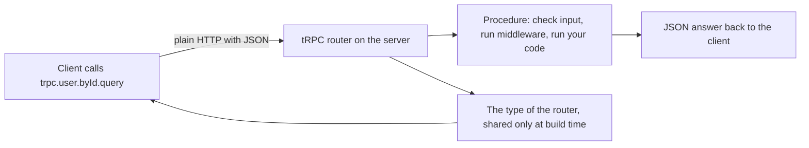
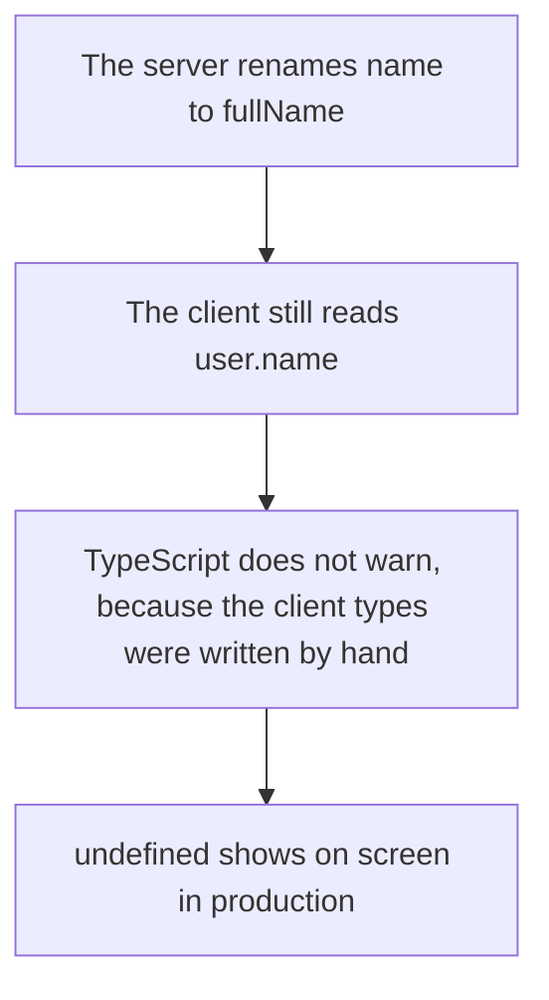
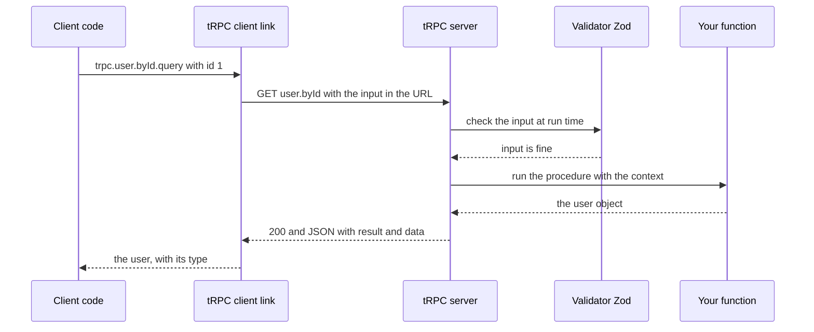
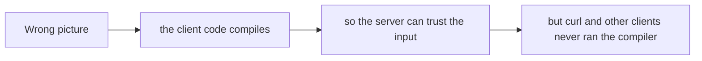
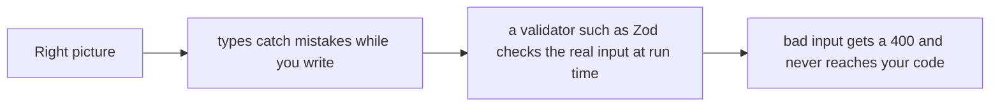
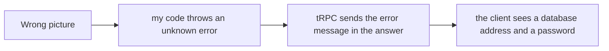
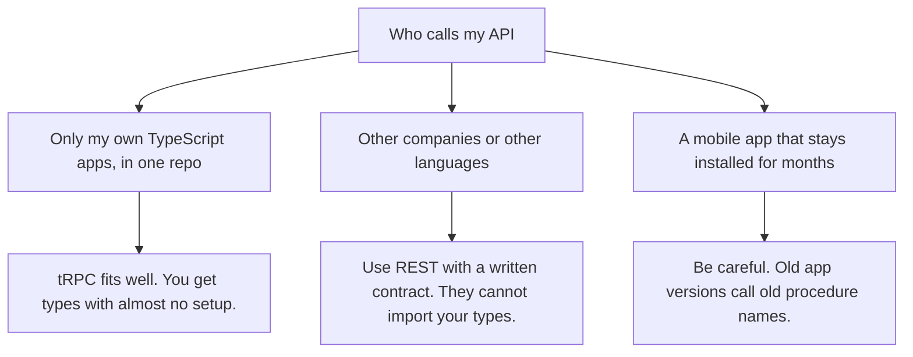

# 15. tRPC

> **Subject:** Backend and API · **Lesson:** 15 · **Made:** 2026-10-23 · **Status:** ready
> **You will be able to:** say what tRPC is, show how one call travels as plain HTTP and JSON, explain how types reach the client without code generation, and say when to choose it and when not.
> **Before this:** [Hasura: when and when not](14-hasura-when-and-when-not.md) · **Next:** [gRPC](16-grpc.md)

## 1. The idea in one sentence

tRPC lets your TypeScript client call your TypeScript server functions like normal functions, and the compiler knows the exact input and output of every one, with no schema file and no generated code.

New words:

- **RPC:** a remote procedure call. You call a function that runs on another machine, and it feels like a local call.
- **Procedure:** one function the server offers. A **query** reads data. A **mutation** changes data. (You met both words in GraphQL.)
- **Router:** a named group of procedures, like a folder of functions. Routers can sit inside routers, so a call looks like `trpc.user.byId`.
- **End-to-end types:** the client knows the types of every procedure, because it imports the *type* of the server's router. (Interview words: *end-to-end type safety*.)

The rule to remember: **the types help you while you write code. They are gone when the code runs, so the server must still check every input.**

## 2. The pictures

### 2a. The big picture

Notice what travels where. Only the **type** of the router goes to the client, and only while you build. At run time, a plain HTTP request goes to the server.



### 2b. The problem, drawn

When client types are written by hand, they drift away from the server.



### 2c. How it works over time

One query, from the line of code to the answer.



### 2d. What is on the wire right now

These are real answers from a real tRPC v11.19.0 server (checked on 2026-10-23). Notice that it is just HTTP: `GET` for a query, `POST` for a mutation, and a JSON body.

| What I sent | Status | Answer (shortened) |
|---|---|---|
| `GET /user.byId?input={"id":1}` | `200` | `{"result":{"data":{"id":1,"name":"Ana"}}}` |
| `GET /user.byId?input={"id":99}` (no such user) | `404` | `{"error":{"message":"No user with that id","code":-32004,"data":{"code":"NOT_FOUND","httpStatus":404,...}}}` |
| `GET /user.byId?input={"id":"x"}` (wrong type) | `400` | `{"error":{"message":"[... expected number, received string ...]","code":-32600,...}}` |
| `POST /user.rename`, no login | `401` | `{"error":{"message":"UNAUTHORIZED",...,"data":{"code":"UNAUTHORIZED","httpStatus":401,...}}}` |
| `POST /user.rename`, logged in | `200` | `{"result":{"data":{"id":1,"name":"Anna","by":1}}}` |
| `GET /user.byId,user.byId?batch=1&input={"0":{"id":1},"1":{"id":2}}` | `200` | `[{"result":{"data":{"id":1,"name":"Ana"}}},{"result":{"data":{"id":2,"name":"Budi"}}}]` |

### 2e. Right against wrong

**Wrong picture 1:** "TypeScript checks the types, so the input must be right."



**Right picture 1:** the types help the person who writes the client. The validator protects the server.



**Wrong picture 2:** "tRPC hides errors by default."



**Right picture 2:** one `errorFormatter` hides the message of every unknown error. You keep the details in the log.


### 2f. Should I use tRPC?

Notice who calls the API. That one question decides most of it.



## 3. Real life analogy

An **internal phone system with a printed directory**.

- The directory (the router's **type**) lists every extension and what each person accepts: "Ext. 12, user lookup, needs a number."
- When you dial from your desk, your phone checks the directory first. If you dial an extension that does not exist, or give the wrong kind of detail, it warns you before the call.
- The call itself is an ordinary phone line: plain HTTP.

Where the analogy stops: the directory is only checked at your desk, when you build the code. A stranger who calls from outside never saw the directory and can say anything. So the person who answers (the server) must check every caller's words again. That is the validator.

## 4. The smallest code that shows it

The server defines a router. The client imports only its **type**:

```ts
// server.ts
import { initTRPC } from "@trpc/server";
import { z } from "zod";

const users = [{ id: 1, name: "Ana" }, { id: 2, name: "Budi" }];
const t = initTRPC.create();

export const appRouter = t.router({
  user: t.router({
    byId: t.procedure
      .input(z.object({ id: z.number().int() }))
      .query(({ input }) => users.find((u) => u.id === input.id)),
  }),
});
export type AppRouter = typeof appRouter;      // the only thing the client imports
```

```ts
// client.ts
import { createTRPCClient, httpBatchLink } from "@trpc/client";
import type { AppRouter } from "./server.js";

const trpc = createTRPCClient<AppRouter>({ links: [httpBatchLink({ url: "http://localhost:3000" })] });

const user = await trpc.user.byId.query({ id: 1 });
console.log(user?.name.toUpperCase());          // user has a type: { id: number; name: string } | undefined
await trpc.user.byId.query({ id: "1" });        // wrong type
await trpc.user.byEmail.query({ email: "a@b.c" }); // a procedure that does not exist
console.log(user?.fullName);                    // a field that does not exist
```

**What the compiler says** (real output of `tsc` 7.0.2, checked on 2026-10-23):

```
client.ts(9,32): error TS2322: Type 'string' is not assignable to type 'number'.
client.ts(10,19): error TS2339: Property 'byEmail' does not exist on type 'DecoratedProcedureRecord<...>'.
client.ts(11,21): error TS2339: Property 'fullName' does not exist on type '{ id: number; name: string; }'.
```

The first call, on the line before, has no error. Three mistakes, three errors, and you did not write any type by hand.

## 5. What really happens, step by step

| Step | Who | What happens |
|---|---|---|
| 1 | Client code | `trpc.user.byId.query({ id: 1 })`. It looks like a function call. |
| 2 | The link | Turns the call into HTTP: `GET /user.byId?input={"id":1}`. A mutation would use `POST` with the input in the body. |
| 3 | tRPC server | Finds the procedure `user.byId` in the router. |
| 4 | Middleware and validator | They run **in the order you chained them**. Zod checks the input (a wrong input stops here with `400`). A login middleware can stop the call with `401`. |
| 5 | Your function | Runs with the checked input. It returns a plain object. |
| 6 | tRPC server | Sends `{"result":{"data": ...}}`. A thrown error goes to the error path with a status. |
| 7 | Client | Gets the data, with the type that the router promised. |

**Middleware and context.** *Context* (`ctx`) is the set of facts about one request, such as the logged-in user. A middleware can read it, stop the call, or add more to it. This is the same idea as Express middleware (lesson 03):

```js
const isAuthed = t.middleware((opts) => {
  if (!opts.ctx.user) throw new TRPCError({ code: "UNAUTHORIZED" });   // becomes a 401
  return opts.next({ ctx: { user: opts.ctx.user } });
});
const protectedProcedure = t.procedure.use(isAuthed);
```

**Order matters.** I tested the same procedure two ways, with an anonymous caller who sends a wrong input. With `.use(isAuthed).input(...)` the answer was `401`. With `.input(...).use(isAuthed)` it was `400`. Put the login check **first**, so a stranger learns nothing about your input rules.

A middleware answers "who are you". It does **not** answer "is this row yours". Check the owner inside the procedure, or you have the IDOR bug from lesson 08.

**Batching.** If two calls happen at the same moment, the client link can send them in **one** request. In my run, two `byId` calls made **1** HTTP request: the paths are joined with a comma, and the inputs are keyed by position (`{"0":...,"1":...}`). The answer is an array, in the same order. If the calls end with different statuses, the server answers `207 Multi-Status`.

**Next.js.** The tRPC docs set it up like this for the App Router: a route handler at `app/api/trpc/[trpc]/route.ts` built with `fetchRequestHandler`, exported as both `GET` and `POST`; and on the client side, `httpBatchLink` pointing at `/api/trpc`, with the TanStack React Query integration (`useTRPC()` and `queryOptions`). (From the docs. I did not run a Next.js app today.)

**Step through it yourself:** [open the tRPC stepper](visuals/15-trpc.html). It has five stories: one call from code to answer, bad input from curl, a login middleware, batching two calls into one request, and the error leak (wrong, then right). Guess first, then press Next.

## 6. Why it exists and what it costs

- **Problem without it:** client types written by hand drift from the server. The other ways to fix this need extra files and steps: an OpenAPI file with a code generator, or a GraphQL schema with a code generator.
- **How it solves it:** the router **is** the contract. The client imports its type, and TypeScript works out every input and output. Zod does two jobs: it checks the input at run time and it gives the type.
- **Cost:**
  - **Both ends must be TypeScript.** The docs say tRPC is "designed for TypeScript monorepos". A Python or Swift client gets no types.
  - **It is not a public API.** Another company cannot import your types. There is no stable written contract and no resource URLs, only names like `user.byId`. Use REST for that (lesson 02).
  - **Client and server move together.** Rename a procedure, and an old client breaks. A mobile app stays installed for months, so this hurts there.
  - **Types are gone at run time.** You must still validate. Zod does it, if you use `.input(...)`.
  - **Unknown errors leak their message by default** (see the next box). Add an `errorFormatter`.
  - **It is not magic caching.** Queries use `GET`, so HTTP caching is possible. But a batch puts several calls in one URL, so the same URL repeats less often. (That second part is my reasoning, not a quote. Test it with your setup.)

<details><summary>Go deeper (optional): the error leak, the error table, subscriptions and versions</summary>

**The error leak (checked on 2026-10-23, tRPC 11.19.0).** I threw `new Error("connect ECONNREFUSED 10.0.0.5:5432 password=hunter2")` inside a procedure. In dev mode the answer held the message **and the stack**. With `NODE_ENV=production`, the stack was gone, but the message with the password was **still in the answer**. Setting `isDev: false` did not change that. This fixed it:

```js
const t = initTRPC.create({
  isDev: false,
  errorFormatter({ shape }) {
    return { ...shape, message: shape.data.code === "INTERNAL_SERVER_ERROR" ? "Something went wrong. Try again later." : shape.message };
  },
});
// and log the real error: createHTTPServer({ router, onError: ({ error, path }) => console.error(path, error) })
```

With it, the unknown error answered `500` and "Something went wrong. Try again later.", the `404` kept its own message, and `onError` still saw the full error. The docs say all errors pass through `onError`, and that `error.data.stack` is only included when `isDev` is true.

**Error codes and statuses (from the docs).** `PARSE_ERROR` 400, `BAD_REQUEST` 400, `UNAUTHORIZED` 401, `PAYMENT_REQUIRED` 402, `FORBIDDEN` 403, `NOT_FOUND` 404, `METHOD_NOT_SUPPORTED` 405, `TIMEOUT` 408, `CONFLICT` 409, `PRECONDITION_FAILED` 412, `PAYLOAD_TOO_LARGE` 413, `UNSUPPORTED_MEDIA_TYPE` 415, `UNPROCESSABLE_CONTENT` 422, `PRECONDITION_REQUIRED` 428, `TOO_MANY_REQUESTS` 429, `CLIENT_CLOSED_REQUEST` 499, `INTERNAL_SERVER_ERROR` 500, `NOT_IMPLEMENTED` 501, `BAD_GATEWAY` 502, `SERVICE_UNAVAILABLE` 503, `GATEWAY_TIMEOUT` 504. Compare with lesson 10.

**Validators.** Zod is the usual choice. The docs also list Yup, Valibot, ArkType, Typia, TypeBox and others, and anything that follows the Standard Schema rule, or a plain function. If the **output** fails an output validator, the answer is `INTERNAL_SERVER_ERROR`.

**The wire format.** The docs call it the HTTP RPC specification. Queries are `GET`, mutations are `POST`, nested procedures are separated by dots, and the input of a `GET` is JSON in the `input` query parameter, URL-encoded. Success is `{"result":{"data":...}}`. Errors have `message`, `code` (a number such as -32004) and `data` with `code`, `httpStatus` and `path`.

**Subscriptions (v11).** A subscription is an async generator. It can run over Server-Sent Events (`httpSubscriptionLink`, the simpler way, needs no WebSocket server) or over WebSockets (`wsLink`). Yielding with `tracked(id, data)` lets the client resume after a disconnect. See lesson 17.

**Versions.** On 2026-10-23 npm showed `@trpc/server` and `@trpc/client` at 11.19.0, and `@trpc/tanstack-react-query` at 11.19.0. Older tutorials use v9 or v10 names, so use the docs for the current API.

</details>

## 7. Common mistakes

**Wrong:** trusting the TypeScript type and skipping the validator.

```ts
byId: t.procedure.query(({ input }) => db.user.find(input.id))   // no .input(...)
```

**Right:**

```ts
byId: t.procedure.input(z.object({ id: z.number().int() })).query(({ input }) => db.user.find(input.id))
```

**Why:** types do not exist at run time. Anyone with curl can send anything.

**Wrong:** the default error handling.

```ts
const t = initTRPC.create();       // an unknown error sends its message to the client
```

**Right:** an `errorFormatter` for `INTERNAL_SERVER_ERROR`, and `onError` for the log.

**Why:** a database error message can hold addresses, names and passwords.

**Wrong:** the login check as the only check.

```ts
const protectedProcedure = t.procedure.use(isAuthed);
note: protectedProcedure.input(IdInput).query(({ input }) => db.note.findUnique({ where: { id: input.id } }))
```

**Right:** the owner is part of the question.

```ts
note: protectedProcedure.input(IdInput).query(({ input, ctx }) =>
  db.note.findFirst({ where: { id: input.id, ownerId: ctx.user.id } }))
```

**Why:** a middleware says who you are. It does not say whose row it is (lesson 08).

**Wrong:** importing server code into the client.

```ts
import { appRouter } from "../server/router";       // pulls server code into the browser bundle
```

**Right:** `import type { AppRouter } from "../server/router";`

**Why:** `import type` is erased at build time. Only the type crosses over, never the code or the secrets.

**Wrong:** using tRPC for an API that other companies call.

**Right:** REST (with a written contract) for outside callers. tRPC for your own TypeScript apps.

**Why:** they cannot import your types, and a renamed procedure breaks them without warning.

## 8. Watch and play

Links checked on 2026-10-23. I opened every page. For the videos I checked only the title and the channel, not the content. The videos are older than v11, so use the docs for names.

- **Play with it:** [The tRPC stepper](visuals/15-trpc.html) in this folder. In "The leak", say out loud why the first answer is dangerous.
- **Video:** [Let's Learn tRPC!](https://www.youtube.com/watch?v=GryES84SSEU) by CodeTV. A walk through of routers, procedures and the client. I did not watch it.
- **Read:** [tRPC introduction](https://trpc.io/docs). What it is, and its three main points.
- **Read:** [tRPC: the HTTP RPC specification](https://trpc.io/docs/rpc). The exact URLs, methods, batching and response shapes from section 2d.
- **Read:** [tRPC: error handling](https://trpc.io/docs/server/error-handling). The code table and the stack rule.
- **Read:** [tRPC: middlewares](https://trpc.io/docs/server/middlewares). The `isAuthed` example.
- **Read:** [tRPC: Next.js App Router setup](https://trpc.io/docs/client/nextjs/app-router-setup). The route handler and the client.

<details><summary>More links (optional)</summary>

- **Read:** [tRPC: input validators](https://trpc.io/docs/server/validators). Zod and the others.
- **Read:** [tRPC: subscriptions](https://trpc.io/docs/server/subscriptions). SSE and WebSockets.
- **Video:** [I'm Never Making APIs Any Other Way (tRPC)](https://www.youtube.com/watch?v=pGPzJv0IVmI) by Under Ctrl. Title and channel checked only.

</details>

## 9. Practice

**A. Predict the output** (write your answer before opening)

A client written in TypeScript, and the same server as in section 4. Which of these three calls reaches your function?

```ts
await trpc.user.byId.query({ id: 1 });                    // call 1
await fetch(url + '/user.byId?input={"id":"1"}');          // call 2: a curl-like call with a string
await fetch(url + '/user.byId?input={"id":2}');            // call 3: a curl-like call with a number
```

<details><summary>Answer</summary>

Calls **1 and 3** reach your function. Call 2 sends `"1"`, a string, where the validator wants a whole number. Zod refuses it, the answer is `400`, and your function never runs. The TypeScript client of call 1 would have caught the same mistake at compile time, but `fetch` (like curl) does not run the compiler. This is why the validator matters.

</details>

**B. Fix the bug**

```ts
const t = initTRPC.create();
const protectedProcedure = t.procedure.use(isAuthed);

export const appRouter = t.router({
  note: protectedProcedure.query(({ input }) => db.note.findUnique({ where: { id: input.id } })),
  deleteAll: t.procedure.mutation(() => db.note.deleteMany()),
});
```

What is wrong? There are four problems.

<details><summary>Answer</summary>

1. **No `.input(...)` on `note`.** There is no validator, and `input` has no type or check. Add `.input(z.object({ id: z.number().int() }))`.
2. **No owner check.** Logged in is not the same as owner. Use `findFirst({ where: { id, ownerId: ctx.user.id } })`.
3. **`deleteAll` has no login check and no role check.** Anyone can empty the table. Use `protectedProcedure` (and an admin check).
4. **`initTRPC.create()` with no `errorFormatter`.** If the database fails, its message goes to the client. Add `errorFormatter` and `onError`.

</details>

**C. Write it yourself**

Open `practice/15-trpc.js`. You build a tiny tRPC: read the wire format (`parseRpcUrl`), run a procedure with a validator, middleware and safe errors (`callProcedure`), map error codes to statuses, work out the status of a batch, and answer five short questions. No packages needed.

```
node --test learn/backend-api/practice/15-trpc.test.js
```

<details><summary>One possible answer</summary>

```js
class TRPCError extends Error {
  constructor(code, message) { super(message ?? code); this.code = code; }
}

const STATUS = {
  PARSE_ERROR: 400, BAD_REQUEST: 400, UNAUTHORIZED: 401, PAYMENT_REQUIRED: 402, FORBIDDEN: 403, NOT_FOUND: 404,
  METHOD_NOT_SUPPORTED: 405, TIMEOUT: 408, CONFLICT: 409, PRECONDITION_FAILED: 412, PAYLOAD_TOO_LARGE: 413,
  UNSUPPORTED_MEDIA_TYPE: 415, UNPROCESSABLE_CONTENT: 422, PRECONDITION_REQUIRED: 428, TOO_MANY_REQUESTS: 429,
  CLIENT_CLOSED_REQUEST: 499, INTERNAL_SERVER_ERROR: 500, NOT_IMPLEMENTED: 501, BAD_GATEWAY: 502,
  SERVICE_UNAVAILABLE: 503, GATEWAY_TIMEOUT: 504,
};
function httpStatusFor(code) {
  return Object.hasOwn(STATUS, code) ? STATUS[code] : 500;
}

function parseRpcUrl({ method, url, body, basePath = "/trpc/" }) {
  try {
    const u = new URL(url, "http://localhost");
    if (!u.pathname.startsWith(basePath)) return { error: "bad request" };
    const names = decodeURIComponent(u.pathname.slice(basePath.length)).split(",").filter(Boolean);
    if (names.length === 0) return { error: "bad request" };
    const batch = u.searchParams.get("batch") === "1";
    if (names.length > 1 && !batch) return { error: "bad request" };
    const raw = method === "GET" ? u.searchParams.get("input") : body;
    const parsed = raw === null || raw === undefined || raw === "" ? undefined : JSON.parse(raw);
    if (!batch) return { batch: false, calls: [{ path: names[0], input: parsed }] };
    return { batch: true, calls: names.map((path, i) => ({ path, input: parsed === undefined ? undefined : parsed[String(i)] })) };
  } catch {
    return { error: "parse error" };
  }
}

async function callProcedure({ router, path, method, rawInput, ctx }) {
  try {
    let node = router;
    for (const part of String(path).split(".")) {
      node = node !== null && typeof node === "object" && Object.hasOwn(node, part) ? node[part] : undefined;
    }
    if (!node || typeof node.handler !== "function") throw new TRPCError("NOT_FOUND", "No procedure with that path");
    const wanted = node.type === "query" ? "GET" : "POST";
    if (method !== wanted) throw new TRPCError("METHOD_NOT_SUPPORTED", `Use ${wanted} for a ${node.type}`);
    let context = ctx;
    for (const mw of node.middlewares ?? []) context = (await mw(context)) ?? context;   // login first
    let input = rawInput;
    if (node.input) {
      const checked = node.input(rawInput);
      if (!checked.ok) throw new TRPCError("BAD_REQUEST", checked.message);
      input = checked.value;
    }
    return { ok: true, data: await node.handler({ input, ctx: context }) };
  } catch (err) {
    if (err instanceof TRPCError) return { ok: false, error: { code: err.code, message: err.message } };
    return { ok: false, error: { code: "INTERNAL_SERVER_ERROR", message: "Something went wrong. Try again later." } };
  }
}

function batchStatus(statuses) {
  if (statuses.length === 0) return 200;
  return statuses.every((s) => s === statuses[0]) ? statuses[0] : 207;
}

const answers = {
  typesExistAtRuntime: false,
  needsRuntimeValidator: true,
  queryHttpMethod: "GET",
  mutationHttpMethod: "POST",
  publicApiForOtherCompanies: "rest",
};
```

Notice four things. `parseRpcUrl` follows the spec: the path is joined with commas for a batch, and the input is keyed by position. `callProcedure` runs the middleware before the validator (login first), and finds the procedure with `Object.hasOwn`, so a path like `__proto__` finds nothing. An unknown error is turned into a safe message inside the function, which is the `errorFormatter` idea built in. And `batchStatus` follows the docs: one status if all agree, `207` if they differ.

</details>

## 10. Interview question

**Q:** "What is tRPC? How is it different from REST and GraphQL? When would you not use it?"

<details><summary>A strong answer, in four parts</summary>

1. **Problem:** with REST, the client types are written by hand and drift away from the server. The usual fixes (an OpenAPI file or a GraphQL schema, plus a code generator) add files and a build step.
2. **How it works:** tRPC is RPC for TypeScript. I define routers and procedures on the server, with a validator such as Zod for the input. I export only the **type** of the router. The client imports that type and calls `trpc.user.byId.query(...)`, and TypeScript knows every input and output, with no code generation. At run time it is plain HTTP and JSON: queries are `GET`, mutations are `POST`, and calls made at the same moment can be batched into one request. Middleware handles login and context.
3. **Tradeoff:** it needs TypeScript on both ends, ideally in one repo. It is not a public API, because outside callers cannot import my types. Client and server must change together, so it is risky for a mobile app that stays installed for months. Types vanish at run time, so I still validate. And by default an unknown error sends its message to the client, so I add an `errorFormatter`. For other companies I would use REST. For many different clients that need different fields, I would use GraphQL.
4. **My example:** your notes say DBO's API is GraphQL (Nexus and Prisma) for the React Native app and the CMS. *They do not say you used tRPC anywhere.* A good way to answer is "where I would use it": a Next.js admin tool in the same repo as its API, yes. The mobile app in the store, no, because old app versions call old procedure names. Say it as a choice you would make, not as something you built.

</details>

## 11. Explain it back

Close this file. Press the **Record my explanation** button under this heading and explain it out loud, like to a new junior, in 4 parts: problem, how it works, tradeoff, my example. Use the words "router type", "plain HTTP" and "validator". Then save the transcript into `my-learning/recordings/`, or write your best version below. Run `/explain-check trpc` or ask the `explain-coach` agent to review it.

### My explanation

<write here>

### Coach feedback

<the explain-coach agent writes here>

## 12. Review questions (day 1, 3, 7, 21)

1. What crosses from the server to the client in tRPC: the code, or the type? When?
2. A client sends `id: "1"` with curl. What happens, and why does the TypeScript client not matter here?
3. What does an unknown thrown error look like to the client by default? How do you fix it?
4. Draw the picture from section 2c from memory: client code, link, server, validator, your function.

<details><summary>Answers</summary>

1. Only the **type** of the router, and only at build time (`import type`). No server code goes to the client. At run time the client and server talk plain HTTP and JSON.
2. The server's validator (Zod) rejects it with `400`, and the procedure never runs. The TypeScript client only helps people who use it. curl never runs the compiler, so the server must check the input itself.
3. By default the message of the error is in the answer (in production the stack is removed, but the message stays). Fix it with an `errorFormatter` that swaps the message of `INTERNAL_SERVER_ERROR` for a safe one, and use `onError` to log the real error.
4. The client code calls `trpc.user.byId.query`. The link sends `GET user.byId?input=...`. The server finds the procedure. The validator checks the input. Your function runs and returns an object. The server answers `200` with `{"result":{"data":...}}`. The client gets a typed value.

</details>

## Connected lessons

- [Validation and error handling](10-validation-and-error-handling.md): the same two rules, "validate at the door" and "never show the insides". The tRPC leak is the lesson-10 problem.
- [Authorization](08-authorization.md): a login middleware is not an owner check.
- [Express middleware](03-express-middleware.md): the same idea, with `ctx` and `next`.
- [REST API design](02-rest-api-design.md) and [GraphQL basics](04-graphql-basics.md): the two styles that tRPC is compared with.
- [gRPC](16-grpc.md): the next lesson. Also RPC, but with a contract file, for any language.
- [WebSockets and Server-Sent Events](17-websockets-and-server-sent-events.md): how tRPC subscriptions push data.
- [Choosing an API style](18-choosing-an-api-style.md): when each one fits.
