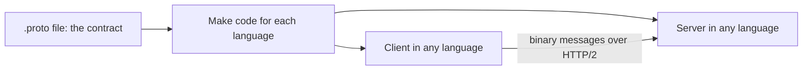
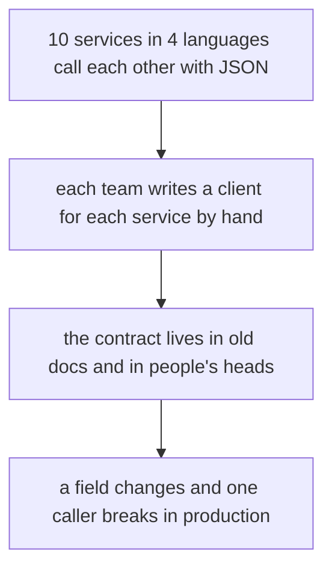
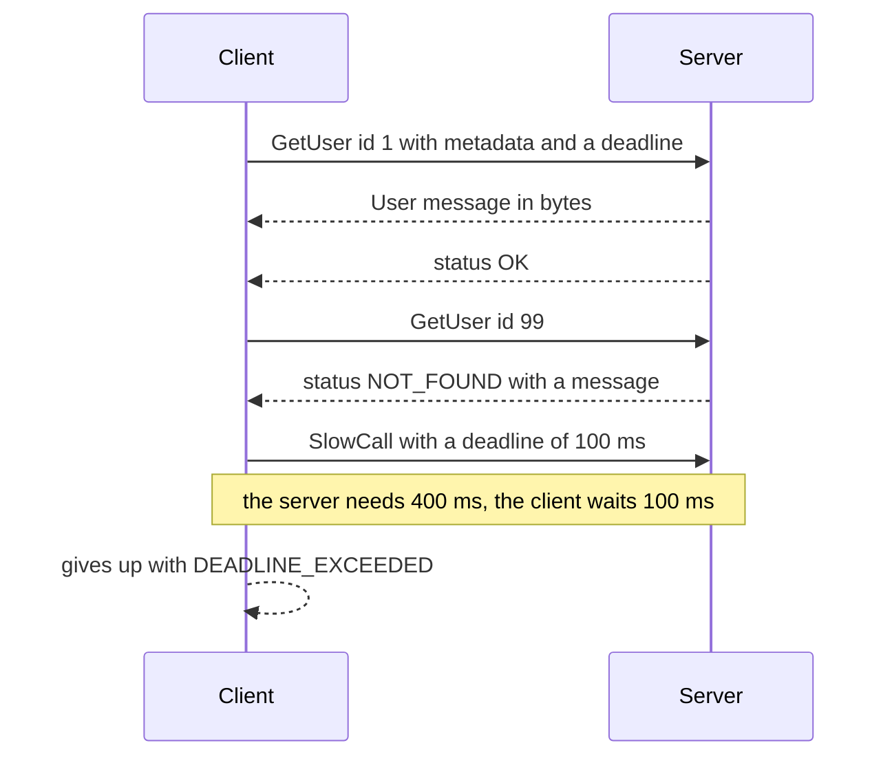
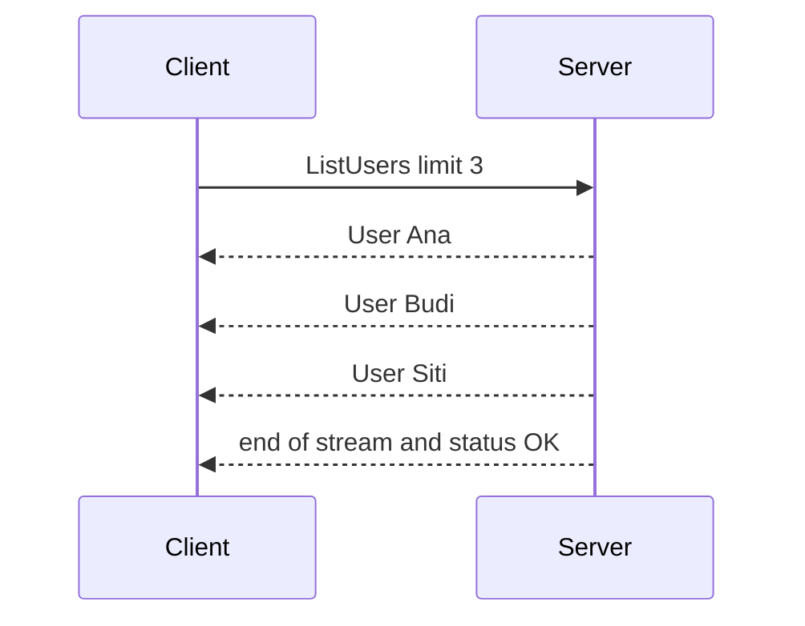
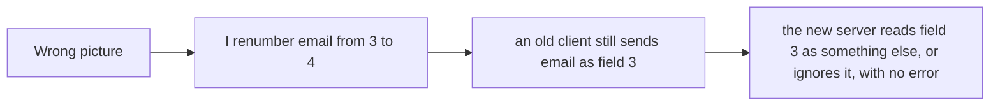
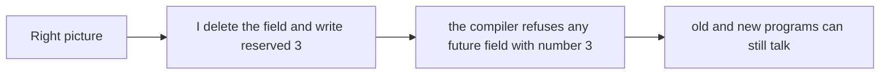
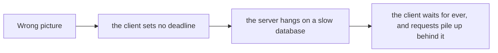
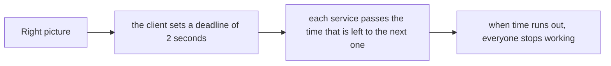
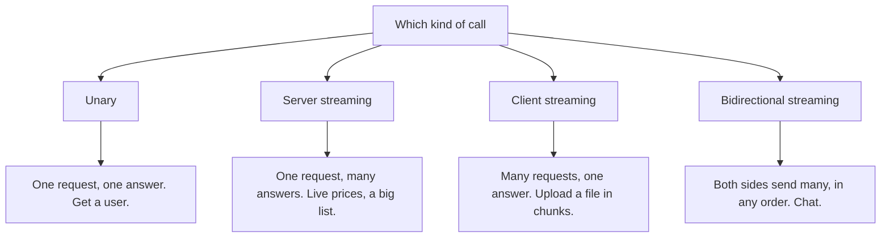

# 16. gRPC

> **Subject:** Backend and API · **Lesson:** 16 · **Made:** 2026-10-23 · **Status:** ready
> **You will be able to:** say what gRPC is, show how a message turns into bytes, name the four kinds of call, explain deadlines and status codes, and say when gRPC is a good choice.
> **Before this:** [tRPC](15-trpc.md) · **Next:** [WebSockets and Server-Sent Events](17-websockets-and-server-sent-events.md)

## 1. The idea in one sentence

You write the contract once in a `.proto` file, and then programs in any language call each other's functions by sending small binary messages over HTTP/2.

New words:

- **gRPC:** a way for programs to call each other's functions over the network. It sends compact binary messages, and it runs on HTTP/2 (a newer HTTP that can run many calls at the same time on one connection).
- **Protobuf:** short for *Protocol Buffers*. The `.proto` file where you describe messages, and the binary format they are sent in.
- **Deadline:** the moment after which the caller stops waiting.
- **Stream:** many messages on one call, one after another.

The rule to remember: **number every field and never reuse a number, always set a deadline, and expect gRPC status codes, not HTTP ones.**

## 2. The pictures

### 2a. The big picture

Notice that the `.proto` file is the one thing both sides share. Each side gets its code from it, in its own language.



### 2b. The problem, drawn

With many services and many languages, hand-written JSON clients drift apart.



### 2c. How it works over time

Three calls to the same server. Notice that a failed call and a slow call end in different ways.



A **stream** is one call with many messages:



### 2d. What is in the bytes right now

This is a real message, made by the protobuf library (checked on 2026-10-23): `User { id: 1, name: "Ana", email: "ana@example.com" }`. Notice that the **field names are not in the bytes**. Only the field **numbers** are.

| Bytes (hex) | What they mean |
|---|---|
| `08` `01` | the tag `08` means "field 1, a number", then the value `01` |
| `12` `03` `41 6e 61` | the tag `12` means "field 2, text", then the length 3, then `Ana` |
| `1a` `0f` `61 6e 61 40 65 78 61 6d 70 6c 65 2e 63 6f 6d` | the tag `1a` means "field 3, text", then the length 15, then `ana@example.com` |

That is **24 bytes**. The same user as JSON is **47 bytes**: `{"id":1,"name":"Ana","email":"ana@example.com"}`.

How the tag is made: `(field number × 8) + kind`. Field 1 as a number: `1 × 8 + 0 = 8 = 0x08`. Field 2 as text: `2 × 8 + 2 = 18 = 0x12`. Field 3 as text: `3 × 8 + 2 = 26 = 0x1a`.

### 2e. Right against wrong

**Wrong picture 1:** "A field number is just a label. I can change it when I tidy up."



**Right picture 1:** the number **is** the field. Never change it and never reuse it.



**Wrong picture 2:** "No deadline is fine. The server will answer sooner or later."



**Right picture 2:** every call has a deadline, and the deadline is passed along to the next service.



### 2f. Which kind of call?

Notice that three of the four use a stream.



## 3. Real life analogy

A **printed order form with numbered boxes**.

- The form says: box 1 is the customer number, box 2 is the name, box 3 is the email. Everyone in the company has the same form.
- When you fill it in, you do not write the box names. You write only "box 1: 1, box 2: Ana, box 3: ...". That is why the message is short.
- If someone changes what box 3 means, and somebody else still has the old form, the numbers still go in, and the data is wrong. So you never change a box. You can add box 4. You can cross out box 3 and promise never to use that number again.

Where the analogy stops: a real order form must be filled in. In protobuf, a box that is empty is allowed, and the reader treats it as the default (0, an empty text, false). And a box that the reader does not know is kept, not thrown away.

## 4. The smallest code that shows it

The contract. This is a real file from my test run:

```proto
syntax = "proto3";
package demo;

service UserService {
  rpc GetUser (GetUserRequest) returns (User);                 // unary
  rpc ListUsers (ListUsersRequest) returns (stream User);      // server streaming
  rpc SlowCall (GetUserRequest) returns (User);                // slow on purpose
}

message GetUserRequest { int32 id = 1; }
message ListUsersRequest { int32 limit = 1; }
message User {
  int32 id = 1;
  string name = 2;
  string email = 3;
}
```

Read it like this: `service` lists the calls. `message` lists the fields. The `= 1`, `= 2`, `= 3` are the field **numbers** from section 2d. The word `stream` marks a stream.

## 5. What really happens, step by step

A real Node client and server (`@grpc/grpc-js` 1.14.6 with `@grpc/proto-loader`), using the file above. The client calls `client.GetUser({ id: 1 }, callback)` and the server answers from a small list. This is what came back (checked on 2026-10-23):

```
GetUser(1)  -> {"id":1,"name":"Ana","email":"ana@example.com"}
GetUser(99) -> code 5 NOT_FOUND | details: No user with that id
ListUsers   -> got Ana, got Budi, got Siti, stream ended
SlowCall with a deadline of 100 ms (the server needs 400 ms)
            -> code 4 DEADLINE_EXCEEDED after ~100 ms
```

What travels for the first call, from the gRPC HTTP/2 specification:

| Step | Who | What happens |
|---|---|---|
| 1 | Client | Opens **one** HTTP/2 connection. It can carry many calls at the same time. |
| 2 | Client | Sends headers: `:method POST`, `:path /demo.UserService/GetUser`, `content-type: application/grpc`. A deadline goes in `grpc-timeout` (a number and a unit, for example `100m` for 100 milliseconds). **Metadata** such as `authorization` is just more headers. |
| 3 | Client | Sends the message: 1 byte that says "not compressed", 4 bytes for the length, then the protobuf bytes. For `GetUserRequest { id: 1 }` those are `08 01`. |
| 4 | Server | Reads the bytes with the same `.proto`, and calls your function. |
| 5 | Server | Sends the headers `:status 200`, then the `User` message in the same framing. |
| 6 | Server | Ends with **trailers**: `grpc-status: 0` (OK). |

The last row is a surprise. For an error, the HTTP status is **still 200**. The error is in the trailers: `grpc-status: 5` and `grpc-message: No user with that id`. So an HTTP monitor that only looks at status codes sees a healthy line.

**Step through it yourself:** [open the gRPC stepper](visuals/16-grpc.html). It has five stories: a message turning into bytes, a unary call with metadata, errors and retries, deadlines passed between services, and streaming. Guess first, then press Next.

## 6. Why it exists and what it costs

- **Problem without it:** many services and many languages, each with hand-written clients, and a contract that is only in documents. JSON is big and slow to read, and has no streaming.
- **How it solves it:** one `.proto` contract makes the code on both sides. The messages are small and fast to read. HTTP/2 gives many calls on one connection, and four kinds of call with streaming. Deadlines and cancel are part of the protocol.
- **Cost:**
  - **A browser cannot call it directly.** You need gRPC-Web with a proxy (Envoy is the default), or a library like Connect. gRPC-Web supports unary and server streaming, but not client or two-way streaming.
  - **It is hard to read by eye.** The bytes are binary. You need a tool such as `grpcurl` to try a call.
  - **Load balancing is different.** One HTTP/2 connection carries all the calls of one client, so a balancer that works on connections sends them all to one server. You need a balancer that understands HTTP/2 calls, or the client must choose a server itself.
  - **You must manage the contract.** Field numbers are forever. A careless change breaks old callers without any error.
  - **No deadline by default.** If you forget, the client can wait for ever.
  - **It is a poor fit for a public API.** Outside callers expect REST and JSON.

<details><summary>Go deeper (optional): status codes, field rules, retries, gRPC-Web and Connect</summary>

**Status codes (docs checked 2026-10-23) and the usual HTTP mapping** (from Google's `code.proto`, which is used by gateways):

| Code | Name | Usual HTTP |
|---|---|---|
| 0 | OK | 200 |
| 1 | CANCELLED | 499 |
| 2 | UNKNOWN | 500 |
| 3 | INVALID_ARGUMENT | 400 |
| 4 | DEADLINE_EXCEEDED | 504 |
| 5 | NOT_FOUND | 404 |
| 6 | ALREADY_EXISTS | 409 |
| 7 | PERMISSION_DENIED | 403 |
| 8 | RESOURCE_EXHAUSTED | 429 |
| 9 | FAILED_PRECONDITION | 400 |
| 10 | ABORTED | 409 |
| 11 | OUT_OF_RANGE | 400 |
| 12 | UNIMPLEMENTED | 501 |
| 13 | INTERNAL | 500 |
| 14 | UNAVAILABLE | 503 |
| 15 | DATA_LOSS | 500 |
| 16 | UNAUTHENTICATED | 401 |

Compare with lesson 10. The meanings in the gRPC docs: `UNAVAILABLE` is "retry with backoff". `ABORTED` is a conflict, "retry at a higher level". `FAILED_PRECONDITION` means the system is not in the right state, "do not retry until it is fixed".

**Field rules (proto3 guide).** A field number is from 1 to 536,870,911. The numbers 19,000 to 19,999 are reserved for the library. Numbers 1 to 15 take one byte for the tag, so give them to the fields you use most. Never reuse a number. When you delete a field, list its number with `reserved`, and the compiler stops anyone from using it again. A missing field reads as its default (0, an empty text, false). Unknown fields are kept in the binary form. Turning a message into JSON can drop them.

**The number format.** A number is sent as a *varint*: 7 bits of value in each byte, and the top bit says "another byte follows". So 1 is `01`, and 150 is `96 01`. A text is sent as a tag, a length, then the UTF-8 bytes. Your exercise builds this.

**Deadlines (docs).** gRPC sets no deadline by default, and the docs say you should always set a realistic one. When a server calls another service, it should pass the original deadline on. Java and Go do this by default. C++ needs it to be turned on. To avoid trouble from different clocks, gRPC sends the time that is **left**, not the time of day.

**Retries (docs).** Retries are set in the *service config*, per method. A policy names the retryable status codes (the example uses `UNAVAILABLE`), `maxAttempts` (the example uses 4) and an exponential backoff with 20% of random jitter. *Hedging* sends the same call to more than one server and takes the first answer. Some retries happen without any policy ("transparent retries") when the call never reached your code.

**Load balancing (gRPC blog).** A connection-level (L4) balancer sends all the calls of one client to one backend. Two ways around it: a proxy that understands HTTP/2 and spreads the calls (it adds a hop), or client-side balancing (the client knows the backends, so it needs more logic).

**Browsers.** gRPC-Web uses a special proxy, and by default Envoy. Its README says it supports unary calls and server streaming, and that client and two-way streaming are not supported. **Connect** (`@connectrpc/connect` 2.2.0 on npm today) is a family of libraries that speaks its own protocol, gRPC, and gRPC-Web. Its servers accept all three by default, and it works in browsers with no Envoy. Any gRPC client can call a Connect server.

**Versions.** On 2026-10-23, npm showed `@grpc/grpc-js` 1.14.6 and `@grpc/proto-loader` 0.8.1.

</details>

## 7. Common mistakes

**Wrong:** no deadline.

```js
client.GetUser({ id: 1 }, (err, user) => { ... });          // can wait for ever
```

**Right:**

```js
client.GetUser({ id: 1 }, { deadline: Date.now() + 2000 }, (err, user) => { ... });
```

**Why:** gRPC has no deadline by default. One slow service then holds every caller above it.

**Wrong:** changing or reusing a field number.

```proto
message User { int32 id = 1; string name = 2; string phone = 3; }   // email was 3 and was deleted
```

**Right:**

```proto
message User { reserved 3; int32 id = 1; string name = 2; string phone = 4; }
```

**Why:** an old caller that still sends field 3 as an email would now be read as a phone.

**Wrong:** watching HTTP status codes to find errors.

**Right:** look at `grpc-status` in the trailers (your client library gives it as `err.code`), and count it in your metrics.

**Why:** the HTTP status of a gRPC answer is `200` even when the call failed.

**Wrong:** calling a gRPC service straight from a browser, or from a plain `fetch`.

**Right:** use gRPC-Web with a proxy, or Connect. Or put a REST or GraphQL layer in front for browsers.

**Why:** gRPC-Web needs a proxy that translates between the browser's HTTP and gRPC (Envoy by default). Connect speaks gRPC-Web itself, so it needs no Envoy.

**Wrong:** retrying every error.

```js
if (err) return retry();
```

**Right:** retry `UNAVAILABLE` with backoff. Do not retry `INVALID_ARGUMENT`, `NOT_FOUND` or `PERMISSION_DENIED`, because the next try will fail in the same way.

**Why:** a retry of a bad request only adds load.

**Wrong:** a connection-level load balancer in front of many servers.

**Right:** a balancer that understands HTTP/2 calls, or client-side balancing.

**Why:** all the calls of one client share one connection, so they all land on one server.

## 8. Watch and play

Links checked on 2026-10-23. I opened every page. For the video I checked only the title and the channel, not the content.

- **Play with it:** [The gRPC stepper](visuals/16-grpc.html) in this folder. In "A message into bytes", say out loud why the field names are not in the 24 bytes.
- **Video:** [gRPC and Protocol Buffers in 6 Minutes](https://www.youtube.com/watch?v=PSe4GuLOFZw) by The Coding Gopher. A short tour. I did not watch it, so use it as a second view.
- **Read:** [gRPC: core concepts](https://grpc.io/docs/what-is-grpc/core-concepts/). The four call types, deadlines, metadata and cancel.
- **Read:** [gRPC: status codes](https://grpc.io/docs/guides/status-codes/). All 17 codes with their meaning.
- **Read:** [gRPC: deadlines](https://grpc.io/docs/guides/deadlines/). Why you always set one.
- **Read:** [Protocol Buffers: encoding](https://protobuf.dev/programming-guides/encoding/). The `08 96 01` example, byte by byte. Your exercise uses it.
- **Try it:** [grpcurl](https://github.com/fullstorydev/grpcurl). A command-line tool like curl for gRPC servers. It needs the `.proto` files or server reflection.

<details><summary>More links (optional)</summary>

- **Read:** [gRPC: retry](https://grpc.io/docs/guides/retry/). The service config, backoff and hedging.
- **Read:** [gRPC load balancing](https://grpc.io/blog/grpc-load-balancing/). Proxy and client-side balancing.
- **Read:** [gRPC over HTTP/2 (the protocol)](https://github.com/grpc/grpc/blob/master/doc/PROTOCOL-HTTP2.md). The headers, the message framing and the trailers.
- **Read:** [Protocol Buffers: proto3 guide](https://protobuf.dev/programming-guides/proto3/). Field numbers, defaults and `reserved`.
- **Read:** [gRPC-Web on GitHub](https://github.com/grpc/grpc-web). What a browser can do, and the proxy.
- **Read:** [Connect: introduction](https://connectrpc.com/docs/introduction). A gRPC-compatible library that works in browsers.
- **Read:** [Google's code.proto](https://github.com/googleapis/googleapis/blob/master/google/rpc/code.proto). The status codes with the HTTP mapping.

</details>

## 9. Practice

**A. Predict the output** (write your answer before opening)

```proto
message Point { int32 x = 1; int32 y = 2; }
```

What are the bytes of `Point { x: 150, y: 1 }`? (Hint: section 2d, and the number 150 is `96 01`.)

<details><summary>Answer</summary>

```
08 96 01 10 01
```

`08` is field 1 as a number, then `96 01` is 150. `10` is field 2 as a number (`2 × 8 + 0 = 16 = 0x10`), then `01` is 1. Five bytes in all. (The first three bytes, `08 96 01`, are the example from the protobuf docs.)

</details>

**B. Fix the bug**

```proto
message User {
  int32 id = 1;
  string name = 2;
  string phone = 3;      // we used to have: string email = 3;
}
```

```js
function load() {
  client.GetUser({ id: 1 }, (err, user) => {
    if (err) return load();                  // retry on any error, at once
  });
}
```

What is wrong? There are four problems.

<details><summary>Answer</summary>

1. **Field number 3 was reused.** An old caller still sends or reads field 3 as an email. Delete the old field with `reserved 3;` and give the new field a new number, for example 4.
2. **No deadline.** The call can wait for ever. Pass `{ deadline: Date.now() + 2000 }`.
3. **It retries on every error.** `INVALID_ARGUMENT` or `NOT_FOUND` will fail again. Retry only `UNAVAILABLE`, with a backoff.
4. **It retries at once, with no limit.** An endless loop of instant retries can bring a struggling server down. Set a limit (for example 4 attempts) and wait between tries (exponential backoff with a little random time).

</details>

**C. Write it yourself**

Open `practice/16-grpc.js`. You build a tiny protobuf from scratch: the **varint** (`150` becomes `96 01`), a field with its tag, a whole message, and the way back. Then the gRPC to HTTP status table, the retry advice, the time left on a deadline, and five short answers. Your bytes must match the real ones from section 2d. No packages needed.

```
node --test learn/backend-api/practice/16-grpc.test.js
```

<details><summary>One possible answer</summary>

```js
function encodeVarint(n) {
  const bytes = [];
  let rest = n;
  while (rest >= 128) {
    bytes.push((rest % 128) + 128);          // 7 bits of value, and the top bit says "more follows"
    rest = Math.floor(rest / 128);
  }
  bytes.push(rest);
  return Buffer.from(bytes);
}

function decodeVarint(buf, offset = 0) {
  let value = 0, scale = 1, i = offset;
  for (; i < buf.length; i++) {
    value += (buf[i] % 128) * scale;
    if (buf[i] < 128) return { value, length: i - offset + 1 };
    scale *= 128;
  }
  throw new Error("varint is cut off");
}

function encodeField(fieldNumber, value) {
  if (typeof value === "number") {
    return Buffer.concat([encodeVarint(fieldNumber * 8 + 0), encodeVarint(value)]);
  }
  const text = Buffer.from(String(value), "utf8");
  return Buffer.concat([encodeVarint(fieldNumber * 8 + 2), encodeVarint(text.length), text]);
}

function encodeMessage(fields) {
  return Buffer.concat(fields.map(([number, value]) => encodeField(number, value)));
}

function decodeMessage(buf) {
  const out = [];
  let i = 0;
  while (i < buf.length) {
    const tag = decodeVarint(buf, i); i += tag.length;
    const field = Math.floor(tag.value / 8), wireType = tag.value % 8;
    if (wireType === 0) {
      const v = decodeVarint(buf, i); i += v.length;
      out.push({ field, wireType, value: v.value });
    } else if (wireType === 2) {
      const len = decodeVarint(buf, i); i += len.length;
      if (i + len.value > buf.length) throw new Error("message is cut off");
      out.push({ field, wireType, value: buf.subarray(i, i + len.value).toString("utf8") });
      i += len.value;
    } else {
      throw new Error(`unsupported wire type ${wireType}`);
    }
  }
  return out;
}

const HTTP = [200, 499, 500, 400, 504, 404, 409, 403, 429, 400, 409, 400, 501, 500, 503, 500, 401];
function grpcToHttp(code) {
  return Number.isInteger(code) && code >= 0 && code < HTTP.length ? HTTP[code] : 500;
}

function retryAdvice(name) {
  if (name === "UNAVAILABLE") return "retry with backoff";
  if (name === "ABORTED") return "retry at a higher level";
  if (name === "FAILED_PRECONDITION") return "fix first";
  return "do not retry";
}

function remainingMs(deadlineAtMs, nowMs) {
  return Math.max(0, deadlineAtMs - nowMs);
}

const answers = {
  fieldNamesAreInTheBytes: false,
  httpStatusOfAFailedGrpcCall: 200,
  defaultDeadline: "none",
  whenYouDeleteAField: "reserve its number",
  browserNeedsSomethingExtra: true,
};
```

Notice four things. `encodeVarint` uses division and `%`, not bit shifts, because JavaScript bit shifts only work on 32 bits. The tag is `fieldNumber * 8 + wireType`, exactly as in section 2d. `decodeMessage` refuses to read past the end of the data and refuses a wire type it does not know, so a damaged message gives an error and not a wrong answer. And `remainingMs` never goes below 0, so an expired deadline cannot become a negative wait.

</details>

## 10. Interview question

**Q:** "What is gRPC and how is it different from REST? When would you use it? What are deadlines, and how do you change a message without breaking callers?"

<details><summary>A strong answer, in four parts</summary>

1. **Problem:** with many services in many languages, hand-written JSON clients drift. JSON is large, there is no contract that a machine checks, and there is no streaming. Calls between services also need timeouts and a clear error vocabulary.
2. **How it works:** I write the contract once in a `.proto` file: services with calls, and messages with numbered fields. Each language makes its own client and server code from it. The messages are sent as small binary protobuf (field numbers and values, not names) over HTTP/2, which runs many calls on one connection. There are four kinds of call: unary, server streaming, client streaming and two-way streaming. The client sets a **deadline**, and each service passes the time that is left to the next. Errors use gRPC status codes such as `NOT_FOUND` and `UNAVAILABLE`, sent in the trailers, and the HTTP status is still 200.
3. **Tradeoff:** it is great for calls between services, especially in more than one language, and for streaming. It is a poor fit for public APIs and for browsers (you need gRPC-Web with a proxy, or Connect). It is harder to debug by eye, and load balancing needs care, because one connection carries many calls. To change a message safely, I only add fields with new numbers, never reuse a number, and `reserve` the numbers I delete. There is no deadline by default, so I always set one, and I retry only `UNAVAILABLE`, with backoff.
4. **My example:** your DBO notes say all calls between the services are GraphQL today, and suggest queue events or plain internal calls with shared TypeScript types instead. *They do not say you used gRPC anywhere.* A fair answer: gRPC would earn its place when services are in different languages or need streaming. For a team that is all TypeScript, shared types (or tRPC) can be simpler. Say what you would choose and why, and do not claim you built it.

</details>

## 11. Explain it back

Close this file. Press the **Record my explanation** button under this heading and explain it out loud, like to a new junior, in 4 parts: problem, how it works, tradeoff, my example. Use the words "contract", "field number" and "deadline". Then save the transcript into `my-learning/recordings/`, or write your best version below. Run `/explain-check grpc` or ask the `explain-coach` agent to review it.

### My explanation

<write here>

### Coach feedback

<the explain-coach agent writes here>

## 12. Review questions (day 1, 3, 7, 21)

1. What is in the bytes of a protobuf message: the field names, or the field numbers? Why does that matter when you change a message?
2. A gRPC call fails with `NOT_FOUND`. What is the HTTP status of the answer, and where is the real error?
3. What happens if you set no deadline? What should you do when one service calls another?
4. Draw the picture from section 2d from memory: the three fields of `User` and their bytes.

<details><summary>Answers</summary>

1. The field **numbers** (inside the tags), with the values. The names are not sent. So the number is the field: if you change or reuse a number, old and new programs read the wrong data without any error. Add new fields with new numbers, and `reserve` the numbers you delete.
2. The HTTP status is still **200**. The error is in the trailers: `grpc-status: 5` (NOT_FOUND) and `grpc-message` with the text. Your client library shows it as the error code.
3. gRPC sets no deadline by default, so the client can wait for ever, and a slow service holds up everyone above it. Always set a realistic deadline, and let each service pass on the time that is left to the next call.
4. `08 01`: field 1 as a number, value 1. `12 03 41 6e 61`: field 2 as text, length 3, `Ana`. `1a 0f ...`: field 3 as text, length 15, `ana@example.com`. 24 bytes in all, against 47 for the same data in JSON.

</details>

## Connected lessons

- [tRPC](15-trpc.md): also RPC. tRPC needs TypeScript on both ends and shares types. gRPC uses a `.proto` file and works in any language.
- [REST API design](02-rest-api-design.md): the style for public APIs. Compare its status codes with gRPC's.
- [Validation and error handling](10-validation-and-error-handling.md): `INVALID_ARGUMENT` and `UNAVAILABLE` are the gRPC versions of 400 and 503.
- [Rate limiting](11-rate-limiting.md): `RESOURCE_EXHAUSTED` is the gRPC 429.
- [Webhooks and idempotency](13-webhooks-and-idempotency.md): a retry is only safe when the call is safe to repeat.
- [WebSockets and Server-Sent Events](17-websockets-and-server-sent-events.md): the next lesson. Another way to send many messages on one connection.
- [Choosing an API style](18-choosing-an-api-style.md): when gRPC is the right choice.
