# 17. WebSockets and Server-Sent Events

> **Subject:** Backend and API · **Lesson:** 17 · **Made:** 2026-10-23 · **Status:** ready
> **You will be able to:** explain polling, Server-Sent Events and WebSockets and choose between them, show how a WebSocket starts, read the event stream format, and say what changes when you run more than one server.
> **Before this:** [gRPC](16-grpc.md) · **Next:** [Choosing an API style](18-choosing-an-api-style.md)

## 1. The idea in one sentence

When the server has news, it should be able to tell the client at once, without the client asking again and again, and you must plan for the connection to break.

New words:

- **Polling:** the client asks again and again, "anything new?"
- **Server-Sent Events (SSE):** the server keeps one HTTP answer open and pushes text events down it. It goes one way only: server to client.
- **WebSocket:** one connection that stays open, and either side can send a message at any time.
- **Heartbeat:** a tiny message on a timer that shows the connection is still alive. (For WebSocket, these are *ping* and *pong*.)

The rule to remember: **use the simplest one that works. Polling for rare news, SSE for one-way pushes, WebSocket when both sides talk. Connections drop, so plan for reconnects.**

## 2. The pictures

### 2a. The big picture

Four ways to get new data. Notice that they get more powerful, and more work, from top to bottom.

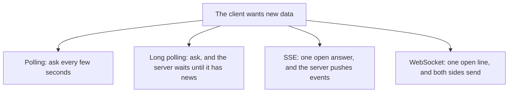

### 2b. The problem, drawn

Polling costs a request for every "no".

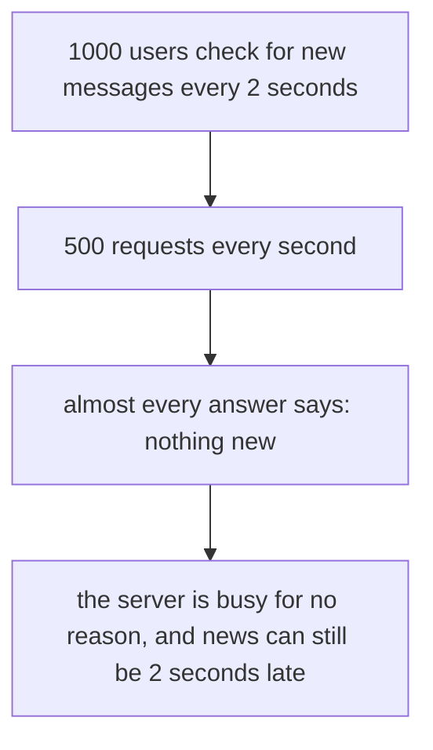

### 2c. How it works over time

**A WebSocket.** Notice that it starts as a normal HTTP request, and then the same connection changes language.

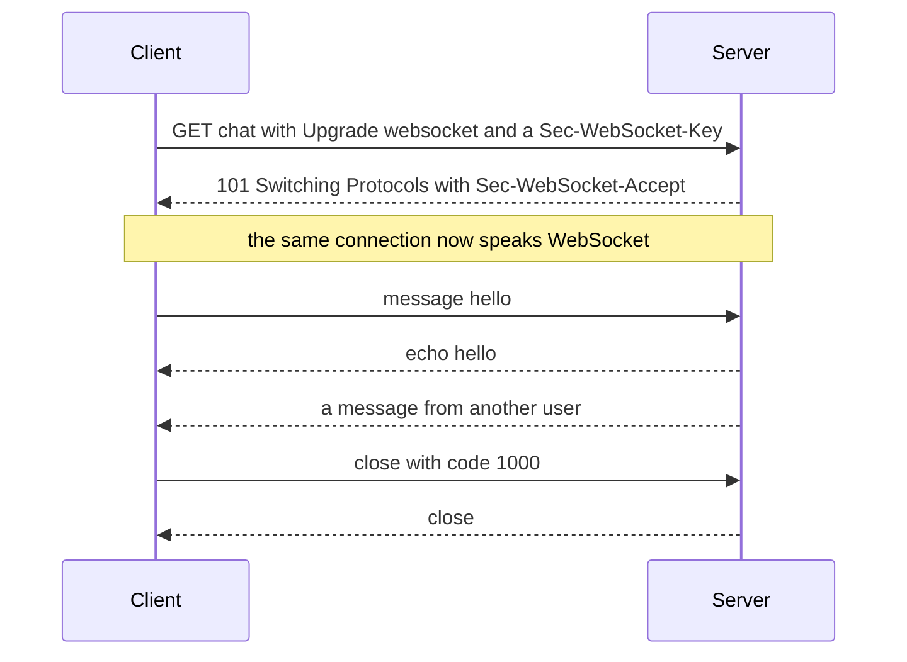

**Server-Sent Events.** Notice how the client resumes after a break.

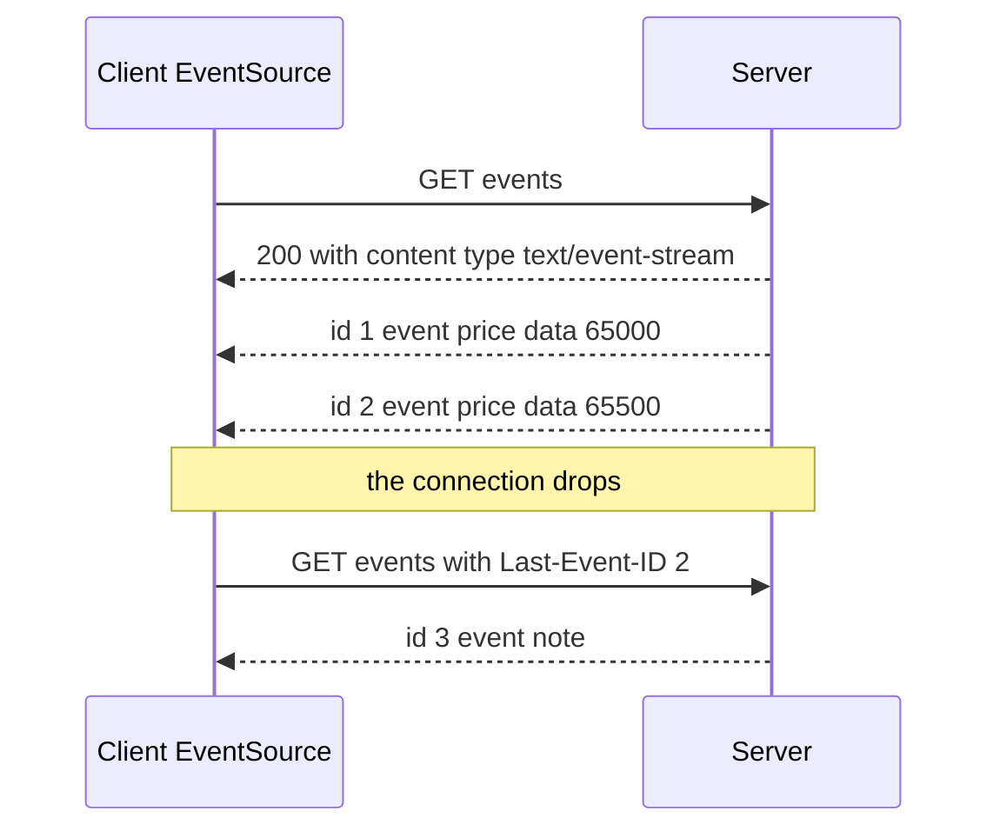

### 2d. What is on the wire right now

Both are real, from a real Node server (checked on 2026-10-23). First, the **WebSocket handshake answer**. curl sent the example key from the standard (RFC 6455), and the server answered:

```
HTTP/1.1 101 Switching Protocols
Upgrade: websocket
Connection: Upgrade
Sec-WebSocket-Accept: s3pPLMBiTxaQ9kYGzzhZRbK+xOo=
```

The accept value is a computation: take the client's `Sec-WebSocket-Key`, add a fixed text from the standard (`258EAFA5-E914-47DA-95CA-C5AB0DC85B11`), make a SHA-1 hash, and write it in base64. For the example key `dGhlIHNhbXBsZSBub25jZQ==` the standard says the answer is `s3pPLMBiTxaQ9kYGzzhZRbK+xOo=`. My server gave exactly that. You build this in the exercise.

Second, the **event stream**, with the `\n` shown on purpose:

```
: keep-alive comment\n
\n
retry: 3000\n
\n
id: 1\n
event: price\n
data: 65000\n
\n
id: 2\n
event: price\n
data: 65500\n
\n
id: 3\n
event: note\n
data: line one\n
data: line two\n
\n
```

It is plain text. A line is `name: value`. A **blank line** ends an event. A line that starts with `:` is a comment. Two `data` lines are joined with a newline, so event 3 is `line one` and `line two`.

### 2e. Right against wrong

**Wrong picture 1:** "WebSocket is the modern one, so I use it for everything."

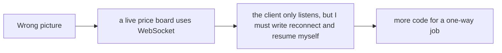

**Right picture 1:** for one-way pushes, SSE is simpler. The browser reconnects for you and sends the last id.

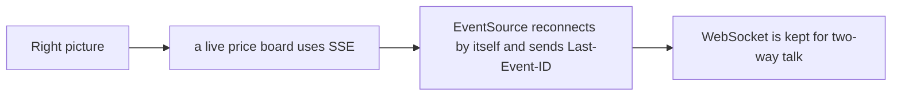

**Wrong picture 2:** "Add more servers and everything scales."

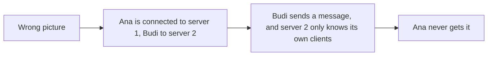

**Right picture 2:** the servers share messages through a message bus, such as Redis Pub/Sub.

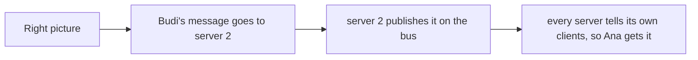

**Wrong picture 3:** "When the connection drops, reconnect at once, in a loop."

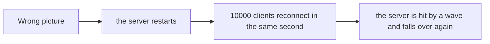

**Right picture 3:** wait a little longer after each failure, and add some random time.

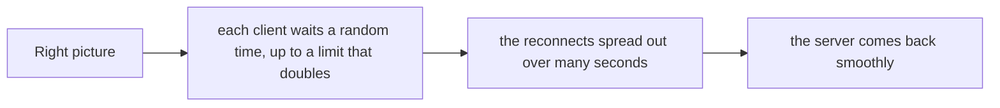

### 2f. Which one?

Notice that the question is who talks.

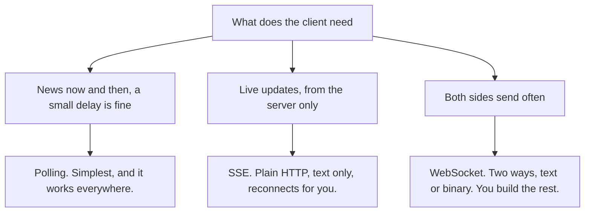

## 3. Real life analogy

Three ways to follow a football match.

- **Polling** is phoning the stadium every minute and asking "who is winning?" Most calls get "same as before."
- **SSE** is a **radio**. You tune in, and the station talks. You cannot talk back. If the signal drops, the radio retunes by itself, and you can tell the station the last thing you heard, so it can catch you up.
- **WebSocket** is a **phone call**. Both people talk, and either can hang up. But if the line goes dead without a click, nobody knows. And you must redial yourself.

Where the analogy stops: after a hang-up, a phone call is gone. For a WebSocket you can build a "remember where we were" scheme with ids, but you must do it yourself. SSE has it built in.

## 4. The smallest code that shows it

The server side of SSE, the browser side of SSE, and the browser side of a WebSocket:

```js
// SSE, on the server (Node)
res.writeHead(200, { "Content-Type": "text/event-stream", "Cache-Control": "no-cache" });
res.write(`id: ${e.id}\nevent: ${e.name}\ndata: ${e.data}\n\n`);     // one event
```

```js
// SSE, in the browser
const es = new EventSource("/events");
es.addEventListener("price", (e) => console.log(e.data, e.lastEventId));
```

```js
// WebSocket, in the browser (and in Node 22 or later, which has WebSocket built in)
const ws = new WebSocket("wss://example.com/chat");
ws.onopen = () => ws.send("hello");
ws.onmessage = (m) => console.log(m.data);
```

**Output.** The raw bytes of the SSE server are the stream in section 2d. Two real clients on a real WebSocket chat server printed this:

```
Ana sent "hello"    -> Ana got: echo: hello          and  Budi got: from other: hello
Budi sent "hi Ana"  -> Budi got: echo: hi Ana        and  Ana got: from other: hi Ana
```

A browser has `EventSource` built in. In Node 24.15 I checked, `WebSocket` is a global, but `EventSource` is **not** (it is `undefined`), so on a Node client you need a package for SSE.

## 5. What really happens, step by step

**A WebSocket, step by step**

| Step | Who | What happens |
|---|---|---|
| 1 | Client | Sends a normal HTTP `GET` with `Upgrade: websocket`, `Connection: Upgrade`, `Sec-WebSocket-Version: 13` and a random `Sec-WebSocket-Key`. |
| 2 | Server | Makes the accept value from the key and answers `101 Switching Protocols` with `Sec-WebSocket-Accept`. |
| 3 | Both | The same connection now carries **frames**, not HTTP. Either side can send at any time. |
| 4 | Both | A **ping** frame is answered by a **pong** frame. This is the heartbeat. It finds a dead line, and keeps the line from being closed for being idle. |
| 5 | Either | Sends a **close** frame with a code, and the other side answers. In my run, a client that closed with code `1000` gave `1000` on the server. |

Frames from the browser to the server are **masked** (the standard requires it), and the server's frames are not. Your library does this for you.

**What I saw when connections ended in different ways (real run):**

| How it ended | Code the server library reported |
|---|---|
| The client sent a close with code `1000` | `1000` (normal closure) |
| The client closed with no code | `1005` (no code was given) |
| curl just dropped the line, with no close frame | `1006` (abnormal: no close frame at all) |

**SSE, step by step**

| Step | Who | What happens |
|---|---|---|
| 1 | Browser | `new EventSource("/events")` makes a `GET`. |
| 2 | Server | Answers `200` with `Content-Type: text/event-stream` and **does not finish the answer**. |
| 3 | Server | Writes events as they happen: `id`, `event`, `data`, then a blank line. |
| 4 | Server | Sends a comment line (`:`) every 15 seconds or so, so proxies do not close an idle connection. (The standard suggests this.) |
| 5 | Both | The connection drops. The browser waits (a few seconds by default, or the `retry` value) and reconnects. |
| 6 | Browser | Sends `Last-Event-ID: 2`, the last `id` it saw. |
| 7 | Server | Sends only what came after 2. I tested it: with `Last-Event-ID: 2`, only event 3 came back. |

A server can stop the reconnects by answering `204 No Content`.

**Step through it yourself:** [open the WebSockets and SSE stepper](visuals/17-websockets-and-server-sent-events.html). It has five stories: polling against push, the WebSocket handshake, an SSE stream that drops and resumes, many servers (wrong, then right), and a reconnect storm. Guess first, then press Next.

## 6. Why it exists and what it costs

- **Problem without it:** with polling, most requests find nothing, and news arrives late. A chat, a price board, a progress bar or a notification needs the news **now**.
- **How it solves it:** one connection stays open, and the server writes to it when it has something. No repeated asking, and no delay.
- **Cost:**
  - **Connections stay open, so the server holds state.** Every client takes a connection and some memory, all day. Plan the limits.
  - **Many servers need a bus.** A message that reaches server 1 must be passed to the clients on server 2. Redis Pub/Sub is common. It is **at-most-once**: if a server is not listening at that moment, the message is lost. For must-arrive messages use something that keeps them, such as Redis Streams, or let clients fetch what they missed.
  - **Connections drop, all the time.** Phones go into tunnels and laptops sleep. You need reconnect with backoff, ids to resume, and a way to fetch what was missed.
  - **WebSocket has no built-in resume.** SSE does (`id` and `Last-Event-ID`).
  - **Backpressure.** The browser WebSocket API has none. If messages arrive faster than the page can handle them, memory or the CPU can run out (MDN says so).
  - **Login is harder.** The browser `WebSocket` constructor takes only a URL and optional sub-protocols. You cannot set a header such as `Authorization`. Use a cookie, a short-lived one-time ticket in the URL, or send the token as the first message. A token in the URL can end up in logs (my reasoning, so check your own logs).
  - **SSE limits on HTTP/1.1.** A browser allows only about 6 connections per site, and open tabs share them. On HTTP/2 the limit is much higher (100 by default).
  - **Proxies and load balancers close idle connections.** Send heartbeats.

<details><summary>Go deeper (optional): close codes, Socket.IO, backoff, other options</summary>

**Close codes (RFC 6455).** `1000` normal closure. `1001` going away (a server shutting down, or a page closed). `1002` protocol error. `1003` data it cannot accept. `1006` is reserved: it must never be sent, and it is what you see when the connection ended with no close frame. `1008` policy violation. `1009` message too big. `1011` the server hit an unexpected problem.

**Socket.IO is not a WebSocket library.** Its docs say "Socket.IO is NOT a WebSocket implementation". It has its own protocol, it can fall back to HTTP long-polling, and a plain WebSocket client cannot connect to a Socket.IO server (and the other way round). Both ends need Socket.IO. Use it when you want its extras (rooms, acknowledgements). Do not use it when you want a standard WebSocket.

**Reconnect with backoff and jitter.** The AWS Architecture Blog recommends capped exponential backoff with jitter: after each failure the longest wait doubles, up to a cap, and each client picks a random time up to that limit. "Full jitter" is `random(0, min(cap, base * 2^attempt))`. You write this in the exercise. For SSE, the server can change the wait with a `retry:` line (in milliseconds).

**SSE details (MDN and the HTML standard).** `data` lines are joined with `\n`. The `id` sets the "last event ID". `retry` must be a whole number. A line with no colon is a field name with an empty value. If the `id` is empty, `Last-Event-ID` is not sent.

**WebSocket details.** The browser also accepts `https://` in the constructor and turns it into `wss://`. If a page has an open WebSocket, the browser may not keep it in its back/forward cache, so close the connection when the user is done. For backpressure problems, MDN points to the WebTransport API.

**Subscriptions in the tools you know.** tRPC v11 subscriptions run over SSE (`httpSubscriptionLink`, the simpler way) or WebSocket (`wsLink`), with `tracked(id, data)` for resuming (lesson 15). Your Hasura guide says Hasura live queries run over WebSocket (lesson 14).

**Node.** Node 24.15 has a global `WebSocket` client and no global `EventSource`. For a WebSocket server, `ws` is the usual package (8.22.0 on npm today).

**Other options.** WebTransport (named by MDN as the answer to backpressure), and plain push notifications for phones. I did not test either.

</details>

## 7. Common mistakes

**Wrong:** WebSocket for a one-way feed.

```js
const ws = new WebSocket(url);      // only ever listens, and has no reconnect code
```

**Right:** `new EventSource(url)`. It reconnects and resumes by itself.

**Why:** you get less code and plain HTTP. Keep WebSocket for two-way talk.

**Wrong:** one server keeps the list of clients in its own memory, and you run three servers.

```js
const clients = new Set();           // only the clients of THIS server
```

**Right:** publish each message on a bus (Redis Pub/Sub) and let every server send it to its own clients.

**Why:** a client on another server would never see the message.

**Wrong:** no heartbeat.

**Right:** a WebSocket ping on a timer that is **shorter than the idle timeout of your proxy or load balancer** (look it up for yours). For SSE, a comment line every 15 seconds or so, which is what the standard suggests.

**Why:** a dead line does not tell anyone. Idle connections are closed by proxies and load balancers. A heartbeat finds both.

**Wrong:** reconnect at once, forever.

```js
ws.onclose = () => connect();        // a storm after every restart
```

**Right:** wait `random(0, min(cap, base * 2^attempt))`, and reset the attempt count after a good connection.

**Why:** an instant retry loop turns a short outage into a long one.

**Wrong:** trusting that every message arrives.

**Right:** give events ids. On reconnect, resume from the last id, or fetch what you missed over plain HTTP.

**Why:** the connection can drop at any moment, and the message in flight is lost.

**Wrong:** the token in the WebSocket URL, and no check of who is asking.

**Right:** a short-lived one-time ticket (made by a normal login-checked call), and a check of who the user is when the socket opens. Also look at the `Origin` header that browsers send, so a page on another site cannot use your users' cookies to open a socket.

**Why:** the constructor cannot send an `Authorization` header, and URLs end up in logs.

## 8. Watch and play

Links checked on 2026-10-23. I opened every page. For the video I checked only the title and the channel, not the content.

- **Play with it:** [The WebSockets and SSE stepper](visuals/17-websockets-and-server-sent-events.html) in this folder. In "A reconnect storm", say out loud why random time helps.
- **Video:** [Polling vs HTTP Long-Polling vs WebSockets vs Server-Sent Events](https://www.youtube.com/watch?v=K-bJN6WN8Kw) by Study With Rishi. A short system design video on all four. I did not watch it.
- **Read:** [MDN: Using server-sent events](https://developer.mozilla.org/en-US/docs/Web/API/Server-sent_events/Using_server-sent_events). The stream format and the connection limits.
- **Read:** [MDN: WebSockets API](https://developer.mozilla.org/en-US/docs/Web/API/WebSockets_API). Two-way, no backpressure, and the handshake.
- **Read:** [RFC 6455: The WebSocket Protocol](https://www.rfc-editor.org/rfc/rfc6455.html). Search for "Sec-WebSocket-Accept" to see the example key.
- **Read:** [HTML standard: Server-sent events](https://html.spec.whatwg.org/multipage/server-sent-events.html). `Last-Event-ID`, `retry`, `204`, and the keep-alive comment.
- **Read:** [Redis Pub/Sub](https://redis.io/docs/latest/develop/pubsub/). The bus, and its at-most-once delivery.

<details><summary>More links (optional)</summary>

- **Read:** [MDN: WebSocket constructor](https://developer.mozilla.org/en-US/docs/Web/API/WebSocket/WebSocket). A URL and optional sub-protocols, and nothing else.
- **Read:** [Socket.IO docs](https://socket.io/docs/v4/). "Not a WebSocket implementation".
- **Read:** [AWS: Exponential Backoff And Jitter](https://aws.amazon.com/blogs/architecture/exponential-backoff-and-jitter/).
- **Read:** [tRPC: subscriptions](https://trpc.io/docs/server/subscriptions). SSE and WebSocket in a tool you know.
- **Code in this repo:** [Hasura guide](hasura-guide.md). Live queries over WebSocket.

</details>

## 9. Practice

**A. Predict the output** (write your answer before opening)

A client reads this stream. What does it log?

```
retry: 1000

id: 7
data: hello

: just a keep-alive

id: 8
event: price
data: 65000
data: 65500

```

<details><summary>Answer</summary>

Two events are dispatched:

1. `message` (the default name) with data `hello`, last id `7`.
2. `price` with data `65000\n65500` (two lines joined by a newline), last id `8`.

The `retry: 1000` block has no `data`, so it makes no event. It only sets the reconnect time to 1000 ms. The comment line makes no event either.

</details>

**B. Fix the bug**

```js
const clients = new Set();
wss.on("connection", (ws) => {
  clients.add(ws);
  ws.on("message", (m) => { for (const c of clients) c.send(String(m)); });
});
// the browser:
ws.onclose = () => connect();
```

What is wrong? There are four problems.

<details><summary>Answer</summary>

1. **The set never loses a client.** A closed socket stays in `clients`, and `c.send` on it is a mistake. Remove it on `close`, and only send when `readyState` is open.
2. **The set lives in one process.** With more than one server, clients on other servers never get the message. Publish on a bus (Redis Pub/Sub) and let each server forward it.
3. **The browser reconnects at once.** After a restart, every client comes back in the same second. Use backoff with jitter.
4. **No heartbeat, no login check.** A dead line is never noticed, and anyone can connect. Add ping and pong, and check the user when the socket opens.

(Also: the message is sent to the sender too. Decide if that is wanted.)

</details>

**C. Write it yourself**

Open `practice/17-websockets-and-server-sent-events.js`. You write the WebSocket **accept key**, an SSE event **formatter** and **parser** (they must handle the real stream from section 2d), the **reconnect delay** with full jitter, a tiny chat **hub** (rooms, broadcast and closed sockets), and some short answers. No packages needed.

```
node --test learn/backend-api/practice/17-websockets-and-server-sent-events.test.js
```

<details><summary>One possible answer</summary>

```js
const { createHash } = require("node:crypto");

const GUID = "258EAFA5-E914-47DA-95CA-C5AB0DC85B11";
function acceptKey(clientKey) {
  return createHash("sha1").update(String(clientKey) + GUID).digest("base64");
}

function formatSseEvent({ id, event, data, retry, comment } = {}) {
  let out = "";
  if (comment !== undefined) out += `: ${comment}\n`;
  if (retry !== undefined) out += `retry: ${retry}\n`;
  if (id !== undefined) out += `id: ${id}\n`;
  if (event !== undefined) out += `event: ${event}\n`;
  if (data !== undefined) out += String(data).split(/\r\n|\r|\n/).map((line) => `data: ${line}\n`).join("");
  return out + "\n";
}

function parseSse(text) {
  const events = [];
  let retry = null, lastId = "";
  for (const block of String(text).replace(/\r\n?/g, "\n").split("\n\n")) {
    let name = "", data = null;
    for (const line of block.split("\n")) {
      if (line === "" || line.startsWith(":")) continue;                  // a comment or nothing
      const i = line.indexOf(":");
      const field = i === -1 ? line : line.slice(0, i);
      let value = i === -1 ? "" : line.slice(i + 1);
      if (value.startsWith(" ")) value = value.slice(1);                  // one space after the colon is dropped
      if (field === "data") data = data === null ? value : data + "\n" + value;
      else if (field === "event") name = value;
      else if (field === "id") lastId = value;
      else if (field === "retry" && /^\d+$/.test(value)) retry = Number(value);
    }
    if (data !== null) events.push({ id: lastId, event: name || "message", data });
  }
  return { events, retry };
}

function reconnectDelay(attempt, { baseMs = 500, capMs = 30000 } = {}, random = Math.random) {
  const n = Number.isFinite(attempt) && attempt > 0 ? attempt : 0;
  const limit = Math.min(capMs, baseMs * 2 ** n);
  return Math.floor(random() * limit);
}

function createHub() {
  const rooms = new Map();                                                // room -> Set of sockets
  return {
    join(room, socket) {
      if (!rooms.has(room)) rooms.set(room, new Set());
      rooms.get(room).add(socket);                                        // a Set, so joining twice is one
    },
    leave(socket) {
      for (const [name, set] of rooms) { set.delete(socket); if (set.size === 0) rooms.delete(name); }
    },
    broadcast(room, message, except) {
      const set = rooms.get(room);
      if (!set) return 0;
      let sent = 0;
      for (const s of [...set]) {
        if (s.readyState !== 1) { set.delete(s); continue; }              // closed: drop it
        if (s === except) continue;
        s.send(message);
        sent++;
      }
      return sent;
    },
    size(room) { return rooms.has(room) ? rooms.get(room).size : 0; },
  };
}

const answers = {
  oneWayLivePrices: "sse",
  chatBothWays: "websocket",
  rareUpdates: "polling",
  sseConnectionsPerBrowserOnHttp1: 6,
  closeCodeNormal: 1000,
  serversShareMessagesWith: "message bus",
};
```

Notice four things. `formatSseEvent` splits `data` on every kind of newline and writes one `data:` line for each. `parseSse` only makes an event when there was at least one `data` line, so a `retry` block or a comment makes none. The parser drops exactly one space after the colon, like the standard. And `reconnectDelay` takes the random function as a parameter, so a test can control it. `broadcast` drops sockets that are no longer open, so the room does not fill with dead ones.

</details>

## 10. Interview question

**Q:** "WebSockets, Server-Sent Events or polling? How do you scale WebSockets? How do you handle reconnects?"

<details><summary>A strong answer, in four parts</summary>

1. **Problem:** a chat, a live board or a progress bar needs news the moment it happens. Polling wastes requests (most answers say "nothing new") and still adds delay.
2. **How it works:** polling is the simplest and fine for rare updates. **SSE** keeps one HTTP answer open and pushes text events one way. The browser reconnects by itself and sends `Last-Event-ID`, so I can resume. **WebSocket** starts as an HTTP request with `Upgrade`, the server answers `101`, and then both sides send frames on the same connection. Ping and pong are the heartbeat. I choose by who talks: SSE for one-way, WebSocket for two-way.
3. **Tradeoff:** open connections mean the server holds state, so I plan the limits. With many servers, a message must reach clients on the other servers, so I use a bus such as Redis Pub/Sub, which is at-most-once, so for important messages I add ids and a way to fetch what was missed. WebSocket has no built-in resume and no backpressure in the browser. Login is awkward, because the browser constructor sets no headers, so I use a cookie or a short-lived ticket. I send heartbeats, because proxies close idle connections. On reconnect I use exponential backoff with jitter, so a restart does not cause a storm.
4. **My example:** your Hasura guide explains that Hasura live queries run over WebSocket, and your DBO notes mention webhooks from Manager and TADA for order and points updates. *Your notes do not say you built a real-time feature.* If asked, say how you would do "order status updates in the app": push notifications or SSE for one-way status, polling as the simple start, WebSocket only if the app needs two-way talk.

</details>

## 11. Explain it back

Close this file. Press the **Record my explanation** button under this heading and explain it out loud, like to a new junior, in 4 parts: problem, how it works, tradeoff, my example. Use the words "one-way", "reconnect" and "heartbeat". Then save the transcript into `my-learning/recordings/`, or write your best version below. Run `/explain-check websockets` or ask the `explain-coach` agent to review it.

### My explanation

<write here>

### Coach feedback

<the explain-coach agent writes here>

## 12. Review questions (day 1, 3, 7, 21)

1. A live price board only listens. Which one do you choose, and what does it do for you after a dropped connection?
2. How does a WebSocket start? What does the server answer, and what changes after that?
3. You run three servers. A user on server 2 sends a chat message. How do the users on server 1 get it? What can go wrong with that?
4. Draw the picture from section 2c part 2 from memory: the stream, the drop, and the resume.

<details><summary>Answers</summary>

1. **SSE.** The browser's `EventSource` reconnects by itself and sends `Last-Event-ID`, so the server can send only what was missed. It is plain HTTP and one-way, which is enough here.
2. It starts as a normal HTTP `GET` with `Upgrade: websocket` and a `Sec-WebSocket-Key`. The server answers `101 Switching Protocols` with `Sec-WebSocket-Accept`. After that, the same connection carries WebSocket frames, and either side can send at any time.
3. Server 2 publishes the message on a bus (for example Redis Pub/Sub), and every server forwards it to its own clients. Redis Pub/Sub is at-most-once: a server that is not listening at that moment loses the message. For important messages, use ids and let clients fetch what they missed, or use a bus that keeps messages (Redis Streams).
4. The client sends `GET events`. The server answers `200` with `text/event-stream` and sends `id: 1` and `id: 2`. The connection drops. After a wait, the client sends `GET events` with `Last-Event-ID: 2`. The server sends `id: 3` and what comes after.

</details>

## Connected lessons

- [tRPC](15-trpc.md): subscriptions run over SSE (the default) or WebSocket.
- [gRPC](16-grpc.md): streams on a gRPC call are the service-to-service version of the same idea. Backoff and retries are the same lesson.
- [Hasura: when and when not](14-hasura-when-and-when-not.md): live queries run over WebSocket.
- [Webhooks and idempotency](13-webhooks-and-idempotency.md): the other way to get news from outside. A webhook is the server calling you. SSE is you holding a line open.
- [Rate limiting](11-rate-limiting.md): limit connections and messages for each user.
- [Authorization](08-authorization.md): check who the user is when the socket opens, and what they may see on each message.
- [Choosing an API style](18-choosing-an-api-style.md): the next lesson. Where push fits next to REST, GraphQL, tRPC and gRPC.
