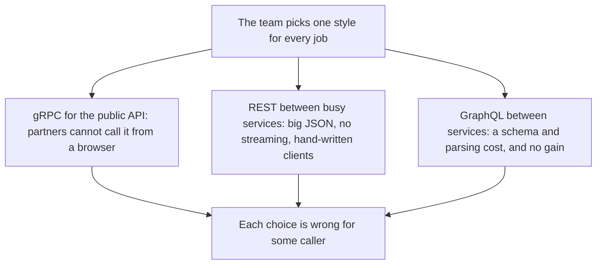
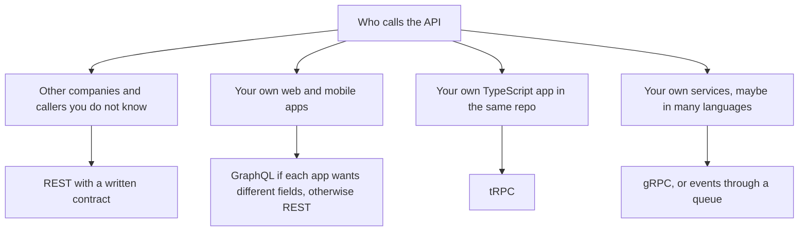
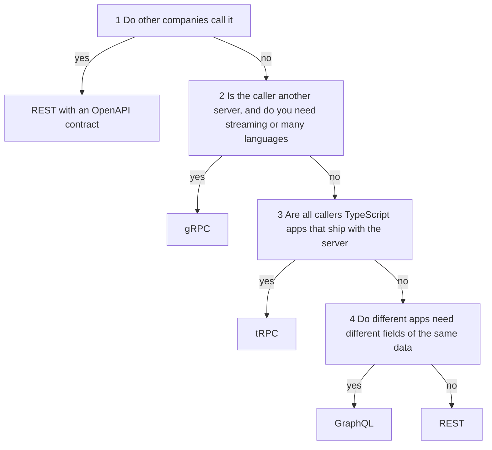
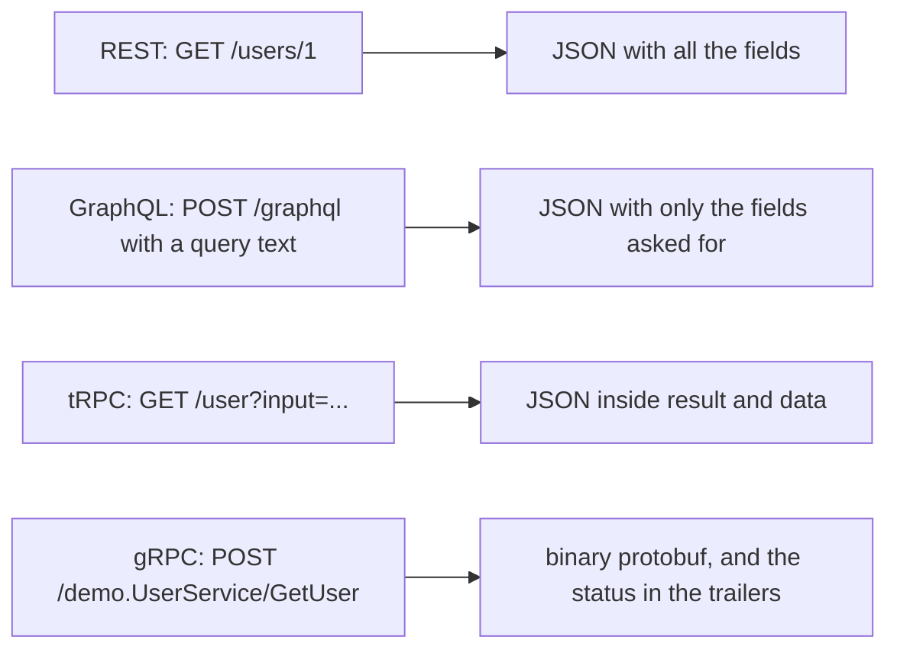
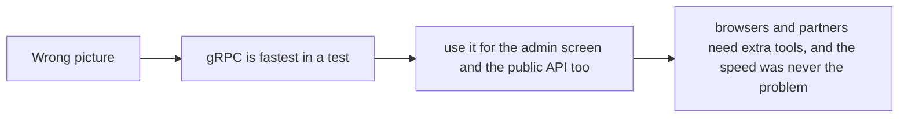
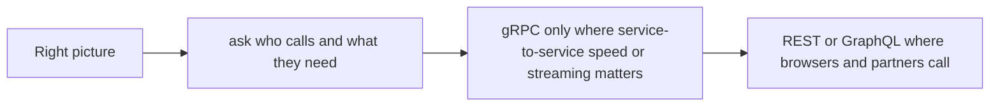
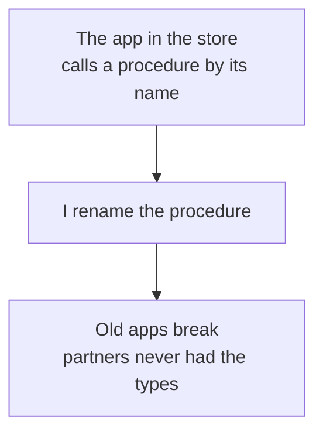
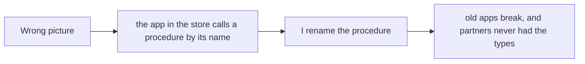
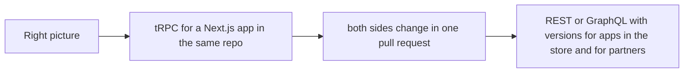

# 18. Choosing an API style

> **Subject:** Backend and API · **Lesson:** 18 · **Made:** 2026-10-23 · **Remade in short cards:** 2026-10-29 · **Status:** ready
>
> **You will be able to:** say what REST, GraphQL, tRPC and gRPC are each best at, pick one by asking four questions, and give an interview answer that names tradeoffs instead of a favorite.
>
> **Before this:** [WebSockets and Server-Sent Events](17-websockets-and-server-sent-events.md) · **Next:** back to the [lesson list](README.md). This is the last lesson of the API styles group.
>
> **How to read it:** one card is one idea. Look at the picture, guess, then press the orange bar to check. The blue bars (📖 More detail) hold the longer explanation. Skip them on the first read, and open them when you want more. About 15 minutes for the cards.

## 1. The idea: four ways to order food

There is no best API style, only the best fit for **who calls** and **what they need**. Think of four ways to order food.

| Style | Like | Best for |
|---|---|---|
| **REST** | a printed **menu** with numbered dishes. You get the whole dish. | anyone can read it and order |
| **GraphQL** | a **build-your-own bowl**. You pick the ingredients. | callers that want different fields |
| **tRPC** | the **kitchen's own order screen**. Only your staff use it. | your own TypeScript apps |
| **gRPC** | the **hotline** between the kitchen and the supplier, in a short coded language | fast calls between servers |

<details class="guess"><summary>🤔 Guess: a public API for partner shops that you do not know. Which style? Press to check.</summary>

**REST**, with a written contract (an OpenAPI file). Other companies can call any HTTP API, and they cannot import your types.

</details>

> **Remember:** ask who calls, then what they need. Do not start from what is new or fast.

<details class="more"><summary>📖 More detail: four new words, the problem, and the full picture</summary>

**New words.**

- **API style:** the way a client and a server agree to talk. REST, GraphQL, tRPC and gRPC are four styles.
- **Contract:** the written agreement of what you can ask for and what you get back. It can be an OpenAPI file, a GraphQL schema, a TypeScript router type, or a `.proto` file.
- **Coupling:** how much two sides must change together. High coupling means a change on one side breaks the other.
- **Round trip:** one trip to the server and back. Fewer is faster.

The rule to remember: **ask who calls, then what they need. Do not start from what is new or fast.**

**The problem, drawn.** One style for every job is wrong for somebody.



**The big picture.** Notice that the first question is always **who calls**.



**The food again.**

- **REST** is a printed **menu** with numbered dishes. Anyone can read it and order. You get the whole dish.
- **GraphQL** is a **build-your-own bowl**. You pick the ingredients, so you get exactly what you want, in one trip. The kitchen must be ready for any mix.
- **tRPC** is the **kitchen's own order screen**. Only your staff use it. It is quick and the staff cannot mistype a dish, because the screen is made from the kitchen's own recipe book.
- **gRPC** is the **hotline between the kitchen and the supplier**, in a short coded language. It is very fast, but only trained people can use it.

Where the analogy stops: a restaurant does not change the dishes while you are ordering. An API does. That is why the **contract** and **coupling** are the real topic.

</details>

## 2. The four questions

Ask them in this order. You reach a style in at most four questions.

| # | Question | If yes | If no |
|---|---|---|---|
| 1 | Do other companies call it? | **REST** with an OpenAPI contract | ask 2 |
| 2 | Is the caller another server, and do you need streaming or many languages? | **gRPC** | ask 3 |
| 3 | Are all callers TypeScript apps that ship with the server? | **tRPC** | ask 4 |
| 4 | Do different apps need different fields of the same data? | **GraphQL** | **REST** |

<details class="guess"><summary>🤔 Guess: a Next.js admin tool and its API, in one repo. All TypeScript, shipped together. Which style? Press to check.</summary>

**tRPC.** Not public (question 1), not server to server (question 2), and all callers are TypeScript apps that ship with the server (question 3). A mobile app in the stores would **not** ship with the server, so it does not count.

</details>

> **Remember:** who calls decides most of it. Push to a browser is a separate question: SSE or WebSocket.

<details class="more"><summary>📖 More detail: the decision drawn, and five real projects</summary>

**The four questions, drawn.** Pushing news to a browser is a **separate** question. It is answered by SSE or WebSocket (lesson 17), on top of whatever style you chose.

Follow the arrows. Notice that you reach a style in at most four questions.



Pushing news to a browser is a **separate** question. It is answered by SSE or WebSocket (lesson 17), on top of whatever style you chose.

**Five real shapes of project.**

**Use the four questions on five real shapes of project:**

| Project | The questions | The pick |
|---|---|---|
| A public catalog for partner shops | Other companies call it: **yes** | **REST**, with an OpenAPI contract |
| Services in Go and Node, with a live price feed between them | Not public. Server to server, with streaming and two languages: **yes** | **gRPC** (and SSE to the browser) |
| A Next.js admin tool and its API, in one repo | Not public. Not server to server. All TypeScript and shipped together: **yes** | **tRPC** |
| A React Native app, a web app and a CMS that each want different fields | Not public. Not all TypeScript in one repo. Different fields: **yes** | **GraphQL** |
| A mobile app in the stores, with a TypeScript server in one repo | The app stays installed for months, so it does **not** ship with the server | **REST** (or GraphQL, if the fields differ) |

**Step through it yourself:** [open the API styles stepper](visuals/18-choosing-an-api-style.html). It has four stories: one job in four styles, five projects walked through the questions, one system that uses several styles, and what breaks in each style when you change a name. Guess first, then press Next.

</details>

## 3. The same job in four styles

The job is "get user 1".

| Style | The request | The answer |
|---|---|---|
| REST | `GET /users/1` | JSON with all the fields |
| GraphQL | `POST /graphql` with a query text | JSON with only the fields asked for |
| tRPC | `GET /user.byId?input=...` | JSON inside `result` and `data` |
| gRPC | `POST /demo.UserService/GetUser` | binary protobuf, and the status in the trailers |

<details class="guess"><summary>🤔 Guess: you only need the `name`. Which style sends only the `name` back? Press to check.</summary>

**GraphQL.** The client picks the fields, so the answer holds only `name`. With REST the server decides what each URL sends.

</details>

> **Remember:** REST: the server picks the fields. GraphQL: the client picks. tRPC: the procedure picks. gRPC: the `.proto` message picks.

<details class="more"><summary>📖 More detail: the same job as code, and the picture</summary>

**The same job, from the client, in four styles.**

The same job, from the client, in four styles:

```js
// REST
const user = await (await fetch("/users/1")).json();

// GraphQL
const { data } = await (await fetch("/graphql", {
  method: "POST", headers: { "content-type": "application/json" },
  body: JSON.stringify({ query: "{ user(id: 1) { name } }" }),
})).json();

// tRPC (the client knows the types)
const user = await trpc.user.byId.query({ id: 1 });

// gRPC (the client was made from the .proto file)
client.GetUser({ id: 1 }, (err, user) => { /* ... */ });
```

**Output:** the sizes in section 2d. REST sent every field (47 bytes), GraphQL sent only the field asked for (32 bytes), tRPC wrapped all fields (67 bytes), and gRPC sent 24 bytes of protobuf.

**How it looks over time.** Notice how different the request and the answer are.

The same job, "get user 1", in each style. Notice how different the request and the answer are.



</details>

## 4. What each answer weighs

The user has three fields: `id`, `name` and `email`. Real answers from real servers (checked on 2026-10-29: Node 26.12.1, graphql 17.0.2, tRPC 11.22.1):

| Style | What came back | Size |
|---|---|---|
| REST | `{"id":1,"name":"Ana","email":"ana@example.com"}` | 47 bytes |
| GraphQL, asking for `name` only | `{"data":{"user":{"name":"Ana"}}}` | 32 bytes |
| tRPC | `{"result":{"data":{"id":1,"name":"Ana","email":"ana@example.com"}}}` | 67 bytes |
| gRPC | protobuf bytes | 24 bytes, and 5 more for the framing |

<details class="guess"><summary>🤔 Guess: tRPC sent more bytes than REST for the same user. Why? Press to check.</summary>

It wraps the same fields inside `{"result":{"data":...}}`. GraphQL is smaller than REST only because it asked for just one field. Be careful: these are for one tiny message. They show the **shape** of the difference, not a speed test.

</details>

> **Remember:** the sizes show the shape of the difference. Real differences depend on the data, compression and your network.

<details class="more"><summary>📖 More detail: the first measurement, as it was written</summary>

Real numbers from real servers (checked on 2026-10-23: Node 24.15, graphql 17.0.2, tRPC 11.19.0). The user has three fields: `id`, `name` and `email`.

**Job 1: get one user.** Notice that GraphQL sent only the field that was asked for.

| Style | What came back | Size |
|---|---|---|
| REST | `{"id":1,"name":"Ana","email":"ana@example.com"}` | 47 bytes |
| GraphQL, asking for `name` only | `{"data":{"user":{"name":"Ana"}}}` (the request body the client sent was 36 bytes) | 32 bytes |
| tRPC | `{"result":{"data":{"id":1,"name":"Ana","email":"ana@example.com"}}}` | 67 bytes |
| gRPC | protobuf bytes, as measured in lesson 16 | 24 bytes, and 5 more for the framing |

**Be careful with these numbers.** They are for one tiny message. They show the *shape* of the difference, not a speed test. Real differences depend on the data, on compression and on your network.

</details>

## 5. Round trips: a page needs the user and the orders

| Style | HTTP requests | Why |
|---|---|---|
| REST | **2** | `GET /users/1` and `GET /users/1/orders` |
| GraphQL | **1** | one query asks for the name and the orders together |
| tRPC | **1** | two calls at the same moment, batched into one request |
| gRPC | 2 calls | two calls, on one HTTP/2 connection (not run) |

<details class="guess"><summary>🤔 Guess: with tRPC, two calls happen at the same moment. How many HTTP requests leave the client? Press to check.</summary>

**1.** The client link batches them. Checked with tRPC 11.22.1 on 2026-10-29: two calls made 1 request. GraphQL gets one trip because the query asks for both things together.

</details>

> **Remember:** fewer round trips is faster. REST often needs more of them.

<details class="more"><summary>📖 More detail: the first table, as it was written</summary>

**Job 2: a page needs the user and the user's orders.** Notice the number of HTTP requests.

| Style | HTTP requests | Why |
|---|---|---|
| REST | **2** | `GET /users/1` and `GET /users/1/orders` |
| GraphQL | **1** | one query asks for the name and the orders together |
| tRPC | **1** | two calls in the same moment, batched into one request (lesson 15) |
| gRPC | 2 calls | two calls, on one HTTP/2 connection. I did not run this one today. |

</details>

## 6. What each style costs you

| Style | The main cost |
|---|---|
| REST | many round trips, fixed shapes |
| GraphQL | N+1, expensive queries, caching |
| tRPC | TypeScript only, not for the public |
| gRPC | browsers and debugging are harder |

<details class="guess"><summary>🤔 Guess: which style is hard to cache by URL, and why? Press to check.</summary>

**GraphQL.** Most requests are `POST` to one URL, and no URL names an object. REST `GET /orders/41` is easy to cache.

</details>

> **Remember:** no style fixes the hard parts. You still need validation, errors, limits, caching and idempotency.

<details class="more"><summary>📖 More detail: the styles side by side</summary>

Every cell comes from lessons 02 and 04 to 17, or from the sources in the Watch and play section.

| Question | REST | GraphQL | tRPC | gRPC |
|---|---|---|---|---|
| Who can call it | any HTTP client | any HTTP client, if they know the schema | TypeScript clients that import the router type | any language with a gRPC library. Browsers need gRPC-Web or Connect. |
| The contract | an OpenAPI file, if you write one | the schema | the router type | the `.proto` file |
| HTTP method | `GET`, `POST`, `PUT`, `PATCH`, `DELETE` | `POST` must be supported. `GET` is optional, for queries only. | `GET` for queries, `POST` for mutations | always `POST` |
| Body | usually JSON | JSON | JSON | protobuf, in binary |
| Who picks the fields | the server | the client | the procedure | the `.proto` message |
| HTTP caching | easy for `GET` (lesson 12) | hard: no URL names an object (graphql.org) | queries are `GET`, so possible. Batches change the URL. (my reasoning) | the calls are `POST`, so ordinary HTTP caches do not help |
| Errors | the HTTP status | an `errors` list in the body, often with `200` (lesson 04) | a status from the code table (lesson 15) | `grpc-status` in the trailers, and HTTP `200` (lesson 16) |
| Push or streaming | add SSE or WebSocket | subscriptions | subscriptions over SSE or WebSocket | four kinds of call, built in |
| The main cost | many round trips, fixed shapes | N+1, expensive queries, caching | TypeScript only, not for the public | browsers and debugging are harder |

</details>

## 7. Mistake 1: choosing by what is new, or by a speed test

"gRPC is the fastest, so I use it for everything."

| | Wrong | Right |
|---|---|---|
| The reason | gRPC is fastest in a test | who calls, and what they need |
| The admin screen and the public API | gRPC too | REST or GraphQL where browsers and partners call |
| gRPC is used | everywhere | only where service-to-service speed or streaming matters |

<details class="guess"><summary>🤔 Guess: why is a fast style still wrong for a browser or a partner? Press to check.</summary>

Browsers and partners need extra tools (gRPC-Web with a proxy, or Connect), and the speed was never the problem. A style that is fast in a test can still be wrong for a browser, a partner or a mobile app.

</details>

> **Remember:** write down who calls, and what they need, before you name a style.

<details class="more"><summary>📖 More detail: wrong picture 1 and right picture 1, and two mistakes as written</summary>

**Wrong picture 1 and right picture 1.**

**Wrong picture 1:** "gRPC is the fastest, so I use it for everything."



**Right picture 1:** speed matters for busy calls between services. For the rest, the fit matters more.



**The mistake.**

**Wrong:** choosing by what is new, or by a speed test.

**Right:** write down who calls, and what they need, before you name a style.

**Why:** a style that is fast in a test can still be wrong for a browser, a partner or a mobile app.

**Mistake: gRPC called straight from a browser.**

**Wrong:** gRPC called straight from a browser.

**Right:** gRPC-Web with a proxy, Connect, or a REST or GraphQL layer in front of it.

**Why:** browsers cannot make the gRPC call themselves (lesson 16).

</details>

## 8. Mistake 2: tRPC for a mobile app in the store, or a public API

"tRPC gives me types for free, so I use it for everything."



<details class="guess"><summary>🤔 Guess: you rename a tRPC procedure. The old app is still in the store. What happens? Press to check.</summary>

The old app calls the old name, and it **breaks**. Partners never had your types at all. Use tRPC where both sides ship together, like a Next.js app in the same repo, where both sides change in one pull request.

</details>

> **Remember:** tRPC where both sides ship together. REST or GraphQL, with versions, for the rest.

<details class="more"><summary>📖 More detail: wrong picture 2 and right picture 2, and the mistake as written</summary>

**Wrong picture 2 and right picture 2.**

**Wrong picture 2:** "tRPC gives me types for free, so I use it for the mobile app and the partner API."



**Right picture 2:** tRPC is for callers that ship **together** with the server.



**The mistake.**

**Wrong:** tRPC for a mobile app in the store or for a public API.

**Right:** tRPC where both sides ship together. REST or GraphQL, with versions, for the rest.

**Why:** old apps call old procedure names, and outside callers cannot import your types.

</details>

## 9. Mixing is normal: one style per kind of caller

A common shape: public REST at the edge, GraphQL for your own apps, gRPC or queue events inside, and SSE for push. Keep a clear line between the parts.

| Caller | A good fit |
|---|---|
| a public partner | REST with a contract |
| your own apps | GraphQL, or REST |
| a busy internal service | gRPC, or events through a queue |
| push to a browser | SSE or WebSocket |

<details class="guess"><summary>🤔 Guess: "let us use one style for the whole product, for consistency". Good idea? Press to check.</summary>

Usually not. A public partner, a mobile app and a busy internal service do not need the same thing. Two styles are fine. Four in one product need a reason for each. Also: GraphQL needs limits on depth, cost and rate per user.

</details>

> **Remember:** one style per kind of caller, with a clear line between them.

<details class="more"><summary>📖 More detail: two mistakes as written</summary>

**Mistake: one style for the whole product.**

**Wrong:** one style for the whole product because "consistency".

**Right:** one style per kind of caller, with a clear line between them.

**Why:** a public partner, a mobile app and a busy internal service do not need the same thing.

**Mistake: GraphQL with no limits.**

**Wrong:** GraphQL with no limits.

**Right:** limit the depth and the cost of a query, and limit the rate per user (lesson 11).

**Why:** the client chooses what to ask for, so one query can ask for far too much.

</details>

## 10. Why it matters and what it costs

- **Without a clear choice:** teams pick what is new, or what they know, and pay for it for years. Callers get an API that does not fit them.
- **With the four questions:** each style was made for one kind of caller. Who calls you decides most of it.
- **The cost:** each style is something to learn and to run, switching later is slow, mixing is normal, and a style does not fix validation, errors, limits, caching and idempotency.

<details class="more"><summary>📖 More detail: the problem and the costs, as they were written</summary>

- **Problem without a clear choice:** teams pick what is new, or what they know, and pay for it for years. Callers get an API that does not fit them.
- **How the four questions help:** each style was made for one kind of caller. Who calls you decides most of it.
- **Cost of the choice:**
  - **Each style is something to learn and to run.** Two styles are fine. Four in one product need a reason for each.
  - **Switching later is slow.** Clients depend on you. A change of style is a new version of the whole API.
  - **Mixing is normal.** A common shape is public REST at the edge, GraphQL for your own apps, gRPC or queue events inside, and SSE for push. Keep a clear line between the parts.
  - **A style does not fix the hard parts.** You still need validation, errors, limits, caching and idempotency (lessons 10 to 13). A GraphQL query can still be too expensive. A gRPC call still needs a deadline.

</details>

## 11. Watch and play

Links checked on 2026-10-23. I opened every page. For the video I checked only the title and the channel, not the content.

- **Play with it:** [The API styles stepper](visuals/18-choosing-an-api-style.html) in this folder. In "Five projects", decide before you press Next.
- **Video:** [tRPC, gRPC, GraphQL or REST: when to use what?](https://www.youtube.com/watch?v=veAb1fSp1Lk) by Software Developer Diaries. I did not watch it, so use it as a second view.
- **Read:** [OpenAPI Specification (latest)](https://spec.openapis.org/oas/latest.html). The usual contract for REST. It is long, so read only the introduction.
- **Read:** [GraphQL: serving over HTTP](https://graphql.org/learn/serving-over-http/). One endpoint, POST, optional GET, and the answer shape.
- **Read:** [GraphQL: caching](https://graphql.org/learn/caching/). Why a URL cache does not fit, and global ids.
- **Read:** [tRPC: concepts](https://trpc.io/docs/concepts). The sentence about TypeScript monorepos.
- **Read:** [gRPC: core concepts](https://grpc.io/docs/what-is-grpc/core-concepts/). The four kinds of call.

<details><summary>More links (optional)</summary>

- **Read:** your own lessons: [REST API design](02-rest-api-design.md), [GraphQL basics](04-graphql-basics.md), [tRPC](15-trpc.md), [gRPC](16-grpc.md) and [WebSockets and SSE](17-websockets-and-server-sent-events.md).
- **Code in this repo:** [DBO case study](../../interview/my-projects/dbo-b2b-platform-system-design-case-study.md). Your own notes on GraphQL at the edge and what to use between services.

</details>

## 12. Practice

**A. Predict the output** (write your answer before opening)

A team builds a React Native app (in the app stores), a web app and a CMS. Each wants different fields of the same orders. All the code is TypeScript, in one repo. Which style, by the four questions?

<details><summary>Answer</summary>

**GraphQL.** Question 1: no outside companies. Question 2: not server to server. Question 3: all TypeScript, but the mobile app stays installed for months, so it does **not** ship with the server. That rules out tRPC. Question 4: different apps want different fields, so yes: **GraphQL**. (This is also the shape of your DBO API in your notes: GraphQL for the React Native app and the CMS.)

</details>

**B. Fix the bug**

A team decides: "Our public partner API will use tRPC because we love the types. Between our services we will use GraphQL. Our mobile app will call gRPC directly, because gRPC is fastest."

What is wrong? There are four problems.

<details><summary>Answer</summary>

1. **tRPC for a public API.** Partners cannot import your types, and there is no stable contract for them. Use REST with an OpenAPI file.
2. **GraphQL between services.** A schema and a parser for callers that always want the same fields. gRPC fits busy server-to-server calls, or use queue events (your DBO notes suggest this).
3. **gRPC straight from a mobile app.** Mobile apps can use gRPC, but a browser-based client cannot, and a mobile app in the store stays on old versions for months. (If it is a web or React Native app, use gRPC-Web, Connect, or put GraphQL or REST in front.) The speed gain is rarely the problem for an app.
4. **"Fastest" was the reason for each choice.** None of the choices started from who calls and what they need.

</details>

**C. Write it yourself**

Open `practice/18-choosing-an-api-style.js`. You write the four questions as code (`chooseStyle`), the table of facts for each style, the number of HTTP requests for the two-call page, and some short answers. The tests walk through the same projects as section 5.

```
node --test learn/backend-api/practice/18-choosing-an-api-style.test.js
```

<details><summary>One possible answer</summary>

```js
function chooseStyle(needs = {}) {
  const n = needs ?? {};
  let api;
  if (n.publicThirdParties) api = "rest";
  else if (n.serviceToService && (n.needsStreaming || n.manyLanguages)) api = "grpc";
  else if (n.clientsAreAllTypeScriptInOneRepo && !n.oldClientsStayInstalled) api = "trpc";
  else if (n.manyClientsNeedDifferentFields) api = "graphql";
  else api = "rest";
  const push = n.serverPushToBrowser === "two-way" ? "websocket" : n.serverPushToBrowser === "one-way" ? "sse" : "none";
  return { api, push };
}

const facts = {
  rest:    { readMethod: "GET",  body: "json",     browserDirect: true,  callers: "anyone" },
  graphql: { readMethod: "POST", body: "json",     browserDirect: true,  callers: "anyone" },
  trpc:    { readMethod: "GET",  body: "json",     browserDirect: true,  callers: "typescript only" },
  grpc:    { readMethod: "POST", body: "protobuf", browserDirect: false, callers: "any language" },
};

function requestsForUserAndOrders(style) {
  const table = { rest: 2, graphql: 1, trpc: 1, grpc: 2 };
  return Object.hasOwn(table, style) ? table[style] : undefined;
}

const answers = {
  firstQuestion: "who calls it",
  publicApiForOtherCompanies: "rest",
  differentFieldsForDifferentApps: "graphql",
  typescriptMonorepoShippedTogether: "trpc",
  busyServiceToServiceWithStreaming: "grpc",
  oneWayLiveUpdatesToABrowser: "sse",
};
```

Notice three things. The order of the `if` lines is the order of the questions, and the first yes wins. Push is a separate answer, because it sits on top of any style. And `oldClientsStayInstalled` switches tRPC off even when everything is TypeScript, which is the mobile app case from section 5.

</details>

## 13. Interview question

**Q:** "REST, GraphQL, tRPC or gRPC: how do you choose?"

<details><summary>A strong answer, in four parts</summary>

1. **Problem:** each style was made for a different kind of caller. A team that picks one for everything, or picks the newest, gives some caller a bad fit and pays for it for years.
2. **How I choose:** I start with **who calls**. Other companies: REST with an OpenAPI contract. A server calling a server with streaming or many languages: gRPC. All callers are TypeScript apps that ship together with the server: tRPC. Different apps that want different fields of the same data: GraphQL. Everything else: REST. Pushing news to a browser is a separate choice: SSE for one way, WebSocket for two ways.
3. **Tradeoff:** REST is simple and cacheable but has fixed shapes and more round trips. GraphQL fits many clients but brings N+1, expensive queries and harder HTTP caching. tRPC gives types with almost no setup, but only for TypeScript, only for callers that ship with the server, and it is not for a public API. gRPC is fast and has streaming, but browsers need gRPC-Web or Connect, and it is harder to debug. Real systems mix styles, with a clear line between them. And no style removes the need for validation, errors, limits, caching and idempotency.
4. **My example:** your DBO notes say the API is GraphQL (Nexus and Prisma) for the React Native app and the CMS, which matches "different apps, different fields". They say all calls between services are GraphQL today, and suggest queue events or plain internal calls with shared TypeScript types for the future. *They do not say you used tRPC or gRPC.* A strong answer: "GraphQL at the edge was a good fit. Between services I would use queue events for async work, and a simple typed internal call, or gRPC if we had several languages or streaming." Say it as a choice you would make.

</details>

## 14. Explain it back

Close this file. Press the **Record my explanation** button under this heading and explain it out loud, like to a new junior, in 4 parts: problem, how I choose, tradeoff, my example. Use the words "who calls", "contract" and "round trip". Then save the transcript into `my-learning/recordings/`, or write your best version below. Run `/explain-check api style` or ask the `explain-coach` agent to review it.

### My explanation

<write here>

### Coach feedback

<the explain-coach agent writes here>

## 15. Review questions (day 1, 3, 7, 21)

1. What is the first question when you choose an API style?
2. A mobile app in the stores, and a TypeScript server in one repo. Why is tRPC a poor choice, even though everything is TypeScript?
3. For one page that needs a user and the user's orders, how many HTTP requests do REST, GraphQL and tRPC make?
4. Draw the picture from section 2f from memory: the four questions and the four answers.

<details><summary>Answers</summary>

1. **Who calls it.** Other companies, your own apps, your own TypeScript app in the same repo, or your own services.
2. The app stays installed for months, so it does not ship together with the server. If you rename a procedure, old apps break. tRPC is for callers that change together with the server.
3. REST **2** (one for the user and one for the orders). GraphQL **1** (one query asks for both). tRPC **1** (two calls in the same moment are batched into one request).
4. Do other companies call it? Yes: REST. No: is it server to server, with streaming or many languages? Yes: gRPC. No: are all callers TypeScript apps that ship with the server? Yes: tRPC. No: do different apps need different fields? Yes: GraphQL. No: REST. Push to a browser is a separate choice: SSE or WebSocket.

</details>

## 16. Go deeper (optional)

Open these when you are ready. None of them is needed for the cards above.

<details><summary>The standards, and what this lesson leaves out</summary>

**OpenAPI.** The OpenAPI Specification describes HTTP APIs so that people and software can understand a service without reading its source code. Its latest version on 2026-10-23 is **3.2.1** (dated 10 September 2026). It is the usual contract for a REST API.

**GraphQL over HTTP (graphql.org).** A GraphQL server has one endpoint, usually `/graphql`. `POST` with a JSON body (`query`, and optional `variables` and `operationName`) must be supported. `GET` may be supported, for queries only. Mutations must use `POST`. The answer is JSON with `data` and `errors`. If the answer has non-null `data`, the server should use a 2xx status, even when `errors` are present, because HTTP has no "partial success" status. Errors that stop the query from running at all usually get `400`. That is why lesson 04 says that a GraphQL error often comes with `200`: it depends on the server and on the content type. (My own tiny test server in section 2d always answered `200`, because I wrote it that way. That is not evidence about GraphQL.)

**GraphQL and caching (graphql.org).** In a URL-based API the URL is a globally unique name for a thing, so clients can build a cache on it. In GraphQL there is no such URL. The docs say a good practice is to expose a globally unique `id` for every object, so clients can cache by it.

**The tRPC docs on fit.** "tRPC (TypeScript Remote Procedure Call) is one implementation of RPC, designed for TypeScript monorepos."

**What this lesson leaves out.** Next.js Server Actions are another way to call server code from React. I did not cover them here. Event-driven design with queues is in `learn/system-design/`. Webhooks are a style for events that come from outside (lesson 13).

**Versions of the tools in my measurements.** `graphql` 17.0.2, `@trpc/server` 11.19.0, `@grpc/grpc-js` 1.14.6, Node 24.15.0.

</details>

## Connected lessons

- [REST API design](02-rest-api-design.md): the style for public APIs, and how to version them.
- [GraphQL basics](04-graphql-basics.md) and [Resolvers and the N+1 problem](05-resolvers-and-the-n-1-problem.md): the style for many clients with different needs, and its main cost.
- [Hasura: when and when not](14-hasura-when-and-when-not.md): a ready-made GraphQL API over Postgres.
- [tRPC](15-trpc.md): types for callers that ship with the server.
- [gRPC](16-grpc.md): fast, typed calls between services.
- [WebSockets and Server-Sent Events](17-websockets-and-server-sent-events.md): pushing news, on top of any style.
- [Caching in APIs](12-caching-in-apis.md), [Rate limiting](11-rate-limiting.md) and [Validation and error handling](10-validation-and-error-handling.md): the hard parts that every style still needs.
