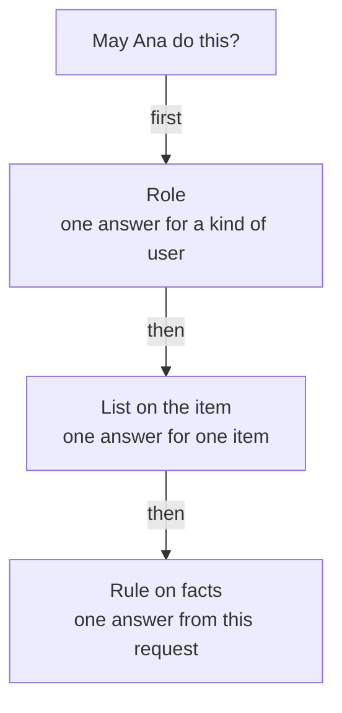
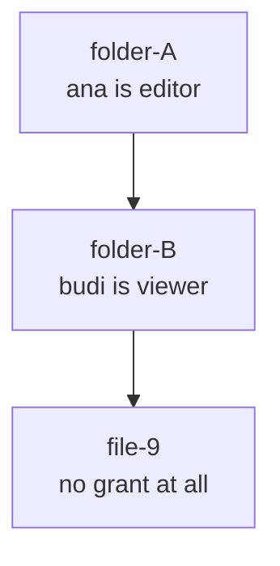
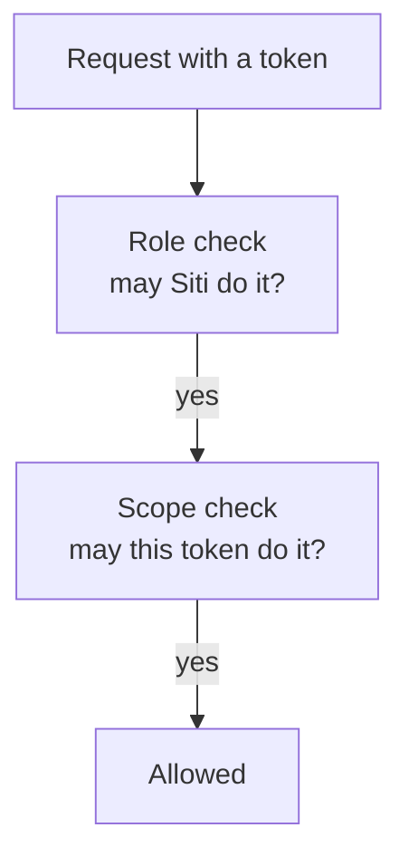
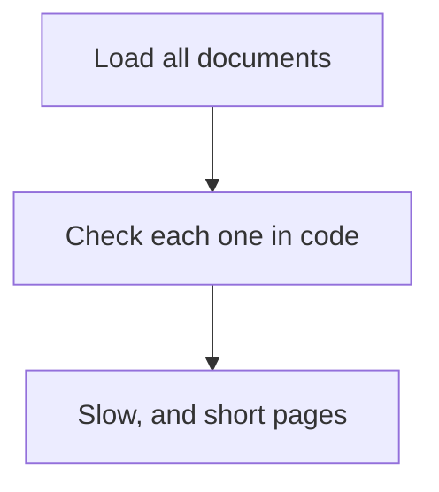
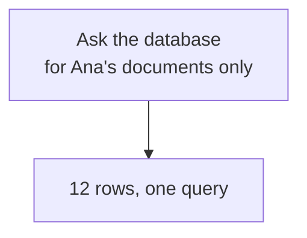

# 19. Access control models

> **Subject:** Backend and API · **Lesson:** 19 · **Made:** 2026-11-17 · **Status:** ready
>
> **You will be able to:** pick between a role, a list on each item (ACL), and a rule on facts (ABAC), explain how a folder grant reaches the files inside it, say why a token needs scopes, and design "who may see this document" for a sharing app.
>
> **Before this:** [Choosing an API style](18-choosing-an-api-style.md) · **Also read:** [Authorization](08-authorization.md) first, because this lesson builds on its three questions.
>
> **How to read it:** one card is one idea. Look at the picture, guess, then press the orange bar to check. The blue bars (📖 More detail) hold the longer explanation. Skip them on the first read, and open them when you want more. About 15 minutes for the cards.

## 1. The idea: three ways to answer "may Ana do this?"

In [lesson 08](08-authorization.md) the server asked three questions: who, which role, which row. This lesson is about the second and third questions. There is more than one way to write them down. Picture an office building.

- A **job badge** opens doors for a whole kind of person. That is a **role**.
- A **guest list** on one door names the people who may enter. That is an **ACL** (access control list).
- A **guard with rules** looks at the facts of today: who you are, what you carry, what time it is. That is **ABAC** (attribute-based access control).



Notice: real apps often ask all three, in this order. Card 7 shows the one function that does it.

<details class="guess"><summary>🤔 Guess: you share one document with one friend. Which of the three fits best? Press to check.</summary>

The **list on the item**. A role is for a whole kind of user, and a rule needs facts that already exist. One document and one friend means one new line in that document's list.

</details>

> **Remember:** a role answers for a kind of user. A list answers for one item. A rule answers from facts. The default is no.

<details class="more"><summary>📖 More detail: four new words, and the same question three times</summary>

**New words.**

- **ACL (access control list):** a list that is stored on one item, such as "ana: owner, budi: viewer".
- **ABAC (attribute-based access control):** a rule that reads facts (the interview word is *attributes*) about the user, the item and the situation.
- **Inheritance:** a grant on a folder reaches the files inside it.
- **Scope:** a limit written on one token, such as "this token may only read".

You already know **role** and **row rule** from lesson 08. RBAC (role-based access control) is just the interview name for "use roles".

**The same question, three answers.** "May Budi write to doc-1?"

| Model | What the server looks at | Answer for Budi |
|---|---|---|
| Role | Budi's role is `viewer`, and viewers only read | no |
| List | the list of doc-1 says `budi: viewer`, write needs editor | no |
| Rule | "is Budi the owner or on the team that owns doc-1?" | depends on the facts |

**Where the analogy stops.** A building has one badge reader per door. In software, the check is code that you write in every place. Lesson 08 said to write it **once**. This lesson is about what that one function reads.

</details>

## 2. Roles (RBAC): one table for a kind of user

A role is a label on the user. A table says what each role may do. Nobody's name is in the table.

```js
const ROLES = {
  viewer: ["read"],
  editor: ["read", "write"],
  admin: ["read", "write", "delete"],
};
function canRole(role, action) {
  return Object.hasOwn(ROLES, role)
    && ROLES[role].includes(action);
}
console.log(canRole("editor", "write"));
console.log(canRole("editor", "delete"));
console.log(canRole("hacker", "read"));
```

<details class="guess"><summary>🤔 Guess: what do the three lines print? Press to check.</summary>

```
true
false
false
```

An editor may write. An editor may not delete. A role that is not in the table gets no (deny by default).

</details>

> **Remember:** a role gives the same answer for every item. It cannot say "this document, but not that one".

<details class="more"><summary>📖 More detail: role explosion, and why hasOwn</summary>

**Role explosion.** A new team wants "editor, but only for team A". You add a role `editor-team-a`. Then `editor-team-b`, then `viewer-team-a`. In a company with 50 teams and 3 levels you now have 150 roles, and people argue about what each one means. This is the sign that roles are not the right tool for that part of the problem. Use a list on the item, or a rule on a fact such as `user.teamId === doc.teamId`.

**Why `Object.hasOwn`.** Without it, `ROLES["toString"]` is a real function, and a user whose role is the text `"toString"` would make the code throw. Checking that the key is really in the table keeps the answer a plain no.

**Where roles shine.** Questions about a whole kind of user: "only staff see the admin page". Few roles, same answer everywhere. OpenFGA's docs say RBAC fits flat, single-tenant access models, and struggles with hierarchy, sharing and multi-tenancy.

**Step through it yourself:** [open the stepper](visuals/19-access-control-models.html), story 1.

</details>

## 3. A list on each item (ACL)

Each document keeps its own list: who may use it, and at what level. Levels are numbers, so "editor or more" is a simple comparison.

```js
const acl = {
  "doc-1": { ana: "owner",
             budi: "viewer" },
  "doc-2": { budi: "owner" },
};
const RANK = { viewer: 1, editor: 2, owner: 3 };
const NEED = { read: 1, write: 2, share: 3 };
function aclAllows(itemId, userId, action) {
  const level = acl[itemId]?.[userId];
  return level !== undefined
    && RANK[level] >= NEED[action];
}
console.log(aclAllows("doc-1", "budi", "read"));
console.log(aclAllows("doc-1", "budi", "write"));
console.log(aclAllows("doc-2", "ana", "read"));
```

<details class="guess"><summary>🤔 Guess: what do the three lines print? Press to check.</summary>

```
true
false
false
```

Budi is a viewer (level 1). Read needs 1, so yes. Write needs 2, so no. Ana is not on the list of doc-2, so no. Ana owns doc-1, and that gives her nothing on doc-2.

</details>

> **Remember:** an ACL is a list on one item. "Not on the list" means no.

<details class="more"><summary>📖 More detail: the list as a database table, and the hard question</summary>

In a database, the lists are one table. Each row is one line of one list.

| doc_acl.doc_id | user_id | level |
|---|---|---|
| doc-1 | ana | owner |
| doc-1 | budi | viewer |
| doc-2 | budi | owner |

The two questions are not equally easy.

| Question | SQL | Cost |
|---|---|---|
| Who may open doc-1? | `WHERE doc_id = 'doc-1'` | easy, the primary key finds it |
| What may Budi open? | `WHERE user_id = 'budi'` | needs an **index on `user_id`**, or it reads the whole table |

**Run for real** (PGlite 0.4.1, which is PostgreSQL 17.5, on 2026-11-17, with an index `doc_acl_user` on `(user_id)`): the join below gave Budi doc-1 and doc-2, and nothing else.

```sql
SELECT d.id, d.title
FROM docs d
JOIN doc_acl a ON a.doc_id = d.id
WHERE a.user_id = $1;
```

**Sharing is writing one row.** "Ana shares doc-1 with Cika" is an insert into `doc_acl`. Only a user whose level on doc-1 is `owner` may do it. That is the `share` action in the code.

**The cost.** The data grows with the number of shares, not the number of users. A company with 10,000 documents shared with 20 people each has 200,000 rows. Removing someone from 500 documents means 500 deletes.

**Step through it yourself:** [open the stepper](visuals/19-access-control-models.html), story 2.

</details>

## 4. A rule on facts (ABAC)

Some questions cannot be a role or a list. "Staff may refund, in their own store, paid orders, up to 100, unless a manager." The server reads facts at the moment of the request.

```js
function canRefund(user, order) {
  if (user.role !== "staff")
    return false;
  if (user.storeId !== order.storeId)
    return false;
  if (order.status !== "paid")
    return false;
  return order.total <= 100
    || user.isManager;
}
const order = { storeId: 1, status: "paid", total: 250 };
const sam = { role: "staff", storeId: 1, isManager: false };
const mia = { role: "staff", storeId: 1, isManager: true };
const raj = { role: "staff", storeId: 2, isManager: true };
console.log(canRefund(sam, order));
console.log(canRefund(mia, order));
console.log(canRefund(raj, order));
```

<details class="guess"><summary>🤔 Guess: what do the three lines print? Press to check.</summary>

```
false
true
false
```

Sam is not a manager, and 250 is over 100. Mia is a manager of the same store, so yes. Raj is a manager of **another** store, so the store rule stops him first.

</details>

> **Remember:** a rule reads facts. It is flexible, and it is code that you must test.

<details class="more"><summary>📖 More detail: roles inside rules, and what makes rules risky</summary>

A real app does not pick one model. The function above uses a **role** (`staff`) and **facts** (`storeId`, `status`, `total`, `isManager`) together. This is normal. The OWASP Authorization Cheat Sheet says ABAC and ReBAC should typically be preferred for application development, because RBAC struggles with object-level decisions, multi-tenancy and role explosion. It also says to deny by default.

**Why rules are risky.**

- Every new fact is a new place to be wrong. Test each rule with a "no" case, not only a "yes" case. The tests in `practice/19-access-control-models.test.js` do this.
- Facts must come from a place you trust: the signed token or your database, never from the request body (lesson 08, mistake 2).
- When rules live inside many routes, nobody can read them all. Keep them in one file, or in a policy tool (see Go deeper).

**Step through it yourself:** [open the stepper](visuals/19-access-control-models.html), story 3.

</details>

## 5. Folders: a grant flows down (inheritance)

Sharing 400 files one by one is no fun. Share the **folder** instead. A grant on a folder reaches everything inside it. To find Ana's right on a file, the server walks from the file **up** through its parents and keeps the best level it finds.



```js
const parents = {
  "file-9": "folder-B",
  "folder-B": "folder-A",
  "folder-A": null,
};
const grants = {
  "folder-A": { ana: "editor" },
  "folder-B": { budi: "viewer" },
};
function levelOnTree(nodeId, userId) {
  let best = 0;
  for (let n = nodeId; n; n = parents[n]) {
    const level = grants[n]?.[userId];
    if (level && RANK[level] > best)
      best = RANK[level];
  }
  return best;
}
console.log(levelOnTree("file-9", "ana"));
console.log(levelOnTree("file-9", "budi"));
console.log(levelOnTree("file-9", "zed"));
```

<details class="guess"><summary>🤔 Guess: what do the three lines print? Press to check.</summary>

```
2
1
0
```

Ana: editor on folder-A is level 2. Budi: viewer on folder-B is level 1. Zed: nothing on the way up, so 0. Nobody ever wrote a line for file-9.

</details>

> **Remember:** the right on an item is the best grant on the item or on any parent above it.

<details class="more"><summary>📖 More detail: the walk, one query, and the loop trap</summary>

**The walk for Ana on file-9, step by step.**

| Step | Node | Grant for Ana | Best so far |
|---|---|---|---|
| 1 | file-9 | none | 0 |
| 2 | folder-B | none (only Budi has one) | 0 |
| 3 | folder-A | editor = 2 | 2 |
| 4 | no parent | the loop ends | **2** |

**One query for the whole walk.** Postgres can climb the tree itself with a recursive query. Run for real on PGlite 0.4.1 (PostgreSQL 17.5), 2026-11-17: Ana got 2 on file-9, Budi got 1, a stranger got 0, and the private file (`file-3`) gave Ana 0 and Budi 3.

```sql
WITH RECURSIVE up AS (
  SELECT id, parent_id FROM nodes WHERE id = $1
  UNION ALL
  SELECT n.id, n.parent_id
  FROM nodes n JOIN up ON n.id = up.parent_id
)
SELECT COALESCE(max(g.level), 0) AS level
FROM up
LEFT JOIN grants g
  ON g.node_id = up.id AND g.user_id = $2;
```

**The reverse question** ("which files may Ana read?") walks **down** from every folder she has a grant on. It gave `folder-A, folder-B, file-9` for Ana in the same test.

**The loop trap.** If a folder's parent chain points back to itself, the plain `for` loop never ends. Real systems forbid this when a folder is moved. The practice file asks you to stop when you meet a node a second time.

**The cost.** Walking up costs one lookup per level. Deep trees are slow, so big systems keep a copy of the answer, and then they must update the copy when someone moves a folder or removes a grant.

**Step through it yourself:** [open the stepper](visuals/19-access-control-models.html), story 4.

</details>

## 6. Scopes: a limit on one token

Siti is an admin. She lets a partner app read her documents. The app gets a token. What stops the app from deleting them? A **scope**: the token says what it may do. The server asks both questions, and both must say yes.



```js
function allowed(user, token, action) {
  return canRole(user.role, action)
    && token.scopes.includes(action);
}
const siti = { role: "admin" };
console.log(allowed(siti,
  { scopes: ["read", "write", "delete"] }, "delete"));
console.log(allowed(siti,
  { scopes: ["read"] }, "delete"));
console.log(allowed({ role: "viewer" },
  { scopes: ["read", "write", "delete"] }, "delete"));
```

<details class="guess"><summary>🤔 Guess: what do the three lines print? Press to check.</summary>

```
true
false
false
```

Siti with a full token: yes. Siti with a read-only token: no, the token stops it. A viewer with a full token: no, the role stops it. The answer is the **smaller** of the two.

</details>

> **Remember:** a scope can only take rights away from a token. It never adds rights the user does not have.

<details class="more"><summary>📖 More detail: roles against scopes, and what OAuth says</summary>

| | Role | Scope |
|---|---|---|
| What it limits | what **a user** may do | what **one token** may do |
| Where it lives | in your database, on the user | inside the token (or in a table the token points to) |
| Who sets it | you, the app owner | the user, on a consent screen ("Allow this app to read your files?") |

OAuth describes scope as "a mechanism in OAuth 2.0 to limit an application's access to a user's account" (oauth.net, opened 2026-11-17). The same page says the scope values are **not** defined by OAuth, so each service picks its own names. You will see `read:docs` or `docs.read`. This lesson uses the plain words `read`, `write` and `delete`.

**The classic bug.** Writing `canRole(...) || token.scopes.includes(...)` gives the **bigger** of the two, so a read-only token for an admin could delete. Use `&&`.

**Step through it yourself:** [open the stepper](visuals/19-access-control-models.html), story 5.

</details>

## 7. Mistake 1: role names all over the code

```js
// in 30 different routes (a sketch)
if (user.role === "admin"
    || user.role === "owner") {
```

<details class="guess"><summary>🤔 Guess: the company adds a new role, <code>support</code>, that may also do this. What is the risk? Press to check.</summary>

You must find and change all 30 places. The one you miss is a bug that nobody sees: either support is locked out, or a route has the wrong rule. Ask a question about **what the user wants to do**, and keep the answer in one function: `can(user, "delete", doc)`.

</details>

> **Remember:** routes ask `can(user, action, item)`. Only that one function knows about roles, lists and rules.

<details class="more"><summary>📖 More detail: the shape of one function</summary>

```js
function can(user, action, item) {
  if (!user) return false;
  // 1. role: some roles may never do this
  if (!canRole(user.role, action)) return false;
  // 2. list or tree: the user's level on this item
  if (!aclAllows(item.id, user.id, action)) return false;
  // 3. rules: any facts that must also be true
  return true;
}
```

Every route calls `can`. When the company adds `support`, you change the table in one place. When you add a rule, you test one function. OWASP's prevention list says the same: implement access control once and reuse it, deny by default, and test it in unit and integration tests.

</details>

## 8. Mistake 2: load everything, then filter

You have 100,000 documents. Ana may open 12 of them. A list page must show her 12.

**Wrong:**



**Right:**



<details class="guess"><summary>🤔 Guess: the page shows 20 per page. You load 20 documents, then drop the ones Ana may not see. What happens to the page? Press to check.</summary>

Ana sees a short page, then an empty page, then another short one. The **permission must be in the query**, so the database counts only what Ana may see. Then every page is full, and the count is right.

</details>

> **Remember:** "may I open this one?" is a check. "Which ones may I see?" must be part of the query.

<details class="more"><summary>📖 More detail: the query for each model</summary>

| Model | How the list query filters |
|---|---|
| Role | `WHERE true` for admins. Roles alone cannot filter rows. |
| List (ACL) | `JOIN doc_acl a ON a.doc_id = d.id WHERE a.user_id = $1` (the index on `user_id` matters) |
| Rule | the rule written as SQL, such as `WHERE d.store_id = $1` |
| Folders | the recursive query that walks **down** (card 5) |

Hasura works this way. Its permission rules are added to the SQL as a filter, so every list is already filtered. The Hasura docs show a rule that follows a relationship to a membership table (users in vendors), which is the same idea as an ACL table (page opened 2026-11-17). See [lesson 14](14-hasura-when-and-when-not.md).

</details>

## 9. Mistake 3: trusting a role that is already old

Ana was an admin when her token was made. At 10:00 someone removes her admin role. Her token is still valid until it expires.

<details class="guess"><summary>🤔 Guess: the token says <code>role: "admin"</code> and expires at 10:15. It is 10:05. What does the server do if it only reads the token? Press to check.</summary>

It still treats Ana as an admin for another 10 minutes. The token is a **copy** of the role from the time it was made.

Two ways to live with that: keep access tokens short (lesson 07), or for dangerous actions (delete, refund, share) read the user's **current** role or list from the database.

</details>

> **Remember:** a token is a copy. For the dangerous actions, check the current truth.

<details class="more"><summary>📖 More detail: the tradeoff</summary>

| Choice | Good | Cost |
|---|---|---|
| Put the role in the token | no database trip per request | stale until the token expires |
| Read the role or list from the database | always current | one more lookup on each request |
| Short tokens plus a database check for dangerous actions | fast for reads, safe for risky actions | two paths to maintain |

OWASP's list says to keep stateless JWTs short-lived and to use refresh tokens for longer sessions.

</details>

## 10. Picking one, and what it costs

**The five side by side.**

| | One answer for | Good at | Hurts when |
|---|---|---|---|
| **Role** (RBAC) | a whole kind of user | few kinds of staff, easy to explain | you need "this one, not that one" (role explosion) |
| **List on the item** (ACL) | one item | sharing one thing with one person, easy undo | you ask "what may Ana open?", and the rows pile up |
| **Rule on facts** (ABAC) | this one request | "own store, under 100, paid" | the rules grow, and they are code to test |
| **Folders** (inheritance, a small ReBAC) | everything inside a parent | one grant instead of 400 | the tree is deep, or a copy of the answer goes stale |
| **Scope** | one token | limiting a partner app or a script | people think it adds rights (it only takes away) |

**Which one for which situation.**

| Situation | Use | Why |
|---|---|---|
| A few kinds of staff, the same rights everywhere | role | one table, easy to explain |
| Share one document with one person | list (ACL) | one new row, easy to undo |
| Share a folder with a team | inheritance | one grant, not 400 |
| "Only in your own store, only under 100" | rule on facts | the answer depends on the request |
| A third-party app or a script | scopes | limit one token |
| Most real apps | **a mix** | a role for the kind of user, a list or tree for items, rules for the rest |

- **Without it:** you check "is she an admin?" in every route, and sharing or hierarchy needs a hack.
- **With it:** one `can(user, action, item)` function. Roles for kinds of users, lists and folders for items, facts for the rest, scopes for tokens.
- **The cost:** each model costs something. Roles explode. Lists grow and are hard to read in reverse. Rules are code to test. Folders cost a walk up. Scopes add a second thing to keep in step.

<details class="more"><summary>📖 More detail: where my own projects fit</summary>

Facts from your DBO notes: DBO has store owners in the mobile app and admins in the CMS and a verification admin UI. That is at least two kinds of users with different powers, which is a **role** question.

*Idea, not a fact:* "a store owner sees only the orders of their own store" is a **rule on facts** (`order.storeId === user.storeId`). Your notes do not say how DBO enforces it. Fill in what you really did (your own code, or database rules) before the interview.

Hasura permissions are a role plus a row filter, so they cover roles and rules. Hasura's docs show a relationship to a join table for membership checks (the ACL idea).

</details>

## 11. Watch and play

Links checked on 2026-11-17. I opened every page. For the video I checked only the title and the channel, not the length or the content.

- **Video:** [RBAC vs ABAC vs ACL: Choosing the Right Authorization Model](https://www.youtube.com/watch?v=BGRJAxJbPn0) by BazAI. The title matches this lesson. Watch it after the stepper and compare it with the table in card 10.
- **Play with it:** [The access control stepper](visuals/19-access-control-models.html) in this folder. In story 4, guess each "best so far" before you press Next.
- **Read:** [OWASP Authorization Cheat Sheet](https://cheatsheetseries.owasp.org/cheatsheets/Authorization_Cheat_Sheet.html). Deny by default, least privilege, and a note that ABAC and ReBAC are usually preferred for apps.
- **Read:** [OpenFGA, Authorization concepts](https://openfga.dev/docs/authorization-concepts). RBAC, ABAC and ReBAC side by side, and a short intro to Google's Zanzibar.
- **Read:** [oauth.net, OAuth 2.0 scope](https://oauth.net/2/scope/). A short page on what a scope is.

<details><summary>More links (optional)</summary>

- **Read:** [Zanzibar: Google's Consistent, Global Authorization System](https://research.google/pubs/zanzibar-googles-consistent-global-authorization-system/). The 2019 USENIX ATC paper page. It says Zanzibar stores and evaluates access control lists for hundreds of Google services.
- **Read:** [AWS IAM, Policy evaluation logic](https://docs.aws.amazon.com/IAM/latest/UserGuide/reference_policies_evaluation-logic.html). It says that an explicit deny in a policy overrides an allow.

</details>

## 12. Practice

**A. Predict the output** (write your answer before opening)

```js
const user = { role: "admin" };
const token = { scopes: ["read"] };
console.log(canRole(user.role, "read")
  && token.scopes.includes("read"));
console.log(canRole(user.role, "delete")
  && token.scopes.includes("delete"));
console.log(canRole("viewer", "read")
  || token.scopes.includes("delete"));
```

(`canRole` is the function from card 2.)

<details><summary>Answer</summary>

```
true
false
true
```

Line 1: role says yes, scope says yes. Line 2: the role says yes, but the token has no `delete`, so `&&` gives false. Line 3 uses `||`, so one yes is enough. That is the classic bug from card 6: **or** instead of **and**.

</details>

**B. Fix the bug**

```js
const RANK = { viewer: 1, editor: 2, owner: 3 };
const NEED = { read: 1, write: 2, share: 3 };
function aclAllows(level, action) {
  return RANK[level] > NEED[action];
}
```

<details><summary>Answer</summary>

`>` should be `>=`. A viewer (1) may read (needs 1), but `1 > 1` is false, so even the owner of a document cannot share it (3 > 3 is false). Equal is allowed.

```js
function aclAllows(level, action) {
  return RANK[level] >= NEED[action];
}
```

</details>

**C. Write it yourself**

Open `practice/19-access-control-models.js`. There are five small tasks: `tokenAllows` (role **and** scope), `aclAllows` (a list on each item), `levelOnTree` (walk up the folders, and survive a loop), `canRefund` (a rule on facts), and `choices` (pick the right model for four situations).

```
node --test learn/backend-api/practice/19-access-control-models.test.js
```

At the start, all 17 tests fail. Each test starts with a plain "yes" case before it checks the "no" cases, so an empty function cannot pass by accident.

<details><summary>One possible answer</summary>

```js
function tokenAllows(user, token, action) {
  if (!user || !token || !Array.isArray(token.scopes)) return false;
  if (!Object.hasOwn(ROLES, user.role)) return false;     // "toString" is not a role
  return ROLES[user.role].includes(action) && token.scopes.includes(action);
}

function aclAllows(acl, itemId, userId, action) {
  if (!Object.hasOwn(acl, itemId)) return false;
  const list = acl[itemId];
  if (!Object.hasOwn(list, userId)) return false;
  const level = list[userId];
  if (!Object.hasOwn(RANK, level) || !Object.hasOwn(NEED, action)) return false;
  return RANK[level] >= NEED[action];
}

function levelOnTree(parents, grants, nodeId, userId) {
  let best = 0;
  const seen = new Set();
  for (let n = nodeId; n && !seen.has(n); n = parents[n]) {
    seen.add(n);                                           // stops a loop
    const level = Object.hasOwn(grants, n) && Object.hasOwn(grants[n], userId)
      ? grants[n][userId] : undefined;
    if (Object.hasOwn(RANK, level) && RANK[level] > best) best = RANK[level];
  }
  return best;
}

function canRefund(user, order) {
  if (!user || !order) return false;
  if (user.role !== "staff") return false;
  if (user.storeId !== order.storeId) return false;
  if (order.status !== "paid") return false;
  return order.total <= 100 || user.isManager === true;
}

const choices = {
  onlyStaffSeeTheAdminPage: "role",
  shareOneDocWithOneFriend: "acl",
  refundOnlyUnder100InYourOwnStore: "rule",
  sharingAFolderReachesItsFiles: "inheritance",
};
```

Notice the pattern in all four functions: ask for a plain **no** at every step, and let only a full set of yes answers reach the last line.

</details>

## 13. Interview question

**Q:** "Design the permissions for a document sharing app, like Google Docs. Users share documents and folders with people and teams. How do you decide who may open what?"

<details><summary>A strong answer, in four parts</summary>

1. **Problem:** many people, many documents, and sharing changes all the time. A single role like `editor` cannot say "this document, but not that one". Checking the login alone lets anyone open anything (lesson 08, IDOR).
2. **How it works:** I keep one table of grants: `(item_id, user_or_team_id, level)`, with levels viewer, editor and owner as numbers. Folders hold grants, and files **inherit** from their parent, so the right on a file is the best grant on the file or on any parent above it. Every route calls one function, `can(user, action, item)`. It denies by default. Lists use the same grants in the **query** (a join on the grants table, with an index on `user_id`), so a page never shows something the user may not open. For third-party apps, tokens carry **scopes**, and the answer is role **and** scope.
3. **Tradeoff:** one grant on a folder is cheap to write and easy to read, but each check costs a walk up the tree, so a deep tree needs a cached answer, and then I must keep that copy fresh when someone moves a folder or removes access. Rules on facts are the most flexible, but they are code to test. Roles alone are simple, but they explode into `editor-team-a` and so on. At very large size, Google's Zanzibar paper describes a global system that stores and evaluates access control lists for hundreds of services, and open-source tools such as OpenFGA follow its model.
4. **My example:** your profile lists Hasura. A Hasura permission rule is a role plus a row filter, and the Hasura docs show a rule that follows a relationship to a membership table, which is the grant table idea. A fact from your DBO notes: DBO has store owners in the mobile app and admins in the CMS, so there are at least two kinds of users with different powers. *Idea, not a fact:* a store owner sees only the orders of their own store. Your notes do not say how DBO enforces it. Fill in what you really did.

</details>

## 14. Explain it back

Close this file. Press the **Record my explanation** button under this heading and explain it out loud, like to a new junior, in 4 parts: problem, how it works, tradeoff, my example. Use the words "role", "list on the item", "rule on facts", "inheritance" and "scope". Then save the transcript into `my-learning/recordings/`, or write your best version below. Run `/explain-check access control models` or ask the `explain-coach` agent to review it.

### My explanation

<write here>

### Coach feedback

<the explain-coach agent writes here>

## 15. Review questions (day 1, 3, 7, 21)

1. What are the three ways to answer "may Ana do this?" Say when you would use each.
2. What is an ACL? Name one good thing and one bad thing about it.
3. Ana has a grant on a folder. How does the server decide that she may open a file inside it?
4. A token has the scope `read`, and its user is an admin. May the token delete? Why?

<details><summary>Answers</summary>

1. **Role:** one answer for a whole kind of user (staff pages). **List on the item (ACL):** one answer for one item (share one document with a friend). **Rule on facts (ABAC):** the answer depends on facts of this request (refund under 100, in your own store). Real apps mix them.
2. An ACL is a list stored on one item, such as "ana: owner, budi: viewer". Good: it is easy to see who may open one item, and sharing is one new row. Bad: "what may Ana open?" needs the other direction (an index on `user_id`), and the number of rows grows with every share.
3. It walks from the file up through its parents and keeps the best level it finds on the way. A grant on any parent counts, so nobody has to write a line for the file.
4. No. The role says yes, but the token's scope has no `delete`. Both must say yes, so the answer is the smaller of the two. A scope only takes rights away from a token.

</details>

## 16. Go deeper (optional)

Open these when you are ready. None of them is needed for the cards above.

<details><summary>ReBAC, Zanzibar and policy tools</summary>

**ReBAC (relationship-based access control).** Instead of a role or a list, you store **relationships** such as "ana is an editor of folder-A" and "file-9 is inside folder-B". The OpenFGA docs call ReBAC a superset of RBAC, and say it can cover ABAC cases when attributes are modeled as relationships. Card 5 is a small ReBAC: the "parent" link and the grants are relationships, and the check walks them.

**Zanzibar.** The 2019 paper describes Google's system. The OpenFGA page says it stores object, relation and user tuples, and answers both "may this user do this?" (check) and "what may this user see?" (reverse query). OpenFGA is an open-source system that follows this model. A fair question for an interview: when is it worth running one? Answer: when sharing and hierarchy are the heart of the product and you have many services that ask the same question. For one app, a grants table plus a recursive query, as in card 5, is often enough.

**Policy tools.** Tools such as OPA, Cedar and Casbin let you keep the rules in separate policy files, not inside route code. I did not run any of them for this lesson, so I do not claim how they behave. A 2024 paper on Cedar (arXiv) says Cedar natively supports RBAC and ABAC and has `forbid` policies, and that Zanzibar does not support ABAC or string matching.

**Deny overrides allow.** In AWS IAM, an explicit deny in a policy overrides an allow (the policy evaluation page, opened 2026-11-17). Some systems let you write "deny" lines. They are powerful and hard to reason about: with a deny you must ask "is there a deny anywhere?" and not only "is there a grant?". Card 5 has no deny. The best level wins.

</details>

## Connected lessons

- [Authorization](08-authorization.md): the three questions, deny by default, IDOR. Read it first.
- [Access and refresh tokens](07-access-and-refresh-tokens.md): short tokens, and why a role in a token goes stale.
- [Hasura: when and when not](14-hasura-when-and-when-not.md): permission rules as a role plus a row filter.
- [Multi-tenancy](../system-design/25-multi-tenancy.md): the tenant id is an owner column for a whole customer, and Postgres row level security is the safety net.
- [Security in a design](../system-design/29-security-in-a-design.md): roles against rules in a system design answer.
