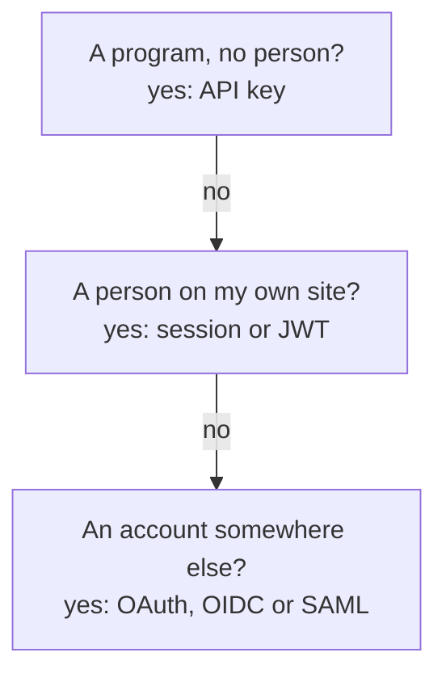
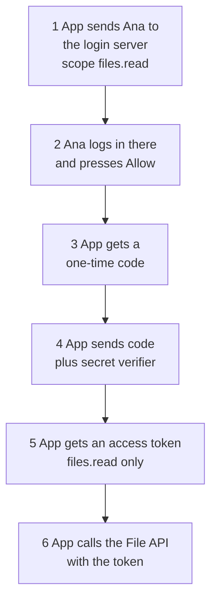
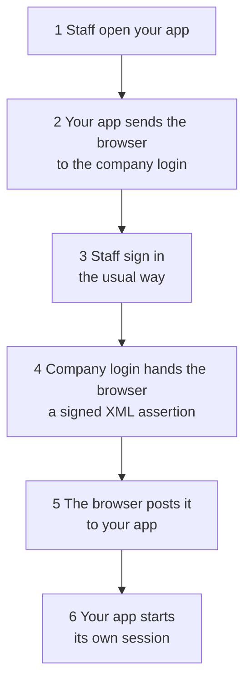

# 20. Login systems compared

> **Subject:** Backend and API · **Lesson:** 20 · **Made:** 2026-11-17 · **Status:** ready
>
> **You will be able to:** tell sessions, JWT, API keys, OAuth, OpenID Connect and SAML apart with one table, say which question each one answers, draw the "sign in with Google" flow, and name what you must check before you trust an ID token.
>
> **Before this:** [Authorization](08-authorization.md) and [Access control models](19-access-control-models.md) · **Read first:** [Authentication: sessions vs JWT](06-authentication-sessions-vs-jwt.md)
>
> **How to read it:** one card is one idea. Look at the picture, guess, then press the orange bar to check. The blue bars (📖 More detail) hold the longer explanation. Skip them on the first read, and open them when you want more. About 15 minutes for the cards.

<!-- quick-summary:start -->
## Quick summary

> Short on time? Read only this. These are the "Remember" lines from the cards below, so you can read the whole lesson in one minute.

- OAuth is permission. OIDC is login, built on OAuth. SAML is company login in XML. An API key is a password for a program.
- The row to look at is "who proves who you are". For a session it is you. For OIDC and SAML it is somebody else.
- Show the key once, store only its hash, and let it carry scopes. A leaked key works until you revoke it.
- OAuth gives an app a limited key. It does not, by itself, tell the app who the user is.
- Check `iss`, `aud`, `exp`, `nonce` and the signature. Then start your own session for `sub`.
- SAML is the same idea as OIDC, in XML, mostly for company single sign-on. You usually support it because a customer asks.
- An access token is a key for an API. An ID token is the answer to "who logged in?", and only for the app named in `aud`.
- The redirect address must match a registered one **exactly**.
- Use the authorization code flow with PKCE. Do not copy old implicit flow tutorials.
<!-- quick-summary:end -->

## 1. The idea: four different questions

People mix these names up because they all sound like "login". They answer **different questions**. Ask the question first, and the name follows.

| The question | The answer |
|---|---|
| "My own users stay logged in on my own site." | a **session** (or a JWT), lesson 06 |
| "A program, with no person, calls my API." | an **API key** |
| "Another app may read my user's files, but only that." | **OAuth 2.0** |
| "Log in with an account that lives somewhere else." | **OpenID Connect** (Google, GitHub) or **SAML** (company login) |



<details class="guess"><summary>🤔 Guess: a "Sign in with Google" button. Is that OAuth, OpenID Connect, or SAML? Press to check.</summary>

**OpenID Connect (OIDC).** Many people say "OAuth", because OIDC is built on top of OAuth. But OAuth alone only gives permission. OIDC adds the part that tells your site **who** signed in.

</details>

> **Remember:** OAuth is permission. OIDC is login, built on OAuth. SAML is company login in XML. An API key is a password for a program.

<details class="more"><summary>📖 More detail: four new words, and where this fits</summary>

**New words.**

- **OAuth 2.0:** a way to give another app **limited** access without giving it your password. RFC 6749 calls it an authorization framework.
- **OpenID Connect (OIDC):** login on top of OAuth. It adds an **ID token**.
- **ID token:** a signed JWT that says who logged in (the user id is in a claim called `sub`).
- **SAML:** an older login standard that sends signed **XML**. Common in big companies.

You already know **session**, **JWT** and **scope** from lessons 06 and 19. This lesson is the map around them. Lesson 07 covers access and refresh tokens, and lesson 08 covers what a user may do after login.

**Authentication and authorization again.** Sessions, JWT, OIDC and SAML are mostly about **who**. OAuth is about **what an app may do**. An API key is a bit of both: it says which program, and its scopes say what that program may do.

</details>

## 2. The six side by side

This is the table to keep. Read each row left to right.

| | Answers | Who proves who you are | Your server gets | Format | Pick it when |
|---|---|---|---|---|---|
| **Session** | "still you?" | your own login page | a cookie with a random id | random id, facts on the server | your own users, in a browser |
| **JWT** | "still you?" | your own login page | a signed token with the facts inside | signed JSON | many servers, or a mobile app |
| **API key** | "which program?" | you (you hand it out) | one long secret in a header | random text | scripts and server to server |
| **OAuth 2.0** | "what may this app do?" | a login server (it asks the user) | an access token with scopes | tokens, often JWT | another app needs limited access |
| **OIDC** | "who is this user?" | a provider such as Google | an ID token (and an access token) | signed JWT | "Sign in with..." buttons, modern apps |
| **SAML** | "who is this staff member?" | the company's login system | a signed assertion | **XML** | a customer needs company single sign-on |

<details class="guess"><summary>🤔 Guess: which of the six does NOT need a login page of yours, even though a person is involved? Press to check.</summary>

**OIDC and SAML.** The user types the password at Google (or at the company), not at your site. Your site gets only a signed answer. OAuth works the same way for the login step.

</details>

> **Remember:** the row to look at is "who proves who you are". For a session it is you. For OIDC and SAML it is somebody else.

<details class="more"><summary>📖 More detail: how they combine, and why "just use JWT" is not an answer</summary>

**They stack.** After "Sign in with Google" (OIDC) works, your site usually starts **its own session** (card 5). So one real login often uses OIDC for the first step and a session cookie for every click after it.

**JWT is a container, not a system.** A JWT only says "this note is signed". An OIDC ID token is a JWT. An OAuth access token is often a JWT. A session replacement is a JWT. So "JWT or OAuth?" is not a real question. Ask instead: "who proves who the user is, and what do I get back?"

**Passkeys** replace the **password** step, not the session step. The user proves who they are with a key kept on their device, and your site stores only the public part (passkeys.dev, opened 2026-11-17). After that you still start a session. See Go deeper.

**Step through it yourself:** [open the stepper](visuals/20-login-systems-compared.html). It has four stories: an API key, OAuth, OIDC and SAML.

</details>

## 3. API key: a password for a program

A script has no fingers to type a password. You give it one long random secret. The server stores only a **hash** of it, so a database leak does not leak the keys.

```js
const { randomBytes, createHash } = require("node:crypto");
const key = "sk_" + randomBytes(32).toString("base64url");
const sha256 = (text) =>
  createHash("sha256").update(text).digest("hex");
const saved = sha256(key);
console.log(key.length, saved.length);
console.log(sha256(key) === saved);
console.log(sha256(key + "x") === saved);
```

<details class="guess"><summary>🤔 Guess: what do the three lines print? Press to check.</summary>

```
46 64
true
false
```

The key is 46 characters (3 for `sk_`, 43 random). Its SHA-256 hash is 64 hex characters. The same key gives the same hash, so the server can find it. A key with one extra letter gives a different hash.

</details>

> **Remember:** show the key once, store only its hash, and let it carry scopes. A leaked key works until you revoke it.

<details class="more"><summary>📖 More detail: why a fast hash is fine here, and what a key cannot do</summary>

**Why SHA-256 and not a slow hash.** Lesson 09 says a password needs a slow hash, because people pick weak passwords and a thief can guess fast. An API key is 32 random bytes, so there is nothing to guess. A plain fast hash is enough to keep the key itself out of the database. This is common practice, and I have not tied it to one standard.

**What a key cannot do.**

- It names a **program**, not a person. If you need to know which user acted, use OAuth.
- It does not end by itself. Plan a way to **revoke** and to **rotate** (make a new one, switch, delete the old one).
- A key put in a URL ends up in logs. Send it in a header.

**Where it fits with lesson 19.** A key row can hold scopes, like `["read"]`. Then "may this key delete?" is the same role-and-scope question.

</details>

## 4. OAuth 2.0: the valet key

Ana has files on your file service. A print shop app wants to read them. Ana must **not** give it her password. OAuth lets her say "this app may read my files, nothing else".



<details class="guess"><summary>🤔 Guess: the app now has an access token. Does the app know who Ana is? Press to check.</summary>

**Not from OAuth alone.** The token says "this token may read files". It does not promise to say who the user is. If your app needs to know who logged in, you need OIDC (card 5).

</details>

> **Remember:** OAuth gives an app a limited key. It does not, by itself, tell the app who the user is.

<details class="more"><summary>📖 More detail: PKCE, the redirect address, and what the specs say</summary>

**PKCE** (said "pixie"). The app makes a random secret, the **verifier**, and first sends only its SHA-256 hash, the **challenge**. Later it sends the verifier. Someone who steals just the one-time code cannot swap it for a token. The RFC 7636 example:

```js
const { createHash } = require("node:crypto");
const verifier = "dBjftJeZ4CVP-mB92K27uhbUJU1p1r_wW1gFWFOEjXk";
console.log(createHash("sha256").update(verifier).digest("base64url"));
```

```
E9Melhoa2OwvFrEMTJguCHaoeK1t8URWbuGJSstw-cM
```

That is the challenge that RFC 7636 Appendix B gives for this verifier (checked 2026-11-17).

**What the specs say (opened 2026-11-17).**

- RFC 6749: an authorization framework that lets a third-party app get limited access to an HTTP service.
- RFC 9700 (OAuth 2.0 Security Best Current Practice, January 2025): public clients **must** use PKCE with the authorization code grant. Clients should **not** use the implicit grant, and should use the authorization code grant instead.
- RFC 6749 section 3.1.2.3: when the full redirect URI is registered, the server must compare it with **simple string comparison**.
- OAuth 2.1 is, on oauth.net, still an Internet-Draft, not a final RFC. It collects the same advice: PKCE for the code flow, exact redirect matching, no implicit grant, no password grant.

**Step through it yourself:** [open the stepper](visuals/20-login-systems-compared.html), story 2.

</details>

## 5. OIDC: "sign in with Google"

OIDC runs the same road as OAuth, with one extra word: `scope=openid`. At the end you get one more thing, the **ID token**. It is a signed JWT that says who logged in. Before you believe it, you check it.

| ID token claim | What it says | What you check |
|---|---|---|
| `iss` | who issued it | equals the provider you expect, exactly |
| `aud` | who it is for | contains **your** client id |
| `exp` | when it ends | is still in the future |
| `nonce` | the answer to your request | equals the random value you sent |
| `sub` | the user's id at the provider | you start your session for this id |

```js
const claims = {
  iss: "https://accounts.example.com",
  aud: "other-app", exp: 2000, nonce: "n-0S6",
};
const want = {
  issuer: "https://accounts.example.com",
  clientId: "my-app", nonce: "n-0S6", now: 1000,
};
console.log(claims.iss === want.issuer);
console.log(claims.aud === want.clientId);
console.log(want.now < claims.exp);
```

<details class="guess"><summary>🤔 Guess: what do the three lines print, and should your app accept this token? Press to check.</summary>

```
true
false
true
```

The issuer is right and the time is fine, but the token is for **other-app**, not for my-app. Reject it. A real, correctly signed token can still be meant for someone else.

</details>

> **Remember:** check `iss`, `aud`, `exp`, `nonce` and the signature. Then start your own session for `sub`.

<details class="more"><summary>📖 More detail: what the spec requires, and what happens after</summary>

**What OIDC Core says to check (section 3.1.3.7, opened 2026-11-17).**

- `iss` must exactly match the issuer.
- `aud` must include your `client_id`. Reject the token if it lists audiences you do not trust.
- The signature must check, using the keys of the issuer.
- The current time must be before `exp`.
- If you sent a `nonce`, the token's `nonce` must be present and equal to it.

**Two more words.** The `nonce` stops an old ID token from being replayed into your login. The `state` value in the stepper is a different check: it ties the browser that left to the browser that comes back, and it protects the redirect step.

**After the check.** You do not ask Google on every click. You start your **own session** (lesson 06) for `sub`, and Google is out of the loop until the session ends.

**Step through it yourself:** [open the stepper](visuals/20-login-systems-compared.html), story 3.

</details>

## 6. SAML: company login, in XML

A large customer says: "our staff sign in with our own system, and we only support SAML". SAML is an older standard for exactly this. The company's login system is the **identity provider (IdP)**. Your app is the **service provider (SP)**. The IdP sends a signed **assertion**: statements about a person in XML.



<details class="guess"><summary>🤔 Guess: do your app and the company's login system call each other directly? Press to check.</summary>

**Not in this flow.** The **browser** carries every message. Your app redirects the browser to the company login, and the company login sends the assertion back through the browser, as an HTML form post. That is why both sides must check signatures: the browser is in the middle.

</details>

> **Remember:** SAML is the same idea as OIDC, in XML, mostly for company single sign-on. You usually support it because a customer asks.

<details class="more"><summary>📖 More detail: assertion, OIDC against SAML, and the cost</summary>

**From the OASIS SAML 2.0 overview (opened 2026-11-17).** An assertion holds statements about a subject. The statements can be about **authentication** (how and when the user logged in), **attributes** (details such as group membership or email), or an **authorization decision**. It is XML, and the messages are often carried in HTML form posts. The main use case is web single sign-on, started either at the service provider or at the identity provider.

| | OIDC | SAML |
|---|---|---|
| Message format | signed JSON (JWT) | signed XML |
| Built on | OAuth 2.0 | its own standard |
| Typical place | consumer sites, mobile apps, modern company tools | big company single sign-on |
| Mobile and API friendly | yes | not really, it is browser based |

**The cost.** XML signatures are easy to get wrong. Use a well-tested library and do not write the check yourself. You also need to swap keys and addresses with each customer, and plan for that setup work.

**Step through it yourself:** [open the stepper](visuals/20-login-systems-compared.html), story 4.

</details>

## 7. Mistake 1: treating an access token as proof of login

```js
// wrong (a sketch)
const tokenInfo = await getAccessTokenInfo(accessToken);
startSession(tokenInfo.userId);
```

<details class="guess"><summary>🤔 Guess: the access token came from "Sign in with Google" last week, for a different app that you do not own. Your code starts a session for it. What can go wrong? Press to check.</summary>

An attacker can get a token from **their own** app, hand it to your site, and your site logs them in as someone else. An access token says "this token may do X". It was not made **for your app**, and it never promised to say who logged in. Use OIDC and check the **ID token**: `iss`, `aud`, `exp`, `nonce`.

</details>

> **Remember:** an access token is a key for an API. An ID token is the answer to "who logged in?", and only for the app named in `aud`.

<details class="more"><summary>📖 More detail: the right code</summary>

**Right:** ask for `scope=openid`, take the **ID token**, check it (the practice file has `checkIdToken`), and only then start your session for `sub`.

```js
const result = checkIdToken(claims, expected);
if (!result.ok) return res.sendStatus(401);   // reason: issuer, audience, expired or nonce
startSession(claims.sub);
```

</details>

## 8. Mistake 2: matching the redirect address loosely

The login server sends the browser back to the app's **redirect address**, with the code in the URL. If the server accepts any address that only **starts with** the registered one, an attacker can steer the code somewhere else.

```js
const registered = "https://app.example.com/callback";
const sent = "https://app.example.com/callback/evil";
console.log(sent.startsWith(registered));
console.log(sent === registered);
```

<details class="guess"><summary>🤔 Guess: what do the two lines print, and which one is the safe check? Press to check.</summary>

```
true
false
```

`startsWith` says yes to the evil address. The safe check is **exact equality**. RFC 6749 says to compare with simple string comparison, and OAuth 2.1 draft says the same.

</details>

> **Remember:** the redirect address must match a registered one **exactly**.

<details class="more"><summary>📖 More detail: what else can slip here</summary>

- Case matters, and so does a trailing slash. `/Callback` is not `/callback`.
- A query string, such as `?next=x`, makes it a different string. Do not allow it unless you registered it.
- A look-alike host, such as `app.example.com.evil.io`, starts with the right text. Only an exact match catches it.
- The `state` value should be random per login and checked when the browser comes back.

The practice file has `redirectAllowed`. Its tests include all of these.

</details>

## 9. Mistake 3: the implicit flow, and a token in the URL

Older guides show OAuth where the access token comes back **directly** in the URL, with no code. That was called the implicit flow.

<details class="guess"><summary>🤔 Guess: why is a token in the URL a problem? Press to check.</summary>

URLs end up in browser history, logs and the `Referer` header, so the token **leaks**. RFC 9700 says clients should not use the implicit grant and should use the authorization code grant instead, with PKCE.

</details>

> **Remember:** use the authorization code flow with PKCE. Do not copy old implicit flow tutorials.

<details class="more"><summary>📖 More detail: what to say if an old guide shows it</summary>

If a tutorial shows `response_type=token`, it is the implicit flow. The OAuth 2.1 draft removes it, along with the password grant. For a single-page app or a mobile app, the safe pattern is the authorization code flow with PKCE. Check the date on any guide before you copy it.

</details>

## 10. Picking one, and what it costs

| Situation | Use | Why |
|---|---|---|
| My own users, one site | session | revoke at once, simple |
| My own users, many servers or a mobile app | JWT with short life and refresh (lesson 07) | no shared session store |
| A script or a partner server | API key with scopes | no person present |
| Another app, limited access to a user's data | OAuth 2.0, code flow with PKCE | user approves, token is limited |
| "Sign in with Google or GitHub" | OIDC | you learn who, without a password |
| A customer says "SAML only" | SAML through a tested library | their IT already runs it |
| Most real apps | **a mix** | OIDC to sign in, then your own session, plus API keys for scripts |

- **Without it:** you build your own password forms and token rules for every case, and one of them is wrong.
- **With it:** you pick by the question: who proves who, and what do I get back.
- **The cost:** OAuth and OIDC have many parts (redirects, a code, a verifier, key checks). SAML needs setup for each customer. An API key lasts until revoked. A provider outage can lock your users out.

<details class="more"><summary>📖 More detail: where my own projects fit</summary>

From your profile: Express, GraphQL, authentication, Prisma and Hasura. Your own tutorial in this repo ([Express, GraphQL and Prisma with real auth](express-graphql-auth-tutorial.md)) is about your **own** login with tokens, so it is the "session or JWT" row.

*Idea, not a fact:* "log in with Google" or a customer's company login would be the OIDC or SAML rows. Your notes do not say whether any of your projects used OIDC or SAML. Say what you really did, and what you would choose, and why.

</details>

## 11. Watch and play

Links checked on 2026-11-17. I opened every page. For videos I checked only the title and the channel, not the length or the content.

- **Video:** [An Illustrated Guide to OAuth and OpenID Connect](https://www.youtube.com/watch?v=t18YB3xDfXI) by OktaDev. The title matches cards 4 and 5. Watch it after the stepper, stories 2 and 3.
- **Video:** [SAML vs. OpenID (OIDC): What's the Difference?](https://www.youtube.com/watch?v=A7GVeqFvqFM) by JumpCloud. The title matches card 6.
- **Play with it:** [The login systems stepper](visuals/20-login-systems-compared.html) in this folder. In story 3, say out loud which of the five ID token checks would stop a token meant for another app.
- **Read:** [How OpenID Connect works](https://openid.net/developers/how-connect-works/). The short official page. It says OIDC is based on the OAuth 2.0 framework.
- **Read:** [RFC 9700, OAuth 2.0 Security Best Current Practice](https://www.rfc-editor.org/rfc/rfc9700.html). Look for the parts about PKCE and the implicit grant.

<details><summary>More links (optional)</summary>

- **Read:** [RFC 7636 (PKCE)](https://www.rfc-editor.org/rfc/rfc7636.html). Appendix B has the example that the practice file uses.
- **Read:** [OpenID Connect Core 1.0](https://openid.net/specs/openid-connect-core-1_0.html). Section 3.1.3.7 is the ID token check list.
- **Read:** [OASIS SAML 2.0 technical overview](https://docs.oasis-open.org/security/saml/Post2.0/sstc-saml-tech-overview-2.0.html). The assertion and the two flows.
- **Read:** [OAuth 2.1](https://oauth.net/2.1/). The draft that collects the current advice.
- **Read:** [What are passkeys? (passkeys.dev)](https://passkeys.dev/docs/intro/what-are-passkeys/). A short page on passkeys.

</details>

## 12. Practice

**A. Predict the output** (write your answer before opening)

```js
const aud = ["other-app", "my-app"];
console.log(aud.includes("my-app"));
const sent = "https://app.example.com/callback/evil";
console.log(sent.startsWith("https://app.example.com/callback"));
console.log(sent === "https://app.example.com/callback");
```

<details><summary>Answer</summary>

```
true
true
false
```

Line 1: `aud` may be a list, and `my-app` is in it. Line 2: `startsWith` says yes to an evil address. Line 3: exact equality says no. That is the check you want.

</details>

**B. Fix the bug**

```js
function login(claims, issuer, now) {
  if (claims.iss !== issuer) return false;
  if (!(now < claims.exp)) return false;
  return true;
}
```

<details><summary>Answer</summary>

It never checks `aud` or `nonce`. A correctly signed ID token that was made for **another app** passes, and so does an old token that is replayed. Add both checks:

```js
function login(claims, expected) {
  if (claims.iss !== expected.issuer) return false;
  const aud = Array.isArray(claims.aud) ? claims.aud : [claims.aud];
  if (!aud.includes(expected.clientId)) return false;
  if (!(expected.now < claims.exp)) return false;
  return claims.nonce === expected.nonce;
}
```

</details>

**C. Write it yourself**

Open `practice/20-login-systems-compared.js`. There are four small tasks: `pkceChallenge` (the S256 hash), `checkIdToken` (the checks, with a reason for the first failure), `redirectAllowed` (exact match), and `choices` (pick the right system for five situations).

```
node --test learn/backend-api/practice/20-login-systems-compared.test.js
```

At the start, all 13 tests fail. Each test starts with a plain "yes" case before it checks the "no" cases, so an empty function cannot pass by accident.

<details><summary>One possible answer</summary>

```js
function pkceChallenge(verifier) {
  return crypto.createHash("sha256").update(verifier, "ascii").digest("base64url");
}

function checkIdToken(claims, expected) {
  if (!claims || typeof claims !== "object" || !expected) return { ok: false, reason: "input" };
  if (claims.iss !== expected.issuer) return { ok: false, reason: "issuer" };
  const aud = Array.isArray(claims.aud) ? claims.aud : [claims.aud];
  if (!aud.includes(expected.clientId)) return { ok: false, reason: "audience" };
  if (!(expected.now < claims.exp)) return { ok: false, reason: "expired" };   // also false when exp is missing
  if (claims.nonce === undefined || claims.nonce !== expected.nonce) return { ok: false, reason: "nonce" };
  return { ok: true };
}

function redirectAllowed(uri, registered) {
  return typeof uri === "string" && Array.isArray(registered) && registered.includes(uri);
}

const choices = {
  stayLoggedInOnMyOwnWebsite: "session",
  signInWithGoogleButton: "oidc",
  partnerAppMayReadOneUsersFilesOnly: "oauth",
  buildScriptCallsMyApi: "api-key",
  customerItSaysWeOnlySupportSaml: "saml",
};
```

Notice that `checkIdToken` writes the checks as "if it is wrong, stop", in a fixed order, and only a full set of passes reaches `{ ok: true }`. That is deny by default again.

</details>

## 13. Interview question

**Q:** "What is the difference between OAuth 2.0, OpenID Connect and SAML? When would you use each?"

<details><summary>A strong answer, in four parts</summary>

1. **Problem:** the three get mixed up, because they all look like "login". They answer different questions. If you use the wrong one, you can end up accepting a token that was never made for your app.
2. **How it works:** **OAuth 2.0** lets an app get limited access to a user's data without the user's password. The user logs in at a login server and the app gets an access token with scopes, through the code flow with PKCE. **OpenID Connect** is built on OAuth. It adds an ID token, a signed JWT that says who logged in. You check `iss`, `aud`, `exp`, `nonce` and the signature, and then you start your own session. **SAML** is an older standard that does the same job as OIDC, with signed XML assertions through the browser, mostly for company single sign-on.
3. **Tradeoff:** OIDC is lighter and works for web and mobile. SAML is browser based and needs setup for every customer, but big companies often require it. OAuth alone is about permission, so it does not tell you who logged in. API keys are simple for scripts, but they last until revoked, so I store only a hash, give them scopes, and plan to rotate them.
4. **My example:** your profile lists authentication in Express and GraphQL, so you can say that your own login was a session or token one. *Idea, not a fact:* a customer asking for company login would be the SAML or OIDC case. Your notes do not say you built one. Say what you really did, and how you would approach it.

</details>

## 14. Explain it back

Close this file. Press the **Record my explanation** button under this heading and explain it out loud, like to a new junior, in 4 parts: problem, how it works, tradeoff, my example. Use the words "permission", "ID token", "assertion" and "API key". Then save the transcript into `my-learning/recordings/`, or write your best version below. Run `/explain-check login systems` or ask the `explain-coach` agent to review it.

### My explanation

<write here>

### Coach feedback

<the explain-coach agent writes here>

## 15. Review questions (day 1, 3, 7, 21)

1. Which question does each of these answer: session, API key, OAuth, OIDC, SAML?
2. A site says "Sign in with Google". Is that OAuth or OIDC? What comes back that OAuth alone does not give?
3. Name the five checks on an ID token.
4. Why must the redirect address match exactly?

<details><summary>Answers</summary>

1. Session: "is this still the same user on my site?" API key: "which program is calling?" OAuth: "what may this app do for the user?" OIDC: "who is this user?" (login, built on OAuth). SAML: "who is this staff member?" (company login, XML).
2. OIDC. It comes back with an **ID token**, a signed JWT that says who logged in (the `sub` claim).
3. `iss` is the provider you expect, `aud` contains your client id, `exp` is still in the future, `nonce` equals the one you sent, and the signature checks with the provider's keys.
4. Because the code goes to that address. If the server accepts anything that only starts with the registered address, an attacker can steer the code to their own address. RFC 6749 says to compare with simple string comparison.

</details>

## 16. Go deeper (optional)

Open these when you are ready. None of them is needed for the cards above.

<details><summary>Passkeys, refresh tokens, and the OAuth 2.1 draft</summary>

**Passkeys.** The passkeys.dev site calls passkeys a replacement for passwords: a credential kept on the user's devices and unlocked with biometrics. The site stores only public keys, and the private keys stay on the devices. A passkey proves **who** at the login step. After that, you still start a session. So passkeys do not replace sessions, OIDC or SAML. They replace the password step.

**Refresh tokens.** An OAuth login server often returns a refresh token too. Lesson 07 explains why there are two tokens, rotation, and reuse detection.

**OAuth 2.1.** On oauth.net (opened 2026-11-17) it is still an Internet-Draft. It collects the advice already in RFC 9700: PKCE for the code flow, exact redirect matching, no implicit grant, no password grant, and no bearer tokens in query strings. Build to that advice today. Do not wait for the final number.

**Build or buy.** Writing your own OAuth server, or your own SAML checks, is a security project. Many teams use a hosted provider or a tested library. Hasura, for example, accepts a JWT from your login provider (lesson 14). Check the docs of the one you pick, and test the failure cases (a wrong `aud`, a wrong `nonce`, an expired token).

</details>

## Connected lessons

- [Authentication: sessions vs JWT](06-authentication-sessions-vs-jwt.md): where your own session or JWT comes in.
- [Access and refresh tokens](07-access-and-refresh-tokens.md): the two tokens, and why a role in a token goes stale.
- [Authorization](08-authorization.md): what a user may do after login.
- [Access control models](19-access-control-models.md): roles, lists, rules and scopes. Scopes are used by API keys and OAuth tokens.
- [Password hashing](09-password-hashing.md): why a password needs a slow hash and an API key does not.
- [Hasura: when and when not](14-hasura-when-and-when-not.md): how a JWT from your login becomes Hasura's session variables.
