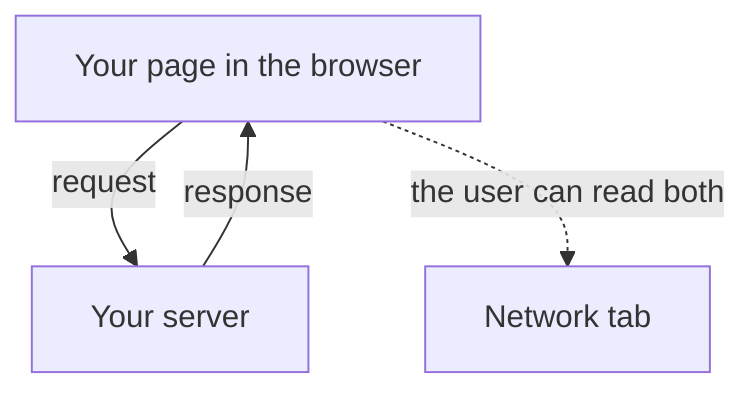
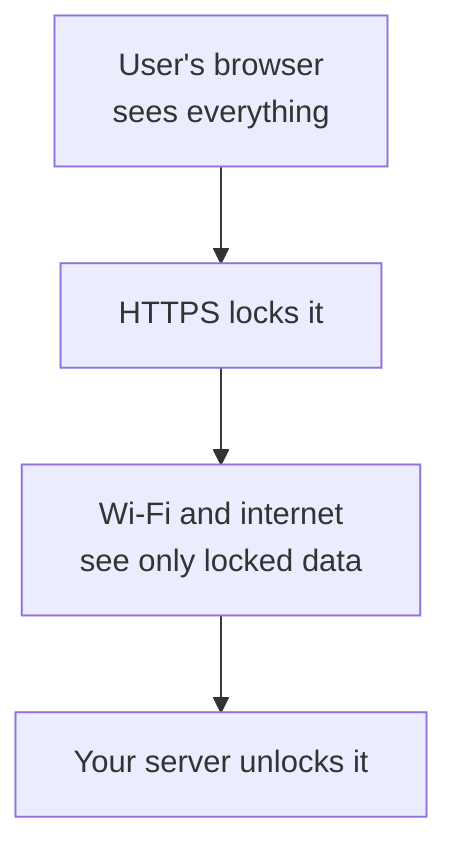
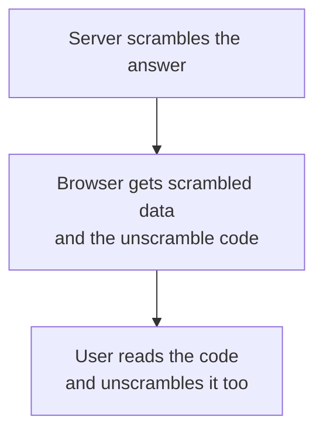
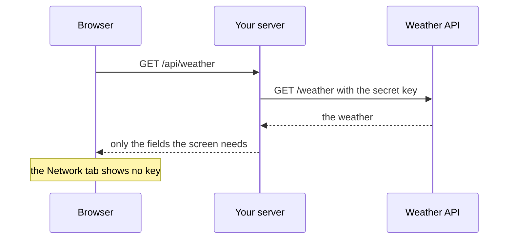
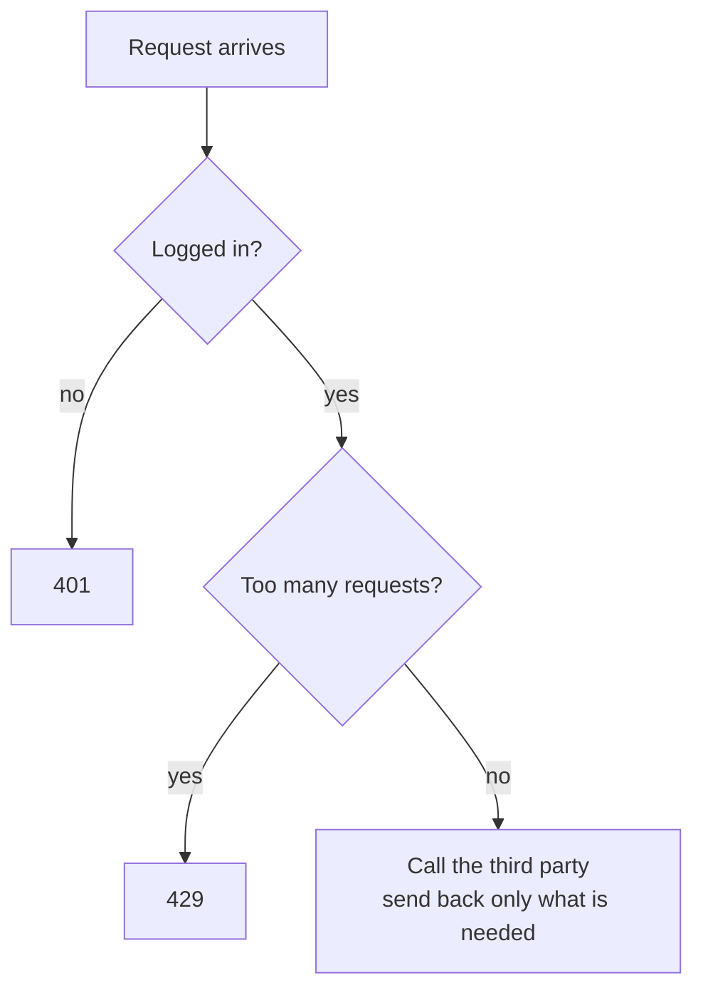
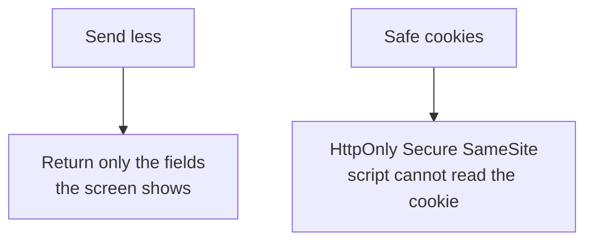

# 21. What the browser can see: hiding API calls and secrets

> **Subject:** Backend and API · **Lesson:** 21 · **Made:** 2026-11-27 · **Status:** ready
>
> **You will be able to:** explain why you cannot hide a request from the Network tab, and list the real ways to keep a secret and protect an API.
>
> **Before this:** [Login systems compared](20-login-systems-compared.md) · **Next:** [Backend and API lessons map](README.md)
>
> **How to read it:** one card is one idea. Look at the picture, guess, then press the orange bar to check. The blue bars (📖 More detail) hold the longer explanation. Skip them on the first read, open them when you want more. About 20 minutes for the cards.

<!-- quick-summary:start -->
## Quick summary

> Short on time? Read only this. These are the "Remember" lines from the cards below, so you can read the whole lesson in one minute.

- The browser belongs to the user. Everything it sends or receives can be read.
- HTTPS protects against people in the middle. It does not protect against the user.
- If the browser can read it, the user can read it. Scrambling only slows down the lazy.
- You cannot hide the request. You can hide the key by making the call from the server.
- Every address is public. The server must check the login, the permission and the rate on every request.
- HttpOnly protects the cookie from scripts, not from the user. Send only the fields the screen needs.
- A key that was ever in browser code is public. Make a new one.
- Design as if the user reads every request, because they can.
<!-- quick-summary:end -->

## 1. The idea: a shop with a glass window

Think of the browser as a shop with a **glass window**. The user stands inside the shop. Every letter that goes out and every letter that comes in passes through the glass. The user can read all of them.

The glass window has a name: the **Network tab**. You open it with F12 in the browser.



Notice: the browser is **the user's machine**. You do not control it. You only control your server.

<details class="guess"><summary>🤔 Guess: can you make a request that the Network tab does not show? Press to check.</summary>

No. If the browser sends it, the user can see it. Even "hidden" calls from a library are listed. You can change **what is in** the request, but not whether it can be seen.

</details>

> **Remember:** the browser belongs to the user. Everything it sends or receives can be read.

<details class="more"><summary>📖 More detail: what the Network tab shows</summary>

| What | Visible? |
|---|---|
| address (URL) and method (GET, POST) | yes |
| headers, including `Authorization` and cookies | yes |
| the body you send | yes |
| the answer from the server | yes |
| the time each call took | yes |

The user can also use "Copy as cURL" to copy a request and send it again from a terminal, with no page at all. Card 5 shows what that means.

</details>

## 2. HTTPS does not hide it from the user

People think HTTPS makes the request secret. It does, but only from **people in the middle**: the Wi-Fi owner, the internet provider. The user at their own browser sees the message **before** it is locked and **after** it is unlocked.



<details class="guess"><summary>🤔 Guess: a user opens the Network tab on their own phone. Does HTTPS stop them reading the request? Press to check.</summary>

No. HTTPS protects the road between the browser and your server. The user is **at the start of the road**, so they see the plain message.

</details>

> **Remember:** HTTPS protects against people in the middle. It does not protect against the user.

<details class="more"><summary>📖 More detail: see the TLS lesson</summary>

[TLS and HTTPS](../networking/04-tls-and-https.md) explains how the lock works. For this lesson only one fact matters: the lock is between the browser and the server, and the user is on the browser side.

</details>

## 3. "Scrambling" the data does not help

Some teams try to protect an API by changing the data: encode it, shuffle it, or encrypt it in JavaScript. This is called **security through obscurity**. It does not work, because the code that **unscrambles** the data must be sent to the browser too. The user can read that code.



Notice: base64 is not even a lock. It is only a different way to write the same text. One function turns it back.

<details class="guess"><summary>🤔 Guess: you encrypt the answer with AES, and the key is inside your JavaScript file. Is it safe? Press to check.</summary>

No. The key is in a file that every visitor downloads. Anyone can read it and decrypt. A secret that is sent to the browser is not a secret.

</details>

> **Remember:** if the browser can read it, the user can read it. Scrambling only slows down the lazy.

<details class="more"><summary>📖 More detail: what I tested</summary>

On 2026-11-27 I opened a real browser page that got an answer written in base64: `eyJjaXR5IjoiSmFrYXJ0YSIs...`. One call to `atob(text)` gave back `{"city":"Jakarta","temp":31}`. It took one line.

GraphQL **persisted queries** (the client sends a short id instead of the whole query) make requests shorter and harder to read. That is useful for speed, but the answer still arrives in the clear, and it is not a security tool. An attacker can still call any query id that your server accepts.

</details>

## 4. What works 1: keep the secret on your server

Say you use a weather API that needs a secret key. If the key is in your browser code, it appears in the Network tab. Anyone can copy it and use your account.

Fix: the browser calls **your** server. Your server calls the weather API with the key.



Notice: this is called a **proxy** (or a backend for frontend). It is the same idea in Next.js, with a Route Handler or a Server Action.

<details class="guess"><summary>🤔 Guess: the Network tab shows `GET /api/weather` and the answer. Can the user still read the weather? Press to check.</summary>

Yes, the weather is public to that user, and that is fine. What they cannot get is **your key**. You hide the **secret**, not the request.

</details>

> **Remember:** you cannot hide the request. You can hide the key by making the call from the server.

<details class="more"><summary>📖 More detail: what I saw in a real browser</summary>

I made two pages and watched the requests with a real browser (2026-11-27).

| Page | What the Network tab listed |
|---|---|
| key in browser code | `GET http://.../weather` with `Authorization: Bearer sk_live_ABC123` |
| call through my server | `GET http://.../api/weather` with **no** Authorization header |

In the second case my server added the key when it called the weather API. The weather API saw the key every time. The browser never did.

In Next.js, a key stays private if it has **no** `NEXT_PUBLIC_` prefix. The docs say only variables with that prefix are sent to the browser. Put the key in a file marked `server-only` so the build stops if a Client Component imports it (lesson 16 in the [React folder](../react/16-server-and-client-components.md)).

Sources: [Next.js, backend for frontend](https://nextjs.org/docs/app/guides/backend-for-frontend) (updated 2026-11-06), [Next.js, data security](https://nextjs.org/docs/app/guides/data-security) (updated 2026-11-18).

**Step through it yourself:** [Network tab stepper](visuals/21-what-the-browser-can-see.html). Press Next and compare the two pages.

</details>

## 5. What works 2: your server checks every request

Now the danger: your `/api/weather` address is public too. Anyone can copy the request from the Network tab and send it again, with no page. If your server answers everyone, strangers can use **your key through your server**.



<details class="guess"><summary>🤔 Guess: a user copies a request as cURL and runs it in a terminal. Does your server know it did not come from your page? Press to check.</summary>

No. A request from a terminal looks the same as one from the page, if it has the same headers. So you cannot trust **where** a request came from. You trust **who** sent it (the login) and **what they may do** (the permission).

</details>

> **Remember:** every address is public. The server must check the login, the permission and the rate on every request.

<details class="more"><summary>📖 More detail: what I saw when I replayed requests</summary>

I sent requests from outside the page (2026-11-27):

| Request | Result |
|---|---|
| my open `/api/weather` with no login | the weather came back to anyone |
| a private address with no cookie | `401` |
| the same address with a copied session cookie | `200` |

The first row is the bug: an open proxy. The third row shows that a copied cookie works until the session ends, so keep sessions short and let users log out.

Lessons to read next: [authorization (08)](08-authorization.md), [rate limiting (11)](11-rate-limiting.md), [sessions vs JWT (06)](06-authentication-sessions-vs-jwt.md).

</details>

## 6. What works 3: send less, and use safe cookies

Two small habits make the Network tab less useful to an attacker.



Notice: the Network tab will still show the fields you send. So the fix is to **send fewer fields**, and never send a password hash, an internal id or a secret.

<details class="guess"><summary>🤔 Guess: a login cookie is marked HttpOnly. Can the user see it in DevTools? Press to check.</summary>

Yes. The user can always see their own cookies in DevTools. HttpOnly stops **scripts** from reading it, so an attacker's script (XSS) cannot steal it. It does not hide it from the person using the browser. I checked: `document.cookie` was empty, but the browser still sent the cookie.

</details>

> **Remember:** HttpOnly protects the cookie from scripts, not from the user. Send only the fields the screen needs.

<details class="more"><summary>📖 More detail: what the three cookie words mean</summary>

- **HttpOnly:** JavaScript cannot read the cookie. Protects against XSS stealing the login.
- **Secure:** the cookie is sent only over HTTPS.
- **SameSite:** the cookie is not sent when another website makes the request. Protects against CSRF.

See [cookies, CORS and same origin](../networking/06-cookies-cors-and-same-origin.md) and [access and refresh tokens (07)](07-access-and-refresh-tokens.md).

A **Data Transfer Object (DTO)** is a small object you build on purpose for the answer, instead of returning a whole database row. The Next.js data security guide recommends a Data Access Layer that returns minimal DTOs.

</details>

## 7. Mistake: a key in the browser

```js
// runs in the browser: the key is public
fetch("https://api.weather.com/v1", {
  headers: { Authorization: "Bearer sk_live_ABC123" },
})
```

<details class="guess"><summary>🤔 Guess: what is wrong, and how do you fix it? Press to check.</summary>

The key is in browser code, so it shows in the Network tab and in the bundle file. Move the call to the server and call your own `/api/weather` from the browser. Then **rotate the old key**, because it is already public.

</details>

> **Remember:** a key that was ever in browser code is public. Make a new one.

<details class="more"><summary>📖 More detail: keys that are safe in the browser</summary>

Some keys are **made** to be public, for example a map key limited to your website's address, or a Stripe publishable key. They can only do small things. A **secret** key (it can charge money or read private data) must stay on the server. Read the provider's rules for each key.

</details>

## 8. Mistake: "we hid it, so it is safe"

```text
"The API address is long and random, and the data is encoded.
Nobody will find it."
```

<details class="guess"><summary>🤔 Guess: what is wrong with that plan? Press to check.</summary>

The address is in the Network tab the first time someone opens the page. The encoding is undone by the code in your own bundle. A plan that depends on nobody looking is not security. Protect the **server** with login, permission and rate limits, and assume the user can see everything in the browser.

</details>

> **Remember:** design as if the user reads every request, because they can.

<details class="more"><summary>📖 More detail: the right way to think</summary>

Security people call this **zero trust** for the client: treat everything from the browser as untrusted input, and treat everything sent to the browser as public. The Next.js data security guide uses the same words when it talks about calling existing APIs.

If you want to slow down **bots**, that is a different job: rate limits, bot detection, and CAPTCHA. They reduce abuse, but they do not hide anything.

</details>

## 9. Why it matters and what it costs

- **Without this:** keys in the browser are copied and used by strangers. Open endpoints are scraped. Data you did not mean to send is visible.
- **With it:** the secret stays on the server, each request is checked, and the answer holds only what the screen needs.
- **The cost:** one more server hop (the proxy), a little more code, and the work of checking permission on every request.

| You want | Do this |
|---|---|
| hide a third-party key | call the third party from your server |
| stop strangers using your API | login, permission and rate limit on the server |
| stop reading data on public Wi-Fi | HTTPS |
| show less in the Network tab | return only the needed fields |
| protect the login cookie from scripts | HttpOnly, Secure, SameSite |
| hide the request from the user | you cannot, so do not rely on it |

## 10. Watch and play

All links below were opened on 2026-11-27 and loaded. I found no video that I could open and check, so there is none here.

- **Try it:** open F12, the Network tab, on any website, and click one request. Look at Headers and Response. Right click a request and try "Copy as cURL".
- **Step through it:** [Network tab stepper](visuals/21-what-the-browser-can-see.html) - two pages side by side.
- **Do:** [practice/21-what-the-browser-can-see.js](practice/21-what-the-browser-can-see.js) - write a safe proxy and run the tests.
- **Read:** [Backend for frontend, Next.js docs](https://nextjs.org/docs/app/guides/backend-for-frontend) - the proxy pattern.
- **Read:** [Data security, Next.js docs](https://nextjs.org/docs/app/guides/data-security) - the Data Access Layer and what reaches the client.

## 11. Practice

**A. Predict**

A teammate says: "We encrypt our API answers with AES in the browser, so users cannot read them." The key is in `app.js`. Can a user read the answers?

<details><summary>Answer</summary>

Yes. The user downloads `app.js`, finds the key, and decrypts the answers the same way the page does. A secret that is sent to the browser is not a secret.

</details>

**B. Fix the bug**

```js
// browser code
const res = await fetch("https://maps.example.com/route?key=sk_SECRET&from=A&to=B");
```

<details><summary>Answer</summary>

Move the call to your server: the browser calls `/api/route?from=A&to=B`, and your server adds `key=sk_SECRET` and calls the maps service. Check the login and the rate on that route. Then rotate `sk_SECRET`, because it is already public.

</details>

**C. Write it yourself**

Open `practice/21-what-the-browser-can-see.js` and write the three functions so that all 10 tests pass:

```bash
node --test learn/backend-api/practice/21-what-the-browser-can-see.test.js
```

<details><summary>One possible answer</summary>

```js
function decodeScrambled(text) {
  return JSON.parse(Buffer.from(text, "base64").toString("utf8"));
}
function pickFields(object, allowedNames) {
  const out = {};
  for (const name of allowedNames) {
    if (name in object) out[name] = object[name];
  }
  return out;
}
function makeWeatherHandler({ apiKey, callThirdParty, getUserId, allowRequest }) {
  return async function handle(request) {
    const userId = getUserId(request);
    if (userId === null) return { status: 401, body: { error: "login first" } };
    if (!allowRequest(userId)) return { status: 429, body: { error: "slow down" } };
    const data = await callThirdParty(request.query.city, apiKey);
    return { status: 200, body: pickFields(data, ["city", "temp"]) };
  };
}
```

The order matters: check the login first, then the rate, then spend money on the third party call.

</details>

## 12. Interview question

**Q:** Can you hide an API call from the browser's Network tab? How do you protect an API that the frontend calls?

<details><summary>A strong answer, in four parts</summary>

1. **Problem:** the browser runs on the user's machine, so every request and response is visible to them. Keys in browser code and open endpoints get copied and abused.
2. **How it works:** you cannot hide the request. Scrambling or encrypting in JavaScript fails, because the unscramble code and the key ship to the browser. Instead, keep secrets on the server and call third parties from there (a proxy, a backend for frontend, a Route Handler or a Server Action). On the server, check the login, the permission and a rate limit on every request, and return only the fields the screen needs.
3. **Tradeoff:** a proxy adds one more hop and some code, and it needs its own protection. HttpOnly cookies and HTTPS reduce attacks (XSS and people in the middle) but do not hide anything from the user.
4. **My example:** an idea, not a fact: in a Next.js or Express app, a route that calls a payment or maps API with the key from an environment variable, behind the login. I will add where I really did this in DBO, Unloan or ZWS only after I confirm it.

</details>

## 13. Explain it back

Close this file. Explain to a new junior why you cannot hide an API call, and what you do instead, in 4 parts (problem, how, tradeoff, my example). Then write your best version below and run `/explain-check hiding api calls` or ask the `explain-coach` agent to review it.

### My explanation

<write here>

### Coach feedback

<the explain-coach agent writes here>

## 14. Review questions (day 1, 3, 7, 21)

1. Why can the user always see a request in the Network tab, even over HTTPS?
2. Why does encrypting an answer in the browser not protect it?
3. What do you hide, if you cannot hide the request?
4. Draw the picture from card 4 from memory: the proxy between the browser and the third party.

<details><summary>Answers</summary>

1. HTTPS protects the road between the browser and the server. The user is at the start of the road, on the browser.
2. The code and the key that decrypt it are sent to the browser, so the user can use them too.
3. The secret key. You make the third-party call from your server.
4. Browser calls your server. Your server calls the third party with the key. Your server sends back only the needed fields.

</details>

## 15. Go deeper (optional)

<details><summary>Other tools and ideas</summary>

- **Token and key rotation:** make keys easy to replace, so a leak is a small problem.
- **Short-lived tokens:** a copied token stops working soon (see lesson 07).
- **Mobile apps:** the same rule applies. A key inside an app can be pulled out of the app file. Use your own server.
- **Request signing:** the server and a trusted client sign requests. It stops changes in transit, but a signing key in a public client is again public.
- **Content Security Policy and XSS:** these protect the page from bad scripts. Next.js has a [CSP guide](https://nextjs.org/docs/app/guides/content-security-policy) (listed in the data security page, I did not open it).

</details>

## Connected lessons

- [Authorization](08-authorization.md) - who may do what, checked on the server.
- [Rate limiting](11-rate-limiting.md) - the 429 in card 5.
- [Access and refresh tokens](07-access-and-refresh-tokens.md) - short-lived tokens and where to keep them.
- [Server and Client Components](../react/16-server-and-client-components.md) - how Next.js keeps server code and secrets off the browser.
- [Server Actions](../react/18-server-actions.md) - a public endpoint that needs the same checks.
