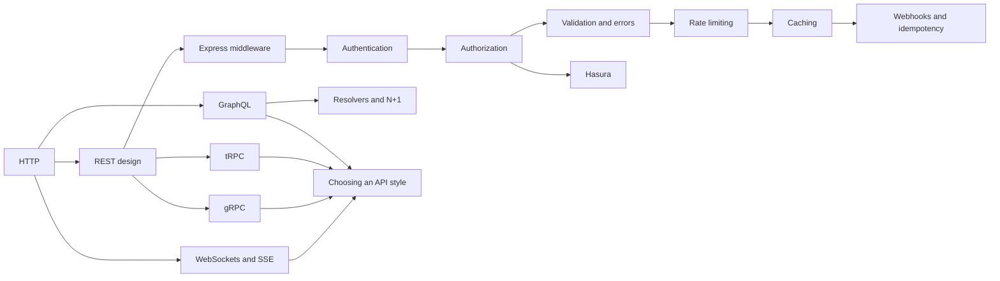

# Backend and API

HTTP, REST and GraphQL APIs, Express, authentication and authorization, and Hasura.

**Why it matters in interviews:** Backend rounds ask you to walk through a request end to end, design an endpoint, and explain JWT and refresh tokens. Your DBO and Skyworx work lives here.

## The map

How the lessons connect. Learn left to right.

## Lessons, one concept per file

Each lesson is one small file made from [the lesson template](../../templates/lesson-template.md): picture first, a code trace, practice, links to watch and play, and an explain it back section.

Status: `planned` (not written yet), `ready` (written, not studied), `learning`, `can explain` (passed explain-check).

### Basics

| # | Lesson | You will understand | Status |
|---|---|---|---|
| 01 | [HTTP basics](01-http-basics.md) | methods, status codes, headers, what a request and response look like | ready |
| 02 | [REST API design](02-rest-api-design.md) | resources, naming, pagination, versioning, idempotency | ready |
| 03 | [Express middleware](03-express-middleware.md) | the request pipeline, next(), error middleware | ready |

Each ready lesson has a step-through page in [visuals/](visuals/) and a practice file in [practice/](practice/). Run one with `node --test learn/backend-api/practice/01-http-basics.test.js`. The tests fail until you write the code.

### GraphQL

| # | Lesson | You will understand | Status |
|---|---|---|---|
| 04 | [GraphQL basics](04-graphql-basics.md) | schema, query, mutation, how it differs from REST | ready |
| 05 | [Resolvers and the N+1 problem](05-resolvers-and-the-n-1-problem.md) | how resolvers run and why DataLoader exists | ready |

### Auth

| # | Lesson | You will understand | Status |
|---|---|---|---|
| 06 | [Authentication: sessions vs JWT](06-authentication-sessions-vs-jwt.md) | where the state lives, what each one does better, and how to pick | ready |
| 07 | [Access and refresh tokens](07-access-and-refresh-tokens.md) | why two tokens, rotation and reuse detection, where to store them | ready |
| 08 | [Authorization](08-authorization.md) | roles, permissions, row level rules, IDOR, and 401 against 403 against 404 | ready |
| 09 | [Password hashing](09-password-hashing.md) | hash, salt and cost, argon2id against bcrypt and scrypt, why not a fast hash | ready |

### Senior level

| # | Lesson | You will understand | Status |
|---|---|---|---|
| 10 | [Validation and error handling](10-validation-and-error-handling.md) | checking input at the door, which status for which problem, one error shape that leaks nothing | ready |
| 11 | [Rate limiting](11-rate-limiting.md) | fixed window, sliding window and token bucket, choosing the key, why servers must share the count | ready |
| 12 | [Caching in APIs](12-caching-in-apis.md) | Cache-Control and ETag, cache-aside with a TTL in Redis, deleting the copy, the crowd at expiry | ready |
| 13 | [Webhooks and idempotency](13-webhooks-and-idempotency.md) | verify the signature, dedupe by event id, queue, answer fast, Idempotency-Key | ready |
| 14 | [Hasura: when and when not](14-hasura-when-and-when-not.md) | permission rules, Actions, event triggers, limits, and when to choose it | ready |

### API styles

| # | Lesson | You will understand | Status |
|---|---|---|---|
| 15 | [tRPC](15-trpc.md) | typed calls inside one TypeScript repo, what travels on the wire, errors, and where it does not fit | ready |
| 16 | [gRPC](16-grpc.md) | the `.proto` contract, how protobuf bytes look, the four call types, status codes and deadlines | ready |
| 17 | [WebSockets and Server-Sent Events](17-websockets-and-server-sent-events.md) | polling, SSE and WebSocket, reconnects with backoff, and why many servers need a message bus | ready |
| 18 | [Choosing an API style](18-choosing-an-api-style.md) | four questions that pick REST, GraphQL, tRPC or gRPC, and what each one costs | ready |

Each lesson from 06 to 18 (the Auth, Senior level and API styles groups) has a stepper page in [visuals/](visuals/) and a runnable exercise with tests in [practice/](practice/README.md).

**To make the next lesson:** in a chat with this folder open, say `/learn backend-api 01` to learn it live with Claude, or ask "make lesson backend-api 01" and the `research-material` agent writes the file. When a lesson file exists, its row becomes a link and the status changes to `ready`.

## Guides already here

Longer guides that cover many concepts at once. Good for revision after the lessons.

- [Express, GraphQL and Prisma with real auth (tutorial)](express-graphql-auth-tutorial.md)
- [Cheat sheet: API request, JWT, microservices](cheatsheet-api-auth-microservice.md)
- [Hasura: what it is and when to choose it](hasura-guide.md)

## Visual cheatsheets

Open in the browser. Everything visible on one page.

- [Backend and API lessons cheatsheet](backend-api-cheatsheet.html) - lessons 01 to 03: pictures, status codes, predict the output, interview answers
- [Express, GraphQL and auth visual cheatsheet](express-graphql-auth-tutorial-cheatsheet.html)
- [Hasura visual cheatsheet](hasura-guide-cheatsheet.html)

## Examples to run

- [examples/express-graphql-auth/](examples/express-graphql-auth/) - Express, GraphQL, Prisma app with register, login and refresh tokens
- [examples/hasura-todo/](examples/hasura-todo/) - Hasura todo app with Docker Compose

## Watch and play

Trusted places to see the ideas, not only read them. Each lesson adds its own checked video and visualizer links.

- [MDN HTTP](https://developer.mozilla.org/en-US/docs/Web/HTTP) - HTTP explained with diagrams
- [GraphQL Learn](https://graphql.org/learn/) - official GraphQL introduction
- [jwt.io](https://jwt.io/) - paste a token and see its header, payload and signature
- [roadmap.sh Backend](https://roadmap.sh/backend) - visual map of backend topics
