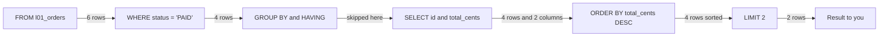
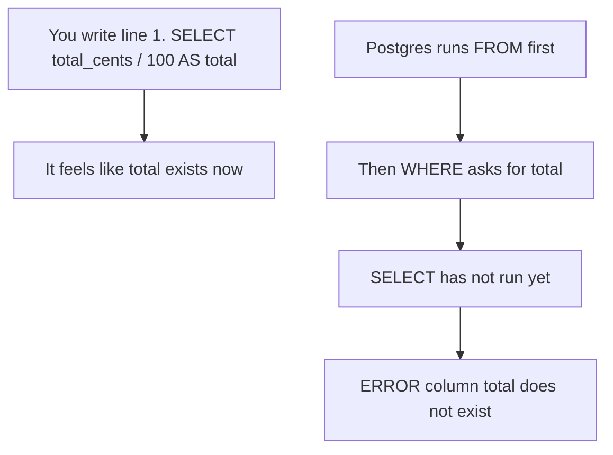
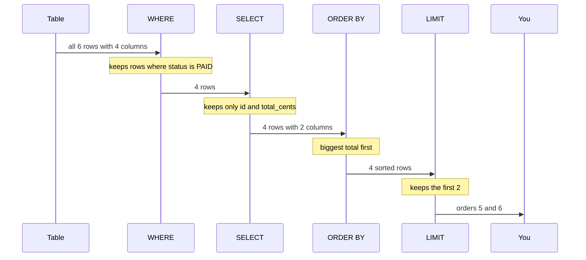
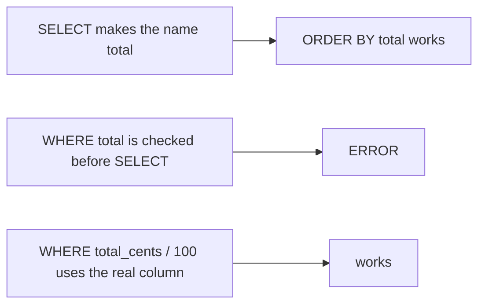
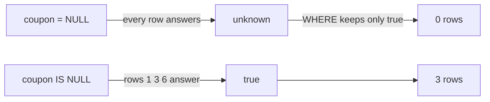
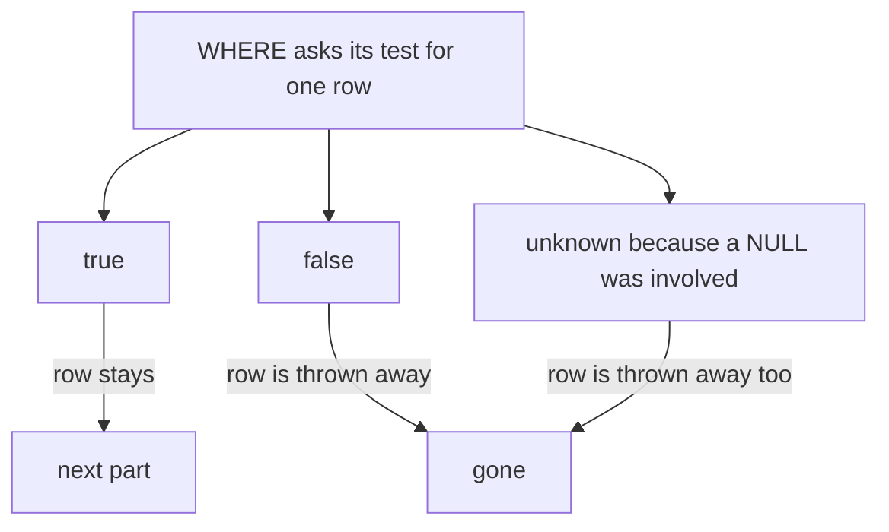

# 01. SQL basics and the order a query runs

> **Subject:** Database · **Lesson:** 01 · **Made:** 2026-10-16 · **Status:** ready
> **You will be able to:** read a SELECT with WHERE, ORDER BY and LIMIT, say the order Postgres works in (FROM first, SELECT almost last), and use that order to explain why a new name from SELECT fails in WHERE, and why `= NULL` finds nothing.
> **Before this:** none, this is the first lesson · **Next:** [Joins](02-joins.md)

## 1. The idea in one sentence

You write a query starting with SELECT, but Postgres works on it starting with FROM: first it gets the rows, then throws some away, then picks columns, then sorts, then cuts.

A table is a grid. Each **row** is one thing, like one order. Each **column** is one fact about it, like `status`.

New words:

- **Clause:** one part of a query that starts with a keyword, like `WHERE status = 'PAID'`.
- **Logical order:** the order in which Postgres works through the clauses. The answer always matches this order. (Interview words: *logical query processing order*, or *SQL order of execution*.)
- **New name:** a name you give a column with `AS`, like `total_cents / 100 AS total`. (Interview word: *alias*.)
- **NULL:** an empty box. Postgres reads it as "unknown", not as zero and not as empty text.

The rule to remember: **FROM, WHERE, GROUP BY, HAVING, SELECT, ORDER BY, LIMIT. A part can only use what the parts before it made.**

## 2. The pictures

All pictures use one tiny table, `l01_orders`, with 6 orders. Section 4 shows how to make it.

| id | status | total_cents | coupon |
|---|---|---|---|
| 1 | PAID | 5000 | NULL |
| 2 | PENDING | 12000 | NEW10 |
| 3 | PAID | 8000 | NULL |
| 4 | CANCELLED | 3000 | NEW10 |
| 5 | PAID | 20000 | VIP |
| 6 | PAID | 15000 | NULL |

### 2a. The big picture

This is the query from section 4 going through the pipeline. Notice that SELECT is the fifth box, not the first, and that the rows get fewer as they move right.



GROUP BY puts rows into buckets, and HAVING throws away buckets. Both are lesson 03. Here they do nothing.

### 2b. The problem, drawn

You read a query top to bottom, so it feels like SELECT runs first. It does not. Notice where the new name `total` is born, and where WHERE asks for it.



### 2c. How it works over time

The same query from section 4, as messages between the parts. Notice that each part only gets what the part before it handed over.



### 2d. What Postgres holds right after WHERE

This is the most confusing moment: WHERE is done, SELECT has not started. These are the rows Postgres holds. Notice that there is **no column called `total`** here. That is why WHERE cannot use it.

| id | status | total_cents | coupon |
|---|---|---|---|
| 1 | PAID | 5000 | NULL |
| 3 | PAID | 8000 | NULL |
| 5 | PAID | 20000 | VIP |
| 6 | PAID | 15000 | NULL |

Orders 2 and 4 are gone. All 4 columns are still here, because SELECT has not picked any yet.

### 2e. Right against wrong

**New names.** Notice that the name works only in parts that run after SELECT.



**Finding NULL.** Notice that `= NULL` gives "unknown" for every row, and WHERE throws unknown rows away.



### 2f. The three answers a test can give

A test in WHERE can answer true, false or unknown. Notice that only true goes on.



## 3. Real life analogy

You hand a librarian a slip: "Titles of red books, biggest first, only 2."

- She goes to the shelf first (FROM).
- She takes out only the red books (WHERE).
- She copies each title onto a card (SELECT).
- She sorts the cards by size (ORDER BY).
- She hands you the first 2 cards (LIMIT).

You wrote "titles" first on the slip, but she did that step fourth.

Where the analogy stops:

- A librarian would guess what you mean by a nickname you made up. Postgres does not guess. A new name from SELECT exists only after SELECT.
- A clever librarian might take a shortcut, like grabbing the 2 biggest red books straight away. Postgres also takes shortcuts (lesson 11). But the answer is always the same as the slow, step by step way.

## 4. The smallest code that shows it

Setup, run once (the same table as section 2):

```sql
CREATE TABLE l01_orders (
  id int PRIMARY KEY, status text NOT NULL,
  total_cents int NOT NULL, coupon text
);
INSERT INTO l01_orders VALUES
  (1, 'PAID', 5000, NULL),  (2, 'PENDING', 12000, 'NEW10'),
  (3, 'PAID', 8000, NULL),  (4, 'CANCELLED', 3000, 'NEW10'),
  (5, 'PAID', 20000, 'VIP'), (6, 'PAID', 15000, NULL);
```

The query:

```sql
SELECT id, total_cents        -- 5th: pick 2 columns
FROM l01_orders               -- 1st: all 6 rows
WHERE status = 'PAID'         -- 2nd: 4 rows stay
ORDER BY total_cents DESC     -- 6th: biggest first
LIMIT 2;                      -- 7th: keep the first 2
```

**Output:**

```
 id | total_cents
----+-------------
  5 |       20000
  6 |       15000
(2 rows)
```

The same shape works on the big practice tables. On `stores` the data is fixed, so you get the same answer:

```sql
SELECT id, name, city FROM stores WHERE city = 'Medan' ORDER BY id LIMIT 3;
```

```
 id |   name   | city
----+----------+-------
  3 | Store 3  | Medan
  8 | Store 8  | Medan
 13 | Store 13 | Medan
(3 rows)
```

On `orders` the totals are random, so try the same shape there and expect different numbers.

Checked on 2026-10-16 with PostgreSQL 18.3 (PGlite). Plain queries like these give the same result on PostgreSQL 16 in the Docker playground.

## 5. What really happens, step by step

The query from section 4.

| Step | Part | What Postgres does | Rows after | Columns after |
|---|---|---|---|---|
| 1 | read the query | Postgres reads the whole query. It does not start at line 1. | none yet | none yet |
| 2 | `FROM l01_orders` | Postgres takes every row of the table. | 6: ids 1 to 6 | id, status, total_cents, coupon |
| 3 | `WHERE status = 'PAID'` | Postgres asks the test for each row. Orders 2 and 4 answer false, so it throws them away. | 4: ids 1, 3, 5, 6 | all 4 |
| 4 | GROUP BY, HAVING | Not in this query, so Postgres skips them. | 4 | all 4 |
| 5 | `SELECT id, total_cents` | Postgres keeps only the two columns you asked for. A new name made with AS would be born here. | 4 | id, total_cents |
| 6 | `ORDER BY total_cents DESC` | Postgres sorts, biggest first. | 4: ids 5, 6, 3, 1 | id, total_cents |
| 7 | `LIMIT 2` | Postgres keeps the first 2 rows. It runs after the sort, so you get the 2 biggest. | 2: ids 5, 6 | id, total_cents |
| 8 | send | Postgres sends the 2 rows to you. | 2 | id, total_cents |

And the failing query `SELECT id, total_cents / 100 AS total FROM l01_orders WHERE total >= 100;`:

| Step | Part | What Postgres does | What it holds |
|---|---|---|---|
| 1 | `FROM l01_orders` | takes all 6 rows | columns id, status, total_cents, coupon |
| 2 | `WHERE total >= 100` | looks for a column named `total` and finds none | stops with `ERROR:  column "total" does not exist` |
| 3 | `SELECT ... AS total` | never runs | nothing is sent |

**Step through it yourself:** [open the query order stepper](visuals/01-sql-basics-and-query-order.html). WHERE paints rows green or red, SELECT fades columns, ORDER BY moves rows, and LIMIT cuts them. Six tabs cover this section and section 7. Write your guess first, then press Next.

<details><summary>Go deeper (optional): the real plan takes shortcuts</summary>

The logical order is a promise about the **result**, not a list of what the machine does. The real list of work is called the query plan, and you read it with `EXPLAIN` (lesson 11). For the same shape of query on the big `orders` table, PostgreSQL 18.3 printed this:

```
EXPLAIN (ANALYZE, COSTS OFF, TIMING OFF, BUFFERS OFF)
SELECT id, store_id, total_cents FROM orders
WHERE status = 'PAID' ORDER BY total_cents DESC LIMIT 5;

Limit (actual rows=5.00 loops=1)
  ->  Sort (actual rows=5.00 loops=1)
        Sort Key: total_cents DESC
        Sort Method: top-N heapsort  Memory: 17kB
        ->  Seq Scan on orders (actual rows=42983.00 loops=1)
              Filter: (status = 'PAID'::text)
              Rows Removed by Filter: 57017
```

Read it from the bottom up. It matches the pipeline: Seq Scan is FROM, Filter is WHERE, Sort is ORDER BY, Limit is LIMIT. But look at "top-N heapsort". Postgres knew only 5 rows were wanted, so it kept only the best 5 while reading. It never sorted all 42,983 rows. Your counts will differ because the seed is random.

On PostgreSQL 16 (the Docker playground) you will see `rows=5` with no decimals. PostgreSQL 18 shows `rows=5.00`. PostgreSQL 18 also adds buffer numbers to `EXPLAIN ANALYZE` by default, which is why the command above turns them off. Both changes are in the [PostgreSQL 18 release notes](https://www.postgresql.org/docs/release/18.0/).

With an index on `total_cents`, the plan can even skip the sort and stop after 5 rows. That is lesson 09 and lesson 10.

</details>

## 6. Why it exists and what it costs

- **Problem without it:** if you think SELECT runs first, some errors look random. A new name fails in WHERE, and a NULL test finds nothing.
- **How the order solves it:** each part only sees what the parts before it made. With that one rule you can predict:
  - WHERE cannot use a new name from SELECT. ORDER BY can.
  - LIMIT cuts after ORDER BY, so "top 2" really means the biggest 2.
  - WHERE cannot use `count(*)`, because counting per bucket happens later, in GROUP BY. That is what HAVING is for (lesson 03).
- **Cost:**
  - You must repeat the expression in WHERE. To avoid that, wrap the query in a subquery or a WITH (lesson 04).
  - The logical order says nothing about speed. You check speed with EXPLAIN (lesson 11).
  - Any test that touches NULL can answer "unknown", so NULL rows can quietly go missing (section 7).

## 7. Common mistakes

**Wrong:** using a new name in WHERE.

```sql
SELECT id, total_cents / 100 AS total
FROM l01_orders
WHERE total >= 100;
-- ERROR:  column "total" does not exist
```

**Right:** write the full expression in WHERE. Use the name in ORDER BY.

```sql
SELECT id, total_cents / 100 AS total
FROM l01_orders
WHERE total_cents / 100 >= 100
ORDER BY total DESC;
-- 5 | 200,  6 | 150,  2 | 120
```

**Why:** WHERE runs before SELECT, so the name is not born yet. ORDER BY runs after SELECT.

**Wrong:** looking for NULL with `=`. On the big `stores` table, only store 1 has no `referred_by`.

```sql
SELECT id, name FROM stores WHERE referred_by = NULL;
-- (0 rows)
```

**Right:**

```sql
SELECT id, name FROM stores WHERE referred_by IS NULL;
--  1 | Store 1
```

**Why:** NULL means unknown. "Is this equal to unknown?" has the answer unknown, never true. Even `NULL = NULL` gives unknown. `IS NULL` asks a different question, "is the box empty?", and that one answers true or false.

**Wrong:** forgetting that `<>` also skips NULL rows.

```sql
SELECT count(*) FROM stores WHERE referred_by <> 2;
-- 997, but 998 stores are "not referred by store 2"
```

**Right:**

```sql
SELECT count(*) FROM stores WHERE referred_by <> 2 OR referred_by IS NULL;
-- 998
```

**Why:** for store 1, `NULL <> 2` is unknown, so WHERE throws it away. There are 1,000 stores, 2 are referred by store 2, so 998 are not.

**Wrong:** LIMIT with no ORDER BY, when you want "the first" of something.

```sql
SELECT id, total_cents FROM l01_orders LIMIT 2;   -- "the 2 cheapest"?
-- 1 | 5000,  2 | 12000
```

**Right:**

```sql
SELECT id, total_cents FROM l01_orders ORDER BY total_cents LIMIT 2;
-- 4 | 3000,  1 | 5000
```

**Why:** without ORDER BY, Postgres promises no order. It sends the rows in whatever order is fastest for it. The wrong query can look right on a small table and break later.

<details><summary>Go deeper (optional): small rules that surprise people</summary>

- **ORDER BY can sort by a column you did not pick.** `SELECT id FROM l01_orders ORDER BY total_cents DESC LIMIT 2` works and returns 5 and 6. Postgres keeps `total_cents` out of sight until the sort is done.
- **A new name in ORDER BY must stand alone.** `ORDER BY total` works. `ORDER BY total + 1` fails with `column "total" does not exist`. The [PostgreSQL docs on sorting](https://www.postgresql.org/docs/current/queries-order.html) say "an output column name has to stand alone".
- **GROUP BY can also use a new name in Postgres.** `SELECT status AS s, count(*) FROM l01_orders GROUP BY s` works. This is a Postgres extra. The [SELECT docs](https://www.postgresql.org/docs/current/sql-select.html) say new names work in ORDER BY and GROUP BY, but not in WHERE or HAVING.
- **DISTINCT runs after SELECT and before ORDER BY.** It removes rows that are the same in every picked column.
- **Where NULL goes in a sort.** Postgres sorts NULL as if it were bigger than every value. So NULL comes last with normal order and first with `DESC`. You can choose with `NULLS FIRST` or `NULLS LAST`.
- **Treating NULL like a normal value.** `a IS DISTINCT FROM b` works like `<>`, but NULL against NULL gives false, and NULL against a value gives true. So `WHERE coupon IS DISTINCT FROM 'VIP'` keeps the NULL rows. See [comparison functions](https://www.postgresql.org/docs/current/functions-comparison.html).
- **Interview words for NULL:** "three-valued logic" means the three answers true, false and unknown.

</details>

## 8. Watch and play

Links checked on 2026-10-16. Each page was opened. For each video, the title and channel were confirmed through YouTube's oEmbed data. The video lengths were not checked.

- **Video:** [Secret To Optimizing SQL Queries - Understand The SQL Execution Order](https://www.youtube.com/watch?v=BHwzDmr6d7s) by ByteByteGo. A short animated walk through the order. Watch it after the stepper.
- **Video:** [SQL Explained in 100 Seconds](https://www.youtube.com/watch?v=zsjvFFKOm3c) by Fireship. A fast first look at tables, rows and SELECT.
- **Play with it:** [The query order stepper](visuals/01-sql-basics-and-query-order.html) in this folder. Guess first, then press Next.
- **Play with it:** [SQLBolt lesson 12: Order of execution of a Query](https://sqlbolt.com/lesson/select_queries_order_of_execution). Type queries in the browser. Say the order out loud before you run each one.
- **Play with it:** [PostgreSQL Exercises: Control which rows are retrieved](https://pgexercises.com/questions/basic/where.html). A real WHERE task with a Run Query button. Do the rest of the "Basic" section after it.
- **Read:** [SQL queries don't start with SELECT](https://jvns.ca/blog/2019/10/03/sql-queries-don-t-start-with-select/) by Julia Evans. One drawing of the order, and a note that the database may run things in a different order if the result stays the same.
- **Read:** [PostgreSQL docs: SELECT](https://www.postgresql.org/docs/current/sql-select.html). Read only the numbered list under "Description". It is the official version of the pipeline.

<details><summary>More links (optional)</summary>

- **Read:** [Sorting rows](https://www.postgresql.org/docs/current/queries-order.html) in the PostgreSQL docs. NULLS FIRST, NULLS LAST, and sorting by a new name.
- **Read:** [Comparison functions and operators](https://www.postgresql.org/docs/current/functions-comparison.html). The box that says "Do not write expression = NULL", and `IS DISTINCT FROM`.
- **Play with it:** [SQLBolt lesson 4: Filtering and sorting](https://sqlbolt.com/lesson/filtering_sorting_query_results) for ORDER BY and LIMIT, and [SQLBolt lesson 8: A short note on NULLs](https://sqlbolt.com/lesson/select_queries_with_nulls).
- **Read:** [PostgreSQL 18 release notes](https://www.postgresql.org/docs/release/18.0/). Only needed for the EXPLAIN differences in the Go deeper box of section 5.
- **Read (revision, dense):** [PostgreSQL queries interview guide](postgresql-queries-interview-guide.md) in this folder. Its LEFT JOIN trap is the same NULL rule from this lesson.

</details>

## 9. Practice

**A. Predict the output** (write your answer before opening). Use the table from section 2.

```sql
SELECT id
FROM l01_orders
WHERE coupon <> 'NEW10'
ORDER BY total_cents
LIMIT 2;
```

<details><summary>Answer</summary>

```
 id
----
  5
(1 row)
```

Only 1 row, even with `LIMIT 2`. Orders 2 and 4 answer false. Orders 1, 3 and 6 have NULL, so they answer unknown and are thrown away too. LIMIT is the most you get, not a promise.

</details>

**B. Fix the bug.** This should show the 2 cheapest orders. On this table it shows orders 1 and 2. Why is that wrong, and how do you fix it?

```sql
SELECT id, total_cents FROM l01_orders LIMIT 2;
```

<details><summary>Answer</summary>

There is no ORDER BY, so Postgres promises no order. It just sent the first 2 rows it found. The cheapest order is order 4 (3000), and it is missing.

```sql
SELECT id, total_cents FROM l01_orders ORDER BY total_cents LIMIT 2;
--  4 |  3000
--  1 |  5000
```

LIMIT runs after ORDER BY, so with the sort it cuts the right rows.

</details>

**C. Write it yourself**

Open [`practice/01-sql-basics-and-query-order.sql`](practice/01-sql-basics-and-query-order.sql). It makes two tiny tables and has six tasks, each with the exact expected result: top 3 PAID orders, the new-name bug, stores with no phone, the `<>` trap, NULL first in a sort, and (optional) a real plan. Run the file once in psql (the top of the file shows how), then write each query under its TODO.

<details><summary>One possible answer</summary>

```sql
-- Task 1
SELECT id, total_cents
FROM l01_orders
WHERE status = 'PAID'
ORDER BY total_cents DESC
LIMIT 3;

-- Task 2: WHERE runs before SELECT, so the name total does not exist yet.
SELECT id, total_cents / 100 AS total
FROM l01_orders
WHERE total_cents / 100 < 100
ORDER BY total;

-- Task 3
SELECT id, name FROM l01_stores WHERE phone IS NULL ORDER BY id;

-- Task 4 (two ways, same 5 rows)
SELECT id, coupon FROM l01_orders WHERE coupon <> 'VIP' OR coupon IS NULL ORDER BY id;
SELECT id, coupon FROM l01_orders WHERE coupon IS DISTINCT FROM 'VIP' ORDER BY id;

-- Task 5
SELECT id, phone FROM l01_stores ORDER BY phone NULLS FIRST, id;
```

Task 6: read from the bottom. `Seq Scan on orders` is FROM. `Filter: (status = 'PAID'::text)` is WHERE. `Sort` with `Sort Key: total_cents DESC` is ORDER BY. `Limit` is LIMIT. SELECT has no line of its own. Postgres picks the columns as rows pass through.

</details>

## 10. Interview question

**Q:** "In what order does a SQL query run? Why can I use a column alias in ORDER BY but not in WHERE?"

<details><summary>A strong answer, in four parts</summary>

1. **Problem:** we write SELECT first, but the database cannot pick columns before it has rows. If you think SELECT runs first, errors like "column does not exist" for an alias in WHERE look random.
2. **How it works:** the logical order is FROM, WHERE, GROUP BY, HAVING, SELECT, ORDER BY, LIMIT. Each part only sees what the parts before it made. An alias is made in SELECT. WHERE runs before SELECT, so the alias does not exist there. ORDER BY runs after SELECT, so it can use it. LIMIT runs last, so it cuts after the sort. NULL means unknown: `= NULL` is never true, so you need `IS NULL`.
3. **Tradeoff:** this order is about the result, not about speed. The planner can reorder work or stop early, for example a top-N sort or an index that gives rows already sorted. You check the real work with EXPLAIN. And in WHERE you must repeat the expression, or wrap the query in a subquery or a CTE.
4. **My example:** *This is an idea, not a fact. Replace it with a real story from DBO, Unloan, ZWS or Skyworx.* In a B2B app like DBO, a screen shows "the 20 newest paid orders for a store". The query is FROM orders, WHERE store and status, ORDER BY created_at DESC, LIMIT 20. Prisma's `findMany` with `where`, `orderBy` and `take` builds the same query. If a filter needs "no coupon", it must be `IS NULL` (in Prisma, `coupon: null`), never a comparison with `=`.

</details>

## 11. Explain it back

Close this file. Press the **Record my explanation** button under this heading and explain the order a query runs, like to a new junior, in 4 parts: problem, how it works, tradeoff, my example. Use the query from section 4, and say what happens to the rows at each step. Then save the transcript into `my-learning/recordings/`, or write your best version below. Run `/explain-check sql query order` or ask the `explain-coach` agent to review it.

### My explanation

<write here>

### Coach feedback

<the explain-coach agent writes here>

## 12. Review questions (day 1, 3, 7, 21)

1. Say the logical order of a query. Which part makes a new name with AS?
2. Why does `WHERE total >= 100` fail when `total` is a new name from SELECT, while `ORDER BY total` works?
3. Why does `WHERE coupon = NULL` return 0 rows with no error? What do you write instead, and where does NULL go when you sort from small to big?
4. Draw the picture from section 2a from memory: the seven boxes, and the row count on each arrow for the query in section 4.

<details><summary>Answers</summary>

1. FROM, WHERE, GROUP BY, HAVING, SELECT, ORDER BY, LIMIT. SELECT makes the new name.
2. WHERE runs before SELECT, so when WHERE looks for `total`, SELECT has not made it yet. ORDER BY runs after SELECT, so the name exists by then. In WHERE, write the full expression `total_cents / 100`.
3. NULL means unknown, so `coupon = NULL` answers unknown for every row, and WHERE keeps only rows that answer true. It is not an error, just a test that is never true. Write `coupon IS NULL`. When you sort from small to big, NULL goes last. With DESC it goes first.
4. FROM gives 6 rows, WHERE leaves 4, GROUP BY and HAVING are skipped, SELECT keeps 4 rows with 2 columns, ORDER BY sorts the 4, LIMIT leaves 2: orders 5 and 6.

</details>

## Connected lessons

- [Joins](02-joins.md): the next lesson. A JOIN is part of FROM, so it runs first of all. The LEFT JOIN trap there is the NULL rule from this lesson.
- [Grouping and aggregation](03-grouping-and-aggregation.md): the GROUP BY and HAVING boxes of the pipeline, and why WHERE cannot use `count(*)`.
- [Subqueries, CTEs and EXISTS](04-subqueries-ctes-and-exists.md): how to give a name once and use it in WHERE, by wrapping the query.
- [Window functions](05-window-functions.md): they run inside SELECT, so WHERE cannot use them either.
- [Reading EXPLAIN](11-reading-explain.md): the real plan, and the shortcuts Postgres takes while keeping the same result.
- Pagination (lesson 17, not written yet): LIMIT with OFFSET, and why page 5000 is slow.
