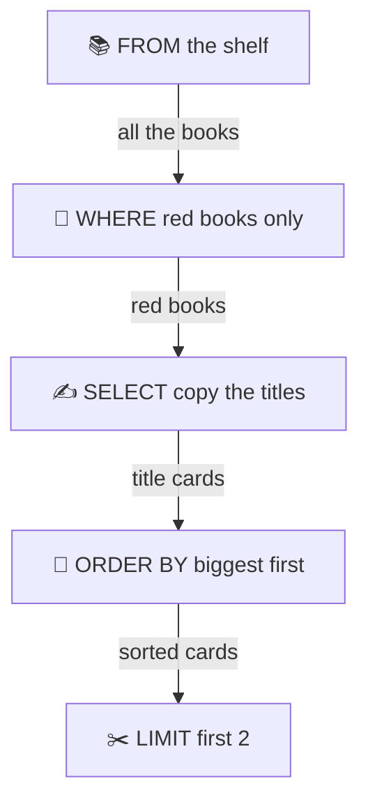
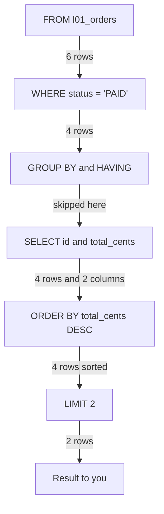
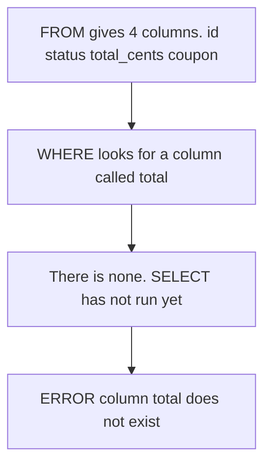
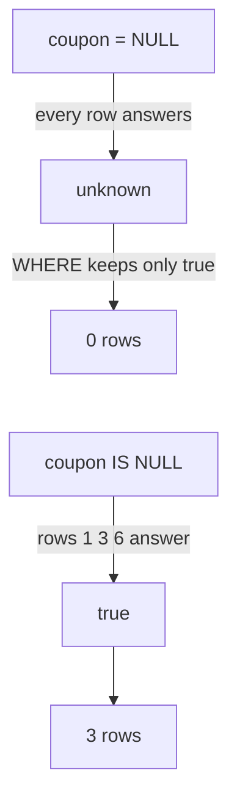
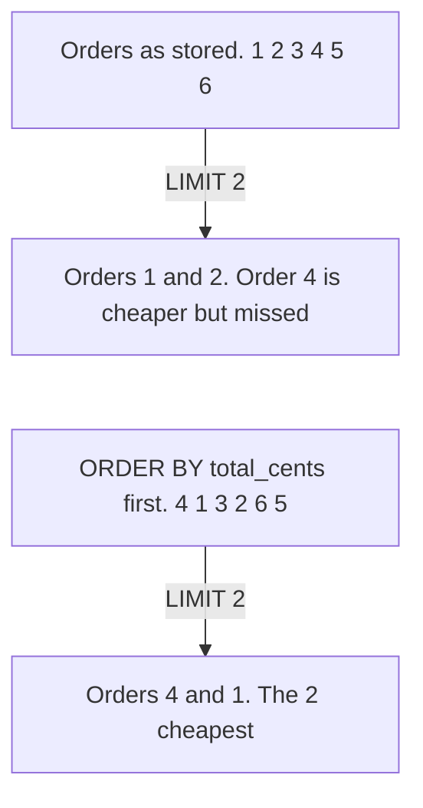

# 01. SQL basics and the order a query runs

> **Subject:** Database · **Lesson:** 01 · **Made:** 2026-10-16 · **Remade in short cards:** 2026-10-26 · **Status:** ready
>
> **You will be able to:** read a SELECT with WHERE, ORDER BY and LIMIT, say the order Postgres works in (FROM first, SELECT almost last), and use that order to explain why a new name from SELECT fails in WHERE, and why `= NULL` finds nothing.
>
> **Before this:** none, this is the first lesson · **Next:** [Joins](02-joins.md)
>
> **How to read it:** one card is one idea. Look at the picture, then guess, then press the orange bar to check. About 15 minutes.

## 1. The idea: a librarian's slip

You give a librarian a slip: **"Titles of red books, biggest first, only 2."**



Notice: the slip says "titles" first. But she copies the titles **third**. She must hold the books before she can copy anything.

<details class="guess"><summary>🤔 Guess: does she copy the titles first? Press to check.</summary>

No. She goes to the shelf first.

Postgres does the same. You write SELECT first. Postgres runs it almost last.

</details>

> **Remember:** you write SELECT first. Postgres works on it almost last.

The slip is only an analogy. A real librarian might guess what a nickname you made up means. Postgres never guesses (card 3).

## 2. Follow the rows through the query

Every card uses one tiny table, `l01_orders`, with 6 orders. A **row** is one order. A **column** is one fact about it, like `status`.

| id | status | total_cents | coupon |
|---|---|---|---|
| 1 | PAID | 5000 | NULL |
| 2 | PENDING | 12000 | NEW10 |
| 3 | PAID | 8000 | NULL |
| 4 | CANCELLED | 3000 | NEW10 |
| 5 | PAID | 20000 | VIP |
| 6 | PAID | 15000 | NULL |

This query asks for the 2 biggest PAID orders. The numbers show the order Postgres works in:

```sql
SELECT id, total_cents       -- 5th
FROM l01_orders              -- 1st
WHERE status = 'PAID'        -- 2nd
ORDER BY total_cents DESC    -- 6th
LIMIT 2;                     -- 7th
```

Notice: SELECT is the fifth box, not the first. The rows get fewer as they move down.



GROUP BY puts rows into buckets, and HAVING throws away buckets. Both are lesson 03. Here they do nothing.

<details class="guess"><summary>🤔 Guess: which 2 orders come out? Press to check.</summary>

```
 id | total_cents
----+-------------
  5 |       20000
  6 |       15000
(2 rows)
```

WHERE kept the 4 PAID orders (1, 3, 5 and 6). ORDER BY put the biggest first. LIMIT kept the first 2.

</details>

> **Remember:** the order is FROM, WHERE, GROUP BY, HAVING, SELECT, ORDER BY, LIMIT. A part can only use what the parts before it made.

<details><summary>Run it yourself: make the table (optional)</summary>

Run this once in any Postgres:

```sql
CREATE TABLE l01_orders (
  id int PRIMARY KEY, status text NOT NULL,
  total_cents int NOT NULL, coupon text
);
INSERT INTO l01_orders VALUES
  (1, 'PAID', 5000, NULL),  (2, 'PENDING', 12000, 'NEW10'),
  (3, 'PAID', 8000, NULL),  (4, 'CANCELLED', 3000, 'NEW10'),
  (5, 'PAID', 20000, 'VIP'), (6, 'PAID', 15000, NULL);
```

Checked on 2026-10-26 with PostgreSQL 17.5 (PGlite). Earlier checks on PostgreSQL 16 and 18 gave the same results for plain queries like these.

</details>

## 3. Mistake 1: a new name in WHERE

In SELECT you can give a column a new name with `AS`. (Interview word: *alias*.) Now try to use that name in WHERE:

```sql
-- SELECT makes the name "total"
SELECT id,
  total_cents / 100 AS total
FROM l01_orders
-- WHERE uses the name too early
WHERE total >= 100;
```

Notice: when WHERE runs, SELECT has not run yet. WHERE only has the columns of the table.



<details class="guess"><summary>🤔 Guess: will this query run? Press to check.</summary>

No. Postgres stops with `ERROR:  column "total" does not exist`.

The fix: in WHERE, write the full expression. ORDER BY runs after SELECT, so it can use the name.

```sql
SELECT id,
  total_cents / 100 AS total
FROM l01_orders
-- WHERE: the full expression
WHERE total_cents / 100 >= 100
-- ORDER BY: the name works
ORDER BY total DESC;
```

```
 id | total
----+-------
  5 |   200
  6 |   150
  2 |   120
(3 rows)
```

</details>

> **Remember:** a new name works in ORDER BY, not in WHERE. In WHERE, write the full expression.

## 4. Mistake 2: NULL is an empty box

Orders 1, 3 and 6 have an empty box in `coupon`. That is **NULL**. It does not mean 0. It means **unknown**.

A test in WHERE can answer three things. "Unknown" is what you get when a NULL is involved. Notice that only "true" keeps the row:

| The test says | The row |
|---|---|
| ✅ true | stays |
| ❌ false | dropped |
| ❓ unknown | dropped too |

Now find the orders with no coupon:

```sql
SELECT id
FROM l01_orders
WHERE coupon = NULL;
```

<details class="guess"><summary>🤔 Guess: how many rows come back? Press to check.</summary>

**0 rows, and no error.** `= NULL` asks "is the box equal to unknown?". The answer is unknown, never true. Even `NULL = NULL` is unknown.

`IS NULL` asks a different question: "is the box empty?". That has a clear answer.



```sql
SELECT id
FROM l01_orders
WHERE coupon IS NULL
ORDER BY id;
```

```
 id
----
  1
  3
  6
(3 rows)
```

</details>

> **Remember:** NULL means unknown. Test for it with `IS NULL`, never with `= NULL`.

## 5. Mistake 3: LIMIT without ORDER BY

Think of a pile of books. "Give me 2 books." She hands you the top 2 of the pile. Are they the cheapest? Nobody said.

```sql
-- the 2 cheapest orders?
SELECT id, total_cents
FROM l01_orders
LIMIT 2;
```



<details class="guess"><summary>🤔 Guess: are these the 2 cheapest orders? Press to check.</summary>

No. On this table you get orders 1 and 2. The cheapest is order 4 (3000), and it is missing.

Without ORDER BY, Postgres promises no order. It sends whatever it finds first. Add ORDER BY:

```sql
SELECT id, total_cents
FROM l01_orders
ORDER BY total_cents
LIMIT 2;
```

```
 id | total_cents
----+-------------
  4 |        3000
  1 |        5000
(2 rows)
```

The wrong query can look right on a small table and break later.

</details>

> **Remember:** LIMIT without ORDER BY gives any rows. When you mean "first", "top" or "cheapest", add ORDER BY.

## 6. Watch it run, step by step

Now watch Postgres do it. **[Open the query order stepper](visuals/01-sql-basics-and-query-order.html).** WHERE paints rows green or red, SELECT fades columns, ORDER BY moves rows, and LIMIT cuts them. Six tabs cover cards 2 to 4. Guess first, then press Next.

<details><summary>Or read the steps as a table</summary>

The query from card 2:

| Step | Part | What happens | Rows left |
|---|---|---|---|
| 1 | FROM | takes every row | 6 |
| 2 | WHERE | throws away orders 2 and 4 | 4 |
| 3 | GROUP BY | not in this query, skipped | 4 |
| 4 | HAVING | not in this query, skipped | 4 |
| 5 | SELECT | keeps only id and total_cents | 4 |
| 6 | ORDER BY | sorts biggest first: 5, 6, 3, 1 | 4 |
| 7 | LIMIT | keeps the first 2: orders 5 and 6 | 2 |

</details>

## 7. Why it matters and what it costs

The order has a name: the *logical order*. (Interview words: *logical query processing order*, or *SQL order of execution*.)

- **Without it,** errors look random. A new name fails. A NULL test finds nothing. "Top 2" gives the wrong rows.
- **With it,** you can predict them. Each part only sees what the parts before it made. So WHERE cannot use a new name from SELECT, and it cannot use `count(*)` either. That is what HAVING is for (lesson 03).
- **The cost:**
  - You repeat the expression in WHERE. To avoid that, wrap the query in a subquery or a WITH (lesson 04).
  - The order says nothing about speed. You check speed with EXPLAIN (lesson 11).
  - A test that touches NULL can answer "unknown", so rows can go missing quietly.

## 8. Watch and play

Links checked on 2026-10-16. Each page was opened. For each video, the title and channel were confirmed through YouTube's oEmbed data. The video lengths were not checked.

- **Video:** [Secret To Optimizing SQL Queries - Understand The SQL Execution Order](https://www.youtube.com/watch?v=BHwzDmr6d7s) by ByteByteGo. A short animated walk through the order. Watch it after the stepper.
- **Video:** [SQL Explained in 100 Seconds](https://www.youtube.com/watch?v=zsjvFFKOm3c) by Fireship. A fast first look at tables, rows and SELECT.
- **Play with it:** [The query order stepper](visuals/01-sql-basics-and-query-order.html) in this folder. Guess first, then press Next.
- **Play with it:** [SQLBolt lesson 12: Order of execution of a Query](https://sqlbolt.com/lesson/select_queries_order_of_execution). Type queries in the browser. Say the order out loud before you run each one.
- **Play with it:** [PostgreSQL Exercises: Control which rows are retrieved](https://pgexercises.com/questions/basic/where.html). A real WHERE task with a Run Query button. Do the rest of the "Basic" section after it.
- **Read:** [SQL queries don't start with SELECT](https://jvns.ca/blog/2019/10/03/sql-queries-don-t-start-with-select/) by Julia Evans. One drawing of the order, and a note that the database may run things in a different order if the result stays the same.
- **Read:** [PostgreSQL docs: SELECT](https://www.postgresql.org/docs/current/sql-select.html). Read only the numbered list under "Description". It is the official version of the pipeline.

<details><summary>More links (optional)</summary>

- **Read:** [Sorting rows](https://www.postgresql.org/docs/current/queries-order.html) in the PostgreSQL docs. NULLS FIRST, NULLS LAST, and sorting by a new name.
- **Read:** [Comparison functions and operators](https://www.postgresql.org/docs/current/functions-comparison.html). The box that says "Do not write expression = NULL", and `IS DISTINCT FROM`.
- **Play with it:** [SQLBolt lesson 4: Filtering and sorting](https://sqlbolt.com/lesson/filtering_sorting_query_results) for ORDER BY and LIMIT, and [SQLBolt lesson 8: A short note on NULLs](https://sqlbolt.com/lesson/select_queries_with_nulls).
- **Read:** [PostgreSQL 18 release notes](https://www.postgresql.org/docs/release/18.0/). Only needed for the EXPLAIN differences in the Go deeper box of card 13.
- **Read (revision, dense):** [PostgreSQL queries interview guide](postgresql-queries-interview-guide.md) in this folder. Its LEFT JOIN trap is the same NULL rule from this lesson.

</details>

## 9. Practice

**A. Predict the output** (write your answer before opening). Use the table from card 2.

```sql
SELECT id
FROM l01_orders
WHERE coupon <> 'NEW10'
ORDER BY total_cents
LIMIT 2;
```

<details class="guess"><summary>🤔 Press to see the answer</summary>

```
 id
----
  5
(1 row)
```

Only 1 row, even with `LIMIT 2`. Orders 2 and 4 answer false. Orders 1, 3 and 6 have NULL, so they answer unknown and are thrown away too. LIMIT is the most you get, not a promise.

</details>

**B. Fix the bug.** This query should show the 2 cheapest orders that have no coupon, with the price in dollars. It has 3 bugs. Find them all.

```sql
SELECT id,
  total_cents / 100 AS dollars
FROM l01_orders
WHERE coupon = NULL AND dollars < 150
LIMIT 2;
```

<details class="guess"><summary>🤔 Press to see the answer</summary>

1. `coupon = NULL` is never true. Use `coupon IS NULL` (card 4).
2. `dollars` does not exist in WHERE yet. Write `total_cents / 100 < 150` (card 3).
3. There is no ORDER BY, so "the 2 cheapest" is not promised. Add `ORDER BY dollars` (card 5).

```sql
SELECT id,
  total_cents / 100 AS dollars
FROM l01_orders
WHERE coupon IS NULL AND total_cents / 100 < 150
ORDER BY dollars
LIMIT 2;
```

```
 id | dollars
----+---------
  1 |      50
  3 |      80
(2 rows)
```

</details>

**C. Write it yourself**

Open [`practice/01-sql-basics-and-query-order.sql`](practice/01-sql-basics-and-query-order.sql). It makes two tiny tables and has six tasks, each with the exact expected result: top 3 PAID orders, the new-name bug, stores with no phone, the `<>` trap, NULL first in a sort, and (optional) a real plan. Run the file once in psql (the top of the file shows how), then write each query under its TODO.

<details><summary>One possible answer</summary>

```sql
-- Task 1
SELECT id, total_cents
FROM l01_orders
WHERE status = 'PAID'
ORDER BY total_cents DESC
LIMIT 3;

-- Task 2: WHERE runs before SELECT, so the name total does not exist yet.
SELECT id,
  total_cents / 100 AS total
FROM l01_orders
WHERE total_cents / 100 < 100
ORDER BY total;

-- Task 3
SELECT id, name FROM l01_stores WHERE phone IS NULL ORDER BY id;

-- Task 4 (two ways, same 5 rows)
SELECT id, coupon FROM l01_orders WHERE coupon <> 'VIP' OR coupon IS NULL ORDER BY id;
SELECT id, coupon FROM l01_orders WHERE coupon IS DISTINCT FROM 'VIP' ORDER BY id;

-- Task 5
SELECT id, phone FROM l01_stores ORDER BY phone NULLS FIRST, id;
```

Task 6: read from the bottom. `Seq Scan on orders` is FROM. `Filter: (status = 'PAID'::text)` is WHERE. `Sort` with `Sort Key: total_cents DESC` is ORDER BY. `Limit` is LIMIT. SELECT has no line of its own. Postgres picks the columns as rows pass through.

</details>

## 10. Interview question

**Q:** "In what order does a SQL query run? Why can I use a column alias in ORDER BY but not in WHERE?"

<details><summary>A strong answer, in four parts</summary>

1. **Problem:** we write SELECT first, but the database cannot pick columns before it has rows. If you think SELECT runs first, errors like "column does not exist" for an alias in WHERE look random.
2. **How it works:** the logical order is FROM, WHERE, GROUP BY, HAVING, SELECT, ORDER BY, LIMIT. Each part only sees what the parts before it made. An alias is made in SELECT. WHERE runs before SELECT, so the alias does not exist there. ORDER BY runs after SELECT, so it can use it. LIMIT runs last, so it cuts after the sort. NULL means unknown: `= NULL` is never true, so you need `IS NULL`.
3. **Tradeoff:** this order is about the result, not about speed. The planner can reorder work or stop early, for example a top-N sort or an index that gives rows already sorted. You check the real work with EXPLAIN. And in WHERE you must repeat the expression, or wrap the query in a subquery or a CTE.
4. **My example:** *This is an idea, not a fact. Replace it with a real story from DBO, Unloan, ZWS or Skyworx.* In a B2B app like DBO, a screen shows "the 20 newest paid orders for a store". The query is FROM orders, WHERE store and status, ORDER BY created_at DESC, LIMIT 20. Prisma's `findMany` with `where`, `orderBy` and `take` builds the same query. If a filter needs "no coupon", it must be `IS NULL` (in Prisma, `coupon: null`), never a comparison with `=`.

</details>

## 11. Explain it back

Close this file. Press the **Record my explanation** button under this heading and explain the order a query runs, like to a new junior, in 4 parts: problem, how it works, tradeoff, my example. Use the query from card 2, and say what happens to the rows at each step. Then save the transcript into `my-learning/recordings/`, or write your best version below. Run `/explain-check sql query order` or ask the `explain-coach` agent to review it.

### My explanation

<write here>

### Coach feedback

<the explain-coach agent writes here>

## 12. Review questions (day 1, 3, 7, 21)

1. Say the logical order of a query. Which part makes a new name with AS?
2. Why does `WHERE total >= 100` fail when `total` is a new name from SELECT, while `ORDER BY total` works?
3. Why does `WHERE coupon = NULL` return 0 rows with no error? What do you write instead, and where does NULL go when you sort from small to big?
4. Draw the picture from card 2 from memory: the seven boxes, and the row count on each arrow for the query in card 2.

<details><summary>Answers</summary>

1. FROM, WHERE, GROUP BY, HAVING, SELECT, ORDER BY, LIMIT. SELECT makes the new name.
2. WHERE runs before SELECT, so when WHERE looks for `total`, SELECT has not made it yet. ORDER BY runs after SELECT, so the name exists by then. In WHERE, write the full expression `total_cents / 100`.
3. NULL means unknown, so `coupon = NULL` answers unknown for every row, and WHERE keeps only rows that answer true. It is not an error, just a test that is never true. Write `coupon IS NULL`. When you sort from small to big, NULL goes last. With DESC it goes first.
4. FROM gives 6 rows, WHERE leaves 4, GROUP BY and HAVING are skipped, SELECT keeps 4 rows with 2 columns, ORDER BY sorts the 4, LIMIT leaves 2: orders 5 and 6.

</details>

## 13. Go deeper (optional)

Open these when you are ready. None of them is needed for the cards above.

<details><summary>Try it on the big practice tables</summary>

The big tables `stores` and `orders` come from the Docker playground (the top of the practice file shows how). `stores` has fixed data, so you get the same answer:

```sql
SELECT id, name, city FROM stores WHERE city = 'Medan' ORDER BY id LIMIT 3;
```

```
 id |   name   | city
----+----------+-------
  3 | Store 3  | Medan
  8 | Store 8  | Medan
 13 | Store 13 | Medan
(3 rows)
```

On `orders` the totals are random, so expect different numbers there.

The NULL rule on the big table. Only store 1 has no `referred_by`:

```sql
SELECT id, name FROM stores WHERE referred_by = NULL;    -- (0 rows)
SELECT id, name FROM stores WHERE referred_by IS NULL;   --  1 | Store 1
```

The `<>` trap, with the same rule:

```sql
SELECT count(*) FROM stores WHERE referred_by <> 2;                          -- 997
SELECT count(*) FROM stores WHERE referred_by <> 2 OR referred_by IS NULL;   -- 998
```

For store 1, `NULL <> 2` is unknown, so WHERE throws it away. There are 1,000 stores and 2 are referred by store 2, so 998 are not.

</details>

<details><summary>The real plan takes shortcuts</summary>

The logical order is a promise about the **result**, not a list of what the machine does. The real list of work is called the query plan, and you read it with `EXPLAIN` (lesson 11). For the same shape of query on the big `orders` table, PostgreSQL 18.3 printed this:

```
EXPLAIN (ANALYZE, COSTS OFF, TIMING OFF, BUFFERS OFF)
SELECT id, store_id, total_cents FROM orders
WHERE status = 'PAID' ORDER BY total_cents DESC LIMIT 5;

Limit (actual rows=5.00 loops=1)
  ->  Sort (actual rows=5.00 loops=1)
        Sort Key: total_cents DESC
        Sort Method: top-N heapsort  Memory: 17kB
        ->  Seq Scan on orders (actual rows=42983.00 loops=1)
              Filter: (status = 'PAID'::text)
              Rows Removed by Filter: 57017
```

Read it from the bottom up. It matches the pipeline: Seq Scan is FROM, Filter is WHERE, Sort is ORDER BY, Limit is LIMIT. But look at "top-N heapsort". Postgres knew only 5 rows were wanted, so it kept only the best 5 while reading. It never sorted all 42,983 rows. Your counts will differ because the seed is random.

On PostgreSQL 16 (the Docker playground) you will see `rows=5` with no decimals. PostgreSQL 18 shows `rows=5.00`. PostgreSQL 18 also adds buffer numbers to `EXPLAIN ANALYZE` by default, which is why the command above turns them off. Both changes are in the [PostgreSQL 18 release notes](https://www.postgresql.org/docs/release/18.0/).

With an index on `total_cents`, the plan can even skip the sort and stop after 5 rows. That is lesson 09 and lesson 10.

</details>

<details><summary>Small rules that surprise people</summary>

- **ORDER BY can sort by a column you did not pick.** `SELECT id FROM l01_orders ORDER BY total_cents DESC LIMIT 2` works and returns 5 and 6. Postgres keeps `total_cents` out of sight until the sort is done.
- **A new name in ORDER BY must stand alone.** `ORDER BY total` works. `ORDER BY total + 1` fails with `column "total" does not exist`. The [PostgreSQL docs on sorting](https://www.postgresql.org/docs/current/queries-order.html) say "an output column name has to stand alone".
- **GROUP BY can also use a new name in Postgres.** `SELECT status AS s, count(*) FROM l01_orders GROUP BY s` works. This is a Postgres extra. The [SELECT docs](https://www.postgresql.org/docs/current/sql-select.html) say new names work in ORDER BY and GROUP BY, but not in WHERE or HAVING.
- **DISTINCT runs after SELECT and before ORDER BY.** It removes rows that are the same in every picked column.
- **Where NULL goes in a sort.** Postgres sorts NULL as if it were bigger than every value. So NULL comes last with normal order and first with `DESC`. You can choose with `NULLS FIRST` or `NULLS LAST`.
- **Treating NULL like a normal value.** `a IS DISTINCT FROM b` works like `<>`, but NULL against NULL gives false, and NULL against a value gives true. So `WHERE coupon IS DISTINCT FROM 'VIP'` keeps the NULL rows. See [comparison functions](https://www.postgresql.org/docs/current/functions-comparison.html).
- **Interview words for NULL:** "three-valued logic" means the three answers true, false and unknown.

</details>

## Connected lessons

- [Joins](02-joins.md): the next lesson. A JOIN is part of FROM, so it runs first of all. The LEFT JOIN trap there is the NULL rule from this lesson.
- [Grouping and aggregation](03-grouping-and-aggregation.md): the GROUP BY and HAVING boxes of the pipeline, and why WHERE cannot use `count(*)`.
- [Subqueries, CTEs and EXISTS](04-subqueries-ctes-and-exists.md): how to give a name once and use it in WHERE, by wrapping the query.
- [Window functions](05-window-functions.md): they run inside SELECT, so WHERE cannot use them either.
- [Reading EXPLAIN](11-reading-explain.md): the real plan, and the shortcuts Postgres takes while keeping the same result.
- Pagination (lesson 17, not written yet): LIMIT with OFFSET, and why page 5000 is slow.
