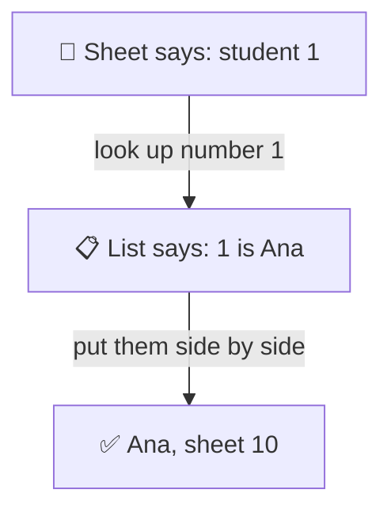
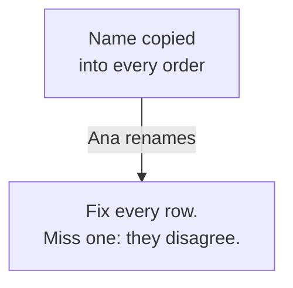
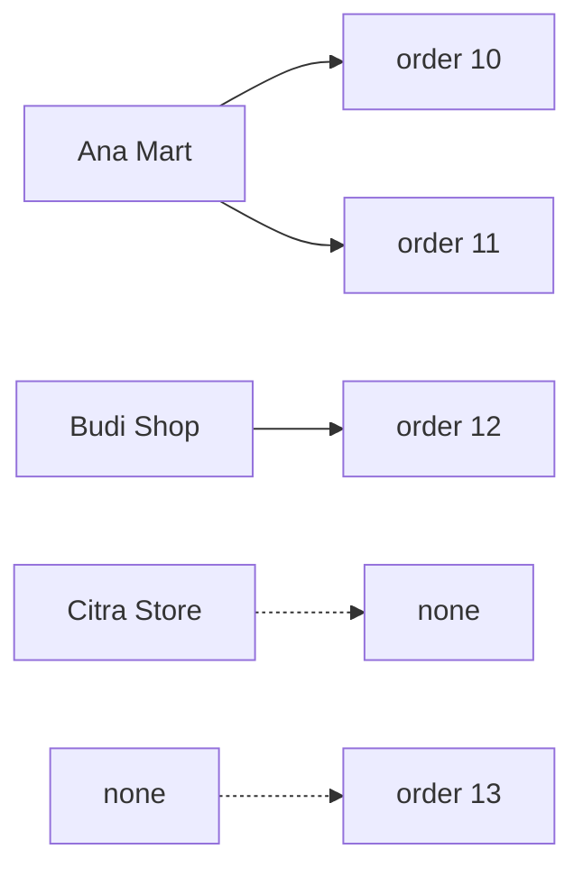
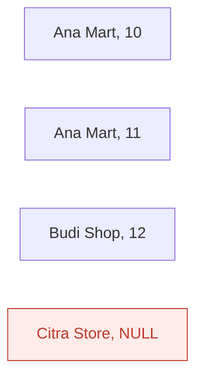
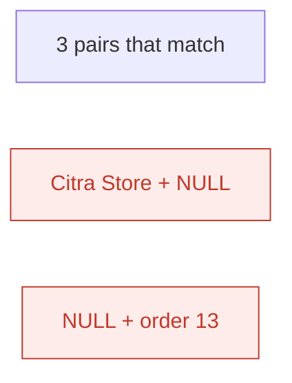
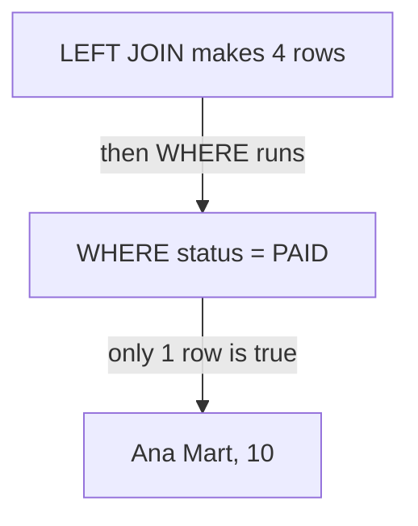
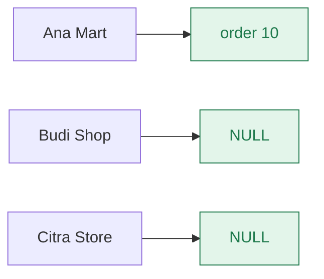
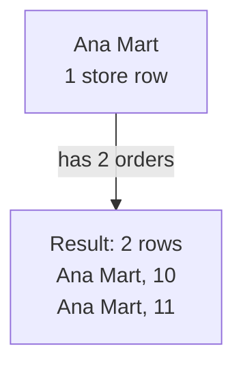
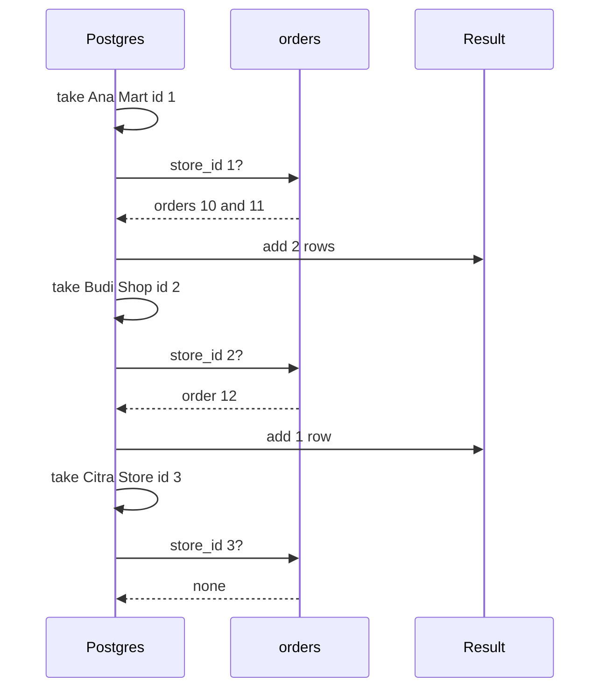

# 02. Joins

> **Subject:** Database · **Lesson:** 02 · **Made:** 2026-10-16 · **Remade in short cards:** 2026-10-28 · **Status:** ready
>
> **You will be able to:** draw what INNER, LEFT, RIGHT and FULL joins keep, say why one store with two orders becomes two rows, and explain why `LEFT JOIN ... WHERE o.status = 'PAID'` quietly loses stores.
>
> **Before this:** [SQL basics and the order a query runs](01-sql-basics-and-query-order.md) · **Next:** [Grouping and aggregation](03-grouping-and-aggregation.md)
>
> **How to read it:** one card is one idea. Look at the picture, guess, then press the orange bar to check. The blue bars (📖 More detail) hold the longer explanation. Skip them on the first read, and open them when you want more. About 20 minutes for the cards.

## 1. The idea: a class list and homework sheets

A teacher has a **class list** and a pile of **homework sheets**. A sheet shows only a student **number**, not a name.



Notice: the sheet cannot answer alone. Someone must look up the number. A **join** is that look-up, done for every row.

<details class="guess"><summary>🤔 Guess: why not write Ana's name on every sheet? Press to check.</summary>

If Ana changes her name, you must fix every sheet. Miss one, and the sheets disagree.

So each name is kept once. The sheet keeps only the number. A join puts them together when you read.

</details>

> **Remember:** a join puts rows from two tables side by side when the **match rule** (the part after `ON`) says they belong together.

<details class="more"><summary>📖 More detail: the four words, and where the teacher picture stops</summary>

- **Join:** Postgres glues a row from one table to a row from another table when they match.
- **Match rule:** the part after `ON`, like `o.store_id = s.id`. (Interview word: *join condition*.)
- **NULL:** an empty cell, "no value here". Not 0, not empty text.
- **Fan-out:** one row becomes many, because it matched many rows. (Interview word: *fan-out*.)

This is the "one big table" problem, drawn:



Where the teacher picture stops: "no homework" is a clear fact. NULL means "I do not know". So `NULL = 'PAID'` is not false. It is NULL, and WHERE throws it away (card 5).

</details>

## 2. Two tiny tables and INNER JOIN

Every card uses the same two tiny tables. `l02_stores` has 3 stores. `l02_orders` has 4 orders. Each order keeps its store's **number**, `store_id`.

| id | name |
|---|---|
| 1 | Ana Mart |
| 2 | Budi Shop |
| 3 | Citra Store |

| id | store_id | status |
|---|---|---|
| 10 | 1 | PAID |
| 11 | 1 | PENDING |
| 12 | 2 | CANCELLED |
| 13 | 4 | PAID |

The lines show which order belongs to which store:



Notice: Citra Store has no orders. Order 13 points to a store that does not exist.

An **INNER JOIN** (just `JOIN`) keeps only the pairs that match. `s` and `o` are short names for the two tables.

```sql
SELECT s.name, o.id AS order_id, o.status
FROM l02_stores s
JOIN l02_orders o ON o.store_id = s.id
ORDER BY s.id, o.id;
```

<details class="guess"><summary>🤔 Guess: which rows are missing from the result? Press to check.</summary>

```
name      | order_id | status
----------+----------+----------
Ana Mart  | 10       | PAID
Ana Mart  | 11       | PENDING
Budi Shop | 12       | CANCELLED
(3 rows)
```

Citra Store is gone (no orders). Order 13 is gone (no store). Neither has a partner.

</details>

> **Remember:** INNER JOIN keeps only the pairs that match.

<details class="more"><summary>📖 More detail: run it yourself, and what Postgres does</summary>

Run this once in any Postgres:

```sql
DROP TABLE IF EXISTS l02_orders, l02_stores;
CREATE TABLE l02_stores (
  id int PRIMARY KEY, name text NOT NULL);
CREATE TABLE l02_orders (
  id int PRIMARY KEY, store_id int,
  status text NOT NULL);
INSERT INTO l02_stores VALUES
  (1, 'Ana Mart'), (2, 'Budi Shop'),
  (3, 'Citra Store');
INSERT INTO l02_orders VALUES
  (10, 1, 'PAID'), (11, 1, 'PENDING'),
  (12, 2, 'CANCELLED'), (13, 4, 'PAID');
```

- In psql, type `\pset null NULL` first. Otherwise NULL shows as an empty cell.
- Nothing stops order 13 from pointing to a missing store. A later lesson (06, not written yet) adds the rule that does (a *foreign key*).
- `FROM l02_stores s` gives the table a short name, `s`, for this query.

Checked on 2026-10-28 with PostgreSQL 17.5 (PGlite). An earlier check on PostgreSQL 18.3 gave the same results. Your Docker playground runs 16. Join results are the same.

</details>

## 3. LEFT JOIN: every left row stays

The **left** table is the one after `FROM`. A **LEFT JOIN** keeps every row of it. If nothing matches, Postgres fills the other side with NULL.



Notice: the red row is Citra Store, with NULL on the order side. The query is the same as card 2, with one word added:

```sql
SELECT s.name, o.id AS order_id, o.status
FROM l02_stores s
LEFT JOIN l02_orders o
  ON o.store_id = s.id
ORDER BY s.id, o.id;
```

<details class="guess"><summary>🤔 Guess: where is order 13 now? Press to check.</summary>

```
name        | order_id | status
------------+----------+----------
Ana Mart    | 10       | PAID
Ana Mart    | 11       | PENDING
Budi Shop   | 12       | CANCELLED
Citra Store | NULL     | NULL
(4 rows)
```

Still missing. A LEFT JOIN only rescues rows from the **left** table. Order 13 is on the right side.

</details>

> **Remember:** LEFT JOIN keeps every left row. An empty right side is NULL.

<details class="more"><summary>📖 More detail: what Postgres does, row by row</summary>

| Step | Query part | What Postgres does | Result so far |
|---|---|---|---|
| 1 | `FROM l02_stores s` | Opens the stores table. Calls it `s`. | empty |
| 2 | `LEFT JOIN l02_orders o` | Opens the orders table. Calls it `o`. | empty |
| 3 | `ON o.store_id = s.id` | Takes Ana Mart (id 1). Checks every order. Orders 10 and 11 have store_id 1. | Ana Mart, 10 / Ana Mart, 11 |
| 4 | same | Takes Budi Shop (id 2). Order 12 matches. | + Budi Shop, 12 |
| 5 | same | Takes Citra Store (id 3). No order has store_id 3. | still 3 rows |
| 6 | `LEFT` | Keeps the left row. Fills the order side with NULL. | + Citra Store, NULL, NULL |
| 7 | (the right side) | Order 13 points to store 4. There is no store 4. A LEFT JOIN only rescues left rows. | 4 rows |
| 8 | `ORDER BY s.id, o.id` | Sorts by store id, then order id. | 4 rows, sorted |
| 9 | `SELECT ...` | Keeps three columns. Names `o.id` as `order_id`. | the output above |

This is the idea, not the exact method. Postgres may find the matches a faster way ([lesson 11](11-reading-explain.md)), but the rows are the same.

</details>

## 4. RIGHT and FULL: the other sides

There are three kinds of rows in this data: the pairs, a store with no orders, and an order with no store.



<details class="guess"><summary>🤔 Guess: which joins keep the two red rows? Press to check.</summary>

"Citra Store + NULL" is kept by LEFT and FULL.
"NULL + order 13" is kept by RIGHT and FULL.

| Join | Keeps | Rows here |
|---|---|---|
| INNER | only the pairs | 3 |
| LEFT | the pairs + lonely stores | 4 |
| RIGHT | the pairs + lonely orders | 4 |
| FULL | all of it | 5 |

</details>

> **Remember:** INNER keeps the pairs. LEFT, RIGHT and FULL also keep the lonely rows from one side or both.

<details class="more"><summary>📖 More detail: the RIGHT and FULL results</summary>

LEFT, RIGHT and FULL have one interview name: **outer joins**. They keep rows that have no match. A RIGHT JOIN is a LEFT JOIN with the two tables swapped.

Change the word in card 3 to `RIGHT JOIN`, and order by `o.id`:

```
name      | order_id | status
----------+----------+----------
Ana Mart  | 10       | PAID
Ana Mart  | 11       | PENDING
Budi Shop | 12       | CANCELLED
NULL      | 13       | PAID
(4 rows)
```

Change it to `FULL JOIN`:

```
name        | order_id | status
------------+----------+----------
Ana Mart    | 10       | PAID
Ana Mart    | 11       | PENDING
Budi Shop   | 12       | CANCELLED
Citra Store | NULL     | NULL
NULL        | 13       | PAID
(5 rows)
```

</details>

## 5. Mistake 1: the check goes in WHERE

The goal: **every store**, with its PAID orders. Many people add the check as a `WHERE` line:

```sql
SELECT s.name, o.id AS order_id,
  o.status
FROM l02_stores s
LEFT JOIN l02_orders o
  ON o.store_id = s.id
WHERE o.status = 'PAID';
```

[Lesson 01](01-sql-basics-and-query-order.md) showed the order: the join runs first, then WHERE.



<details class="guess"><summary>🤔 Guess: how many of the 3 stores come back? Press to check.</summary>

```
name     | order_id | status
---------+----------+-------
Ana Mart | 10       | PAID
(1 row)
```

Only Ana Mart. No error. Budi Shop and Citra Store vanish. The LEFT JOIN is now acting like an INNER JOIN.

| Row after the join | `status = 'PAID'` | WHERE |
|---|---|---|
| Ana Mart, 10, PAID | true | keeps it |
| Ana Mart, 11, PENDING | false | throws it away |
| Budi Shop, 12, CANCELLED | false | throws it away |
| Citra Store, NULL | NULL (unknown) | throws it away |

WHERE keeps only rows that answer **true**. NULL is not true.

</details>

> **Remember:** WHERE runs after the join, and `NULL = 'PAID'` is never true.

<details class="more"><summary>📖 More detail: the half fix that still loses a store</summary>

A common try is `WHERE o.status = 'PAID' OR o.id IS NULL`:

```
name        | order_id
------------+---------
Ana Mart    | 10
Citra Store | NULL
(2 rows)
```

Citra Store is back, but Budi Shop is still missing. Budi Shop has a CANCELLED order, so its row is not NULL. It fails `status = 'PAID'` and is thrown away.

The same trap happens with other signs. `WHERE o.status <> 'CANCELLED'` loses Citra Store too, because `NULL <> 'CANCELLED'` is NULL, not true. That is practice task A.

</details>

## 6. The fix: put the check in ON

The check is not a filter on the result. It is part of the **match**. Move it into `ON`:

```sql
SELECT s.name, o.id AS order_id,
  o.status
FROM l02_stores s
LEFT JOIN l02_orders o
  ON o.store_id = s.id
  AND o.status = 'PAID'
ORDER BY s.id, o.id;
```



Notice: only a PAID order counts as a match. Budi Shop has orders, but none is PAID. It is kept with NULL anyway.

<details class="guess"><summary>🤔 Guess: why does Budi Shop stay now? Press to check.</summary>

```
name        | order_id | status
------------+----------+-------
Ana Mart    | 10       | PAID
Budi Shop   | NULL     | NULL
Citra Store | NULL     | NULL
(3 rows)
```

Orders 11 and 12 are now just "not a match". Budi Shop has no pair, and a LEFT JOIN keeps a left row with no pair.

</details>

> **Remember:** to keep every left row, filter the right table in `ON`, not in `WHERE`.

<details class="more"><summary>📖 More detail: what the docs say about ON and WHERE</summary>

The PostgreSQL docs say a condition in `ON` is used before the join, and a condition in `WHERE` is used after it. "That does not matter with inner joins, but it matters a lot with outer joins." See [Table Expressions](https://www.postgresql.org/docs/current/queries-table-expressions.html).

So with an **inner** join you can put the check in either place. With a LEFT join, the place changes the answer. When you are unsure, ask: "do I want to remove stores, or only remove orders?"

</details>

## 7. Mistake 2: counting rows after a join

One store row turned into two result rows for Ana Mart. This is **fan-out**.



```sql
SELECT count(*)
FROM l02_stores s
JOIN l02_orders o
  ON o.store_id = s.id;
```

<details class="guess"><summary>🤔 Guess: how many stores have orders? What does count(*) say? Press to check.</summary>

Only 2 stores have orders (Ana Mart and Budi Shop). But `count(*)` gives **3**, because Ana Mart is counted twice.

Fix: count each store once.

```sql
SELECT count(DISTINCT s.id)
FROM l02_stores s
JOIN l02_orders o
  ON o.store_id = s.id;
```

That gives **2**.

</details>

> **Remember:** a join can multiply rows. Count with `DISTINCT`, or ask a yes or no question with `EXISTS`.

<details class="more"><summary>📖 More detail: sums break too, and what to use instead</summary>

Sums have the same problem. If you join a store to its orders and then add up a column of the **store**, each store is added once per order.

- `count(DISTINCT s.id)` counts each store once.
- Group first, then join. [Lesson 03](03-grouping-and-aggregation.md) goes deeper.
- For "does this store have an order?", use `EXISTS`. It answers yes or no with no fan-out ([lesson 04](04-subqueries-ctes-and-exists.md)).

</details>

## 8. Watch it run, step by step

Press Next and watch each store look for its orders while rows appear in the result. Six tabs: INNER, LEFT, RIGHT, FULL, "The trap" (WHERE crosses out rows) and "The fix". Type the row count you expect first.

**Step through it yourself:** [open the joins stepper](visuals/02-joins.html).

<details class="more"><summary>📖 More detail: the same thing as a picture over time</summary>

The LEFT JOIN from card 3. Each store looks for its orders. Notice Citra Store, which has none.



An INNER JOIN adds nothing for Citra Store. A LEFT JOIN adds a row with NULL.

</details>

## 9. Why it matters and what it costs

- **Without it,** you copy the store name into every order, and the copies can disagree ([lesson 07](07-normalization.md)). Or your app runs one query per table and glues rows in code.
- **With it,** each fact lives in one place. The join puts the pieces together when you read.
- **The cost:**
  - Finding matches takes work. An index on `orders.store_id` makes it fast ([lesson 09](09-indexes-and-b-trees.md)).
  - Fan-out: rows multiply, so counts and sums after a join can be too big.
  - Outer joins give NULLs. Your code must handle the empty side.

## 10. Watch and play

Links checked on 2026-10-16: every page opened, and each video's title and channel were confirmed on YouTube.

- **Video:** [SQL Joins Explained](https://www.youtube.com/watch?v=9yeOJ0ZMUYw) by Socratica, about 10 minutes. Each join with small tables.
- **Video:** [6 SQL Joins you MUST know! (Animated + Practice)](https://www.youtube.com/watch?v=Yh4CrPHVBdE) by Anton Putra, about 10 minutes. Animated rows, after the stepper.
- **Play with it:** [The joins stepper](visuals/02-joins.html) in this folder. Do the trap tab twice.
- **Play with it:** [SQL Join Visualizer](https://chat2db.ai/tools/sql-join-visualizer) by Chat2DB. Type in the tables from card 2 and switch between the joins. It shows the NULLs.
- **Play with it:** [SQLBolt lesson 6 (joins)](https://sqlbolt.com/lesson/select_queries_with_joins) and [lesson 7 (outer joins)](https://sqlbolt.com/lesson/select_queries_with_outer_joins). Short tasks you run in the browser.
- **Play with it:** [PostgreSQL Exercises, joins](https://pgexercises.com/questions/joins/). Real Postgres tasks. "All members, along with their recommender" is like `stores.referred_by`.
- **Read:** [PostgreSQL docs, Table Expressions](https://www.postgresql.org/docs/current/queries-table-expressions.html). In 7.2.1.1, read LEFT, RIGHT, FULL, and `ON` against `WHERE`.

<details><summary>More links (optional)</summary>

- **Read:** [PostgreSQL tutorial, Joins Between Tables](https://www.postgresql.org/docs/current/tutorial-join.html). The official beginner page. It also shows a self join.
- **Read:** [Say NO to Venn Diagrams When Explaining JOINs](https://blog.jooq.org/say-no-to-venn-diagrams-when-explaining-joins/) by Lukas Eder. Why circles are a weak picture for joins: they hide fan-out.
- **Video:** [Learn MySQL joins in 5 minutes!](https://www.youtube.com/watch?v=G3lJAxg1cy8) by Bro Code, about 5 minutes. MySQL, but the joins are the same.
- **Play with it:** [Database Joins: An Interactive Exploration](https://web-apps.thecoatlessprofessor.com/database/joins-demo.html). Change the sample data and see each join type change.
- **Guide:** the longer [PostgreSQL queries guide](postgresql-queries-interview-guide.md) in this folder, section "Joins, properly". Good for revision after this lesson.

</details>

## 11. Practice

**A. Predict the output** (write your answer before opening). Use the tables from card 2.

```sql
SELECT s.name, o.id AS order_id
FROM l02_stores s
LEFT JOIN l02_orders o ON o.store_id = s.id
WHERE o.status <> 'CANCELLED'
ORDER BY s.id, o.id;
```

<details><summary>Answer</summary>

```
name     | order_id
---------+---------
Ana Mart | 10
Ana Mart | 11
(2 rows)
```

Budi Shop's only order is CANCELLED, so WHERE throws it away. Citra Store has NULL, and `NULL <> 'CANCELLED'` is NULL, not true. So Citra Store goes too. It is the same trap with a different sign.

</details>

**B. Fix the bug**

A report for the admin screen must list **all 1,000 stores** with their PAID orders. A count shows only 900 stores. Find the bug.

```sql
SELECT count(DISTINCT s.id)
FROM stores s
LEFT JOIN orders o ON o.store_id = s.id
WHERE o.status = 'PAID';
-- 900
```

<details><summary>Answer</summary>

Stores 901 to 1000 have no orders. The LEFT JOIN keeps them with NULL, then WHERE throws them away. Move the check into `ON`:

```sql
SELECT count(DISTINCT s.id)
FROM stores s
LEFT JOIN orders o ON o.store_id = s.id AND o.status = 'PAID';
-- 1000
```

</details>

**C. Write it yourself**

Open [`practice/02-joins.sql`](practice/02-joins.sql). Two tiny tables, six tasks, each with the exact expected result:

1. Every order with its store name (INNER JOIN).
2. Stores with no orders at all.
3. Fix the trap: every store with its PAID orders.
4. Count stores with orders, without fan-out.
5. Broken data on both sides in one query (FULL JOIN).
6. Who referred each store (a table joined to itself).

The top of the file says how to run it.

<details><summary>One possible answer</summary>

```sql
-- 1
SELECT s.name, o.id AS order_id, o.status
FROM l02_practice_stores s
JOIN l02_practice_orders o ON o.store_id = s.id
ORDER BY o.id;

-- 2  keep every store, then keep only rows where the order side is empty
SELECT s.name
FROM l02_practice_stores s
LEFT JOIN l02_practice_orders o ON o.store_id = s.id
WHERE o.id IS NULL
ORDER BY s.id;

-- 3  the PAID check goes in ON
SELECT s.name, o.id AS order_id
FROM l02_practice_stores s
LEFT JOIN l02_practice_orders o
  ON o.store_id = s.id AND o.status = 'PAID'
ORDER BY s.id, o.id;

-- 4  count each store once
SELECT count(DISTINCT s.id) AS stores_with_orders
FROM l02_practice_stores s
JOIN l02_practice_orders o ON o.store_id = s.id;

-- 5  keep both sides, then keep only rows with an empty side
SELECT s.name, o.id AS order_id
FROM l02_practice_stores s
FULL JOIN l02_practice_orders o ON o.store_id = s.id
WHERE s.id IS NULL OR o.id IS NULL
ORDER BY s.id, o.id;

-- 6  the stores table twice: s is the store, r is the store that referred it
SELECT s.name, r.name AS referred_by_name
FROM l02_practice_stores s
LEFT JOIN l02_practice_stores r ON r.id = s.referred_by
ORDER BY s.id;
```

Task 2 uses `WHERE o.id IS NULL` on purpose. Here the WHERE is the point: it keeps only the rows the LEFT JOIN filled with NULL. Interviewers call this an *anti-join*. Lesson 04 shows `NOT EXISTS`, which does the same job.

Bonus answer: every order belongs to one of stores 1 to 900, so the inner join has exactly 100,000 rows. The LEFT JOIN adds one NULL row for each of the 100 stores without orders.

</details>

## 12. Interview question

**Q:** "What is the difference between an INNER JOIN and a LEFT JOIN? A report uses `LEFT JOIN orders o ... WHERE o.status = 'PAID'`, and some stores are missing. Why, and how do you fix it?"

<details><summary>A strong answer, in four parts</summary>

1. **Problem:** we split data into tables so each fact lives once. Orders keep only `store_id`. To show a store's name next to its orders, we join the tables back together at read time.
2. **How it works:** the match rule after `ON` decides which pairs belong together.
   - INNER JOIN keeps only pairs that match. A store with no orders disappears.
   - LEFT JOIN keeps every store. If nothing matched, the order columns are NULL.
   - RIGHT keeps every row on the right side. FULL keeps both sides.
   - `WHERE` runs after the join. `NULL = 'PAID'` is not true, so WHERE throws away the NULL rows. Stores with no PAID order vanish, and the LEFT JOIN acts like an INNER JOIN. Postgres even plans it as an inner join.
   - The fix: put `o.status = 'PAID'` inside `ON`. Then it is part of the match, and unmatched stores stay with NULL.
3. **Tradeoff:** a join causes fan-out. One store with many orders becomes many rows, so counts and sums can be too big. Use `count(DISTINCT ...)`, group first, or use `EXISTS` when you only need yes or no. Joins on big tables also need an index on the join column, like `orders.store_id`.
4. **My example:** *This is an idea, not a fact. Replace it with your own real story.* DBO is a B2B commerce app with an admin CMS. An admin report like "all stores with their paid orders this month" must still show stores with zero orders. If the date or status filter sits in WHERE, those stores silently vanish. I would put the filters in `ON`, and check the store count against `SELECT count(*) FROM stores`.

</details>

## 13. Explain it back

Close this file. Press **Record my explanation** and explain joins out loud, like to a new junior, in 4 parts: problem, how it works, tradeoff, my example. Use "match rule", "NULL" and "fan-out", and walk the trap row by row. Save the transcript into `my-learning/recordings/`, or write your best version below. Then run `/explain-check joins` or ask the `explain-coach` agent.

### My explanation

<write here>

### Coach feedback

<the explain-coach agent writes here>

## 14. Review questions (day 1, 3, 7, 21)

1. Using the tables from card 2, how many rows do INNER, LEFT, RIGHT and FULL give?
2. Why does `LEFT JOIN orders o ... WHERE o.status = 'PAID'` lose stores, and where does the check go instead?
3. After `stores JOIN orders`, why can `count(*)` be bigger than the number of stores?
4. Draw the four result pictures from cards 2 to 4 from memory: INNER, LEFT, RIGHT and FULL.

<details><summary>Answers</summary>

1. INNER 3 (only the pairs). LEFT 4 (the pairs plus the store with no orders). RIGHT 4 (the pairs plus the order with no store). FULL 5 (the pairs plus both lonely rows).
2. WHERE runs after the join. The stores the LEFT JOIN kept have NULL in `o.status`, and `NULL = 'PAID'` is not true, so WHERE throws them away. Stores whose orders are all not PAID are thrown away too. Put the check in `ON`: `ON o.store_id = s.id AND o.status = 'PAID'`.
3. Fan-out. A store with many orders becomes one row per order, so it is counted many times. Use `count(DISTINCT s.id)`.

</details>


## 15. Go deeper (optional)

Open these when you are ready. None of them is needed for the cards above.

<details><summary>Try the trap on the big practice tables</summary>

The big tables `stores` and `orders` come from the Docker playground (the top of the practice file shows how). Stores 901 to 1000 have no orders.

| Query | Result |
|---|---|
| `SELECT count(*) FROM stores s JOIN orders o ON o.store_id = s.id;` | 100000 |
| `SELECT count(*) FROM stores s LEFT JOIN orders o ON o.store_id = s.id;` | 100100 |
| `SELECT count(DISTINCT s.id) FROM stores s LEFT JOIN orders o ON o.store_id = s.id WHERE o.status = 'PAID';` | 900 |
| `SELECT count(DISTINCT s.id) FROM stores s LEFT JOIN orders o ON o.store_id = s.id AND o.status = 'PAID';` | 1000 |

The LEFT JOIN adds exactly 100 rows: one NULL row for each store without orders. The trap quietly drops those 100 stores.

</details>

<details><summary>Postgres itself turns the trap into an inner join</summary>

You can see the trap in the plan. `EXPLAIN` prints the steps Postgres plans to run ([lesson 11](11-reading-explain.md)). On the big practice tables, checked on PostgreSQL 18.3:

```sql
EXPLAIN (COSTS OFF)
SELECT s.name, o.id FROM stores s LEFT JOIN orders o ON o.store_id = s.id
WHERE o.status = 'PAID';
```

```
Hash Join
  Hash Cond: (o.store_id = s.id)
  ->  Seq Scan on orders o
        Filter: (status = 'PAID'::text)
  ->  Hash
        ->  Seq Scan on stores s
```

It says `Hash Join`, not `Hash Left Join`. Postgres saw that the WHERE throws away every NULL row anyway. So it changed your LEFT JOIN into a plain inner join, because that is less work.

With the check in `ON`, the plan says `Hash Right Join`. That is still your LEFT JOIN. Postgres swapped the two tables inside the plan, because it is cheaper to build its lookup table from the 1,000 stores. "Right" there describes the plan, not your query.

The PostgreSQL docs say the same thing in words: a condition in `ON` is used before the join, and a condition in `WHERE` is used after it. "That does not matter with inner joins, but it matters a lot with outer joins." See card 6.

The plan shape uses `EXPLAIN` without `ANALYZE`, so it looks the same on PostgreSQL 16.

</details>

<details><summary>Self join, CROSS JOIN, USING, and missing indexes</summary>

**A table joined to itself (self join).** In the practice database, `stores.referred_by` holds the id of another store. To show the name of that store, use the stores table twice with two short names:

```sql
SELECT s.id, s.name, s.referred_by, r.name AS referred_by_name
FROM stores s
LEFT JOIN stores r ON r.id = s.referred_by
WHERE s.id <= 4
ORDER BY s.id;
```

```
id | name    | referred_by | referred_by_name
---+---------+-------------+-----------------
1  | Store 1 | NULL        | NULL
2  | Store 2 | 1           | Store 1
3  | Store 3 | 1           | Store 1
4  | Store 4 | 2           | Store 2
(4 rows)
```

It is a LEFT JOIN, so Store 1, which nobody referred, still appears. Practice task 6 is the same idea on tiny tables.

**CROSS JOIN.** Every left row with every right row, with no match rule. 3 stores and 4 orders give 12 rows. A join with a wrong match rule can look like this by accident.

**USING.** `JOIN orders USING (store_id)` is a short way to write the match rule when both columns have the same name. Our tables use `s.id` and `o.store_id`, so we need `ON`.

**No automatic index.** Postgres makes an index for a primary key. It does not make one for a column like `orders.store_id` that points to another table, even when there is a foreign key. You add it yourself ([lesson 09](09-indexes-and-b-trees.md)).

**How Postgres finds matches.** It picks one of three methods: nested loop, hash join or merge join. [Lesson 11](11-reading-explain.md) covers them.

</details>

## Connected lessons

- [SQL basics and the order a query runs](01-sql-basics-and-query-order.md): joins run before WHERE. That is why the trap happens.
- [Grouping and aggregation](03-grouping-and-aggregation.md): next. Counts and sums after a join.
- [Subqueries, CTEs and EXISTS](04-subqueries-ctes-and-exists.md): "has an order" without fan-out.
- Keys and relationships (lesson 06, not written yet): the foreign key that would stop order 13.
- [Normalization](07-normalization.md): why we split tables.
- [Indexes and B-trees](09-indexes-and-b-trees.md): an index on `orders.store_id`.
- [Reading EXPLAIN](11-reading-explain.md): how Postgres really finds matches.
- [N+1 queries and ORMs](12-n-plus-1-queries-and-orms.md): one join against many small queries in Prisma, GraphQL and Hasura.
