# 02. Joins

> **Subject:** Database · **Lesson:** 02 · **Made:** 2026-10-16 · **Status:** ready
> **You will be able to:** draw what INNER, LEFT, RIGHT and FULL joins keep, say why one store with two orders becomes two rows, and explain why `LEFT JOIN ... WHERE o.status = 'PAID'` quietly loses stores.
> **Before this:** [SQL basics and the order a query runs](01-sql-basics-and-query-order.md) · **Next:** [Grouping and aggregation](03-grouping-and-aggregation.md)

## 1. The idea in one sentence

A join puts rows from two tables side by side when they match, so split data comes back together.

New words:

- **Join:** Postgres glues a row from one table to a row from another table when they match.
- **Match rule:** the part after `ON`, like `o.store_id = s.id`. (Interview word: *join condition*.)
- **NULL:** an empty cell, "no value here". Not 0, not empty text.
- **Fan-out:** one row becomes many, because it matched many rows. (Interview word: *fan-out*.)

The rule to remember: **`ON` decides which rows match. A LEFT JOIN keeps every left row and fills NULL. `WHERE` runs after the join and throws rows away.**

`FROM l02_stores s` gives the table a short name, `s`, for this query.

## 2. The pictures

### 2a. The big picture

Two tables go in, one result comes out. Notice that the orders table only holds the store's **number**, not its name.

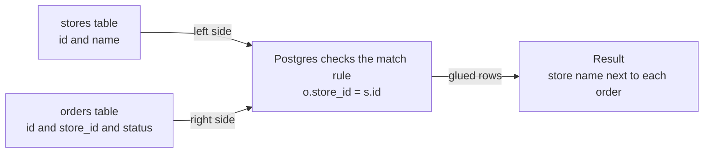

### 2b. The problem, drawn

Why split the data? Notice what a rename costs in one big table.

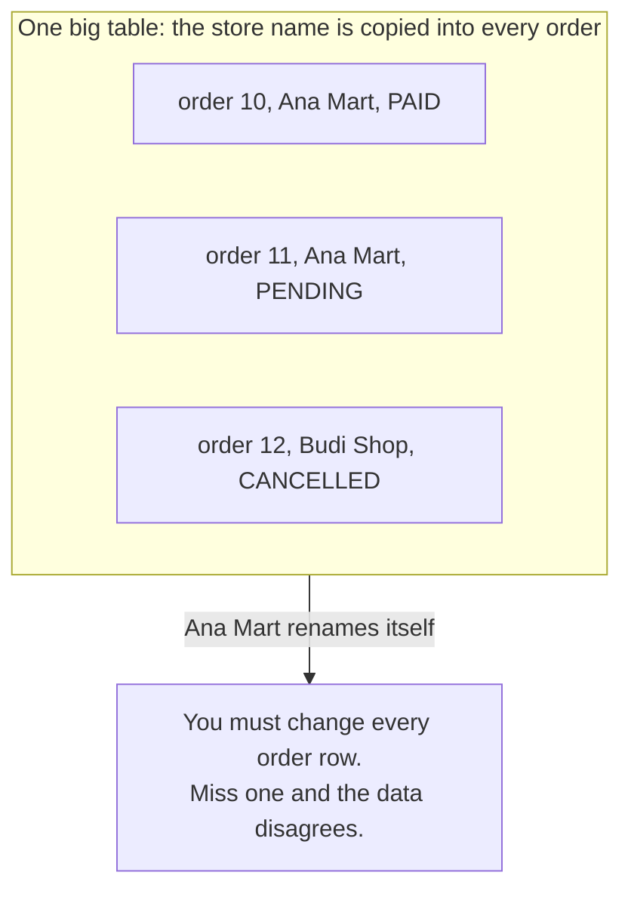

So each store is kept once, and orders keep only its id. Notice the new problem: the orders table cannot answer alone.

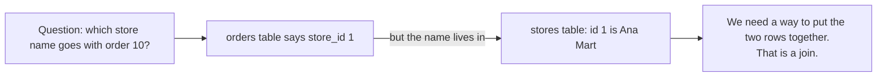

### 2c. How it works over time

The query from section 4: each store looks for its orders. Notice Citra Store, which has none.

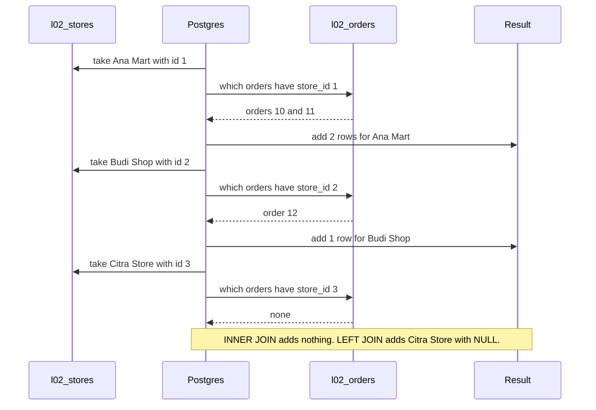

This is the idea, not the exact method. Postgres may find matches a faster way ([lesson 11](11-reading-explain.md)), but the rows are the same.

### 2d. What is in the tables and results right now

The matches as lines. Notice the two rows with no line: Citra Store, and order 13, which points to a missing store 4.

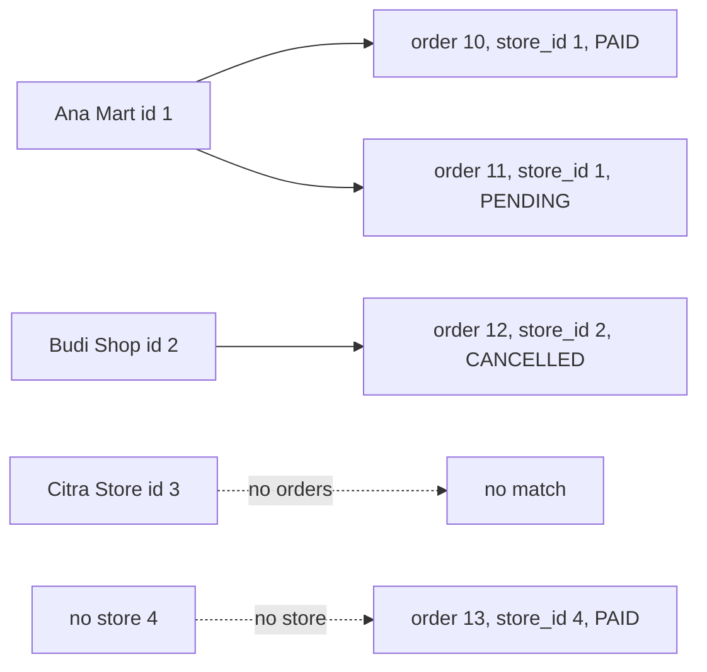

Now one picture per join. Red rows have an empty side.

**INNER JOIN: only pairs that match.** Notice that Citra Store and order 13 are both gone.

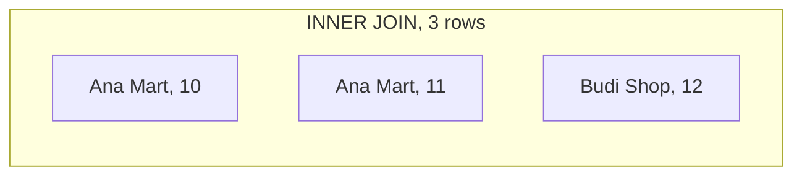

**LEFT JOIN: every left row stays.** Notice Citra Store, with NULL on the order side.

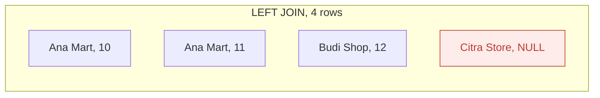

**RIGHT JOIN: every right row stays.** Notice order 13 with a NULL store, and no Citra Store.

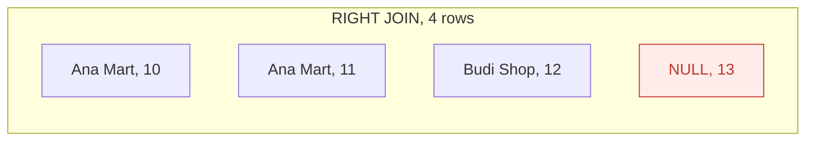

**FULL JOIN: every row from both sides stays.** Notice that both lonely rows are here.

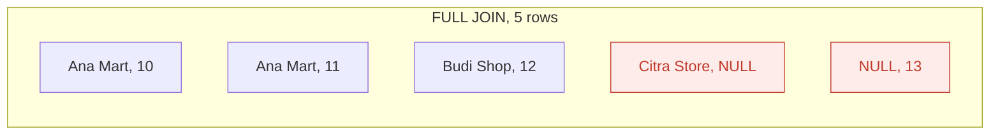

LEFT, RIGHT and FULL have one interview name: **outer joins**. They keep rows that have no match.

### 2e. Right against wrong: the LEFT JOIN plus WHERE trap

The goal: **every store**, with its PAID orders.

**Wrong:** the PAID check is in `WHERE`. Notice that only one of the 4 joined rows survives.

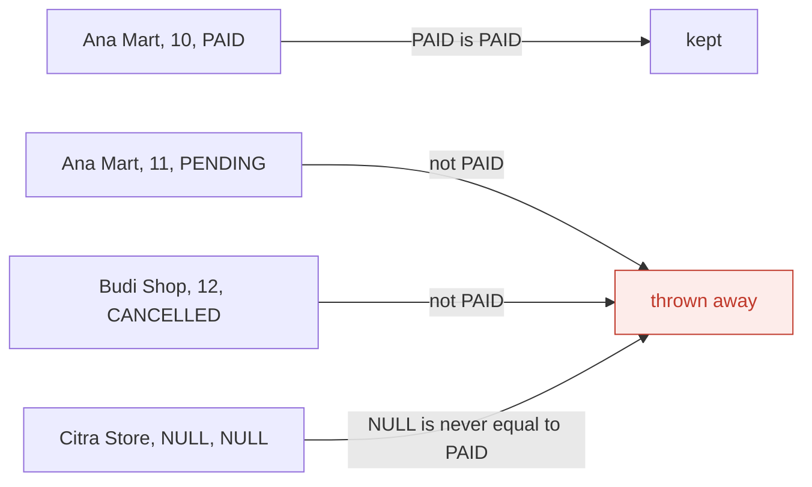

**Right:** the PAID check is in `ON`. Notice that a store with no PAID order just has no match, so LEFT JOIN keeps it.

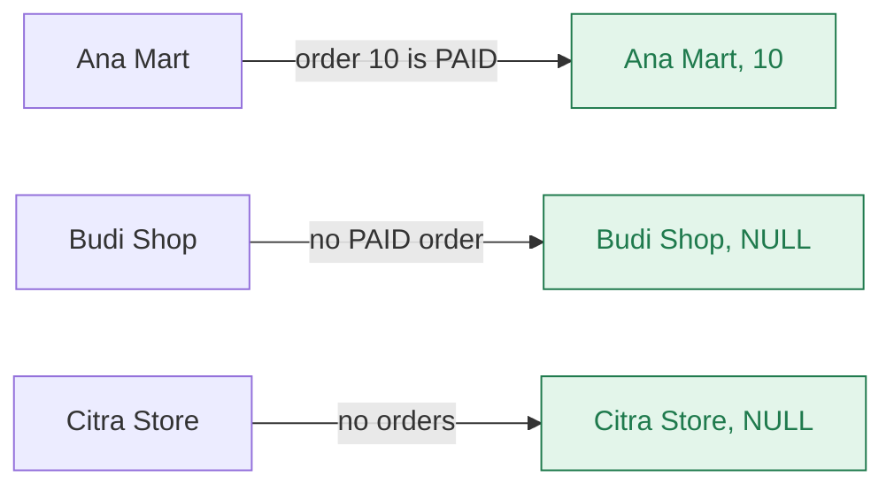

### 2f. One row becomes many: fan-out

Notice that one store row turns into two result rows. If you count rows after this join, you count Ana Mart twice.

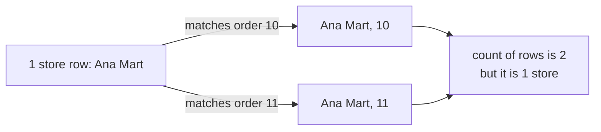

## 3. Real life analogy

A teacher has a **class list** and a pile of **homework sheets**. Each sheet has a student number on it.

- **INNER JOIN:** one line per sheet whose student is on the list. Students with no sheet are missing.
- **LEFT JOIN:** one line per student. No sheet means "no homework" next to the name.
- **Fan-out:** a student with two sheets gets two lines.
- **RIGHT and FULL:** a sheet with an unknown number is kept with an empty name.

Where the analogy stops: "no homework" is a clear fact. NULL means "I do not know". So `NULL = 'PAID'` is not false. It is NULL, and WHERE throws it away (section 5).

## 4. The smallest code that shows it

```sql
DROP TABLE IF EXISTS l02_orders, l02_stores;
CREATE TABLE l02_stores (id int PRIMARY KEY, name text NOT NULL);
CREATE TABLE l02_orders (id int PRIMARY KEY, store_id int, status text NOT NULL);
INSERT INTO l02_stores VALUES (1, 'Ana Mart'), (2, 'Budi Shop'), (3, 'Citra Store');
INSERT INTO l02_orders VALUES (10, 1, 'PAID'), (11, 1, 'PENDING'),
                              (12, 2, 'CANCELLED'), (13, 4, 'PAID');

SELECT s.name, o.id AS order_id, o.status
FROM l02_stores s
LEFT JOIN l02_orders o ON o.store_id = s.id
ORDER BY s.id, o.id;
```

**Output:**

```
name        | order_id | status
------------+----------+----------
Ana Mart    | 10       | PAID
Ana Mart    | 11       | PENDING
Budi Shop   | 12       | CANCELLED
Citra Store | NULL     | NULL
(4 rows)
```

- Change `LEFT JOIN` to `JOIN` (same as `INNER JOIN`): Citra Store disappears, 3 rows.
- In psql, type `\pset null NULL` first, or NULL shows as an empty cell.
- Nothing stops order 13 pointing to a missing store. Lesson 06 adds that rule (a *foreign key*).

Checked on 2026-10-16 with PostgreSQL 18.3 (PGlite). Your Docker playground runs 16. Join results are the same.

## 5. What really happens, step by step

**Trace 1: the LEFT JOIN from section 4.**

| Step | Query part | What Postgres does | Result so far |
|---|---|---|---|
| 1 | `FROM l02_stores s` | Opens the stores table. Calls it `s`. | empty |
| 2 | `LEFT JOIN l02_orders o` | Opens the orders table. Calls it `o`. | empty |
| 3 | `ON o.store_id = s.id` | Takes Ana Mart (id 1). Checks every order. Orders 10 and 11 have store_id 1. | Ana Mart, 10 / Ana Mart, 11 |
| 4 | same | Takes Budi Shop (id 2). Order 12 matches. | + Budi Shop, 12 |
| 5 | same | Takes Citra Store (id 3). No order has store_id 3. | still 3 rows |
| 6 | `LEFT` | A LEFT JOIN keeps every left row. Postgres adds Citra Store and fills the order side with NULL. | + Citra Store, NULL, NULL |
| 7 | (the right side) | Order 13 points to store 4. There is no store 4. A LEFT JOIN only rescues left rows, so order 13 is not added. | 4 rows |
| 8 | `ORDER BY s.id, o.id` | Sorts by store id, then order id. | 4 rows, sorted |
| 9 | `SELECT s.name, o.id AS order_id, o.status` | Keeps the three columns and names `o.id` as `order_id`. | the output in section 4 |

**Trace 2: the trap.** The same query, plus one line: `WHERE o.status = 'PAID'`. [Lesson 01](01-sql-basics-and-query-order.md) showed that Postgres runs `FROM` and the joins before `WHERE`. So steps 1 to 7 above happen first. Then:

| Step | Row checked | `o.status = 'PAID'` gives | What WHERE does | Rows left |
|---|---|---|---|---|
| 8 | Ana Mart, 10, PAID | true | keeps it | 1 |
| 9 | Ana Mart, 11, PENDING | false | throws it away | 1 |
| 10 | Budi Shop, 12, CANCELLED | false | throws it away. Budi Shop is now gone. | 1 |
| 11 | Citra Store, NULL, NULL | NULL, which means unknown | WHERE keeps only true, so it throws it away. Citra Store is gone. | 1 |

The result is 1 row: `Ana Mart | 10 | PAID`. That is an INNER JOIN result, with no error.

**The fix:** move the check into the match rule.

```sql
SELECT s.name, o.id AS order_id, o.status
FROM l02_stores s
LEFT JOIN l02_orders o ON o.store_id = s.id AND o.status = 'PAID'
ORDER BY s.id, o.id;
```

```
name        | order_id | status
------------+----------+-------
Ana Mart    | 10       | PAID
Budi Shop   | NULL     | NULL
Citra Store | NULL     | NULL
(3 rows)
```

Now orders 11 and 12 are just "not a match". Budi Shop has no match, so the LEFT JOIN keeps it with NULL.

**On the big practice tables** (stores 901 to 1000 have no orders):

| Query | Result |
|---|---|
| `SELECT count(*) FROM stores s JOIN orders o ON o.store_id = s.id;` | 100000 |
| `SELECT count(*) FROM stores s LEFT JOIN orders o ON o.store_id = s.id;` | 100100 |
| `SELECT count(DISTINCT s.id) FROM stores s LEFT JOIN orders o ON o.store_id = s.id WHERE o.status = 'PAID';` | 900 |
| `SELECT count(DISTINCT s.id) FROM stores s LEFT JOIN orders o ON o.store_id = s.id AND o.status = 'PAID';` | 1000 |

The LEFT JOIN adds exactly 100 rows: one NULL row for each store without orders. The trap quietly drops those 100 stores.

**Step through it yourself:** [open the joins stepper](visuals/02-joins.html). Press Next and watch each store look for its orders, and rows appear in the result. Six tabs: INNER, LEFT, RIGHT, FULL, "The trap" (WHERE crosses out rows) and "The fix". Type the row count you expect first.

<details><summary>Go deeper (optional): Postgres itself turns the trap into an inner join</summary>

You can see the trap in the plan. `EXPLAIN` prints the steps Postgres plans to run ([lesson 11](11-reading-explain.md)). On the big practice tables, checked on PostgreSQL 18.3:

```sql
EXPLAIN (COSTS OFF)
SELECT s.name, o.id FROM stores s LEFT JOIN orders o ON o.store_id = s.id
WHERE o.status = 'PAID';
```

```
Hash Join
  Hash Cond: (o.store_id = s.id)
  ->  Seq Scan on orders o
        Filter: (status = 'PAID'::text)
  ->  Hash
        ->  Seq Scan on stores s
```

It says `Hash Join`, not `Hash Left Join`. Postgres saw that the WHERE throws away every NULL row anyway. So it changed your LEFT JOIN into a plain inner join, because that is less work.

With the check in `ON`, the plan says `Hash Right Join`. That is still your LEFT JOIN. Postgres swapped the two tables inside the plan, because it is cheaper to build its lookup table from the 1,000 stores. "Right" there describes the plan, not your query.

The PostgreSQL docs say the same thing in words: a condition in `ON` is used before the join, and a condition in `WHERE` is used after it. "That does not matter with inner joins, but it matters a lot with outer joins." See section 8.

The plan shape uses `EXPLAIN` without `ANALYZE`, so it looks the same on PostgreSQL 16.

</details>

## 6. Why it exists and what it costs

- **Problem without it:** you copy the store name into every order, and copies can disagree ([lesson 07](07-normalization.md)). Or your app runs one query per table and glues rows in code.
- **How it solves it:** each fact lives in one place. The join puts the pieces together when you read.
- **Cost or tradeoff:**
  - Finding matches takes work. An index on `orders.store_id` makes it fast ([lesson 09](09-indexes-and-b-trees.md)).
  - Fan-out: rows multiply. Counts and sums after a join can be too big ([lesson 03](03-grouping-and-aggregation.md)).
  - Outer joins give NULLs. Your code must handle the empty side.
  - For "does this store have an order?", use `EXISTS` instead. It answers yes or no without fan-out ([lesson 04](04-subqueries-ctes-and-exists.md)).

<details><summary>Go deeper (optional): self join, CROSS JOIN, USING, and missing indexes</summary>

**A table joined to itself (self join).** In the practice database, `stores.referred_by` holds the id of another store. To show the name of that store, use the stores table twice with two short names:

```sql
SELECT s.id, s.name, s.referred_by, r.name AS referred_by_name
FROM stores s
LEFT JOIN stores r ON r.id = s.referred_by
WHERE s.id <= 4
ORDER BY s.id;
```

```
id | name    | referred_by | referred_by_name
---+---------+-------------+-----------------
1  | Store 1 | NULL        | NULL
2  | Store 2 | 1           | Store 1
3  | Store 3 | 1           | Store 1
4  | Store 4 | 2           | Store 2
(4 rows)
```

It is a LEFT JOIN, so Store 1, which nobody referred, still appears. Practice task 6 is the same idea on tiny tables.

**CROSS JOIN.** Every left row with every right row, with no match rule. 3 stores and 4 orders give 12 rows. A join with a wrong match rule can look like this by accident.

**USING.** `JOIN orders USING (store_id)` is a short way to write the match rule when both columns have the same name. Our tables use `s.id` and `o.store_id`, so we need `ON`.

**No automatic index.** Postgres makes an index for a primary key. It does not make one for a column like `orders.store_id` that points to another table, even when there is a foreign key. You add it yourself ([lesson 09](09-indexes-and-b-trees.md)).

**How Postgres finds matches.** It picks one of three methods: nested loop, hash join or merge join. [Lesson 11](11-reading-explain.md) covers them.

</details>

## 7. Common mistakes

**Wrong:** a filter on the right table in `WHERE`.

```sql
SELECT s.name, o.id AS order_id
FROM l02_stores s
LEFT JOIN l02_orders o ON o.store_id = s.id
WHERE o.status = 'PAID';            -- 1 row: Budi Shop and Citra Store vanish
```

**Right:**

```sql
SELECT s.name, o.id AS order_id
FROM l02_stores s
LEFT JOIN l02_orders o ON o.store_id = s.id AND o.status = 'PAID';   -- 3 rows
```

**Why:** WHERE runs after the join, and `NULL = 'PAID'` is never true.

**Wrong:** the "half fix" with `OR ... IS NULL`.

```sql
SELECT s.name, o.id AS order_id
FROM l02_stores s
LEFT JOIN l02_orders o ON o.store_id = s.id
WHERE o.status = 'PAID' OR o.id IS NULL
ORDER BY s.id, o.id;
-- Ana Mart    | 10
-- Citra Store | NULL       (2 rows: Budi Shop is still missing)
```

**Right:** put the check in `ON`, as above.

**Why:** Budi Shop has a CANCELLED order, so its row is not NULL. It fails `status = 'PAID'` and is thrown away.

**Wrong:** counting rows after a join to count stores.

```sql
SELECT count(*) FROM l02_stores s JOIN l02_orders o ON o.store_id = s.id;
-- 3, but only 2 stores have orders
```

**Right:**

```sql
SELECT count(DISTINCT s.id) FROM l02_stores s JOIN l02_orders o ON o.store_id = s.id;
-- 2
```

**Why:** fan-out. Ana Mart has two orders, so it is two rows. `DISTINCT` counts each store once. Sums have the same problem. [Lesson 03](03-grouping-and-aggregation.md) goes deeper.

## 8. Watch and play

Links checked on 2026-10-16: every page opened, and each video's title and channel were confirmed on YouTube.

- **Video:** [SQL Joins Explained](https://www.youtube.com/watch?v=9yeOJ0ZMUYw) by Socratica, about 10 minutes. Each join with small tables.
- **Video:** [6 SQL Joins you MUST know! (Animated + Practice)](https://www.youtube.com/watch?v=Yh4CrPHVBdE) by Anton Putra, about 10 minutes. Animated rows, after the stepper.
- **Play with it:** [The joins stepper](visuals/02-joins.html) in this folder. Do the trap tab twice.
- **Play with it:** [SQL Join Visualizer](https://chat2db.ai/tools/sql-join-visualizer) by Chat2DB. Type in the tables from section 4 and switch between the joins. It shows the NULLs.
- **Play with it:** [SQLBolt lesson 6 (joins)](https://sqlbolt.com/lesson/select_queries_with_joins) and [lesson 7 (outer joins)](https://sqlbolt.com/lesson/select_queries_with_outer_joins). Short tasks you run in the browser.
- **Play with it:** [PostgreSQL Exercises, joins](https://pgexercises.com/questions/joins/). Real Postgres tasks. "All members, along with their recommender" is like `stores.referred_by`.
- **Read:** [PostgreSQL docs, Table Expressions](https://www.postgresql.org/docs/current/queries-table-expressions.html). In 7.2.1.1, read LEFT, RIGHT, FULL, and `ON` against `WHERE`.

<details><summary>More links (optional)</summary>

- **Read:** [PostgreSQL tutorial, Joins Between Tables](https://www.postgresql.org/docs/current/tutorial-join.html). The official beginner page. It also shows a self join.
- **Read:** [Say NO to Venn Diagrams When Explaining JOINs](https://blog.jooq.org/say-no-to-venn-diagrams-when-explaining-joins/) by Lukas Eder. Why circles are a weak picture for joins: they hide fan-out.
- **Video:** [Learn MySQL joins in 5 minutes!](https://www.youtube.com/watch?v=G3lJAxg1cy8) by Bro Code, about 5 minutes. MySQL, but the joins are the same.
- **Play with it:** [Database Joins: An Interactive Exploration](https://web-apps.thecoatlessprofessor.com/database/joins-demo.html). Change the sample data and see each join type change.
- **Guide:** the longer [PostgreSQL queries guide](postgresql-queries-interview-guide.md) in this folder, section "Joins, properly". Good for revision after this lesson.

</details>

## 9. Practice

**A. Predict the output** (write your answer before opening). Use the tables from section 4.

```sql
SELECT s.name, o.id AS order_id
FROM l02_stores s
LEFT JOIN l02_orders o ON o.store_id = s.id
WHERE o.status <> 'CANCELLED'
ORDER BY s.id, o.id;
```

<details><summary>Answer</summary>

```
name     | order_id
---------+---------
Ana Mart | 10
Ana Mart | 11
(2 rows)
```

Budi Shop's only order is CANCELLED, so WHERE throws it away. Citra Store has NULL, and `NULL <> 'CANCELLED'` is NULL, not true. So Citra Store goes too. It is the same trap with a different sign.

</details>

**B. Fix the bug**

A report for the admin screen must list **all 1,000 stores** with their PAID orders. A count shows only 900 stores. Find the bug.

```sql
SELECT count(DISTINCT s.id)
FROM stores s
LEFT JOIN orders o ON o.store_id = s.id
WHERE o.status = 'PAID';
-- 900
```

<details><summary>Answer</summary>

Stores 901 to 1000 have no orders. The LEFT JOIN keeps them with NULL, then WHERE throws them away. Move the check into `ON`:

```sql
SELECT count(DISTINCT s.id)
FROM stores s
LEFT JOIN orders o ON o.store_id = s.id AND o.status = 'PAID';
-- 1000
```

</details>

**C. Write it yourself**

Open [`practice/02-joins.sql`](practice/02-joins.sql). Two tiny tables, six tasks, each with the exact expected result:

1. Every order with its store name (INNER JOIN).
2. Stores with no orders at all.
3. Fix the trap: every store with its PAID orders.
4. Count stores with orders, without fan-out.
5. Broken data on both sides in one query (FULL JOIN).
6. Who referred each store (a table joined to itself).

The top of the file says how to run it.

<details><summary>One possible answer</summary>

```sql
-- 1
SELECT s.name, o.id AS order_id, o.status
FROM l02_practice_stores s
JOIN l02_practice_orders o ON o.store_id = s.id
ORDER BY o.id;

-- 2  keep every store, then keep only rows where the order side is empty
SELECT s.name
FROM l02_practice_stores s
LEFT JOIN l02_practice_orders o ON o.store_id = s.id
WHERE o.id IS NULL
ORDER BY s.id;

-- 3  the PAID check goes in ON
SELECT s.name, o.id AS order_id
FROM l02_practice_stores s
LEFT JOIN l02_practice_orders o
  ON o.store_id = s.id AND o.status = 'PAID'
ORDER BY s.id, o.id;

-- 4  count each store once
SELECT count(DISTINCT s.id) AS stores_with_orders
FROM l02_practice_stores s
JOIN l02_practice_orders o ON o.store_id = s.id;

-- 5  keep both sides, then keep only rows with an empty side
SELECT s.name, o.id AS order_id
FROM l02_practice_stores s
FULL JOIN l02_practice_orders o ON o.store_id = s.id
WHERE s.id IS NULL OR o.id IS NULL
ORDER BY s.id, o.id;

-- 6  the stores table twice: s is the store, r is the store that referred it
SELECT s.name, r.name AS referred_by_name
FROM l02_practice_stores s
LEFT JOIN l02_practice_stores r ON r.id = s.referred_by
ORDER BY s.id;
```

Task 2 uses `WHERE o.id IS NULL` on purpose. Here the WHERE is the point: it keeps only the rows the LEFT JOIN filled with NULL. Interviewers call this an *anti-join*. Lesson 04 shows `NOT EXISTS`, which does the same job.

Bonus answer: every order belongs to one of stores 1 to 900, so the inner join has exactly 100,000 rows. The LEFT JOIN adds one NULL row for each of the 100 stores without orders.

</details>

## 10. Interview question

**Q:** "What is the difference between an INNER JOIN and a LEFT JOIN? A report uses `LEFT JOIN orders o ... WHERE o.status = 'PAID'`, and some stores are missing. Why, and how do you fix it?"

<details><summary>A strong answer, in four parts</summary>

1. **Problem:** we split data into tables so each fact lives once. Orders keep only `store_id`. To show a store's name next to its orders, we join the tables back together at read time.
2. **How it works:** the match rule after `ON` decides which pairs belong together.
   - INNER JOIN keeps only pairs that match. A store with no orders disappears.
   - LEFT JOIN keeps every store. If nothing matched, the order columns are NULL.
   - RIGHT keeps every row on the right side. FULL keeps both sides.
   - `WHERE` runs after the join. `NULL = 'PAID'` is not true, so WHERE throws away the NULL rows. Stores with no PAID order vanish, and the LEFT JOIN acts like an INNER JOIN. Postgres even plans it as an inner join.
   - The fix: put `o.status = 'PAID'` inside `ON`. Then it is part of the match, and unmatched stores stay with NULL.
3. **Tradeoff:** a join causes fan-out. One store with many orders becomes many rows, so counts and sums can be too big. Use `count(DISTINCT ...)`, group first, or use `EXISTS` when you only need yes or no. Joins on big tables also need an index on the join column, like `orders.store_id`.
4. **My example:** *This is an idea, not a fact. Replace it with your own real story.* DBO is a B2B commerce app with an admin CMS. An admin report like "all stores with their paid orders this month" must still show stores with zero orders. If the date or status filter sits in WHERE, those stores silently vanish. I would put the filters in `ON`, and check the store count against `SELECT count(*) FROM stores`.

</details>

## 11. Explain it back

Close this file. Press **Record my explanation** and explain joins out loud, like to a new junior, in 4 parts: problem, how it works, tradeoff, my example. Use "match rule", "NULL" and "fan-out", and walk the trap row by row. Save the transcript into `my-learning/recordings/`, or write your best version below. Then run `/explain-check joins` or ask the `explain-coach` agent.

### My explanation

<write here>

### Coach feedback

<the explain-coach agent writes here>

## 12. Review questions (day 1, 3, 7, 21)

1. Using the tables from section 4, how many rows do INNER, LEFT, RIGHT and FULL give?
2. Why does `LEFT JOIN orders o ... WHERE o.status = 'PAID'` lose stores, and where does the check go instead?
3. After `stores JOIN orders`, why can `count(*)` be bigger than the number of stores?
4. Draw the four result pictures from section 2d from memory: INNER, LEFT, RIGHT and FULL.

<details><summary>Answers</summary>

1. INNER 3 (only the pairs). LEFT 4 (the pairs plus the store with no orders). RIGHT 4 (the pairs plus the order with no store). FULL 5 (the pairs plus both lonely rows).
2. WHERE runs after the join. The stores the LEFT JOIN kept have NULL in `o.status`, and `NULL = 'PAID'` is not true, so WHERE throws them away. Stores whose orders are all not PAID are thrown away too. Put the check in `ON`: `ON o.store_id = s.id AND o.status = 'PAID'`.
3. Fan-out. A store with many orders becomes one row per order, so it is counted many times. Use `count(DISTINCT s.id)`.

</details>

## Connected lessons

- [SQL basics and the order a query runs](01-sql-basics-and-query-order.md): joins run before WHERE. That is why the trap happens.
- [Grouping and aggregation](03-grouping-and-aggregation.md): next. Counts and sums after a join.
- [Subqueries, CTEs and EXISTS](04-subqueries-ctes-and-exists.md): "has an order" without fan-out.
- Keys and relationships (lesson 06, not written yet): the foreign key that would stop order 13.
- [Normalization](07-normalization.md): why we split tables.
- [Indexes and B-trees](09-indexes-and-b-trees.md): an index on `orders.store_id`.
- [Reading EXPLAIN](11-reading-explain.md): how Postgres really finds matches.
- [N+1 queries and ORMs](12-n-plus-1-queries-and-orms.md): one join against many small queries in Prisma, GraphQL and Hasura.
