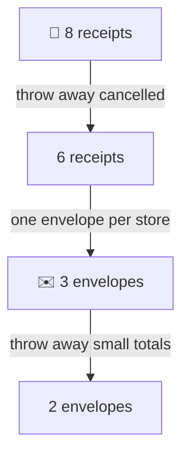
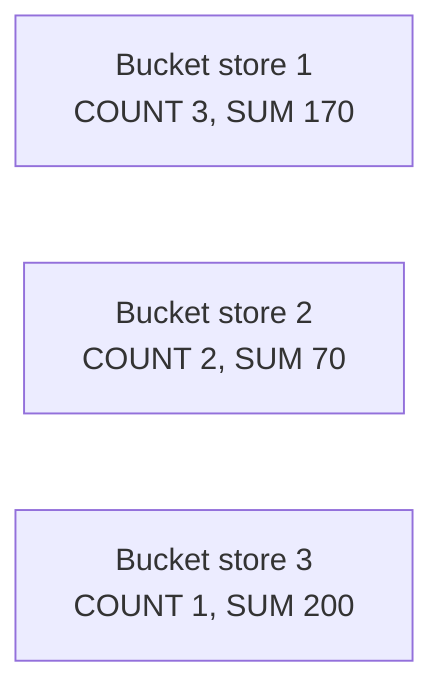
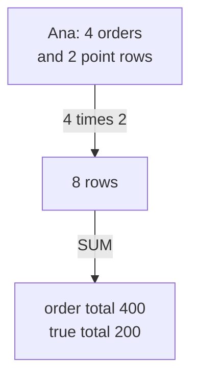
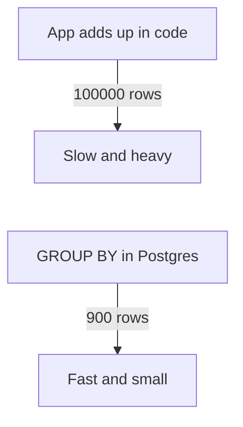

# 03. Grouping and aggregation

> **Subject:** Database · **Lesson:** 03 · **Made:** 2026-10-16 · **Remade in short cards:** 2026-10-28 · **Status:** ready
>
> **You will be able to:** put rows into buckets with GROUP BY, say why WHERE runs before the buckets and HAVING after, pick the right COUNT, and spot a total that a join made too big.
>
> **Before this:** [Joins](02-joins.md) · **Next:** [Subqueries, CTEs and EXISTS](04-subqueries-ctes-and-exists.md)
>
> **How to read it:** one card is one idea. Look at the picture, guess, then press the orange bar to check. The blue bars (📖 More detail) hold the longer explanation. Skip them on the first read, and open them when you want more. About 25 minutes for the cards.

## 1. The idea: receipts and envelopes

You have a pile of shop receipts. You want one number per store.



Notice: the first cut is on **receipts**. The second cut is on **envelopes**. In SQL the first is `WHERE`, the envelopes are `GROUP BY`, and the second cut is `HAVING`.

<details class="guess"><summary>🤔 Guess: can you throw away a small envelope before you add up its receipts? Press to check.</summary>

No. You do not know an envelope's total until the last receipt is in.

So a rule about **one row** goes in WHERE. A rule about **a whole bucket** goes in HAVING.

</details>

> **Remember:** WHERE throws away rows before the buckets. HAVING throws away buckets after the totals are done.

<details class="more"><summary>📖 More detail: the four words, and where the envelope picture stops</summary>

- **Bucket:** all rows that have the same value in the GROUP BY column. (Interview word: *group*.)
- **Summary function:** a function that reads all rows of a bucket and gives back one value. The five you need are COUNT, SUM, AVG, MIN and MAX. (Interview word: *aggregate function*.)
- **NULL:** an empty cell. It means "no value here". It is not 0 and not empty text.
- **Fan-out:** a join that turns one row into many copies. (Interview words: *fan-out* or *row multiplication*.)

Where the picture stops: your envelope holds the receipts. Postgres does not. It keeps only the numbers written on the envelope (card 3).

</details>

## 2. The main query on 8 tiny rows

Every card uses the same tiny table, `l03_orders`. Stores: 1 Ana, 2 Budi, 3 Citra, 4 Dewi (Dewi has no orders).

| id | store_id | status | total | coupon |
|---|---|---|---|---|
| 1 | 1 | PAID | 100 | NEW10 |
| 2 | 1 | PAID | 50 | NULL |
| 3 | 2 | PENDING | 70 | NULL |
| 4 | 1 | CANCELLED | 30 | NEW10 |
| 5 | 3 | PAID | 200 | VIP |
| 6 | 2 | PAID | 40 | NULL |
| 7 | 1 | PAID | 20 | NULL |
| 8 | 2 | PAID | 30 | NEW10 |

The question: **paid orders and revenue per store, only stores with 100 or more.**

```sql
SELECT store_id,
  COUNT(*)   AS paid_orders,
  SUM(total) AS revenue
FROM l03_orders
WHERE status = 'PAID'
GROUP BY store_id
HAVING SUM(total) >= 100
ORDER BY store_id;
```

<details class="guess"><summary>🤔 Guess: which stores come out? Press to check.</summary>

```
 store_id | paid_orders | revenue
----------+-------------+---------
        1 |           3 |     170
        3 |           1 |     200
(2 rows)
```

Store 2 is missing. Its paid total is 40 + 30 = 70, so HAVING removed its bucket.

</details>

> **Remember:** the order is WHERE, GROUP BY, HAVING. Each store gets one result row.

<details class="more"><summary>📖 More detail: make the tables yourself</summary>

Run this once in any Postgres. The same setup is at the top of the [practice file](practice/03-grouping-and-aggregation.sql).

```sql
DROP TABLE IF EXISTS l03_points;
DROP TABLE IF EXISTS l03_orders;
DROP TABLE IF EXISTS l03_stores;
CREATE TABLE l03_stores (
  id int PRIMARY KEY,
  name text NOT NULL,
  city text NOT NULL);
CREATE TABLE l03_orders (
  id int PRIMARY KEY,
  store_id int NOT NULL
    REFERENCES l03_stores(id),
  status text NOT NULL,
  total int NOT NULL,
  coupon text);
CREATE TABLE l03_points (
  id int PRIMARY KEY,
  store_id int NOT NULL
    REFERENCES l03_stores(id),
  amount int NOT NULL);
INSERT INTO l03_stores VALUES
  (1,'Ana','Jakarta'),
  (2,'Budi','Jakarta'),
  (3,'Citra','Bandung'),
  (4,'Dewi','Medan');
INSERT INTO l03_orders VALUES
  (1,1,'PAID',100,'NEW10'),
  (2,1,'PAID',50,NULL),
  (3,2,'PENDING',70,NULL),
  (4,1,'CANCELLED',30,'NEW10'),
  (5,3,'PAID',200,'VIP'),
  (6,2,'PAID',40,NULL),
  (7,1,'PAID',20,NULL),
  (8,2,'PAID',30,'NEW10');
INSERT INTO l03_points VALUES
  (1,1,10), (2,1,20), (3,2,5), (4,3,50);
ANALYZE l03_stores, l03_orders,
  l03_points;
```

`total` is a small plain number to keep the sums easy. The big practice table uses `total_cents`.

Checked on 2026-10-28 with PostgreSQL 17.5 (PGlite). Earlier checks on PostgreSQL 18.3 gave the same results.

</details>

## 3. A bucket keeps only a note

After the last row is read, Postgres does **not** keep the receipts. It keeps one small note per bucket.



Notice: the note has the key and the totals. It has no `status`. Now ask for `status` anyway:

```sql
SELECT store_id, status, COUNT(*)
FROM l03_orders
GROUP BY store_id;
```

<details class="guess"><summary>🤔 Guess: does it work? Press to check.</summary>

No:

```
ERROR:  column "l03_orders.status" must appear in the GROUP BY clause or be used in an aggregate function
```

Store 1 has orders with two different statuses. The bucket note cannot say which one to show.

Fix: group by it too.

```sql
SELECT store_id, status, COUNT(*)
FROM l03_orders
GROUP BY store_id, status;
```

Now every pair (store, status) is its own bucket:

```
 store_id |  status   | count
----------+-----------+-------
        1 | CANCELLED |     1
        1 | PAID      |     3
        2 | PAID      |     2
        2 | PENDING   |     1
        3 | PAID      |     1
(5 rows)
```

</details>

> **Remember:** every column in SELECT must be in GROUP BY or inside a summary function.

<details class="more"><summary>📖 More detail: why Postgres does it this way</summary>

Each bucket gives one result row. The row can only show what the bucket knows: the key, and the totals the summary functions kept.

An exception exists for a primary key. If you group by the primary key of a table, Postgres knows the other columns of that table follow from it. See [the GROUP BY clause](https://www.postgresql.org/docs/current/sql-select.html#SQL-GROUPBY).

</details>

## 4. Three counts on one column

`COUNT` has three forms, and NULL makes them differ.

```sql
SELECT COUNT(*)               AS all_rows,
       COUNT(coupon)          AS with_coupon,
       COUNT(DISTINCT coupon) AS different_coupons
FROM l03_orders;
```

Look at the `coupon` column in card 2: NEW10, NULL, NULL, NEW10, VIP, NULL, NULL, NEW10.

<details class="guess"><summary>🤔 Guess: what are the three numbers? Press to check.</summary>

```
 all_rows | with_coupon | different_coupons
----------+-------------+-------------------
        8 |           4 |                 2
(1 row)
```

- `COUNT(*)` counts rows. All 8.
- `COUNT(coupon)` skips NULL cells. 4 orders used a coupon.
- `COUNT(DISTINCT coupon)` counts different values, and also skips NULL. Only NEW10 and VIP, so 2.

</details>

> **Remember:** `COUNT(*)` counts rows. `COUNT(column)` skips NULL.

<details class="more"><summary>📖 More detail: AVG, MIN and MAX, and rounding</summary>

The other summary functions on the same buckets:

```sql
SELECT store_id,
  AVG(total) AS avg_total,
  MIN(total) AS smallest,
  MAX(total) AS biggest
FROM l03_orders
WHERE status = 'PAID'
GROUP BY store_id
ORDER BY store_id;
```

```
 store_id |      avg_total       | smallest | biggest
----------+----------------------+----------+---------
        1 |  56.6666666666666667 |       20 |     100
        2 |  35.0000000000000000 |       30 |      40
        3 | 200.0000000000000000 |      200 |     200
(3 rows)
```

AVG gives many decimals. Use `ROUND(AVG(total), 2)` when you show it to people. It gives 56.67, 35.00 and 200.00.

</details>

## 5. FILTER: many counts in one read

An "orders by status" screen needs a count per status, per store. You can run one query per status, or use `FILTER`.

```sql
SELECT store_id,
  COUNT(*) FILTER (
    WHERE status = 'PAID') AS paid,
  COUNT(*) FILTER (
    WHERE status = 'PENDING') AS pending,
  COUNT(*) FILTER (
    WHERE status = 'CANCELLED') AS cancelled
FROM l03_orders
GROUP BY store_id
ORDER BY store_id;
```

<details class="guess"><summary>🤔 Guess: what does store 2 show for paid, pending and cancelled? Press to check.</summary>

```
 store_id | paid | pending | cancelled
----------+------+---------+-----------
        1 |    3 |       0 |         1
        2 |    2 |       1 |         0
        3 |    1 |       0 |         0
(3 rows)
```

Store 2: 2 paid, 1 pending, 0 cancelled.

</details>

> **Remember:** `FILTER` is a small WHERE for one summary function. Every row still reaches its bucket.

<details class="more"><summary>📖 More detail: why not use WHERE here</summary>

A `WHERE status = 'PAID'` would throw the other rows away **before** the buckets, so you could count only one status per query. With `FILTER`, every row reaches its bucket, and each counter decides alone whether to count it. One read of the table gives all three counts.

</details>

## 6. Mistake 1: a name from SELECT inside HAVING

You name a total in SELECT, then use the name in HAVING.

```sql
SELECT store_id,
  SUM(total) AS revenue
FROM l03_orders
WHERE status = 'PAID'
GROUP BY store_id
HAVING revenue >= 100;
```

<details class="guess"><summary>🤔 Guess: does it work? Press to check.</summary>

No:

```
ERROR:  column "revenue" does not exist
```

HAVING runs **before** SELECT ([lesson 01](01-sql-basics-and-query-order.md)), so the name `revenue` does not exist yet.

Fix: repeat the summary function.

```sql
... GROUP BY store_id
HAVING SUM(total) >= 100;
```

`ORDER BY revenue` does work, because ORDER BY runs after SELECT.

</details>

> **Remember:** HAVING repeats the summary function. It cannot use a new name from SELECT.

<details class="more"><summary>📖 More detail: a total inside WHERE</summary>

The same idea, one step earlier. WHERE runs on single rows, before any bucket exists. So there is no total to look at:

```sql
SELECT store_id, SUM(total)
FROM l03_orders
WHERE SUM(total) >= 100
GROUP BY store_id;
```

```
ERROR:  aggregate functions are not allowed in WHERE
```

A rule about a row goes in WHERE. A rule about a bucket goes in HAVING.

</details>

## 7. Mistake 2: counting nothing

Dewi has **no orders**. List every store with its number of orders. A LEFT JOIN keeps Dewi ([lesson 02](02-joins.md)).

```sql
SELECT s.name,
  COUNT(*) AS orders
FROM l03_stores s
LEFT JOIN l03_orders o
  ON o.store_id = s.id
GROUP BY s.id, s.name
ORDER BY s.id;
```

<details class="guess"><summary>🤔 Guess: what number does Dewi get? Press to check.</summary>

```
 name  | orders
-------+--------
 Ana   |      4
 Budi  |      3
 Citra |      1
 Dewi  |      1
(4 rows)
```

Dewi gets **1**, but she has no orders. The LEFT JOIN keeps her as one row with NULL in every order column. `COUNT(*)` counts that row.

Fix: count a column from the right table. `COUNT(o.id)` skips NULL.

```sql
SELECT s.name,
  COUNT(o.id) AS orders
FROM l03_stores s
LEFT JOIN l03_orders o
  ON o.store_id = s.id
GROUP BY s.id, s.name
ORDER BY s.id;
```

Now Dewi shows 0 (Ana 4, Budi 3, Citra 1).

</details>

> **Remember:** after a LEFT JOIN, count a column from the right table, not `*`.

<details class="more"><summary>📖 More detail: the sum of nothing is NULL, not 0</summary>

`COUNT` of no rows is 0. But `SUM`, `AVG`, `MIN` and `MAX` of no rows are **NULL**.

```sql
SELECT SUM(total) AS revenue
FROM l03_orders
WHERE store_id = 4;
```

```
 revenue
---------
    NULL
```

`COALESCE(x, 0)` means "use x, or 0 if x is NULL":

```sql
SELECT COALESCE(SUM(total), 0)
  AS revenue
FROM l03_orders
WHERE store_id = 4;
```

That gives 0. The docs say the same: "sum of no rows returns null, not zero".

</details>

## 8. Mistake 3: two joins at once

Ana has 4 orders and 2 point rows (points are a loyalty bonus). Join both tables to Ana at once:



```sql
SELECT s.name,
  SUM(o.total)  AS order_total,
  SUM(p.amount) AS points
FROM l03_stores s
JOIN l03_orders o ON o.store_id = s.id
JOIN l03_points p ON p.store_id = s.id
WHERE s.id = 1
GROUP BY s.name;
```

<details class="guess"><summary>🤔 Guess: Ana's true totals are 200 and 30. What does it give? Press to check.</summary>

```
 name | order_total | points
------+-------------+--------
 Ana  |         400 |    120
(1 row)
```

Both are wrong. Every order is paired with both point rows, so each order is counted **twice**. Each point row is paired with all 4 orders, so it is counted 4 times.

Fix: add up each table first, then join one row to one row.

```sql
WITH o AS (
  SELECT store_id,
    SUM(total) AS order_total
  FROM l03_orders GROUP BY store_id
), p AS (
  SELECT store_id,
    SUM(amount) AS points
  FROM l03_points GROUP BY store_id
)
SELECT s.name,
  COALESCE(o.order_total, 0) AS order_total,
  COALESCE(p.points, 0) AS points
FROM l03_stores s
LEFT JOIN o ON o.store_id = s.id
LEFT JOIN p ON p.store_id = s.id
ORDER BY s.id;
```

```
 name  | order_total | points
-------+-------------+--------
 Ana   |         200 |     30
 Budi  |         140 |      5
 Citra |         200 |     50
 Dewi  |           0 |      0
(4 rows)
```

`WITH` gives a name to a small query that runs first. [Lesson 04](04-subqueries-ctes-and-exists.md) explains it.

</details>

> **Remember:** a join can multiply rows, and then every SUM is too big. Add up each table first, then join.

<details class="more"><summary>📖 More detail: the trap, step by step</summary>

Ana only, row by row:

| Step | What Postgres does | Rows made so far | SUM(o.total) | SUM(p.amount) |
|---|---|---|---|---|
| 1 | Order 1 (100) meets point rows 10 and 20 | 2 | 200 | 30 |
| 2 | Order 2 (50) meets both point rows | 4 | 300 | 60 |
| 3 | Order 4 (30) meets both point rows | 6 | 360 | 90 |
| 4 | Order 7 (20) meets both point rows | 8 | 400 | 120 |
| 5 | SELECT shows the sums. True answers are 200 and 30. | 8 | 400 | 120 |

At full size: store 42 has 139 orders and 253 point rows. Joining both at once made 139 times 253 = 35,167 rows. Its order total came out **253 times too big**: 85,687,542,061 cents instead of 338,685,937. (Checked on the big practice tables, PostgreSQL 18.3.)

</details>

## 9. Watch it run, step by step

Rows drop into buckets one by one, the totals change, and HAVING removes a bucket. The stepper has six tabs: "Buckets and COUNT", "WHERE, then HAVING", "COUNT traps", "FILTER", "Join trap" and "Join fix". Write your guess first, then press Next.

**Step through it yourself:** [open the grouping stepper](visuals/03-grouping-and-aggregation.html).

<details class="more"><summary>📖 More detail: the main query from card 2, one row at a time</summary>

Postgres reads one row, checks WHERE, and drops the row into a bucket at once. HAVING runs only after the last row.

| Step | Query part | What Postgres does | Buckets after (count, sum) | Result |
|---|---|---|---|---|
| 1 | FROM | Opens `l03_orders`. It will read 8 rows one by one. | none | |
| 2 | WHERE, GROUP BY | Row 1: PAID, so keep. Make bucket store 1. | s1 (1, 100) | |
| 3 | WHERE, GROUP BY | Row 2: PAID. Into bucket store 1. | s1 (2, 150) | |
| 4 | WHERE | Row 3: PENDING. Thrown away. It never reaches a bucket. | s1 (2, 150) | |
| 5 | WHERE | Row 4: CANCELLED. Thrown away. Its 30 is never added. | s1 (2, 150) | |
| 6 | WHERE, GROUP BY | Row 5: PAID. Make bucket store 3. | s1 (2, 150), s3 (1, 200) | |
| 7 | WHERE, GROUP BY | Row 6: PAID. Make bucket store 2. | s1 (2, 150), s3 (1, 200), s2 (1, 40) | |
| 8 | WHERE, GROUP BY | Row 7: PAID. Into bucket store 1. | s1 (3, 170), s3 (1, 200), s2 (1, 40) | |
| 9 | WHERE, GROUP BY | Row 8: PAID. Into bucket store 2. Last row, so the totals are final. | s1 (3, 170), s3 (1, 200), s2 (2, 70) | |
| 10 | HAVING | Store 1: 170 is at least 100. Keep. | s1 kept | |
| 11 | HAVING | Store 2: 70 is less than 100. Remove the whole bucket. | s2 removed | |
| 12 | HAVING | Store 3: 200 is at least 100. Keep. | s3 kept | |
| 13 | SELECT | One result row per bucket left: key, COUNT, SUM. | s1, s3 | 1 3 170, 3 1 200 |
| 14 | ORDER BY | Sort by store_id. | | 1 3 170, 3 1 200 |

**Postgres shows the same order in its plan.** Read it from the bottom up.

```sql
EXPLAIN (ANALYZE, COSTS OFF, TIMING OFF, BUFFERS OFF)
SELECT store_id, COUNT(*) AS paid_orders, SUM(total) AS revenue
FROM l03_orders WHERE status = 'PAID'
GROUP BY store_id HAVING SUM(total) >= 100 ORDER BY store_id;
```

```
Sort (actual rows=2.00 loops=1)
  Sort Key: store_id
  Sort Method: quicksort  Memory: 17kB
  ->  HashAggregate (actual rows=2.00 loops=1)
        Group Key: store_id
        Filter: (sum(total) >= 100)
        Batches: 1  Memory Usage: 32kB
        Rows Removed by Filter: 1
        ->  Seq Scan on l03_orders (actual rows=6.00 loops=1)
              Filter: (status = 'PAID'::text)
              Rows Removed by Filter: 2
```

- **Seq Scan** reads the rows. Its `Filter` is your **WHERE**. It removed 2 rows.
- **HashAggregate** is the bucket table. Its `Filter` is your **HAVING**. It removed 1 bucket.
- **Sort** is your ORDER BY.

</details>

## 10. Why it matters and what it costs

Without GROUP BY, an admin dashboard fetches every order and adds them up in JavaScript.



- **Without it,** to get "revenue per city" the app moves 100,000 rows to make a 5 row answer. Or it runs one query per store.
- **With it,** Postgres reads the rows once, next to the data. It keeps one small note per bucket and sends back only the result rows.
- **The cost:**
  - Postgres still reads every row that passes WHERE. For 100,000 orders that is fast. For hundreds of millions, a dashboard may need a summary table that is kept up to date. *This is an idea, not something you need to build now.*
  - You lose the single rows. If you need each row **and** its store total side by side, use a window function ([lesson 05](05-window-functions.md)).
  - Many buckets need memory. Very many buckets can spill to disk (see Go deeper at the end).
  - A plain row rule in HAVING still works, but it is slower. Postgres builds buckets for rows it could have thrown away earlier. Put row rules in WHERE.

## 11. Watch and play

Links checked on 2026-10-16: every page was opened, and each video's title and channel were confirmed through YouTube. Video lengths come from the YouTube listing.

- **Video:** [SQL Group By: An Explanation and How To Use It](https://www.youtube.com/watch?v=x2_mOJ3skSc) by Database Star, about 5 minutes. A calm first look at buckets.
- **Video:** [Advanced Aggregate Functions in SQL (GROUP BY, HAVING vs. WHERE)](https://www.youtube.com/watch?v=nNrgRVIzeHg) by Becoming a Data Scientist, about 6 minutes. WHERE against HAVING with examples.
- **Play with it:** [The grouping stepper](visuals/03-grouping-and-aggregation.html) in this folder. Guess first, then press Next.
- **Play with it:** [SQLBolt lesson 10](https://sqlbolt.com/lesson/select_queries_with_aggregates) and [lesson 11](https://sqlbolt.com/lesson/select_queries_with_aggregates_pt_2). Short tasks in the browser. Lesson 11 is about HAVING.
- **Play with it:** [PostgreSQL Exercises: Aggregation](https://pgexercises.com/questions/aggregates/). Real Postgres questions you answer in the browser. Do the first ten.
- **Play with it:** [PGlite REPL](https://pglite.dev/repl/). A real Postgres that runs in your browser tab. Paste the setup from card 2, then try every query in this lesson without Docker.
- **Read:** [SQL queries don't start with SELECT](https://jvns.ca/blog/2019/10/03/sql-queries-don-t-start-with-select/) by Julia Evans. One clear picture of the query order. Find where GROUP BY and HAVING sit.

<details><summary>More links (optional)</summary>

- **Read:** [PostgreSQL tutorial: Aggregate Functions](https://www.postgresql.org/docs/current/tutorial-agg.html). The official short page. It says WHERE picks rows before the buckets and HAVING picks buckets after, and it shows FILTER.
- **Read:** [Aggregate expressions](https://www.postgresql.org/docs/current/sql-expressions.html#SYNTAX-AGGREGATES). The exact rules for `count(*)`, `count(f1)`, `count(distinct f1)` and FILTER.
- **Read:** [Aggregate functions list](https://www.postgresql.org/docs/current/functions-aggregate.html). It says "sum of no rows returns null, not zero" and suggests `coalesce`.
- **Read:** [SELECT: the GROUP BY clause](https://www.postgresql.org/docs/current/sql-select.html#SQL-GROUPBY). The rule about ungrouped columns and the primary key exception.
- **Video:** [Difference Between count(*), count(0), count(-1), count(col), count('youtube')](https://www.youtube.com/watch?v=IE8NueisxHY) by Ankit Bansal. A short COUNT interview question.
- **Video:** [Difference between Where and Having Clause in SQL](https://www.youtube.com/watch?v=4xPxGX4mfb4) by Ankit Bansal.
- **Video:** [Why Your SQL JOIN Returns Duplicates](https://www.youtube.com/watch?v=Y9hrlLIXKoU) by Database Star. Rows that a join copies.
- **Video:** [Using FILTER in SQL - EXPLAINING PostgreSQL](https://www.youtube.com/watch?v=5tQiYwEBNZw) by CYBERTEC. Longer, about 10 minutes.
- **Read (Prisma):** [Aggregation, grouping, and summarizing](https://www.prisma.io/docs/orm/v7/prisma-client/queries/aggregation-grouping-summarizing). `groupBy` with `by`, `_sum`, `_count` and `having`. The FAQ says "where filters all records before grouping, and having filters entire groups".
- **Read (Hasura):** [Postgres aggregation queries](https://hasura.io/docs/2.0/queries/postgres/aggregation-queries/). The `<table>_aggregate` field with count, sum, avg, max and min.
- **Revise later:** the [PostgreSQL queries guide](postgresql-queries-interview-guide.md), section "Aggregation: GROUP BY, HAVING, FILTER, COUNT".

</details>

## 12. Practice

**A. Predict the output** (write your answer before opening)

```sql
SELECT store_id,
       COUNT(*)               AS all_rows,
       COUNT(coupon)          AS with_coupon,
       COUNT(DISTINCT coupon) AS different_coupons
FROM l03_orders
GROUP BY store_id
ORDER BY store_id;
```

<details><summary>Answer</summary>

```
 store_id | all_rows | with_coupon | different_coupons
----------+----------+-------------+-------------------
        1 |        4 |           2 |                 1
        2 |        3 |           1 |                 1
        3 |        1 |           1 |                 1
(3 rows)
```

Store 1 has 4 orders. Two have a coupon, and both are NEW10, so there is 1 different coupon. Store 2 has 3 orders, and only order 8 has a coupon.

</details>

**B. Fix the bug**

The goal: stores whose paid orders add up to 100 or more.

```sql
SELECT store_id, SUM(total) AS revenue
FROM l03_orders
WHERE status = 'PAID' AND SUM(total) >= 100
GROUP BY store_id;
-- ERROR:  aggregate functions are not allowed in WHERE
```

<details><summary>Answer</summary>

`SUM(total) >= 100` is a rule about a bucket. WHERE runs on single rows, before any bucket exists. Move it to HAVING, and write the summary function again (not the name `revenue`).

```sql
SELECT store_id, SUM(total) AS revenue
FROM l03_orders
WHERE status = 'PAID'
GROUP BY store_id
HAVING SUM(total) >= 100
ORDER BY store_id;
```

```
 store_id | revenue
----------+---------
        1 |     170
        3 |     200
(2 rows)
```

`status = 'PAID'` stays in WHERE. It is a rule about one row.

</details>

**C. Write it yourself**

Open [practice/03-grouping-and-aggregation.sql](practice/03-grouping-and-aggregation.sql). It makes the tiny tables, then gives six tasks, each with the exact expected result:

1. Orders per status.
2. Paid revenue per city.
3. Stores with 3 or more orders.
4. Paid, pending and cancelled per store with FILTER, Dewi included with zeros.
5. Fix the join double count.
6. Find WHERE and HAVING inside a real EXPLAIN plan.

Run it in the Docker playground (instructions at the top of the file), or paste it into the PGlite REPL.

<details><summary>One possible answer</summary>

```sql
-- 1
SELECT status, COUNT(*) AS orders
FROM l03_orders
GROUP BY status
ORDER BY status;

-- 2
SELECT s.city, SUM(o.total) AS revenue
FROM l03_stores s
JOIN l03_orders o ON o.store_id = s.id
WHERE o.status = 'PAID'
GROUP BY s.city
ORDER BY revenue DESC;

-- 3  ("3 or more" is about a bucket, so it goes in HAVING)
SELECT store_id, COUNT(*) AS orders
FROM l03_orders
GROUP BY store_id
HAVING COUNT(*) >= 3
ORDER BY store_id;

-- 4  (LEFT JOIN keeps Dewi. Her one row has NULL status, so every FILTER says no and gives 0.)
SELECT s.name,
       COUNT(*) FILTER (WHERE o.status = 'PAID')      AS paid,
       COUNT(*) FILTER (WHERE o.status = 'PENDING')   AS pending,
       COUNT(*) FILTER (WHERE o.status = 'CANCELLED') AS cancelled
FROM l03_stores s
LEFT JOIN l03_orders o ON o.store_id = s.id
GROUP BY s.id, s.name
ORDER BY s.id;

-- 5  (add up each table first, then join one row to one row)
WITH o AS (
  SELECT store_id, SUM(total) AS order_total
  FROM l03_orders GROUP BY store_id
), p AS (
  SELECT store_id, SUM(amount) AS points
  FROM l03_points GROUP BY store_id
)
SELECT s.name,
       COALESCE(o.order_total, 0) AS order_total,
       COALESCE(p.points, 0)      AS points
FROM l03_stores s
LEFT JOIN o ON o.store_id = s.id
LEFT JOIN p ON p.store_id = s.id
ORDER BY s.id;

-- 6
-- WHERE is the "Filter: (status = 'PAID'::text)" line under Seq Scan on orders.
-- HAVING is the "Filter: (sum(total_cents) >= ...)" line on the HashAggregate.
```

`WITH` gives a name to a small query that runs first. [Lesson 04](04-subqueries-ctes-and-exists.md) explains it. All six were run against the expected results on 2026-10-16.

</details>

## 13. Interview question

**Q:** "What is the difference between WHERE and HAVING? And a revenue report joins stores to orders and to point transactions, and the totals look too big. Why?"

<details><summary>A strong answer, in four parts</summary>

1. **Problem:** we want one number per store or per city, like paid revenue. Fetching every row into the app and adding them up there is slow. GROUP BY lets Postgres do it next to the data.
2. **How it works:** Postgres reads the rows and runs WHERE on each one. Rows that pass drop into a bucket for their key. Postgres keeps only the key and a running total per bucket. After the last row, HAVING throws away whole buckets, and SELECT makes one row per bucket. So WHERE is a rule about a row, and HAVING is a rule about a bucket. A total cannot go in WHERE, because no total exists yet. In EXPLAIN, WHERE is the Filter on the scan, and HAVING is the Filter on the HashAggregate.
3. **Tradeoff and traps:**
   - Put row rules in WHERE, because HAVING would build buckets for rows it could have skipped.
   - `COUNT(*)` counts rows, `COUNT(col)` skips NULLs, `COUNT(DISTINCT col)` counts different values. After a LEFT JOIN, count a column from the right table.
   - The too-big totals are fan-out. Each store has many orders and many point rows, so the join pairs every order with every point row. 4 orders and 2 point rows make 8 rows, and SUM adds every copy. The fix is to add up each table per store first, then join one row to one row.
4. **My example:** *This is an idea, not a fact. Replace it with your own real story.* An admin CMS like the one in DBO often has a dashboard: paid orders per store, revenue per city, and a count per status. One GROUP BY with `COUNT(*) FILTER (WHERE status = ...)` gives the whole status screen in one query. In Prisma this is `groupBy` with `_count`, `_sum` and `having`. In Hasura it is the `orders_aggregate` field.

</details>

## 14. Explain it back

Close this file. Press the **Record my explanation** button under this heading and explain grouping out loud, like to a new junior, in 4 parts: problem, how it works, tradeoff, my example. Use the words "bucket", "WHERE before" and "HAVING after", and explain why a join can make a SUM too big. Then save the transcript into `my-learning/recordings/`, or write your best version below. Run `/explain-check grouping and aggregation` or ask the `explain-coach` agent to review it.

### My explanation

<write here>

### Coach feedback

<the explain-coach agent writes here>

## 15. Review questions (day 1, 3, 7, 21)

1. You want stores with more than 10 paid orders. Which part goes in WHERE and which in HAVING? Why can the count not go in WHERE?
2. A table has 8 rows. The coupon column has 4 NULLs and the values NEW10, NEW10, VIP, NEW10. What do `COUNT(*)`, `COUNT(coupon)` and `COUNT(DISTINCT coupon)` return?
3. A store has 4 orders and 2 point rows. You join both tables at once and SUM the order totals. How many times is each order counted, and how do you fix it?
4. Draw the picture from card 1 from memory: the receipts, the envelopes, and where WHERE and HAVING cut.

<details><summary>Answers</summary>

1. `status = 'PAID'` goes in WHERE, because it is about one row. `COUNT(*) > 10` goes in HAVING, because it is about a bucket. WHERE runs on single rows before any bucket exists, so there is no count yet.
2. 8, 4 and 2. `COUNT(*)` counts every row. `COUNT(coupon)` skips the 4 NULLs. `COUNT(DISTINCT coupon)` counts NEW10 and VIP once each.
3. Each order is counted 2 times, because the join pairs it with both point rows. That makes 8 rows. Fix: SUM the orders per store and SUM the points per store first, then join the two small results.
4. FROM, then WHERE (throws away rows), then GROUP BY (makes buckets), then HAVING (throws away buckets), then SELECT, then ORDER BY, then LIMIT.

</details>

## 16. Go deeper (optional)

Open these when you are ready. None of them is needed for the cards above.

<details><summary>The same idea on the big practice tables (shaped like DBO)</summary>

The practice database has 1,000 stores and 100,000 orders. The seed is random, so your numbers will differ.

**Revenue per city**, paid orders only:

```sql
SELECT s.city, COUNT(*) AS paid_orders, SUM(o.total_cents) AS revenue_cents
FROM stores s
JOIN orders o ON o.store_id = s.id
WHERE o.status = 'PAID'
GROUP BY s.city
ORDER BY revenue_cents DESC;
```

```
   city   | paid_orders | revenue_cents
----------+-------------+---------------
 Jakarta  |        8701 |   22083156176
 Medan    |        8684 |   21702619226
 Semarang |        8613 |   21598237415
 Bandung  |        8488 |   21581546583
 Surabaya |        8497 |   21392428290
(5 rows)
```

**Stores with many paid orders:**

```sql
SELECT store_id, COUNT(*) AS paid_orders
FROM orders
WHERE status = 'PAID'
GROUP BY store_id
HAVING COUNT(*) >= 68
ORDER BY paid_orders DESC, store_id;
```

```
 store_id | paid_orders
----------+-------------
      224 |          71
      100 |          70
      190 |          69
       34 |          68
      687 |          68
(5 rows)
```

Checked on 2026-10-16 with PostgreSQL 18.3 (PGlite). Every output here comes from a real run.

</details>

<details><summary>Two ways to make buckets, and Postgres 16 against 18</summary>

- Postgres has two ways to make buckets. **HashAggregate** keeps a table of buckets in memory and drops rows in as they come. **GroupAggregate** sorts the rows by the key first, then walks down the line and closes a bucket when the key changes. Both give the same answer. On the tiny table, before `ANALYZE` had run, this lesson's query used GroupAggregate with a Sort under it. After `ANALYZE` it used HashAggregate. The planner picks whatever it thinks is cheaper.
- If the bucket table does not fit in `work_mem`, HashAggregate writes some of it to disk. EXPLAIN then shows more than 1 in `Batches`.
- **Postgres 16 against 18.** The Docker playground runs Postgres 16. There you will see `actual rows=2` instead of `actual rows=2.00`. Postgres 18 also adds `Buffers` lines to `EXPLAIN ANALYZE` unless you write `BUFFERS OFF`. The plan shape is the same. (PostgreSQL 18 release notes: "Modify EXPLAIN to output fractional row counts" and "Automatically include BUFFERS output in EXPLAIN ANALYZE".)

</details>

## Connected lessons

- [SQL basics and the order a query runs](01-sql-basics-and-query-order.md): the query order that decides where WHERE and HAVING sit.
- [Joins](02-joins.md): the lesson before. A LEFT JOIN makes the NULL rows that trip up `COUNT(*)`, and a one to many join causes fan-out.
- [Subqueries, CTEs and EXISTS](04-subqueries-ctes-and-exists.md): the next lesson. It explains the `WITH` used in the join fix.
- [Window functions](05-window-functions.md): totals per bucket without losing the single rows.
- [Reading EXPLAIN](11-reading-explain.md): more about HashAggregate, Sort and "Rows Removed by Filter".
- [N+1 queries and ORMs](12-n-plus-1-queries-and-orms.md): another case where the app does work Postgres should do.
