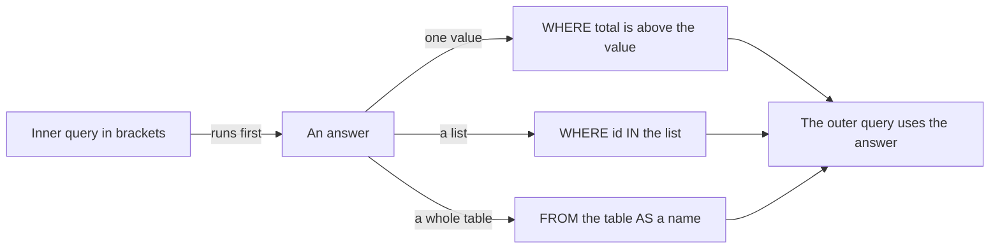
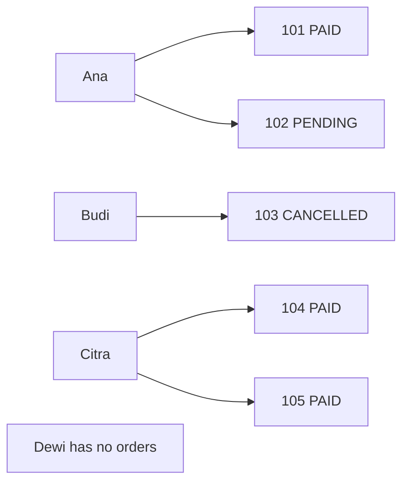
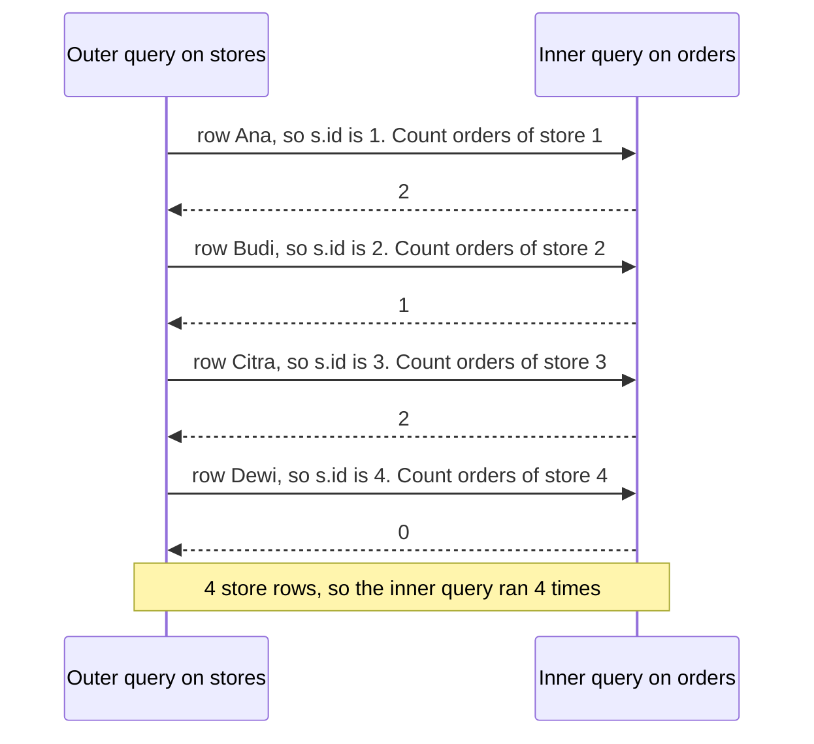
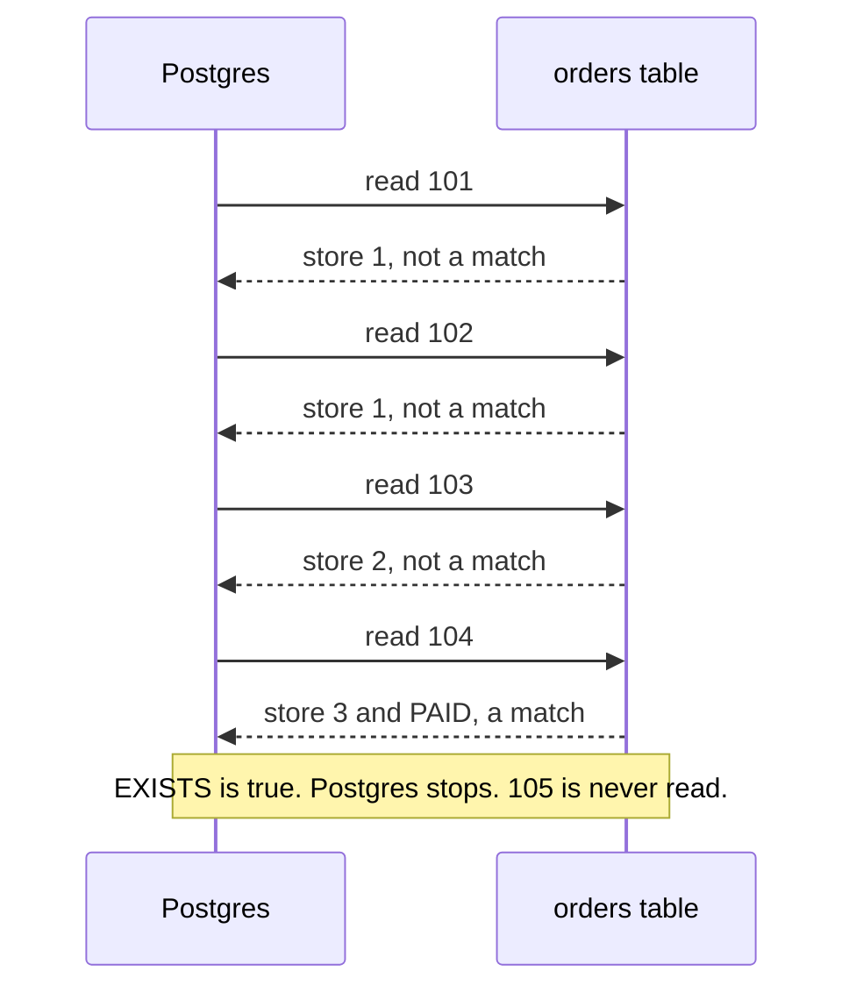
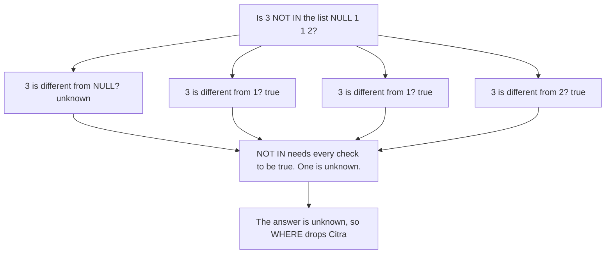
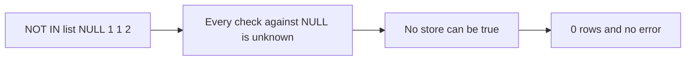
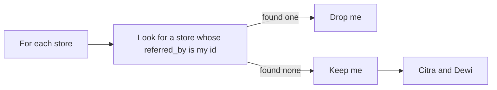
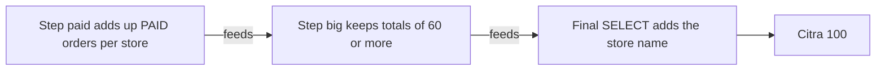

# 04. Subqueries, CTEs and EXISTS

> **Subject:** Database · **Lesson:** 04 · **Made:** 2026-10-16 · **Status:** ready
> **You will be able to:** put one query inside another, split a long query into named steps with WITH, and answer "has at least one" and "has none" questions with EXISTS and NOT EXISTS, without falling into the NOT IN trap.
> **Before this:** [Grouping and aggregation](03-grouping-and-aggregation.md) · **Next:** [Window functions](05-window-functions.md)

## 1. The idea in one sentence

Some questions need another answer first, so you put a small query inside the big one, and Postgres uses the small answer in the big question.

New words, at most 4:

- **Subquery:** a query inside brackets, inside another query. Postgres uses its answer in the outer query. (Interview word: *subquery* or *inner query*.)
- **Correlated subquery:** a subquery that uses a value from the outer row, like `s.id`. So Postgres runs it again for every outer row. (Interview word: *correlated subquery*.)
- **CTE:** a named step at the top of a query, written with `WITH name AS (...)`. Later steps read it like a table. (Interview word: *CTE*, short for *common table expression*.)
- **Unknown:** `NULL` means "no value". When Postgres compares anything with `NULL`, the answer is not true and not false. It is unknown. `WHERE` keeps a row only when the answer is true.

The rule to remember: **for "has one", use EXISTS. For "has none", use NOT EXISTS. Never use NOT IN on a list that could hold a NULL.**

## 2. The pictures

All pictures use four tiny stores and five orders. Section 4 has the code to make them.

| stores | id | name | referred_by |
|---|---|---|---|
| | 1 | Ana | NULL |
| | 2 | Budi | 1 |
| | 3 | Citra | 1 |
| | 4 | Dewi | 2 |

| orders | id | store_id | status | total |
|---|---|---|---|---|
| | 101 | 1 | PAID | 50 |
| | 102 | 1 | PENDING | 20 |
| | 103 | 2 | CANCELLED | 70 |
| | 104 | 3 | PAID | 90 |
| | 105 | 3 | PAID | 10 |

`referred_by` says which store brought this store in. Ana brought Budi and Citra. Budi brought Dewi.

### 2a. The big picture

Notice that the inner answer comes in three shapes, and the shape decides where you can put it.



### 2b. The problem, drawn

Question: "Which orders are bigger than the average order?" You need the average first. Without a subquery, your app makes two trips. Notice the copied number in the middle.


A second problem: "Which stores have **no** orders?" Notice that Dewi has no arrow. A normal `WHERE` looks at one store row at a time. It cannot see "no arrows". It must ask the orders table a question.



### 2c. How it works over time

A correlated subquery: "each store, with how many orders it has". Notice that the inner query runs once for **every** store row.



`EXISTS` for Citra: "does store 3 have a PAID order?" Notice that Postgres stops at the first yes. It never reads order 105.



### 2d. What is in memory right now

The NOT IN trap, frozen at one moment. The query is `WHERE id NOT IN (SELECT referred_by FROM stores)`. The inner list is `NULL, 1, 1, 2`. Postgres is checking Citra, whose id is 3. Notice the one unknown.



Every store is dropped the same way. The query returns **0 rows**.

| Store | id | Checks against NULL, 1, 1, 2 | NOT IN answer | Kept? |
|---|---|---|---|---|
| Ana | 1 | unknown, false, false, true | false | no |
| Budi | 2 | unknown, true, true, false | false | no |
| Citra | 3 | unknown, true, true, true | unknown | no |
| Dewi | 4 | unknown, true, true, true | unknown | no |

### 2e. Right against wrong

Question: "Which stores never brought in another store?" The true answer is Citra and Dewi.

**Wrong:** NOT IN. Notice that one NULL in the list wipes out every row.



**Right:** NOT EXISTS. Notice that it asks "is there a row that points at me?" The answer is always yes or no.



### 2f. A CTE is a list of named steps

Notice that you read it top to bottom, like a recipe. Each step can use the steps above it.



## 3. Real life analogy

- **Subquery:** before you ask "who scored above average?", you ask a friend "what is the average?". Then you use the answer.
- **EXISTS:** "does anyone in this room have a pen?" You stop asking at the first yes.
- **NOT IN with NULL:** a guard has a list of banned names. One line is smudged. Citra asks, "I am not on the list, right?" The guard says, "I do not know. The smudge could be you." Nobody gets in.

Where it stops: a real guard would fix the list. Postgres never guesses and gives no warning. It just returns fewer rows.

## 4. The smallest code that shows it

Run this setup once. It makes the tiny tables from section 2.

```sql
CREATE TABLE mini_stores (id int PRIMARY KEY, name text NOT NULL, referred_by int);
INSERT INTO mini_stores VALUES (1, 'Ana', NULL), (2, 'Budi', 1), (3, 'Citra', 1), (4, 'Dewi', 2);
CREATE TABLE mini_orders (id int PRIMARY KEY, store_id int NOT NULL, status text NOT NULL, total int NOT NULL);
INSERT INTO mini_orders VALUES (101, 1, 'PAID', 50), (102, 1, 'PENDING', 20),
  (103, 2, 'CANCELLED', 70), (104, 3, 'PAID', 90), (105, 3, 'PAID', 10);
```

Now the three shapes, one query each:

```sql
-- One value: orders bigger than the average (the average is 48)
SELECT id, total FROM mini_orders
WHERE total > (SELECT avg(total) FROM mini_orders) ORDER BY id;

-- A list: stores that have a PAID order
SELECT name FROM mini_stores
WHERE id IN (SELECT store_id FROM mini_orders WHERE status = 'PAID') ORDER BY id;

-- A table: the average number of orders per store that has orders
SELECT round(avg(order_count), 2) AS avg_orders
FROM (SELECT store_id, count(*) AS order_count FROM mini_orders GROUP BY store_id) AS per_store;
```

**Output**, one result for each query:

One value: orders above the average.

```
 id  | total
-----+-------
 101 |    50
 103 |    70
 104 |    90
```

A list: stores with a PAID order.

```
 name
-------
 Ana
 Citra
```

A table: average orders per store.

```
 avg_orders
------------
       1.67
```

Now "has one", "has none" and the trap:

```sql
-- has one: stores with at least one PAID order
SELECT s.name FROM mini_stores s
WHERE EXISTS (SELECT 1 FROM mini_orders o WHERE o.store_id = s.id AND o.status = 'PAID') ORDER BY s.id;

-- has none: stores with no orders
SELECT s.name FROM mini_stores s
WHERE NOT EXISTS (SELECT 1 FROM mini_orders o WHERE o.store_id = s.id) ORDER BY s.id;

-- the trap: stores that never brought in another store
SELECT name FROM mini_stores WHERE id NOT IN (SELECT referred_by FROM mini_stores) ORDER BY id;
SELECT s.name FROM mini_stores s
WHERE NOT EXISTS (SELECT 1 FROM mini_stores k WHERE k.referred_by = s.id) ORDER BY s.id;
```

**Output**, one result for each query:

Has one (EXISTS):

```
 name
-------
 Ana
 Citra
```

Has none (NOT EXISTS):

```
 name
------
 Dewi
```

The trap (NOT IN). Zero rows and no error:

```
 name
------
(0 rows)
```

The fix (NOT EXISTS):

```
 name
-------
 Citra
 Dewi
```

And a CTE, the named steps from picture 2f:

```sql
WITH paid AS (                        -- step 1: PAID total per store
  SELECT store_id, sum(total) AS paid_total
  FROM mini_orders WHERE status = 'PAID'
  GROUP BY store_id
),
big AS (                              -- step 2: uses step 1
  SELECT store_id, paid_total FROM paid WHERE paid_total >= 60
)
SELECT s.name, big.paid_total
FROM big JOIN mini_stores s ON s.id = big.store_id;
```

**Output:**

```
 name  | paid_total
-------+------------
 Citra |        100
```

Ana has only 50 PAID, so step 2 drops her.

`SELECT 1` inside EXISTS is a habit. EXISTS only asks "is there a row?". It never looks at the columns.

## 5. What really happens, step by step

Trace of the EXISTS query: "stores with at least one PAID order". Postgres takes the store rows one by one. For each one, it reads orders until it finds a match. This is the simple model. On big tables Postgres often finds a faster way to get the same answer (see the Go deeper box below).

| Step | Outer row | What Postgres does | Orders read | EXISTS | Result so far |
|---|---|---|---|---|---|
| 1 | Ana, id 1 | Plugs 1 into `o.store_id = s.id`. Reads 101: store 1 and PAID. A match. Stops. | 101 | true | Ana |
| 2 | Budi, id 2 | Reads 101, 102: other store. 103: store 2 but CANCELLED. 104, 105: other store. No match. | all 5 | false | Ana |
| 3 | Citra, id 3 | Reads 101, 102, 103: other stores. 104: store 3 and PAID. Stops. 105 is skipped. | 4 | true | Ana, Citra |
| 4 | Dewi, id 4 | Reads all 5 orders. None is store 4. | all 5 | false | Ana, Citra |
| 5 | (done) | Returns the kept rows. | 15 in total | | **Ana, Citra** |

Notice two things:

- A store **with** a match is cheap. Postgres stops early.
- A store **without** a match is the expensive one. Postgres must read everything to be sure. That is also true for NOT EXISTS.

**On the big practice tables** (100,000 orders), EXISTS for one store at a time:

| Store | Has a PAID order? | Order rows Postgres read |
|---|---|---|
| 1 | yes | a few hundred, then it stopped (random seed, so your number differs) |
| 950 (has no orders) | no | all 100,000 |

**A correlated subquery really runs once per row.** Here Postgres counts orders for the 200 stores in Medan:

```sql
EXPLAIN (ANALYZE, COSTS OFF, TIMING OFF, BUFFERS OFF)
SELECT s.name, (SELECT count(*) FROM orders o WHERE o.store_id = s.id) AS n
FROM stores s WHERE s.city = 'Medan';
```

```
Seq Scan on stores s (actual rows=200.00 loops=1)
  Filter: (city = 'Medan'::text)
  Rows Removed by Filter: 800
  SubPlan 1
    ->  Aggregate (actual rows=1.00 loops=200)
          ->  Seq Scan on orders o (actual rows=100.68 loops=200)
                Filter: (store_id = s.id)
                Rows Removed by Filter: 99899
```

How to read it:

- `SubPlan 1` is the inner query.
- `loops=200` means Postgres ran it 200 times, once per Medan store.
- Each run read all 100,000 orders. That is 20 million rows read in total.
- The fix is an index on `orders(store_id)` ([lesson 09](09-indexes-and-b-trees.md)), or one `JOIN` with `GROUP BY` ([lesson 03](03-grouping-and-aggregation.md)).

Checked on 2026-10-16 with PostgreSQL 18.3 (PGlite). On Postgres 16 you see `rows=200` without the `.00`.

**Step through it yourself:** [open the subqueries and EXISTS stepper](visuals/04-subqueries-ctes-and-exists.html). Five programs: a plain subquery, a correlated one, EXISTS stopping early, the NOT IN trap, and NOT EXISTS. Counters show how often the inner query ran and how many rows it read.

<details><summary>Go deeper (optional): Postgres often does not loop</summary>

The tables above are the simple model. It is the promise Postgres makes: the docs say an EXISTS subquery is "generally only executed long enough to determine whether at least one row is returned".

When EXISTS or NOT EXISTS sits in `WHERE`, Postgres usually rewrites it into a join that does all rows at once. Two interview words for these:

- **Semi join:** keep a row from the left table if it has at least one match. This is EXISTS (and IN).
- **Anti join:** keep a row only if it has no match. This is NOT EXISTS.

On the practice database, the plans look like this:

```
-- EXISTS (... status = 'PAID')            -- NOT EXISTS (...)
Hash Join                                   Hash Right Anti Join
  Hash Cond: (o.store_id = s.id)              Hash Cond: (o.store_id = s.id)
  ->  HashAggregate                           ->  Seq Scan on orders o
        Group Key: o.store_id                 ->  Hash
        ->  Seq Scan on orders o                    ->  Seq Scan on stores s
              Filter: (status = 'PAID'::text)
  ->  Hash
        ->  Seq Scan on stores s
```

Postgres read orders once, not once per store. That is why EXISTS and IN are usually just as fast in modern Postgres.

`NOT IN (subquery)` cannot become an anti join, because of the NULL rule. Postgres runs it as a `hashed SubPlan` instead. The PostgreSQL wiki page "Don't Do This" warns that this can get very slow when the list is too big for memory.

The correlated subquery in the `SELECT` list stays a loop (`SubPlan` with `loops=200`). That is why it needs an index.

</details>

## 6. Why it exists and what it costs

- **Problem without it:** two trips with copied numbers (picture 2b), "has none" questions that are hard to write, and long queries full of nested brackets.
- **How it solves it:** a subquery answers the small question in the same trip. EXISTS asks "is there a matching row?", always yes or no. A CTE names each step.
- **Cost:**
  - A correlated subquery in `SELECT` runs once per outer row. Without an index, that is slow (section 5).
  - A subquery used as one value must return one row. Two rows is an error.
  - `NOT IN` gives wrong answers when the list holds a NULL.
  - A CTE used twice is worked out once and kept, so the outer `WHERE` cannot help inside it (Go deeper below).

When to use which:

| You want | Use |
|---|---|
| Compare with one number, like the average | a subquery that returns one value |
| "Has at least one" | `EXISTS` (IN is fine too) |
| "Has none" | `NOT EXISTS` |
| Columns from the other table | `JOIN` |
| A long query in readable steps | a CTE with `WITH` |

<details><summary>Go deeper (optional): when Postgres inlines a CTE, and when it keeps it</summary>

Since PostgreSQL 12 (released in 2019), a CTE can be **inlined**. That means Postgres pastes the step into the main query and plans everything together. The docs say this happens by default when the CTE:

- is not recursive,
- has no side effects (a plain `SELECT` with no volatile functions like `random()`),
- is used only **once** in the query.

If it is used two or more times, Postgres works it out once and keeps the rows. That is called **materialized**. You can choose yourself with `WITH x AS MATERIALIZED (...)` or `WITH x AS NOT MATERIALIZED (...)`.

Real plans from the practice database:

```sql
WITH paid AS (SELECT * FROM orders WHERE status = 'PAID')
SELECT * FROM paid WHERE store_id = 42;
```

```
-- default: inlined, both filters in one scan
Seq Scan on orders
  Filter: ((status = 'PAID'::text) AND (store_id = 42))

-- with AS MATERIALIZED: all PAID orders first, then the store filter
CTE Scan on paid
  Filter: (store_id = 42)
  CTE paid
    ->  Seq Scan on orders
          Filter: (status = 'PAID'::text)
```

Why this matters: with an index on `store_id`, the inlined version can use it. The materialized version cannot, because it first builds the full list of PAID orders.

Before Postgres 12, every CTE was materialized. People called it an "optimization fence". Old blog posts say "CTEs are slow in Postgres". That is no longer true by default. An interviewer may ask this to see if your knowledge is current.

</details>

<details><summary>Go deeper (optional): a recursive CTE walks the referral tree</summary>

`WITH RECURSIVE` has two parts joined by `UNION ALL`:

1. A **starting row**.
2. A **step** that joins the table to the rows found so far.

Postgres repeats the step until it finds no new rows.

```sql
WITH RECURSIVE tree AS (
  SELECT id, name, 1 AS depth FROM mini_stores WHERE id = 1      -- start: Ana
  UNION ALL
  SELECT s.id, s.name, tree.depth + 1
  FROM mini_stores s JOIN tree ON s.referred_by = tree.id         -- step: who did they bring in?
)
SELECT id, name, depth FROM tree ORDER BY depth, id;
```

```
 id | name  | depth
----+-------+-------
  1 | Ana   |     1
  2 | Budi  |     2
  3 | Citra |     2
  4 | Dewi  |     3
```

Round 1 finds Ana. Round 2 finds who Ana brought in: Budi and Citra. Round 3 finds who they brought in: Dewi. Round 4 finds nobody, so it stops.

On the practice database, the seed makes store `g` referred by store `g / 2`. Walking **up** from store 1000 gives this chain:

```sql
WITH RECURSIVE chain AS (
  SELECT id, referred_by, 1 AS step FROM stores WHERE id = 1000
  UNION ALL
  SELECT s.id, s.referred_by, c.step + 1 FROM stores s JOIN chain c ON s.id = c.referred_by
)
SELECT string_agg(id::text, ' -> ' ORDER BY step) AS path FROM chain;
```

```
1000 -> 500 -> 250 -> 125 -> 62 -> 31 -> 15 -> 7 -> 3 -> 1
```

If the data has a loop (A brought B, B brought A), the query never ends. Guard it with a depth limit like `WHERE depth < 20` in the step, or with the `CYCLE` clause (Postgres 14 and later).

</details>

## 7. Common mistakes

**Wrong:** NOT IN on a column that can be NULL.

```sql
SELECT name FROM mini_stores WHERE id NOT IN (SELECT referred_by FROM mini_stores) ORDER BY id;
-- (0 rows). No error. It looks like "no such stores".
```

**Right:**

```sql
SELECT s.name FROM mini_stores s
WHERE NOT EXISTS (SELECT 1 FROM mini_stores k WHERE k.referred_by = s.id)
ORDER BY s.id;
-- Citra, Dewi
```

**Why:** one NULL in the list makes every NOT IN check unknown or false (picture 2d). NOT EXISTS only asks "is there a matching row?". Adding `WHERE referred_by IS NOT NULL` inside the NOT IN also works, but you must remember it every time.

**Wrong:** JOIN when you only want "has one".

```sql
SELECT s.name FROM mini_stores s
JOIN mini_orders o ON o.store_id = s.id WHERE o.status = 'PAID'
ORDER BY s.id;
-- Ana, Citra, Citra   (Citra twice, because she has two PAID orders)
```

**Right:**

```sql
SELECT s.name FROM mini_stores s
WHERE EXISTS (SELECT 1 FROM mini_orders o WHERE o.store_id = s.id AND o.status = 'PAID')
ORDER BY s.id;
-- Ana, Citra
```

**Why:** a JOIN makes one row per matching pair. EXISTS keeps each store once. If you catch yourself adding `DISTINCT` after a JOIN, you probably wanted EXISTS.

**Wrong:** `=` with a subquery that can return many rows.

```sql
SELECT name FROM mini_stores WHERE id = (SELECT store_id FROM mini_orders WHERE status = 'PAID');
-- ERROR: more than one row returned by a subquery used as an expression
```

**Right:** use `IN` for a list.

```sql
SELECT name FROM mini_stores WHERE id IN (SELECT store_id FROM mini_orders WHERE status = 'PAID') ORDER BY id;
-- Ana, Citra
```

**Why:** `=` needs one value. Three PAID orders give three values.

## 8. Watch and play

Links checked on 2026-10-16: each page was opened, and each video's title, channel and length came from YouTube. The videos were not watched.

- **Video:** [How to use the SQL EXISTS and NOT EXISTS conditional operators](https://www.youtube.com/watch?v=BAiQq_u2pd8) by Vlad Mihalcea, 6 minutes. EXISTS and NOT EXISTS with two related tables.
- **Video:** [SQL WITH Clause, Clearly Explained](https://www.youtube.com/watch?v=LJC8277LONg) by Maven Analytics, 13 minutes. CTEs against subqueries, and recursive CTEs.
- **Play with it:** [The subqueries and EXISTS stepper](visuals/04-subqueries-ctes-and-exists.html) in this folder. Guess first, then watch the "rows read" counter.
- **Play with it:** [PostgreSQL Exercises: members with their recommender, using no joins](https://pgexercises.com/questions/joins/sub.html). Run real SQL in the browser. It needs a correlated subquery.
- **Play with it:** [PostgreSQL Exercises: recursive queries](https://pgexercises.com/questions/recursive/). Members recommend members, like `referred_by`. Try it after the recursive Go deeper box.
- **Play with it:** [explain.dalibo.com](https://explain.dalibo.com/). Paste the plan from section 5 and see `SubPlan` and its loops as a diagram.
- **Read:** [PostgreSQL docs: Subquery Expressions](https://www.postgresql.org/docs/current/functions-subquery.html). In the NOT IN part, find the words "null, not true".

<details><summary>More links (optional)</summary>

- **Read:** [PostgreSQL docs: WITH Queries](https://www.postgresql.org/docs/current/queries-with.html), section 7.8.3 "Common Table Expression Materialization". The inline and materialize rules with examples.
- **Read:** [PostgreSQL wiki: Don't Do This](https://wiki.postgresql.org/wiki/Don%27t_Do_This). The part "Don't use NOT IN" gives the NULL reason and the speed reason.
- **Read:** [PostgreSQL 12 release notes](https://www.postgresql.org/docs/release/12.0/). Search for "inlined" to see the CTE change.
- **Video:** [SQL Subquery using EXISTS and IN](https://www.youtube.com/watch?v=sP6MCZ9patk) by Data with Baraa, 10 minutes. Another view of IN against EXISTS.
- **Video:** [SQL CTEs (Common Table Expressions) - Why and How to Use Them](https://www.youtube.com/watch?v=ZaFMM-vNlvc) by Database Star, 8 minutes.
- **Read:** [SQLBolt: Subqueries](https://sqlbolt.com/topic/subqueries). A short page on plain and correlated subqueries. It does not cover EXISTS.

</details>

## 9. Practice

**A. Predict the output** (write your answer before opening)

Same tiny tables. Three queries:

```sql
SELECT name FROM mini_stores WHERE id IN (2, NULL) ORDER BY id;
SELECT name FROM mini_stores WHERE id NOT IN (2, 3) ORDER BY id;
SELECT name FROM mini_stores WHERE id NOT IN (2, NULL) ORDER BY id;
```

<details><summary>Answer</summary>

```
IN (2, NULL)      NOT IN (2, 3)      NOT IN (2, NULL)
 Budi              Ana                (0 rows)
                   Dewi
```

- `IN` needs just one true check. For Budi, `2 = 2` is true. The NULL does not hurt IN.
- `NOT IN (2, 3)` has no NULL, so it works normally.
- `NOT IN (2, NULL)` needs every check to be true. The check against NULL is always unknown. So no row passes.

</details>

**B. Fix the bug**

Your teammate wants "stores that have a PAID order" for a dashboard. The list shows Citra twice.

```sql
SELECT s.name
FROM mini_stores s
JOIN mini_orders o ON o.store_id = s.id
WHERE o.status = 'PAID'
ORDER BY s.id;
-- Ana, Citra, Citra
```

<details><summary>Answer</summary>

```sql
SELECT s.name
FROM mini_stores s
WHERE EXISTS (
  SELECT 1 FROM mini_orders o
  WHERE o.store_id = s.id AND o.status = 'PAID'
)
ORDER BY s.id;
-- Ana, Citra
```

The JOIN makes one row for each matching order. Citra has two PAID orders, so she appears twice. EXISTS asks "is there at least one?" and keeps each store once. `SELECT DISTINCT s.name` also hides the duplicate, but it makes Postgres build all the pairs first and then remove copies.

</details>

**C. Write it yourself**

Open `practice/04-subqueries-ctes-and-exists.sql`. It makes its own tiny tables and has six tasks: one value and IN, a correlated count, EXISTS and NOT EXISTS, a broken NOT IN to fix, a CTE, and finding `loops` in a real plan. A bonus task is a recursive CTE. Every task shows its expected result.

<details><summary>One possible answer</summary>

```sql
-- Task 1a
SELECT id, total FROM l04_orders
WHERE total > (SELECT avg(total) FROM l04_orders)
ORDER BY id;

-- Task 1b
SELECT name FROM l04_stores
WHERE id IN (SELECT store_id FROM l04_orders WHERE status = 'CANCELLED')
ORDER BY id;

-- Task 2
SELECT s.name,
       (SELECT count(*) FROM l04_orders o
        WHERE o.store_id = s.id AND o.status = 'PAID') AS paid_orders
FROM l04_stores s
ORDER BY s.id;

-- Task 3a
SELECT s.name FROM l04_stores s
WHERE EXISTS (SELECT 1 FROM l04_orders o
              WHERE o.store_id = s.id AND o.status = 'PAID' AND o.total >= 100)
ORDER BY s.id;

-- Task 3b
SELECT s.name FROM l04_stores s
WHERE NOT EXISTS (SELECT 1 FROM l04_orders o WHERE o.store_id = s.id)
ORDER BY s.id;

-- Task 4: the blocked list holds a NULL, so every NOT IN check is unknown or false.
SELECT s.name FROM l04_stores s
WHERE NOT EXISTS (SELECT 1 FROM l04_blocked b WHERE b.store_id = s.id)
ORDER BY s.id;

-- Task 5
WITH paid AS (
  SELECT store_id, sum(total) AS paid_total
  FROM l04_orders
  WHERE status = 'PAID'
  GROUP BY store_id
),
big AS (
  SELECT store_id, paid_total FROM paid WHERE paid_total >= 100
)
SELECT s.name, big.paid_total
FROM big JOIN l04_stores s ON s.id = big.store_id
ORDER BY s.id;

-- Task 6
EXPLAIN (ANALYZE, COSTS OFF, TIMING OFF)
SELECT s.name,
       (SELECT count(*) FROM orders o WHERE o.store_id = s.id) AS n
FROM stores s
WHERE s.city = 'Bandung';

-- Bonus
WITH RECURSIVE tree AS (
  SELECT id, name, 0 AS depth FROM l04_stores WHERE id = 1
  UNION ALL
  SELECT s.id, s.name, tree.depth + 1
  FROM l04_stores s JOIN tree ON s.referred_by = tree.id
)
SELECT name, depth FROM tree WHERE depth > 0 ORDER BY depth, id;
```

</details>

## 10. Interview question

**Q:** "Find all customers who have never placed an order. Show me two ways. Which one would you use, and why? What happens with NOT IN?"

<details><summary>A strong answer, in four parts</summary>

1. **Problem:** "has none" questions cannot be answered by looking at one customer row. You must ask the orders table "is there any row for this customer?".
2. **How it works:**
   - `NOT EXISTS (SELECT 1 FROM orders o WHERE o.customer_id = c.id)`. For each customer, Postgres looks for one matching order. If it finds none, it keeps the customer. Postgres usually turns this into an anti join, so it reads orders once, not once per customer.
   - The other way is `LEFT JOIN orders ... WHERE o.id IS NULL` ([lesson 02](02-joins.md)). It gives the same rows.
   - `NOT IN (SELECT customer_id FROM orders)` breaks when the list holds a NULL. A check against NULL is unknown, NOT IN needs every check to be true, so it returns 0 rows with no error. It is also harder for Postgres to plan, so it can be slow on big lists.
3. **Tradeoff:** I pick NOT EXISTS. It is safe with NULLs, it says what I mean, and Postgres plans it well. JOIN is right when I need columns from the other table. A correlated subquery in the SELECT list runs once per row, so it needs an index on the inner column.
4. **My example:** *This is an idea, not a fact. Replace it with your own real story.* DBO is a B2B commerce app with stores and orders. A list like "stores that have not ordered this month" for the admin CMS is a NOT EXISTS with a date filter inside the subquery. With Prisma or Hasura, you can turn on query logging (or use the Analyze button in the Hasura console) to see which SQL they write for a "has none" filter.

</details>

<details><summary>A follow-up they ask: "Are CTEs slow in Postgres?"</summary>

"Not by default since Postgres 12. A CTE that is used once, has no side effects, and is not recursive is inlined into the main query. So it plans like a subquery. If it is used twice, Postgres works it out once and keeps the rows, and the outer filter cannot reach inside. I can force either way with `MATERIALIZED` or `NOT MATERIALIZED`. I check with EXPLAIN: a `CTE Scan` node means it was kept."

</details>

## 11. Explain it back

Close this file. Press the **Record my explanation** button under this heading and explain this lesson out loud, like to a new junior, in 4 parts: problem, how it works, tradeoff, my example. Use the words "subquery", "correlated", "EXISTS" and "unknown". Try to draw picture 2d while you talk. Then save the transcript file into `my-learning/recordings/`, or write your best version below. Run `/explain-check subqueries` or ask the `explain-coach` agent to review it.

### My explanation

<write here>

### Coach feedback

<the explain-coach agent writes here>

## 12. Review questions (day 1, 3, 7, 21)

1. What is the difference between a normal subquery and a correlated one? How many times does each run?
2. Why does EXISTS often finish fast for a store that has orders, but read everything for a store that has none?
3. The list from a subquery is `5, NULL`. Why does `WHERE id NOT IN (that list)` return no rows? What do you write instead?
4. Draw picture 2d from memory: the NOT IN list with a NULL, the four checks for Citra, and why the answer is unknown.

<details><summary>Answers</summary>

1. A normal subquery does not use the outer row, so Postgres works it out once and uses the answer for every row. A correlated subquery uses a value from the outer row, like `s.id`, so in the simple model it runs once per outer row. In `SELECT`, it really does run once per row (`loops=200` in section 5).
2. EXISTS stops at the first matching row. A store with orders gives a match early. A store with no orders never matches, so Postgres must check every row to be sure.
3. NOT IN means "different from every value". `id <> NULL` is unknown, never true. So the whole NOT IN is unknown or false for every row, and WHERE keeps only true. Write `NOT EXISTS (SELECT 1 FROM ... WHERE x = outer.id)` instead.
4. The list is NULL, 1, 1, 2. For id 3: against NULL is unknown, against 1 is true, against 1 is true, against 2 is true. NOT IN needs all true. One is unknown, so the answer is unknown, and WHERE drops Citra. The same happens to every store, so 0 rows.

</details>

## Connected lessons

- [Grouping and aggregation](03-grouping-and-aggregation.md): the lesson before. The CTE example uses `GROUP BY`.
- [Joins](02-joins.md): `LEFT JOIN ... WHERE o.id IS NULL` is another way to find "has none".
- [Window functions](05-window-functions.md): the next lesson. It often replaces a correlated subquery.
- [Indexes and B-trees](09-indexes-and-b-trees.md): the fix for a slow correlated subquery.
- [Reading EXPLAIN](11-reading-explain.md): how to spot `SubPlan`, `loops` and `CTE Scan`.
- [PostgreSQL queries and indexing guide](postgresql-queries-interview-guide.md): the longer guide, for revision.
