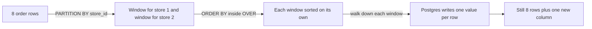
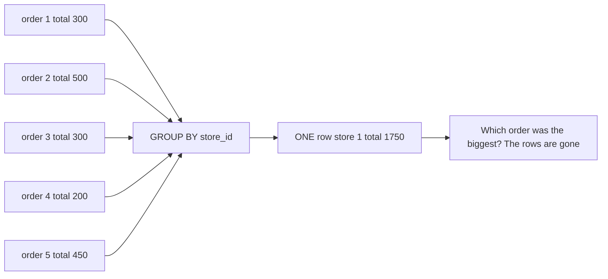
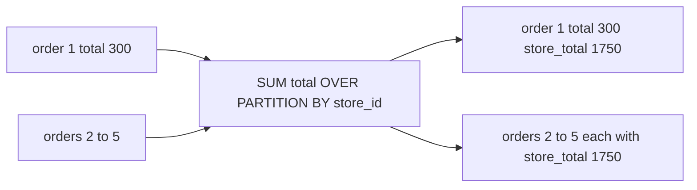
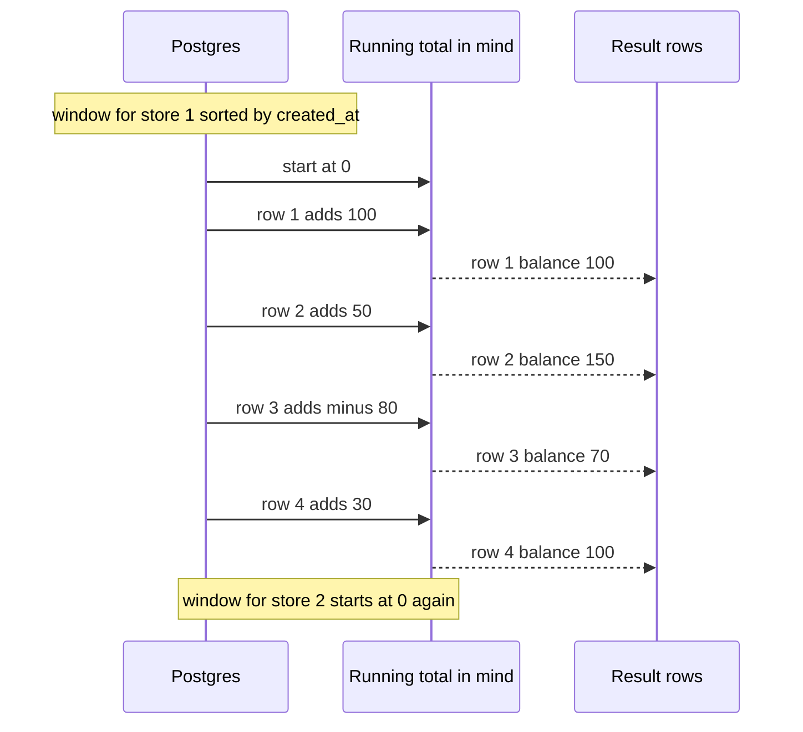
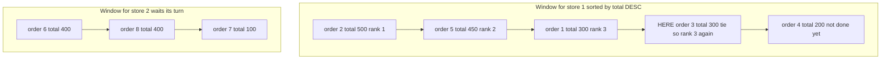
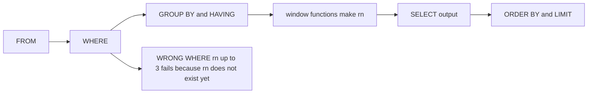
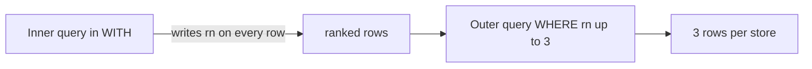

# 05. Window functions

> **Subject:** Database · **Lesson:** 05 · **Made:** 2026-10-16 · **Status:** ready
> **You will be able to:** number, rank and add up rows inside each group without losing any row, and write "top 3 orders per store" while explaining why the filter needs an outer query.
> **Before this:** [Subqueries, CTEs and EXISTS](04-subqueries-ctes-and-exists.md) · **Next:** Keys and relationships (lesson 06, not written yet)

## 1. The idea in one sentence

A window function lets each row look at the other rows in its group and write one extra value next to itself, while every row stays in the result.

New words:

- **Window:** the group of rows that one row is allowed to look at. (Interview word: *window function*, a function that uses a window.)
- **Partition:** one separate window. `PARTITION BY store_id` makes one window per store. Rows never see rows of another window.
- **Running total:** the sum from the first row down to this row, like a bank balance. (Interview word: *cumulative sum*.)
- **CTE:** a query with a name, written first with `WITH`. The main query reads it like a table. You met it in [lesson 04](04-subqueries-ctes-and-exists.md).

The rule to remember: **`GROUP BY` squashes many rows into one row. A window function keeps every row and adds one column.**

## 2. The pictures

All pictures use the same 8 orders of two stores. Store 1 has 5 orders. Store 2 has 3 orders.

### 2a. The big picture

Notice the four jobs, in this order: read, split, sort, walk down and write.



### 2b. The problem, drawn

The boss asks: "Total per store, but also show me each order." `GROUP BY` can only do the first half. Notice that the five order rows are gone after it.



A window function answers both halves. Notice that five rows go in and five rows come out.



### 2c. How it works over time

Postgres builds a running total of loyalty points for store 1. Notice that it keeps only one number in mind, and adds each row to it.



### 2d. What is in memory right now

The moment Postgres stands on order 3 in the `RANK` query. Notice the two windows, and the tie: orders 1 and 3 both have 300.



### 2e. Right against wrong

Postgres runs the parts of a query in a fixed order (see [lesson 01](01-sql-basics-and-query-order.md)). Notice that `WHERE` runs **before** the window functions. So `WHERE` cannot see `rn` yet.



The fix: make `rn` in an inner query first. Then filter in the outer query. Notice the two rounds.



## 3. Real life analogy

A school prints one sheet with every student's test score.

- The head teacher's summary says "Class A average 72". The names are gone. That is `GROUP BY`.
- A class teacher keeps every name and writes "3rd in my class" next to each one. That is a window function.
- Each class is ranked on its own. That is `PARTITION BY class`.
- The teacher ranks by score, highest first. That is `ORDER BY score DESC` inside `OVER`.

Where the analogy stops: a teacher can glance at any student in any order. Postgres must sort each window first, then walk down it row by row. If you give no `ORDER BY` inside `OVER`, the walking order is not fixed, so "row number 1" could be any row.

## 4. The smallest code that shows it

Paste this setup first. It makes two tiny tables with fixed rows, so your output matches the lesson.

<details><summary>Setup: two tiny tables (paste once)</summary>

```sql
DROP TABLE IF EXISTS w_orders;
DROP TABLE IF EXISTS w_points;
CREATE TABLE w_orders (id int PRIMARY KEY, store_id int NOT NULL, total int NOT NULL, created_at date NOT NULL);
INSERT INTO w_orders VALUES
  (1, 1, 300, '2026-10-01'), (2, 1, 500, '2026-10-02'), (3, 1, 300, '2026-10-03'),
  (4, 1, 200, '2026-10-04'), (5, 1, 450, '2026-10-05'),
  (6, 2, 400, '2026-10-01'), (7, 2, 100, '2026-10-02'), (8, 2, 400, '2026-10-03');
CREATE TABLE w_points (id int PRIMARY KEY, store_id int NOT NULL, amount int NOT NULL, reason text NOT NULL, created_at date NOT NULL);
INSERT INTO w_points VALUES
  (1, 1, 100, 'PURCHASE', '2026-10-01'), (2, 1,  50, 'PURCHASE', '2026-10-02'),
  (3, 1, -80, 'REDEEM',   '2026-10-03'), (4, 1,  30, 'PURCHASE', '2026-10-04'),
  (5, 2, 200, 'PURCHASE', '2026-10-01'), (6, 2, -50, 'REDEEM',   '2026-10-02');
```

`w` stands for "window". The tables are shaped like the practice tables `orders` and `point_transactions`.

</details>

### 4a. The problem, then the fix

```sql
SELECT store_id, SUM(total) AS store_total
FROM w_orders GROUP BY store_id ORDER BY store_id;
```

```
 store_id | store_total
----------+-------------
        1 |        1750
        2 |         900
```

Two rows. The orders are gone. Now the window version:

```sql
SELECT id, store_id, total,
       SUM(total) OVER (PARTITION BY store_id) AS store_total
FROM w_orders ORDER BY store_id, id;
```

```
 id | store_id | total | store_total
----+----------+-------+-------------
  1 |        1 |   300 |        1750
  2 |        1 |   500 |        1750
  3 |        1 |   300 |        1750
  4 |        1 |   200 |        1750
  5 |        1 |   450 |        1750
  6 |        2 |   400 |         900
  7 |        2 |   100 |         900
  8 |        2 |   400 |         900
```

Eight rows. `OVER (...)` is what turns `SUM` into a window function.

### 4b. ROW_NUMBER, RANK and DENSE_RANK with a tie

```sql
SELECT store_id, id, total,
  ROW_NUMBER() OVER (PARTITION BY store_id ORDER BY total DESC, id) AS row_number,
  RANK()       OVER (PARTITION BY store_id ORDER BY total DESC)     AS rank,
  DENSE_RANK() OVER (PARTITION BY store_id ORDER BY total DESC)     AS dense_rank
FROM w_orders ORDER BY store_id, total DESC, id;
```

```
 store_id | id | total | row_number | rank | dense_rank
----------+----+-------+------------+------+------------
        1 |  2 |   500 |          1 |    1 |          1
        1 |  5 |   450 |          2 |    2 |          2
        1 |  1 |   300 |          3 |    3 |          3
        1 |  3 |   300 |          4 |    3 |          3
        1 |  4 |   200 |          5 |    5 |          4
        2 |  6 |   400 |          1 |    1 |          1
        2 |  8 |   400 |          2 |    1 |          1
        2 |  7 |   100 |          3 |    3 |          2
```

- **ROW_NUMBER:** 1, 2, 3, 4, 5. Always different, even for a tie.
- **RANK:** ties share a number, then it **skips**: 1, 2, 3, 3, **5**.
- **DENSE_RANK:** ties share a number, **no skip**: 1, 2, 3, 3, **4**.

### 4c. Running total of loyalty points

```sql
SELECT id, created_at, reason, amount,
       SUM(amount) OVER (ORDER BY created_at) AS balance
FROM w_points WHERE store_id = 1
ORDER BY created_at;
```

```
 id | created_at | reason   | amount | balance
----+------------+----------+--------+---------
  1 | 2026-10-01 | PURCHASE |    100 |     100
  2 | 2026-10-02 | PURCHASE |     50 |     150
  3 | 2026-10-03 | REDEEM   |    -80 |      70
  4 | 2026-10-04 | PURCHASE |     30 |     100
```

`ORDER BY` inside `OVER` changes the meaning of `SUM`. Without it, `SUM` gives the whole window total on every row. With it, `SUM` adds from the top down to this row. For all stores at once, add `PARTITION BY store_id`. Then store 2 shows 200, then 150.

On the big practice table the same query is `... FROM point_transactions WHERE store_id = 1 ORDER BY created_at`. The numbers differ there, because the seed uses random values.

### 4d. LAG: compare with the order before

```sql
SELECT store_id, id, total,
       LAG(total) OVER (PARTITION BY store_id ORDER BY created_at) AS previous_total,
       total - LAG(total) OVER (PARTITION BY store_id ORDER BY created_at) AS change
FROM w_orders ORDER BY store_id, created_at;
```

```
 store_id | id | total | previous_total | change
----------+----+-------+----------------+--------
        1 |  1 |   300 |                |
        1 |  2 |   500 |            300 |    200
        1 |  3 |   300 |            500 |   -200
        1 |  4 |   200 |            300 |   -100
        1 |  5 |   450 |            200 |    250
        2 |  6 |   400 |                |
        2 |  7 |   100 |            400 |   -300
        2 |  8 |   400 |            100 |    300
```

The empty cells are `NULL`, which means "no value". The first order of each store has no order before it.

### 4e. Top 3 orders per store

```sql
WITH ranked AS (
  SELECT store_id, id, total,
         ROW_NUMBER() OVER (PARTITION BY store_id ORDER BY total DESC, id) AS rn
  FROM w_orders
)
SELECT store_id, id, total, rn
FROM ranked
WHERE rn <= 3
ORDER BY store_id, rn;
```

```
 store_id | id | total | rn
----------+----+-------+----
        1 |  2 |   500 |  1
        1 |  5 |   450 |  2
        1 |  1 |   300 |  3
        2 |  6 |   400 |  1
        2 |  8 |   400 |  2
        2 |  7 |   100 |  3
```

Store 1 lost orders 3 and 4. Store 2 has only 3 orders, so it keeps all of them. A subquery in `FROM` works the same way as the `WITH`.

## 5. What really happens, step by step

The top 3 query from 4e, run on the 8 orders:

| Step | Part of the query | What Postgres does | State after |
|---|---|---|---|
| 1 | `FROM w_orders` (inner) | Reads all 8 rows. | 8 rows, no `rn` yet |
| 2 | `PARTITION BY store_id` | Cuts the rows into two windows. | Store 1: orders 1 to 5. Store 2: orders 6 to 8 |
| 3 | `ORDER BY total DESC, id` | Sorts each window on its own. `id` breaks the 300 tie. | Store 1: 2, 5, 1, 3, 4. Store 2: 6, 8, 7 |
| 4 | `ROW_NUMBER()` | Walks down store 1. The counter starts at 1 and goes up by one per row. | `rn` of orders 2, 5, 1, 3, 4 = 1, 2, 3, 4, 5 |
| 5 | `ROW_NUMBER()` | New window, so the counter starts at 1 again. | `rn` of orders 6, 8, 7 = 1, 2, 3 |
| 6 | `WITH ranked AS (...)` ends | The inner query is done. Every row has `rn`. | `ranked` holds 8 rows, each with `rn` |
| 7 | `WHERE rn <= 3` (outer) | Checks each row. Drops order 3 (`rn` 4) and order 4 (`rn` 5). | 6 rows left |
| 8 | `ORDER BY store_id, rn` | Sorts the final rows. | The 6 rows shown in 4e |

For `RANK`, step 4 is different. Postgres also remembers the last total. If the next total is the same, it writes the same rank again. If it is new, it writes the row position, which can skip a number.

Output checked on 2026-10-16 with PostgreSQL 18.3 (PGlite). These results are the same on PostgreSQL 16.

**Step through it yourself:** [open the window functions stepper](visuals/05-window-functions.html). The rows sit in coloured boxes, one box per window. A pointer walks down the rows and the yellow column fills in. It has six programs:

1. **ROW_NUMBER**: the counter, and the restart at store 2.
2. **RANK with a tie**: `rank` and `dense_rank` side by side. Watch rank 4 get skipped.
3. **Running total**: the balance of loyalty points per store.
4. **LAG, the row before**: why the first row of each store gets `NULL`.
5. **Top 3 per store**: the inner query writes `rn`, then the outer `WHERE` keeps or drops each row.
6. **Bug: no PARTITION BY**: one big window, so store 2 gets the wrong balance.

## 6. Why it exists and what it costs

- **Problem without it:** `GROUP BY` loses the rows. To get "each order plus its rank" you would need a slow query inside a query for every row, or a loop in JavaScript after loading everything.
- **How it solves it:** Postgres splits the rows into windows, sorts each window once, and walks down it. Each row gets its value in one pass.
- **Cost:**
  - **Sorting.** Postgres must sort each window. On 100,000 orders that is a real sort, which can spill to disk. An index in the same order as `PARTITION BY` and `ORDER BY` can remove the sort (see Go deeper).
  - **Two rounds to filter.** You cannot filter on a window value in the same query. You need an inner query, so Postgres numbers rows before it drops them.
  - **ORMs hide it.** Prisma's normal find queries have no window functions. You write the SQL yourself with Prisma's raw SQL feature. In Hasura, a common way is a Postgres view that Hasura then exposes as a query.

<details><summary>Go deeper (optional)</summary>

**Frames: which rows does SUM add up?** The rows a function adds up are called the *frame*. With `ORDER BY` inside `OVER`, the default frame is "from the start of the window to this row, **plus every row with the same ORDER BY value**". That last part surprises people. Give store 1 a second point change on 10-02, so two rows share a day:

```sql
INSERT INTO w_points VALUES (9, 1, 20, 'PURCHASE', '2026-10-02');

SELECT id, created_at, amount,
  SUM(amount) OVER (ORDER BY created_at) AS default_frame,
  SUM(amount) OVER (ORDER BY created_at, id
                    ROWS BETWEEN UNBOUNDED PRECEDING AND CURRENT ROW) AS rows_frame
FROM w_points WHERE store_id = 1
ORDER BY created_at, id;

DELETE FROM w_points WHERE id = 9;   -- put the table back
```

```
 id | created_at | amount | default_frame | rows_frame
----+------------+--------+---------------+------------
  1 | 2026-10-01 |    100 |           100 |        100
  2 | 2026-10-02 |     50 |           170 |        150
  9 | 2026-10-02 |     20 |           170 |        170
  3 | 2026-10-03 |    -80 |            90 |         90
  4 | 2026-10-04 |     30 |           120 |        120
```

Both rows on 10-02 show 170 with the default frame. `ROWS BETWEEN UNBOUNDED PRECEDING AND CURRENT ROW` means "exactly the rows above me and me", so each row gets its own balance. For a real balance, add a tie breaker (`id`) and use `ROWS`. The PostgreSQL tutorial states this default frame rule.

**DISTINCT ON, the Postgres shortcut for "top 1 per group".**

```sql
SELECT DISTINCT ON (store_id) store_id, id, total
FROM w_orders ORDER BY store_id, total DESC, id;
```

```
 store_id | id | total
----------+----+-------
        1 |  2 |   500
        2 |  6 |   400
```

It keeps the first row of each `store_id`, after the `ORDER BY`. It is shorter than `ROW_NUMBER`, but it only gives the top 1, and it is not standard SQL. For top 3 you still need `ROW_NUMBER`.

**The plan on the big table.** Top 3 per store on the 100,000 seed orders, with `EXPLAIN (ANALYZE, COSTS OFF, TIMING OFF, BUFFERS OFF)` on PostgreSQL 18.3:

```
WindowAgg (actual rows=2700.00 loops=1)
  Window: w1 AS (PARTITION BY orders.store_id ORDER BY orders.total_cents, orders.id ROWS UNBOUNDED PRECEDING)
  Run Condition: (row_number() OVER w1 <= 3)
  Storage: Memory  Maximum Storage: 17kB
  ->  Sort (actual rows=100000.00 loops=1)
        Sort Key: orders.store_id, orders.total_cents DESC, orders.id
        Sort Method: external merge  Disk: 3336kB
        ->  Seq Scan on orders (actual rows=100000.00 loops=1)
```

- Read it from the bottom: read every order, sort them (here the sort spilled to disk), then `WindowAgg` writes the numbers.
- `Run Condition` means Postgres moved your `rn <= 3` into the window step. It stops writing rows for a store after 3. This arrived in PostgreSQL 15 ("Improve the performance of window functions that use row_number(), rank(), dense_rank() and count()"), so you see it on 16 too.
- After `CREATE INDEX ON orders (store_id, total_cents DESC, id)`, the `Sort` disappears and the bottom becomes `Index Only Scan using ...`. It still reads all 100,000 rows, because every store needs its first 3.
- **PostgreSQL 16 against 18:** on 16 you will not see the `Window:` line or the `Storage:` line (both added in 18), and row counts have no decimals (`rows=2700`, not `rows=2700.00`). Your counts and sizes will differ, because the seed uses `random()`.

**Other window functions you will meet:** `LEAD` (the row after), `FIRST_VALUE`, `NTILE(4)` (split into 4 equal groups), and `AVG(...) OVER (... ROWS BETWEEN 6 PRECEDING AND CURRENT ROW)` for a 7 day moving average. The same window can be named once with `WINDOW w AS (...)` and used as `OVER w`.

</details>

## 7. Common mistakes

**Wrong:** a window function in `WHERE`.

```sql
SELECT store_id, id, total
FROM w_orders
WHERE ROW_NUMBER() OVER (PARTITION BY store_id ORDER BY total DESC) <= 3;
-- ERROR:  window functions are not allowed in WHERE
```

**Right:** make the number in an inner query, filter outside.

```sql
WITH ranked AS (
  SELECT store_id, id, total,
         ROW_NUMBER() OVER (PARTITION BY store_id ORDER BY total DESC, id) AS rn
  FROM w_orders
)
SELECT store_id, id, total FROM ranked WHERE rn <= 3;
```

**Why:** `WHERE` runs before window functions (picture 2e). The number does not exist yet when `WHERE` runs.

**Wrong:** forgetting `PARTITION BY`.

```sql
SELECT store_id, id, amount,
       SUM(amount) OVER (ORDER BY store_id, created_at) AS balance
FROM w_points;
-- store 2 shows 300 and 250
```

**Right:**

```sql
SELECT store_id, id, amount,
       SUM(amount) OVER (PARTITION BY store_id ORDER BY created_at) AS balance
FROM w_points;
-- store 2 shows 200 and 150
```

**Why:** without `PARTITION BY` there is one big window. The total of store 1 keeps going into store 2 (stepper, program 6).

**Wrong:** forgetting `ORDER BY` inside `OVER` for a running total.

```sql
SELECT id, amount, SUM(amount) OVER (PARTITION BY store_id) AS balance
FROM w_points WHERE store_id = 1;
-- every row shows 100
```

**Right:** `SUM(amount) OVER (PARTITION BY store_id ORDER BY created_at)` gives 100, 150, 70, 100.

**Why:** without `ORDER BY`, the frame is the whole window, so every row gets the full total.

**Wrong:** using `RANK() <= 3` when you need exactly 3 rows. With a tie at third place, `RANK` gives 4 rows for store 1 (500, 450, 300, 300).

**Right:** use `ROW_NUMBER` with a tie breaker, like `ORDER BY total DESC, id`.

**Why:** `RANK` gives tied rows the same number, so more rows pass the filter. Without a tie breaker, `ROW_NUMBER` picks one of the tied rows by chance, and the pick can change between runs.

## 8. Watch and play

Links checked on 2026-10-16. Each page was opened and matched the topic. For each video, the title, channel and length came from YouTube itself.

- **Video:** [SQL Window Functions | Clearly Explained | PARTITION BY, ORDER BY, ROW_NUMBER, RANK, DENSE_RANK](https://www.youtube.com/watch?v=rIcB4zMYMas) by Maven Analytics, about 8 minutes. Short and clear. Watch it after the stepper.
- **Video:** [SQL Window Functions in 10 Minutes](https://www.youtube.com/watch?v=y1KCM8vbYe4) by Colt Steele, about 10 minutes. A quick tour of `OVER`, `PARTITION BY` and ranking.
- **Play with it:** [The window functions stepper](visuals/05-window-functions.html) in this folder. Type your guess first, then press Next.
- **Play with it:** [ROW_NUMBER, RANK and DENSE_RANK on YeSQL](https://theartofpostgresql.com/yesql/window-functions/row-number-rank-dense-rank/). Real Postgres (PGlite) in your browser, with Formula 1 race data. Press Run on each query.
- **Play with it:** [Window Functions for Data Analysis](https://www.crunchydata.com/developers/playground/postgres-window-functions-for-data-analysis) on the Crunchy Data playground. A Postgres terminal in the browser. Do the running total and the `LAG` steps.
- **Play with it:** [Rank members by hours used](https://pgexercises.com/questions/aggregates/rankmembers.html) on PostgreSQL Exercises. Write the query, press Run, then read the answer about ties.
- **Read:** [Window Functions tutorial](https://www.postgresql.org/docs/current/tutorial-window.html) in the PostgreSQL docs. Short. Read the part about the default frame and why `WHERE` cannot use window functions.

<details><summary>More links (optional)</summary>

- **Video:** [Window Functions in MySQL | Intermediate MySQL](https://www.youtube.com/watch?v=7NBt0V8ebGk) by Alex The Analyst, about 13 minutes. MySQL, but the SQL is the same for these functions.
- **Video:** [SQL Window Function | How to write SQL Query using RANK, DENSE RANK, LEAD/LAG](https://www.youtube.com/watch?v=Ww71knvhQ-s) by techTFQ, about 25 minutes. Many interview style queries.
- **Video (long):** [SQL Window Functions Basics (Visually Explained)](https://www.youtube.com/watch?v=o666k19mZwE) by Data with Baraa, about 57 minutes. Slow, with drawings of partitions and frames.
- **Play with it:** [Running totals on YeSQL](https://theartofpostgresql.com/yesql/window-functions/running-totals/). Running totals and `ROWS` against `RANGE` frames.
- **Play with it:** [Produce a numbered list of members](https://pgexercises.com/questions/aggregates/nummembers.html) on PostgreSQL Exercises. A first `ROW_NUMBER` task.
- **Read:** [Window Functions reference](https://www.postgresql.org/docs/current/functions-window.html) in the PostgreSQL docs. One line per function: `row_number`, `rank`, `dense_rank`, `lag`, `lead` and more.
- **Read:** [Using window functions for pagination](https://use-the-index-luke.com/sql/partial-results/window-functions) on Use The Index, Luke. Why `ROW_NUMBER` in an inner query can stop early, and which databases do it.

</details>

## 9. Practice

**A. Predict the output** (write your answer before opening)

```sql
SELECT id, total,
       SUM(total) OVER (PARTITION BY store_id) AS a,
       SUM(total) OVER (PARTITION BY store_id ORDER BY created_at) AS b
FROM w_orders WHERE store_id = 2 ORDER BY created_at;
```

<details><summary>Answer</summary>

```
 id | total |  a  |  b
----+-------+-----+-----
  6 |   400 | 900 | 400
  7 |   100 | 900 | 500
  8 |   400 | 900 | 900
```

- `a` has no `ORDER BY`, so every row sees the whole window: 900.
- `b` has `ORDER BY`, so it is a running total: 400, then 500, then 900.
- The last running total always equals the whole total.

</details>

**B. Fix the bug**

This should give the newest order of each store.

```sql
SELECT store_id, id, created_at,
       ROW_NUMBER() OVER (PARTITION BY store_id ORDER BY created_at DESC) AS rn
FROM w_orders
WHERE rn = 1;
-- ERROR:  column "rn" does not exist
```

<details><summary>Answer</summary>

`rn` is a name made in `SELECT`. `WHERE` runs before `SELECT` and before window functions, so the name does not exist yet. Move the numbering into an inner query:

```sql
WITH latest AS (
  SELECT store_id, id, created_at,
         ROW_NUMBER() OVER (PARTITION BY store_id ORDER BY created_at DESC) AS rn
  FROM w_orders
)
SELECT store_id, id, created_at FROM latest WHERE rn = 1 ORDER BY store_id;
```

```
 store_id | id | created_at
----------+----+------------
        1 |  5 | 2026-10-05
        2 |  8 | 2026-10-03
```

</details>

**C. Write it yourself**

Open `practice/05-window-functions.sql`. Run its setup part. It makes `l05_orders` and `l05_points` with different rows from this lesson. Seven tasks, each with the exact expected result:

1. Number each order inside its store, oldest first.
2. `RANK` and `DENSE_RANK` by total, with a tie at 120.
3. The points balance after each change, per store.
4. `LAG`: previous total and the change.
5. The 2 newest orders of each store.
6. Fix a query that puts a window function in `WHERE`.
7. Optional: top 3 per store on the big `orders` table, and read its plan.

<details><summary>One possible answer</summary>

```sql
-- 1
SELECT store_id, id, created_at,
       ROW_NUMBER() OVER (PARTITION BY store_id ORDER BY created_at) AS order_no
FROM l05_orders ORDER BY store_id, order_no;

-- 2
SELECT store_id, id, total,
       RANK()       OVER (PARTITION BY store_id ORDER BY total DESC) AS rnk,
       DENSE_RANK() OVER (PARTITION BY store_id ORDER BY total DESC) AS dense
FROM l05_orders ORDER BY store_id, total DESC, id;

-- 3
SELECT store_id, id, amount,
       SUM(amount) OVER (PARTITION BY store_id ORDER BY created_at) AS balance
FROM l05_points ORDER BY store_id, created_at;

-- 4
SELECT store_id, id, total,
       LAG(total) OVER (PARTITION BY store_id ORDER BY created_at) AS previous_total,
       total - LAG(total) OVER (PARTITION BY store_id ORDER BY created_at) AS change
FROM l05_orders ORDER BY store_id, created_at;

-- 5
WITH ranked AS (
  SELECT store_id, id, created_at,
         ROW_NUMBER() OVER (PARTITION BY store_id ORDER BY created_at DESC) AS rn
  FROM l05_orders
)
SELECT store_id, id, created_at FROM ranked
WHERE rn <= 2 ORDER BY store_id, created_at DESC;

-- 6
WITH ranked AS (
  SELECT store_id, id, total,
         ROW_NUMBER() OVER (PARTITION BY store_id ORDER BY total DESC, id) AS rn
  FROM l05_orders
)
SELECT store_id, id, total FROM ranked WHERE rn = 1 ORDER BY store_id;

-- 7
EXPLAIN ANALYZE
WITH ranked AS (
  SELECT id, store_id, total_cents,
         ROW_NUMBER() OVER (PARTITION BY store_id ORDER BY total_cents DESC, id) AS rn
  FROM orders
)
SELECT * FROM ranked WHERE rn <= 3;
```

Tasks 1 to 6 were run and match the expected results in the file. Task 7 gives the plan shape shown in the Go deeper box of section 6.

</details>

## 10. Interview question

**Q:** "Get the top 3 orders by total for every store. Why can't you write `WHERE ROW_NUMBER() ... <= 3`? And what is the difference between `ROW_NUMBER`, `RANK` and `DENSE_RANK`?"

<details><summary>A strong answer, in four parts</summary>

1. **Problem:** "Top N per group" needs the detail rows. `GROUP BY` squashes each store into one row, so the orders are gone. `LIMIT 3` gives 3 rows for the whole table, not 3 per store.
2. **How it works:**
   - `ROW_NUMBER() OVER (PARTITION BY store_id ORDER BY total DESC, id)` splits the rows into one window per store, sorts each window, and numbers the rows 1, 2, 3, starting again in each store.
   - Postgres runs window functions after `WHERE`, `GROUP BY` and `HAVING`. So `WHERE` cannot see the number. I put the numbering in a CTE or subquery and filter `rn <= 3` outside.
   - With a tie, `ROW_NUMBER` still gives different numbers. `RANK` gives the same number and skips: 1, 2, 3, 3, 5. `DENSE_RANK` gives the same number and does not skip: 1, 2, 3, 3, 4.
3. **Tradeoff:**
   - Postgres must sort each window. On a big table an index on `(store_id, total DESC)` removes the sort.
   - Use `ROW_NUMBER` with a tie breaker for exactly N rows. Use `RANK` if tied rows must all be shown.
   - For only the top 1, Postgres also has `DISTINCT ON`, which is shorter.
4. **My example:** *This is an idea, not a fact. Replace it with your own real story.* The practice tables are shaped like DBO: stores, orders and loyalty point changes. A store's points balance over time is `SUM(amount) OVER (PARTITION BY store_id ORDER BY created_at)`, and "latest 3 orders per store" for an admin page is the `ROW_NUMBER` query above. With Prisma, this would be written as raw SQL, because the normal find queries have no window functions.

</details>

## 11. Explain it back

Close this file. Press the **Record my explanation** button under this heading and explain window functions out loud, like to a new junior, in 4 parts: problem, how it works, tradeoff, my example. Use the words "window", "partition" and "running total". Say why `WHERE` cannot use `ROW_NUMBER`. Then save the transcript file into `my-learning/recordings/`, or write your best version below. Run `/explain-check window functions` or ask the `explain-coach` agent to review it.

### My explanation

<write here>

### Coach feedback

<the explain-coach agent writes here>

## 12. Review questions (day 1, 3, 7, 21)

1. A store has totals 500, 400, 400, 300. Write `ROW_NUMBER`, `RANK` and `DENSE_RANK` for them.
2. What changes when you add `ORDER BY created_at` inside `OVER` for `SUM(amount)`?
3. Why does `WHERE ROW_NUMBER() OVER (...) <= 3` fail, and how do you fix it?
4. Draw picture 2a from memory: read, split by `PARTITION BY`, sort by `ORDER BY`, walk down and write.

<details><summary>Answers</summary>

1. `ROW_NUMBER` 1, 2, 3, 4. `RANK` 1, 2, 2, 4. `DENSE_RANK` 1, 2, 2, 3.
2. Without it, every row gets the total of the whole window. With it, each row gets the sum from the first row down to itself: a running total.
3. Postgres runs `WHERE` before window functions, so the number does not exist yet. Make the number in a CTE or subquery, then filter `rn <= 3` in the outer query.
4. 8 rows, then two windows (store 1, store 2), then each window sorted, then a pointer walking down each window and writing one value per row. Still 8 rows at the end, plus one column.

</details>

## Connected lessons

- [SQL basics and query order](01-sql-basics-and-query-order.md): the order of the query parts. It explains why `WHERE` cannot see a window value.
- [Grouping and aggregation](03-grouping-and-aggregation.md): `GROUP BY` squashes rows. This lesson keeps them.
- [Subqueries, CTEs and EXISTS](04-subqueries-ctes-and-exists.md): the lesson before. The `WITH` you need for top N per group.
- Keys and relationships (lesson 06, not written yet): the next lesson.
- [Composite, partial and covering indexes](10-composite-partial-and-covering-indexes.md): an index on `(store_id, total DESC)` can remove the sort.
- [Reading EXPLAIN](11-reading-explain.md): how to read the `WindowAgg` plan in the Go deeper box.
- Lesson 17, pagination (not written yet): `ROW_NUMBER` is one way to page, and why keyset paging is often better.
- [PostgreSQL queries and indexing guide](postgresql-queries-interview-guide.md): the dense revision guide. Its window functions part covers the same ideas in less space.
