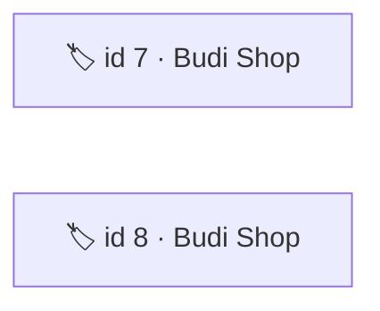
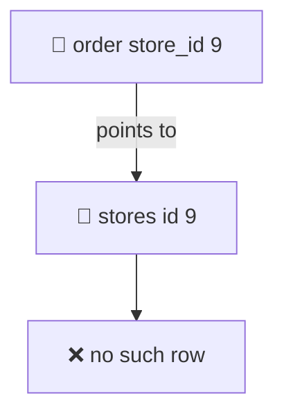
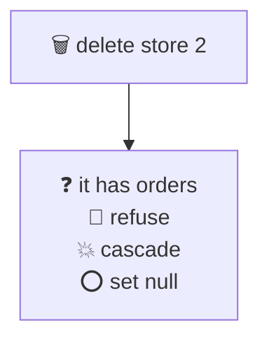
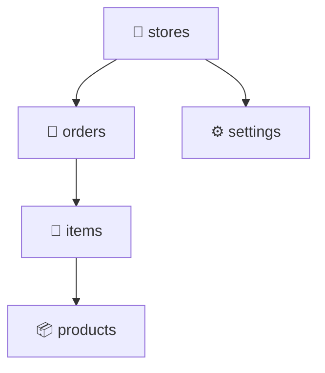
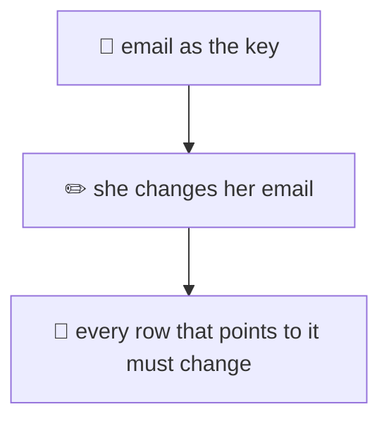
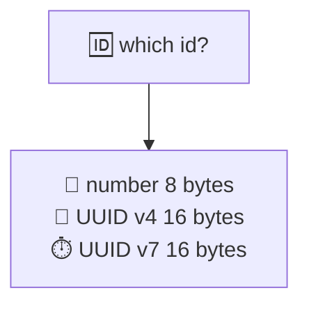
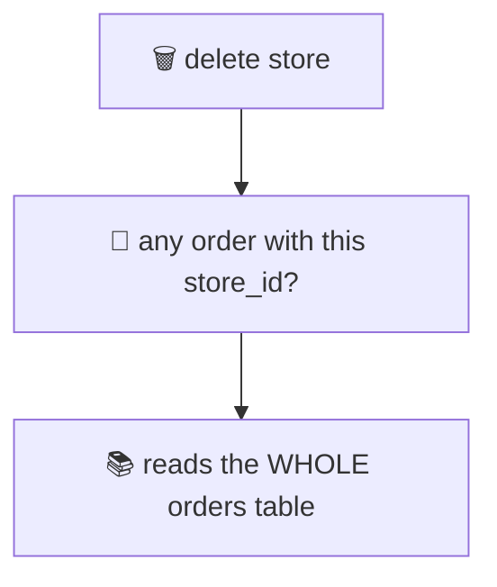

# 06. Keys and relationships

> **Subject:** Database · **Lesson:** 06 · **Made:** 2026-11-01 · **Status:** ready
>
> **You will be able to:** say what a primary key and a foreign key promise, choose what happens when a parent row is deleted, draw one to many, many to many and one to one with tables, choose between a number id and a UUID, and name the index that Postgres does NOT make for you.
>
> **Before this:** [Window functions](05-window-functions.md) · **Next:** [Normalization](07-normalization.md)
>
> **How to read it:** one card is one idea. Look at the picture, guess, then press the orange bar to check. The blue bars (📖 More detail) hold the longer explanation with the why and a real example. Skip them on the first read, and open them when you want more. Every number and error text was run on PostgreSQL 18.3. About 25 minutes for the cards.

## 1. A primary key is a name tag

Two shops are both called "Budi Shop", one in Bandung and one in Medan. Names repeat. Each shop needs a tag that never repeats: its **id**.



<details class="guess"><summary>🤔 Guess: the table already has a row with id 7. You insert another row with id 7. What does Postgres do? Press to check.</summary>

It refuses:

```text
ERROR:  duplicate key value violates unique constraint "l06_practice_orders_pkey"
DETAIL:  Key (id)=(101) already exists.
```

(That is the real message from the practice file, with id 101.) A **primary key** is a rule with three parts: the value is unique, it is never empty (NULL), and a table has only one primary key.

</details>

> **Remember:** a primary key names exactly one row: unique, never empty, one per table.

<details class="more"><summary>📖 More detail: the index, and keys made of two columns</summary>

Postgres builds an index for the primary key by itself. That is how it checks "is this id already taken?" fast, and how `WHERE id = 7` finds the row fast (lessons 09 and 25).

A key can use **two columns together**. In the practice file, the lines of an order use `PRIMARY KEY (order_id, product_id)`. One order may have many products, and one product may be in many orders, but the same pair only once:

```text
ERROR:  duplicate key value violates unique constraint "l06_practice_order_items_pkey"
DETAIL:  Key (order_id, product_id)=(101, 1) already exists.
```

A table may also have other **UNIQUE** columns (for example an email). That is a second rule, not a second primary key. UNIQUE allows NULL. A primary key does not.

</details>

## 2. A foreign key is a pointer that cannot break

An order says "I belong to store 9". Without a rule, nothing checks that store 9 exists. A **foreign key** is that rule: the pointer must land on a real row.



<details class="guess"><summary>🤔 Guess: you insert an order with <code>store_id = 9</code>, and there is no store 9. What happens? And what if <code>store_id</code> is NULL? Press to check.</summary>

Store 9 is refused:

```text
ERROR:  insert or update on table "l06_practice_orders" violates foreign key constraint "l06_practice_orders_store_id_fkey"
DETAIL:  Key (store_id)=(9) is not present in table "l06_practice_stores".
```

NULL depends on the column. If the column may be empty, NULL is allowed: "no store". I tested it. If the column is `NOT NULL` (like `store_id` in the practice file), NULL is refused:

```text
ERROR:  null value in column "store_id" of relation "l06_practice_orders" violates not-null constraint
```

</details>

> **Remember:** a foreign key must point to a real row. Add NOT NULL when the pointer is required.

<details class="more"><summary>📖 More detail: the rule runs in both directions</summary>

Two moments are checked:

1. **A row with a pointer is added or changed** (insert or update on the order). Postgres looks for the parent id in the parent table. The parent's primary key index makes this fast.
2. **A parent row is deleted or its id is changed.** Postgres must look in the child table for rows that still point to it. Card 3 is about this, and card 7 is the price of it.

A foreign key can point at any column that has a UNIQUE rule, not only the primary key. Pointing at the primary key is by far the most common.

In the joins lesson (02), order 13 pointed to a store that did not exist, and an inner join left it out without any warning. A foreign key makes that mistake impossible to save.

</details>

## 3. What happens when the parent is deleted?

You delete store 2. Store 2 has orders. Three choices:



<details class="guess"><summary>🤔 Guess: which choice do you want for <code>orders.store_id</code>, where an order is money? Press to check.</summary>

**Refuse.** This is also the default (`NO ACTION`). The delete fails and nothing is lost:

```text
ERROR:  update or delete on table "l06_practice_stores" violates foreign key constraint "l06_practice_orders_store_id_fkey" on table "l06_practice_orders"
DETAIL:  Key (id)=(2) is still referenced from table "l06_practice_orders".
```

The other two are for other cases:

- `ON DELETE CASCADE`: the children go too. Good for **parts that belong to the parent**, like the lines of one order. In my test, deleting order 101 also deleted its two lines (`DELETE 1`, and only the lines of order 103 were left).
- `ON DELETE SET NULL`: the children stay and the pointer becomes empty. Good for an **optional link**, like "who brought this store in". I deleted store 4 and the store it had referred kept its row, with `referred_by` now NULL.

</details>

> **Remember:** default is refuse. CASCADE for parts of the parent. SET NULL for an optional link.

<details class="more"><summary>📖 More detail: the danger of CASCADE, and RESTRICT against NO ACTION</summary>

**CASCADE can reach far.** If `orders` cascades from `stores`, and `order_items` cascades from `orders`, then one `DELETE FROM stores WHERE id = 2` silently deletes the store, all its orders, and all their lines. That is right for a test database and dangerous for money. Many teams never delete such rows, and use a column like `deleted_at` instead. Prisma has the same choices, called referential actions: `Cascade`, `Restrict`, `NoAction`, `SetNull`, `SetDefault`. They map to foreign key rules in the database.

**RESTRICT and NO ACTION** both refuse. The difference is when. I tested a foreign key that may be checked late:

- With `NO ACTION`, I deleted the parent first, then the child, in one transaction. No error, because the check waited until the end.
- With `ON DELETE RESTRICT`, the same order failed at once, with `violates RESTRICT setting of foreign key constraint`.

If you never delay checks (you probably do not), you will not see a difference.

</details>

## 4. One to many, many to many, one to one

There are only three shapes. Each one is a different place for the foreign key.



<details class="guess"><summary>🤔 Guess: an order has many products, and a product is in many orders. Which table gets the foreign key? Press to check.</summary>

**Neither.** A third table in the middle gets two foreign keys, one to each side. In the practice file it is `order_items` with `order_id` and `product_id`. Its primary key is the pair, so the same product cannot appear twice in one order.

The three shapes:

| Shape | Where the foreign key goes |
|---|---|
| One to many (store has many orders) | in the **many** side: `orders.store_id` |
| Many to many (orders and products) | in a **middle table** with two foreign keys |
| One to one (store and its settings) | in either table, and the column is also **unique** (`store_id` is the primary key of `store_settings`) |

</details>

> **Remember:** the foreign key sits on the many side. Many to many needs a middle table. One to one is a foreign key that is also unique.

<details class="more"><summary>📖 More detail: the middle table can carry data, and one to one is rare</summary>

The middle table is a real table. `order_items` also has `qty`, the number of units. The price at the time of sale would also live there, not in `products`, because the product price changes later.

For one to one, I made the foreign key the primary key, so a second settings row for the same store fails:

```text
ERROR:  duplicate key value violates unique constraint "l06_practice_store_settings_pkey"
DETAIL:  Key (store_id)=(1) already exists.
```

If two things are always one to one, you could put them in one table. People split them when one part is optional (not every store has settings), is rarely read, or has private data that needs different permissions. Otherwise, one table is simpler.

</details>

## 5. A natural key or a made-up key?

A **natural key** is real data that is unique, like an email or a phone number. A **surrogate key** is an id the database makes up, which means nothing.



<details class="guess"><summary>🤔 Guess: should a <code>users</code> table use <code>email</code> as its primary key? Press to check.</summary>

Usually **no.** Real data changes. People change email, a phone number moves to a new owner, a company renames itself. If the key changes, every foreign key that points to it must change too.

Use a made-up id as the primary key, and keep the email as a separate **UNIQUE** column. The id never changes. The email can.

</details>

> **Remember:** the key should never change and mean nothing. Keep real data as UNIQUE columns.

<details class="more"><summary>📖 More detail: when a natural key is fine</summary>

A natural key is fine for a small lookup table that almost never changes, like a country code (`ID`, `SG`) or a status name. Its value is short, readable in the child table, and stable.

Two warnings about emails even as a UNIQUE column:

- `Ana@x.com` and `ana@x.com` are different text. A plain UNIQUE would let both in. Lesson 26 shows an index on `lower(email)`. A `UNIQUE` index on `lower(email)` refuses the second one (I tested it: `Key (lower(email))=(ana@x.com) already exists`).
- Privacy: an id like a national ID number should not be copied into every child table.

`ON UPDATE CASCADE` can rewrite all pointers when a key changes. It works, but it updates every child row. That is why not changing the key is cheaper.

</details>

## 6. Which made-up id: number, UUID v4 or UUID v7?

Three common choices for the id column.



<details class="guess"><summary>🤔 Guess: 1 million rows. Size of the primary key index: number (8 bytes), UUID v4 (16 bytes, random), UUID v7 (16 bytes, starts with a time)? Press to check.</summary>

| Id | Index size for 1 million rows |
|---|---|
| `bigint` identity | 21 MB |
| UUID v7 | 30 MB |
| UUID v4 | 38 MB |

The number is smallest. The random UUID is the biggest, because it lands on a random leaf page, so pages split all over the tree (lesson 26, card 2). UUID v7 starts with the time, so new ids arrive in order and go to the right edge.

</details>

> **Remember:** default to a `bigint` identity. Use a UUID when ids are made outside the database. Prefer v7 over v4.

<details class="more"><summary>📖 More detail: how I measured, and when to pick a UUID</summary>

I made three empty tables and inserted 1 million rows into each, one run each:

```sql
CREATE TABLE k_id (id bigint GENERATED ALWAYS AS IDENTITY PRIMARY KEY, pad text);
CREATE TABLE k_v4 (id uuid DEFAULT gen_random_uuid() PRIMARY KEY, pad text);
CREATE TABLE k_v7 (id uuid DEFAULT uuidv7() PRIMARY KEY, pad text);
```

The inserts took about 1.8 seconds, 4.2 seconds and 2.6 seconds (number, v4, v7). That is one run on one laptop, so trust the order, not the digits. In the same run, `pg_column_size` said 8 bytes for the `bigint` and 16 for a UUID, and the v7 values were in increasing order.

`uuidv7()` is new in **PostgreSQL 18**. In older versions you need an extension or you make the UUID in your app.

When is a UUID the right pick?

- The client or another service must make the id **before** the row is saved (offline apps, merging data from many places).
- You do not want people to guess the next id in a URL. (A number is easy to guess.)

A v7 id holds the time it was made, so it also shows when a row was created. Think about that before you show it to the public.

**identity or serial?** `GENERATED ALWAYS AS IDENTITY` is the standard form. `serial` is the older Postgres way. With `ALWAYS`, nobody can type their own id by accident:

```text
ERROR:  cannot insert a non-DEFAULT value into column "id"
```

</details>

## 7. The foreign key with no index

Postgres makes an index for a primary key. It does **not** make one for a foreign key column. When you delete a store, Postgres must find all orders with that `store_id`.



<details class="guess"><summary>🤔 Guess: store 950 has no orders. Deleting it should be instant. With no index on <code>orders.store_id</code>, how long do the checks take on a table of 100,000 orders and one of 200,000 point transactions? Press to check.</summary>

In the practice database (100,000 orders, 200,000 point transactions), `EXPLAIN ANALYZE` showed:

```text
 Trigger for constraint orders_store_id_fkey: time=5.275 calls=1
 Trigger for constraint point_transactions_store_id_fkey: time=11.475 calls=1
 Execution Time: 16.876 ms
```

Delete a row that has no children, and still 17 ms. After I added an index on each `store_id` column:

```text
 Trigger for constraint orders_store_id_fkey: time=0.182 calls=1
 Trigger for constraint point_transactions_store_id_fkey: time=0.087 calls=1
 Execution Time: 0.315 ms
```

</details>

> **Remember:** a primary key gets an index. A foreign key does not. Index every foreign key column you delete through or filter by.

<details class="more"><summary>📖 More detail: the same cost on a bigger table, and the check query</summary>

The index also helps the query you will run most: "all orders of this store". I made 1 million orders over 20,000 stores and measured both cases:

| | No index | Index on `store_id` |
|---|---|---|
| `SELECT count(*) ... WHERE store_id = 123` | 43.7 ms (Seq Scan) | 0.105 ms (Bitmap Index Scan) |
| `DELETE` a store with no orders (constraint check) | 43.7 ms | 0.089 ms |

The size of the first number grows with the table. The second stays small.

The Postgres docs say this too: a DELETE on the parent needs a scan of the child table, so "it is often a good idea to index the referencing columns too". It does not do it for you, because there are many choices for the index.

To list every foreign key and say whether some index starts with its column, run CHECK 5a in `practice/06-keys-and-relationships.sql`. In that file, `order_items.order_id` already has an index, because it is the first column of the primary key `(order_id, product_id)`. `order_items.product_id` has none.

An index costs writes (lesson 26). So: foreign keys you read through or delete through get one. A foreign key on a tiny table that you never delete from may not need one.

</details>

## 8. Watch it run, step by step

Now watch the keys check each statement. **[Open the keys stepper](visuals/06-keys-and-relationships.html).** It has three tabs: an order for a missing store, a delete of a store with orders, and a delete that cascades. Guess first, then press Next.

<details><summary>Or read the checks as a table</summary>

| Statement | What Postgres checks | Result |
|---|---|---|
| `INSERT orders (id 104, store_id 9)` | is there a store 9? | no: foreign key error |
| `INSERT orders (id 101, ...)` when 101 exists | is id 101 taken? | yes: duplicate key error |
| `INSERT orders (id 105, store_id NULL)` | NOT NULL on store_id | error |
| `DELETE stores WHERE id = 2` | any order with store_id 2? | yes: refuse |
| `DELETE orders WHERE id = 101` | any lines (CASCADE)? | yes: delete the 2 lines too |
| `DELETE stores WHERE id = 4` | who has referred_by 4? (SET NULL) | blank their pointer |

</details>

## 9. Why it matters and what it costs

Interview words: *primary key*, *foreign key*, *referential integrity*, *surrogate key*, *cascade*, *junction table*, *UUID v7*.

|  | Without keys | With keys |
|---|---|---|
| A pointer to a missing row | saved, and found months later | refused at once |
| Delete a parent | children are left pointing at nothing | refused, or handled by your rule |
| Writes | fastest | one lookup per pointer check |

- **With the map,** you can explain why a join loses rows, why a delete is slow, and why the team picked a UUID.
- **Without it,** the answer to bad data is a cleanup script, and the answer to a slow delete is "the database is slow".

**The costs:**

- Writes check the other table. A foreign key adds a lookup to every insert and update of the child.
- The index you must add yourself on the child column takes space and slows writes a little (lesson 26).
- A UUID is twice as big as a number, in the table, in every index, and in every table that points to it.

## 10. Watch and play

Links checked on 2026-11-01. Each page loaded (HTTP 200). For each video, the title and channel were confirmed through YouTube's oEmbed data. The video lengths were not checked.

- **Play with it:** [The keys stepper](visuals/06-keys-and-relationships.html) in this folder. Guess first, then press Next.
- **Play with it:** [dbdiagram.io](https://dbdiagram.io/). Draw stores, orders, products and order_items with arrows. It turns the picture into `CREATE TABLE` lines.
- **Video:** [Primary Key vs Foreign Key (Key Differences Explained)](https://www.youtube.com/watch?v=BV9fu6g2L4I) from the channel DatabaseTown. Cards 1 and 2.
- **Video:** [What is a Foreign Key Constraint? Understanding Primary & Foreign Keys](https://www.youtube.com/watch?v=5kiMg7GXAsY) from the channel CockroachDB. Cards 2 and 3.
- **Video:** [UUIDv4 vs UUIDv7 in PostgreSQL 18: A Story of More Friendly UUID based Primary Keys](https://www.youtube.com/watch?v=fuvHJ3Quq68) by Josef Machytka. Card 6.
- **Read:** [Constraints](https://www.postgresql.org/docs/current/ddl-constraints.html) in the PostgreSQL docs. Primary keys, foreign keys and the delete rules (cards 1 to 3, and the index advice in card 7).
- **Read:** [UUID Functions](https://www.postgresql.org/docs/current/functions-uuid.html). `gen_random_uuid()` and `uuidv7()` (card 6).
- **Read:** [Identity Columns](https://www.postgresql.org/docs/current/ddl-identity-columns.html). `GENERATED ALWAYS AS IDENTITY` (card 6).

<details><summary>More links (optional)</summary>

- **Read:** [Referential actions](https://www.prisma.io/docs/orm/prisma-schema/data-model/relations/referential-actions) in the Prisma docs. The same delete rules, written in a Prisma schema.
- **Read:** [Nested loops join and the N+1 problem](https://use-the-index-luke.com/sql/join/nested-loops-join-n1-problem) on Use The Index, Luke. Why the child column needs an index.
- **Read (revision, dense):** [Database design and why](database-design-and-why.md), the long guide on keys and design.

</details>

## 11. Practice

**A. Predict.** The tables: `stores` has ids 1 and 2. `orders` has `id` as the primary key and `store_id` as `NOT NULL REFERENCES stores (id)`. Order 101 exists, for store 1. No order is for store 2. Which statements fail?

- (a) `INSERT INTO orders (id, store_id) VALUES (101, 2)`
- (b) `INSERT INTO orders (id, store_id) VALUES (102, 3)`
- (c) `INSERT INTO orders (id, store_id) VALUES (103, NULL)`
- (d) `DELETE FROM stores WHERE id = 2`

<details class="guess"><summary>🤔 Press to see the answer</summary>

**(a), (b) and (c) fail. (d) works.**

(a) id 101 is already taken (duplicate key). (b) there is no store 3 (foreign key). (c) `store_id` is `NOT NULL`. (d) store 2 has no orders pointing at it, so the delete is allowed.

</details>

**B. What would you check?** A teammate says: "`DELETE FROM stores WHERE id = 5` takes 40 seconds. The id is the primary key, so it must be the database." What do you check first?

<details class="guess"><summary>🤔 Press to see the answer</summary>

The primary key lookup is not the slow part. Postgres must also check every table that has a foreign key to `stores`. If one of those big tables has no index on its `store_id`, Postgres reads the whole table for each check.

Run `EXPLAIN (ANALYZE) DELETE ...` inside `BEGIN` and `ROLLBACK`, and look at the `Trigger for constraint` lines. The slow one names the table. Then create an index on that foreign key column. On a live table use `CREATE INDEX CONCURRENTLY` so writes are not blocked (lesson 09).

</details>

**C. Write it yourself**

Open [`practice/06-keys-and-relationships.sql`](practice/06-keys-and-relationships.sql). It gives six tasks with the exact expected results: stores and orders (one to many), orders and products (many to many), store settings (one to one), a self link with SET NULL, the missing indexes, and the big tables. Run the file once in psql, then write each `CREATE TABLE` under its TODO and run the CHECK lines. Some CHECK lines should fail. That is the point.

<details><summary>One possible answer</summary>

```sql
-- Task 1
CREATE TABLE l06_practice_stores (
  id   int GENERATED ALWAYS AS IDENTITY PRIMARY KEY,
  name text NOT NULL CHECK (name <> '')
);
CREATE TABLE l06_practice_orders (
  id          int PRIMARY KEY,
  store_id    int NOT NULL REFERENCES l06_practice_stores (id),
  total_cents int
);

-- Task 2
CREATE TABLE l06_practice_order_items (
  order_id   int NOT NULL REFERENCES l06_practice_orders (id) ON DELETE CASCADE,
  product_id int NOT NULL REFERENCES l06_practice_products (id),
  qty        int NOT NULL,
  PRIMARY KEY (order_id, product_id)
);

-- Task 3
CREATE TABLE l06_practice_store_settings (
  store_id     int PRIMARY KEY REFERENCES l06_practice_stores (id) ON DELETE CASCADE,
  bank_account text NOT NULL
);

-- Task 4
ALTER TABLE l06_practice_stores
  ADD COLUMN referred_by int REFERENCES l06_practice_stores (id) ON DELETE SET NULL;

-- Task 5
CREATE INDEX ON l06_practice_order_items (product_id);
CREATE INDEX ON l06_practice_orders (store_id);
CREATE INDEX ON l06_practice_stores (referred_by);

-- Task 6
CREATE INDEX ON orders (store_id);
CREATE INDEX ON point_transactions (store_id);
-- then run the same BEGIN / EXPLAIN (ANALYZE, COSTS OFF) DELETE ... / ROLLBACK
```

I ran all of these against the file's CHECK lines on PostgreSQL 18.3. Tasks 1 to 5 match the expected results. In task 6 the two trigger lines dropped from 5.3 and 11.5 ms to 0.18 and 0.09 ms. Drop the two indexes afterwards, as the file says.

</details>

## 12. Interview question

**Q:** "What is the difference between a primary key and a foreign key? What happens to child rows when you delete a parent? Would you use an integer or a UUID for ids?"

<details><summary>A strong answer, in four parts</summary>

1. **Problem:** without keys, two rows can look the same, and a row can point to something that is gone. Bad data is saved quietly and found months later.
2. **How it works:** a primary key is unique, never NULL, and one per table, and Postgres builds an index for it. A foreign key says "this column must match a real primary key in another table". Deleting a parent is refused by default. `CASCADE` deletes the children and `SET NULL` blanks the pointer, and I choose by whether the child is part of the parent. One to many puts the key on the many side, many to many needs a middle table. For ids I use a `bigint` identity by default. A UUID when ids are made outside the database, and v7 over v4 so new ids arrive in order.
3. **Tradeoff:** a foreign key adds a lookup to every write, and Postgres does not index the child column for me. In my test a delete check took 43.7 ms with no index on 1 million rows and 0.089 ms with one. A UUID is twice the size: 38 MB of index for v4 against 21 MB for a number.
4. **My example:** *This is an idea, not a fact. Replace it with a real story from DBO, Unloan, ZWS or Skyworx.* A `stores` table and a big `orders` table. Deleting an unused store is slow because `orders.store_id` has no index. I find it with `EXPLAIN ANALYZE` and the `Trigger for constraint` line, add the index, and the delete drops from tens of milliseconds to under one.

</details>

## 13. Explain it back

Close this file. Press the **Record my explanation** button under this heading and explain keys and relationships, like to a new junior, in 4 parts: problem, how it works, tradeoff, my example. Use these numbers: 5.3 and 11.5 ms against 0.18 and 0.09 ms, 21 MB against 38 MB. Then save the transcript into `my-learning/recordings/`, or write your best version below. Run `/explain-check postgres keys` or ask `coach my explanation`.

### My explanation

<write here>

### Coach feedback

<the explain-coach agent writes here>

## 14. Review questions (day 1, 3, 7, 21)

1. What three things does a primary key promise?
2. What does a foreign key stop? What happens if the foreign key column is NULL?
3. A parent row is deleted and it has children. Name the three choices and one case for each.
4. Where does the foreign key go in one to many, many to many and one to one?
5. Why is an email usually a bad primary key? What do you do instead?
6. Number, UUID v4 or UUID v7: which one is smallest, and which one fills the index pages in a random way?
7. Does Postgres make an index for a foreign key column? What does it cost when you forget?

<details><summary>Answers</summary>

1. The value is unique, it is never NULL, and a table has only one primary key (Postgres builds an index for it).
2. It stops a pointer to a row that does not exist. If the column allows NULL, NULL is accepted ("no parent"). With `NOT NULL`, it is refused.
3. Refuse (the default): for orders, which are money. `CASCADE`: for parts of the parent, like order lines. `SET NULL`: for an optional link, like "referred by".
4. One to many: on the many side. Many to many: in a middle table with two foreign keys. One to one: a foreign key that is also unique (for example it is the primary key).
5. An email changes, and every pointer to it would have to change. Use a made-up id as the key, and keep the email as a UNIQUE column.
6. The number (8 bytes, 21 MB for 1 million rows) is the smallest. UUID v4 is random, so it fills pages in random order (38 MB). UUID v7 starts with the time (30 MB).
7. No. The primary key gets one, the foreign key does not. Deleting a parent, and "all rows of this parent", must read the whole child table (43.7 ms for 1 million rows against 0.089 ms with an index).

</details>

## 15. Go deeper (optional)

None of this is needed for the cards above.

<details><summary>Delay the check to the end of the transaction</summary>

A foreign key can be made `DEFERRABLE`. Then `SET CONSTRAINTS ALL DEFERRED` inside a transaction lets you delete the parent first and fix the child later, as long as everything is correct at `COMMIT`. I ran this with the default delete rule and it worked. `ON DELETE RESTRICT` does not wait, it fails at once. This helps when two rows point at each other and you must insert both.

</details>

<details><summary>Add the rule later without a long lock</summary>

`ALTER TABLE ... ADD CONSTRAINT ... FOREIGN KEY` checks every row while it holds a lock. On a big live table, add it as `NOT VALID` first, then run `VALIDATE CONSTRAINT`, which takes a weaker lock. [Lesson 19](19-zero-downtime-migrations.md) (zero-downtime migrations) covers this, with timings.

</details>

<details><summary>Prisma</summary>

In a Prisma schema, the delete rule sits on the `@relation` line, for example `onDelete: Cascade` (see the link in card 10). I did not check which indexes a Prisma migration creates for a relation. Look at the generated SQL in your own `migration.sql`, and compare it with the check query in the practice file. `@@index([storeId])` adds one by hand.

</details>

<details><summary>Make the tables yourself</summary>

The practice file builds its own small tables, named `l06_practice_...`. Task 6 uses the `stores`, `orders` and `point_transactions` tables of the Docker playground (`learn/database/examples/postgres-practice`), which have no index on `store_id`. The 1 million row numbers in this lesson came from tables I made just for the test, so they will not be in the playground. Your numbers will differ.

</details>

## Connected lessons

- [02. Joins](02-joins.md): a join follows a foreign key. Order 13 there pointed at a missing store.
- [07. Normalization](07-normalization.md): the next lesson. Splitting a table needs a primary key and a foreign key.
- [08. Constraints and data types](08-constraints-and-data-types.md): PRIMARY KEY, UNIQUE and FOREIGN KEY are constraints too.
- [09. Indexes and B-trees](09-indexes-and-b-trees.md) and [25. An index, built and searched](25-an-index-built-and-searched.md): the index behind a key.
- [26. What an index costs](26-what-an-index-costs.md): why a random UUID splits pages, and what the missing index costs to write.
- [Database design and why](database-design-and-why.md): the long guide.
