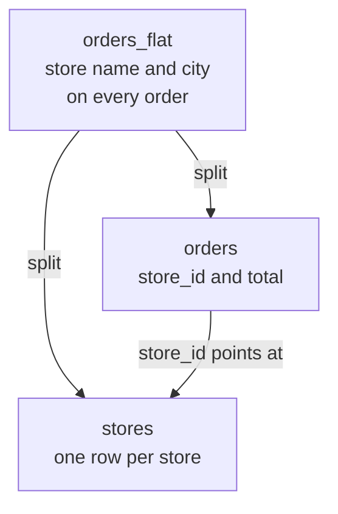
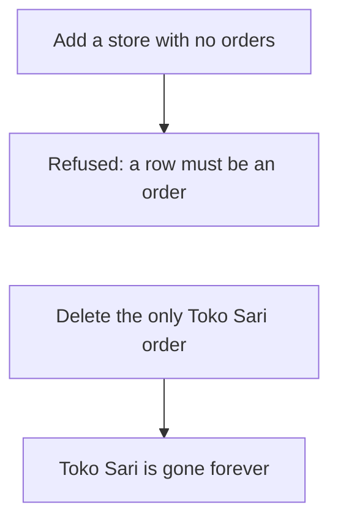
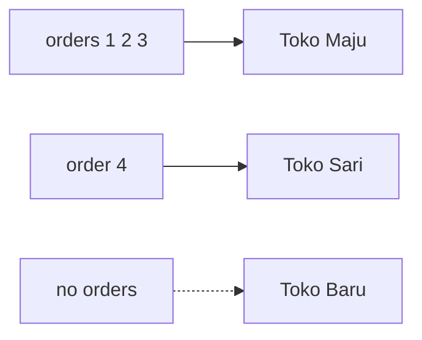
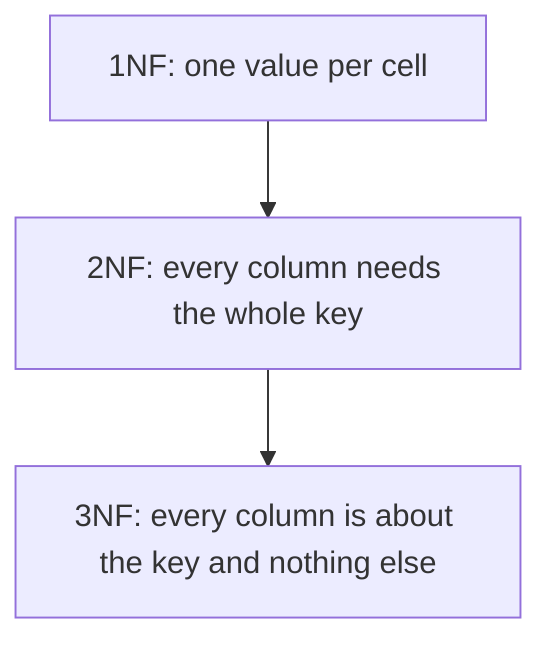
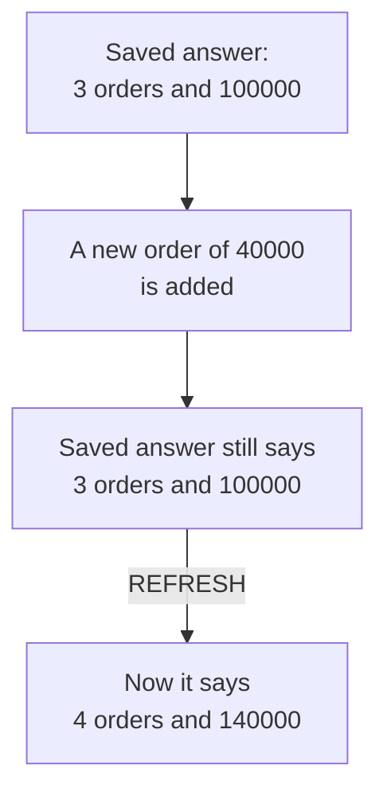

# 07. Normalization

> **Subject:** Database · **Lesson:** 07 · **Made:** 2026-10-16 · **Remade in short cards:** 2026-10-28 · **Status:** ready
>
> **You will be able to:** show the three problems that duplicate data causes, split a messy table so each fact lives in one place, say 1NF, 2NF and 3NF in one plain sentence each, and explain when a senior engineer copies data on purpose and what that costs.
>
> **Before this:** [Keys and relationships](06-keys-and-relationships.md) · **Next:** [Constraints and data types](08-constraints-and-data-types.md)
>
> **How to read it:** one card is one idea. Look at the picture, guess, then press the orange bar to check. The blue bars (📖 More detail) hold the longer explanation. Skip them on the first read, and open them when you want more. About 25 minutes for the cards.

## 1. The idea: a phone number on every card

You write your friend's phone number on **every birthday card** you send. When the number changes, you must find every card. You will miss one.



Notice: after the split, the city is saved **once**. Each order only points at its store, like a card that only says the friend's name.

Our tiny example has 4 orders and 2 stores. "Toko Maju is in Jakarta" is saved **three times**.

| order_id | store_name | store_city | total_cents |
|---|---|---|---|
| 1 | Toko Maju | Jakarta | 50000 |
| 2 | Toko Maju | Jakarta | 20000 |
| 3 | Toko Maju | Jakarta | 30000 |
| 4 | Toko Sari | Bandung | 15000 |

<details class="guess"><summary>🤔 Guess: Toko Maju moves to Surabaya, but you change only order 1. What does the table say now? Press to check.</summary>

Order 1 says Surabaya. Orders 2 and 3 still say Jakarta. The same store is in two cities, and nothing warns you.

</details>

> **Remember:** one fact, one place. Copy only on purpose, and decide who keeps the copy right.

<details class="more"><summary>📖 More detail: the four words, and where the phone book picture stops</summary>

A **fact** here is one small true thing, like "Toko Maju is in Jakarta".

- **Duplicate:** the same fact saved in more than one row. (Interview word: *redundancy*.)
- **Anomaly:** a wrong result that a duplicate causes when you change, add or delete rows. There are three kinds: *update*, *insert* and *delete anomaly* (cards 2 and 3).
- **Normalize:** split a table so that each fact lives in one place, and point at it with an id. (Interview word: *normalization*. Its rules are called *normal forms*: 1NF, 2NF, 3NF.)
- **Denormalize:** copy a fact on purpose, to freeze it in time or to read it faster. (Interview word: *denormalization*.)

The phone book is better than the cards: you write the number once. Where the picture stops: a database can check the links for you. A foreign key stops an order from pointing at a store that does not exist. A phone book cannot stop a card with a wrong name.

</details>

## 2. Problem 1: the update problem

You change the city in order 1 only, then ask which (store, city) pairs exist.

```sql
UPDATE orders_flat
SET store_city = 'Surabaya'
WHERE order_id = 1;

SELECT DISTINCT store_name, store_city
FROM orders_flat
ORDER BY store_name, store_city;
```

<details class="guess"><summary>🤔 Guess: how many different (store, city) pairs come back? Press to check.</summary>

```
UPDATE 1
 store_name | store_city
------------+------------
 Toko Maju  | Jakarta
 Toko Maju  | Surabaya
 Toko Sari  | Bandung
(3 rows)
```

Three pairs, but there are only two stores. Toko Maju has **two cities**. Postgres did exactly what it was told.

</details>

> **Remember:** a fact saved many times will one day disagree with itself.

<details class="more"><summary>📖 More detail: make the table yourself</summary>

These lines make a separate box (a *schema*) called `l07`, so the lesson tables never touch your practice tables. Run them in the Docker playground or in the [PGlite REPL](https://pglite.dev/repl/).

```sql
CREATE SCHEMA l07;
SET search_path = l07;
CREATE TABLE orders_flat (
  order_id    int PRIMARY KEY,
  store_name  text NOT NULL,
  store_city  text NOT NULL,
  total_cents int NOT NULL
);
INSERT INTO orders_flat VALUES
  (1, 'Toko Maju', 'Jakarta', 50000),
  (2, 'Toko Maju', 'Jakarta', 20000),
  (3, 'Toko Maju', 'Jakarta', 30000),
  (4, 'Toko Sari', 'Bandung', 15000);
```

Checked on 2026-10-28 with PostgreSQL 17.5 (PGlite). Earlier checks on PostgreSQL 18.3 gave the same results. Postgres 16 in the Docker playground gives the same rows and messages.

</details>

## 3. Problems 2 and 3: insert and delete

The store only exists **inside** order rows. That causes two more problems.



```sql
-- add a new store with no orders
INSERT INTO orders_flat
  (store_name, store_city)
VALUES ('Toko Baru', 'Medan');

-- delete order 4
DELETE FROM orders_flat
WHERE order_id = 4;
```

<details class="guess"><summary>🤔 Guess: what happens to each statement? Press to check.</summary>

The insert is refused. `order_id` is empty, and it must not be:

```
ERROR:  null value in column "order_id" of relation "orders_flat" violates not-null constraint
```

The delete works (`DELETE 1`), but it removes the whole row: the order, the store name and the city. Now:

```sql
SELECT * FROM orders_flat
WHERE store_name = 'Toko Sari';
```

gives `(0 rows)`. Toko Sari is gone forever.

</details>

> **Remember:** a table with the store inside the order cannot hold a store with no orders, and deleting the last order deletes the store.

<details class="more"><summary>📖 More detail: the three problems have one cause</summary>

- **Update problem:** a fact saved many times will one day disagree with itself.
- **Insert problem:** you cannot save a thing until an unrelated thing exists.
- **Delete problem:** deleting one thing deletes another.

All three come from the same cause: two kinds of facts (about the order, about the store) live in the same row.

</details>

## 4. The fix: one table for each kind of fact

Split the table. Each store gets one row. Each order keeps only the store's id.



```sql
CREATE TABLE stores (
  id int PRIMARY KEY,
  name text NOT NULL,
  city text NOT NULL);
CREATE TABLE orders (
  id int PRIMARY KEY,
  store_id int NOT NULL
    REFERENCES stores(id),
  total_cents int NOT NULL);
```

Then Toko Maju moves. You change **one** cell:

```sql
UPDATE stores
SET city = 'Surabaya'
WHERE id = 1;

SELECT o.id, s.name, s.city
FROM orders o
JOIN stores s ON s.id = o.store_id
ORDER BY o.id;
```

<details class="guess"><summary>🤔 Guess: what do orders 1, 2 and 3 say about the city? Press to check.</summary>

```
 id |   name    |   city
----+-----------+----------
  1 | Toko Maju | Surabaya
  2 | Toko Maju | Surabaya
  3 | Toko Maju | Surabaya
  4 | Toko Sari | Bandung
(4 rows)
```

All say Surabaya. There is only one place to read the city from.

The other two problems are gone too. You can insert Toko Baru (a store with no orders) and nothing refuses it. You can delete order 4, and Toko Sari stays in `stores`.

</details>

> **Remember:** split by kind of fact. Other rows point at the fact with an id, and a join puts them back together when you read.

<details class="more"><summary>📖 More detail: what a foreign key adds</summary>

A **join** ([lesson 02](02-joins.md)) glues each order row to the store row it points at. A **foreign key** (`REFERENCES`, lesson 06) is the rule that `store_id` must point at a real store. Postgres also uses it to refuse a delete of a store while orders still point there:

```
DELETE FROM stores WHERE id = 1;
ERROR:  update or delete on table "stores" violates foreign key constraint "orders_store_id_fkey" on table "orders"
```

</details>

## 5. The three rules: 1NF, 2NF, 3NF

The rules for "one fact, one place" have names, called **normal forms**. Each one builds on the one before.



| Rule | Plain sentence | Breaks it | Fix |
|---|---|---|---|
| **1NF** | One value per cell, no lists. | `orders.products = 'Kopi, Teh'` | `order_lines` table, one row per product |
| **2NF** | When the key is two columns, every other column must need both of them. | `order_lines (order_id, product_id, qty, product_name)`. `product_name` needs only `product_id`. | Move `product_name` to `products` |
| **3NF** | Every column is a fact about this row's key, not about another column. | `orders (id, store_id, store_city)`. The city is about the store, not the order. | Move the city to `stores` |

<details class="guess"><summary>🤔 Guess: `orders (id, store_id, store_city)`. Which rule does it break? Press to check.</summary>

**3NF.** The city is a fact about the store, not about the order. The fix is the split from card 4.

</details>

> **Remember:** 1NF no lists. 2NF no half of a key. 3NF no facts about another column.

<details class="more"><summary>📖 More detail: why a list in a cell is a problem</summary>

A **key** is the column, or columns, that name one row, like `id`. Lesson 06 explains keys.

Why a list in a cell is a problem (real run):

```sql
CREATE TABLE orders_list (id int PRIMARY KEY, products text);
INSERT INTO orders_list VALUES (1, 'Kopi, Teh'), (2, 'Teh Botol'), (3, 'Gula');
SELECT * FROM orders_list WHERE products LIKE '%Teh%';
```

```
 id | products
----+-----------
  1 | Kopi, Teh
  2 | Teh Botol
(2 rows)
```

You asked for orders with Teh. Postgres also gave you Teh Botol, a different product. With one row per product, `WHERE product_name = 'Teh'` is exact.

</details>

## 6. Copy on purpose, case 1: the price paid

Normalizing is the default. Sometimes a copy is **not a duplicate at all**. It is a different fact.

| Question | What to do |
|---|---|
| Is it a fact about that moment, like the price paid that day? | Save it on the row. It must never change. |
| Is a read slow, and did you measure it? No. | Keep one place. Join it and add an index. |
| Is a read slow, and did you measure it? Yes. | Copy it, and pick who keeps it right (card 7). |

The store paid 10000 per Kopi. Later Kopi costs 12000.

```sql
SELECT l.qty * l.unit_price_cents
    AS paid_then,
  l.qty * p.price_cents
    AS price_today
FROM order_lines l
JOIN products p
  ON p.id = l.product_id;
```

<details class="guess"><summary>🤔 Guess: order 1 has 2 Kopi. What did the store pay, and what would "today's price" say? Press to check.</summary>

```
 paid_then | price_today
-----------+-------------
     20000 |       24000
(1 row)
```

`paid_then` is the truth. If you read the price from `products`, every old order changes when the price changes. So the price on the line is not a bad duplicate. It is a different fact: the price on that day. It must never be updated.

</details>

> **Remember:** a price paid is a fact about a moment. Save it on the order line and never update it.

<details class="more"><summary>📖 More detail: the tables for this case</summary>

This is an idea for a DBO-like shop, not a fact about DBO.

```sql
CREATE TABLE products (
  id int PRIMARY KEY,
  name text NOT NULL,
  price_cents int NOT NULL);
INSERT INTO products
  VALUES (1, 'Kopi', 10000);
CREATE TABLE order_lines (
  order_id int NOT NULL
    REFERENCES orders(id),
  product_id int NOT NULL
    REFERENCES products(id),
  qty int NOT NULL,
  unit_price_cents int NOT NULL,
  PRIMARY KEY (order_id, product_id));
-- order 1, Kopi, qty 2, price that day
INSERT INTO order_lines
  VALUES (1, 1, 2, 10000);
UPDATE products
SET price_cents = 12000 WHERE id = 1;
```

</details>

## 7. Copy on purpose, case 2: a saved total

Adding up a long history on every page view is slow. So you save the total on the store row. The history stays the truth, and the total is a **copy**.

Here one code path forgets to update the copy:

```sql
-- history row, and the saved total
INSERT INTO point_transactions
  (store_id, amount) VALUES (1, 100);
UPDATE stores
SET points_balance = points_balance + 100
WHERE id = 1;
-- this code forgot the balance
INSERT INTO point_transactions
  (store_id, amount) VALUES (1, -30);
```

<details class="guess"><summary>🤔 Guess: the saved copy against the real sum of the history? Press to check.</summary>

```
 id | saved_copy | real_sum
----+------------+----------
  1 |        100 |       70
(1 row)
```

No error. The store just sees the wrong number: 100 instead of 70. That is the cost of every copy.

</details>

> **Remember:** every copy needs an owner, and a check that compares the copy with the truth.

<details class="more"><summary>📖 More detail: who keeps a copy right</summary>

Pick one, and write it down.

- **Trigger:** a small function that Postgres runs by itself after each insert, update or delete. It never forgets, but every write does extra work, and the logic is hidden from app code.
- **App code in the same transaction:** your Prisma code writes the history row and the total together, so both save or neither does. It is easy to read, but a second code path, or a manual SQL fix, can forget it.
- **Materialized view:** Postgres saves the result of a query, and you refresh it. It is simple and always correct after a refresh. It is old between refreshes.

The setup for this case:

```sql
ALTER TABLE stores ADD COLUMN
  points_balance int NOT NULL DEFAULT 0;
CREATE TABLE point_transactions (
  id serial PRIMARY KEY,
  store_id int NOT NULL
    REFERENCES stores(id),
  amount int NOT NULL);
```

The Go deeper card at the end has a trigger that keeps the balance right, and a check query to run every night.

</details>

## 8. Copy on purpose, case 3: a saved report

An admin dashboard shows sales per store. You can save the report's answer (a *materialized view*) and refresh it on a schedule.



Notice the gap between the new order and the refresh. The report is old during that gap. Those numbers come from a real run.

<details class="guess"><summary>🤔 Guess: of the three owners (trigger, app code in one transaction, materialized view), which one is old between refreshes? Press to check.</summary>

The **materialized view**. It is simple and always correct after a refresh, but old between refreshes. A trigger never forgets, but every write does extra work. App code in the same transaction is easy to read, but a second code path or a manual SQL fix can forget it.

</details>

> **Remember:** before you copy anything, try an index first (lesson 09). Measure the slow read (lesson 11). Copy only if the read is still too slow.

<details class="more"><summary>📖 More detail: refreshing without blocking</summary>

A plain `REFRESH MATERIALIZED VIEW` can block other sessions that read the view while it runs. `REFRESH MATERIALIZED VIEW CONCURRENTLY` lets readers keep reading. It needs a unique index on the view that covers all rows. Postgres has no built-in automatic refresh. You run it from a cron job or a queue job. More in the Go deeper card.

</details>

## 9. Watch it run, step by step

The stepper has six programs: the three problems, the fix, and two copies on purpose (a price, and a points balance). Each program asks you to predict first. Orange cells show the duplicate. The rows change as you press Next.

**Step through it yourself:** [open the normalization stepper](visuals/07-normalization.html).

<details class="more"><summary>📖 More detail: all 13 steps, from the mess to the fix</summary>

Steps 1 to 7 are the messy table. Steps 8 to 13 are the fix.

| Step | SQL | What Postgres does | Rows after | Output |
|---|---|---|---|---|
| 1 | `CREATE TABLE orders_flat` + `INSERT` 4 rows | Saves 4 rows. Jakarta is saved 3 times. | 4 orders, 2 stores hidden inside them | `INSERT 0 4` |
| 2 | `UPDATE orders_flat SET store_city = 'Surabaya' WHERE order_id = 1` | Finds the row with id 1. Changes its city. Leaves rows 2 and 3 alone. | Row 1 says Surabaya. Rows 2 and 3 say Jakarta. | `UPDATE 1` |
| 3 | `SELECT DISTINCT store_name, store_city ...` | Reads all rows. Keeps each different pair once. | no change | Toko Maju Jakarta, Toko Maju Surabaya, Toko Sari Bandung. **Update problem.** |
| 4 | `INSERT INTO orders_flat (store_name, store_city) VALUES ('Toko Baru', 'Medan')` | Checks the rules. `order_id` is empty, and it must not be. Refuses the row. | no change | `ERROR: null value in column "order_id" of relation "orders_flat" violates not-null constraint`. **Insert problem.** |
| 5 | `DELETE FROM orders_flat WHERE order_id = 4` | Removes the whole row: the order, the store name and the city. | 3 rows, all Toko Maju | `DELETE 1` |
| 6 | `SELECT * FROM orders_flat WHERE store_name = 'Toko Sari'` | Looks for Toko Sari. Finds nothing. | no change | `(0 rows)`. **Delete problem.** |
| 7 | | You decide to split the table. | | |
| 8 | `CREATE TABLE stores (id, name, city)` and `CREATE TABLE orders (id, store_id REFERENCES stores, total_cents)`, then insert 2 stores and 4 orders | Saves each store once. Each order saves only a store id. | stores: 2 rows. orders: 4 rows. | `INSERT 0 2`, `INSERT 0 4` |
| 9 | `UPDATE stores SET city = 'Surabaya' WHERE id = 1` | Changes one cell in one store row. | Toko Maju says Surabaya, once. | `UPDATE 1` |
| 10 | `SELECT o.id, s.name, s.city FROM orders o JOIN stores s ON s.id = o.store_id` | For each order, follows `store_id` to the store row and reads the city there. | no change | Orders 1, 2 and 3 say Surabaya. Order 4 says Bandung. |
| 11 | `INSERT INTO stores VALUES (3, 'Toko Baru', 'Medan')` | Saves a store with no orders. Nothing refuses it. | stores: 3 rows | `INSERT 0 1` |
| 12 | `DELETE FROM orders WHERE id = 4` | Removes one order row. Does not touch `stores`. | orders: 3 rows | `DELETE 1` |
| 13 | `SELECT * FROM stores ORDER BY id` | Reads the stores. | no change | Toko Maju Surabaya, Toko Sari Bandung, Toko Baru Medan. All three problems are gone. |

A **join** (lesson 02) glues each order row to the store row it points at. A **foreign key** (`REFERENCES`, lesson 06) is the rule that `store_id` must point at a real store. Postgres also uses it to refuse `DELETE FROM stores WHERE id = 1` while orders still point there.

</details>

## 10. Why it matters and what it costs

- **Without it,** a fact saved many times will one day disagree with itself (update problem). You cannot save a thing until an unrelated thing exists (insert problem). Deleting one thing deletes another (delete problem).
- **With it,** each fact gets one home. Other rows point at it with an id. A join puts them back together when you read.
- **The cost:** reads need joins. A page that shows orders with store names now reads two tables. With an index on the id, that join is usually fast (lesson 09).
- **Copying on purpose** (cards 6 to 8) is a trade: faster reads, but a copy that can drift. Name the owner of every copy.

## 11. Watch and play

Links checked on 2026-10-16. Each page was opened and matched the topic. For videos, the title, channel and length came from YouTube itself (the page and its oEmbed data). The videos were not watched in full.

- **Video:** [Basic Concept of Database Normalization](https://www.youtube.com/watch?v=xoTyrdT9SZI) by Studytonight with Abhishek, about 8 minutes. The update, insert and delete problems on a student table. Watch it first.
- **Video:** [1st, 2nd and 3rd Normal Form](https://www.youtube.com/watch?v=J-drts33N8g) by Learn Learn Scratch Tutorials, about 12 minutes. The three rules on one worked example.
- **Video:** [Learn Database Denormalization](https://www.youtube.com/watch?v=4bTq0GdSeQs) by Decomplexify, about 19 minutes. When copying on purpose is right. Good for cards 6 to 8.
- **Play with it:** [The normalization stepper](visuals/07-normalization.html) in this folder. Predict first, then press Next.
- **Play with it:** [PGlite REPL](https://pglite.dev/repl/). Real Postgres in your browser, no Docker. Paste the setup from card 2, then the fix from card 4, and run them.
- **Play with it:** [dbdiagram.io](https://dbdiagram.io/). Type the tables and it draws the boxes and arrows. Draw `orders_flat`, then draw `stores` and `orders` with the arrow.
- **Read:** [Database normalization](https://en.wikipedia.org/wiki/Database_normalization) on Wikipedia. Open the "Example" part: one book table, fixed step by step, with a table at each step.

<details><summary>More links (optional)</summary>

- **Video (long):** [Learn Database Normalization - 1NF, 2NF, 3NF, 4NF, 5NF](https://www.youtube.com/watch?v=GFQaEYEc8_8) by Decomplexify, about 29 minutes. Very clear, and goes past 3NF.
- **Read:** [Denormalization in Production: Common Problem and Solution](https://www.red-gate.com/simple-talk/other/denormalization-in-production-common-problem-and-solution/) by Dennes Torres on Simple Talk (2021). The price change that rewrites old orders, and why you copy the price.
- **Read:** [Database Normalization: 1NF, 2NF, and 3NF](https://www.boot.dev/blog/backend/database-normalization) on the Boot.dev blog. Short definitions of the three problems, with small tables.
- **Read:** [Materialized Views](https://www.postgresql.org/docs/current/rules-materializedviews.html) in the PostgreSQL docs. A sales summary refreshed each night.
- **Read:** [REFRESH MATERIALIZED VIEW](https://www.postgresql.org/docs/current/sql-refreshmaterializedview.html) in the PostgreSQL docs. The `CONCURRENTLY` option and its unique index rule.
- **Read:** [Trigger Functions](https://www.postgresql.org/docs/current/plpgsql-trigger.html) in the PostgreSQL docs. The example near the end keeps a summary table right with a trigger.
- **Play with it:** [SQLBolt lesson 6, joins](https://sqlbolt.com/lesson/select_queries_with_joins). Says why tables are split, then lets you join them in the browser.

</details>

## 12. Practice

**A. Predict the output** (write your answer before opening)

Start from the four rows of `orders_flat` in card 1.

```sql
UPDATE orders_flat SET store_city = 'Surabaya' WHERE order_id IN (1, 2);
SELECT store_city, count(*) FROM orders_flat
WHERE store_name = 'Toko Maju' GROUP BY store_city ORDER BY store_city;
```

<details><summary>Answer</summary>

```
UPDATE 2
 store_city | count
------------+-------
 Jakarta    |     1
 Surabaya   |     2
(2 rows)
```

Two rows changed. Order 3 still says Jakarta, so the store has two cities. On this table the update must be `WHERE store_name = 'Toko Maju'`, which changes 3 rows. On a split table it is `UPDATE stores ... WHERE id = 1`, which changes 1 row.

</details>

**B. Fix the bug**

An admin reports that order 1 now shows a total of 24000. The store paid 20000. Kopi went from 10000 to 12000 last week.

```sql
SELECT l.order_id, sum(l.qty * p.price_cents) AS order_total
FROM order_lines l JOIN products p ON p.id = l.product_id
GROUP BY l.order_id;
--  order_id | order_total
--         1 |       24000
```

<details><summary>Answer</summary>

The query reads today's price from `products`. Read the price saved on the line instead. The join is not needed any more.

```sql
SELECT l.order_id, sum(l.qty * l.unit_price_cents) AS order_total
FROM order_lines l
GROUP BY l.order_id;
--  order_id | order_total
--         1 |       20000
```

If `order_lines` had no `unit_price_cents` column, the real fix is to add it, and to fill it when the order is made.

</details>

**C. Write it yourself**

Open [`practice/07-normalization.sql`](practice/07-normalization.sql). It makes its own tiny tables (`l07_...`) and has six tasks. Each task shows the exact expected result.

1. Spot the duplicate: count how many rows repeat each store's city, and list every price of each product.
2. Split the messy table into `l07_stores`, `l07_products`, `l07_orders` and `l07_order_lines`, then run the two check queries.
3. Ask "how much did each store spend?" of both designs. You should get the same answer.
4. Move Toko Maju to Surabaya in both designs. Compare the row counts.
5. Add a store with no orders, and list every store with its order count.
6. Save `order_count` on the store row, write a check query, then watch it catch a drift.

<details><summary>One possible answer</summary>

```sql
-- 1a
SELECT store_name, store_city, count(*) AS rows
FROM l07_flat
GROUP BY store_name, store_city
ORDER BY store_name;

-- 1b
SELECT DISTINCT product_name, unit_price_cents
FROM l07_flat
ORDER BY product_name, unit_price_cents;
-- Teh has two prices. That is not a bug: the price changed between
-- 1 and 7 September. Each line saves the price of its own day.

-- 2
CREATE TABLE l07_stores (
  id   serial PRIMARY KEY,
  name text NOT NULL UNIQUE,
  city text NOT NULL
);
CREATE TABLE l07_products (
  id   serial PRIMARY KEY,
  name text NOT NULL UNIQUE
);
CREATE TABLE l07_orders (
  id         int  PRIMARY KEY,
  store_id   int  NOT NULL REFERENCES l07_stores(id),
  order_date date NOT NULL
);
CREATE TABLE l07_order_lines (
  order_id         int NOT NULL REFERENCES l07_orders(id),
  product_id       int NOT NULL REFERENCES l07_products(id),
  qty              int NOT NULL,
  unit_price_cents int NOT NULL,
  PRIMARY KEY (order_id, product_id)
);
INSERT INTO l07_stores (name, city)
SELECT DISTINCT store_name, store_city FROM l07_flat ORDER BY store_name;
INSERT INTO l07_products (name)
SELECT DISTINCT product_name FROM l07_flat ORDER BY product_name;
INSERT INTO l07_orders (id, store_id, order_date)
SELECT DISTINCT f.order_id, s.id, f.order_date
FROM l07_flat f JOIN l07_stores s ON s.name = f.store_name;
INSERT INTO l07_order_lines (order_id, product_id, qty, unit_price_cents)
SELECT f.order_id, p.id, f.qty, f.unit_price_cents
FROM l07_flat f JOIN l07_products p ON p.name = f.product_name;

-- 3a
SELECT store_name, sum(qty * unit_price_cents) AS spent_cents
FROM l07_flat
GROUP BY store_name
ORDER BY store_name;

-- 3b
SELECT s.name, sum(l.qty * l.unit_price_cents) AS spent_cents
FROM l07_order_lines l
JOIN l07_orders o ON o.id = l.order_id
JOIN l07_stores s ON s.id = o.store_id
GROUP BY s.name
ORDER BY s.name;

-- 4a (UPDATE 3) and 4b (UPDATE 1)
UPDATE l07_flat   SET store_city = 'Surabaya' WHERE store_name = 'Toko Maju';
UPDATE l07_stores SET city       = 'Surabaya' WHERE name = 'Toko Maju';

-- 5a and 5b
INSERT INTO l07_stores (name, city) VALUES ('Toko Baru', 'Semarang');
SELECT s.name, count(o.id) AS order_count
FROM l07_stores s
LEFT JOIN l07_orders o ON o.store_id = s.id
GROUP BY s.name
ORDER BY s.name;
-- l07_flat cannot hold Toko Baru: its key is (order_id, product_name),
-- and a store with no orders has neither.

-- 6a
ALTER TABLE l07_stores ADD COLUMN order_count int NOT NULL DEFAULT 0;
UPDATE l07_stores s
SET order_count = (SELECT count(*) FROM l07_orders o WHERE o.store_id = s.id);

-- 6b (run it again after the INSERT in 6c)
SELECT s.name, s.order_count AS saved, count(o.id) AS real
FROM l07_stores s
LEFT JOIN l07_orders o ON o.store_id = s.id
GROUP BY s.id, s.name, s.order_count
HAVING s.order_count <> count(o.id)
ORDER BY s.name;
-- Two ways to stop the drift: a trigger on l07_orders that adds 1 to
-- order_count, or app code that inserts the order and updates the count
-- in the same transaction. Or do not save it: count with a join and an index.
```

Every expected result in the practice file was checked against these answers on PostgreSQL 18.3 (PGlite).

</details>

## 13. Interview question

**Q:** "What is normalization? Why would you ever denormalize? Give an example."

<details><summary>A strong answer, in four parts</summary>

1. **Problem:** when the same fact is saved in many rows, the copies drift apart. You get three problems: an update that misses some copies, a thing you cannot add until another thing exists, and a delete that removes a fact you wanted to keep.
2. **How it works:** normalizing gives each fact one home and points at it with an id. Orders save `store_id`, and the city lives once in `stores`. A join puts them back together on read. In normal form words: 1NF is one value per cell. 2NF is that every column needs the whole key. 3NF is that every column is about the key and nothing else. Most app databases aim for 3NF.
3. **Tradeoff:** normalized data needs joins on read. I copy data on purpose in two situations. First, when it is a fact about a moment, like the unit price on an order line, which must never change. Second, when a measured read is still too slow after indexing, like a points balance on the store row. Then I decide who keeps the copy right: a trigger, app code in the same transaction, or a materialized view that I refresh. I also add a check that compares the copy with the source.
4. **My example:** In DBO, the store row kept a `points` number, and we also kept a point history. When TADA sent the same webhook twice, some stores got double points. I traced the wrong balances back through the point history, and wrote a one-off script to fix them. The history was the source of truth, and the balance was the copy I could rebuild from it. *This part is an idea, not a fact:* a nightly check query that compares each balance with the sum of the history would catch the next drift before a store owner notices.

</details>

## 14. Explain it back

Close this file. Explain normalization out loud, like to a new junior, in 4 parts: problem, how it works, tradeoff, my example. Use the words "duplicate", "one place", "update problem" and "copy on purpose". Then write your best version below, and run `/explain-check normalization` or ask the `explain-coach` agent to review it.

### My explanation

<write here>

### Coach feedback

<the explain-coach agent writes here>

## 15. Review questions (day 1, 3, 7, 21)

1. Name the three problems that a duplicate causes, with one Toko example each.
2. Is the unit price on an order line a bad duplicate? Why or why not?
3. You save `order_count` on the store row. Name three ways to keep it right, and one cost of each.
4. Draw the picture from card 1 from memory: the big table, the split, and the arrow.

<details><summary>Answers</summary>

1. **Update:** you change Toko Maju's city on one order, and the other orders still say Jakarta. **Insert:** you cannot save Toko Baru until it has an order. **Delete:** you delete order 4, and Toko Sari's only copy is gone.
2. No. It is a different fact: the price the store paid on that day. The product price is today's price. If old orders read today's price, history changes every time the price changes.
3. **Trigger:** never forgets, but every write does extra work and the logic is hidden from app code. **App code in the same transaction:** easy to read, but another code path or a manual SQL fix can forget it. **Materialized view:** simple, but old between refreshes, and a plain refresh can block readers.
4. `orders_flat` on the left, with the store name and city on every row. Two arrows labelled "split" go to `stores` (one row per store, name and city) and `orders` (store_id and total). An arrow from `orders` to `stores` says "store_id points at".

</details>

## 16. Go deeper (optional)

Open these when you are ready. None of them is needed for the cards above.

<details><summary>The formal words</summary>

- **Functional dependency:** "A decides B" means one value of A always gives the same B. `store_id` decides `store_city`.
- **1NF:** every column holds one value (it is *atomic*), and every row can be told apart by a key.
- **2NF:** 1NF, and no column depends on only part of a key made of several columns (no *partial dependency*). A table with a one-column key is always in 2NF.
- **3NF:** 2NF, and no non-key column depends on another non-key column (no *transitive dependency*). In `orders (id, store_id, store_city)`, `id` decides `store_id`, and `store_id` decides `store_city`.
- The classic line: every column depends on "the key, the whole key, and nothing but the key".
- **BCNF, 4NF, 5NF** are stricter forms. They matter in rare shapes. Most app databases aim for 3NF. Wikipedia's "Database normalization" page walks one book table through every form.
- **Arrays and JSONB:** Postgres can save a list in one column (`text[]` or `jsonb`). That breaks the strict 1NF idea. It is fine for data you always read as one piece, like a list of photo URLs. Use a real table for anything you search, join or count. Lesson 08 compares JSONB with normal columns.

</details>

<details><summary>The trigger, refresh without blocking, and a check query</summary>

**The trigger** (real run). After this, the app only inserts history rows, and Postgres updates the balance.

```sql
CREATE FUNCTION add_to_balance() RETURNS trigger LANGUAGE plpgsql AS $$
BEGIN
  UPDATE stores SET points_balance = points_balance + NEW.amount WHERE id = NEW.store_id;
  RETURN NEW;
END $$;
CREATE TRIGGER keep_points_balance AFTER INSERT ON point_transactions
  FOR EACH ROW EXECUTE FUNCTION add_to_balance();
UPDATE stores SET points_balance = (SELECT sum(amount) FROM point_transactions WHERE store_id = 1) WHERE id = 1;  -- fix the old drift once
INSERT INTO point_transactions (store_id, amount) VALUES (1, 50);
SELECT id, points_balance FROM stores WHERE id = 1;   -- 120, and the real sum is 100 - 30 + 50 = 120
```

- This trigger handles inserts only. That is enough if history rows are never changed or deleted (an *append-only ledger*). If you allow updates or deletes, the trigger must handle them too. The PostgreSQL docs page "Trigger Functions" has a full example that keeps a summary table right on insert, update and delete.
- The trigger runs inside the same transaction as the insert. If the trigger fails, the insert is undone too. Lesson 13 (transactions, not written yet) explains this.
- Two inserts for the same store at the same moment both update the same store row. Postgres makes the second one wait for the first. Lesson 15 (locks, not written yet) shows this.

**Refresh without blocking readers.** A plain `REFRESH MATERIALIZED VIEW` can block other sessions that read the view while it runs. `REFRESH MATERIALIZED VIEW CONCURRENTLY` lets readers keep reading. It needs a unique index on the view that covers all rows, for example `CREATE UNIQUE INDEX ON store_sales (store_id)`. (PostgreSQL docs, "REFRESH MATERIALIZED VIEW".) Postgres has no built-in automatic refresh. You run it from a cron job or a queue job.

**A check query for any saved total.** Run it every night, and alert if it returns rows:

```sql
SELECT s.id, s.points_balance, coalesce(sum(t.amount), 0) AS real_sum
FROM stores s LEFT JOIN point_transactions t ON t.store_id = s.id
GROUP BY s.id, s.points_balance
HAVING s.points_balance <> coalesce(sum(t.amount), 0);
```

**Postgres 16 against 18.** Nothing in this lesson behaves differently. psql on both versions prints the same rows, the same `UPDATE 1` tags and the same not-null error text.

</details>

## Connected lessons

- [Keys and relationships](06-keys-and-relationships.md): the lesson before. Primary and foreign keys are the ids that let a split table point at another table.
- [Constraints and data types](08-constraints-and-data-types.md): the next lesson. Rules like `UNIQUE` and `NOT NULL` that protect the clean tables, and JSONB against normal columns.
- [Joins](02-joins.md): normalized data is read back with joins.
- [Indexes and B-trees](09-indexes-and-b-trees.md): try an index on the join column before you copy data for speed.
- [Reading EXPLAIN](11-reading-explain.md): measure a slow read before you decide to denormalize.
- [PostgreSQL queries and indexing guide](postgresql-queries-interview-guide.md): the longer guide, for revision.
- Lesson 13, transactions and ACID (not written yet): why the history row and the saved total must be written in one transaction.
