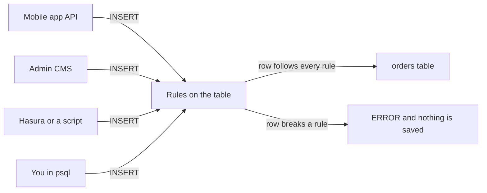
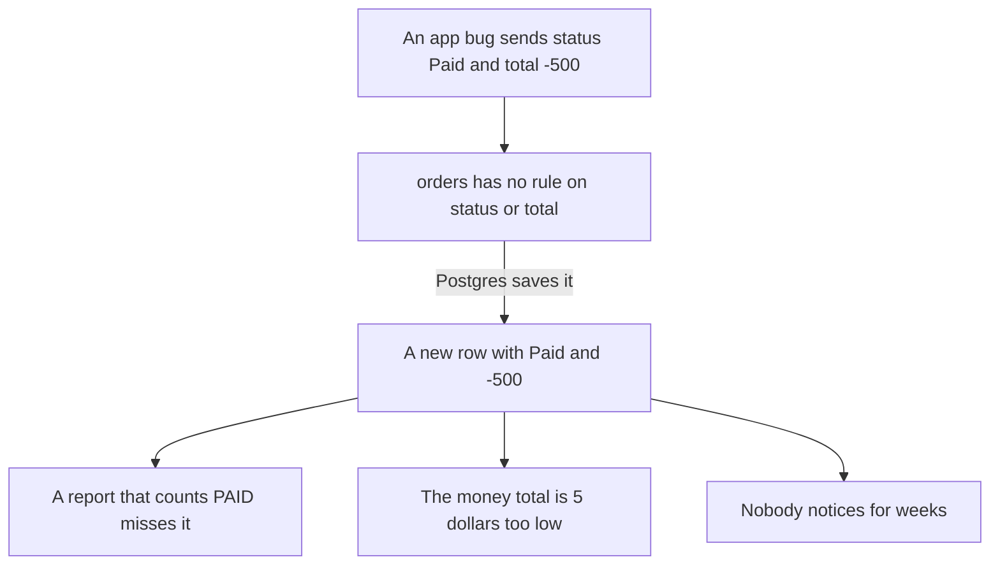
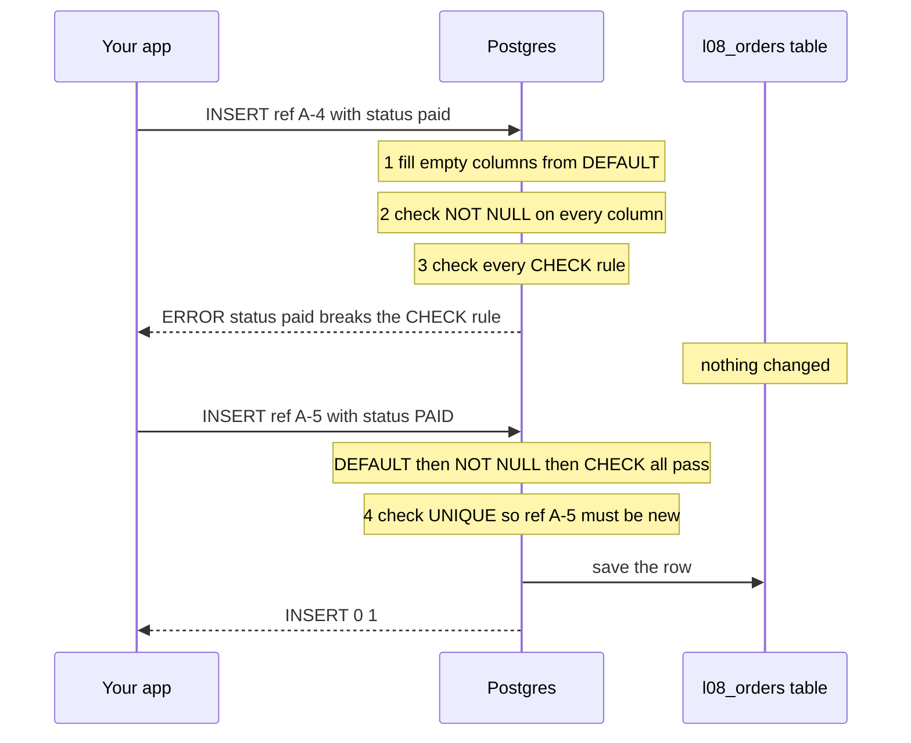
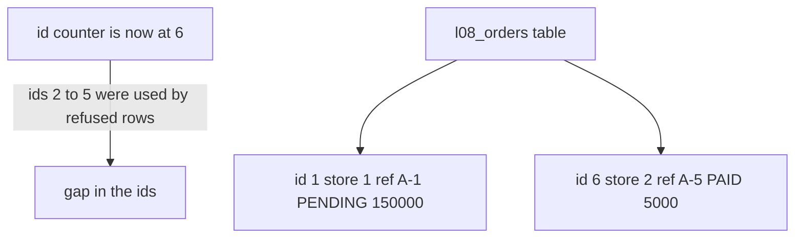
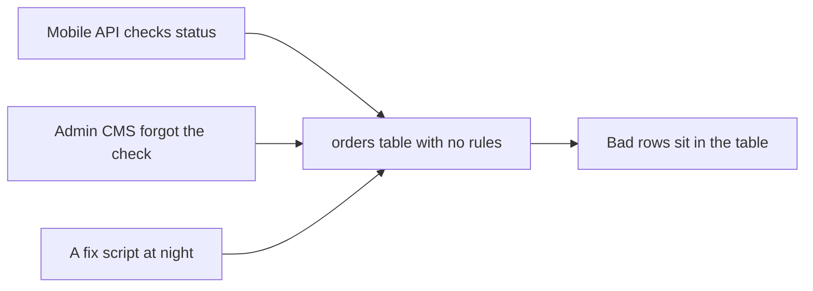
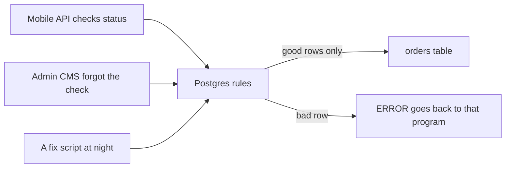
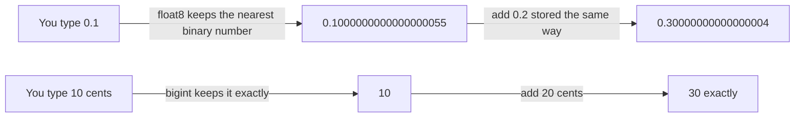
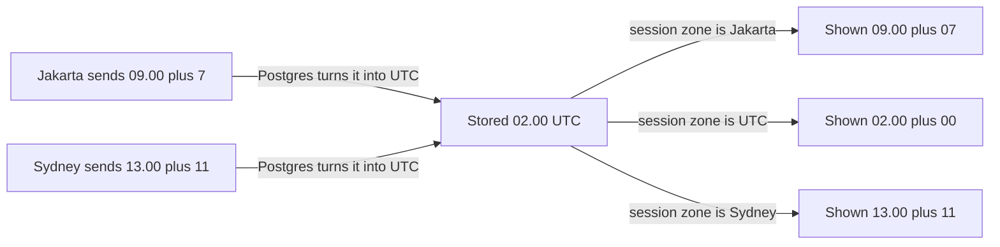
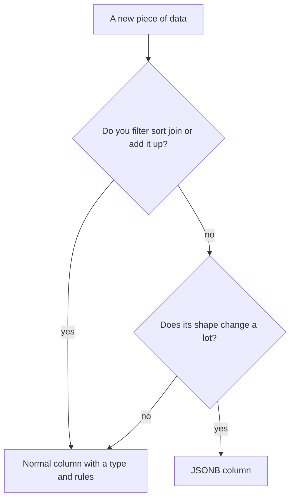

# 08. Constraints and data types

> **Subject:** Database · **Lesson:** 08 · **Made:** 2026-10-16 · **Status:** ready
> **You will be able to:** add rules that make Postgres refuse bad rows, read the error it gives back, and say why money goes in cents, time goes in timestamptz, and most data goes in normal columns instead of JSONB.
> **Before this:** [Normalization](07-normalization.md) · **Next:** [Indexes and B-trees](09-indexes-and-b-trees.md)

## 1. The idea in one sentence

You write rules on each column, so Postgres itself says no to bad data, because your app code will have bugs.

New words, at most 4:

- **Constraint:** a rule on a column or table. Postgres checks it on every insert and update. (Interview word: *constraint*.)
- **Float:** a number type that stores a very close guess, not the exact number. In Postgres it is `float8` or `real`. JavaScript `number` is the same kind.
- **UTC:** the world's base clock, with no time zone offset. Jakarta is UTC plus 7 hours.
- **JSONB:** a column that holds a whole JSON object, like `{"n": 7}`.

The rule to remember: **every path into the table goes through the same rules. Checks in your app guard only that one app.**

## 2. The pictures

### 2a. The big picture

Many programs write to one table. Notice that they all pass the same gate.



### 2b. The problem, drawn

The practice `orders` table has no rule on `status` or on `total_cents`. Notice how one bug spreads into reports.



This really happens on the practice database. Postgres accepts the row, and `GROUP BY status` shows a new group:

```
  status   | count
-----------+-------
 CANCELLED | 13970
 DELIVERED | 14164
 PAID      | 42983
 PENDING   | 14435
 Paid      |     1      <- the bug, a group of its own
 SHIPPED   | 14448
```

Your counts will be different, because the seed uses random data. The `Paid` row of 1 will be the same.

### 2c. How it works over time

What Postgres does with one INSERT. Notice that it checks everything **before** it says yes.



### 2d. What is in the table right now

A snapshot after the six inserts in section 4. Notice two rows saved, four refused, and a gap in the ids.



The id counter moves forward even when a row is refused. A gap in ids is normal. Never use ids to count rows.

### 2e. Right against wrong

**Wrong:** the rules live only in the app.



**Right:** the app checks for nice messages. Postgres checks as the last guard.



### 2f. Money: why float is wrong

Notice that the float stores a close guess. Cents store the exact number.



### 2g. Time: stored in UTC, shown in your zone

Two payments happen at the same moment, in two cities. Notice that `timestamptz` stores one value and shows it in many zones.



### 2h. JSONB or normal columns?

Notice the question that decides it: do you filter, sort, join or add up this field?



## 3. Real life analogy

Think of the counter at a government office that takes forms.

- The clerk refuses a form with an empty required box. (NOT NULL.)
- The clerk refuses a date written as "next Tuesday". (CHECK and data types.)
- The clerk refuses a second form with the same ID number. (UNIQUE.)
- The clerk stamps today's date if you left it empty. (DEFAULT.)
- It does not matter who brought the form. Every form goes through the same counter.

Where the analogy stops: a clerk can think about the whole story. Postgres checks only the rules you wrote. A CHECK rule sees one row at a time. It cannot ask "does this total match the items in the other table?"

## 4. The smallest code that shows it

```sql
CREATE TABLE l08_orders (
  id          serial PRIMARY KEY,
  store_id    int    NOT NULL,
  ref         text   NOT NULL UNIQUE,          -- the order number the app shows
  status      text   NOT NULL DEFAULT 'PENDING'
              CHECK (status IN ('PENDING','PAID','SHIPPED','DELIVERED','CANCELLED')),
  total_cents bigint NOT NULL CHECK (total_cents >= 0)
);
INSERT INTO l08_orders (store_id, ref, total_cents) VALUES (1, 'A-1', 150000);
INSERT INTO l08_orders (store_id, ref, total_cents) VALUES (NULL, 'A-2', 5000);
INSERT INTO l08_orders (store_id, ref, total_cents) VALUES (2, 'A-1', 5000);
INSERT INTO l08_orders (store_id, ref, total_cents) VALUES (2, 'A-3', -500);
INSERT INTO l08_orders (store_id, ref, status, total_cents) VALUES (2, 'A-4', 'paid', 5000);
INSERT INTO l08_orders (store_id, ref, status, total_cents) VALUES (2, 'A-5', 'PAID', 5000);
SELECT * FROM l08_orders;
```

**Output:**

```
INSERT 0 1
ERROR:  null value in column "store_id" of relation "l08_orders" violates not-null constraint
DETAIL:  Failing row contains (2, null, A-2, PENDING, 5000).
ERROR:  duplicate key value violates unique constraint "l08_orders_ref_key"
DETAIL:  Key (ref)=(A-1) already exists.
ERROR:  new row for relation "l08_orders" violates check constraint "l08_orders_total_cents_check"
DETAIL:  Failing row contains (4, 2, A-3, PENDING, -500).
ERROR:  new row for relation "l08_orders" violates check constraint "l08_orders_status_check"
DETAIL:  Failing row contains (5, 2, A-4, paid, 5000).
INSERT 0 1
 id | store_id | ref | status  | total_cents
----+----------+-----+---------+-------------
  1 |        1 | A-1 | PENDING |      150000
  6 |        2 | A-5 | PAID    |        5000
(2 rows)
```

Read each error. It names the table, the column or the rule, and the bad row. Postgres made the rule names for you, like `l08_orders_status_check`.

## 5. What really happens, step by step

| Step | Statement | What Postgres does | Result | Id counter after |
|---|---|---|---|---|
| 1 | Insert A-1, no status | Takes id 1. Fills `status` with the DEFAULT `PENDING`. Every rule passes. | Saved | 1 |
| 2 | Insert store_id NULL | Takes id 2. Fills `status`. Checks NOT NULL: `store_id` is empty. Stops. | ERROR, not-null | 2 |
| 3 | Insert A-1 again | Takes id 3. NOT NULL and CHECK pass. Checks UNIQUE: `A-1` is already there. | ERROR, unique | 3 |
| 4 | Insert total -500 | Takes id 4. NOT NULL passes. CHECK `total_cents >= 0` is false. | ERROR, check | 4 |
| 5 | Insert status `paid` | Takes id 5. CHECK compares text exactly. `paid` is not `PAID`. | ERROR, check | 5 |
| 6 | Insert status `PAID` | Takes id 6. Every rule passes. | Saved | 6 |
| 7 | SELECT | Reads the table. Only rows 1 and 6 are there. | 2 rows | 6 |

A refused statement changes nothing in the table. Only the id counter moved.

**The same moment, two kinds of time column.** Two payments happen at the same moment. One app is in Jakarta, one in Sydney. Both values go into a `timestamp` column and a `timestamptz` column.

```sql
CREATE TABLE l08_times (label text, plain timestamp, with_tz timestamptz);
INSERT INTO l08_times VALUES ('paid in Jakarta', '2026-10-16 09:00:00+07', '2026-10-16 09:00:00+07');
INSERT INTO l08_times VALUES ('paid in Sydney',  '2026-10-16 13:00:00+11', '2026-10-16 13:00:00+11');
```

| Step | What you run | What Postgres does | What you see |
|---|---|---|---|
| 1 | Insert the Jakarta row | `plain`: throws the `+07` away and keeps `09:00`. `with_tz`: turns it into UTC and keeps `02:00 UTC`. | INSERT 0 1 |
| 2 | Insert the Sydney row | `plain`: throws `+11` away, keeps `13:00`. `with_tz`: `13:00 - 11h` is `02:00 UTC`. | INSERT 0 1 |
| 3 | `SET timezone = 'UTC'` then SELECT | Shows `with_tz` in UTC. | plain `09:00` and `13:00`. with_tz `02:00:00+00` twice |
| 4 | `SET timezone = 'Asia/Jakarta'` then SELECT | Same stored value, shown in Jakarta time. | with_tz `09:00:00+07` twice. plain does not change |
| 5 | Subtract the two rows | `with_tz`: same moment. `plain`: looks 4 hours apart. | tz_gap `00:00:00`, plain_gap `04:00:00` |

The **session time zone** is a setting on your connection. Postgres uses it only to show `timestamptz` values and to read times that have no offset. The stored value never changes.

**Money, three ways:**

```sql
SELECT 0.1::float8 + 0.2::float8 AS float_sum,
       0.1::numeric + 0.2::numeric AS numeric_sum,
       10 + 20 AS cents_sum;
```

```
      float_sum      | numeric_sum | cents_sum
---------------------+-------------+-----------
 0.30000000000000004 |         0.3 |        30
```

Add `0.1` ten times as `float8` and Postgres gives `0.9999999999999999`. As `numeric` it gives `1.0`. JavaScript prints the same `0.30000000000000004` for `0.1 + 0.2`, because a JavaScript number is a float too.

Checked on 2026-10-16 with PostgreSQL 18.3 (PGlite). Your playground runs Postgres 16. Every output in this lesson is the same there.

**Step through it yourself:** [open the constraints stepper](visuals/08-constraints-and-data-types.html). Press Next and watch each insert walk through the rule gates. It has four programs: the six inserts above, DEFAULT and NULL, the two time zones, and soft delete.

## 6. Why it exists and what it costs

- **Problem without it:** app code has bugs, and more than one program writes to the table. One bad row breaks reports, totals and joins, often weeks later (picture 2b).
- **How it solves it:** Postgres checks every row on every insert and update, from every program. A bad row never gets in.
- **Cost:** a rule can block a real new case. Then you must change the rule with a migration. Each check also costs a tiny bit of time on every write.

### The type choices, one by one

**Money.**

| Type | `0.1 + 0.2` | Good for money? |
|---|---|---|
| `float8` or `real` | `0.30000000000000004` | No. A close guess, not exact. |
| `numeric(12,2)` | `0.3` | Yes. Exact, but slower to add up. |
| `bigint` cents, like `total_cents` | `10 + 20 = 30` | Yes. Exact and fast. The app shows `150000` as `1,500.00`. |

The seed uses `total_cents bigint`. Use `numeric` when you need parts of a cent, like tax rates or currency rates.

**Time.**

| Type | What Postgres keeps | Problem |
|---|---|---|
| `timestamp` | The clock numbers you sent. The offset is thrown away without a warning. | Two zones mix up. Sydney 13:00 and Jakarta 09:00 look 4 hours apart. |
| `timestamptz` | One moment, stored as UTC. Shown in the session time zone. | None for normal app times. Use it by default. |

**Text.**

| Type | What it does |
|---|---|
| `text` | Any length. Same speed as `varchar` in Postgres. |
| `varchar(n)` | Same as text, plus a length limit. A longer value gives `ERROR: value too long for type character varying(5)`. |
| `text` with `CHECK (char_length(name) <= 100)` | Same limit, but you can change it later without changing the column type. |

**A status column with a fixed list.**

| Way | Example | Add a new value | Remove a value |
|---|---|---|---|
| CHECK list | `CHECK (status IN ('PENDING','PAID'))` | Drop the rule and add a new one. Postgres reads every row to check it. | Same. Fails if old rows still use the value. |
| Postgres **enum** (a custom type with a fixed list) | `CREATE TYPE order_status AS ENUM (...)` | `ALTER TYPE order_status ADD VALUE 'REFUNDED'` | Not possible. Postgres says `dropping an enum value is not implemented`. You must make a new type. |
| **Lookup table** (a small table of allowed values) | `status text REFERENCES order_statuses(code)` | Insert a row. No migration. | Delete the row. Postgres refuses while orders still use it. |

A lookup table can also hold extra info, like a label for the admin screen. Pick it when non-developers change the list. Pick a CHECK list when the list rarely changes.

**JSONB against normal columns.**

| | Normal columns | JSONB |
|---|---|---|
| Types | `int`, `bigint`, `timestamptz` and so on | No types inside. `"7"` and `7` and `"seven"` all fit. |
| Rules | NOT NULL, UNIQUE, CHECK, foreign keys | Hard. You can write a CHECK, but it gets long fast. |
| Filters | Simple and fast, with a normal index | Need casts like `(payload->>'n')::int`. Text comparison is a trap (section 7). |
| Good for | Data you filter, sort, join or add up | A flexible payload, like `jobs.payload` in the seed. Each job type has its own shape. |

To search inside JSONB fast, add a GIN index (an index type made for "contains" questions): `CREATE INDEX ON jobs USING gin (payload);`. Then `WHERE payload @> '{"n": 7}'` can use it. Lesson 09 explains indexes.

### In Prisma

Checked in the Prisma docs on 2026-10-16.

| You want in Postgres | Prisma schema | What your JavaScript gets |
|---|---|---|
| `bigint` cents | `totalCents BigInt` | A JS `bigint`. `JSON.stringify` throws `TypeError: Do not know how to serialize a BigInt`. Convert it before you send JSON. |
| `numeric(12,2)` | `price Decimal @db.Decimal(12, 2)` | A `Decimal` object from decimal.js. Plain `Decimal` makes `decimal(65,30)`. |
| `timestamptz` | `createdAt DateTime @db.Timestamptz(3)` | A JS `Date` |
| `timestamp(3)` | `createdAt DateTime` **(the default)** | A JS `Date`. The column has no time zone. |
| `jsonb` | `payload Json` | A plain JS value |
| enum | `enum OrderStatus { ... }` | A string union type |
| CHECK rule | Not in the schema | Run `prisma migrate dev --create-only`, add `ALTER TABLE ... ADD CONSTRAINT ... CHECK (...)` to the SQL file, then apply it. |

<details><summary>Go deeper (optional)</summary>

- **CHECK and NULL.** A CHECK rule passes when the answer is NULL. So `CHECK (n > 0)` lets a NULL in. Add NOT NULL too. The PostgreSQL docs say this in "Check Constraints".
- **UNIQUE and NULL.** Two NULLs do not count as the same, so a UNIQUE column can hold many NULLs. Since Postgres 15 you can write `UNIQUE NULLS NOT DISTINCT` to allow only one.
- **Order of the errors.** When a row breaks two rules, you see only one error. The practice row `('Paid', -500)` showed only the status error.
- **Adding a rule to a big live table.** `ADD CONSTRAINT ... CHECK` reads every row while it holds a lock. `ADD CONSTRAINT ... NOT VALID` skips old rows, then `VALIDATE CONSTRAINT` checks them later with a weaker lock. Lesson 19 (zero-downtime migrations, not written yet) covers this.
- **The money type.** Postgres has a `money` type. The PostgreSQL wiki page "Don't Do This" says not to use it. It does not store a currency, and it depends on a server setting.
- **Int is too small for some currencies.** `int` stops at 2,147,483,647. As cents, that is about 21 million. In rupiah that is a normal order size. Use `bigint` for cents.
- **Enum in a transaction.** Postgres can run `ALTER TYPE ... ADD VALUE` inside a transaction. You cannot use the new value until that transaction commits. To remove a value, you make a new type and move the column to it.
- **Soft delete with a partial unique index.** Some apps never delete a row. They set `deleted_at` to a time instead. A normal UNIQUE on `email` then blocks a new user with the email of a deleted one. A partial unique index checks only live rows:

  ```sql
  CREATE UNIQUE INDEX l08_staff_email_live ON l08_staff (email) WHERE deleted_at IS NULL;
  ```

  With it, one deleted Ana and one live Ana can both exist. A second live Ana gets `ERROR: duplicate key value violates unique constraint "l08_staff_email_live"`. Prisma 7.4 added this as a preview feature (`partialIndexes`) with `@@unique([email], where: ...)`. Lesson 10 shows partial indexes in more detail.
- **The GIN plan.** On the 50 row `jobs` table, Postgres reads the whole table, because that is faster for so few rows. With `SET enable_seqscan = off` it shows `Bitmap Index Scan on jobs_payload_gin` for `payload @> '{"n": 7}'`. A filter like `(payload->>'n')::int = 7` cannot use that index.
- **Postgres 18 against 16.** Postgres 18 stores NOT NULL rules in `pg_constraint` with names like `l08_orders_store_id_not_null`. Postgres 16 does not list them there. The error text you see on insert is the same in both. Postgres 18 also lets you mark CHECK and foreign key rules as `NOT ENFORCED`.

</details>

## 7. Common mistakes

**Wrong:** money as a float.

```sql
CREATE TABLE payments (amount float8 NOT NULL);
```

**Right:**

```sql
CREATE TABLE payments (amount_cents bigint NOT NULL CHECK (amount_cents >= 0));
```

**Why:** a float keeps a close guess. Ten payments of `0.1` add up to `0.9999999999999999`.

**Wrong:** a Prisma `DateTime` with no native type.

```prisma
createdAt DateTime @default(now())
```

**Right:**

```prisma
createdAt DateTime @default(now()) @db.Timestamptz(3)
```

**Why:** the default makes a `timestamp(3)` column with no time zone. It works only while every program writes UTC. One script that writes Jakarta time mixes the data, and the column cannot tell you.

**Wrong:** sending NULL and expecting the DEFAULT.

```sql
CREATE TABLE l08_d (id serial PRIMARY KEY, status text NOT NULL DEFAULT 'PENDING');
INSERT INTO l08_d (status) VALUES (NULL);
-- ERROR:  null value in column "status" of relation "l08_d" violates not-null constraint
```

**Right:** leave the column out, or write `DEFAULT`.

```sql
INSERT INTO l08_d (status) VALUES (DEFAULT);   -- status becomes PENDING
```

**Why:** Postgres uses the DEFAULT only when you give no value. NULL is a value you gave. In Prisma, `undefined` leaves the field out, and `null` sends NULL.

**Wrong:** comparing a number inside JSONB as text.

```sql
SELECT count(*) FROM jobs WHERE payload->>'n' > '40';          -- 15
```

**Right:**

```sql
SELECT count(*) FROM jobs WHERE (payload->>'n')::int > 40;     -- 10
```

**Why:** `->>` gives back text. As text, `'5'` comes after `'40'`, the same way "b" comes after "a". So 5 to 9 sneak in. Checked on the seed `jobs` table, which has `n` from 1 to 50.

## 8. Watch and play

Links checked on 2026-10-16. Each page was opened and matched the topic. For each video, the title, channel and length came from YouTube itself.

- **Video:** [Floating Point Numbers - Computerphile](https://www.youtube.com/watch?v=PZRI1IfStY0), about 9 minutes. Why a computer cannot store 0.1 exactly. Watch it before section 2f.
- **Video:** [The Problem with Time & Timezones - Computerphile](https://www.youtube.com/watch?v=-5wpm-gesOY) with Tom Scott, about 10 minutes. Why you store one moment in UTC and only show local time.
- **Play with it:** [The constraints stepper](visuals/08-constraints-and-data-types.html) in this folder. Guess which inserts fail, then press Next.
- **Play with it:** [DB Fiddle](https://www.db-fiddle.com/). Pick PostgreSQL, paste section 4, and run it. Then remove one rule and run it again.
- **Play with it:** [float.exposed](https://float.exposed/) by Bartosz Ciechanowski. Type `0.1` in the double column and see the exact value it really stores.
- **Read:** [PostgreSQL wiki: Don't Do This](https://wiki.postgresql.org/wiki/Don't_Do_This). Read "Don't use timestamp (without time zone)", "Don't use varchar(n) by default" and "Don't use money".
- **Read:** [PostgreSQL docs: Constraints](https://www.postgresql.org/docs/current/ddl-constraints.html). Sections 5.5.1 to 5.5.3: CHECK, NOT NULL and UNIQUE with small examples.

<details><summary>More links (optional)</summary>

- **Read:** [Enums vs Check Constraints in Postgres](https://www.crunchydata.com/blog/enums-vs-check-constraints-in-postgres) by Craig Kerstiens, Crunchy Data, 2022. A short case for trying CHECK before enum.
- **Read:** [PostgreSQL docs: JSON types](https://www.postgresql.org/docs/current/datatype-json.html). Section 8.14.4 shows GIN indexes on jsonb.
- **Read:** [PostgreSQL docs: Partial indexes](https://www.postgresql.org/docs/current/indexes-partial.html). Example 11.3 is a partial unique index.
- **Read:** [Prisma: CHECK constraints with PostgreSQL](https://www.prisma.io/docs/orm/v7/more/troubleshooting/check-constraints). How to add CHECK rules in a Prisma project.
- **Read:** [Prisma: database features](https://www.prisma.io/docs/orm/v7/reference/database-features). The table of which rules Prisma schema can and cannot describe.
- **Read:** [Prisma: customizing migrations](https://www.prisma.io/docs/orm/v7/prisma-migrate/workflows/customizing-migrations). The `--create-only` steps.
- **Read:** [Exposing Floating Point](https://ciechanow.ski/exposing-floating-point/) by Bartosz Ciechanowski. Long, with pictures of how a float is built from bits.
- **Read:** the [PostgreSQL queries guide](postgresql-queries-interview-guide.md) in this folder, part "JSONB, when, and how to index it".

</details>

## 9. Practice

**A. Predict the output** (write your answer before opening)

```sql
CREATE TABLE l08_quiz (
  code text UNIQUE,
  qty  int  CHECK (qty > 0)
);
INSERT INTO l08_quiz VALUES ('A', 5);      -- 1
INSERT INTO l08_quiz VALUES ('A', 3);      -- 2
INSERT INTO l08_quiz VALUES ('B', 0);      -- 3
INSERT INTO l08_quiz VALUES (NULL, NULL);  -- 4
INSERT INTO l08_quiz VALUES (NULL, NULL);  -- 5
SELECT count(*) FROM l08_quiz;
```

<details><summary>Answer</summary>

- 1 works.
- 2 fails: `duplicate key value violates unique constraint "l08_quiz_code_key"`.
- 3 fails: `violates check constraint "l08_quiz_qty_check"`, because 0 is not above 0.
- 4 works. 5 works too. The count is **3**.

Why 4 and 5 work: there is no NOT NULL. A CHECK passes when the answer is NULL. UNIQUE does not treat two NULLs as the same. So "UNIQUE" and "CHECK" alone do not mean "required". Add NOT NULL.

</details>

**B. Fix the bug**

A store dashboard shows "Today: 0 orders" every morning until 7 am in Jakarta. The connection's session time zone is `Asia/Jakarta`. The table and the query:

```sql
CREATE TABLE l08_shop_orders (id serial PRIMARY KEY, created_at timestamp NOT NULL);
-- the API saves created_at with new Date() through Prisma, which writes UTC
SELECT count(*) FROM l08_shop_orders WHERE created_at >= current_date;
```

<details><summary>Answer</summary>

The column is `timestamp`, so it holds UTC clock numbers with no zone. At 06:00 in Jakarta, an order is stored as `23:00` of yesterday in UTC. `current_date` is today in Jakarta, so the filter misses it.

Fix: store a moment, not clock numbers. Make the column `timestamptz`, and say which day you mean.

```sql
ALTER TABLE l08_shop_orders
  ALTER COLUMN created_at TYPE timestamptz USING created_at AT TIME ZONE 'UTC';
SELECT count(*) FROM l08_shop_orders
WHERE created_at >= date_trunc('day', now() AT TIME ZONE 'Asia/Jakarta') AT TIME ZONE 'Asia/Jakarta';
```

`USING created_at AT TIME ZONE 'UTC'` tells Postgres that the old clock numbers were UTC. In Prisma, add `@db.Timestamptz(3)` to the field.

</details>

**C. Write it yourself**

Open `practice/08-constraints-and-data-types.sql`. There are six tasks:

1. Add a CHECK rule to a table that already has a bad row. Read the error, find the row, fix it.
2. Add NOT NULL, UNIQUE and a CHECK list with a DEFAULT. Then predict which of six inserts fail.
3. Add up money as float and as cents.
4. Show one moment in three time zones.
5. Find the JSONB text comparison bug, and use a GIN index.
6. (Stretch) Soft delete with a partial unique index.

Each task has the exact expected result in a comment. An error is often the right answer. Run it as the top of the file says.

<details><summary>One possible answer</summary>

```sql
-- 1a
ALTER TABLE l08_vouchers ADD CONSTRAINT l08_vouchers_discount_positive CHECK (discount_cents > 0);
-- 1b
SELECT id, code, discount_cents FROM l08_vouchers WHERE discount_cents <= 0;
-- 1c
UPDATE l08_vouchers SET discount_cents = 100 WHERE id = 3;
ALTER TABLE l08_vouchers ADD CONSTRAINT l08_vouchers_discount_positive CHECK (discount_cents > 0);

-- 2a
ALTER TABLE l08_vouchers ALTER COLUMN code SET NOT NULL;
ALTER TABLE l08_vouchers ADD CONSTRAINT l08_vouchers_code_key UNIQUE (code);
ALTER TABLE l08_vouchers ADD COLUMN kind text NOT NULL DEFAULT 'FIXED'
  CHECK (kind IN ('FIXED','PERCENT'));

-- 3a
SELECT sum(amount_float) AS float_total, sum(amount_cents) AS cents_total FROM l08_payments;
-- 3b
SELECT (sum(amount_cents) / 100.0)::numeric(12,2) AS dollars FROM l08_payments;

-- 4a
SET timezone = 'Asia/Jakarta';
INSERT INTO l08_visits VALUES ('visit', '2026-03-01 08:00:00+07', '2026-03-01 08:00:00+07');
-- 4b
SET timezone = 'UTC';
SELECT label, plain, with_tz FROM l08_visits;
-- 4c
SET timezone = 'Australia/Sydney';
SELECT label, plain, with_tz FROM l08_visits;
SET timezone = 'Asia/Jakarta';

-- 5a: ->> gives text, and as text '5' to '9' come after '40'.
-- 5b
SELECT count(*) FROM l08_events WHERE (payload->>'n')::int > 40;
-- 5c
CREATE INDEX l08_events_payload_gin ON l08_events USING gin (payload);
SELECT id, payload FROM l08_events WHERE payload @> '{"n": 7}';

-- 6a
CREATE UNIQUE INDEX l08_staff_email_live ON l08_staff (email) WHERE deleted_at IS NULL;
```

Every expected result in the practice file came from running these answers.

</details>

## 10. Interview question

**Q:** "Your API already validates input. Why add constraints in Postgres too? And how would you store prices and order times?"

<details><summary>A strong answer, in four parts</summary>

1. **Problem:** app checks guard only one path. An admin tool, a script, a second service or a bug can skip them. One bad row then breaks reports and totals, and you find it weeks later.
2. **How it works:** Postgres checks every insert and update against the rules on the table. NOT NULL makes a field required. UNIQUE stops duplicates. CHECK holds a yes or no test, like `total_cents >= 0` or a fixed status list. DEFAULT fills empty fields. A bad row gets an error and nothing is saved. For types: money in integer cents (`bigint`) or `numeric`, never float, because float keeps a close guess. Times in `timestamptz`, which stores UTC and shows the session time zone. Normal columns for anything I filter or add up. JSONB only for flexible payloads.
3. **Tradeoff:** rules can block a real new case, so changing them needs a migration. Enums are hard to change later, so I prefer a CHECK list or a lookup table. In the app, I still validate, because users need friendly messages. The database is the last guard, not the only one.
4. **My example:** *This is an idea, not a fact. Replace it with your own real story.* DBO has a mobile app and an admin CMS, so at least two programs can write orders. With Prisma, I would add `@db.Timestamptz(3)` to every `DateTime`, keep money as cents, and add CHECK rules for status and totals in a `--create-only` migration.

</details>

## 11. Explain it back

Close this file. Press the **Record my explanation** button under this heading and explain constraints out loud, like to a new junior, in 4 parts: problem, how it works, tradeoff, my example. Use the words "constraint", "float", "UTC" and "JSONB". Then save the transcript file into `my-learning/recordings/`, or write your best version below. Run `/explain-check constraints` or ask the `explain-coach` agent to review it.

### My explanation

<write here>

### Coach feedback

<the explain-coach agent writes here>

## 12. Review questions (day 1, 3, 7, 21)

1. The API checks `status`, but the admin CMS does not. Where should the last check live, and why?
2. Why is `float8` wrong for money? Give the exact number Postgres prints for `0.1 + 0.2`.
3. A Jakarta app and a Sydney app save the same moment into a `timestamp` column and a `timestamptz` column. What does each column keep?
4. Draw picture 2c from memory: one INSERT, the four checks in order, and what happens on a failure.

<details><summary>Answers</summary>

1. In Postgres, as a CHECK constraint. Every program goes through the table rules, so a bug in one program cannot save a bad row. Keep the app check too, for friendly messages.
2. A float keeps the nearest binary number, not the exact one. `0.1::float8 + 0.2::float8` prints `0.30000000000000004`. Use `bigint` cents or `numeric`.
3. `timestamp` keeps only the clock numbers and throws the offset away: `09:00` and `13:00`, which look 4 hours apart. `timestamptz` turns both into the same UTC moment, `02:00 UTC`, and shows it in the session time zone.
4. Fill DEFAULTs, check NOT NULL, check CHECK rules, check UNIQUE. If any fails, Postgres sends an ERROR and saves nothing. The id counter still moves. If all pass, it saves the row and sends `INSERT 0 1`.

</details>

## Connected lessons

- [Normalization](07-normalization.md): the lesson before. It splits tables. This lesson puts rules on each column of those tables.
- [Keys and relationships](06-keys-and-relationships.md): PRIMARY KEY and FOREIGN KEY are constraints too. A foreign key gives the error `is not present in table "stores"`.
- [Indexes and B-trees](09-indexes-and-b-trees.md): the next lesson. A UNIQUE rule builds an index under the hood, and a GIN index speeds up JSONB searches.
- [Composite, partial and covering indexes](10-composite-partial-and-covering-indexes.md): the partial index from the soft delete example.
- Lesson 18, upsert and idempotency (not written yet): `ON CONFLICT` needs a UNIQUE rule to work.
- Lesson 19, zero-downtime migrations (not written yet): adding a rule to a big live table with `NOT VALID`.
