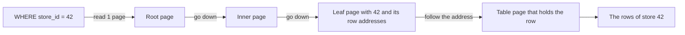
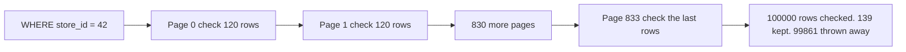
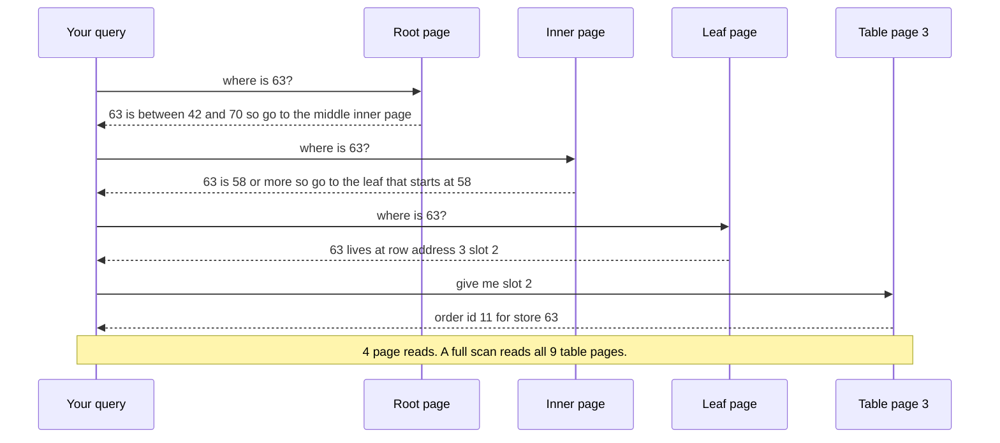
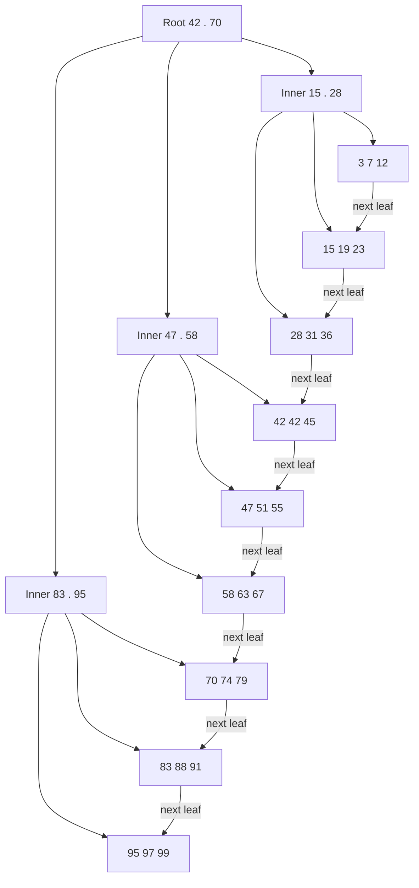
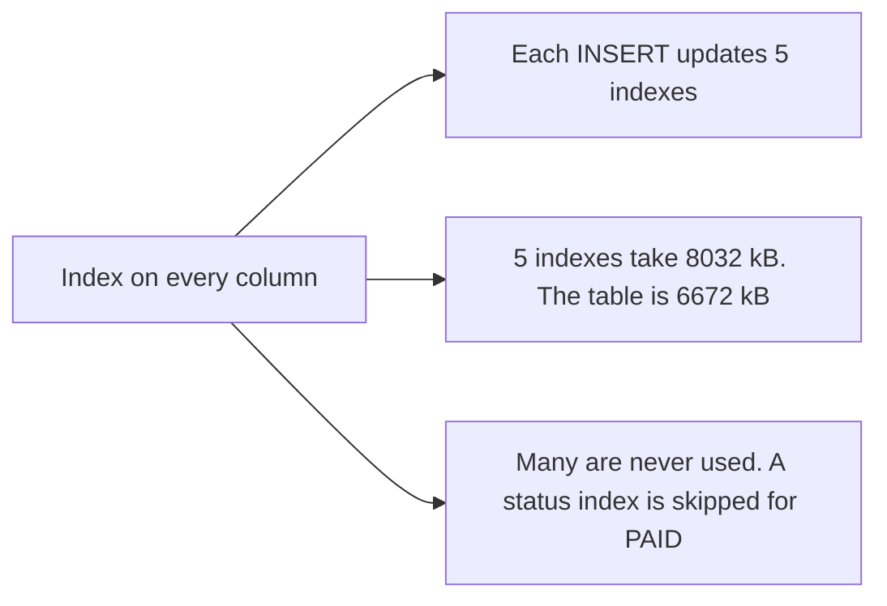
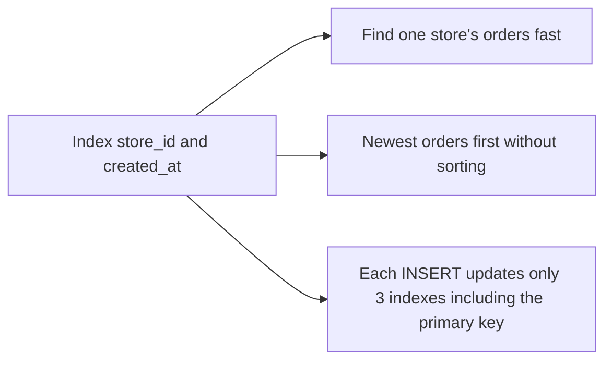
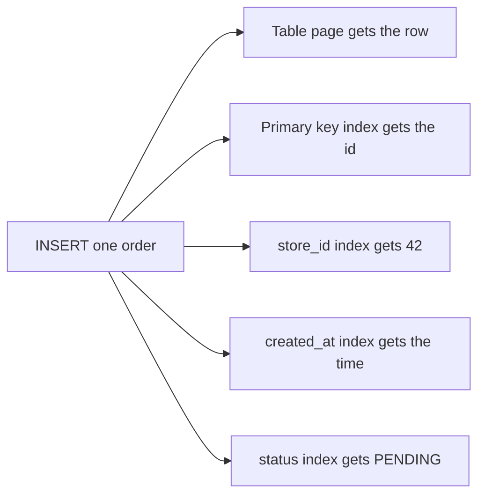

# 09. Indexes and B-trees

> **Subject:** Database · **Lesson:** 09 · **Made:** 2026-10-16 · **Status:** ready
> **You will be able to:** draw a B-tree, walk a search from the top page down to the row, and say what every index costs when you write.
> **Before this:** [Constraints and data types](08-constraints-and-data-types.md) · **Next:** [Composite, partial and covering indexes](10-composite-partial-and-covering-indexes.md)

## 1. The idea in one sentence

An index is a sorted list of one column, where every entry says where its row lives, so Postgres can jump to a few rows instead of reading the whole table.

New words, at most 4:

- **Page:** a block of 8 kB on disk. Postgres always reads and writes whole pages, never one row alone. (interview word: page or block)
- **Index:** a separate, sorted list of the values of one column. Each entry holds a value and the address of its row. (interview word: index)
- **B-tree:** the shape of that list. It is a few levels of sorted pages. The one page at the top is the **root**. The pages at the bottom are the **leaves**. Pages in between are **inner pages**. (interview word: B-tree)
- **Row address:** where a row sits in the table: a page number and a slot number, written like `(3,2)`. (interview word: TID or ctid. The table itself is called the **heap**.)

The rule to remember: **a search through an index reads one page per level of the tree, then only the table pages that hold your rows. Every write pays for this: each INSERT must also add an entry to every index on the table.**

## 2. The pictures

### 2a. The big picture

Notice that Postgres reads only one page per level, then jumps straight to the right table page.



### 2b. The problem, drawn

Without an index, Postgres has no idea where store 42's orders are. Notice that it must open every page and check every row.



### 2c. How it works over time

A search for store 63 in a small tree. Notice the order: down the tree first, then one jump into the table.



### 2d. What is on disk right now

This is the small tree from the stepper. It indexes `store_id` for 27 orders. A real page holds hundreds of entries. Here each page holds 3, so the tree fits on screen. Notice that the leaves hold every value in sorted order, and each leaf links to the next one.



Inside one leaf and its table pages. The leaf is sorted. The table is not.

| Leaf `58 63 67` holds | Row address | That table page holds (in the order rows were added) |
|---|---|---|
| 58 | (0,1) | page 0: store 58, store 12, store 91 |
| 63 | (3,2) | page 3: store 19, **store 63**, store 83 |
| 67 | (7,3) | page 7: store 88, store 31, store 67 |

These row addresses are real. They come from `SELECT ctid, id, store_id` on the small table used by the stepper.

### 2e. Right against wrong

**Wrong:** "indexes make things fast, so index every column."



**Right:** index the columns that your WHERE, JOIN and ORDER BY use often, and that pick out a small part of the table.



### 2f. One INSERT, many writes

Notice that one new row means one write in the table plus one in every index.



## 3. Real life analogy

An index is like **the index at the back of a book**.

- You want the page about "closures". Reading the whole book would take hours.
- The index at the back lists words from A to Z, each with a page number.
- Because the list is sorted, you jump to C, find "closures, page 212", and open page 212.
- A thick dictionary even has **letter tabs** on the edge. You grab the C tab first. That is the root of the tree.

Where the analogy stops:

- A book is printed once. A table changes every second. Postgres must fix the index on **every** insert, update and delete. A book never pays that cost.
- A book index lists many words. A Postgres index usually lists the values of one or a few columns.

## 4. The smallest code that shows it

Run this in the practice database. `EXPLAIN ANALYZE` runs the query and shows how Postgres did it. `BUFFERS` adds how many pages it read.

```sql
EXPLAIN (ANALYZE, BUFFERS, COSTS OFF)
SELECT * FROM orders WHERE store_id = 42;

CREATE INDEX orders_store_id_idx ON orders (store_id);

EXPLAIN (ANALYZE, BUFFERS, COSTS OFF)
SELECT * FROM orders WHERE store_id = 42;

SELECT pg_size_pretty(pg_relation_size('orders')) AS table_size,
       pg_size_pretty(pg_relation_size('orders_store_id_idx')) AS index_size;
```

**Output, before the index:**

```
Seq Scan on orders (actual time=0.281..10.240 rows=139.00 loops=1)
  Filter: (store_id = 42)
  Rows Removed by Filter: 99861
  Buffers: shared hit=834
Execution Time: 10.451 ms
```

**Output, after the index:**

```
Bitmap Heap Scan on orders (actual time=0.484..0.796 rows=139.00 loops=1)
  Recheck Cond: (store_id = 42)
  Heap Blocks: exact=127
  Buffers: shared hit=127 read=3
  ->  Bitmap Index Scan on orders_store_id_idx (actual time=0.174..0.175 rows=139.00 loops=1)
        Index Cond: (store_id = 42)
        Index Searches: 1
        Buffers: shared read=3
Execution Time: 1.037 ms
```

```
 table_size | index_size
------------+------------
 6672 kB    | 720 kB
```

How to read it (lesson 11 goes further):

- **Seq Scan** means Postgres read the table from the first page to the last.
- **Rows Removed by Filter: 99861** is the wasted work. It checked 100,000 rows to keep 139.
- **Buffers: 834** is 834 pages read. That is the whole table.
- After the index, the **Bitmap Index Scan** read **3 index pages**. **Heap Blocks: 127** is 127 table pages. Total 130 pages, not 834.
- Time went from about 10 ms to about 1 ms.
- "Bitmap" is one way to use an index. Postgres first collects all 139 row addresses, sorts them by page, then opens each table page once.

Your numbers will differ a little, because the seed uses `random()`. The shape stays the same.

## 5. What really happens, step by step

The query `SELECT * FROM orders WHERE store_id = 42`, after `CREATE INDEX`. The page numbers come from looking inside the real index.

| Step | What Postgres does | Pages read so far | State after |
|---|---|---|---|
| 1 | Plans the query. Its statistics say about 110 of 100,000 rows match. Few rows, so the index is cheaper than reading 834 pages. | 0 | Plan: use `orders_store_id_idx` |
| 2 | Reads the **root** page of the index. It holds 88 entries, one per leaf: "from store 21, go to leaf 4", "from store 32, go to leaf 5", "from the middle of store 42, go to leaf 6". | 1 | Postgres knows the first 42 is in leaf 5 |
| 3 | Reads **leaf 5**. It is sorted, so Postgres jumps to the entry for 42. Postgres stores 42 once, with a list of 132 row addresses. | 2 | 132 addresses collected |
| 4 | Leaf 5 ends, but the 42s may go on. Postgres follows the **next leaf** link to leaf 6. It finds 7 more addresses. The next entry is 43, which is bigger, so it stops. | 3 | 139 addresses collected. Index part done. |
| 5 | Sorts the 139 addresses by table page. Some pages hold two orders of store 42. | 3 | 127 different table pages to visit |
| 6 | Opens each of the 127 table pages and takes the matching rows. It checks `store_id = 42` again on each row (the "Recheck Cond" line). | 130 | 139 rows found |
| 7 | Returns the 139 rows. | 130 | Done in about 1 ms, against 834 pages and 10 ms before |

For 100,000 orders this tree has only **2 levels**: the root, then 88 leaves. A bigger index grows one more level. `point_transactions` has 200,000 rows, and its index on `reference` has **3 levels**. A lookup there reads 4 pages: root, inner, leaf and one table page.

```
Index Scan using point_transactions_reference_key on point_transactions (actual time=0.273..0.275 rows=1.00 loops=1)
  Index Cond: (reference = 'seed:123456'::text)
  Index Searches: 1
  Buffers: shared read=4
```

The table has 1,869 pages. The index read 4.

Checked on 2026-10-16 with PostgreSQL 18.3 (PGlite), on the practice seed.

**Step through it yourself:** [open the indexes and B-trees stepper](visuals/09-indexes-and-b-trees.html). It draws the small tree from picture 2d, the table pages under it, and a page counter. It has four programs:

1. **"1. Find one store"**: root, inner page, leaf, then the row. 4 page reads.
2. **"2. Range search"**: `BETWEEN 40 AND 52`. Watch Postgres walk along the leaves.
3. **"3. Insert a row"**: the table gets a row, and every index gets an entry. The second insert finds a full leaf, so Postgres splits it in two.
4. **"4. Full scan"**: no index. Count the rows checked.

## 6. Why it exists and what it costs

- **Problem without it:** Postgres reads every page and checks every row (picture 2b). The work grows with the table, even when you want 1 row.
- **How it solves it:**
  - The values are kept **sorted**, so Postgres can jump to the right place.
  - The tree is **short**. Each page points to a few hundred pages below it. With about 300 entries per page, 2 levels reach about 90,000 rows. 3 levels reach about 27 million. 4 levels reach about 8 billion.
  - So a lookup reads only a few index pages, even in a huge table.

**A free gift of sorting: ORDER BY and ranges.** The leaves are already in order and linked. So Postgres can read them in order and stop early.

```sql
EXPLAIN (ANALYZE, BUFFERS, COSTS OFF)
SELECT * FROM orders ORDER BY created_at DESC LIMIT 10;
```

| | Plan | Pages | Time |
|---|---|---|---|
| No index on `created_at` | Seq Scan of all 100,000 rows, then Sort | 837 | 50.6 ms |
| With `CREATE INDEX orders_created_at_idx ON orders (created_at)` | Index Scan Backward, no Sort | 12 | 0.06 ms |

"Backward" means Postgres walked the leaves from the end. A range like `created_at BETWEEN now() - interval '2 days' AND now() - interval '1 day'` works the same way. Postgres finds the first match, then walks right until the values are too big. It found 273 rows after reading 3 index pages.

**Cost 1: every write gets slower.** The same insert of 100,000 rows into a copy of `orders`. Times change from run to run, so look at the gap, not the exact numbers:

| Indexes on the copy | Time | Changes written to the log |
|---|---|---|
| none | 146 ms | 100,000 |
| 4 (id, store_id, created_at, status) | 708 ms | 503,868 |

A second run on 2026-10-22 gave 75 ms with no indexes and 633 ms with 4. The gap is 5 to 8 times.

- Each INSERT adds one entry to **every** index (picture 2f).
- An UPDATE usually adds new index entries too (Go deeper has the exception).
- A DELETE leaves old index entries behind. The cleaner (interview word: VACUUM, lesson 16, not written yet) removes them from every index later.

**Cost 2: disk space.** Indexes are real files.

| Name | Size |
|---|---|
| orders (the table) | 6672 kB |
| orders_pkey | 2208 kB |
| orders_created_at_idx | 2208 kB |
| orders_store_id_idx | 720 kB |
| orders_status_idx | 696 kB |

Four indexes take 5,832 kB. That is almost as big as the table. They also compete with the table for memory.

**Cost 3: an index helps only when the filter is picky.** How picky a filter is has an interview name: **selectivity**. About 3 in 7 orders are PAID.

| Query (with an index on `status`) | Matches | Plan | Pages |
|---|---|---|---|
| `status = 'PAID'` | 42,983 | Bitmap scan, but `Heap Blocks: exact=834` | 872 |
| `status IN ('PAID', 'SHIPPED')` | 57,431 | **Seq Scan**. The index is not used. | 834 |

- For PAID, Postgres used the index, yet still opened **all 834 table pages**. It read more pages than a full scan. It was only a few milliseconds faster (19 ms against 23 ms).
- Add SHIPPED and Postgres gives up on the index. When most pages hold a match, reading the table in order is cheaper.

**Foreign keys do not get an index by themselves.** `orders.store_id REFERENCES stores(id)` only adds a check. `stores.id` has an index, because it is the primary key. `orders.store_id` has none until you make one. The Postgres docs say so directly.

It hurts on delete. When you delete a store, Postgres must check that no order still points to it. Deleting 100 stores that have no orders:

```
-- no index on orders.store_id or point_transactions.store_id
Trigger for constraint orders_store_id_fkey: time=831.392 calls=100
Trigger for constraint point_transactions_store_id_fkey: time=1632.179 calls=100
Execution Time: 2466.765 ms

-- after CREATE INDEX on both store_id columns
Trigger for constraint orders_store_id_fkey: time=3.114 calls=100
Trigger for constraint point_transactions_store_id_fkey: time=2.565 calls=100
Execution Time: 6.191 ms
```

Without the index, each check was a full scan of the child table. 200 full scans took 2.5 seconds.

**More index kinds, in lesson 10:**

- **Composite:** one index on two columns, like `(store_id, created_at)`. Column order matters.
- **Partial:** an index on only some rows, like `WHERE status = 'PENDING'`.
- **Covering:** an index that holds every column the query needs, so Postgres skips the table.

<details><summary>Go deeper (optional)</summary>

- **Postgres 16 against 18.** These outputs come from Postgres 18. On your Docker playground (Postgres 16):
  - Row counts have no decimals: `rows=139`, not `rows=139.00`.
  - The line `Index Searches: 1` does not exist. Postgres 18 added it.
  - `EXPLAIN ANALYZE` shows `Buffers` lines only when you write `BUFFERS`. Postgres 18 adds them by default. This lesson always writes `BUFFERS`, so you see them on both.
  - Postgres 18 can sometimes use a two-column index without a filter on its first column ("skip scan"). Lesson 10 covers this.
  - Plan shapes and page counts are the same.
- **Bitmap scan against Index Scan.** An Index Scan reads one index entry, then its table page, then the next entry. A Bitmap scan first collects all addresses, sorts them, then visits each table page once. Postgres picks bitmap when many rows match, so it does not open the same page twice. Lesson 11 shows all the plan shapes.
- **Duplicates stored once.** Since Postgres 13, a leaf stores a repeated value once with a list of row addresses (deduplication). That is why `orders_store_id_idx` (900 different values) is 720 kB, while `orders_pkey` (100,000 different values) is 2208 kB.
- **Free room and splits.** `CREATE INDEX` fills leaf pages to 90% (fillfactor 90). The free room takes new entries. When a leaf is full, Postgres splits it into two pages and adds a pointer in the page above. When the root splits, the tree gets one level taller. The stepper shows a split in program 3.
- **The update exception (HOT).** If an UPDATE changes no indexed column, and the table page has free room, Postgres adds no new index entries. More indexes mean fewer updates can use this shortcut.
- **Building an index blocks writes.** A normal `CREATE INDEX` lets reads run but makes INSERT, UPDATE and DELETE wait until it finishes. On a live table use `CREATE INDEX CONCURRENTLY`. It is slower but does not block writes. Lesson 19 (not written yet) covers this.
- **Look inside a tree yourself.** `CREATE EXTENSION pageinspect;` then `SELECT level FROM bt_metap('orders_store_id_idx');`. Level 1 means 2 levels: root and leaves.
- **B-tree or B+ tree?** In Postgres, row addresses sit in the leaves and the leaves are linked. Textbooks call that shape a B+ tree. Postgres just calls it B-tree.
- **Other index types**, one line each (from the Postgres docs on index types):
  - **B-tree:** the default. Equality, ranges and sorting.
  - **Hash:** equality only (`=`).
  - **GIN:** values that hold many parts, like arrays, JSONB and full text search.
  - **GiST:** shapes, locations and "nearest first" searches.
  - **SP-GiST:** special trees, like tries, for some data types.
  - **BRIN:** a tiny summary per block of pages. Good for huge tables where the column grows with the insert order, like `created_at` in a log.

</details>

## 7. Common mistakes

**Wrong:** thinking the foreign key already made an index.

```sql
CREATE TABLE orders (
  id       bigserial PRIMARY KEY,
  store_id int NOT NULL REFERENCES stores(id)   -- no index here
);
```

**Right:** add it yourself.

```sql
CREATE INDEX orders_store_id_idx ON orders (store_id);
```

**Why:** Postgres indexes the primary key and UNIQUE columns. It does not index the column that points to another table. In a Prisma schema you write `@@index([storeId])` on the model. Check your migration SQL for the `CREATE INDEX` line.

**Wrong:** adding an index for every column "to be safe".

```sql
CREATE INDEX ON orders (status);
CREATE INDEX ON orders (total_cents);
CREATE INDEX ON orders (store_id);
CREATE INDEX ON orders (created_at);
```

**Right:** index what your real slow queries filter, join or sort by. Then check that the plan uses it.

```sql
CREATE INDEX ON orders (store_id);     -- every store page filters by this
CREATE INDEX ON orders (created_at);   -- "newest first" lists sort by this
```

**Why:** every index slows every INSERT and takes disk. An index on `status` with 5 values is often skipped anyway.

**Wrong:** "I made an index, so Postgres must use it."

**Right:** run `EXPLAIN` and read the first line. If the filter matches a big part of the table, a Seq Scan is the correct, faster choice.

**Why:** Postgres guesses the cost of both ways and picks the cheaper one. Lesson 10 lists more reasons an index is not used, like wrapping the column in a function.

## 8. Watch and play

Links checked on 2026-10-16. Each page was opened and matched the topic. For each video, the title, channel and length came from YouTube itself. The videos were not watched in full.

- **Video:** [Database Indexing Explained (with PostgreSQL)](https://www.youtube.com/watch?v=-qNSXK7s7_w) by Hussein Nasser, about 18 minutes. He builds a big table, then compares plans before and after an index. Watch it after section 4.
- **Video:** [How do B-Tree Indexes work? | Systems Design Interview](https://www.youtube.com/watch?v=Z2OaqmxiH20) by Jordan has no life, about 9 minutes. The tree, reads and writes, as an interview topic.
- **Play with it:** [the indexes and B-trees stepper](visuals/09-indexes-and-b-trees.html) in this folder. Predict the page count first, then press Next.
- **Play with it:** [B+ Tree Visualization](https://www.cs.usfca.edu/~galles/visualization/BPlusTree.html) from the University of San Francisco. Set Max. Degree to 4, insert 20 numbers, then use Find. Watch the splits.
- **Play with it:** [explain.dalibo.com](https://explain.dalibo.com/). Paste the before and after plans from section 4 and compare the pictures.
- **Read:** [The Balanced Search Tree (B-Tree)](https://use-the-index-luke.com/sql/anatomy/the-tree) on Use The Index, Luke. Figure 1.2 is a tree with root, branch and leaf nodes, like picture 2d.
- **Read:** [Slow Indexes, Part I](https://use-the-index-luke.com/sql/anatomy/slow-indexes) on Use The Index, Luke. The three steps of a lookup: walk the tree, follow the leaves, read the table. Steps 2 to 6 of section 5.

<details><summary>More links (optional)</summary>

- [The Leaf Nodes of an SQL Index](https://use-the-index-luke.com/sql/anatomy/the-leaf-nodes) on Use The Index, Luke. Figure 1.1: sorted leaves pointing into an unsorted table.
- [Indexes: Introduction](https://www.postgresql.org/docs/current/indexes-intro.html), Postgres docs. "The system has to keep it synchronized with the table", and why unused indexes should be removed.
- [B-Tree structure](https://www.postgresql.org/docs/current/btree.html#BTREE-STRUCTURE), Postgres docs. Root, internal and leaf pages, page splits, deduplication.
- [Foreign keys](https://www.postgresql.org/docs/current/ddl-constraints.html#DDL-CONSTRAINTS-FK), Postgres docs. The paragraph that says the referencing columns are not indexed automatically.
- [Index types](https://www.postgresql.org/docs/current/indexes-types.html), Postgres docs. B-tree, Hash, GiST, SP-GiST, GIN, BRIN.
- [Heap-only tuples (HOT)](https://www.postgresql.org/docs/current/storage-hot.html), Postgres docs. The update exception from Go deeper.
- [CREATE INDEX](https://www.postgresql.org/docs/current/sql-createindex.html), Postgres docs. Fillfactor 90 and `CONCURRENTLY`.
- [Postgres 18 release notes](https://www.postgresql.org/docs/release/18.0/). BUFFERS by default, index lookup counts, skip scan.
- [Database Indexing for System Design Interviews](https://www.hellointerview.com/learn/system-design/deep-dives/db-indexing) by Hello Interview. B-tree, hash and other indexes, as interviewers ask about them.

</details>

## 9. Practice

**A. Predict the plan** (write your answer before opening)

Say `orders` has indexes on `store_id`, `status` and `created_at`, like the ones you made in sections 4 and 6. (The seed has none. You add them.) For each query, will Postgres use the index or read the whole table?

```sql
SELECT * FROM orders WHERE store_id = 7;                               -- 1
SELECT * FROM orders WHERE status IN ('PAID', 'SHIPPED', 'PENDING');   -- 2
SELECT * FROM orders ORDER BY created_at DESC LIMIT 5;                 -- 3
```

<details><summary>Answer</summary>

1. **Uses the index** (Bitmap Index Scan on `orders_store_id_idx`). Store 7 has about 110 of 100,000 orders. Very picky.
2. **Seq Scan.** These three statuses are about 5 in 7 orders. Almost every page has a match, so reading the table in order is cheaper.
3. **Uses the index** (Index Scan Backward on `orders_created_at_idx`). The leaves are sorted, so Postgres reads the last 5 entries and stops. No Sort step.

Checked with `EXPLAIN (COSTS OFF)` on Postgres 18.3.

</details>

**B. Fix the bug**

A cleanup script deletes 100 test stores. No orders point to them, yet it takes 2.5 seconds.

```sql
DELETE FROM stores WHERE id > 900;
-- Trigger for constraint orders_store_id_fkey: time=831.392 calls=100
-- Trigger for constraint point_transactions_store_id_fkey: time=1632.179 calls=100
-- Execution Time: 2466.765 ms
```

<details><summary>Answer</summary>

For each deleted store, Postgres checks that no row in `orders` and `point_transactions` still points to it. The foreign key columns have no index. So each check reads the whole child table: 100 stores times 2 tables is 200 full scans.

```sql
CREATE INDEX orders_store_id_idx ON orders (store_id);
CREATE INDEX point_transactions_store_id_idx ON point_transactions (store_id);
```

After that, the same delete took 6 ms. Each check became a short walk down a tree.

</details>

**C. Write it yourself**

Open `practice/09-indexes-and-b-trees.sql`. It makes its own small tables with fixed rows, so your results match exactly. Six tasks:

1. List the indexes of `l09_orders`. Is the foreign key `store_id` indexed?
2. Count store 42's orders, and read the plan before an index.
3. Create the index and read the plan again.
4. Check the size of the table and the index.
5. Make "top 3 orders by total" use an index, so the Sort step disappears.
6. Find a status filter where the index is not used.

<details><summary>One possible answer</summary>

```sql
-- 1
SELECT indexname FROM pg_indexes WHERE tablename = 'l09_orders' ORDER BY indexname;
-- only l09_orders_pkey. store_id has no index.

-- 2
SELECT count(*) FROM l09_orders WHERE store_id = 42;   -- 100
EXPLAIN (ANALYZE, BUFFERS) SELECT * FROM l09_orders WHERE store_id = 42;
-- Seq Scan, Rows Removed by Filter: 49900, Buffers: shared hit=319

-- 3
CREATE INDEX l09_orders_store_id_idx ON l09_orders (store_id);
EXPLAIN (ANALYZE, BUFFERS) SELECT * FROM l09_orders WHERE store_id = 42;
-- Bitmap Index Scan on l09_orders_store_id_idx (2 index pages), Heap Blocks: exact=100

-- 4
SELECT pg_size_pretty(pg_relation_size('l09_orders')) AS table_size,
       pg_size_pretty(pg_relation_size('l09_orders_store_id_idx')) AS index_size;
-- 2552 kB and 352 kB

-- 5
CREATE INDEX l09_orders_total_cents_idx ON l09_orders (total_cents);
EXPLAIN (COSTS OFF) SELECT id, total_cents FROM l09_orders ORDER BY total_cents DESC LIMIT 3;
-- Limit -> Index Scan Backward using l09_orders_total_cents_idx. No Sort.

-- 6
CREATE INDEX l09_orders_status_idx ON l09_orders (status);
EXPLAIN (COSTS OFF) SELECT * FROM l09_orders WHERE status IN ('PAID', 'SHIPPED');
-- Seq Scan. 28,572 of 50,000 rows match, so the index is skipped.
```

</details>

## 10. Interview question

**Q:** "How does a database index work inside? Why not put an index on every column?"

<details><summary>A strong answer, in four parts</summary>

1. **Problem:** without an index, Postgres must read every page of the table and check every row. In our orders table, finding one store's 139 orders read all 834 pages and threw away 99,861 rows.
2. **How it works:** a B-tree index keeps the column's values sorted, each with the address of its row. The values sit in leaf pages, which link to each other in order. Above them, a few levels of pages point down, with a root page at the top. A search reads the root, compares the value, goes down one level at a time to the right leaf, then opens only the table pages that hold the matches. Each level fans out to hundreds of pages, so even millions of rows need only 3 or 4 levels. Because the leaves are sorted, ranges, `BETWEEN` and `ORDER BY ... LIMIT` are fast too.
3. **Tradeoff:** every INSERT must add an entry to every index, and updates and deletes create index work too. In the practice database, 4 indexes made a bulk insert 5 to 8 times slower. Indexes take disk and memory. And an index helps only when the filter is picky. For a value that matches half the table, Postgres prefers a full scan. So I index columns that real queries filter, join or sort by, including foreign keys, because Postgres does not index those for me.
4. **My example:** *This is an idea, not a fact. Replace it with your own real story.* In DBO, a store screen loads that store's orders and loyalty points. That is a `WHERE store_id = ?` on a big table, often with "newest first". I would check the migrations for an index on each `store_id` foreign key, and use `EXPLAIN ANALYZE` to confirm the plan uses it.

</details>

## 11. Explain it back

Close this file. Press the **Record my explanation** button under this heading. Explain indexes out loud like to a new junior, in 4 parts: problem, how it works, tradeoff, my example. Use the words "page", "root", "leaf" and "row address". Draw the tree from picture 2d while you talk. Then save the transcript into `my-learning/recordings/`, or write your best version below. Run `/explain-check indexes` or ask the `explain-coach` agent to review it.

### My explanation

<write here>

### Coach feedback

<the explain-coach agent writes here>

## 12. Review questions (day 1, 3, 7, 21)

1. Without an index, what does Postgres do for `WHERE store_id = 42`? What line in EXPLAIN shows the waste?
2. Walk a search for store 63 through the tree in picture 2d. Which pages are read, in order?
3. Name two costs of an index. Why might Postgres ignore an index on `status`?
4. Draw the picture from section 2d from memory: root, inner pages, leaves with the next-leaf links, and one arrow from a leaf entry to a table page.

<details><summary>Answers</summary>

1. It reads every page of the table and checks every row (a Seq Scan). `Rows Removed by Filter: 99861` shows how many rows it checked and threw away.
2. The root (63 is between 42 and 70, so the middle inner page). The inner page (63 is 58 or more, so the leaf `58 63 67`). The leaf (63 is at row address (3,2)). Then table page 3, slot 2. 4 page reads in total.
3. Writes get slower, because every INSERT adds an entry to every index. Indexes take disk and memory. A status like PAID matches a big part of the table, so almost every table page has a match. Reading the whole table in order is then cheaper than jumping around through the index.

</details>

## Connected lessons

- Keys and relationships (lesson 06, not written yet): a primary key gets an index. A foreign key does not.
- [Constraints and data types](08-constraints-and-data-types.md): the lesson before. UNIQUE also builds a B-tree index behind the scenes.
- [Composite, partial and covering indexes](10-composite-partial-and-covering-indexes.md): the next lesson. Indexes on two columns, on some rows, and when an index is not used.
- [Reading EXPLAIN](11-reading-explain.md): Seq Scan, Index Scan and Bitmap scan, estimated against actual rows.
- [N+1 queries and ORMs](12-n-plus-1-queries-and-orms.md): 101 small queries hurt even more when each one has no index.
- [PostgreSQL queries and indexing guide](postgresql-queries-interview-guide.md): the longer guide, for revision after lessons 09 to 11.
