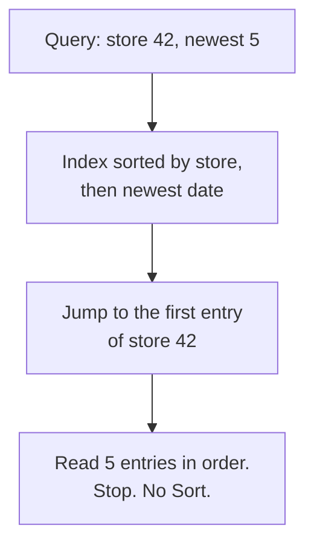
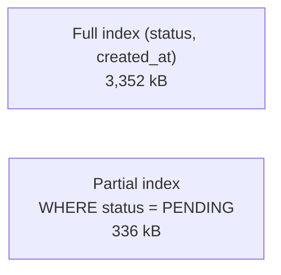

# 10. Composite, partial and covering indexes

> **Subject:** Database · **Lesson:** 10 · **Made:** 2026-10-16 · **Remade in short cards:** 2026-10-28 · **Status:** ready
>
> **You will be able to:** pick the column order for a two-column index, say why it beats two single indexes, build a partial and a covering index, and list six reasons Postgres ignores an index.
>
> **Before this:** [Indexes and B-trees](09-indexes-and-b-trees.md) · **Next:** [Reading EXPLAIN](11-reading-explain.md)
>
> **How to read it:** one card is one idea. Look at the picture, guess, then press the orange bar to check. The blue bars (📖 More detail) hold the longer explanation. Skip them on the first read, and open them when you want more. The big numbers come from the practice database (100,000 orders), so yours will differ a little. About 25 minutes for the cards.

## 1. The idea: a phone book with two sort keys

A phone book is sorted by last name, then by first name. "Find Tan, Budi" is fast: open at the Tans, then find Budi. "Find all the Tans" is fast too. But "find everyone called Budi" is slow, because the Budis are spread across every last name.



Notice: the DBO admin shows "the 5 newest orders of this store". Postgres never sorts anything, because the index is already in the right order.

<details class="guess"><summary>🤔 Guess: an index sorted by (store, date). A query asks only for one date, "every order on 10-03", with no store. Can Postgres jump straight in? Press to check.</summary>

No. The orders of 10-03 are spread across every store, like the Budis. Postgres can only jump with the **first** column. (Card 3 shows why, and the Postgres 18 exception.)

</details>

> **Remember:** equality columns first, then the sort or range column. Postgres jumps with the first column, then reads in order and stops early.

<details class="more"><summary>📖 More detail: words from lesson 09, and the four new words</summary>

Words from lesson 09 that you need here:

- An **index entry** is one line in the index: the sorted value plus a pointer to the row in the table.
- A **Seq Scan** means Postgres reads every row of the table. An **Index Scan** means Postgres uses an index.
- `EXPLAIN` prints the plan Postgres picked. A **Sort** step in the plan means Postgres had to sort rows itself.

New words, at most 4:

- **Composite index:** one index on two or more columns, sorted by the first, then by the second inside it. (Interview words: *multicolumn index*, *compound index*.)
- **Partial index:** an index that holds only some rows, the ones that match a `WHERE` you write when you make it (card 5).
- **Covering index:** an index that holds every column a query needs, so Postgres never opens the table. In Postgres you add the extra columns with `INCLUDE` (card 6).
- **Skip scan:** new in Postgres 18. Postgres jumps once per value of the first column, so it can use the index without that column (card 3).

Where the phone book picture stops: Postgres reads its "book" backward as fast as forward. And Postgres 18 can flip to each last name and look for Budi there. That is skip scan. A person would also do that if the book had only five last names.

</details>

## 2. One composite index instead of two single ones

"The 5 newest orders of store 42." Without the right index Postgres reads all 100,000 orders, keeps 139, sorts them, and keeps 5.

```sql
EXPLAIN (ANALYZE, COSTS OFF,
  TIMING OFF, BUFFERS OFF)
SELECT id, total_cents, created_at
FROM orders
WHERE store_id = 42
ORDER BY created_at DESC
LIMIT 5;

CREATE INDEX orders_store_created_idx
  ON orders (store_id, created_at DESC);

-- run the same EXPLAIN again
```

<details class="guess"><summary>🤔 Guess: after the index, is there still a Sort step in the plan? Press to check.</summary>

Before the index:

```
Limit (actual rows=5.00 loops=1)
  ->  Sort (actual rows=5.00 loops=1)
        Sort Key: created_at DESC
        Sort Method: top-N heapsort  Memory: 17kB
        ->  Seq Scan on orders (actual rows=139.00 loops=1)
              Filter: (store_id = 42)
              Rows Removed by Filter: 99861
```

After the index:

```
Limit (actual rows=5.00 loops=1)
  ->  Index Scan using orders_store_created_idx on orders (actual rows=5.00 loops=1)
        Index Cond: (store_id = 42)
        Index Searches: 1
```

**The Sort step is gone.** `Index Cond` means Postgres used `store_id` to jump.

</details>

> **Remember:** one sorted list can give "store 42, already in date order". Two single indexes cannot.

<details class="more"><summary>📖 More detail: why two single indexes are worse</summary>

With one index on `store_id` and one on `created_at`, Postgres has two bad choices. It can walk the date index newest first, and open the table for each entry to see the store. It threw away **3,787** rows of other stores before it found 5 of store 42:

```sql
CREATE INDEX ON orders (store_id);
CREATE INDEX ON orders (created_at);
-- WHERE store_id = 42
--   ORDER BY created_at DESC LIMIT 5
-- plan: Index Scan Backward using
--         orders_created_at_idx
--   Filter: (store_id = 42)
--   Rows Removed by Filter: 3787
```

The same work on the 100,000-row seed, counted in 8 kB pages:

| Plan | Pages Postgres touched |
|---|---|
| No index: Seq Scan, then Sort | 837 |
| Two single indexes: walk dates, throw away 3,787 rows | 3,800 |
| One composite index | 8 |

Checked on 2026-10-16 with PostgreSQL 18.3 (PGlite). On a Docker Postgres 16 you see `rows=5` without decimals and no `Index Searches` line. The seed uses random data, so your row counts will be a bit different.

</details>

## 3. The leftmost column rule

Here is the whole index for 13 small orders. Inside each store the dates are newest first. Dates of different stores are **not** next to each other.

| Store | Dates in the index, newest first |
|---|---|
| 7 | 10-12, 10-11, 10-09, 10-07, 10-05, 10-03, 10-01 |
| 8 | 10-10, 10-06, 10-03 |
| 9 | 10-08, 10-04, 10-01 |

<details class="guess"><summary>🤔 Guess: where do you jump to find "every order on 10-03"? Press to check.</summary>

There is **no single place to jump to**. One 10-03 is in store 7 and one is in store 8. That is the leftmost column rule: a query must give a value for the first column to jump.

| The query gives | Result |
|---|---|
| `store_id` | Fast Index Scan (jump). |
| only `created_at`, Postgres 16 or 17 | Reads the whole index or the whole table. |
| only `created_at`, Postgres 18, few stores | **Skip scan**: one jump per store. |
| only `created_at`, Postgres 18, many stores | Still a Seq Scan. |

</details>

> **Remember:** an index on (a, b) can jump with `a`. It cannot jump with only `b` (except Postgres 18 skip scan, when `a` has few values).

<details class="more"><summary>📖 More detail: skip scan, with real numbers</summary>

Postgres 18 added B-tree skip scan. Your Docker playground runs 16, so a query on only the second column will most likely show a Seq Scan there. The [Postgres 16 docs](https://www.postgresql.org/docs/16/indexes-multicolumn.html) say the whole index would have to be read, "so in most cases the planner would prefer a sequential table scan".

On the seed (18.3), an index on `(status, created_at)` with a query on `created_at` only gave `Index Searches: 6`: 5 statuses plus one. The same query with the index `(store_id, created_at)` and 900 stores gave a Seq Scan, because skip scan would need about 900 jumps.

</details>

## 4. Mistake 1: the range column first

You want "store 42, the last 90 days". Which order do you give the index?

```sql
-- A: the date first
CREATE INDEX ON orders
  (created_at, store_id);

-- B: the store first
CREATE INDEX ON orders
  (store_id, created_at);
```

<details class="guess"><summary>🤔 Guess: which order reads fewer index pages? Press to check.</summary>

**B**, the store first. On the seed, A read **101** index pages and B read **3**.

With the date first, Postgres reads every store's orders in the date range and skips the wrong stores one by one. With the store first, it jumps to store 42, then reads only the dates it needs.

</details>

> **Remember:** put columns you test with `=` first. Put the sort or range column (`>=`, `BETWEEN`, `ORDER BY`) last.

<details class="more"><summary>📖 More detail: "most selective column first" is not the rule</summary>

People say "put the most selective column first". The order that really matters is equality first, range or sort last. A range on the first column stops Postgres from using the second column to narrow the search.

`DESC` is not required in the index. A plain `(store_id, created_at)` index also works for `ORDER BY created_at DESC`, and the plan says `Index Scan Backward`. You need `DESC` in the index only when the directions are mixed, for example `ORDER BY a ASC, b DESC`.

</details>

## 5. A partial index: only the rows you search

A worker asks every few seconds for the oldest PENDING orders. A full index also stores every PAID and DELIVERED order, which this query never needs.



```sql
CREATE INDEX orders_pending_idx
  ON orders (created_at)
  WHERE status = 'PENDING';
```

<details class="guess"><summary>🤔 Guess: can a query for PAID orders use this index? Press to check.</summary>

No. Postgres uses a partial index only when the query repeats the same condition (`status = 'PENDING'`). A query for PAID cannot use it. The gain: only about 14 percent of rows, so **336 kB** instead of **3,352 kB**.

</details>

> **Remember:** a partial index is small, but only for queries that repeat its `WHERE`.

<details class="more"><summary>📖 More detail: partial indexes and Prisma</summary>

Prisma sends values as parameters (`status = $1`). Postgres usually plans with the real value, and then it uses the partial index. If it switches to one shared plan for every value (a *generic plan*), it cannot use the partial index. With `plan_cache_mode = force_generic_plan` the seed showed `Seq Scan` plus `Sort` instead. The [partial index docs](https://www.postgresql.org/docs/current/indexes-partial.html) explain why.

</details>

## 6. A covering index: skip the table

Sometimes the index finds the row, but the query wants one more column. So Postgres visits the table for every row. `INCLUDE` stores the extra value in the index.

```sql
CREATE INDEX l10_cover_idx
  ON l10_cover (store_id)
  INCLUDE (total_cents);

SELECT store_id, total_cents
FROM l10_cover
WHERE store_id = 42;
```

<details class="guess"><summary>🤔 Guess: right after inserting 100,000 rows, does Postgres do an Index Only Scan? Press to check.</summary>

Not yet. A small check on 100,000 generated rows (PostgreSQL 17.5, PGlite) picked a `Bitmap Heap Scan`, because the table pages were not yet marked clean. After `VACUUM l10_cover`:

```
Index Only Scan using l10_cover_idx on l10_cover (actual rows=112 loops=1)
  Index Cond: (store_id = 42)
  Heap Fetches: 0
```

`Index Only Scan` with `Heap Fetches: 0`: no trips to the table. (A heap fetch is a trip to the table.)

</details>

> **Remember:** `INCLUDE (col)` lets Postgres answer from the index alone. It works only for pages that `VACUUM` has marked as clean.

<details class="more"><summary>📖 More detail: the cost, and the numbers on the seed</summary>

- **Cost:** a bigger index. And Postgres can skip the table only for pages that `VACUUM` has marked as clean. On the seed, right after the inserts the plan printed `Heap Fetches: 5`. After `VACUUM orders` it printed `Heap Fetches: 0`.
- **Setup for this card:** a table with `id`, `store_id`, `total_cents` and `created_at`, and 100,000 rows from `generate_series`.

The official page is [Index-Only Scans and Covering Indexes](https://www.postgresql.org/docs/current/indexes-index-only-scans.html).

</details>

## 7. When Postgres does not use your index

You made a fitting index, and the plan still says `Seq Scan`. The index stores the **plain column value**. If your query changes the value first, Postgres cannot look it up.

```sql
SELECT * FROM orders
WHERE date_trunc('day', created_at)
  = '2026-10-01';
```

<details class="guess"><summary>🤔 Guess: there is an index on `created_at`. Does this query use it? Press to check.</summary>

No: `Seq Scan`, 99,683 rows removed. Ask for a range instead: `created_at >= '2026-10-01' AND created_at < '2026-10-02'`. The plan became `Index Only Scan`.

</details>

> **Remember:** do not wrap the indexed column in a function or a cast. Compare the plain column.

<details class="more"><summary>📖 More detail: seven reasons, each from a real run on the seed</summary>

| Reason | Example | What Postgres printed | Fix |
|---|---|---|---|
| A function on the column | `WHERE date_trunc('day', created_at) = '2026-10-01'` | `Seq Scan`, 99,683 rows removed | Ask for a range: `created_at >= '2026-10-01' AND created_at < '2026-10-02'`. Plan became `Index Only Scan`. |
| A function you really need | `WHERE lower(name) = 'store 42'` | `Seq Scan` on stores | Index the same expression: `CREATE INDEX ON stores (lower(name))`. Plan became `Index Scan`. (Interview word: *expression index*.) |
| A type cast on the column | `WHERE id::text = '4242'` | `Seq Scan`, 99,999 rows removed | Compare with the right type: `WHERE id = 4242`. |
| `LIKE` that starts with `%` | `WHERE name LIKE '%42'` | `Seq Scan` | A sorted list has no place to start for "ends with 42". Use a trigram index (`pg_trgm`) if you need it. |
| Most rows match | `WHERE status IN ('PAID','SHIPPED','DELIVERED')`, 72% of rows | `Seq Scan` | Nothing to fix. Reading the table in one pass is cheaper. |
| A tiny table | `jobs` has 50 rows on 1 page. `WHERE id = 7` | `Seq Scan`, even with the primary key | Nothing to fix. One page is faster than an index. |
| Old statistics | 50,000 PENDING rows, then 49,990 changed to DONE, no `ANALYZE` yet | Guessed 99,815 rows, real 10, chose `Seq Scan` | Run `ANALYZE l10_tasks`. Then it guessed 10 and chose `Index Scan`. |

The rule behind the first three: the index stores the **plain column value**. If your query changes the value first, Postgres cannot look it up. Statistics are Postgres's notes about how many rows have each value. Lesson 11 covers them.

</details>

## 8. Watch it run, step by step

The stepper has five programs: "Both columns", "Two single indexes", "Only the second column" (with skip scan), "Partial index" and "Covering index". Each one asks you to predict a number first. Watch the counters for jumps, entries read and table visits.

**Step through it yourself:** [open the stepper](visuals/10-composite-partial-and-covering-indexes.html).

<details class="more"><summary>📖 More detail: the "store 7, newest 5" query, one entry at a time</summary>

The stepper's first program uses 13 small orders and the index `(store_id, created_at DESC)`.

```sql
SELECT id, created_at, total_cents FROM l10_orders
WHERE store_id = 7 ORDER BY created_at DESC LIMIT 5;
```

| Step | What Postgres does | Where the reader is | Rows sent | Table visits |
|---|---|---|---|---|
| 1 | The planner sees `store_id = 7`. The index starts with store_id, so it can jump. Inside a store the dates are newest first, which matches `ORDER BY`. No Sort needed. | not started | none | 0 |
| 2 | It walks down the index tree to the first entry of store 7. | store 7, 10-12 | none | 0 |
| 3 | It follows the pointer to row 13 to get `total_cents`. It sends the row. | store 7, 10-12 | 13 | 1 |
| 4 | Next entry. Same thing. | store 7, 10-11 | 13, 12 | 2 |
| 5 | Next entry. | store 7, 10-09 | 13, 12, 10 | 3 |
| 6 | Next entry. | store 7, 10-07 | 13, 12, 10, 8 | 4 |
| 7 | Next entry. That is 5 rows. | store 7, 10-05 | 13, 12, 10, 8, 6 | 5 |
| 8 | `LIMIT 5` is reached, so it stops. Two older store 7 entries and all of stores 8 and 9 are never read. | stopped | 5 rows | 5 |

Real result: rows 13, 12, 10, 8, 6.

</details>

## 9. Why it matters and what it costs

- **Composite index.** Without it, a query that filters on one column and sorts by another forces a Sort or wasted reads. With it, one sorted list: Postgres jumps with the first column and reads the second in order. Column order: equality first, range or sort last.
- **Partial index.** Without it, a full index stores rows the query never needs. With it, only the hot rows. The cost: Postgres uses it only when the query repeats the same condition.
- **Covering index.** Without it, Postgres visits the table for every row. With `INCLUDE`, it can skip the table. The cost: a bigger index, and it works only for pages `VACUUM` has marked clean.
- **Every index costs writes.** Each `INSERT`, and each `UPDATE` of an indexed column, must also change every index on the table. A wide index (many columns, big `INCLUDE`) uses more disk and memory. Index the queries you really run, not every column.

## 10. Watch and play

Links checked on 2026-10-16: each page was opened. For the videos, the title and channel were confirmed through YouTube. The video lengths were not checked.

- **Video:** [5mins of Postgres E48: Benchmarking multi column, covering and hash indexes in Postgres](https://www.youtube.com/watch?v=sY2auWXW0Fw) by pganalyze. A short episode that compares one composite index with several single ones.
- **Video:** [Composite Indexes & Index Prefixes](https://www.youtube.com/watch?v=Kgv8mkZsmVI) by CockroachDB. The leftmost column rule, shown on a composite index.
- **Play with it:** [The stepper](visuals/10-composite-partial-and-covering-indexes.html) in this folder. Predict the number first, then step.
- **Play with it:** [explain.dalibo.com](https://explain.dalibo.com/). Paste the two plans from card 2 and compare the drawings.
- **Read:** [Concatenated Indexes](https://use-the-index-luke.com/sql/where-clause/the-equals-operator/concatenated-keys) on Use The Index, Luke. The phone book analogy, with a drawing of the index.
- **Read:** [Multicolumn Indexes, PostgreSQL 18 docs](https://www.postgresql.org/docs/18/indexes-multicolumn.html). Read the skip scan paragraph with the `(x, y)` example.
- **Read:** [Index-Only Scans and Covering Indexes](https://www.postgresql.org/docs/current/indexes-index-only-scans.html). The `INCLUDE` example and why the visibility map matters.

<details><summary>More links (optional)</summary>

- [Partial indexes](https://use-the-index-luke.com/sql/where-clause/partial-and-filtered-indexes) on Use The Index, Luke: the "unprocessed messages" example.
- [Case-insensitive search](https://use-the-index-luke.com/sql/where-clause/functions/case-insensitive-search) on Use The Index, Luke: why `UPPER` or `LOWER` hides the index.
- [Tuning SQL LIKE using indexes](https://use-the-index-luke.com/sql/where-clause/searching-for-ranges/like-performance-tuning) on Use The Index, Luke.
- [Index-Only Scan: Avoiding Table Access](https://use-the-index-luke.com/sql/clustering/index-only-scan-covering-index) on Use The Index, Luke.
- [Indexes on expressions](https://www.postgresql.org/docs/current/indexes-expressional.html), PostgreSQL docs, with the `lower(col1)` example.
- [pg_trgm](https://www.postgresql.org/docs/current/pgtrgm.html), PostgreSQL docs: indexes that help `LIKE '%foo%'`.
- [Postgres 18: Skip Scan, Breaking Free from the Left-Most Index Limitation](https://www.pgedge.com/blog/postgres-18-skip-scan-breaking-free-from-the-left-most-index-limitation), pgEdge blog, 2025-11-18.
- [Skip scan](https://postgres.fm/episodes/skip-scan), Postgres FM podcast with Peter Geoghegan, who built it. 58 minutes.
- [Database Indexing Explained (with PostgreSQL)](https://www.youtube.com/watch?v=-qNSXK7s7_w) by Hussein Nasser. Longer, about indexes in general.

</details>

## 11. Practice

**A. Predict the output** (write your answer before opening)

The table has only the index `(store_id, created_at)`. There are 900 different stores. Postgres 18. Which plan do you expect?

```sql
SELECT id FROM orders WHERE created_at >= now() - interval '1 day';
```

<details><summary>Answer</summary>

```
Seq Scan on orders (actual rows=273.00 loops=1)
  Filter: (created_at >= (now() - '1 day'::interval))
  Rows Removed by Filter: 99727
```

The query does not give `store_id`, the first column. Skip scan would need about 900 jumps, so Postgres reads the table. With an index on `(status, created_at)` instead (only 5 statuses), the same query gave a `Bitmap Index Scan` with `Index Searches: 6`. That is skip scan.

</details>

**B. Fix the bug**

The worker query is slow, even though someone added a partial index.

```sql
CREATE INDEX orders_pending_idx ON orders (created_at) WHERE status = 'PENDING';

SELECT id FROM orders
WHERE status <> 'PAID'
ORDER BY created_at LIMIT 10;
```

<details><summary>Answer</summary>

The query asks for "not PAID". That also includes SHIPPED, DELIVERED and CANCELLED, which are not in the index. Postgres can use a partial index only when the query's `WHERE` proves every needed row is inside it. The fix is to ask for what you mean:

```sql
SELECT id FROM orders
WHERE status = 'PENDING'
ORDER BY created_at LIMIT 10;
-- Limit -> Index Scan using orders_pending_idx, no Sort
```

</details>

**C. Write it yourself**

Open [practice/10-composite-partial-and-covering-indexes.sql](practice/10-composite-partial-and-covering-indexes.sql). It makes two tiny tables and has five tasks:

1. Pick the column order for "store 7, from 10-05, in date order".
2. Make a partial index for the two oldest PENDING orders.
3. Make an index-only scan with `Heap Fetches: 0`.
4. Find why three queries ignore their index, and fix two of them.
5. See why Postgres skips a good index on a tiny table.

Every task has the exact expected result in a comment.

<details><summary>One possible answer</summary>

```sql
-- Task 1: equality column first, then the range and sort column
CREATE INDEX l10_task1_idx ON l10_orders (store_id, created_at);

-- Task 2
CREATE INDEX l10_task2_idx ON l10_orders (created_at) WHERE status = 'PENDING';

-- Task 3 (plain created_at instead of created_at DESC also works, read backward)
CREATE INDEX l10_task3_idx ON l10_orders (store_id, created_at DESC) INCLUDE (total_cents);
VACUUM l10_orders;

-- Task 4a: index the same expression the query uses
CREATE INDEX l10_task4_idx ON l10_stores (lower(name));

-- Task 4b: compare the column with a date, do not change the column
SELECT id, store_id FROM l10_orders WHERE created_at = DATE '2026-10-03' ORDER BY id;

-- Task 4c: the index is sorted from the first letter. "Ends with Kita"
-- has no first letters, so there is no place to jump to. Postgres reads everything.

-- Task 5: the table has 5 rows on one page. Reading that one page
-- is cheaper than reading the index and then the table.
```

</details>

## 12. Interview question

**Q:** "This query is slow: `WHERE store_id = ? ORDER BY created_at DESC LIMIT 20`. There is an index on `store_id` and another on `created_at`. Is that enough? What would you do?"

<details><summary>A strong answer, in four parts</summary>

1. **Problem:** two single indexes cannot serve a filter plus a sort together. Postgres either finds the store's rows and sorts them, or walks the date index and throws away other stores' rows. On 100,000 orders the second plan threw away 3,787 rows to keep 5.
2. **How it works:** I would add one composite index on `(store_id, created_at DESC)`. It is sorted by store, then by date inside each store, like a phone book. Postgres jumps to the store, reads 20 entries in order and stops. No Sort. I check with `EXPLAIN ANALYZE` that the Sort step is gone and the plan says `Index Cond: (store_id = ...)`. Column order rule: equality columns first, sort or range column last. The leftmost column rule says a query without `store_id` cannot jump in. Postgres 18 softens that with skip scan, but only when the first column has few values.
3. **Tradeoff:** every index slows writes and uses disk. I would drop the single `store_id` index, since the composite one also serves `WHERE store_id = ?` alone. If the screen also needs `total_cents`, `INCLUDE (total_cents)` gives an Index Only Scan, at the price of a bigger index.
4. **My example:** *This is an idea, not a fact. Replace it with your own story.* DBO has an admin CMS and a mobile app for stores. A "latest orders of this store" list is exactly this query shape. In Prisma, you would add `@@index([storeId, createdAt(sort: Desc)])` to the model. This same shape was question 4 of your mock interview on 2026-07-07: `ORDER BY tenor DESC, plafon DESC LIMIT 1` with two single indexes. The answer is one composite index, not "add DESC".

</details>

## 13. Explain it back

Close this file. Press the **Record my explanation** button under this heading and explain composite indexes out loud, like to a new junior, in 4 parts: problem, how it works, tradeoff, my example. Use the phone book and the words "jump" and "stop early". Then save the transcript into `my-learning/recordings/`, or write your best version below. Run `/explain-check composite indexes` or ask the `explain-coach` agent to review it.

### My explanation

<write here>

### Coach feedback

<the explain-coach agent writes here>

## 14. Review questions (day 1, 3, 7, 21)

1. Why can an index on `(store_id, created_at)` serve `WHERE store_id = 42 ORDER BY created_at DESC LIMIT 5` with no Sort, when two single indexes cannot?
2. What is the leftmost column rule, and what did Postgres 18 change about it?
3. Name three reasons Postgres ignores an index that exists on the right column.
4. Draw the entries table from card 3 from memory: the sorted entries of three stores, and where "all orders on 10-03" sit.

<details><summary>Answers</summary>

1. The composite index is sorted by store, then by date inside each store. Postgres jumps to store 42 and the dates are already in order, so it reads 5 entries and stops. A single store index gives the rows unsorted, so Postgres must sort them. A single date index does not know the store, so Postgres must check rows and throw many away.
2. Postgres can jump into a composite index only with a value for its first column. Without it, the matching entries are spread everywhere. Postgres 18 added skip scan: if the first column has few different values, Postgres jumps once per value. With many values it still reads the table.
3. Any three of: a function on the column (`lower(name)`, `date_trunc`), a type cast (`id::text`), `LIKE '%x'`, most rows match, the table is tiny, old statistics.
4. Store 7: 10-12, 10-11, 10-09, 10-07, 10-05, 10-03, 10-01. Store 8: 10-10, 10-06, 10-03. Store 9: 10-08, 10-04, 10-01. The two 10-03 entries are in different stores, far apart.

</details>

## 15. Go deeper (optional)

Open these when you are ready. None of them is needed for the cards above.

<details><summary>Postgres 16 against 18</summary>

**Version differences you will see** (checked in the [PostgreSQL 18 release notes](https://www.postgresql.org/docs/release/18.0/), released 2025-09-25):

- Postgres 18 added B-tree skip scan. Your Docker playground runs 16, so a query on only the second column will most likely show a Seq Scan there. The [Postgres 16 docs](https://www.postgresql.org/docs/16/indexes-multicolumn.html) say the whole index would have to be read, "so in most cases the planner would prefer a sequential table scan".
- Postgres 18 prints `rows=5.00` with decimals, an `Index Searches` line, and `Disabled: true` under a step you switched off with `SET enable_seqscan = off`. `EXPLAIN ANALYZE` also shows buffers by default on 18. Postgres 16 shows none of these.
- On the seed (18.3), an index on `(status, created_at)` with a query on `created_at` only gave `Index Searches: 6`: 5 statuses plus one. The same query with the index `(store_id, created_at)` and 900 stores gave a Seq Scan.

</details>

<details><summary>LIKE 'abc%' in your Docker database</summary>

`WHERE name LIKE 'Store 42%'` (no leading `%`) can use a normal B-tree index, but only when the database uses the "C" collation. The PGlite check database uses "C". The `postgres:16` Docker image uses `en_US.utf8` by default. There you need a special index: `CREATE INDEX ON stores (name text_pattern_ops)`. See [operator classes](https://www.postgresql.org/docs/16/indexes-opclass.html) in the docs.

</details>

## Connected lessons

- [Indexes and B-trees](09-indexes-and-b-trees.md): the previous lesson. How one index finds a row, and the tree that a "jump" walks down.
- [Reading EXPLAIN](11-reading-explain.md): the next lesson. How to read `Index Cond`, `Filter`, `Rows Removed by Filter` and `Heap Fetches`, and why old statistics give bad guesses.
- [N+1 queries and ORMs](12-n-plus-1-queries-and-orms.md): each of those many small queries needs an index like the ones here.
- [PostgreSQL queries interview guide](postgresql-queries-interview-guide.md): the "burn topic" section has the `tenor, plafon` story in full.
- MVCC and VACUUM (lesson 16, not written yet): why an Index Only Scan needs `VACUUM` to mark pages as clean.
- Pagination (lesson 17, not written yet): keyset pagination needs exactly this kind of composite index.
- Upsert, idempotency and job queues (lesson 18, not written yet): the PENDING worker query is where a partial index shines.
