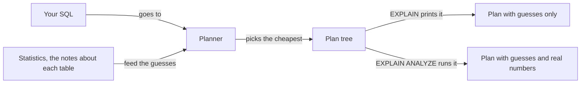
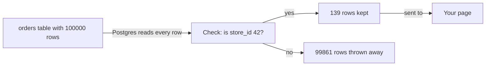
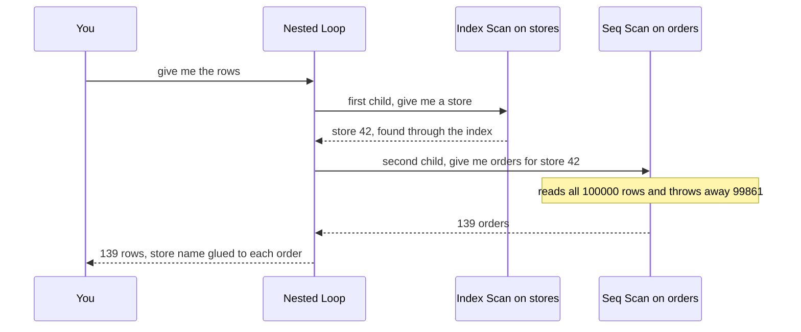
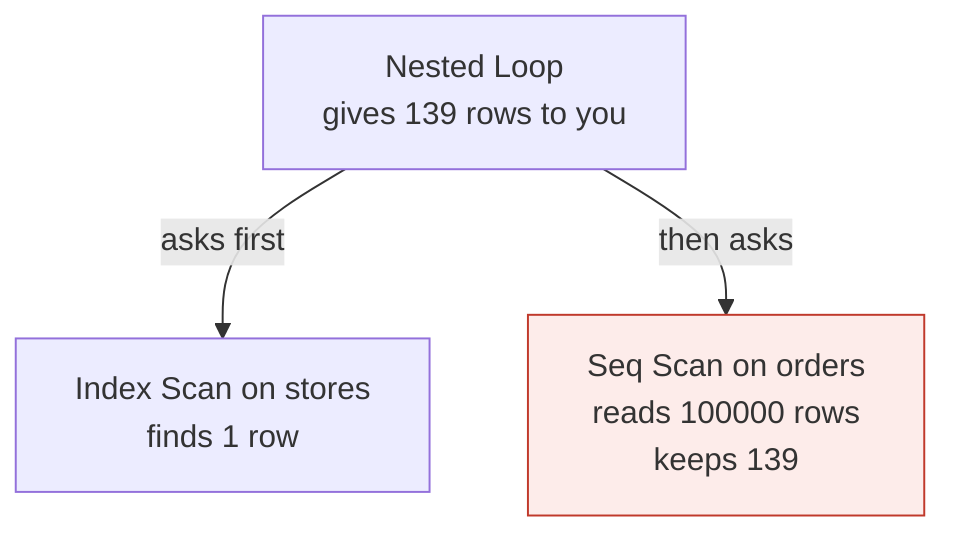
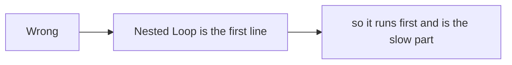
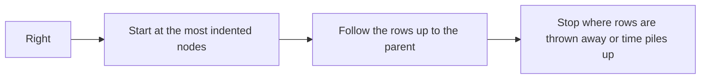
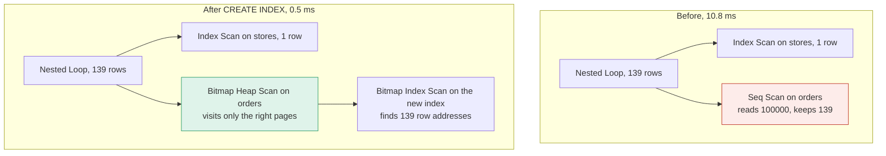
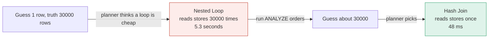
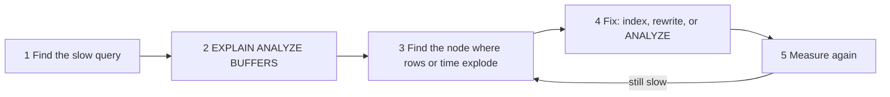

# 11. Reading EXPLAIN

> **Subject:** Database · **Lesson:** 11 · **Made:** 2026-10-16 · **Status:** ready
> **You will be able to:** read a query plan from the inside out, point at the slow step, compare guessed rows with real rows, and say a 5 step "slow query" plan in an interview.
> **Before this:** [Composite, partial and covering indexes](10-composite-partial-and-covering-indexes.md) · **Next:** [N+1 queries and ORMs](12-n-plus-1-queries-and-orms.md)

## 1. The idea in one sentence

`EXPLAIN` shows the recipe Postgres picked for your query, and `EXPLAIN ANALYZE` also cooks it and writes down what really happened.

New words:

- **Plan:** the recipe Postgres picks to answer your query. The part of Postgres that picks it is the **planner**. (Interview word: *query plan* or *execution plan*.)
- **Node:** one step of the plan, like "read the whole orders table". The top line is a node, and so is every line that starts with `->`. Nodes sit in a tree.
- **Estimate:** how many rows the planner **guesses** a node will give, before anything runs. `EXPLAIN ANALYZE` puts the **actual** count next to it.
- **Statistics:** short notes Postgres keeps about each table: about how many rows, and which values are common. The planner makes its guesses from them. The command `ANALYZE orders` refreshes them. (Interview word: *planner statistics*.)

Careful: `EXPLAIN ANALYZE` (run the query and measure) and `ANALYZE orders` (refresh the notes) share a word. They are two different commands.

The rule to remember: **read the plan from the inside out. Find the node where rows are thrown away or time piles up. Then compare the guess with the truth.**

## 2. The pictures

The node names are explained in plain words in the table in section 4. For now: a **Seq Scan** reads every row of a table. An **Index Scan** uses an index. A **Nested Loop** and a **Hash Join** are two ways to join two tables.

### 2a. The big picture

Notice that the planner only uses its notes. It does not look at the real rows before it picks.



### 2b. The problem, drawn

This SQL looks innocent: "the orders of store 42". Notice what Postgres really does without an index on `orders.store_id`. You cannot see this from the SQL. Only the plan shows it.



### 2c. How it works over time

This is the plan from section 4, running. The top node asks its children for rows. Rows start at the deepest nodes and flow up. Notice that the Seq Scan does almost all the work.



### 2d. What is on the screen right now: the plan as a tree

Postgres prints a plan as indented text. The same plan as a tree is below. Notice: the **most indented** lines are the **bottom** of the tree. They run first. Each box shows the real row count.

```text
Nested Loop                                          <- runs last, gives you the rows
  ->  Index Scan using stores_pkey on stores s       <- child 1
  ->  Seq Scan on orders o                           <- child 2, the slow one
        Filter: (store_id = 42)
        Rows Removed by Filter: 99861
```



### 2e. Right against wrong

**Wrong way to read a plan:** top to bottom, like a book.



**Right way:** inside out. The deepest node runs first. Its rows flow up to its parent.



### 2f. Before and after the fix

One index changes the tree. Notice that the red box is gone. Postgres now touches 133 pages instead of 837. A page is a block of 8 kB of the table or the index.



### 2g. A wrong guess picks a bad recipe

The planner's notes said "no order is REFUNDED". Then 30,000 orders became REFUNDED. Notice how one bad guess changes the whole plan.



## 3. Real life analogy

A map app plans your drive before you leave. It shows the route and a guessed time. That is `EXPLAIN`. Then you drive with a dashcam that writes the real time on every road. That is `EXPLAIN ANALYZE`. The app guesses traffic from old notes. If the notes are old, it picks a bad road. That is a stale estimate, fixed by `ANALYZE`.

Where the analogy stops:

- A route is a line. A plan is a tree. Two branches feed one join.
- A dashcam does not change the trip. `EXPLAIN ANALYZE` **really runs** the query. On a `DELETE`, the rows are really deleted (section 7).

## 4. The smallest code that shows it

The query: the orders of store 42, with the store name. The seed has no index on `orders.store_id` yet.

```sql
EXPLAIN
SELECT s.name, o.id, o.total_cents
FROM stores s JOIN orders o ON o.store_id = s.id
WHERE s.id = 42;
```

**Output: the plan on paper** (nothing ran)

```text
Nested Loop  (cost=0.28..2093.39 rows=110 width=25)
  ->  Index Scan using stores_pkey on stores s  (cost=0.28..8.29 rows=1 width=13)
        Index Cond: (id = 42)
  ->  Seq Scan on orders o  (cost=0.00..2084.00 rows=110 width=20)
        Filter: (store_id = 42)
```

Now the same query with `EXPLAIN (ANALYZE, BUFFERS)`. Postgres runs it and measures.

```text
Nested Loop  (cost=0.28..2093.39 rows=110 width=25) (actual time=0.806..10.520 rows=139.00 loops=1)
  Buffers: shared hit=835 read=2
  ->  Index Scan using stores_pkey on stores s  (cost=0.28..8.29 rows=1 width=13) (actual time=0.169..0.172 rows=1.00 loops=1)
        Index Cond: (id = 42)
        Index Searches: 1
        Buffers: shared hit=1 read=2
  ->  Seq Scan on orders o  (cost=0.00..2084.00 rows=110 width=20) (actual time=0.260..9.795 rows=139.00 loops=1)
        Filter: (store_id = 42)
        Rows Removed by Filter: 99861
        Buffers: shared hit=834
Planning Time: 0.162 ms
Execution Time: 10.788 ms
```

Your numbers will be a bit different. The seed uses random data, so store 42 may have 100 to 150 orders.

**How to read one line.** Take the Seq Scan line apart:

| Part | Plain meaning |
|---|---|
| `Seq Scan on orders o` | The node: read the whole table, row by row. |
| `cost=0.00..2084.00` | The planner's price: to the first row, and to the last row. Made-up units. Use them to compare two plans. They are **not** milliseconds. |
| `rows=110` (first brackets) | The **estimate**: the planner guessed 110 rows. |
| `actual time=0.260..9.795` | Real milliseconds: when the first row came out, and when the last one did. It **includes** the time of the children. |
| `rows=139.00` (second brackets) | The **actual** rows. Guess 110, truth 139: close enough. |
| `loops=1` | How many times this node ran. Actual rows and time are **per loop**. |
| `Rows Removed by Filter: 99861` | Rows Postgres read, checked and threw away. **The big clue for a missing index.** |
| `Buffers: shared hit=834` | Postgres touched 834 pages of 8 kB. `hit` means it found them in memory. `read` means it had to fetch them. |

**The nodes you will meet** (all from real runs on the practice data):

| Node | Plain words | You see it when |
|---|---|---|
| Seq Scan | Read the whole table, every row. | No useful index, or the query needs a big part of the table anyway. |
| Index Scan | Look in the index, then jump to each matching row. | Few rows match, or the order of the index helps (`ORDER BY created_at DESC LIMIT 5`). |
| Index Only Scan | Answer from the index alone. Postgres skips the table. | All the needed columns are in the index (lesson 10). `count(*) WHERE store_id = 42` did this after `VACUUM`. |
| Bitmap Index Scan + Bitmap Heap Scan | First collect all matching row addresses from the index. Then visit each table page once. | A middle number of rows, spread over many pages. |
| Nested Loop | For each row from child 1, run child 2. | Child 1 gives few rows. |
| Hash Join + Hash | Put the smaller side into a lookup table in memory (the Hash). Then stream the bigger side past it. | Two big-ish inputs joined on `=`. |
| Sort | Put all rows in order. It must read **all** its input before it gives the first row. | `ORDER BY` with no index that already has that order. |
| Limit | Stop after N rows. It tells its child to stop too. | `LIMIT`. Fast only if the child can give rows already in order. |

Checked on 2026-10-16 with PostgreSQL 18.3 (PGlite) on the practice seed. See "Go deeper" in section 5 for what Postgres 16 prints.

## 5. What really happens, step by step

Read the plan from section 4 from the inside out. Then fix it and read it again.

| Step | Node or action | What Postgres does | Rows in → out | Work |
|---|---|---|---|---|
| 1 | Planner | Reads its notes. Guesses 1 store and 110 orders. Picks Nested Loop. | | 0.16 ms planning |
| 2 | Index Scan on stores (child 1) | Walks the `stores_pkey` index to id 42. Jumps to that one row. | 1 → 1 | 3 pages |
| 3 | Nested Loop | Got 1 store. Now it asks child 2 for that store's orders. This happens once, so `loops=1`. | | |
| 4 | Seq Scan on orders (child 2) | No index on `store_id`. Reads all 100,000 rows. Checks `store_id = 42` on each. | 100,000 → 139 | 834 pages, 9.8 ms |
| 5 | Seq Scan, the clue | `Rows Removed by Filter: 99861`. It threw away 99.9% of what it read. | | |
| 6 | Nested Loop | Glues the store name to each of the 139 orders. Sends them to you. | 139 → 139 | 10.5 ms total |
| 7 | **You find the hot node** | Seq Scan took 9.8 of 10.5 ms and removed 99,861 rows. Guess 110 against actual 139 is fine. So the notes are fine, and an index is missing. | | |
| 8 | Fix | `CREATE INDEX orders_store_id_idx ON orders (store_id);` | | |
| 9 | Bitmap Index Scan (deepest) | Looks up 42 in the new index. Collects 139 row addresses. | → 139 addresses | 3 pages |
| 10 | Bitmap Heap Scan | Visits only the 127 table pages that hold those rows. No rows thrown away. | 139 → 139 | 130 pages |
| 11 | Nested Loop | Same gluing as before. | 139 → 139 | 0.5 ms total |
| 12 | **Measure again** | 10.8 ms became 0.5 ms. Pages went from 837 to 133. Same 139 rows. | | |

**Step through it yourself:** [open the EXPLAIN stepper](visuals/11-reading-explain.html). It has six real plans: "Seq scan with a filter", "Same join, with an index", "Latest 5, no index", "Latest 5, index and limit", "Hash join", and "Wrong guess". Press Next and watch the rows climb up the tree. The red box is the node to fix. Guess the hot node first.

### 5b. When the guess is wrong

Estimated rows against actual rows tells you if the planner's notes are old. A small gap is normal. A gap of 10 times or more is a warning.

To see it, change 30,000 orders to a status the notes have never seen:

```sql
UPDATE orders SET status = 'REFUNDED' WHERE id <= 30000;
EXPLAIN (ANALYZE, BUFFERS)
SELECT s.name, o.total_cents
FROM orders o JOIN stores s ON s.id = o.store_id
WHERE o.status = 'REFUNDED';
```

Before `ANALYZE` (shortened):

```text
Nested Loop  (cost=0.00..2740.20 rows=1 width=17) (actual time=19.685..5297.487 rows=30000.00 loops=1)
  Join Filter: (s.id = o.store_id)
  Rows Removed by Join Filter: 13549728
  ->  Seq Scan on orders o  (cost=0.00..2708.70 rows=1 width=12) (actual time=18.042..35.131 rows=30000.00 loops=1)
        Filter: (status = 'REFUNDED'::text)
  ->  Seq Scan on stores s  (cost=0.00..19.00 rows=1000 width=13) (actual time=0.002..0.092 rows=452.66 loops=30000)
Execution Time: 5303.137 ms
```

After `ANALYZE orders;` (shortened):

```text
Hash Join  (cost=31.50..2444.53 rows=29980 width=17) (actual time=14.608..42.550 rows=30000.00 loops=1)
  Hash Cond: (o.store_id = s.id)
  ->  Seq Scan on orders o  (cost=0.00..2334.00 rows=29980 width=12) (actual time=12.984..23.157 rows=30000.00 loops=1)
  ->  Hash  (cost=19.00..19.00 rows=1000 width=13) (actual time=1.582..1.584 rows=1000.00 loops=1)
        ->  Seq Scan on stores s  (cost=0.00..19.00 rows=1000 width=13) (actual time=0.040..0.620 rows=1000.00 loops=1)
Execution Time: 47.882 ms
```

| Step | What happens |
|---|---|
| 1 | The notes were made before the update. They say no order is REFUNDED. |
| 2 | The planner guesses `rows=1`. For 1 row, a Nested Loop over stores looks cheap. |
| 3 | The truth is 30,000 rows. So the inner Seq Scan on stores runs `loops=30000` times. |
| 4 | `ANALYZE orders` refreshes the notes. The guess becomes 29,980. |
| 5 | Now the planner picks a Hash Join. It reads stores **once**. 5,303 ms becomes 48 ms. |

Postgres has a helper (*autovacuum*) that runs `ANALYZE` for you after many changes. It can lag behind a big import or a migration. After a bulk change, run `ANALYZE` yourself.

<details><summary>Go deeper (optional): Postgres 16 against 18, and other details</summary>

**What you will see on Postgres 16** (the Docker playground). These came from the PostgreSQL 18 release notes:

- **Buffers.** Postgres 18 adds the `Buffers:` lines to `EXPLAIN ANALYZE` by itself. On 16 you must write `EXPLAIN (ANALYZE, BUFFERS)`. Always write it. Then both versions show the same thing.
- **Decimals.** Postgres 18 prints `rows=139.00`. Postgres 16 prints `rows=139`. In the wrong guess plan, 18 prints `rows=452.66 loops=30000` and 16 prints `rows=453 loops=30000`. The number is an average per loop, so 16 rounds it.
- **Index Searches.** Postgres 18 adds a line `Index Searches: 1` under index nodes. Postgres 16 does not have it.
- Times on your laptop will differ. The shapes and the row counts are what matter.

**Why `rows=452.66`?** `stores.id` is unique. So for each order, the loop stops scanning stores at the first match. On average that was store number 452 or so. Multiply by loops: about 13.5 million rows checked. That matches `Rows Removed by Join Filter: 13549728`.

**Where the cost numbers come from.** For the Seq Scan in section 4: 834 pages × 1.0 (`seq_page_cost`) + 100,000 rows × 0.01 (`cpu_tuple_cost`) + 100,000 checks × 0.0025 (`cpu_operator_cost`) = 2084. That is why cost is "planner units", not time.

**Who really runs first.** Postgres pulls rows. The top node asks its child for one row, and the child asks its own child. So nodes work at the same time, row by row. "Inside out" is the order the rows travel. A Sort and a Hash are special: they must read all their input before they give anything back. That is why their first-row time is large. In a Hash Join, Postgres may fetch one row from the outer side first, to check it is not empty. Then it builds the Hash.

**Time of one node alone.** `actual time` includes the children. To get the node's own time, subtract its children's times. explain.dalibo.com does this for you.

**Index Only Scan needs VACUUM.** It skips the table only for pages marked "all visible". `VACUUM` marks them. Lesson 16 (MVCC and VACUUM, not written yet) explains why.

**auto_explain.** A Postgres module that writes the plan of every slow query into the log. Useful when a query is slow only in production. Read the [auto_explain docs](https://www.postgresql.org/docs/current/auto-explain.html).

</details>

## 6. Why it exists and what it costs

- **Problem without it:** the same SQL can run in 0.5 ms or 5 seconds. The SQL text does not tell you which. Without a plan you guess, and you add random indexes.
- **How it solves it:** `EXPLAIN` shows the recipe. `EXPLAIN ANALYZE` shows real rows and real time per node. So you can point at one node and say "this one".
- **Cost or tradeoff:**
  - `EXPLAIN ANALYZE` **runs** the query. A 5 second query takes 5 seconds. A `DELETE` really deletes.
  - Measuring adds a little time. Compare plans run the same way.
  - A plan depends on the data. A tiny dev table gives a different plan from production. Test on data of a similar size.

### The slow query workflow (say this in the interview)



Notice step 5 loops back. You are not done until the numbers say so.

1. **Find it.** Do not guess. Use `pg_stat_statements`, a Postgres add-on (extension) that counts every query and its time. Sort by **total** time: a 50 ms query called 10,000 times hurts more than one 2 second report.

   ```sql
   SELECT calls, round(mean_exec_time) AS avg_ms, round(total_exec_time) AS total_ms, query
   FROM pg_stat_statements
   ORDER BY total_exec_time DESC
   LIMIT 5;
   ```

   In a Prisma app you can also log slow queries from the app side:

   ```ts
   const prisma = new PrismaClient({
     // keep your usual options here
     log: [{ emit: "event", level: "query" }],
   });
   prisma.$on("query", (e) => {
     if (e.duration > 200) console.log(e.duration + " ms", e.query, e.params);
   });
   ```

2. **Explain it.** Run `EXPLAIN (ANALYZE, BUFFERS)` on that exact query, with real values for the parameters.
3. **Find the node.** Read inside out. Look for big `Rows Removed by Filter`, a guess far from the actual rows, a big `loops`, a Sort over many rows, or the biggest jump in time.
4. **Fix it.** Many rows removed → add an index. A wrong guess → `ANALYZE`. Too much work in the query itself → rewrite it.
5. **Measure again.** Same command. Compare time and buffers. Also remember: every index slows down writes (lesson 09).

## 7. Common mistakes

**Wrong:** "Nested Loop is the first line, so it runs first and is the slow part."

**Right:** the first line is the **last** step. Its time includes all its children. Go to the deepest nodes and walk up.

**Why:** a plan is a tree. Rows start at the leaves.

**Wrong:** "cost=2084 means 2 seconds."

**Right:** cost is in planner units. Use it only to compare plans for the same query. For real time, use `actual time` from `EXPLAIN ANALYZE`.

**Why:** the planner prices pages and rows, not milliseconds.

**Wrong:** measuring a delete on a live database.

```sql
EXPLAIN ANALYZE DELETE FROM orders WHERE status = 'CANCELLED';   -- rows are really gone
```

**Right:** wrap it in a transaction and undo it.

```sql
BEGIN;
EXPLAIN ANALYZE DELETE FROM orders WHERE status = 'CANCELLED';
ROLLBACK;
```

**Why:** `EXPLAIN ANALYZE` runs the statement for real. `ROLLBACK` throws the changes away (lesson 13, not written yet).

**Wrong:** reading `rows=452.66 loops=30000` as "452 rows".

**Right:** actual rows are **per loop**. Multiply: about 13.5 million rows in total.

**Why:** a node inside a Nested Loop runs once for every outer row.

**Wrong:** "Seq Scan is always bad. Add an index."

**Right:** look at how many rows it throws away. The Medan hash join in the stepper reads all 100,000 orders with no filter. It needs about 20% of them, and they sit on every page. An index would not help, and the planner does not use one. A Seq Scan on a 10 row table is also fine.

**Why:** the clue is rows **thrown away**, not the word "Seq Scan".

## 8. Watch and play

Links checked on 2026-10-16: each page was opened, and for the videos the title and channel were confirmed through YouTube.

- **Video:** [Postgres Explain Explained - How Databases Prepare Optimal Query Plans to Execute SQL](https://www.youtube.com/watch?v=P7EUFtjeAmI) by Hussein Nasser, about 10 minutes. He runs EXPLAIN on a real table and talks through the plan. Watch after section 4.
- **Play with it:** [The EXPLAIN stepper](visuals/11-reading-explain.html) in this folder. Six real plans. Guess the hot node, then press Next.
- **Play with it:** [explain.dalibo.com](https://explain.dalibo.com/). Paste the plan from section 4 and see it as a tree of boxes. Try the "before" and "after" plans. Careful: it stores the plan on its server, so never paste plans from work that show private data.
- **Read:** [Using EXPLAIN](https://www.postgresql.org/docs/current/using-explain.html) in the PostgreSQL docs. Read "EXPLAIN Basics" and "EXPLAIN ANALYZE". It explains `loops` and `Rows Removed by Filter`.
- **Read:** [PostgreSQL operations](https://use-the-index-luke.com/sql/explain-plan/postgresql/operations) on Use The Index, Luke. Every node from the table in section 4, in short words.
- **Read:** [pg_stat_statements](https://www.postgresql.org/docs/current/pgstatstatements.html) in the PostgreSQL docs. Look at the columns `calls`, `total_exec_time` and `mean_exec_time`.
- **Read:** [Logging in Prisma](https://www.prisma.io/docs/orm/prisma-client/observability-and-logging/logging). The `$on("query")` example gives you the SQL and its duration.

<details><summary>More links (optional)</summary>

- **Video:** [A beginners guide to EXPLAIN ANALYZE - Michael Christofides](https://www.youtube.com/watch?v=31EmOKBP1PY) on the Tiger Data channel, about 30 minutes. A calm conference talk by a pgMustard founder.
- **Play with it:** [explain.depesz.com](https://explain.depesz.com/). Another place to paste a plan. It shows each node's own time.
- **Read:** [PostgreSQL 18 release notes](https://www.postgresql.org/docs/18/release-18.html). Search for "EXPLAIN" to see the Buffers and decimal changes.
- **Read:** [Hasura Explain API](https://hasura.io/docs/2.0/api-reference/explain/). An admin-only endpoint that gives the SQL Hasura makes for a GraphQL query, plus its plan.

</details>

## 9. Practice

**A. Predict** (write your answers before opening)

```text
Limit  (actual time=58.219..58.224 rows=5.00 loops=1)
  ->  Sort  (actual time=58.102..58.104 rows=5.00 loops=1)
        Sort Key: created_at DESC
        Sort Method: top-N heapsort  Memory: 17kB
        ->  Seq Scan on orders  (actual time=0.014..27.091 rows=100000.00 loops=1)
```

1. Which node runs first?
2. How many rows did Postgres read to give you 5?
3. Why is the Sort's first-row time 58.1 ms, not 0.01 ms?

<details><summary>Answer</summary>

1. The Seq Scan on orders. It is the most indented.
2. 100,000. The Seq Scan read the whole table.
3. A Sort must see **all** its input before it knows which 5 rows are the newest. So no row can come out until the whole table is read and sorted. An index on `created_at` fixes it: the plan becomes `Limit -> Index Scan Backward using orders_created_at_idx`, with `rows=5.00` and 0.2 ms.

</details>

**B. Fix the bug**

The REFUNDED query from 5b takes 5.3 seconds. A teammate says "add an index on `status`". Before you agree, read the plan: `Nested Loop`, an estimate of `rows=1`, `actual rows=30000.00`, and an inner Seq Scan with `loops=30000`. What is the real problem, and what do you run first?

<details><summary>Answer</summary>

The problem is the guess, not a missing index. The plan says `rows=1` but the truth is 30,000. The notes are old, so the planner picks a Nested Loop that runs the inner Seq Scan 30,000 times. Run `ANALYZE orders;` first. Then the guess is about 30,000 and the planner picks a Hash Join (5.3 s became 48 ms in section 5b).

An index on `status` is the wrong first move. In a test run it did make this one query fast (about 70 ms). With a guess of 1 row, the planner used the new index and did 30,000 quick lookups in `stores`. But the estimate still said `rows=1`. The notes were still wrong, so the next query can pick a bad plan again. Fix the notes first. Then ask if you still need the index.

</details>

**C. Write it yourself**

Open `practice/11-reading-explain.sql`. It makes two small tables with fixed rows, so your numbers will match exactly. Five tasks:

1. Read a Seq Scan and find the clue.
2. Make the guess wrong, then fix it with `ANALYZE`.
3. Read a Hash Join and say which node runs first.
4. Add an index so the Seq Scan from task 1 goes away.
5. Add an index so the Sort under a `LIMIT 3` goes away.

Run it in the Docker playground (see the top of the file).

<details><summary>One possible answer</summary>

```sql
-- Task 1
EXPLAIN (ANALYZE, COSTS OFF, TIMING OFF, BUFFERS OFF, SUMMARY OFF)
SELECT * FROM l11_orders WHERE store_id = 7;
-- Seq Scan on l11_orders (actual rows=200.00 loops=1)
--   Filter: (store_id = 7)
--   Rows Removed by Filter: 29800
-- It read 30,000 rows to keep 200. The clue is Rows Removed by Filter.

-- Task 2
UPDATE l11_orders SET status = 'REFUNDED' WHERE id <= 10000;
EXPLAIN (ANALYZE, TIMING OFF, BUFFERS OFF, SUMMARY OFF)
SELECT count(*) FROM l11_orders WHERE status = 'REFUNDED';
-- Seq Scan ... rows=1 ... (actual rows=10000.00 loops=1): guess 1, truth 10000
ANALYZE l11_orders;
-- run the same EXPLAIN again: the Seq Scan guess is now about rows=10000

-- Task 3
EXPLAIN (ANALYZE, COSTS OFF, TIMING OFF, BUFFERS OFF, SUMMARY OFF)
SELECT s.city, count(*) FROM l11_orders o JOIN l11_stores s ON s.id = o.store_id
WHERE s.city = 'Medan' GROUP BY s.city;
-- The deepest node is Seq Scan on l11_stores (30 Medan stores kept, 120 removed).
-- It fills the Hash first. Then Seq Scan on l11_orders streams 30,000 rows past it.
-- Hash Join gives 6000 rows. GroupAggregate turns them into 1 row: Medan | 6000.

-- Task 4
CREATE INDEX l11_orders_store_id_idx ON l11_orders (store_id);
-- the task 1 plan becomes Bitmap Heap Scan + Bitmap Index Scan, actual rows=200, no Rows Removed

-- Task 5
CREATE INDEX l11_orders_created_at_idx ON l11_orders (created_at);
-- Limit (actual rows=3.00)
--   ->  Index Scan Backward using l11_orders_created_at_idx on l11_orders (actual rows=3.00)
```

</details>

## 10. Interview question

**Q:** "A query is slow in production. Walk me through what you do."

<details><summary>A strong answer, in four parts</summary>

1. **Problem:** the SQL text does not show why a query is slow. The same query can read 139 rows or 100,000 rows depending on the plan. So I measure before I change anything.
2. **How it works:** my 5 steps.
   - Find the query by total time in `pg_stat_statements`, or with Prisma query logging.
   - Run `EXPLAIN (ANALYZE, BUFFERS)` on it with real parameters.
   - Read the tree from the inside out. Look for the node with big `Rows Removed by Filter`, a guess far from the actual rows, a big `loops`, or a Sort over many rows.
   - Fix that one thing. Many rows removed means a missing index. A wrong guess means stale statistics, so I run `ANALYZE`. Otherwise I rewrite the query.
   - Run the same `EXPLAIN` again and compare time and buffers.
3. **Tradeoff:** `EXPLAIN ANALYZE` really runs the query, so on writes I wrap it in `BEGIN` and `ROLLBACK`. Every new index slows down inserts and updates. A plan on a tiny dev table can differ from production.
4. **My example:** *This is an idea, not a fact. Replace it with a true story from DBO, Unloan, ZWS or Skyworx.* In a B2B app like DBO, the admin page "orders of one store" filters `orders` by `store_id`. Without an index, the plan shows a Seq Scan with almost every row removed by the filter. In the practice data, one index took it from 10.8 ms to 0.5 ms.

</details>

## 11. Explain it back

Close this file. Press the **Record my explanation** button under this heading and explain reading EXPLAIN out loud, like to a new junior, in 4 parts: problem, how it works, tradeoff, my example. Use the words "plan", "node", "estimate" and "inside out". Then save the transcript into `my-learning/recordings/`, or write your best version below. Run `/explain-check reading explain` or ask the `explain-coach` agent to review it.

### My explanation

<write here>

### Coach feedback

<the explain-coach agent writes here>

## 12. Review questions (day 1, 3, 7, 21)

1. What is the difference between `EXPLAIN`, `EXPLAIN ANALYZE` and `ANALYZE orders`?
2. A Seq Scan shows `rows=139.00` and `Rows Removed by Filter: 99861`. What does that tell you, and what do you do?
3. A node shows `rows=1` in the estimate and `rows=30000.00` in the actual. Why does that matter, and what is the fix?
4. Draw the plan tree from section 2d from memory, and mark which node runs first.

<details><summary>Answers</summary>

1. `EXPLAIN` shows the plan with guesses and does not run the query. `EXPLAIN ANALYZE` runs the query and adds real rows and times. `ANALYZE orders` is a different command: it refreshes the planner's notes (statistics) about the table.
2. Postgres read about 100,000 rows to keep 139. It threw away almost everything. An index on the filter column, here `orders.store_id`, is probably missing. Add it and measure again.
3. The planner picks the recipe from the guess. With a guess of 1 row, it picked a Nested Loop that then ran 30,000 times. The notes are old. Run `ANALYZE` on the table, then check the plan again.
4. Nested Loop at the top. Two children: Index Scan on stores (1 row) and Seq Scan on orders (reads 100,000, keeps 139). The deepest nodes run first: child 1, then child 2. Rows flow up to the Nested Loop.

</details>

## Connected lessons

- [Indexes and B-trees](09-indexes-and-b-trees.md): what the Index Scan in the plan is really walking.
- [Composite, partial and covering indexes](10-composite-partial-and-covering-indexes.md): the previous lesson. Use EXPLAIN to prove which index the planner picks, and to see an Index Only Scan.
- [N+1 queries and ORMs](12-n-plus-1-queries-and-orms.md): the next lesson. Sometimes each query is fast, but there are 101 of them. `pg_stat_statements` shows that as a high `calls` count.
- [Joins](02-joins.md): the SQL side of Nested Loop and Hash Join.
- MVCC and VACUUM (lesson 16, not written yet): why Index Only Scan needs `VACUUM`, and how autovacuum also runs `ANALYZE`.
- [PostgreSQL queries and indexing guide](postgresql-queries-interview-guide.md): the longer guide, for revision after the lessons.
