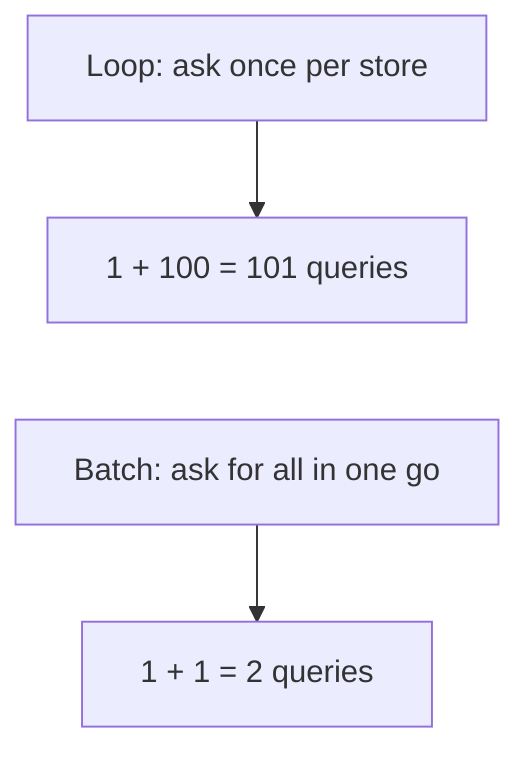
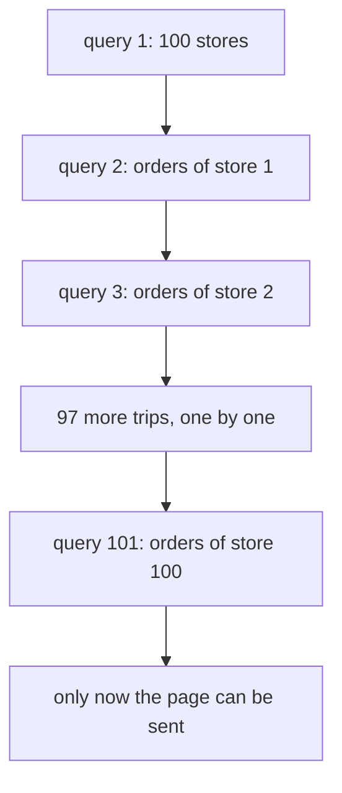
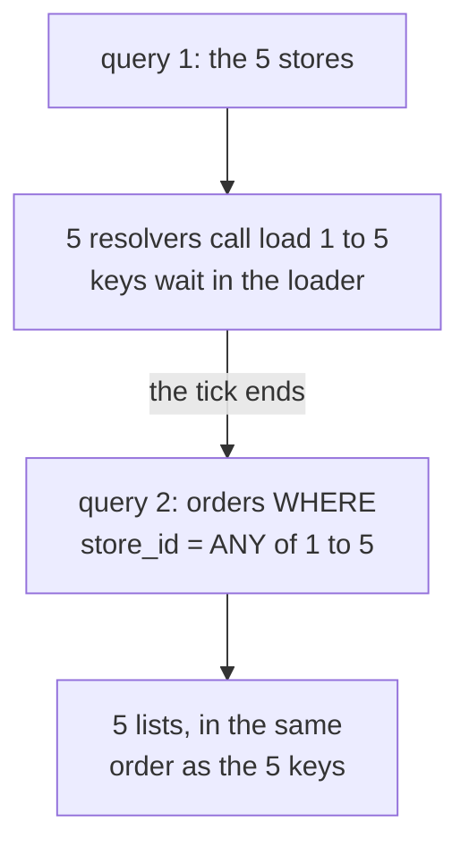
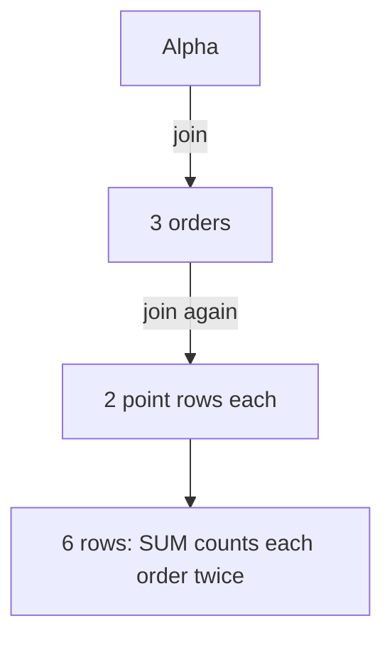

# 12. N+1 queries and ORMs

> **Subject:** Database · **Lesson:** 12 · **Made:** 2026-10-16 · **Remade in short cards:** 2026-10-28 · **Status:** ready
>
> **You will be able to:** say why one page can send 101 queries, find it in a query log, and fix it with a JOIN, an `= ANY($1)` batch, Prisma `include`, a GraphQL DataLoader, or Hasura.
>
> **Before this:** [Reading EXPLAIN](11-reading-explain.md) · **Next:** Transactions and ACID (lesson 13, not written yet)
>
> **How to read it:** one card is one idea. Look at the picture, guess, then press the orange bar to check. The blue bars (📖 More detail) hold the longer explanation. Skip them on the first read, and open them when you want more. The numbers come from the practice database, so yours will differ a little. About 25 minutes for the cards.

## 1. The idea: a shop 10 minutes away

You need 100 items from a shop that is 10 minutes away.



Notice: both ways put the **same data** on the page. The number of trips is very different. **N+1** is the first way: drive there, buy one item, drive home, 100 times.

<details class="guess"><summary>🤔 Guess: a page shows 100 stores, and the code asks for each store's orders one store at a time. How many queries? Press to check.</summary>

**101.** One query for the list of stores, then one more for each of the 100 stores. Each query waits for its own trip over the network. The batch way writes one shopping list: 2 queries.

</details>

> **Remember:** count the trips, not the speed of one query.

<details class="more"><summary>📖 More detail: the four words, and where the shop picture stops</summary>

- **Round trip:** the app sends one query, then waits until the answer comes back. Every query costs at least one trip.
- **N+1:** 1 query for the list, then N more queries, one per item. With N = 100 stores, that is 101 queries.
- **Batch:** many small requests packed into one query. For example, "orders of stores 1, 2, 3 ... 100" in one go.
- **ORM:** a library that writes the SQL for you from code, like Prisma. (Interview word: *object relational mapper*.)

Where the picture stops: a real shop does not care how long the list is. A database does. One huge query can be slow too, and one giant join can bring back far more rows than you need (card 7).

</details>

## 2. The loop: 101 queries

This runs against the practice database (stores, orders). `db` is a connected Postgres client, for example from the `pg` package. The helper `q` counts every query sent.

```js
let count = 0;
const q = (sql, params) => {
  count++;
  return db.query(sql, params);
};

const stores = (await q(
  "SELECT id, name FROM stores " +
  "ORDER BY id LIMIT 100")).rows;
for (const s of stores) {
  s.orders = (await q(
    "SELECT id, total_cents FROM orders " +
    "WHERE store_id = $1", [s.id])).rows;
}
console.log("loop:", count, "queries");
```

Every arrow to the right is a trip, and the app is **waiting** the whole time:



<details class="guess"><summary>🤔 Guess: without an index on `orders.store_id`, how many order rows does Postgres read in total for the loop? Press to check.</summary>

About **10 million**. Each of the 100 loop queries does a `Seq Scan` over all 100,000 orders. The batch reads them once (about 100 thousand).

```
Seq Scan on orders (actual rows=112.00 loops=1)
  Filter: (store_id = 1)
  Rows Removed by Filter: 99888
```

An index on `orders.store_id` ([lesson 09](09-indexes-and-b-trees.md)) makes each loop query fast. But it does **not** remove the 101 trips.

</details>

> **Remember:** a loop with `await` inside looks innocent, and sends one trip per item.

<details class="more"><summary>📖 More detail: the loop, step by step</summary>

The practice seed has **exactly 100,000 orders** and no index on `orders.store_id` yet. Your row counts per store will be a little different, because the seed uses random numbers.

| Step | Code | What the app does | What Postgres does | Queries so far | Rows Postgres read |
|---|---|---|---|---|---|
| 1 | `SELECT ... FROM stores LIMIT 100` | sends query 1, then waits | walks the `stores_pkey` index and stops after 100 rows | 1 | 100 |
| 2 | loop, store 1 | sends `WHERE store_id = $1` with 1, then waits | `Seq Scan on orders`: reads all 100,000 rows, keeps 112, throws away 99,888 | 2 | about 100,100 |
| 3 | loop, store 2 | sends the same query with 2, then waits | reads all 100,000 rows **again**, keeps 114 | 3 | about 200,100 |
| 4 | stores 3 to 99 | 97 more trips, one after the other | 97 more full reads of the table | 100 | about 9,900,100 |
| 5 | loop, store 100 | the last trip | reads all 100,000 rows, keeps 139 | **101** | about **10,000,100** |
| 6 | `count = 0`, stores again | sends query 1 of the batch version | 100 store rows | 1 | 100 |
| 7 | `stores2.map(s => s.id)` | builds `[1, 2, ... 100]` in its own memory, **no trip** | nothing | 1 | 100 |
| 8 | `WHERE store_id = ANY($1)` | sends the whole list as **one** parameter | `Seq Scan on orders` **once**: keeps 11,054 rows that match any of the 100 ids | **2** | about 100,100 |
| 9 | `Map.groupBy` | sorts the 11,054 rows into 100 lists by `store_id` | nothing | 2 | |
| 10 | `?? []` | a store with no orders gets `[]` | nothing | 2 | |

</details>

## 3. The batch: 2 queries

Ask for all the orders at once, with `= ANY($1)` and the list of ids. Then group the rows in code.

```js
count = 0;
const stores2 = (await q(
  "SELECT id, name FROM stores " +
  "ORDER BY id LIMIT 100")).rows;
const ids = stores2.map(s => s.id);
const orders = (await q(
  "SELECT id, store_id, total_cents " +
  "FROM orders " +
  "WHERE store_id = ANY($1)", [ids])).rows;
const byStore = Map.groupBy(
  orders, o => o.store_id);
for (const s of stores2) {
  s.orders = byStore.get(s.id) ?? [];
}
console.log("batch:", count, "queries");
```

<details class="guess"><summary>🤔 Guess: what do the two versions print? And why is `?? []` there? Press to check.</summary>

```
loop: 101 queries
batch: 2 queries
```

Both versions put exactly the same orders on each store. The `?? []` matters: `IN` and `ANY` only return rows that exist. A store with no orders is missing from the Map, so `byStore.get(s.id)` gives `undefined`. It must get an empty list.

</details>

> **Remember:** one trip for the list, one trip for all the children, then group in code. Give empty lists to parents with no children.

<details class="more"><summary>📖 More detail: the plan, and versions</summary>

The real plan for the batch query, with the 100 ids written out:

```
Seq Scan on orders (actual rows=11054.00 loops=1)
  Filter: (store_id = ANY ('{1,2,3, ... ,100}'::integer[]))
  Rows Removed by Filter: 88946
```

(The middle of the id list is cut short here.) One `Seq Scan` keeps 11,054 rows that match any of the 100 ids.

Checked on 2026-10-16 with Node 24.15.0 and PostgreSQL 18.3 (PGlite) on the practice seed. `Map.groupBy` needs Node 21 or newer.

</details>

## 4. Why it hides

Each query alone looks fine. The number of queries follows the **data**, not the code.

| Data | Queries sent by the loop | Feels |
|---|---|---|
| Test data, 5 stores | 6 | fine |
| Staging, 100 stores | 101 | a bit slow |
| Production, 1000 stores | 1001 | slow page |

<details class="guess"><summary>🤔 Guess: your code did not change, but the page got slow after the data grew. What is the first thing to count? Press to check.</summary>

The **number of queries** for one page view. N+1 looks innocent in the code and fine in test data. You find it in a query log: the same query printed many times in a row.

</details>

> **Remember:** the code did not change, but the page got slower. Look at the query log.

<details class="more"><summary>📖 More detail: why it happens so easily, and how to see it</summary>

- **Why it happens so easily:**
  - A loop with `await` inside looks innocent.
  - In GraphQL, each resolver only sees its own parent. The `orders` resolver for Alpha does not know that Bravo is asking too.
  - With an ORM, a "lazy" relation can send a query when you just read a field.
- **How to see it:**
  - **Prisma log.** `new PrismaClient({ log: ["query"] })` prints every SQL query. In Prisma 7, you also pass your `adapter` in the same object. Look for the same query printed many times in a row.
  - **pg_stat_statements.** This view counts how many times each query shape ran. The Docker playground has it turned on. Look at the `calls` column. If `SELECT ... WHERE store_id = $1` has `calls` going up by 100 for every page view, you found an N+1.
  - **APM tools** (Datadog, New Relic, Sentry and similar) draw one bar per query under one request. N+1 looks like a long staircase of tiny, equal bars.

</details>

## 5. GraphQL: DataLoader

In GraphQL, the `orders` resolver runs once per store, and each resolver only sees its own parent. A **DataLoader** lets each resolver ask, but waits before it sends anything.



Notice: 5 `load` calls become **one** query.

<details class="guess"><summary>🤔 Guess: `{ stores { name orders { id } } }` for 50 stores, with a DataLoader on `orders`. How many SQL queries? And without the loader? Press to check.</summary>

With the DataLoader: **2**. One for the stores, and one batch for all 50 stores' orders.

Without it: **51**. One for the stores, and one for each of the 50 stores.

The loader waits until the running code is done (the end of the tick). By then, GraphQL has called all 50 resolvers, so all 50 keys are in one list.

</details>

> **Remember:** make the DataLoader **once per request**. A shared loader keeps a cache across users and can show one user's data to another.

<details class="more"><summary>📖 More detail: the resolver, with and without a DataLoader</summary>

With the real `dataloader` 2.2.3 and `graphql` 17.0.2 packages, the query `{ stores { name orders { id } } }` on the 5 tiny stores sent **6** queries without the loader and **2** with it.

A resolver that queries the database directly (wrong), and a DataLoader made once per request in the context (right):

**Right:** a DataLoader, made once per request in the context.

```js
const context = () => ({
  ordersLoader: new DataLoader(async (storeIds) => {
    const { rows } = await db.query("SELECT * FROM orders WHERE store_id = ANY($1)", [storeIds]);
    const byStore = Map.groupBy(rows, r => r.store_id);
    return storeIds.map(id => byStore.get(id) ?? []);   // same order as the keys
  }),
});
const resolvers = {
  Store: { orders: (store, _args, ctx) => ctx.ordersLoader.load(store.id) },
};
```

The batch function must return its answers **in the same order as the keys**, and the **same number** of answers (practice B).

</details>

## 6. Which tool does what

Every fix ends at 1 or 2 queries, no matter how many stores there are.

| Tool | Queries |
|---|---|
| Prisma `include`, query strategy | 2 (the second uses `IN`) |
| Prisma `include`, join strategy | 1 (orders packed as JSON) |
| GraphQL resolver + DataLoader | 2 (keys batched per tick) |
| Hasura nested query | 1 (SQL built by Hasura) |
| Hand written SQL | 1 JOIN, or 1 `ANY` batch |

<details class="guess"><summary>🤔 Guess: in Prisma, what turns `store.orders` for 100 stores from 101 queries into 2? Press to check.</summary>

`include`: ask for the relation once.

```js
const stores = await prisma.store
  .findMany({
    include: { orders: true }
  });
```

`include` loads the orders of all stores together. With the default `query` strategy that is 2 queries, not 1 + N. The wrong way is a `findMany` inside a `for` loop, one trip per store.

</details>

> **Remember:** let the tool batch for you: `include` in Prisma, a DataLoader in GraphQL, a nested query in Hasura.

<details class="more"><summary>📖 More detail: the fixes, one by one</summary>

- **One JOIN.** One trip. The parent columns repeat on every child row.
- **One batch with `IN` or `= ANY($1)`.** Two trips. You must group the rows in code and give empty lists to parents with no children.
- **Prisma `include`.** Prisma loads the relation for all parents. Its docs say the default `query` strategy sends one query per table, with `IN` for the children. With `relationLoadStrategy: "join"`, it sends one query with the children packed as JSON.
- **DataLoader in GraphQL.** Each resolver calls `loader.load(id)`. The loader collects all keys from one tick, then calls your batch function once.
- **Hasura.** Hasura turns one GraphQL query into one SQL query. You do not write resolvers, so there is nothing to batch.

</details>

## 7. Mistake: fixing N+1 with one giant join

The opposite mistake: one join of a store with **two** child lists, then a sum. The rows multiply (fan-out, from [lesson 02](02-joins.md)).

```sql
SELECT s.id, SUM(o.total_cents)
FROM l12_stores s
JOIN l12_orders o
  ON o.store_id = s.id
LEFT JOIN l12_points p
  ON p.store_id = s.id
GROUP BY s.id;
```



<details class="guess"><summary>🤔 Guess: Alpha's real order total is 1400. What does the query show? Press to check.</summary>

**2800.** Every order row is repeated once per point row, so each order is counted twice.

Fix: sum each child table on its own first, then join the small results (practice task 6). Or use two batches.

</details>

> **Remember:** one giant join with two child lists fans out and gives wrong sums.

<details class="more"><summary>📖 More detail: the cost of batches</summary>

- A batch has to be grouped in code, and the batch function must return values in the same order as the keys.
- A very long id list makes a big query. Paginate the parents ([lesson 17, not written yet](README.md)).

</details>

## 8. Watch it run, step by step

The app is on the left and Postgres on the right. Press Next and watch the query counter. It has five tabs, all with the 5 tiny stores from the practice file:

1. The N+1 loop (6 trips)
2. Fix 1, one JOIN
3. Fix 2, the `ANY` batch
4. Fix 3, DataLoader collecting keys in one tick
5. Prisma join and Hasura, one query with JSON lists

**Step through it yourself:** [open the N+1 stepper](visuals/12-n-plus-1-queries-and-orms.html).

<details class="more"><summary>📖 More detail: what to notice in the trace</summary>

What to notice:

- The loop made **101 trips**. The batch made **2**.
- Without an index, the loop also read the whole orders table **100 times**. That is about 10 million rows read, against 100 thousand.
- An index on `orders.store_id` ([lesson 09](09-indexes-and-b-trees.md)) makes each loop query fast. But it does **not** remove the 101 trips.

</details>

## 9. Why it matters and what it costs

- **Without a fix,** the page waits for one trip per item. It looks fine with test data, then gets slower as the data grows. It also puts more load on the database and uses a connection for longer.
- **With a fix,** the page sends 1 or 2 queries, however many items there are.
- **The cost:**
  - A batch has to be grouped in code, and the batch function must return values in the same order as the keys.
  - A very long id list makes a big query.
  - One giant join with two child lists fans out and gives wrong sums (card 7). Use two batches, or group each child table first.
  - A DataLoader must be made **once per request** (card 5).

## 10. Watch and play

Links checked on 2026-10-16. Each page was opened. For the videos, the title, channel and length were confirmed on YouTube.

- **Play with it:** [The N+1 stepper](visuals/12-n-plus-1-queries-and-orms.html) in this folder. Guess the number of queries first, then press Next.
- **Video:** [GraphQL N+1 Problem](https://www.youtube.com/watch?v=uCbFMZYQbxE) by Ben Awad, about 16 minutes. He shows the extra queries in the log, then fixes them with DataLoader.
- **Video:** [Explaining n+1 in GraphQL](https://www.youtube.com/watch?v=7PSEETJRVS8) by Adam Malone at API World 2024, on the Zuplo channel, 1 minute. A quick recap, and how a compiled query like Hasura avoids it.
- **Read:** [Solving the N+1 Problem with DataLoader](https://www.graphql-js.org/docs/n1-dataloader/) in the GraphQL.js docs. The 10 posts and 11 queries example, and why the loader is made per request.
- **Read:** [Query optimization](https://www.prisma.io/docs/orm/v7/prisma-client/queries/advanced/query-optimization-performance) in the Prisma 7 docs. Look at "Solving the n+1 problem" and the `include` and fluent API examples.
- **Read:** [Choosing the Best Join Strategy in Prisma ORM](https://www.prisma.io/blog/prisma-orm-now-lets-you-choose-the-best-join-strategy-preview) on the Prisma blog. Diagrams of `join` against `query`, and the SQL Prisma sends.
- **Play with it:** [explain.dalibo.com](https://explain.dalibo.com/). Paste the plan of the batch query and of one loop query from cards 2 and 3, and compare.

<details><summary>More links (optional)</summary>

- **Video:** [How Prisma Solves the N+1 Problem in GraphQL Resolvers](https://www.youtube.com/watch?v=7oMfBGEdwsc) by Tim Suchanek at Prisma Day 2020, about 33 minutes. Older, but it explains Prisma's `findUnique` batching.
- **Video:** [DataLoader and the Problem it solves in GraphQL](https://www.youtube.com/watch?v=ld2_AS4l19g) by knowthen, about 22 minutes.
- **Video:** [DataLoader, Source code walkthrough](https://www.youtube.com/watch?v=OQTnXNCDywA) by Lee Byron, about 35 minutes. How the real library collects keys.
- **Read:** [graphql/dataloader on GitHub](https://github.com/graphql/dataloader). The rules for the batch function and the per request cache.
- **Read:** [Relation queries in the Prisma 7 docs](https://www.prisma.io/docs/orm/v7/prisma-client/queries/relation-queries). The `relationLoadStrategy` section.
- **Read:** [Logging in the Prisma 7 docs](https://www.prisma.io/docs/orm/v7/prisma-client/observability-and-logging/logging). The `log` option and the `$on("query")` event.
- **Read:** [Hasura Explain API](https://hasura.io/docs/2.0/api-reference/explain/). See the SQL Hasura makes for a query.
- **Read:** [Architecture of a high performance GraphQL to SQL engine](https://hasura.io/blog/architecture-of-a-high-performance-graphql-to-sql-server-58d9944b8a87) on the Hasura blog, from 2018. The albums and tracks N+1 example.
- **Read:** [pg_stat_statements](https://www.postgresql.org/docs/current/pgstatstatements.html) in the PostgreSQL docs. The `calls` column.
- **Read:** [Prisma ORM release status](https://www.prisma.io/docs/orm/release-status). Where Prisma 7 and Prisma 8 stand.

</details>

## 11. Practice

**A. Predict the output** (write your answer before opening)

A GraphQL server runs `{ stores { name orders { id } } }` for 50 stores. The `orders` resolver uses a DataLoader. How many SQL queries does this send? And what if the loader is **removed**?

<details><summary>Answer</summary>

With the DataLoader: **2**. One for the stores, and one batch for all 50 stores' orders.

Without it: **51**. One for the stores, and one for each of the 50 stores.

The loader waits until the running code is done (the end of the tick). By then, GraphQL has called all 50 resolvers, so all 50 keys are in one list.

</details>

**B. Fix the bug**

This loader sends one query per request, but some stores show the wrong orders.

```js
const ordersLoader = new DataLoader(async (storeIds) => {
  const { rows } = await db.query(
    "SELECT * FROM orders WHERE store_id = ANY($1) ORDER BY store_id", [storeIds]);
  const byStore = Map.groupBy(rows, r => r.store_id);
  return [...byStore.values()];
});
```

<details><summary>Answer</summary>

DataLoader needs the answers **in the same order as the keys**, and the **same number** of answers. `byStore.values()` follows the order of the rows, not the keys. A store with no orders is missing, so the list is also too short. DataLoader then fails, because it got the wrong number of values.

Fix: walk the keys, not the rows.

```js
return storeIds.map(id => byStore.get(id) ?? []);
```

</details>

**C. Write it yourself**

Two parts.

**SQL part.** Open `practice/12-n-plus-1-queries-and-orms.sql`. It makes three tiny tables (5 stores, 8 orders, 3 point rows). Six tasks: count the trips, the `IN` batch, the `ANY` batch, one JOIN, one row per store with a JSON list (the Prisma join and Hasura shape), and the fan-out trap. Every task has its expected result.

**JavaScript part.** Open `practice/12-n-plus-1-dataloader.js`. A fake database counts every query. Write `loadOrdersForStores` (one query, then group) and `createLoader` (a tiny DataLoader). Run the tests from the folder that contains `learn/`:

```
node --test learn/database/practice/12-n-plus-1-dataloader.test.js
```

At the start, 1 test passes: it shows that the N+1 way sends 5 queries for 5 stores.

<details><summary>One possible answer</summary>

SQL tasks:

```sql
-- Task 1. a) 6 queries: 1 for the stores + 1 for each of the 5 stores.
-- b)
SELECT id, total_cents FROM l12_orders WHERE store_id = 3 ORDER BY id;

-- Task 2. Store 5 is not in the result. The app must give it an empty list.
SELECT id, store_id, total_cents
FROM l12_orders
WHERE store_id IN (1, 2, 3, 4, 5)
ORDER BY store_id, id;

-- Task 3
SELECT id, store_id, total_cents
FROM l12_orders
WHERE store_id = ANY(ARRAY[1, 2, 3, 4, 5])
ORDER BY store_id, id;

-- Task 4
SELECT s.id AS store_id, s.name, o.id AS order_id, o.total_cents
FROM l12_stores s
LEFT JOIN l12_orders o ON o.store_id = s.id
ORDER BY s.id, o.id;

-- Task 5 (the LATERAL way, like Prisma "join")
SELECT s.id, s.name, o.orders
FROM l12_stores s
LEFT JOIN LATERAL (
  SELECT COALESCE(
           jsonb_agg(jsonb_build_object('id', x.id, 'total_cents', x.total_cents) ORDER BY x.id),
           '[]') AS orders
  FROM l12_orders x
  WHERE x.store_id = s.id
) o ON true
ORDER BY s.id;

-- Task 5 (another way, with GROUP BY)
SELECT s.id, s.name,
       COALESCE(jsonb_agg(jsonb_build_object('id', o.id, 'total_cents', o.total_cents) ORDER BY o.id)
                FILTER (WHERE o.id IS NOT NULL), '[]') AS orders
FROM l12_stores s
LEFT JOIN l12_orders o ON o.store_id = s.id
GROUP BY s.id, s.name
ORDER BY s.id;

-- Task 6. a) Alpha has 3 orders and 2 point rows. The join makes 3 x 2 = 6 rows,
-- so every order is counted twice: 1400 x 2 = 2800.
-- b) Sum each child table on its own, then join the small results.
SELECT s.id, s.name, o.order_total, COALESCE(p.points, 0) AS points
FROM l12_stores s
LEFT JOIN (SELECT store_id, SUM(total_cents) AS order_total FROM l12_orders GROUP BY store_id) o
  ON o.store_id = s.id
LEFT JOIN (SELECT store_id, SUM(amount) AS points FROM l12_points GROUP BY store_id) p
  ON p.store_id = s.id
ORDER BY s.id;
```

JavaScript tasks:

```js
async function loadOrdersForStores(db, storeIds) {
  const rows = await db.ordersOfStores(storeIds);   // one trip
  const byStore = new Map();                          // store id -> its orders
  for (const row of rows) {
    if (!byStore.has(row.store_id)) byStore.set(row.store_id, []);
    byStore.get(row.store_id).push(row);
  }
  return storeIds.map(id => byStore.get(id) ?? []);   // same order as storeIds
}

function createLoader(batchFn) {
  let waiting = [];   // { key, resolve, reject } for every load() in this tick

  async function sendBatch() {
    const batch = waiting;
    waiting = [];                                      // the next tick starts a new list
    const keys = [...new Set(batch.map(w => w.key))];  // each key only once
    try {
      const values = await batchFn(keys);
      for (const w of batch) w.resolve(values[keys.indexOf(w.key)]);
    } catch (err) {
      for (const w of batch) w.reject(err);
    }
  }

  return {
    load(key) {
      return new Promise((resolve, reject) => {
        waiting.push({ key, resolve, reject });
        if (waiting.length === 1) process.nextTick(sendBatch); // first key: plan one send
      });
    },
  };
}
```

All 10 tests pass with this answer. The real DataLoader waits a little longer than `process.nextTick`: it waits until the promise callbacks that are already queued have run too. Lesson 11 of JavaScript, [the event loop](../javascript/11-the-event-loop.md), explains ticks and promise callbacks.

</details>

## 12. Interview question

**Q:** "Our GraphQL API is slow on the store list page, but every single query in the log is fast. What is going on, and how do you fix it?"

<details><summary>A strong answer, in four parts</summary>

1. **Problem:** this sounds like N+1. The list query runs once, then the `orders` resolver runs once per store. 100 stores means 101 queries, and each one costs a round trip. Each query is fast, so nothing looks wrong alone. The count grows with the data, so it gets worse in production.
2. **How it works and how I find it:** I would check the query log. In Prisma that is `log: ["query"]`. In Postgres, `pg_stat_statements` shows a `calls` count that jumps by N per request. An APM trace shows a staircase of small equal queries. Then I fix it so the number of queries does not depend on N:
   - one JOIN, or one batch with `WHERE store_id = ANY($1)` that I group in code;
   - in Prisma, `include`, which loads the relation for all parents at once;
   - in GraphQL resolvers, a DataLoader made per request, which collects the keys from one tick and sends one `ANY` query;
   - in Hasura, nothing to do, because it compiles the whole GraphQL query into one SQL query.
3. **Tradeoff:** a batch must be grouped in code and keep the order of the keys. Very long id lists need pagination. A giant join over two child lists fans out and gives wrong sums, so sometimes 2 or 3 batched queries are better than 1 join. A DataLoader must never be shared across requests, because its cache could leak data between users.
4. **My example:** *This is an idea, not a fact. Replace it with your own real story.* DBO has stores, orders and loyalty points, with an admin CMS on GraphQL and Hasura. A store list that shows each store's latest orders and points balance is the classic N+1 shape. Hasura would avoid it for table queries. A custom resolver or Express endpoint written with Prisma in a loop would not. Check your own code for a `findMany` or `findUnique` inside a loop, or a resolver that queries per parent.

</details>

## 13. Explain it back

Close this file. Press the **Record my explanation** button under this heading and explain N+1 out loud, like to a new junior, in 4 parts: problem, how it works, tradeoff, my example. Use the words "round trip", "batch" and "DataLoader". Draw the 101 arrows picture while you talk. Then save the transcript into `my-learning/recordings/`, or write your best version below. Run `/explain-check n-plus-1-queries` or ask the `explain-coach` agent to review it.

### My explanation

<write here>

### Coach feedback

<the explain-coach agent writes here>

## 14. Review questions (day 1, 3, 7, 21)

1. A page lists 100 stores and their orders with a loop. How many queries is that, and why is it slow when each query takes only 1 ms?
2. Name three ways to load the orders of 100 stores in one or two queries.
3. What two rules must a DataLoader batch function follow, and why must the loader be made once per request?
4. Draw the picture from card 2 from memory: the app, Postgres, and the arrows. Then draw the fixed version with 2 arrows.

<details><summary>Answers</summary>

1. 101 queries: 1 for the list, 1 per store. Each query waits for its own round trip, one after the other. The waiting adds up, and it grows with the number of stores. Without an index on `store_id`, each query also reads the whole orders table.
2. Any three of: one JOIN; one batch with `WHERE store_id IN (...)` or `= ANY($1)` and group in code; Prisma `include` (with the `query` or `join` strategy); a DataLoader in GraphQL resolvers; a Hasura nested query.
3. It must return the same number of values as keys, in the same order as the keys (missing ones as `[]` or `null`). It must be made per request, because it caches values, and a shared cache could show one user's data to another and keep old data.
4. App on the left, Postgres on the right. Arrow 1 "100 stores", then arrows 2 to 101 "orders of store 1" ... "orders of store 100", each with a reply. The fixed version: arrow 1 "stores", arrow 2 "orders WHERE store_id = ANY of the 100 ids", then group in the app.

</details>

## 15. Go deeper (optional)

Open these when you are ready. None of them is needed for the cards above.

<details><summary>Postgres 16 against 18, and timing</summary>

- These plans come from PostgreSQL 18.3. In your Docker playground (PostgreSQL 16) you will see `actual rows=112` with no `.00`. Plans that use an index also show an extra line `Index Searches: 1` on 18 only.
- Timing in PGlite is not the same as a real server, so this lesson shows trips and rows read, not milliseconds. On a real network, every trip also adds network time. For example, 101 trips of 1 ms each add about 100 ms of pure waiting.
- `pg_stat_statements` groups an `IN (...)` list on PostgreSQL 18 into one line, even when the list length changes. On 16, an `IN` list of 7 values and one of 8 values can show as two lines. `= ANY($1)` with one array parameter shows as one line on both.

</details>

<details><summary>Prisma versions, the generated SQL, and Hasura's explain</summary>

- **Prisma 7.** The docs for Prisma ORM 7 say `relationLoadStrategy` is still in Preview. You turn it on with `previewFeatures = ["relationJoins"]` in the generator block. It works on PostgreSQL, CockroachDB and MySQL. With the flag on, `join` is the default, and `query` is the other choice. Without the flag, Prisma always uses the `query` way.
- **What `join` sends on PostgreSQL.** One query with a `LEFT JOIN LATERAL` and `JSONB_AGG`. For each parent row, the lateral part finds that parent's children and packs them into one JSON list. Task 5 in the practice file builds the same shape by hand.
- **The Prisma log example** in the docs shows the `query` strategy: one `SELECT ... FROM "User"`, then one `SELECT ... FROM "Post" WHERE "authorId" IN ($1,$2,$3,$4)`.
- **Prisma's own batching.** Prisma groups `findUnique()` calls made in the same tick into one query. The docs suggest `prisma.store.findUnique({ where: { id } }).orders()` in resolvers for this reason. `findMany()` is not batched.
- **Prisma ORM 8.** On 2026-10-16, the Prisma docs call Prisma ORM 8 a release candidate, a full TypeScript rewrite with a new API. Its docs say `.include("posts")` reads the relation in the same SQL statement with a correlated subquery. Check the release status page before you use it.
- **Hasura.** Hasura says it compiles a GraphQL query instead of resolving it field by field, and makes one SQL query for a query of any depth. It builds the JSON inside Postgres with `json_agg`. The admin endpoint `POST /v1/graphql/explain` returns the SQL and the Postgres plan for each top level field. A query with two top level fields becomes two SQL queries.
- **Hasura is not free of N+1 everywhere.** Remote schemas, actions and remote joins call other services. Those calls are outside the single SQL query.

</details>

## Connected lessons

- [Joins](02-joins.md): the JOIN fix, and fan-out, the opposite mistake.
- [Indexes and B-trees](09-indexes-and-b-trees.md): an index on `orders.store_id` makes each query fast, but does not remove the trips.
- [Reading EXPLAIN](11-reading-explain.md): the lesson before. EXPLAIN shows one query. N+1 is about how many queries there are, so you also need the log.
- [The event loop](../javascript/11-the-event-loop.md) (JavaScript): what a tick is, and why DataLoader can collect keys before it sends.
- Pagination (lesson 17, not written yet): keep the parent list small, so the batch stays small.
- Connection pooling (lesson 20, not written yet): many trips also hold a database connection for longer.
- [PostgreSQL queries and indexing guide](postgresql-queries-interview-guide.md): the longer guide, for revision.
