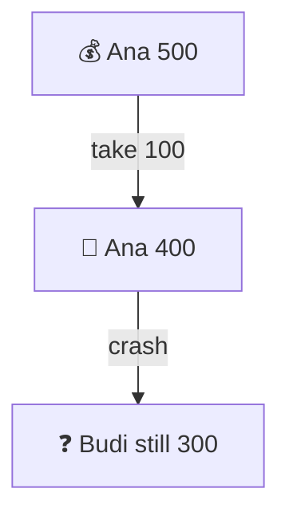
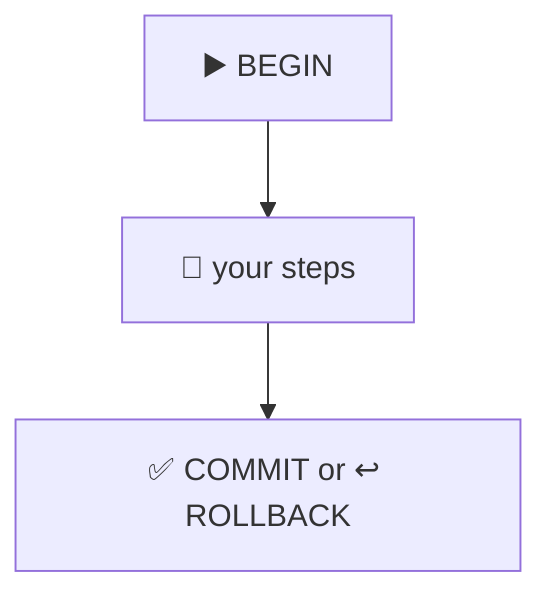
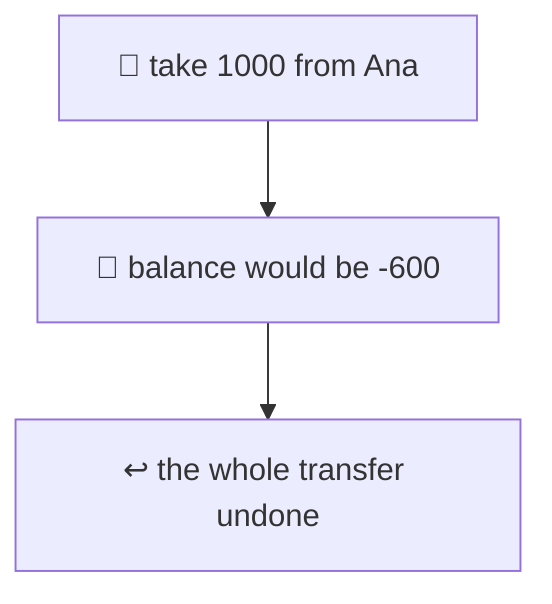
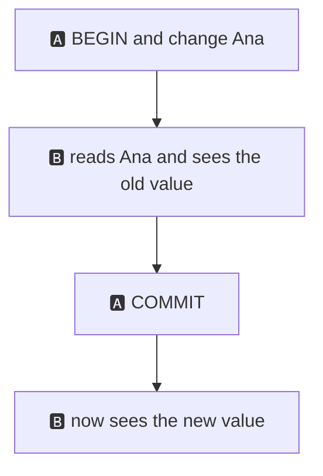
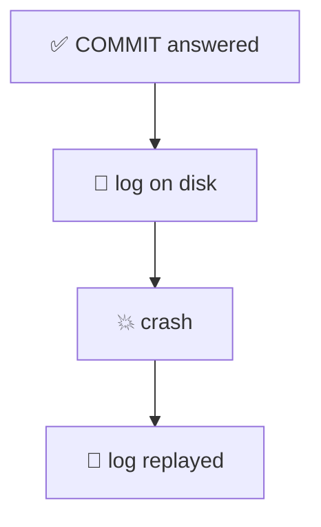
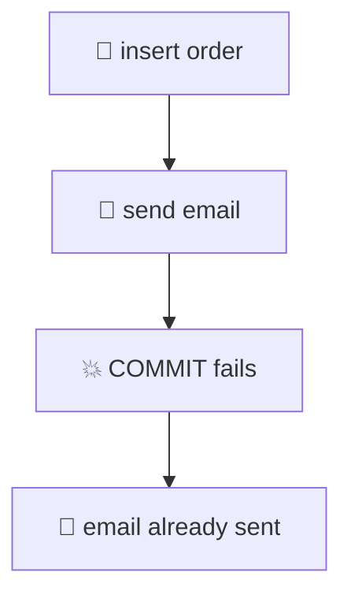
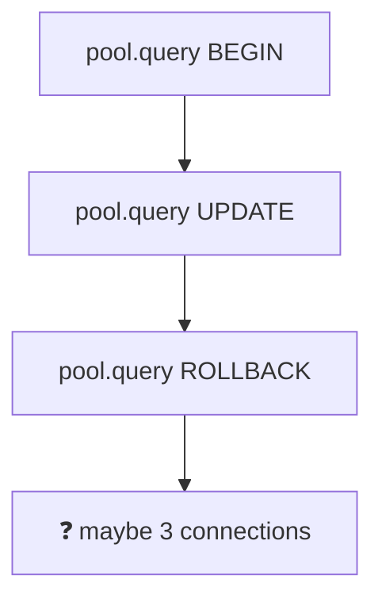

# 13. Transactions and ACID

> **Subject:** Database · **Lesson:** 13 · **Made:** 2026-11-01 · **Status:** ready
>
> **You will be able to:** say what a transaction is, say what each letter of ACID protects you from using a money transfer, use BEGIN, COMMIT, ROLLBACK and SAVEPOINT, and avoid the connection pool trap in Node.
>
> **Before this:** [N+1 queries and ORMs](12-n-plus-1-queries-and-orms.md) · **Next:** [Isolation levels](14-isolation-levels.md)
>
> **How to read it:** one card is one idea. Look at the picture, guess, then press the orange bar to check. The blue bars (📖 More detail) hold the longer explanation with the why and a real example. Skip them on the first read, and open them when you want more. Every number and error text was run on PostgreSQL 18.3. About 25 minutes for the cards.

## 1. The idea: two steps that must happen together

Ana sends 100 to Budi. That is two writes: take 100 from Ana, give 100 to Budi. If only the first one happens, 100 disappears.



A **transaction** wraps the two writes into one. Either both happen, or neither.

<details class="guess"><summary>🤔 Guess: Ana 500, Budi 300 (total 800). You take 100 from Ana. Then the second UPDATE has a typo (<code>'Bud'</code> instead of <code>'Budi'</code>) and changes 0 rows. No transaction. What is the total now? Press to check.</summary>

**700.** The first UPDATE already happened and nothing undoes it. I ran it:

```text
 owner | balance | total
-------+---------+-------
 Ana   |     400 |   700
 Budi  |     300 |   700
```

100 vanished, and Postgres did not complain, because "0 rows updated" is not an error.

</details>

> **Remember:** a transaction turns several writes into one: all of them happen, or none of them.

<details class="more"><summary>📖 More detail: every statement is already a transaction</summary>

If you send one statement alone, Postgres wraps it in a tiny transaction for you. This is called **autocommit**. One `UPDATE` that changes 1,000 rows is atomic: you never see 400 of them changed.

The problem in the card is different. It is **two** statements. Postgres cannot know they belong together, so each one is saved on its own. You have to say so, with `BEGIN`.

The Postgres tutorial says it this way: a transaction bundles several steps into one all-or-nothing operation, and the in-between states are not visible to other sessions. That sentence is most of the lesson.

</details>

## 2. BEGIN, COMMIT, ROLLBACK

You say where the transaction starts and how it ends.



```sql
BEGIN;
UPDATE l13_accounts SET balance = balance - 100 WHERE owner = 'Ana';
UPDATE l13_accounts SET balance = balance + 100 WHERE owner = 'Budi';
COMMIT;
```

`COMMIT` keeps every step. `ROLLBACK` throws every step away.

<details class="guess"><summary>🤔 Guess: inside a transaction, the second step fails (<code>SELECT 1/0</code>). You still type <code>COMMIT</code>. What is saved? Press to check.</summary>

**Nothing.** After the error the transaction is **aborted**. Every later statement is refused until you end it:

```text
ERROR:  division by zero
ERROR:  current transaction is aborted, commands ignored until end of transaction block
```

And the `COMMIT` itself answers `ROLLBACK`. Postgres does not let you save half of it. The balances were the same as before.

</details>

> **Remember:** an error aborts the whole transaction. COMMIT on an aborted transaction rolls back.

<details class="more"><summary>📖 More detail: SAVEPOINT, DDL, and small surprises</summary>

**SAVEPOINT** lets you undo only the last part. I took 50 from Ana, set a savepoint, tried to take 5000 (it failed), went back with `ROLLBACK TO SAVEPOINT s1`, gave 50 to Budi, and committed. The first step was kept: Ana 350, Budi 450.

**Even `CREATE TABLE` can be rolled back.** Many databases cannot. In Postgres, `BEGIN; CREATE TABLE t (...); ROLLBACK;` leaves no table. I checked with `to_regclass`: the name was found inside, and `NULL` after the rollback. A migration written as one transaction leaves no half-made table when a step fails.

**Small things I saw:**

- `ROLLBACK` with no transaction open is only a warning: `there is no transaction in progress`.
- `BEGIN` twice is only a warning too: `there is already a transaction in progress`.
- `now()` is the time the transaction **started**. I called it twice with a 1 second sleep in between, and both gave the same time. `clock_timestamp()` moved by 1 second.

</details>

## 3. C: the rules always hold (Consistency)

You can teach the database a rule, like "a balance is never below 0". A transaction may not end in a state that breaks a rule.



<details class="guess"><summary>🤔 Guess: with <code>CHECK (balance >= 0)</code>, you give 1000 to Budi first, then take 1000 from Ana (she has 400). The second step fails. Does Budi keep the 1000? Press to check.</summary>

**No.** The two steps were one transaction, so the failure undid both:

```text
ERROR:  new row for relation "l13_accounts" violates check constraint "balance_not_negative"
DETAIL:  Failing row contains (1, Ana, -600).
```

Budi stayed at 400. Total stayed 800.

</details>

> **Remember:** the database enforces the rules you give it. A broken rule undoes the whole transaction.

<details class="more"><summary>📖 More detail: what "consistent" means here</summary>

The C in ACID is the odd one. It does not mean "your business is correct". It means: **every rule you wrote** (`NOT NULL`, `UNIQUE`, `CHECK`, foreign keys from lesson 06) is true when a transaction ends. If you did not write a rule, nobody checks it.

So the C depends on your design. "Total money stays 800" is not a rule Postgres knows. In my test it stayed 800 only because both UPDATEs were in one transaction. The `CHECK` rule only protects each balance, not the total.

Lesson 08 has the rules. Rules give you C. Transactions give you A.

</details>

## 4. I: others do not see unfinished work (Isolation)

While you are in the middle of a transaction, other sessions should not see your half-done changes.



<details class="guess"><summary>🤔 Guess: session A starts a transaction and takes 100 from Ana (400 to 300), not committed yet. Session B reads Ana's balance. What does B see? What if B tries to UPDATE Ana? Press to check.</summary>

I used two connections from Node:

```text
A sees: Ana=300
B sees (A not committed): Ana=400
```

B reads the **old** value, 400. It does not see the half-done change and it does not wait.

But when B tried to `UPDATE` the same row, B **waited**. After A committed, B's update finished (it had waited about 1.5 seconds, the time I made A wait). Then B saw `Ana=301`: its +1 was added on top of A's 300.

</details>

> **Remember:** a reader sees the last committed value. Two writers on the same row wait for each other.

<details class="more"><summary>📖 More detail: this is a promise with levels</summary>

Isolation is not all or nothing. Postgres has levels, and they decide **what** a transaction may see when others commit while it is still open. The default level is `READ COMMITTED`: each statement sees what was committed when that statement began. [Lesson 14](14-isolation-levels.md) shows the other levels and what each one stops.

Why does B read 400 and not wait? Postgres keeps the old version of the row while A works on a new one (this is called MVCC, lesson 16). Readers use the old version, so reading never blocks. Writers to the same row do block each other, because only one can change the row at a time (lesson 15).

</details>

## 5. D: a commit survives a crash (Durability)

When `COMMIT` answers, your change is safe. Even if the power goes out one second later.



<details class="guess"><summary>🤔 Guess: one row was committed. Another was inserted but the transaction was still open. The server crashes (no clean stop). After restart, which rows exist? Press to check.</summary>

Only the committed one. I stopped the test server in "immediate" mode, which is the same as a crash: no tidy shutdown. After the restart:

```text
 id |            note
----+----------------------------
  1 | committed before the crash
```

The log of the server said `database system was not properly shut down; automatic recovery in progress`, and then it replayed the log (`redo starts`, `redo done`).

</details>

> **Remember:** COMMIT means the log is on disk. After a crash, Postgres replays the log: committed stays, unfinished goes.

<details class="more"><summary>📖 More detail: the write-ahead log, and the way to give durability up</summary>

Before Postgres changes a data page, it writes a description of the change to the **write-ahead log (WAL)**, and by default `COMMIT` waits until that log record is on disk. The data pages themselves can be written later. After a crash, Postgres starts at the last checkpoint and replays the log. This is the same log that lesson 24 showed.

You can turn the wait off: `synchronous_commit = off`. `COMMIT` then answers faster, before the log is on disk. The Postgres docs say that after a crash you may lose the last few transactions that were reported as committed, but the database is not corrupted. I did not test this one. Do not use it for money.

A **replica** or a **backup** is a different kind of durability: the disk itself may die. Lesson 21 covers copies.

</details>

## 6. A rollback cannot undo the outside world

ROLLBACK undoes rows in this database. It cannot undo an email, a payment API call or a message in a queue.



<details class="guess"><summary>🤔 Guess: you send the "order confirmed" email inside the transaction, and then the COMMIT fails. Does ROLLBACK unsend the email? Press to check.</summary>

**No.** The order row is gone, but the customer has an email for an order that does not exist.

Two fixes:

1. Send the email **after** the commit. If the app crashes before the email, one email is missed.
2. Write a row "send this email" in the **same transaction** as the order (an **outbox** table), and let a worker send it later. If the transaction rolls back, the "send" row rolls back too.

</details>

> **Remember:** keep the outside world out of the transaction. Write an outbox row inside, and send after commit.

<details class="more"><summary>📖 More detail: also, do not keep a transaction open while you wait</summary>

A transaction that calls a slow service holds its locks and its connection for the whole call. Other requests pile up behind it. Do the slow call before `BEGIN` or after `COMMIT`. The long guide ([Database scaling and correctness](database-scaling-and-correctness.md), "Never call another service inside a transaction") draws this with the outbox.

Rolled back inserts also keep one thing: the **number** they took from the identity counter. I inserted a row in a transaction, rolled back, then inserted again: the ids in the table were 1, 2 and 4. Number 3 is gone for good. Do not use ids to count rows or to find "missing" ones.

</details>

## 7. In Node: one transaction needs one connection

A transaction lives on **one connection**. A pool hands out a different connection each time you ask.



<details class="guess"><summary>🤔 Guess: <code>pool.query('BEGIN')</code>, then <code>pool.query('UPDATE ...')</code>, then <code>pool.query('ROLLBACK')</code>. Does the UPDATE get rolled back? Press to check.</summary>

**Not reliably.** With the `pg` library, I ran the three one after another and they all used the same connection (backend pid `46126` three times). That is luck: it works while the pool is idle. When calls overlap, as they do in a busy server, each call can get its own connection (three calls at once gave pids 46126, 46127 and 46128).

I ran the three calls at the same time. The `UPDATE` stayed saved (Ana went from 400 to 300), and `ROLLBACK` did nothing, because it ran on a different connection with nothing to roll back.

The right way: take **one client** from the pool, and use it for the whole transaction:

```js
const client = await pool.connect();
try {
  await client.query('BEGIN');
  await client.query('UPDATE l13_accounts SET balance = balance - $1 WHERE owner = $2', [amt, from]);
  await client.query('UPDATE l13_accounts SET balance = balance + $1 WHERE owner = $2', [amt, to]);
  await client.query('COMMIT');
} catch (e) {
  await client.query('ROLLBACK');
  throw e;
} finally {
  client.release();
}
```

I ran it with a good transfer (Ana 300, Budi 500) and a failing one (the CHECK rule refused it, balances did not move).

</details>

> **Remember:** BEGIN, every step and COMMIT must go through the same client. Always release it in `finally`.

<details class="more"><summary>📖 More detail: the three things people forget</summary>

1. **`finally { client.release() }`.** If an error skips the release, the pool loses that connection for good. After a few errors, requests can hang waiting for a free connection (lesson 20).
2. **`ROLLBACK` in the `catch`.** Without it, the released connection goes back into the pool still inside the failed transaction. I tested a pool with one connection: the next request's first query got `current transaction is aborted, commands ignored until end of transaction block`, even for `SELECT 1`. A transaction that stays open also keeps its locks.
3. **A transaction that waits for user input.** Never keep a transaction open while you wait for an HTTP call or a person. See card 6.

ORMs hide this. Most give you a callback form that takes one connection for you and does the `BEGIN`, `COMMIT` and `ROLLBACK`. In the Prisma docs I opened on 2026-11-01, that form is `db.transaction(async (tx) => ...)` in Prisma ORM 8, and the Prisma ORM 7 version of the page used `prisma.$transaction`. I did not run Prisma. Check which version your project uses.

</details>

## 8. Watch it run, step by step

Now watch a transfer from both sides. **[Open the transaction stepper](visuals/13-transactions-and-acid.html).** It has three tabs: a transfer that works, a transfer that fails in the middle, and a crash before COMMIT. Guess first, then press Next.

<details><summary>Or read the transfer as a table</summary>

| Step | Your session sees | Another session sees |
|---|---|---|
| `BEGIN` | Ana 500, Budi 300 | Ana 500, Budi 300 |
| take 100 from Ana | Ana 400, Budi 300 | Ana 500, Budi 300 |
| give 100 to Budi | Ana 400, Budi 400 | Ana 500, Budi 300 |
| `COMMIT` | Ana 400, Budi 400 | Ana 400, Budi 400 |

The other session never sees the in-between state (Ana 400, Budi 300). That is atomicity and isolation together.

</details>

## 9. Why it matters and what it costs

Interview words: *transaction*, *ACID*, *atomicity*, *rollback*, *savepoint*, *write-ahead log*, *autocommit*, *outbox*.

|  | Without a transaction | With a transaction |
|---|---|---|
| Error in the middle | half the work stays | all of it is undone |
| Other readers | may see half-done work | see old or new, not the middle |
| Crash after commit | depends on luck | committed work stays |

- **With the map,** you can explain why money vanished, why a retry is safe, and why a "weird half order" cannot be saved.
- **Without it,** bugs look like "sometimes the totals are off" and nobody can say when.

**The costs:**

- A transaction holds its locks until the end. A long one makes others wait (lesson 15).
- A transaction that stays open also makes cleanup of old rows wait (lesson 16).
- The commit waits for the log to reach the disk. That is the price of durability.
- It cannot undo anything outside the database (card 6).

## 10. Watch and play

Links checked on 2026-11-01. Each page was opened. For each video, the title and channel were confirmed through YouTube's oEmbed data. The video lengths were not checked.

- **Play with it:** [The transaction stepper](visuals/13-transactions-and-acid.html) in this folder. Guess first, then press Next.
- **Video:** [Relational Database ACID Transactions (Explained by Example)](https://www.youtube.com/watch?v=pomxJOFVcQs) from the channel Hussein Nasser. Cards 1 to 5.
- **Video:** [ACID Properties in Databases With Examples](https://www.youtube.com/watch?v=GAe5oB742dw) from the channel ByteByteGo. A short version of cards 1 to 5.
- **Read:** [Transactions](https://www.postgresql.org/docs/current/tutorial-transactions.html) in the PostgreSQL tutorial. Short, with the same bank example as card 1.
- **Read:** [Reliability and the Write-Ahead Log](https://www.postgresql.org/docs/current/wal-intro.html) in the PostgreSQL docs. Card 5.
- **Read:** [Asynchronous Commit](https://www.postgresql.org/docs/current/wal-async-commit.html). The `synchronous_commit` setting (card 5, More).

<details><summary>More links (optional)</summary>

- **Read:** [SAVEPOINT](https://www.postgresql.org/docs/current/sql-savepoint.html). The official page for card 2.
- **Read:** [Transactions in Prisma ORM](https://www.prisma.io/docs/orm/prisma-client/queries/transactions). The ORM version of card 7 (see the version note there).
- **Read (revision, dense):** [Database scaling and correctness](database-scaling-and-correctness.md), Part A. The outbox and the races that transactions alone do not fix.

</details>

## 11. Practice

**A. Predict.** Ana 500, Budi 300. The transaction takes 100 from Ana and gives 100 to Budi. What are the balances after each case?

- (a) The power goes out after both UPDATEs, before COMMIT.
- (b) The power goes out right after COMMIT printed `COMMIT`.
- (c) The second UPDATE fails with an error, and you type COMMIT.

<details class="guess"><summary>🤔 Press to see the answer</summary>

- **(a)** Ana 500, Budi 300. Not committed, so after recovery it is as if nothing happened.
- **(b)** Ana 400, Budi 400. The commit was answered, so it is durable.
- **(c)** Ana 500, Budi 300. The transaction is aborted, and COMMIT answers `ROLLBACK`.

</details>

**B. What would you check?** A teammate's Express code does `pool.query('BEGIN')`, then `pool.query('UPDATE ...')`, then `pool.query('COMMIT')`. It works in tests. In production, sometimes an UPDATE stays saved after an error. What is wrong?

<details class="guess"><summary>🤔 Press to see the answer</summary>

`pool.query` does not hold a connection. Each call may run on a different one. In a test with one request at a time, the pool gives the same connection every time, so it looks fine. Under load, `BEGIN`, `UPDATE` and `ROLLBACK` can land on different connections, so there is no transaction, and the UPDATE is saved at once.

Fix: `const client = await pool.connect()`, run every statement with `client.query`, `ROLLBACK` in the `catch`, and `client.release()` in `finally` (card 7).

</details>

**C. Write it yourself**

Open [`practice/13-transactions-and-acid.sql`](practice/13-transactions-and-acid.sql). It gives six tasks with the exact expected results: a transfer that works, an error in the middle, a CHECK rule that undoes the whole transfer, a SAVEPOINT, a `CREATE TABLE` that is rolled back, and (optional) two windows that show what the other session sees. Run the file part by part in psql, not with `-f`, so you can read each error.

<details><summary>One possible answer</summary>

```sql
-- Task 1
BEGIN;
UPDATE l13_accounts SET balance = balance - 100 WHERE owner = 'Ana';
UPDATE l13_accounts SET balance = balance + 100 WHERE owner = 'Budi';
COMMIT;

-- Task 2
BEGIN;
UPDATE l13_accounts SET balance = balance - 200 WHERE owner = 'Ana';
SELECT 1/0;
UPDATE l13_accounts SET balance = balance + 200 WHERE owner = 'Budi';
COMMIT;

-- Task 3
ALTER TABLE l13_accounts
  ADD CONSTRAINT balance_not_negative CHECK (balance >= 0);
BEGIN;
UPDATE l13_accounts SET balance = balance + 1000 WHERE owner = 'Budi';
UPDATE l13_accounts SET balance = balance - 1000 WHERE owner = 'Ana';
COMMIT;

-- Task 4
BEGIN;
UPDATE l13_accounts SET balance = balance - 50 WHERE owner = 'Ana';
SAVEPOINT s1;
UPDATE l13_accounts SET balance = balance - 5000 WHERE owner = 'Ana';
ROLLBACK TO SAVEPOINT s1;
UPDATE l13_accounts SET balance = balance + 50 WHERE owner = 'Budi';
COMMIT;

-- Task 5
BEGIN;
CREATE TABLE l13_scratch (id int);
SELECT to_regclass('l13_scratch');
ROLLBACK;
SELECT to_regclass('l13_scratch');
```

I ran these against the file's CHECK lines on PostgreSQL 18.3 and all of them match. Task 6: with A at 350, A saw 250 and B saw 350, B's UPDATE waited until A committed, and B then saw 251.

</details>

## 12. Interview question

**Q:** "What is a transaction? Explain ACID with an example. What can a transaction not do?"

<details><summary>A strong answer, in four parts</summary>

1. **Problem:** a money transfer is two writes. If the first happens and the second does not, money disappears. In my test, a typo in the second UPDATE left the total at 700 instead of 800, and no error.
2. **How it works:** a transaction wraps the writes in `BEGIN` and `COMMIT`. **Atomicity**: all or nothing (an error aborts the whole thing, and `ROLLBACK` undoes it). **Consistency**: your rules (`CHECK`, `UNIQUE`, foreign keys) are true when it ends. **Isolation**: other sessions do not see half-done work. **Durability**: after `COMMIT` answers, the change is in the write-ahead log on disk, and survives a crash (I crashed my test server, the committed row was there, the open one was not).
3. **Tradeoff:** the transaction holds locks until it ends, so a long one makes others wait. Commit waits for the log to reach the disk (`synchronous_commit = off` skips it, and you can lose the last few commits in a crash). It cannot undo an email or an API call, so I write an outbox row inside the transaction and send after the commit. In Node, I use one client from `pool.connect()`, not `pool.query`.
4. **My example:** *This is an idea, not a fact. Replace it with a real story from DBO, Unloan, ZWS or Skyworx.* Redeeming points: subtract points and create the redemption row in one transaction, then put the call to the partner service in an outbox row. If the partner call fails later, the retry does not double-spend, because the points are already out.

</details>

## 13. Explain it back

Close this file. Press the **Record my explanation** button under this heading and explain transactions and ACID, like to a new junior, in 4 parts: problem, how it works, tradeoff, my example. Use these numbers: total 700 instead of 800, ids 1, 2 and 4, Ana 300 left saved after a rollback that did nothing. Then save the transcript into `my-learning/recordings/`, or write your best version below. Run `/explain-check postgres transactions` or ask `coach my explanation`.

### My explanation

<write here>

### Coach feedback

<the explain-coach agent writes here>

## 14. Review questions (day 1, 3, 7, 21)

1. What problem does a transaction solve? What happens to two UPDATEs sent without BEGIN?
2. An error happens in the middle of a transaction and you type COMMIT. What gets saved? What does COMMIT answer?
3. Name the four letters of ACID and say what each one protects you from, in one line each.
4. Session A has changed a row but not committed. What does session B see when it reads that row? What happens when B tries to update it?
5. After COMMIT answers, the server crashes. Is the change there? Why? What about an open transaction at the moment of the crash?
6. Can ROLLBACK unsend an email? What do you do instead?
7. Why is `pool.query('BEGIN')` followed by `pool.query('UPDATE ...')` wrong? How do you do it right?

<details><summary>Answers</summary>

1. Two related writes can be half done. Without BEGIN each UPDATE is its own transaction and is saved at once, so the first one stays if the second fails.
2. Nothing. The transaction is aborted after the error. COMMIT answers `ROLLBACK`.
3. Atomicity: all or nothing. Consistency: your rules hold at the end. Isolation: others do not see half-done work. Durability: committed work survives a crash.
4. B sees the old, committed value, and does not wait. If B tries to update the same row, B waits until A commits or rolls back.
5. Yes. COMMIT waits until the log record is on disk, and Postgres replays the log after a crash. The open transaction is gone, as if it never happened.
6. No, it only undoes rows in this database. Send the email after the commit, or write an outbox row in the transaction and send it from a worker.
7. `pool.query` can use a different connection every call, and a transaction lives on one connection. Use `const client = await pool.connect()`, run all steps with `client.query`, `ROLLBACK` in the catch, and `client.release()` in finally.

</details>

## 15. Go deeper (optional)

None of this is needed for the cards above.

<details><summary>What is not atomic: a loop in your code</summary>

If your app loops over 100 rows and does one `UPDATE` each without a transaction, each update is saved alone. A crash in the middle leaves 40 of them done. Put the loop inside one transaction, or write it as one SQL statement.

</details>

<details><summary>Read, then write: the lost update</summary>

`SELECT balance` in your app, add 50 in JavaScript, then `UPDATE ... SET balance = <new>`. Even inside a transaction, two sessions can read 100 at the same time and both write 150. One +50 is lost (I ran it: both read 100, the final balance was 150, not 200). The fixes are in [lesson 14](14-isolation-levels.md) and lesson 15: a stricter isolation level, a row lock (`SELECT ... FOR UPDATE`), or doing the arithmetic inside the UPDATE (`balance = balance + 50`).

</details>

<details><summary>Transaction ids and the "old rows" problem</summary>

Every write transaction gets a number, the transaction id. The row versions carry the ids of the transactions that made and deleted them. This is how isolation can show you old rows while others write new ones. Lesson 16 (MVCC) draws it.

</details>

<details><summary>Distributed transactions: two databases</summary>

A transaction lives in one database. When a flow touches two services, there is no single COMMIT. The usual answer is a chain of local transactions plus undo steps (a saga), and the outbox from card 6. The long guide covers both.

</details>

<details><summary>Make the table yourself</summary>

The practice file builds `l13_accounts` with two rows. The Node snippets of card 7 used the same table with `pg` 8.23.1.

</details>

## Connected lessons

- [06. Keys and relationships](06-keys-and-relationships.md): foreign keys are rules the transaction enforces (the C in ACID).
- [08. Constraints and data types](08-constraints-and-data-types.md): the rules that give consistency.
- [24. One query, from start to finish](24-one-query-start-to-finish.md): the write-ahead log and the commit.
- [Database scaling and correctness](database-scaling-and-correctness.md): the long guide, with the outbox and the four races.
- [14. Isolation levels](14-isolation-levels.md): what a transaction may see.
- Lesson 15, locks and deadlocks (not written yet): why B waited in card 4.
