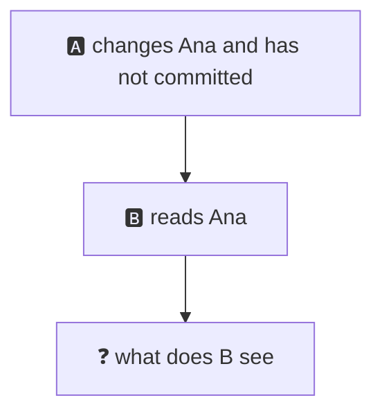
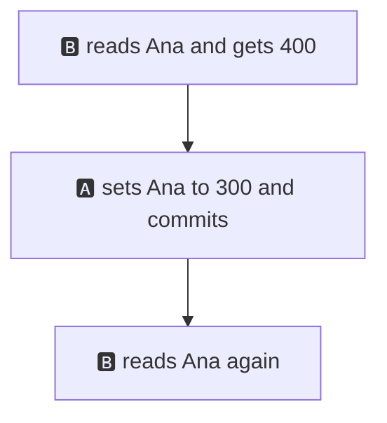
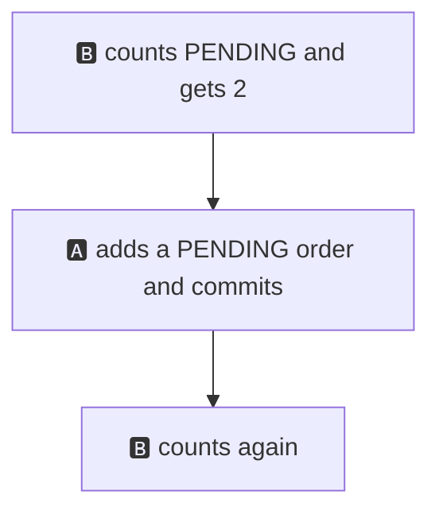
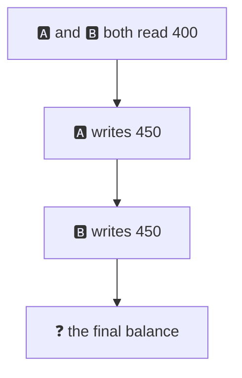
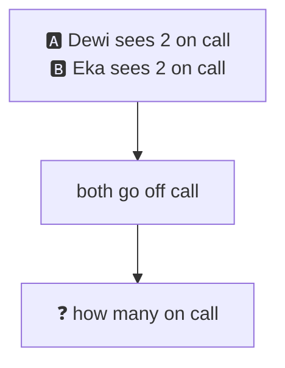
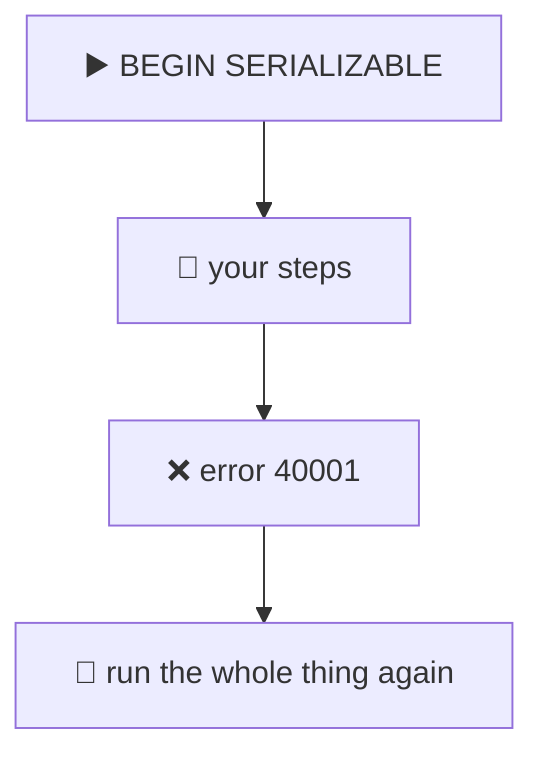
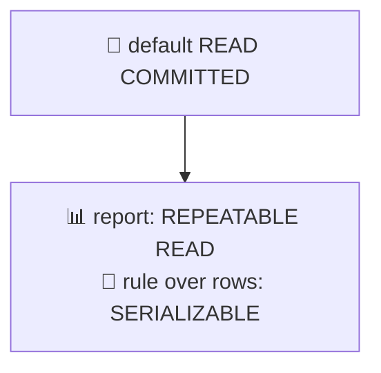

# 14. Isolation levels

> **Subject:** Database · **Lesson:** 14 · **Made:** 2026-11-01 · **Status:** ready
>
> **You will be able to:** name the problems two sessions can cause each other (non-repeatable read, phantom read, lost update, write skew), say which isolation level stops which one in Postgres, and write the retry loop that SERIALIZABLE needs.
>
> **Before this:** [Transactions and ACID](13-transactions-and-acid.md) · **Next:** [Locks and deadlocks](15-locks-and-deadlocks.md)
>
> **How to read it:** one card is one idea. Look at the picture, guess, then press the orange bar to check. The blue bars (📖 More detail) hold the longer explanation with the why and a real example. Skip them on the first read, and open them when you want more. Every result was run with two real connections on PostgreSQL 18.3. About 25 minutes for the cards.

## 1. The idea: what does B see while A is in the middle?

Lesson 13 said: other sessions do not see your half-done work. But when you commit, **when** do they start to see it? At the next statement? Only in a new transaction? The **isolation level** is the answer to that question.



<details class="guess"><summary>🤔 Guess: A set Ana to 0 but has not committed. B asks for the weakest level, <code>READ UNCOMMITTED</code>, and reads Ana. Ana was 400. What does B see, and what is the default level in Postgres? Press to check.</summary>

B sees **400**. Not the 0. Postgres has four level names, but it does not have a real "read uncommitted": `READ UNCOMMITTED` behaves like `READ COMMITTED`. I asked for it and tested it.

The default level is **`READ COMMITTED`**. I checked with `SHOW default_transaction_isolation`.

So in Postgres you have three real levels: `READ COMMITTED`, `REPEATABLE READ` and `SERIALIZABLE`.

</details>

> **Remember:** the default is READ COMMITTED. A dirty read (seeing uncommitted work) never happens in Postgres.

<details class="more"><summary>📖 More detail: the table of problems and levels</summary>

Each problem below is a card in this lesson. This table is what I measured on Postgres 18.3. "Yes" means the problem can happen.

| Problem | READ COMMITTED (default) | REPEATABLE READ | SERIALIZABLE |
|---|---|---|---|
| Dirty read (see uncommitted work) | no | no | no |
| Non-repeatable read (card 2) | **yes** | no | no |
| Phantom read (card 3) | **yes** | no | no |
| Lost update, read then write back (card 4) | **yes** | error 40001 | error 40001 |
| Write skew (card 5) | **yes** | **yes** | error 40001 |

(The SQL standard says phantom reads are allowed at REPEATABLE READ. Postgres is stricter than the standard here. In my test it did not happen.)

Set the level on one transaction:

```sql
BEGIN ISOLATION LEVEL REPEATABLE READ;
-- ... your statements ...
COMMIT;
```

</details>

## 2. Non-repeatable read: the same question, a different answer

You read a row. Someone else commits a change. You read the same row again, and it changed, while your transaction is still open.



<details class="guess"><summary>🤔 Guess: B is in a transaction and reads Ana twice. A commits a change in between. What does B read the second time, at the default level? And at <code>REPEATABLE READ</code>? Press to check.</summary>

| Level | First read | Second read |
|---|---|---|
| READ COMMITTED | 400 | **300** |
| REPEATABLE READ | 400 | **400** |

At `READ COMMITTED`, every statement sees what was committed when **that statement** started. At `REPEATABLE READ`, the whole transaction sees what was committed when the transaction's **first statement** started. Same picture of the data from start to end.

</details>

> **Remember:** READ COMMITTED takes a new picture for each statement. REPEATABLE READ takes one picture per transaction.

<details class="more"><summary>📖 More detail: when you want one picture</summary>

Take a report that runs three queries one after the other, while another session inserts a row between them. I ran it with two numbers: the count of rows and the sum of amounts. At the start there were 2 rows (100 and 200). A third row (300) was inserted between the two queries:

| Level | Count (first query) | Sum (second query) |
|---|---|---|
| READ COMMITTED | 2 | 600 |
| REPEATABLE READ | 2 | 300 |

At the default level, the report says "2 rows" and "total 600". The two numbers do not match. At `REPEATABLE READ`, they agree.

So for a **report of several queries**, use `REPEATABLE READ`. For a single statement, you do not need it, because one statement already sees one picture.

</details>

## 3. Phantom read: new rows appear

The same thing, but with rows that match your `WHERE`. You count the pending orders. Someone adds one. You count again.



<details class="guess"><summary>🤔 Guess: B counts <code>PENDING</code> orders twice in one transaction. A inserts a new <code>PENDING</code> order in between. What are the two counts at the default level? And at <code>REPEATABLE READ</code>? Press to check.</summary>

| Level | First count | Second count |
|---|---|---|
| READ COMMITTED | 2 | **3** |
| REPEATABLE READ | 2 | **2** |

The new row is a **phantom**: it was not there when B first looked, and then it appeared. At `REPEATABLE READ` Postgres hides it.

</details>

> **Remember:** a phantom is a new row that matches your WHERE. REPEATABLE READ hides it in Postgres.

<details class="more"><summary>📖 More detail: why it is the same fix as card 2</summary>

Card 2 was a changed row, card 3 is an added row. Both come from the same thing: at `READ COMMITTED`, every statement takes a new picture. With one picture for the whole transaction (`REPEATABLE READ`), neither happens.

This is one place where Postgres is better than the SQL standard. The standard allows phantoms at `REPEATABLE READ`. Postgres does not, because its picture covers all rows, not only the ones you read. The docs say so. In my test the second count stayed at 2.

A picture is not a lock. At `REPEATABLE READ`, A can still insert the new order. B just does not see it. This matters in card 5.

</details>

## 4. Lost update: two people add 50

Two sessions read Ana's balance (400), add 50 in your code, and write the result back. The right total is 500.



<details class="guess"><summary>🤔 Guess: both read 400, both write 450, at the default level. What is the final balance? And what happens in B at <code>REPEATABLE READ</code>? Press to check.</summary>

At the default level: **450.** Two +50 happened, but only one is in the table. Nobody got an error. This is a **lost update**. I ran it: `both read 400 400 final Ana = 450`.

At `REPEATABLE READ`, B gets an error instead of losing the update:

```text
ERROR:  could not serialize access due to concurrent update
```

(Error code `40001`.) B's picture says "Ana is 400", but Ana has changed since. Postgres will not let B write on top of a row it did not see.

</details>

> **Remember:** read, compute in code, write back is the lost update. Do the math in the UPDATE or take a lock.

<details class="more"><summary>📖 More detail: three ways to fix it</summary>

All three give **500** in my test.

1. **One statement does it all.** No read, no gap:

   ```sql
   UPDATE l14_accounts SET balance = balance + 50 WHERE id = 1;
   ```

   The second session waits until the first commits, then adds 50 to the **new** value. This is the best fix when you can use it.

2. **Lock the row when you read it.** Use this when you must look at the value before you decide:

   ```sql
   BEGIN;
   SELECT balance FROM l14_accounts WHERE id = 1 FOR UPDATE;
   -- decide in code, then:
   UPDATE l14_accounts SET balance = 450 WHERE id = 1;
   COMMIT;
   ```

   The second session's `SELECT ... FOR UPDATE` waits. When it gets its answer, it is 450 (A read 400, B read 450). [Lesson 15](15-locks-and-deadlocks.md) covers locks.

3. **Use `REPEATABLE READ` and retry** on the error (card 6).

</details>

## 5. Write skew: both checks were right, and the rule broke

The hospital rule: at least one doctor must stay on call. Dewi and Eka are both on call. Each checks "are there 2 or more on call?", sees yes, and goes off call. They write **different rows**.



<details class="guess"><summary>🤔 Guess: both transactions run at the same time at <code>REPEATABLE READ</code>. Both see 2 on call, then Dewi goes off and Eka goes off. How many are on call at the end? And at <code>SERIALIZABLE</code>? Press to check.</summary>

At `REPEATABLE READ` (and at the default level too): **0.** Both commits worked. The rule is broken. Each transaction was fine **on its own picture**, and they changed different rows, so there was no conflict.

At `SERIALIZABLE`, one of them fails at commit:

```text
ERROR:  could not serialize access due to read/write dependencies among transactions
DETAIL:  Reason code: Canceled on identification as a pivot, during commit attempt.
HINT:  The transaction might succeed if retried.
```

and the count at the end is **1.**

</details>

> **Remember:** write skew: two transactions read the same rows and each write a different row. Only SERIALIZABLE stops it.

<details class="more"><summary>📖 More detail: what SERIALIZABLE does</summary>

`SERIALIZABLE` promises: the result is the same as if the transactions ran **one at a time**, in some order. If Dewi ran first and Eka second, Eka would have seen "1 on call" and said no. So Postgres cancels one of them.

It does not do this by locking everything. It watches what each transaction read and wrote, and cancels one when it finds a cycle (the "pivot" in the message). Because of this, it can cancel a transaction that did nothing wrong. **You must be ready to run it again** (card 6).

Two other ways to stop write skew, without `SERIALIZABLE`: lock the rows you read (`SELECT ... FOR UPDATE` on both doctors), or put the rule in the database so that it is checked at write time (for example a constraint or a lock on one shared row).

Other examples of the same pattern: two people book the same meeting room at the same time, two users take the last username, a bank checks "total of all accounts of the customer is above 0" and two withdrawals run at once.

</details>

## 6. Serialization errors: you must retry

At `REPEATABLE READ` and `SERIALIZABLE`, Postgres sometimes says "not this time". The error code is **`40001`**. The error is **not a bug**. The message even says: "The transaction might succeed if retried."



<details class="guess"><summary>🤔 Guess: in the doctors example, the transaction that failed is run again from the start. What does it see the second time, and what does it do? Press to check.</summary>

The second time, it sees **1 doctor on call**, so the check says "not 2 or more", and it **does not** go off call. The rule holds. I ran this with a retry loop:

```text
B: attempt 1 got 40001, retrying
A: attempt 1 saw 2 on call, went off call
B: attempt 2 saw 1 on call, said no
on call now = 1
```

(Which one fails can change between runs. One of them fails.)

</details>

> **Remember:** on error 40001, run the whole transaction again from BEGIN. Give up after a few tries.

<details class="more"><summary>📖 More detail: the retry loop in Node</summary>

```js
async function withRetry(pool, work, tries = 3) {
  for (let attempt = 1; attempt <= tries; attempt++) {
    const client = await pool.connect();
    try {
      await client.query('BEGIN ISOLATION LEVEL SERIALIZABLE');
      const result = await work(client);
      await client.query('COMMIT');
      return result;
    } catch (e) {
      await client.query('ROLLBACK');
      if (e.code !== '40001' || attempt === tries) throw e;
    } finally {
      client.release();
    }
  }
}
```

Three rules:

- Retry the **whole** transaction, including the reads. The decision must be made again on new data.
- Only retry error code `40001` (and `40P01`, a deadlock, [lesson 15](15-locks-and-deadlocks.md)). Do not retry other errors.
- Do nothing outside the database inside `work` (no emails, no HTTP calls), because it may run more than once. See lesson 13, card 6.

The error can also come from the `COMMIT`, not only from a statement. Put the `COMMIT` inside the `try`, as above.

</details>

## 7. Which level should I use?

Most code never changes the level. Pick by the problem.



<details class="guess"><summary>🤔 Guess: a nightly report runs 3 queries (orders, refunds, totals) that must agree with each other, while orders keep coming in. Which level? Press to check.</summary>

**`REPEATABLE READ`**, and make it read only (`BEGIN ISOLATION LEVEL REPEATABLE READ READ ONLY`). All 3 queries use one picture, so the numbers agree (card 2). It does not block the writers, and it has no write conflicts to retry.

| Situation | Use |
|---|---|
| Normal reads and writes of single rows | default `READ COMMITTED` |
| `balance = balance + 50` | default, one statement |
| Read, decide, then write one row | default with `SELECT ... FOR UPDATE` |
| A report of many queries that must agree | `REPEATABLE READ`, read only |
| A rule over **many rows** (at least one on call, no double booking) | `SERIALIZABLE` with a retry loop, or locks |

</details>

> **Remember:** default for most work. REPEATABLE READ for reports. SERIALIZABLE for a rule over many rows, with a retry.

<details class="more"><summary>📖 More detail: the cost of a higher level</summary>

A higher level is not "safer for free":

- At `REPEATABLE READ` and `SERIALIZABLE`, your code **must** handle error `40001`. If it does not, it fails at random under load.
- `SERIALIZABLE` needs more memory and CPU to track what each transaction read. The docs advise not to put more into one serializable transaction than you need, and more of them can be cancelled when many run at once.
- A long `REPEATABLE READ` transaction keeps its picture. Old row versions cannot be cleaned up while it is open ([lesson 16](16-mvcc-and-vacuum.md)).

Many teams choose: default level, atomic `UPDATE` statements, `FOR UPDATE` where needed, and `SERIALIZABLE` only for the one or two places where a rule spans many rows.

</details>

## 8. Watch it run, step by step

Now watch two sessions at the same time. **[Open the isolation stepper](visuals/14-isolation-levels.html).** It has three tabs: the same read twice at READ COMMITTED, the same read twice at REPEATABLE READ, and write skew at SERIALIZABLE. Guess first, then press Next.

<details><summary>Or read card 2 as a table</summary>

| Step | Session | Statement | What B sees |
|---|---|---|---|
| 1 | B | `BEGIN` | |
| 2 | B | `SELECT balance` | 400 |
| 3 | A | `UPDATE ... SET balance = 300` (saved at once) | |
| 4 | B | `SELECT balance` | READ COMMITTED: **300**. REPEATABLE READ: **400** |
| 5 | B | `COMMIT` | |

</details>

## 9. Why it matters and what it costs

Interview words: *isolation level*, *READ COMMITTED*, *REPEATABLE READ*, *SERIALIZABLE*, *phantom read*, *lost update*, *write skew*, *serialization failure*.

|  | Lower level | Higher level |
|---|---|---|
| What you see | a new picture for every statement | one picture, or a one-at-a-time result |
| Speed | fastest | a little slower |
| Your code | simple | must retry error 40001 |

- **With the map,** you can say why two numbers in a report do not match, why a balance lost an update, and why a "check then write" rule broke.
- **Without it,** these bugs show up as "it happens once a week, and I cannot reproduce it".

**The costs:**

- Retry code in every place that uses a higher level.
- More memory for SERIALIZABLE, and some transactions cancelled for no fault of their own.
- At REPEATABLE READ and above, a long transaction keeps old rows alive.

## 10. Watch and play

Links checked on 2026-11-01. Each page loaded (HTTP 200). For each video, the title and channel were confirmed through YouTube's oEmbed data. The video lengths were not checked.

- **Play with it:** [The isolation stepper](visuals/14-isolation-levels.html) in this folder. Guess first, then press Next.
- **Video:** [Isolation levels (REPEATABLE READ won't save you)](https://www.youtube.com/watch?v=_6ef7AQ83rc) from the channel Hello Interview. Cards 4 and 5.
- **Video:** [How Database Isolation Levels Work](https://www.youtube.com/watch?v=cN1Iu1LMdmk) from the channel In Plain Bytes. Cards 1 to 3.
- **Read:** [Transaction Isolation](https://www.postgresql.org/docs/current/transaction-iso.html) in the PostgreSQL docs. The official table, and the three real levels. Cards 1 to 7.
- **Read:** [Concurrency Control, introduction](https://www.postgresql.org/docs/current/mvcc-intro.html). Why readers do not block writers.
- **Read:** [Data Consistency Checks at the Application Level](https://www.postgresql.org/docs/current/applevel-consistency.html). The write skew cases, and how to guard them. Card 5.

<details><summary>More links (optional)</summary>

- **Read:** [Consistency models](https://jepsen.io/consistency) on Jepsen. A map of the words (serializable, snapshot isolation, and more).
- **Read:** [Explicit Locking](https://www.postgresql.org/docs/current/explicit-locking.html). `SELECT ... FOR UPDATE` (card 4).
- **Read (revision, dense):** [Database scaling and correctness](database-scaling-and-correctness.md), Part A, the four races.

</details>

## 11. Practice

**A. Predict.** Ana has 400. A transaction at the default level reads it, then waits. Another session sets it to 300 and commits. The first session reads again, then does `UPDATE ... SET balance = balance + 50 WHERE id = 1`. What does the second read show, and what is the final balance?

<details class="guess"><summary>🤔 Press to see the answer</summary>

The second read shows **300** (a new picture per statement at the default level). The `UPDATE` adds 50 to the **current** value, so the final balance is **350**. This is why `balance = balance + 50` does not lose updates.

</details>

**B. What would you check?** A teammate says: "Our `pay` function reads the wallet balance, checks `balance >= price` in JavaScript, then runs `UPDATE wallets SET balance = <new number>`. Two taps at the same time let the balance go negative. I will switch the database to SERIALIZABLE." Is that the best fix?

<details class="guess"><summary>🤔 Press to see the answer</summary>

It would work, but it is a big hammer. A simpler fix keeps the default level and does the check and the change in one statement:

```sql
UPDATE wallets SET balance = balance - $1
WHERE id = $2 AND balance >= $1;
```

If it changes 0 rows, the balance was too low. Or take a lock first: `SELECT ... FOR UPDATE` on the wallet row (card 4). With `SERIALIZABLE`, the code **must** also retry on error 40001, or taps will fail at random. A `CHECK (balance >= 0)` on the column (lesson 08) is a good second guard.

</details>

**C. Write it yourself**

Open [`practice/14-isolation-levels.sql`](practice/14-isolation-levels.sql). You need two psql windows. It gives six tasks with the exact lines to type in each window, and the expected results: the same read twice, phantom rows, the error at `REPEATABLE READ`, write skew with the doctors, and two fixes you write yourself (one `UPDATE`, and `SELECT ... FOR UPDATE`).

<details><summary>One possible answer</summary>

```sql
-- Task 5: one statement does the whole job (run it in A, then in B, each in BEGIN ... COMMIT)
UPDATE l14_accounts SET balance = balance + 50 WHERE id = 1;

-- Task 6: the two SELECT lines
-- A:
SELECT balance FROM l14_accounts WHERE id = 1 FOR UPDATE;
-- B (waits for A to commit, then answers 450):
SELECT balance FROM l14_accounts WHERE id = 1 FOR UPDATE;
```

Results I got (checked with two connections from Node, on PostgreSQL 18.3): Task 1: 400 then 300 at the default level, 400 then 400 at `REPEATABLE READ`. Task 2: 2 then 3, and 2 then 2. Task 3: `could not serialize access due to concurrent update`, and the final balance is 450. Task 4: 0 on call at `REPEATABLE READ`, 1 on call at `SERIALIZABLE` with the error shown in card 5. Task 5: 500. Task 6: B read 450, final 500.

</details>

## 12. Interview question

**Q:** "What are the isolation levels in Postgres? What is write skew, and how do you stop it?"

<details><summary>A strong answer, in four parts</summary>

1. **Problem:** two sessions run at the same time, and each one's reads can be changed by the other's commits. Without a plan you get totals that do not match, lost updates, and broken rules. In my test, two doctors both went off call and 0 were left.
2. **How it works:** the isolation level says which commits a transaction sees. In Postgres: `READ COMMITTED` (default): a new picture for every statement. `REPEATABLE READ`: one picture per transaction, and it stops non-repeatable and phantom reads, and gives error 40001 for a lost update. `SERIALIZABLE`: the result is as if one at a time, and it stops write skew by cancelling one transaction. Postgres has no real READ UNCOMMITTED, so there are no dirty reads. At the two higher levels, the app must retry error code 40001.
3. **Tradeoff:** a higher level means more checks, more memory, and retry code. For most writes I stay at the default and use `balance = balance + x`, or `SELECT ... FOR UPDATE`. I use `REPEATABLE READ READ ONLY` for a report of several queries, and `SERIALIZABLE` with a retry loop only for rules over many rows.
4. **My example:** *This is an idea, not a fact. Replace it with a real story from DBO, Unloan, ZWS or Skyworx.* Two requests redeem points at the same time. The code reads the balance, checks it, and writes the new number, so both pass and the balance goes negative. I change it to one `UPDATE ... WHERE balance >= $1`, and add a `CHECK (balance >= 0)` as a second guard.

</details>

## 13. Explain it back

Close this file. Press the **Record my explanation** button under this heading and explain isolation levels, like to a new junior, in 4 parts: problem, how it works, tradeoff, my example. Use these numbers: 400 then 300 against 400 then 400, 2 then 3 orders, 450 instead of 500, 0 doctors on call. Then save the transcript into `my-learning/recordings/`, or write your best version below. Run `/explain-check postgres isolation` or ask `coach my explanation`.

### My explanation

<write here>

### Coach feedback

<the explain-coach agent writes here>

## 14. Review questions (day 1, 3, 7, 21)

1. What is the default isolation level in Postgres? What happens if you ask for `READ UNCOMMITTED`?
2. What is a non-repeatable read? Which level stops it?
3. What is a phantom read? What is different about Postgres here?
4. Two sessions read 400, each add 50 in code and write back. What is the final balance, and what are two fixes?
5. What is write skew? Which level stops it, and how does it stop it?
6. What does error code `40001` mean? What must your code do?
7. A report runs 3 queries that must agree. Which level and which option?

<details><summary>Answers</summary>

1. `READ COMMITTED`. `READ UNCOMMITTED` is accepted but it behaves like `READ COMMITTED`: there are no dirty reads.
2. Reading the same row twice in one transaction and getting different answers, because someone committed a change in between. `REPEATABLE READ` and `SERIALIZABLE` stop it.
3. New rows that match your WHERE appear between two reads. In Postgres, `REPEATABLE READ` also hides phantoms (the SQL standard does not require this).
4. 450, one update is lost. Fixes: `UPDATE ... SET balance = balance + 50` in one statement, or `SELECT ... FOR UPDATE` before the read. (A third: `REPEATABLE READ` and retry on the error.)
5. Two transactions read the same rows and each write a different row, and together they break a rule (both doctors go off call). Only `SERIALIZABLE` stops it, by cancelling one of them with error 40001. Or you lock the rows you read.
6. A serialization failure. The transaction was cancelled to keep the result correct. Run the whole transaction again from BEGIN, and give up after a few tries.
7. `REPEATABLE READ`, with `READ ONLY`. All 3 queries use one picture.

</details>

## 15. Go deeper (optional)

None of this is needed for the cards above.

<details><summary>Postgres does not lock readers</summary>

In the tests of this lesson, reading never waited. Only two writers on the same row waited for each other. The reason is that Postgres keeps old row versions for readers (MVCC, [lesson 16](16-mvcc-and-vacuum.md)). That is the main difference from databases that use read locks.

</details>

<details><summary>Read-only deferrable</summary>

`BEGIN ISOLATION LEVEL SERIALIZABLE READ ONLY DEFERRABLE;` waits until it can take a picture that cannot be cancelled, and then runs without any risk of error 40001. It is meant for long reports that must be fully consistent. I did not test it.

</details>

<details><summary>Hasura and Prisma</summary>

I did not test how Hasura or Prisma set the isolation level. Both let you run SQL, and Prisma can run a transaction with an isolation level option (see the transactions page on the Prisma docs, and check its version note). Look at what your own project does before you rely on a level.

</details>

<details><summary>Make the tables yourself</summary>

The practice file builds the three small tables. The results in this lesson came from the same tables, with two `pg` connections in Node 8.23.1 and `psql` on a throwaway Postgres 18.3.

</details>

## Connected lessons

- [13. Transactions and ACID](13-transactions-and-acid.md): the I in ACID. This lesson is that letter in full.
- [08. Constraints and data types](08-constraints-and-data-types.md): the `CHECK` that is the second guard in practice B.
- [15. Locks and deadlocks](15-locks-and-deadlocks.md): `SELECT ... FOR UPDATE` and why B waited.
- [16. MVCC and VACUUM](16-mvcc-and-vacuum.md): how Postgres keeps the old picture.
- [Database scaling and correctness](database-scaling-and-correctness.md): the long guide, the four races.
