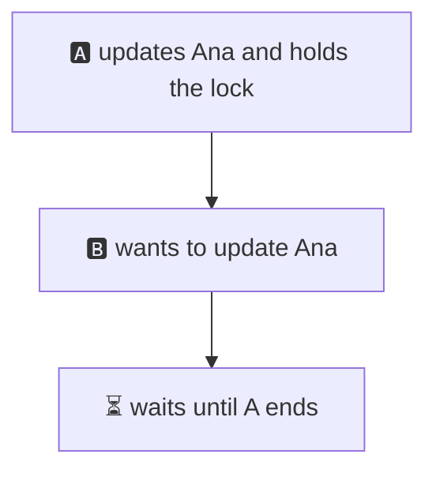
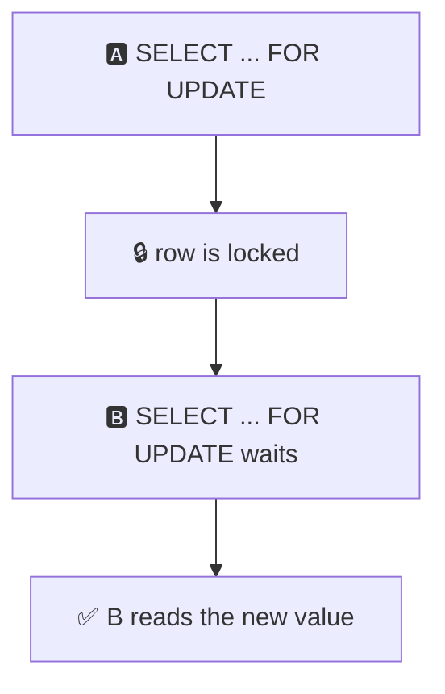
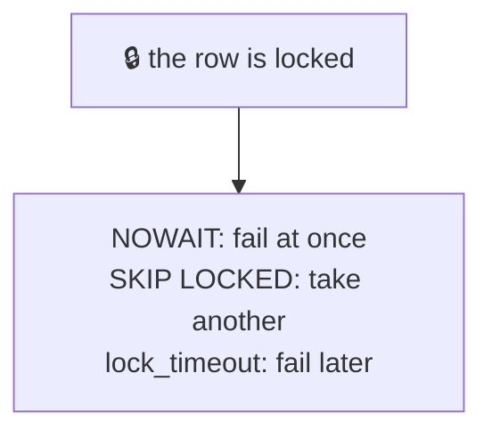
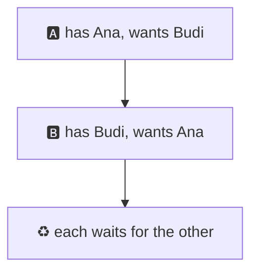
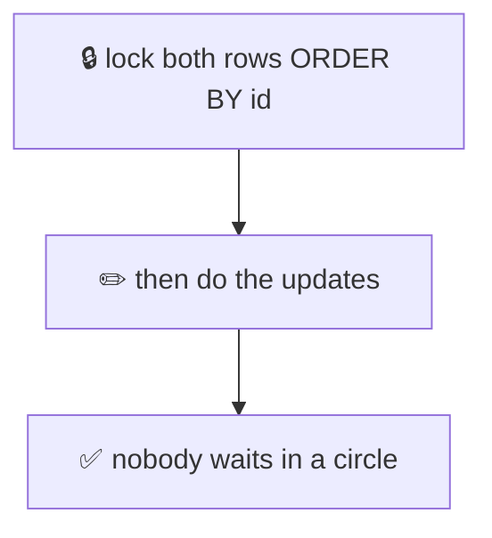
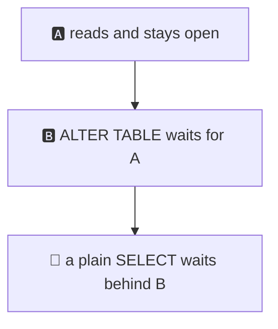
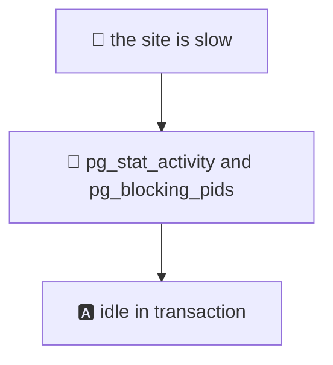

# 15. Locks and deadlocks

> **Subject:** Database · **Lesson:** 15 · **Made:** 2026-11-01 · **Status:** ready
>
> **You will be able to:** say which statements wait for a row lock and which do not, use `SELECT ... FOR UPDATE`, `NOWAIT`, `SKIP LOCKED` and `lock_timeout`, explain how a deadlock happens and how to avoid it, find who is blocking whom, and say why a waiting `ALTER TABLE` can stop a whole site.
>
> **Before this:** [Isolation levels](14-isolation-levels.md) · **Next:** [MVCC and VACUUM](16-mvcc-and-vacuum.md)
>
> **How to read it:** one card is one idea. Look at the picture, guess, then press the orange bar to check. The blue bars (📖 More detail) hold the longer explanation with the why and a real example. Skip them on the first read, and open them when you want more. Every result was run with two or three real connections on PostgreSQL 18.3. About 25 minutes for the cards.

## 1. The idea: a writer holds a key to the row

When a transaction changes a row, it holds a **lock** on that row until it commits or rolls back. Someone else who wants to change the same row must wait for the key.



<details class="guess"><summary>🤔 Guess: A updated Ana and has not committed. B wants to (a) SELECT Ana, (b) UPDATE Budi, (c) UPDATE Ana. Which of B's statements wait? Press to check.</summary>

**Only (c).** I ran all three:

```text
B select Ana    done after 0 ms
B update Budi   done after 0 ms
B update Ana    done after 800 ms   (A committed after about 800 ms)
```

- (a) **A read never waits.** B sees the last committed value (lesson 13, card 4).
- (b) **A different row never waits.** The lock is on one row, not on the table.
- (c) **The same row waits** until A commits or rolls back.

</details>

> **Remember:** a row lock stops other writers of that row. It does not stop readers, and it does not stop writers of other rows.

<details class="more"><summary>📖 More detail: what the waiting looks like</summary>

You can see a wait. While B was waiting, `pg_stat_activity` showed B with `wait_event_type = Lock` and `wait_event = transactionid`. B is really waiting for A's **transaction** to end. That is why it waits until COMMIT or ROLLBACK, not only until A's statement ends.

A's own row showed `idle in transaction`: A was not running anything, it was just holding the lock. This is the main danger of a transaction that is left open (card 7).

The lock is kept in the row itself (in its header), so locking a million rows does not fill a big lock table. Postgres docs call these **row-level locks**. There are also **table-level locks**, which card 6 uses.

</details>

## 2. SELECT ... FOR UPDATE: lock the row when you read it

Lesson 14 had a problem: read a value, decide in code, write it back. Two sessions both read the old value. If you read with `FOR UPDATE`, the second reader **waits**, and reads the new value.



<details class="guess"><summary>🤔 Guess: A did <code>SELECT ... WHERE id = 1 FOR UPDATE</code> and has not committed. B runs (a) a plain SELECT of row 1, then (b) a SELECT of row 1 with FOR UPDATE. Which waits? Press to check.</summary>

**Only (b).**

```text
B plain select   done after 0 ms
B for update     done after 600 ms   (A committed after about 600 ms)
```

A plain `SELECT` ignores row locks, so readers are never blocked by `FOR UPDATE`. Only another `FOR UPDATE` (or an `UPDATE`, or a `DELETE`) on that row waits.

</details>

> **Remember:** FOR UPDATE says "I will change this row, so nobody else may change it until I finish." Plain SELECTs are not blocked.

<details class="more"><summary>📖 More detail: the pattern, and the lost update fixed</summary>

```sql
BEGIN;
SELECT balance FROM wallets WHERE id = 1 FOR UPDATE;   -- lock and read
-- in your code: if (balance >= price) ...
UPDATE wallets SET balance = balance - 100 WHERE id = 1;
COMMIT;
```

In lesson 14, card 4, two sessions read 400 and both wrote 450. With `FOR UPDATE`, A read 400, B's `FOR UPDATE` waited, then B read **450**, and the final balance was **500**. Nothing was lost.

Keep the work between `FOR UPDATE` and `COMMIT` **short**. Everyone else who wants the row stands in line behind you.

Always try first: can one `UPDATE ... SET balance = balance - 100 WHERE id = 1 AND balance >= 100` do the whole job? It needs no `FOR UPDATE`, and it is shorter.

</details>

## 3. Do not wait forever: NOWAIT, SKIP LOCKED, lock_timeout

By default a waiter waits as long as it takes. Three ways to say "not that long".



<details class="guess"><summary>🤔 Guess: A holds <code>FOR UPDATE</code> on row 1 of 3 rows. What does B get with (a) <code>FOR UPDATE NOWAIT</code>, (b) <code>FOR UPDATE SKIP LOCKED</code> over all rows, (c) an UPDATE of row 1 with <code>lock_timeout = '500ms'</code>? Press to check.</summary>

```text
(a) ERROR: could not obtain lock on row in relation "l15_accounts"      (after 0 ms, code 55P03)
(b) rows 2 and 3, row 1 is skipped
(c) ERROR: canceling statement due to lock timeout                      (after 500 ms, code 55P03)
```

</details>

> **Remember:** NOWAIT fails at once. SKIP LOCKED skips locked rows. lock_timeout gives up after a time.

<details class="more"><summary>📖 More detail: when to use each</summary>

- **`NOWAIT`:** when waiting is useless. "Someone else is already editing this order. Tell the user."
- **`SKIP LOCKED`:** when any free row will do. This is how a **job queue** works: many workers each take the next job that nobody has locked. [Lesson 18](18-upsert-idempotency-and-job-queues.md) builds a queue with it.
- **`lock_timeout`:** a safety net for any statement. `SET lock_timeout = '2s'` makes a statement fail if it waits more than 2 seconds for a lock. It does not limit how long the statement **runs**, only how long it **waits**. (That is `statement_timeout`.) The error code is the same, `55P03`, so your code can retry.

For a web request, a short `lock_timeout` is almost always better than waiting for a minute while the user's browser spins.

</details>

## 4. A deadlock: each one waits for the other

A moves money from Ana to Budi. B moves money from Budi to Ana. They run at the same time. Each locks its first row, then needs the other's row.



<details class="guess"><summary>🤔 Guess: both transactions are stuck, each waiting for a row the other holds. What does Postgres do, and how long does it take? Press to check.</summary>

Postgres notices after about **1 second** (`deadlock_timeout`), and **kills one** of the two:

```text
ERROR:  deadlock detected
DETAIL:  Process 52904 waits for ShareLock on transaction 1039; blocked by process 52905.
Process 52905 waits for ShareLock on transaction 1038; blocked by process 52904.
HINT:  See server log for query details.
```

(Error code `40P01`.) In my run, A was cancelled after 1000 ms, and then B's update finished at once. A's transaction was rolled back, so it needs to run again. B kept its work: Ana 410, Budi 390.

</details>

> **Remember:** a deadlock is a circle of waiting. Postgres breaks it by cancelling one transaction. Your code must retry it.

<details class="more"><summary>📖 More detail: why waiting forever is not allowed, and which one dies</summary>

Without a rule, the two would wait forever. So after `deadlock_timeout` (default 1 second) a waiting session checks if the waits form a circle. If yes, it cancels itself or the other (you do not control which). The **log** names both queries, which is what the hint means.

Not every wait is a deadlock. If A waits for B, and B is just slow, that is only a wait. Postgres checks only after one second, so a short wait costs nothing extra.

The retry is the same as in lesson 14, card 6: run the **whole** transaction again from `BEGIN`. Retry on `40001` and on `40P01`.

</details>

## 5. Avoiding deadlocks: always lock in the same order

A deadlock needs the two to lock rows in **opposite** order. If every transaction locks in the same order (for example by id, smallest first), a circle cannot form.



<details class="guess"><summary>🤔 Guess: the same two transfers (Ana to Budi, Budi to Ana), but each first runs <code>SELECT ... WHERE id IN (...) ORDER BY id FOR UPDATE</code>. What happens? Press to check.</summary>

**No deadlock.** One transfer gets both locks, the other waits at its first statement, and both finish. In my run, both were done in about 0 ms of waiting, and the balances were 400, 400, 400 (the two transfers cancel out):

```sql
BEGIN;
SELECT id FROM l15_accounts
WHERE id IN (1, 2)
ORDER BY id
FOR UPDATE;
-- now do both UPDATEs, in any order
COMMIT;
```

The `ORDER BY id` is the important part. Both sessions ask for row 1 first, so one of them simply waits.

</details>

> **Remember:** lock the rows you need in one fixed order (ORDER BY id) at the start. Keep transactions short.

<details class="more"><summary>📖 More detail: more ways to stay out of deadlocks</summary>

1. **Same order** everywhere. This is the main fix. It works for rows in one table, and for tables (always touch `accounts` before `orders`).
2. **Short transactions.** The less time you hold locks, the fewer chances to meet.
3. **Lock everything you need first.** A transaction that locks, then thinks, then locks more is at risk.
4. **Retry.** You cannot make it impossible in a big system. Run the whole transaction again on `40P01`.
5. **One statement.** `UPDATE ... WHERE id IN (1, 2)` locks the rows it changes in one pass. But the order in which one statement locks its rows is not promised, so two statements that touch the same rows can still meet.

Other places where deadlocks can come from: two `INSERT`s with the same unique key, foreign keys (a child insert takes a light lock on the parent row), and `UPDATE`s inside a loop where the loop order differs between requests. I did not test these.

</details>

## 6. A waiting ALTER TABLE blocks everyone behind it

Table changes need a strong lock. Reads take a very light lock. They are friends, until a strong lock **waits** in line.



<details class="guess"><summary>🤔 Guess: A did a plain SELECT on a table and left its transaction open. B runs <code>ALTER TABLE ... ADD COLUMN</code> and has to wait for A. Then C runs a plain SELECT on the same table. Does C wait? Press to check.</summary>

**Yes.** C only reads, but it waited behind B. After a second it was still waiting:

```text
C plain select (1 s limit) ERROR after 1000 ms: still waiting after 1 s
waiting: alter table ...  (Lock), select count(*) ...  (Lock)
```

When A committed, B's ALTER ran at once, and C was answered right after. The problem: **one forgotten open transaction + one ALTER = the table is closed for everyone.**

The fix is a short `lock_timeout` on the ALTER:

```text
B alter with lock_timeout   ERROR after 300 ms: canceling statement due to lock timeout
C select (no wait)          done after 0 ms
```

B gives up after 0.3 seconds, and nobody else is blocked. Run it again later.

</details>

> **Remember:** a waiting ALTER TABLE also blocks the readers behind it. Run it with a short lock_timeout.

<details class="more"><summary>📖 More detail: the queue and the modes</summary>

Locks are served **in order**. A new request has to wait if it conflicts with a lock that is **already waiting**, not only with one that is already granted. The `ALTER TABLE` asks for the strongest mode, `ACCESS EXCLUSIVE`, which conflicts with every other mode, even the light lock a `SELECT` takes. So C queued behind B.

There are eight table lock modes. You do not need all of them. These three are enough:

| What you run | Table lock it takes | Blocks |
|---|---|---|
| `SELECT` | `ACCESS SHARE` | only `ACCESS EXCLUSIVE` |
| `INSERT` / `UPDATE` / `DELETE` | `ROW EXCLUSIVE` | `SHARE` and stronger (for example a normal `CREATE INDEX`) |
| most `ALTER TABLE` | `ACCESS EXCLUSIVE` | everything |

The full table is in the docs (see card 10). Lesson 19 (zero-downtime migrations, not written yet) builds on this card: how to change a live table in small steps, each with a short `lock_timeout`.

</details>

## 7. Who is blocking? Find the lock

When the site "hangs", the first question is "who is waiting, and for whom?"



<details class="guess"><summary>🤔 Guess: B is waiting for a lock. In <code>pg_stat_activity</code>, what is the state of the session that holds the lock (A), if A is not running anything? Press to check.</summary>

A is **`idle in transaction`**: it opened a transaction, changed a row, and is doing nothing now. This query lists every waiting session and who blocks it:

```sql
SELECT pid, pg_blocking_pids(pid) AS blocked_by, wait_event_type, state,
       left(query, 40) AS query
FROM pg_stat_activity
WHERE cardinality(pg_blocking_pids(pid)) > 0;
```

My run gave one row: B's pid, `blocked_by` = A's pid, `wait_event_type = Lock`, state `active`. Then A's own row in `pg_stat_activity` said `idle in transaction`.

</details>

> **Remember:** a wait always has a holder. Often the holder is idle in transaction. Set a timeout so it cannot stay that way.

<details class="more"><summary>📖 More detail: the timeout that frees a forgotten transaction</summary>

`idle_in_transaction_session_timeout` ends a session that sits in a transaction without sending anything. I set it to 1 second on A, waited 1.6 seconds, and B's update went through at once, because A's connection was **terminated**. A's next statement failed:

```text
terminating connection due to idle-in-transaction timeout   (code 25P03)
```

In Node, this arrives as an `error` event on that client, and the `pg` library throws it unhandled if you have no listener. Add `client.on('error', ...)` on pool clients, and set the timeout in the database (`ALTER DATABASE ... SET idle_in_transaction_session_timeout = '30s'`) or per role.

You can kill a stuck session yourself: `SELECT pg_terminate_backend(pid);`. Do it only when you know what that session is doing. Its transaction is rolled back.

Where do forgotten transactions come from? A `BEGIN` without a `finally` that rolls back (lesson 13, card 7), a transaction that waits for an HTTP call, a debugger paused on a request, or a psql window that someone left open at lunch.

</details>

## 8. Watch it run, step by step

Now watch the waiting from both sides. **[Open the lock stepper](visuals/15-locks-and-deadlocks.html).** It has three tabs: B waits for A's row lock, a deadlock, and an ALTER TABLE that blocks a reader. Guess first, then press Next.

<details><summary>Or read the deadlock as a table</summary>

| Step | Session | Statement | State |
|---|---|---|---|
| 1 | A | `BEGIN` | |
| 2 | B | `BEGIN` | |
| 3 | A | `UPDATE ... WHERE id = 1` | A holds row 1 |
| 4 | B | `UPDATE ... WHERE id = 2` | B holds row 2 |
| 5 | A | `UPDATE ... WHERE id = 2` | A waits for B |
| 6 | B | `UPDATE ... WHERE id = 1` | B waits for A: a circle |
| 7 | | after 1 second | Postgres cancels one of them: `deadlock detected` |
| 8 | the other | | its update finishes |

</details>

## 9. Why it matters and what it costs

Interview words: *row lock*, *SELECT FOR UPDATE*, *deadlock*, *lock ordering*, *SKIP LOCKED*, *lock timeout*, *idle in transaction*, *ACCESS EXCLUSIVE*.

|  | Without a plan | With a plan |
|---|---|---|
| Two writers, one row | one waits, nobody knows why | `FOR UPDATE`, or one `UPDATE` statement |
| Opposite lock order | random deadlocks | lock in id order, and retry on `40P01` |
| A schema change | the site hangs | short `lock_timeout`, run again |

- **With the map,** you can find the blocker in a minute, and you know the three fixes: same order, short transactions, timeouts.
- **Without it,** "the database is slow" is the whole report, and the fix is a restart.

**The costs:**

- A lock held for a long time makes everyone else wait.
- `FOR UPDATE` on a popular row makes it a single-file line. Throughput of that row is one transaction at a time.
- Retries and timeouts must be in your code, or users see errors.

## 10. Watch and play

Links checked on 2026-11-01. Each page was opened. For each video, the title and channel were confirmed through YouTube's oEmbed data. The video lengths were not checked.

- **Play with it:** [The lock stepper](visuals/15-locks-and-deadlocks.html) in this folder. Guess first, then press Next.
- **Video:** [All Postgres Locks Explained | A Deep Dive](https://www.youtube.com/watch?v=URwmzTeuHdk) from the channel Hussein Nasser. Cards 1 and 6.
- **Video:** [Database Deadlocks Easily Explained](https://www.youtube.com/watch?v=9Zw3ay3_tCQ) from the channel Software Developer Diaries. Cards 4 and 5.
- **Read:** [Explicit Locking](https://www.postgresql.org/docs/current/explicit-locking.html) in the PostgreSQL docs. Table locks, row locks, and the deadlock section (cards 1 to 6).
- **Read:** [Lock Management settings](https://www.postgresql.org/docs/current/runtime-config-locks.html). `deadlock_timeout` (card 4).
- **Read:** [Client Connection Defaults](https://www.postgresql.org/docs/current/runtime-config-client.html). `lock_timeout` and `idle_in_transaction_session_timeout` (cards 3 and 7).
- **Read:** [System Information Functions](https://www.postgresql.org/docs/current/functions-info.html). `pg_blocking_pids` (card 7).
- **Read:** [The pg_locks view](https://www.postgresql.org/docs/current/view-pg-locks.html). The raw list of every lock.

<details><summary>More links (optional)</summary>

- **Read:** [Viewing Locks](https://www.postgresql.org/docs/current/monitoring-locks.html). How to read the lock list.
- **Read (revision, dense):** [Database scaling and correctness](database-scaling-and-correctness.md), Part A. The toolbox from simplest to heaviest.

</details>

## 11. Practice

**A. Predict.** A runs `BEGIN; UPDATE accounts SET balance = 0 WHERE id = 1;` and stops. B runs `UPDATE accounts SET balance = 1 WHERE id = 2;`, then `SELECT * FROM accounts WHERE id = 1 FOR UPDATE;`. Which of B's statements waits, and what does B see after A rolls back?

<details class="guess"><summary>🤔 Press to see the answer</summary>

The `UPDATE` of row 2 does **not** wait (different row). The `SELECT ... FOR UPDATE` of row 1 **waits**, because A holds the lock on row 1. After A rolls back, B gets row 1 with the **old** value (400), because A's change was undone.

</details>

**B. What would you check?** On a Monday morning the site hangs for two minutes. The log shows one `ALTER TABLE orders ADD COLUMN ...` from the migration job, and then hundreds of waiting `SELECT`s. What happened, and what do you change?

<details class="guess"><summary>🤔 Press to see the answer</summary>

The `ALTER TABLE` asked for an `ACCESS EXCLUSIVE` lock and had to wait for an older open transaction (often a long report or an `idle in transaction` session). All new `SELECT`s queued behind the `ALTER`.

Check: `pg_stat_activity` and `pg_blocking_pids` to find the old transaction. Change: run migrations with `SET lock_timeout = '2s'` so the ALTER gives up instead of blocking the site, retry it in a loop, and set `idle_in_transaction_session_timeout` so old forgotten transactions cannot sit there (card 6 and card 7).

</details>

**C. Write it yourself**

Open [`practice/15-locks-and-deadlocks.sql`](practice/15-locks-and-deadlocks.sql). You need two or three psql windows. It gives seven tasks with the exact lines to type in each window: which statements wait, `FOR UPDATE`, `NOWAIT` and `SKIP LOCKED`, a real deadlock, a transfer that cannot deadlock (you write it), a query that finds the blocker (you write it), and the waiting `ALTER TABLE`.

<details><summary>One possible answer</summary>

```sql
-- Task 5: lock both rows in id order, first thing after BEGIN (the same in window A and B)
BEGIN;
SELECT id FROM l15_accounts
WHERE id IN (1, 2)
ORDER BY id
FOR UPDATE;
-- A: UPDATE l15_accounts SET balance = balance - 10 WHERE id = 1;
-- A: UPDATE l15_accounts SET balance = balance + 10 WHERE id = 2;
-- B: UPDATE l15_accounts SET balance = balance - 10 WHERE id = 2;
-- B: UPDATE l15_accounts SET balance = balance + 10 WHERE id = 1;
COMMIT;

-- Task 6: in window C
SELECT pid, pg_blocking_pids(pid) AS blocked_by, wait_event_type, state,
       left(query, 40) AS query
FROM pg_stat_activity
WHERE cardinality(pg_blocking_pids(pid)) > 0;
```

Results I got (two or three connections from Node, on PostgreSQL 18.3): Task 1: only B's last UPDATE waited (800 ms in my run). Task 2: the plain SELECT did not wait, `FOR UPDATE` waited. Task 3: `could not obtain lock on row in relation`, rows 2 and 3, and `canceling statement due to lock timeout` after 500 ms. Task 4: `deadlock detected` after 1000 ms. Task 5: no deadlock, balances 400, 400, 400. Task 6: one row, B, blocked by A's pid, and A was `idle in transaction`. Task 7: C waited behind the ALTER; with `lock_timeout = '300ms'` the ALTER failed after 300 ms and C did not wait.

</details>

## 12. Interview question

**Q:** "What is a deadlock? How do you avoid it? What do you do when a query is stuck waiting for a lock?"

<details><summary>A strong answer, in four parts</summary>

1. **Problem:** a transaction that changes a row holds its lock until it ends. Two transactions that each hold a row the other wants wait forever, and a forgotten open transaction can stop a whole table.
2. **How it works:** a row lock blocks other writers of that row, but not readers and not writers of other rows. `SELECT ... FOR UPDATE` takes the lock on read. `NOWAIT`, `SKIP LOCKED` and `lock_timeout` say how long to wait. A deadlock is a circle of waits: after `deadlock_timeout` (1 second) Postgres cancels one transaction with error `40P01`. To avoid it, I lock rows in the same order everywhere (`ORDER BY id`), keep transactions short, and retry on `40P01`. To find a stuck wait, I use `pg_stat_activity` with `pg_blocking_pids`, and often the holder is `idle in transaction`.
3. **Tradeoff:** locks give correctness but they cost throughput: a popular row becomes a single-file line. A waiting `ALTER TABLE` also blocks readers behind it, so I run schema changes with a short `lock_timeout` and retry. `idle_in_transaction_session_timeout` frees forgotten transactions, at the price of killing slow-but-valid ones.
4. **My example:** *This is an idea, not a fact. Replace it with a real story from DBO, Unloan, ZWS or Skyworx.* A points-transfer between two wallets. Two opposite transfers deadlock once a week. I fix it by locking both wallet rows in id order at the start, and I add a retry on `40P01`.

</details>

## 13. Explain it back

Close this file. Press the **Record my explanation** button under this heading and explain locks and deadlocks, like to a new junior, in 4 parts: problem, how it works, tradeoff, my example. Use these numbers: 800 ms wait against 0 ms for a read, deadlock found after 1000 ms, ALTER failing after 300 ms. Then save the transcript into `my-learning/recordings/`, or write your best version below. Run `/explain-check postgres locks` or ask `coach my explanation`.

### My explanation

<write here>

### Coach feedback

<the explain-coach agent writes here>

## 14. Review questions (day 1, 3, 7, 21)

1. A has updated a row and not committed. Which of B's statements wait: a SELECT of that row, an UPDATE of another row, an UPDATE of that row?
2. What does `SELECT ... FOR UPDATE` do, and when do you use it?
3. Name three ways to avoid waiting for ever. What error code do `NOWAIT` and `lock_timeout` give?
4. How does a deadlock happen? What does Postgres do, how long does it take, and what must your code do?
5. What is the main way to avoid deadlocks? Give the SQL.
6. A waiting `ALTER TABLE` blocks plain SELECTs behind it. Why, and how do you protect the site?
7. A query is stuck. How do you find who blocks it, and what state does a forgotten transaction show?

<details><summary>Answers</summary>

1. Only the UPDATE of that same row. A SELECT never waits for a row lock, and a different row has its own lock.
2. It locks the rows it returns until the end of the transaction, so nobody else can change them. Use it when you must read a value and then decide before you write (when one `UPDATE` cannot do the whole job).
3. `NOWAIT` (fail at once), `SKIP LOCKED` (leave out locked rows), `lock_timeout` (fail after a time). `NOWAIT` and `lock_timeout` give `55P03`.
4. Two transactions lock rows in opposite order and each waits for the other. After `deadlock_timeout` (1 second) Postgres cancels one with `40P01 deadlock detected`. Your code must run the whole transaction again.
5. Always lock the rows in the same order, for example `SELECT ... WHERE id IN (...) ORDER BY id FOR UPDATE` right after `BEGIN`.
6. `ALTER TABLE` needs the strongest lock and waits for older transactions. New SELECTs queue behind the waiting ALTER. Use a short `lock_timeout` on the ALTER and retry, and find and end old transactions.
7. `pg_stat_activity` with `pg_blocking_pids(pid)`. The holder is often `idle in transaction`. Use `idle_in_transaction_session_timeout` so they cannot stay there.

</details>

## 15. Go deeper (optional)

None of this is needed for the cards above.

<details><summary>Advisory locks: a lock you name yourself</summary>

`pg_advisory_xact_lock(42)` takes a lock on the number 42, not on a row. Any code that agrees to use 42 as "the lock for the nightly job" can use it. I tested it: while A held it, `pg_try_advisory_lock(42)` in B returned `false`, and after A committed it returned `true`. Use it for "only one worker may run this job", when there is no row to lock. The xact version is released at the end of the transaction. The plain `pg_advisory_lock` is kept until you unlock it or the session ends.

</details>

<details><summary>Foreign keys take locks too</summary>

When you insert a child row (an order for store 1), Postgres takes a light lock on the parent row (store 1), so nobody can delete the store before your insert commits. This is why a foreign key can be part of a deadlock or a wait. I did not test it here.

</details>

<details><summary>Optimistic locking: no lock at all</summary>

Instead of locking the row, you read a `version` number, and write with `UPDATE ... SET ..., version = version + 1 WHERE id = $1 AND version = $2`. If it changed 0 rows, someone else got there first, and you reload and retry. This suits "a user edits a form for 5 minutes", where holding a lock would be wrong. The long guide compares both styles.

</details>

<details><summary>Hasura and Prisma</summary>

I did not test how Hasura or Prisma lock rows. Look at the SQL your own project sends (Postgres log or `pg_stat_statements`) before you decide whether you need `FOR UPDATE`. Prisma can send raw SQL for it.

</details>

<details><summary>Make the tables yourself</summary>

The practice file builds the two small tables. The results in this lesson came from the same tables, with `pg` 8.23.1 in Node and a throwaway Postgres 18.3. Times (800 ms, 600 ms, 1000 ms) are mostly the delays I put into my script, so your numbers will differ.

</details>

## Connected lessons

- [13. Transactions and ACID](13-transactions-and-acid.md): why B waited in card 4. Locks live until the transaction ends.
- [14. Isolation levels](14-isolation-levels.md): the lost update that `FOR UPDATE` fixes, and the retry loop for `40001`.
- [06. Keys and relationships](06-keys-and-relationships.md): a foreign key check also takes a lock.
- [16. MVCC and VACUUM](16-mvcc-and-vacuum.md): why readers do not need locks.
- [18. Upsert, idempotency and job queues](18-upsert-idempotency-and-job-queues.md): `SKIP LOCKED` as a queue.
- Lesson 19, zero-downtime migrations (not written yet): card 6 in practice.
- [Database scaling and correctness](database-scaling-and-correctness.md): the long guide.
