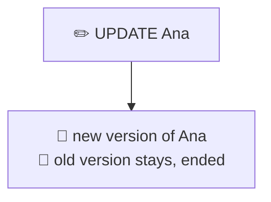
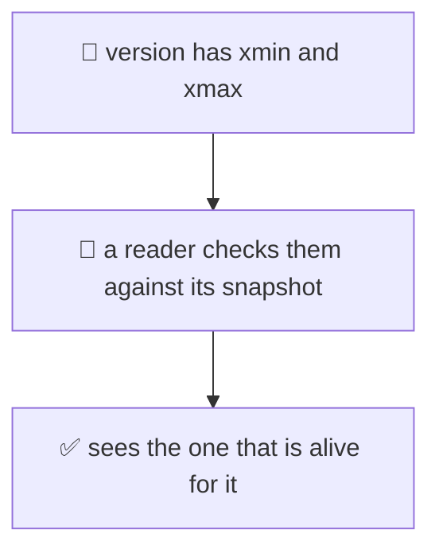
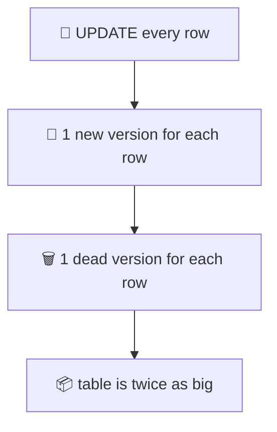
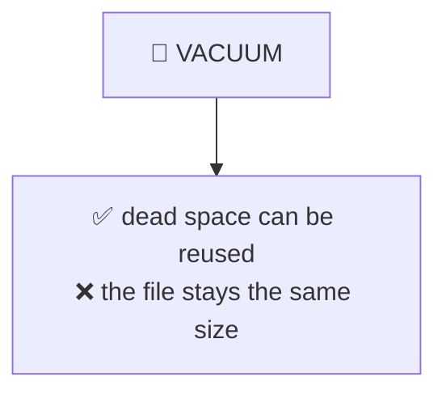
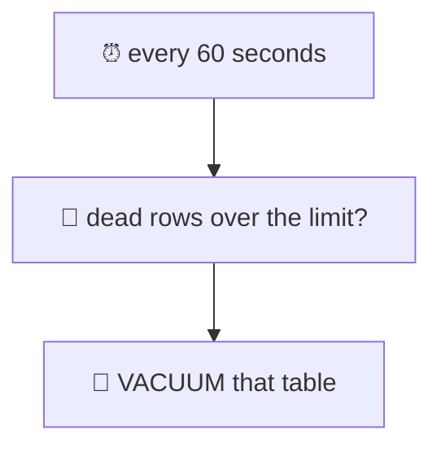
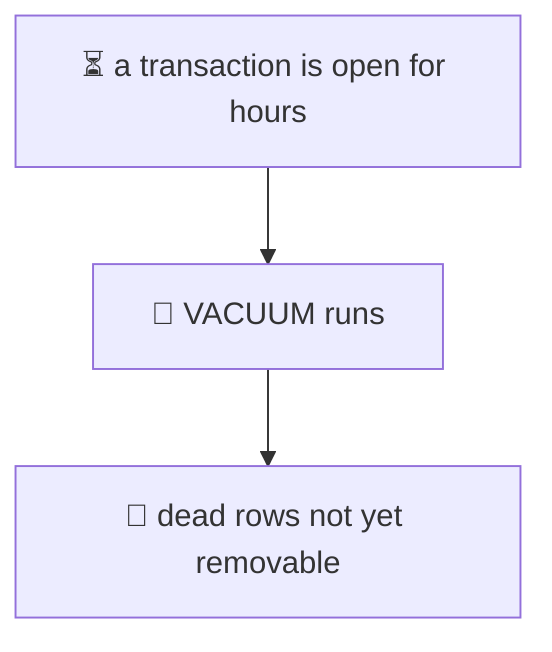
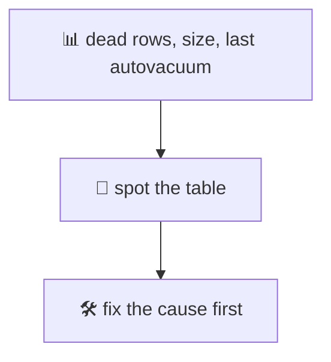

# 16. MVCC and VACUUM

> **Subject:** Database · **Lesson:** 16 · **Made:** 2026-11-01 · **Status:** ready
>
> **You will be able to:** say why an UPDATE in Postgres writes a new row and keeps the old one, read `xmin`, `xmax` and `ctid`, explain why a table grows (bloat), say what VACUUM, VACUUM FULL and autovacuum do, and find the long transaction that stops the cleanup.
>
> **Before this:** [Locks and deadlocks](15-locks-and-deadlocks.md) · **Next:** [Pagination](17-pagination.md)
>
> **How to read it:** one card is one idea. Look at the picture, guess, then press the orange bar to check. The blue bars (📖 More detail) hold the longer explanation with the why and a real example. Skip them on the first read, and open them when you want more. Every number was run on PostgreSQL 18.3. About 25 minutes for the cards.

## 1. The idea: an UPDATE writes a new row

In Postgres, an UPDATE does not change a row where it lies. It writes a **new version** of the row, and leaves the old version where it was. The old version is marked "ended".



Why? So that a reader who started a moment ago can still see the old version. Readers and writers do not wait for each other. This idea has a name: **MVCC**, multi-version concurrency control.

<details class="guess"><summary>🤔 Guess: a table has 2 rows (Ana and Budi). You UPDATE Ana once. How many row versions are now on the table's page: 2, 3, or 1? Press to check.</summary>

**3.** The new Ana, the old Ana, and Budi. I looked inside the page with the `pageinspect` extension:

```text
 lp | t_xmin | t_xmax | t_ctid
----+--------+--------+--------
  1 |   1057 |   1059 | (0,3)      <- old Ana, ended by transaction 1059
  2 |   1057 |      0 | (0,2)      <- Budi
  3 |   1059 |      0 | (0,3)      <- new Ana
```

</details>

> **Remember:** an UPDATE is a new version plus an old version marked as ended. The old one stays until it is cleaned.

<details class="more"><summary>📖 More detail: what a DELETE does</summary>

A DELETE does the same thing without the new version: it only **marks** the old version as ended. I deleted Budi, and his version (slot 2) got `t_xmax = 1060`. The bytes stayed on the page.

So after an UPDATE or a DELETE, the table still holds the old data. Nothing is cleaned at that moment. That is why a table can be bigger than its rows (cards 3 and 4).

An INSERT that is rolled back also leaves a version behind. It is just never visible, because the transaction that made it is marked aborted.

</details>

## 2. xmin, xmax and the address

Every version carries two numbers: **`xmin`** is the transaction that created it, **`xmax`** is the transaction that ended it (0 if nobody did). Each version has an address, the **`ctid`** (page number, slot number).



<details class="guess"><summary>🤔 Guess: you run <code>SELECT ctid, xmin, xmax, *</code> before and after an UPDATE of Ana. What changes for Ana's row, and what stays for Budi's? Press to check.</summary>

Ana's row got a **new address and a new xmin**. Budi's did not change:

```text
before:  Ana  ctid (0,1)  xmin 1057   Budi  ctid (0,2)  xmin 1057
after:   Ana  ctid (0,3)  xmin 1059   Budi  ctid (0,2)  xmin 1057
```

The row looks the same to you (same id, new name), but it is a **different version** in a different slot. This is also why an UPDATE needs new index entries (lesson 26): the address changed.

</details>

> **Remember:** xmin made it, xmax ended it, ctid is where it lives. An UPDATE gives the row a new ctid.

<details class="more"><summary>📖 More detail: how a reader picks a version</summary>

When a statement (or a transaction, at `REPEATABLE READ`, lesson 14) starts, it takes a **snapshot**: the list of transactions that were finished at that moment. For every version it meets, the reader asks two things:

1. Did the transaction in `xmin` finish (commit) **before** my snapshot? If not, this version does not exist for me yet.
2. Is `xmax` empty, or did that transaction finish **after** my snapshot? If so, this version is still alive for me.

If both are yes, the reader sees this version. The check is cheap and it takes **no lock**. This is why, in lesson 15, a plain SELECT never waited for a row lock.

A COMMIT is small, too: Postgres only marks the transaction as committed. It does not touch the rows.

</details>

## 3. Dead rows pile up: the table grows

An old version that no reader can ever need again is **dead**. Dead versions still take space on the page.



<details class="guess"><summary>🤔 Guess: a table of 100,000 rows takes 5088 kB. You run <code>UPDATE ... SET n = n + 1</code> on every row once. How big is the table now? Press to check.</summary>

**10176 kB**, twice as big, for the same 100,000 rows. I counted exactly with the `pgstattuple` extension:

```text
 table_size |  live  |  dead  
------------+--------+--------
 5088 kB    | 100000 |      0     (start)
 10176 kB   | 100000 | 100000     (after one UPDATE of every row)
```

The column `n` has no index, but the primary key index grew too, from 2208 kB to 4408 kB, because the new versions needed new index entries.

</details>

> **Remember:** every UPDATE and DELETE leaves a dead row. Dead rows take space until someone cleans them.

<details class="more"><summary>📖 More detail: why not twice again?</summary>

I ran a second UPDATE of every row, and the table became only 15 MB, not 20 MB. Postgres can clean a page a little while it is working on it (a short "page prune"), and then it reuses the space. The big picture stays: **the table grows when you update many rows, and it does not shrink by itself.**

The pages are 8 KB each. This table was about 640 pages at the start (5088 kB), and about 1900 pages after two updates. Lesson 26, card 3, shows the case where an UPDATE does not need new index entries (a HOT update). In this test the pages were full, so the updates were not HOT.

</details>

## 4. VACUUM: make the space reusable

**`VACUUM`** goes through the table, finds dead versions that nobody can need, and marks their space as free **for new rows**.



<details class="guess"><summary>🤔 Guess: the table is 15 MB with many dead rows. You run <code>VACUUM</code>. What is the file size after it? Then you update every row again: does the table grow? Press to check.</summary>

The file is still **15 MB**. VACUUM does not give space back to the operating system. But the free space is counted:

```text
after 2 updates:    15 MB   dead 100000   free 4.6 MB
after VACUUM:       15 MB   dead 0        free 9.9 MB
update every row:   15 MB   dead 100000   free 5.0 MB    <- the table did NOT grow
```

The new versions went into the freed space. So VACUUM stops the growth. `VACUUM FULL` shrinks the file, by writing a fresh copy of the table:

```text
after VACUUM FULL:  5088 kB   dead 0   free 0.0
```

</details>

> **Remember:** VACUUM frees space for reuse and keeps the file the same size. VACUUM FULL makes it smaller, but it rewrites the table and blocks it.

<details class="more"><summary>📖 More detail: what to run, and when</summary>

| Command | What it does | Locks the table? |
|---|---|---|
| `VACUUM` | marks dead space reusable, updates the visibility map | no, reads and writes go on |
| `VACUUM FULL` | writes a new, compact copy of the table and its indexes | **yes**, the docs say it takes an `ACCESS EXCLUSIVE` lock, so even reads wait (lesson 15, card 6) |

Use plain `VACUUM` (or let autovacuum do it) almost always. Use `VACUUM FULL` only for a table that is **much** bigger than it needs to be and will not grow again, and only when you can afford the lock. I did not test `pg_repack`, an extension that does the same job with a short lock.

A **DELETE** of half the rows (I deleted 50,000 of 100,000, then ran VACUUM) left the table at 5088 kB. The space became free inside the file, but the file did not shrink. VACUUM can cut empty pages only at the **end** of the file.

`VACUUM VERBOSE` prints what it did. In my run for two updates of 100,000 rows:

```text
tuples: 3 removed, 100000 remain, 0 are dead but not yet removable
index scan needed: ... had 199997 dead item identifiers removed
```

It also sets the **visibility map**, which lets index-only scans skip the table (lesson 25).

</details>

## 5. Autovacuum: the cleaner that runs by itself

You do not run VACUUM by hand. A background process, **autovacuum**, does it for every table, when enough rows changed.



<details class="guess"><summary>🤔 Guess: the default rule is: vacuum a table when dead rows are more than <code>50 + 0.2 × (number of rows)</code>. For a table of 100,000 rows, how many dead rows are needed? Press to check.</summary>

**20,050.** The two defaults are `autovacuum_vacuum_threshold = 50` and `autovacuum_vacuum_scale_factor = 0.2` (20% of the table). I read them from `pg_settings`.

Autovacuum looks every `autovacuum_naptime`, which is 60 seconds by default. In my test, I made a table of 1000 rows, updated all of them and deleted 100, which left 1100 dead rows. About 30 seconds later:

```text
t=30s  2026-11-01 20:58:25+07 | dead=0 | autovacuum_count=1
```

Autovacuum had run on its own, and the dead rows were gone.

</details>

> **Remember:** autovacuum is on by default and cleans a table after about 20% of its rows are dead. Do not turn it off.

<details class="more"><summary>📖 More detail: big tables, and per-table settings</summary>

20% is fine for a small table. For a table with **100 million** rows, 20% is 20 million dead rows before the first cleaning. That is a lot of waste. For big, busy tables, you give them their own, lower number:

```sql
ALTER TABLE orders SET (autovacuum_vacuum_scale_factor = 0.01);
```

I ran this on a test table, and `SELECT reloptions FROM pg_class WHERE relname = ...` showed it: `{autovacuum_vacuum_scale_factor=0.01}` (plus `autovacuum_enabled=off`, which I had set earlier for the test).

Other defaults, from my server: `autovacuum_max_workers = 3` (how many tables at once), `autovacuum_vacuum_insert_threshold = 1000`, and `autovacuum_vacuum_insert_scale_factor = 0.2` (autovacuum also runs after many inserts, to mark pages all-visible).

Autovacuum also does other jobs: it updates the planner's statistics (the same as `ANALYZE`, lesson 11), and it protects against transaction id wraparound (Go deeper). This is why it must stay on.

</details>

## 6. The long transaction that stops the cleanup

VACUUM can only remove a dead version if **no transaction can still need it**. A transaction that is still open might need it. One forgotten transaction stops the cleanup of the whole database.



<details class="guess"><summary>🤔 Guess: A opens a <code>REPEATABLE READ</code> transaction and reads the table, then does nothing. B updates all 100,000 rows and runs <code>VACUUM VERBOSE</code>. How many dead rows does VACUUM remove? And after A commits? Press to check.</summary>

**None.** B's VACUUM said:

```text
tuples: 0 removed, 200000 remain, 100000 are dead but not yet removable
```

A could still see the old versions, so they had to stay. After A committed, B ran VACUUM again:

```text
tuples: 100000 removed, 100000 remain, 0 are dead but not yet removable
```

`pg_stat_activity` showed A as `idle in transaction`, with the oldest `backend_xmin`. That number is how you find the culprit.

</details>

> **Remember:** an old open transaction keeps every dead row since it started. Find it with backend_xmin, and end it.

<details class="more"><summary>📖 More detail: how to find and fix it</summary>

```sql
SELECT pid, state, backend_xid, backend_xmin,
       age(coalesce(backend_xmin, backend_xid)) AS age
FROM pg_stat_activity
WHERE backend_xmin IS NOT NULL OR backend_xid IS NOT NULL
ORDER BY age DESC;
```

The first row is the session that holds the cleanup back the most. In my run it was A (`idle in transaction`). The query also lists your own session, which is fine: it is the newest.

Where do they come from? A `BEGIN` that never gets a `COMMIT` (lesson 13, card 7), a report that runs for hours, a debugger that is stopped on a request, or a replica that asks for old rows (lesson 21). The fixes:

- Keep transactions **short**.
- Set `idle_in_transaction_session_timeout` (lesson 15, card 7), so a forgotten session is ended.
- Run big reports on a replica, or in smaller chunks.

A `REPEATABLE READ` transaction keeps its snapshot for its whole life, so it has a `backend_xmin` even when it is idle. A `READ COMMITTED` transaction that only read, and now sits idle, has none (I checked: both were empty). But once it has **written** something it has a transaction id (`backend_xid`), and that holds the cleanup back too. This is why the query looks at both columns.

</details>

## 7. What to watch

You can see the problem before users do.



<details class="guess"><summary>🤔 Guess: after an UPDATE of every row, you look at <code>pg_stat_user_tables</code> for the table. What percent of the rows are dead? Press to check.</summary>

**50.0%**, which is 100,000 dead for 100,000 live. This query shows it for every table:

```sql
SELECT relname, n_live_tup, n_dead_tup,
       round(100.0 * n_dead_tup / nullif(n_live_tup + n_dead_tup, 0), 1) AS dead_pct,
       last_autovacuum
FROM pg_stat_user_tables
ORDER BY n_dead_tup DESC
LIMIT 10;
```

The counters are written in batches. To see the newest numbers at once, run `SELECT pg_stat_force_next_flush();` first (Postgres 15 and later).

</details>

> **Remember:** watch dead_pct and last_autovacuum. If a table stays bloated, find why autovacuum cannot clean it (card 6) before you reach for VACUUM FULL.

<details class="more"><summary>📖 More detail: a short checklist</summary>

When a table is "too big for its rows":

1. **Is autovacuum on, and when did it last run?** (`last_autovacuum`, `autovacuum_count`.)
2. **Is something holding the cleanup back?** An old transaction (card 6), or a replica that asks to keep old rows (lesson 21).
3. **Is the table updated a lot, so 20% is too high?** Give it a lower scale factor (card 5).
4. **Do the updates change indexed columns?** Then every update writes new index entries, and the indexes bloat too (lesson 26).
5. **Only then:** a one-time `VACUUM FULL` or `REINDEX` in a quiet period, if the table will not grow again.

Another number to know: `SELECT age(datfrozenxid) FROM pg_database` shows how far a database is from the transaction id limit. In my test database it was 343. See Go deeper.

</details>

## 8. Watch it run, step by step

Now watch the versions on a page. **[Open the MVCC stepper](visuals/16-mvcc-and-vacuum.html).** It has three tabs: an UPDATE that makes a new version, a VACUUM that clears dead versions, and a long transaction that stops the VACUUM. Guess first, then press Next.

<details><summary>Or read the page as a table</summary>

The table starts with Ana (slot 1) and Budi (slot 2).

| Step | Slot 1 | Slot 2 | Slot 3 |
|---|---|---|---|
| start | Ana v1 | Budi | empty |
| `UPDATE Ana` | Ana v1, **ended** by tx 1059 | Budi | Ana v2 |
| `DELETE Budi` | Ana v1, ended | Budi, **ended** by tx 1060 | Ana v2 |
| `VACUUM` | free | free | Ana v2 |

A reader that started before the UPDATE still sees Ana v1. A reader that starts after it sees Ana v2.

</details>

## 9. Why it matters and what it costs

Interview words: *MVCC*, *dead tuple*, *bloat*, *VACUUM*, *autovacuum*, *xmin*, *snapshot*, *transaction id wraparound*, *idle in transaction*.

|  | Good | Price |
|---|---|---|
| Readers and writers | never block each other | old versions pile up |
| An UPDATE | no lock for readers | a new row, new index entries |
| Cleanup | automatic | needs time, and a table with no old transactions |

- **With the map,** you can say why a table is 3 times bigger than its data, why a nightly report slows a table down, and why `DELETE` does not free disk.
- **Without it,** the answer to "the table is too big" is `VACUUM FULL` at noon, and the site freezes.

**The costs:**

- Disk and memory for dead rows, and for the bigger indexes.
- Autovacuum uses CPU and disk. It is tuned by settings you may need to change for big tables.
- One long transaction can stop it for the whole database.

## 10. Watch and play

Links checked on 2026-11-01. Each page loaded (HTTP 200). For each video, the title and channel were confirmed through YouTube's oEmbed data. The video lengths were not checked.

- **Play with it:** [The MVCC stepper](visuals/16-mvcc-and-vacuum.html) in this folder. Guess first, then press Next.
- **Video:** [Postgres Transactions and MVCC Explained - Every Row Is a Ghost](https://www.youtube.com/watch?v=GEztokgB9N0) from the channel Pattern Repetition. Cards 1 and 2.
- **Video:** [PostgreSQL VACUUM explained: MVCC, dead tuples, table bloat and autovacuum](https://www.youtube.com/watch?v=HmkyvSfdM0o) from the channel Prepare-sh. Cards 3 to 5.
- **Read:** [Routine Vacuuming](https://www.postgresql.org/docs/current/routine-vacuuming.html) in the PostgreSQL docs. Why vacuum, autovacuum, and wraparound (cards 3 to 7).
- **Read:** [VACUUM](https://www.postgresql.org/docs/current/sql-vacuum.html). The command, with VACUUM FULL (card 4).
- **Read:** [Automatic Vacuuming settings](https://www.postgresql.org/docs/current/runtime-config-autovacuum.html). The defaults of card 5.
- **Read:** [System Columns](https://www.postgresql.org/docs/current/ddl-system-columns.html). `xmin`, `xmax` and `ctid` (card 2).
- **Read:** [pageinspect](https://www.postgresql.org/docs/current/pageinspect.html) and [pgstattuple](https://www.postgresql.org/docs/current/pgstattuple.html). The two extensions used in this lesson.

<details><summary>More links (optional)</summary>

- **Read:** [Database Page Layout](https://www.postgresql.org/docs/current/storage-page-layout.html). What is inside an 8 KB page.
- **Read:** [Concurrency Control](https://www.postgresql.org/docs/current/mvcc-intro.html). The docs version of the idea in card 1.
- **Read (revision, dense):** [How Postgres works inside](postgres-internals-visual.md), the MVCC and WAL parts.

</details>

## 11. Practice

**A. Predict.** A table of 1 million rows is 80 MB. You delete 900,000 rows, then run plain `VACUUM`. What is the size of the file after? What do you run if you want the file to shrink a lot, and what is the price?

<details class="guess"><summary>🤔 Press to see the answer</summary>

Still about **80 MB**. VACUUM makes the space reusable inside the file. It does not shrink the file (except for empty pages at the very end). In my test, deleting half of the rows and running VACUUM left the table at the same size.

`VACUUM FULL` rewrites the table into a new, small file. The price: it takes a strong lock (`ACCESS EXCLUSIVE`), so the table is closed for reads and writes while it runs, and it needs free disk space for the second copy.

</details>

**B. What would you check?** A table of 2 million rows takes 40 GB. Autovacuum shows `last_autovacuum` from yesterday, and `n_dead_tup` is 25 million and growing. What do you check, in order?

<details class="guess"><summary>🤔 Press to see the answer</summary>

Autovacuum runs, but it cannot remove the dead rows. So look for something that holds them: the `pg_stat_activity` query with `backend_xmin` (card 6). Find the oldest transaction, usually `idle in transaction`, and end it. Also think about a replica that asks the primary to keep old rows (lesson 21). Then run `VACUUM (VERBOSE)` and look for `dead but not yet removable`: if the number is big, something still holds them.

After that, lower the scale factor for this table (card 5). Only if the table stays far too big, plan a `VACUUM FULL` or a rebuild in a quiet hour.

</details>

**C. Write it yourself**

Open [`practice/16-mvcc-and-vacuum.sql`](practice/16-mvcc-and-vacuum.sql). It gives six tasks with the exact expected results: the new address after an UPDATE, the old version on the page, the table that doubled and then shrinks, a dead row monitor query (you write it), the long transaction that stops the cleanup (you write the query that finds it), and a per-table autovacuum setting (you write it).

<details><summary>One possible answer</summary>

```sql
-- Task 4
SELECT relname, n_live_tup, n_dead_tup,
       round(100.0 * n_dead_tup / nullif(n_live_tup + n_dead_tup, 0), 1) AS dead_pct,
       last_autovacuum
FROM pg_stat_user_tables
WHERE relname = 'l16_big';

-- Task 5: the sessions that hold old rows alive
SELECT pid, state, backend_xid, backend_xmin,
       age(coalesce(backend_xmin, backend_xid)) AS age
FROM pg_stat_activity
WHERE backend_xmin IS NOT NULL OR backend_xid IS NOT NULL
ORDER BY age DESC;

-- Task 6
ALTER TABLE l16_big SET (autovacuum_vacuum_scale_factor = 0.01);
SELECT reloptions FROM pg_class WHERE relname = 'l16_big';
```

Results I got, on PostgreSQL 18.3: Task 1: ctid `(0,1)` to `(0,3)` and a new xmin for Ana, nothing for Budi. Task 2: 3 slots, then slot 2 got `t_xmax` after the DELETE, then slots 1 and 2 were empty after `VACUUM`. Task 3: 5088 kB, 10176 kB, 15 MB, 15 MB, 15 MB, 5088 kB. Task 4: 100000 live, 100000 dead, 50.0 percent. Task 5: `0 removed, 200000 remain, 100000 are dead but not yet removable`, then `100000 removed` after A committed, and A listed first in the query. Task 6: `{autovacuum_enabled=off,autovacuum_vacuum_scale_factor=0.01}`.

</details>

## 12. Interview question

**Q:** "What is MVCC? Why does a Postgres table grow after many UPDATEs? What do VACUUM and autovacuum do?"

<details><summary>A strong answer, in four parts</summary>

1. **Problem:** readers and writers should not block each other, and a reader should see a steady picture of the data while writers work.
2. **How it works:** Postgres never changes a row in place. An UPDATE writes a new version and marks the old one ended (`xmax`). A DELETE only marks it. Each reader takes a snapshot and sees the version that is alive for it, with no lock. The price is dead versions: in my test, one UPDATE of every row doubled a table from 5088 kB to 10176 kB. `VACUUM` marks that space reusable, but does not shrink the file. `VACUUM FULL` rewrites the table and shrinks it, with a strong lock. Autovacuum runs `VACUUM` by itself when dead rows pass `50 + 20%` of the table.
3. **Tradeoff:** MVCC gives non-blocking reads, at the price of disk, index growth, and a cleanup job. The cleanup can be stopped by one long open transaction (`dead but not yet removable`), so I keep transactions short, set `idle_in_transaction_session_timeout`, lower the scale factor on big tables, and watch `n_dead_tup` and `last_autovacuum`.
4. **My example:** *This is an idea, not a fact. Replace it with a real story from DBO, Unloan, ZWS or Skyworx.* An `orders` table whose `status` is updated many times per row. It grows to three times its data, and queries slow down. I find an old `idle in transaction` session with `backend_xmin`, end it, lower the autovacuum scale factor for that table, and the size stays flat.

</details>

## 13. Explain it back

Close this file. Press the **Record my explanation** button under this heading and explain MVCC and VACUUM, like to a new junior, in 4 parts: problem, how it works, tradeoff, my example. Use these numbers: 3 versions for 2 rows, 5088 kB to 10176 kB, 20,050 dead rows, 100000 dead but not yet removable. Then save the transcript into `my-learning/recordings/`, or write your best version below. Run `/explain-check postgres mvcc` or ask `coach my explanation`.

### My explanation

<write here>

### Coach feedback

<the explain-coach agent writes here>

## 14. Review questions (day 1, 3, 7, 21)

1. What does an UPDATE do to the old row in Postgres? What does a DELETE do?
2. What are `xmin`, `xmax` and `ctid`?
3. Why can a plain SELECT read without taking any lock?
4. A table got twice as big after one UPDATE of every row. Why? Does VACUUM make it smaller again?
5. What is the difference between VACUUM and VACUUM FULL?
6. When does autovacuum clean a table by default? How would you change it for a huge table?
7. VACUUM says "dead but not yet removable". What does that mean and how do you find the cause?

<details><summary>Answers</summary>

1. It writes a new version and marks the old one as ended (it stays until it is cleaned). A DELETE only marks the old version as ended.
2. `xmin`: the transaction that created the version. `xmax`: the transaction that ended it (0 if none). `ctid`: the address (page, slot). A new version has a new ctid.
3. The reader checks `xmin` and `xmax` against its snapshot and picks the version that is alive for it. Old versions are still there, so there is nothing to wait for.
4. Every row got a new version and the old versions are dead but still in the file. VACUUM makes the space reusable but the file stays the same size (it stops the growth). Only VACUUM FULL shrinks it.
5. VACUUM marks dead space as reusable and does not block normal reads and writes. VACUUM FULL writes a compact new copy, makes the file smaller, and takes an exclusive lock for the whole time.
6. When dead rows are over `50 + 0.2 × rows` (a check every 60 seconds). For a huge table, lower it for that table: `ALTER TABLE t SET (autovacuum_vacuum_scale_factor = 0.01)`.
7. Some transaction that started earlier could still need those old rows, so VACUUM cannot remove them. Find it with `pg_stat_activity` (`backend_xmin` and `backend_xid`, oldest first), and end it or shorten it.

</details>

## 15. Go deeper (optional)

None of this is needed for the cards above.

<details><summary>Transaction id wraparound</summary>

A transaction id is a 32-bit number. After about 2 billion transactions, the numbers would wrap around and old rows would look as if they are in the future. To prevent this, VACUUM **freezes** old rows (marks them as visible to everyone, whatever their xmin). If it cannot, Postgres stops accepting writes to protect the data. This is one more reason to keep autovacuum on. `SELECT datname, age(datfrozenxid) FROM pg_database;` shows how far each database is. In my test database it was 343, which is tiny. I did not test the wraparound itself. The docs describe it in "Routine Vacuuming".

</details>

<details><summary>HOT updates and fillfactor</summary>

If an UPDATE does not change an indexed column and the new version fits on the same page, it is a HOT update: no new index entries (lesson 26, card 4). Setting a table's `fillfactor` below 100 leaves room on each page for that. In this lesson the pages were full, and the primary key index grew when I updated the unindexed `n` column, which shows the updates were not HOT.

</details>

<details><summary>TOAST and big values</summary>

Large values (long text, big JSON) are stored outside the main table, in a TOAST table. VACUUM cleans that one too. You can see it in `VACUUM VERBOSE` as a second line, `pg_toast...`. My test row text was short, so that table was empty.

</details>

<details><summary>Hasura and Prisma</summary>

I did not test how Hasura or Prisma change this. Both write normal UPDATEs, so the same dead rows appear. A very chatty `status` column (updated again and again) makes a table bloat faster, whatever tool writes it.

</details>

<details><summary>Make the tables yourself</summary>

The practice file builds the small tables. The sizes in this lesson come from a table of 100,000 rows with a text column and the primary key, on a throwaway Postgres 18.3. Your sizes can differ by a few percent.

</details>

## Connected lessons

- [13. Transactions and ACID](13-transactions-and-acid.md): a COMMIT only marks the transaction. The rows are not touched.
- [14. Isolation levels](14-isolation-levels.md): the snapshot, and why a REPEATABLE READ transaction keeps old rows alive.
- [15. Locks and deadlocks](15-locks-and-deadlocks.md): why readers do not wait, and `idle in transaction`.
- [25. An index, built and searched](25-an-index-built-and-searched.md): the visibility map and index-only scans.
- [26. What an index costs](26-what-an-index-costs.md): a new ctid means new index entries, and HOT updates.
- [How Postgres works inside](postgres-internals-visual.md): the long guide.
