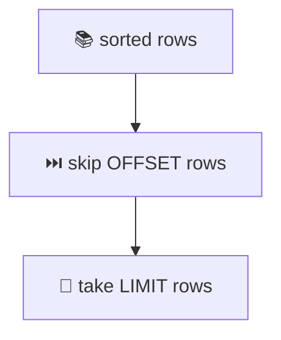
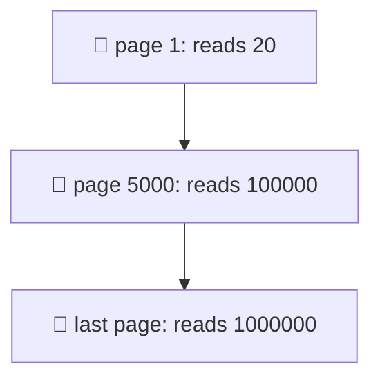
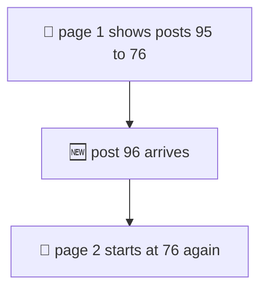
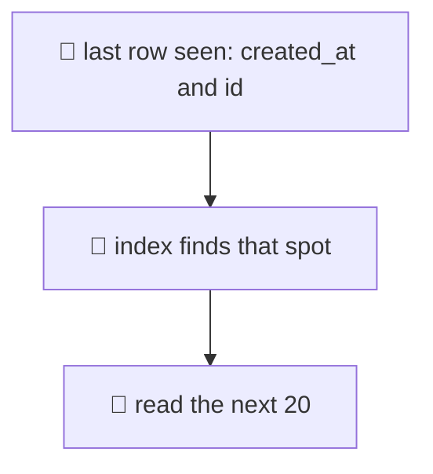
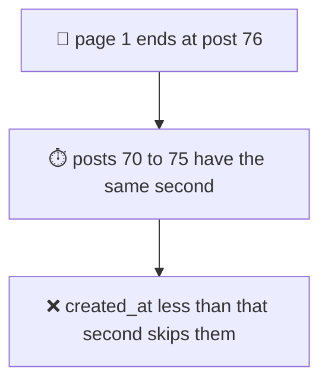
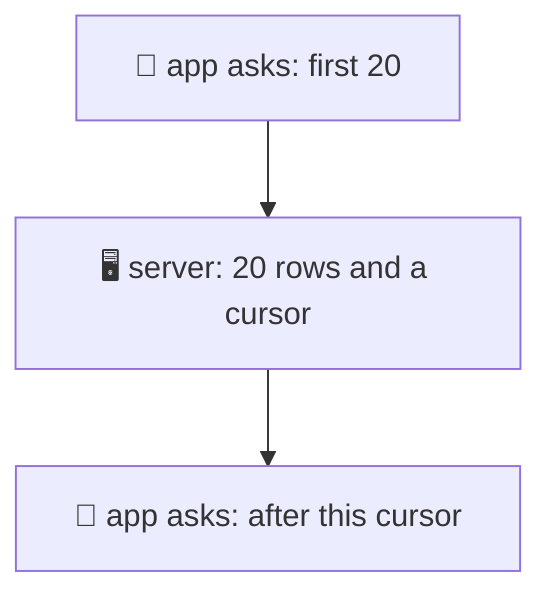
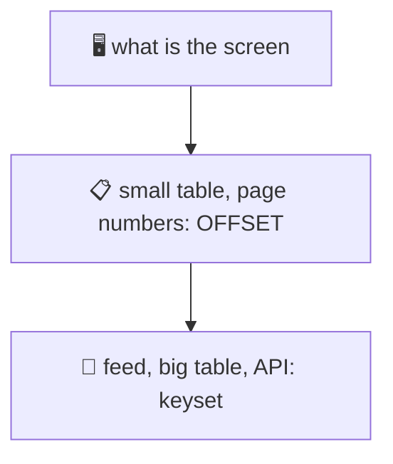

# 17. Pagination

> **Subject:** Database · **Lesson:** 17 · **Made:** 2026-11-01 · **Status:** ready
>
> **You will be able to:** explain why `OFFSET` gets slower on deep pages and shows the wrong rows when data changes, write keyset pagination with `(created_at, id)`, say why you need a tie-breaker, build a cursor in Node, and choose between the two.
>
> **Before this:** [MVCC and VACUUM](16-mvcc-and-vacuum.md) · **Next:** Upsert, idempotency and job queues (lesson 18, not written yet)
>
> **How to read it:** one card is one idea. Look at the picture, guess, then press the orange bar to check. The blue bars (📖 More detail) hold the longer explanation with the why and a real example. Skip them on the first read, and open them when you want more. Every number was run on PostgreSQL 18.3. About 25 minutes for the cards.

## 1. The idea: skip some rows, show the next 20

Nobody shows 1 million rows on a screen. You show a **page**: 20 rows at a time. The simplest way is `LIMIT 20 OFFSET 40` for page 3: "skip 40 rows, then give me 20".



```sql
SELECT id, created_at, title
FROM l17_posts
ORDER BY created_at DESC, id DESC
LIMIT 20 OFFSET 99980;     -- page 5000
```

<details class="guess"><summary>🤔 Guess: <code>LIMIT 20 OFFSET 99980</code> on a table with a good index. How many rows does Postgres read to give you 20? Press to check.</summary>

**100,000.** `EXPLAIN ANALYZE` shows it on the index scan line:

```text
Limit (actual time=10.758..10.761 rows=20.00 loops=1)
  -> Index Scan using l17_posts_created_idx (actual time=0.004..8.048 rows=100000.00 loops=1)
```

The index scan produced 100,000 rows. The `Limit` step threw away the first 99,980 and kept 20. The Postgres docs say it the same way: the rows skipped by `OFFSET` still have to be computed.

</details>

> **Remember:** OFFSET does not jump. It reads every skipped row and throws it away.

<details class="more"><summary>📖 More detail: the test table</summary>

I made a table with 1,000,000 posts. Ten posts share each second (so `created_at` is not unique), and an index on `(created_at DESC, id DESC)`:

```sql
CREATE TABLE l17_posts (
  id         bigint GENERATED ALWAYS AS IDENTITY PRIMARY KEY,
  created_at timestamptz NOT NULL,
  title      text NOT NULL
);
CREATE INDEX l17_posts_created_idx ON l17_posts (created_at DESC, id DESC);
```

The table is 57 MB and the index is 30 MB. `ORDER BY created_at DESC, id DESC` is the same order as the index, so Postgres can read the index from the start and stop after 20 rows when OFFSET is 0.

</details>

## 2. The deeper the page, the slower

Page 1 reads 20 rows. Page 5000 reads 100,000. The last page reads a million.



<details class="guess"><summary>🤔 Guess: the same query on 1 million rows with the index. Time for page 1, page 5000 and the last page (50,000)? Press to check.</summary>

| Page | Offset | Rows read | Time |
|---|---|---|---|
| 1 | 0 | 20 | **0.06 ms** |
| 5,000 | 99,980 | 100,000 | **10 ms** |
| 50,000 (last) | 999,980 | 1,000,000 | **101 ms** |

(From the second run of each query, with the data in memory.) Each page is 20 rows. The work grows with the page number, in a straight line.

</details>

> **Remember:** OFFSET cost grows with the page number. Page 5000 reads 5000 times more than page 1.

<details class="more"><summary>📖 More detail: it can be worse on a real table</summary>

My table was written in the same order as the index, which is the **best case**: the rows of one page sit next to each other in the file. I made a second copy of the table with the rows in random order (`ORDER BY random()`), with the same index. Now each of the 100,000 index entries points to a different place in the table:

- page 5000: **52 ms** with the data already in memory, and **134 ms** on the first run
- page 5000 read 100,377 buffers, about one per row

And with **no** matching index, even page 1 is expensive. `ORDER BY title LIMIT 20` with no index on `title` read the whole table and sorted it in a "top-N heapsort": **83 ms** on 1 million rows for the first page. (Lesson 11 shows how to read this plan.)

</details>

## 3. OFFSET also shows the wrong rows

You load page 1. A new post arrives. You load page 2. Everything moved down by one row.



<details class="guess"><summary>🤔 Guess: page 1 shows posts 95 down to 76. A new post (96) is added. Then you load page 2 with <code>OFFSET 20</code>. What is the first post on page 2? Press to check.</summary>

**76, again.** I ran it:

```text
page 1: 95,94,93,...,77,76
page 2: 76,75,74,...,58,57
repeated from page 1: 76
```

The new post pushed everything down by one, so the old post 76 moved from page 1 to the top of page 2. The user sees it twice. If a post is **deleted** instead, one row is skipped and the user never sees it.

</details>

> **Remember:** OFFSET counts rows from the top. When rows are added or deleted above you, the pages shift: repeats or gaps.

<details class="more"><summary>📖 More detail: why this happens</summary>

`OFFSET 20` does not mean "after the last row I showed". It means "skip the first 20 rows **as they are right now**". The database does not remember your page 1. Each query is new, and the table may be different.

On a quiet table (an admin list that changes once a day) this does not matter. On a feed where new rows arrive every second, it happens all the time.

The Postgres docs also say: with `LIMIT`, use an `ORDER BY` that gives a **unique** order. If two rows tie, which one comes first is not promised, so even OFFSET pages can repeat or skip rows (card 5).

</details>

## 4. Keyset pagination: start after the last row you saw

Instead of "skip N rows", say "give me rows that come **after this row**". The last row of page 1 becomes the key for page 2.



```sql
SELECT id, created_at, title
FROM l17_posts
WHERE (created_at, id) < ($1, $2)       -- the last row of the previous page
ORDER BY created_at DESC, id DESC
LIMIT 20;
```

<details class="guess"><summary>🤔 Guess: the same page 5000 on 1 million rows, but with keyset (the cursor is the last row of page 4999). How long does it take? Press to check.</summary>

**0.09 ms.** About the same as page 1:

```text
Limit (actual time=0.055..0.058 rows=20.00 loops=1)
  -> Index Scan using l17_posts_created_idx
       Index Cond: (ROW(created_at, id) < ROW('2026-01-02 08:00:02+07', 900021))
       Index Searches: 1
```

The index goes straight to the spot (the `Index Cond` line) and reads 20 rows. At the very end of the table it took 0.016 ms. The rows are **the same 20** as `OFFSET 99980` (I compared them: `same_rows = t`).

</details>

> **Remember:** keyset says "after this row". The cost is the same for every page.

<details class="more"><summary>📖 More detail: the row comparison, and going back</summary>

`(created_at, id) < ($1, $2)` is a **row comparison**. It means: `created_at < $1`, or `created_at = $1 AND id < $2`. Postgres can use it as an index condition.

You could write that second form by hand with `OR`. I tried it on the same table:

```text
Filter: ((created_at < '...') OR ((created_at = '...') AND (id < 900021)))
Rows Removed by Filter: 99980
Execution Time: 7.794 ms
```

It read and dropped the first 99,980 rows again, like OFFSET. So use the **row comparison**, not the `OR` version.

**The previous page.** Use the **first** row of the page you show as the cursor. Flip the comparison and the order, then reverse the result in your code:

```sql
SELECT ... FROM l17_posts
WHERE (created_at, id) > ($1, $2)
ORDER BY created_at ASC, id ASC
LIMIT 20;
```

I checked that this gives exactly the rows of the page before.

**The index.** Keyset needs an index in the same order as the `ORDER BY`. Without it, Postgres has to sort everything again for every page.

</details>

## 5. The tie-breaker: sort by a unique key

If you page by `created_at` alone, and 10 posts share the same second, the page boundary can fall in the middle of those 10. Then "created_at < last second" throws away the rest of that second.



<details class="guess"><summary>🤔 Guess: 95 posts, 10 per second, pages of 20, keyset on <code>created_at</code> only. How many posts do you see when you walk through all pages? Press to check.</summary>

**89 of 95.** Posts 70, 71, 72, 73, 74 and 75 were never shown. They have the same second as post 76 (the last row of page 1), so `created_at < '...:07'` dropped them. No error. Nobody notices.

With the **tie-breaker** `(created_at, id)`, I walked through all pages and got 95 rows, 95 unique, in 5 pages.

</details>

> **Remember:** the sort must be unique. Add the primary key as the last column, in the ORDER BY and in the cursor.

<details class="more"><summary>📖 More detail: how to choose the sort</summary>

- The order is **unique** if its last column is unique (the `id`). Then the cursor `(created_at, id)` points to exactly one row.
- If you sort by something else, for example `score DESC`, use `ORDER BY score DESC, id DESC` and the cursor `(score, id)`. The idea is the same.
- Keep the same direction for all columns in the row comparison. If you need `created_at DESC, id ASC`, the row comparison does not work, and you would have to write the `OR` version (slow, card 4) or change the index.
- If the sort column can be **NULL**, decide where NULLs go (`NULLS LAST`) and test it. A comparison with NULL is never true, so rows with NULL can vanish from the pages.

</details>

## 6. A cursor in an API

The client should not build `created_at` and `id` itself. Send it a **cursor**: one text value that means "continue after this row". The client sends it back.



<details class="guess"><summary>🤔 Guess: how does the server know that a next page exists, without running <code>SELECT count(*)</code>? Press to check.</summary>

Ask for **one more row** than the page size (21 instead of 20). If you get 21, there is a next page: show 20 and keep the 20th as the cursor. If you get 20 or fewer, this is the last page.

```js
const enc = row => Buffer.from(JSON.stringify([row.ts, row.id])).toString('base64url');
const dec = s => JSON.parse(Buffer.from(s, 'base64url').toString());

async function getPage(client, after, size = 20) {
  let r;
  if (!after) {
    r = await client.query(
      'SELECT id, created_at::text AS ts, title FROM l17_posts ORDER BY created_at DESC, id DESC LIMIT $1', [size + 1]);
  } else {
    const [ts, id] = dec(after);
    r = await client.query(
      'SELECT id, created_at::text AS ts, title FROM l17_posts WHERE (created_at, id) < ($1, $2) ORDER BY created_at DESC, id DESC LIMIT $3', [ts, id, size + 1]);
  }
  const hasNext = r.rows.length > size;
  const rows = r.rows.slice(0, size);
  return { rows, hasNext, nextCursor: hasNext ? enc(rows[rows.length - 1]) : null };
}
```

I walked through 95 rows with this: 5 pages, 95 unique rows, the last page had `hasNext = false`. A new post arriving between page 1 and page 2 caused **0** repeated rows (with OFFSET it repeated one).

</details>

> **Remember:** the cursor is the last row, packed into text. Ask for size + 1 rows to know if there is a next page.

<details class="more"><summary>📖 More detail: the date trap, and GraphQL</summary>

**The date trap.** Look at `created_at::text AS ts` above. A JavaScript `Date` keeps **milliseconds**. A Postgres `timestamptz` keeps **microseconds**. I made 6 rows that differ only in the microseconds, and made the cursor from the `Date` the `pg` library returns:

```text
cursor made from a JS Date : 6,5          <- the walk stops after the first page
cursor kept as text        : 6,5,4,3,2,1  <- all six
```

The Date cut off the microseconds, so the cursor pointed **before** all the other rows, and the next page was empty. Cast to text in SQL and send the text back, or use a number for the cursor.

**Opaque.** The `base64url` is not for secrecy. It tells the client "do not look inside". You can change the inside later (add a column) without breaking apps. Do not trust it either: validate it when you decode it, because a user can send any text.

**GraphQL.** The usual shape is the Relay connection: `first`, `after`, and in the answer `edges { node cursor }` and `pageInfo { hasNextPage endCursor }`. That is keyset paging with a cursor. I did not run a GraphQL server here. See the spec link in card 10. I did not test how Hasura pages. Its docs show `limit` and `offset`, which are the OFFSET kind, and a `where` filter, with which you can do a keyset by hand.

</details>

## 7. Which one should I use?

Each has a price. Pick by the screen.



<details class="guess"><summary>🤔 Guess: (a) an admin screen with 500 rows and buttons "page 1 2 3 ...", (b) an infinite-scroll feed of 50 million posts. Which pagination for each? Press to check.</summary>

(a) **OFFSET.** 500 rows are tiny. Page numbers and "jump to page 12" are easy. The cost does not matter.

(b) **Keyset.** Fast on every page, and the pages do not shift when new posts arrive.

| | OFFSET | Keyset |
|---|---|---|
| Jump to page 12 | yes | no (only next and previous) |
| "Page 5 of 80" label | yes (needs a count) | no |
| Speed on a deep page | slower and slower | the same on every page |
| New or deleted rows while paging | repeats or gaps | stable |
| Needs | any ORDER BY | a unique ORDER BY and a matching index |

</details>

> **Remember:** OFFSET for small tables and page numbers. Keyset for big tables, feeds and APIs.

<details class="more"><summary>📖 More detail: the cost of "page 5 of 80"</summary>

A "page X of Y" label needs the total: `SELECT count(*)`. Postgres has no stored row count. It counts the rows. On my 1 million row table:

```text
Aggregate (actual time=73.121..73.122 rows=1.00 loops=1)
  -> Seq Scan on l17_posts (actual time=0.008..42.218 rows=1000000.00 loops=1)
```

**73 ms**, and it grows with the table. Often the total is not needed. "Next" and "Previous" are enough. If you still want a number, you can show "about 1.2 million" from the planner's estimate (`reltuples` in `pg_class`, kept by VACUUM and ANALYZE), or count only up to a limit (`SELECT count(*) FROM (SELECT 1 FROM t LIMIT 1001) x` and show "1000+").

A good compromise is a **hybrid**: keyset for "next" and "previous", and OFFSET only for the first few pages (where the cost is small).

</details>

## 8. Watch it run, step by step

Now watch how many rows each way reads. **[Open the pagination stepper](visuals/17-pagination.html).** It has three tabs: OFFSET on page 5000, keyset on the same page, and a page that shifts when a new post arrives. Guess first, then press Next.

<details><summary>Or read it as a table</summary>

For page 5000 (rows 99,981 to 100,000) of 1,000,000:

| Step | OFFSET 99980 | Keyset after (created_at, id) |
|---|---|---|
| 1 | open the index at the newest row | go straight to the cursor in the index |
| 2 | read 99,980 rows and throw them away | (nothing to skip) |
| 3 | read 20 rows | read 20 rows |
| Rows read | 100,000 | 20 |
| Time | 10 ms | 0.09 ms |

</details>

## 9. Why it matters and what it costs

Interview words: *pagination*, *OFFSET*, *keyset pagination*, *cursor*, *seek method*, *tie-breaker*, *infinite scroll*, *Relay connection*.

|  | OFFSET | Keyset |
|---|---|---|
| Code | simplest | a little more (cursor, size + 1) |
| Page 5000 | reads 100,000 rows | reads 20 rows |
| Data changes | pages shift | stable |

- **With the map,** you can say why the feed gets slow after a month, why a user saw the same post twice, and what to change.
- **Without it,** the answer to a slow list is "add a bigger server".

**The costs:**

- Keyset cannot jump to page N.
- It needs a unique, indexed sort and a cursor that the client sends back unchanged.
- A total count still costs a full scan (73 ms on 1 million rows).

## 10. Watch and play

Links checked on 2026-11-01. Each page was opened. For each video, the title and channel were confirmed through YouTube's oEmbed data. The video lengths were not checked.

- **Play with it:** [The pagination stepper](visuals/17-pagination.html) in this folder. Guess first, then press Next.
- **Video:** [API Pagination: Making Billions of Products Scrolling Possible](https://www.youtube.com/watch?v=14K_a2kKTxU) from the channel ByteByteGo. Cards 1 to 7 in a few minutes.
- **Video:** [Pagination in MySQL - offset vs. cursor](https://www.youtube.com/watch?v=zwDIN04lIpc) from the channel PlanetScale. It uses MySQL, but the idea is the same as cards 2 and 4.
- **Read:** [LIMIT and OFFSET](https://www.postgresql.org/docs/current/queries-limit.html) in the PostgreSQL docs. Short. It says to use a unique order and that large offsets are slow (cards 1, 3 and 5).
- **Read:** [Row-wise comparison](https://www.postgresql.org/docs/current/functions-comparisons.html). The `(a, b) < (x, y)` form of card 4.
- **Read:** [Paging Through Results](https://use-the-index-luke.com/sql/partial-results/fetch-next-page) on Use The Index, Luke. Keyset ("seek method") explained, with the index.
- **Read:** [We need tool support for keyset pagination](https://use-the-index-luke.com/no-offset). A short argument against OFFSET.

<details><summary>More links (optional)</summary>

- **Read:** [GraphQL Cursor Connections Specification](https://relay.dev/graphql/connections.htm). The `first`, `after`, `edges` and `pageInfo` of card 6.
- **Read:** [Using EXPLAIN](https://www.postgresql.org/docs/current/using-explain.html). To see the `rows=100000` line yourself.
- **Read (revision, dense):** [Advanced SQL workbook](advanced-sql-workbook.md). It has keyset and window-function paging examples.

</details>

## 11. Practice

**A. Predict.** A feed has an index on `(created_at DESC, id DESC)`. The query is `... ORDER BY created_at DESC, id DESC LIMIT 20 OFFSET 40000`. Roughly how many rows does the index scan produce, and what would you change?

<details class="guess"><summary>🤔 Press to see the answer</summary>

About **40,020 rows**: the 40,000 skipped, plus the 20 shown. To change it, switch to keyset: the app keeps the last row of the page it showed, and sends `(created_at, id)` as a cursor. The query becomes `WHERE (created_at, id) < ($1, $2) ORDER BY created_at DESC, id DESC LIMIT 20`, which reads about 20 rows on every page.

</details>

**B. What would you check?** A teammate built keyset pagination with `WHERE created_at < $1 ORDER BY created_at DESC LIMIT 20`. Support says "some posts never show up in the feed". The posts are created by an import that inserts 500 rows with the same `created_at`. What is wrong?

<details class="guess"><summary>🤔 Press to see the answer</summary>

There is no tie-breaker. If a page ends in the middle of the 500 posts that share one `created_at`, then `created_at < $1` skips the rest of them. They never appear.

Fix: add `id` to the cursor and the sort: `WHERE (created_at, id) < ($1, $2) ORDER BY created_at DESC, id DESC`, and make sure an index matches that order. Also check that the cursor keeps the microseconds of `created_at` (card 6).

</details>

**C. Write it yourself**

Open [`practice/17-pagination.sql`](practice/17-pagination.sql). It makes 200,000 posts and gives six tasks with the exact expected results: page 1 and page 5000 with no index, the index (you write it), the keyset query (you write it), the tie-breaker test, the "is there a next page" query (you write it), and the cost of a count.

<details><summary>One possible answer</summary>

```sql
-- Task 2
CREATE INDEX l17_posts_created_idx ON l17_posts (created_at DESC, id DESC);
ANALYZE l17_posts;

-- Task 3 (after the \gset line of the task)
SELECT id, created_at, title
FROM l17_posts
WHERE (created_at, id) < (:'c_created_at', :c_id)
ORDER BY created_at DESC, id DESC
LIMIT 20;

-- Task 5: the same query with LIMIT 21
SELECT id, created_at, title
FROM l17_posts
WHERE (created_at, id) < (:'c_created_at', :c_id)
ORDER BY created_at DESC, id DESC
LIMIT 21;
```

Results I got, on PostgreSQL 18.3: Task 1: a Seq Scan and a Sort in both plans (top-N heapsort for page 1, external merge for page 5000). Task 2: Index Scan with `rows=100000` for page 5000, about 11 ms. Task 3: `Index Cond: (ROW(created_at, id) < ROW(...))`, 0.04 ms, `same_rows = t`. Task 4: the `created_at`-only query starts at 69 (ids 70 to 75 are lost), the two-column query starts at 75. Task 5: 21 rows, and 4 rows at the very end. Task 6: a Seq Scan of 200000 rows, 14 ms.

</details>

## 12. Interview question

**Q:** "Why is `OFFSET` pagination slow on a big table? How would you paginate a feed with millions of rows?"

<details><summary>A strong answer, in four parts</summary>

1. **Problem:** `LIMIT 20 OFFSET 99980` must produce and throw away 99,980 rows before it returns 20. The deeper the page, the more work. And if rows are added or removed above you, the pages shift and rows repeat or vanish.
2. **How it works:** I use keyset (cursor) pagination: `WHERE (created_at, id) < ($1, $2) ORDER BY created_at DESC, id DESC LIMIT 20`, with an index on `(created_at DESC, id DESC)`. The index jumps straight to the cursor and reads 20 rows. The `id` is the tie-breaker, so the order is unique. The API returns a cursor (the last row, packed as text) and I ask for 21 rows to know if there is a next page.
3. **Tradeoff:** keyset cannot jump to page N and has no "page X of Y" (a count costs a full scan, 73 ms on 1 million rows). So I use OFFSET for small tables and admin screens with page numbers, and keyset for feeds and APIs. In my test, page 5000 took 10 ms with OFFSET and 0.09 ms with keyset, and OFFSET repeated a row when a post arrived.
4. **My example:** *This is an idea, not a fact. Replace it with a real story from DBO, Unloan, ZWS or Skyworx.* A list of orders sorted by `created_at`, shown in an admin page with `limit` and `offset`. It gets slow on old pages, so I switch the API to a cursor on `(created_at, id)` and keep the page numbers only for the first few pages.

</details>

## 13. Explain it back

Close this file. Press the **Record my explanation** button under this heading and explain pagination, like to a new junior, in 4 parts: problem, how it works, tradeoff, my example. Use these numbers: 100,000 rows read for page 5000, 10 ms against 0.09 ms, 89 of 95 posts. Then save the transcript into `my-learning/recordings/`, or write your best version below. Run `/explain-check postgres pagination` or ask `coach my explanation`.

### My explanation

<write here>

### Coach feedback

<the explain-coach agent writes here>

## 14. Review questions (day 1, 3, 7, 21)

1. `LIMIT 20 OFFSET 99980`: how many rows are read, and why?
2. A post arrives between page 1 and page 2 with OFFSET. What does the user see?
3. Write the keyset query for the page after `(created_at, id) = ($1, $2)`, newest first.
4. Why do you need `id` in the sort and the cursor? What happens without it?
5. Why use `(a, b) < (x, y)` and not `a < x OR (a = x AND b < y)`?
6. How do you know a next page exists without `count(*)`?
7. Name two things keyset cannot do, and one case where you still use OFFSET.

<details><summary>Answers</summary>

1. About 100,000. Postgres reads the skipped rows and throws them away. They still have to be computed.
2. The first row of page 2 is the last row of page 1 (it moved down by one). A repeated row. (If a row is deleted, a row is skipped instead.)
3. `SELECT ... FROM t WHERE (created_at, id) < ($1, $2) ORDER BY created_at DESC, id DESC LIMIT 20;` with an index on `(created_at DESC, id DESC)`.
4. Many rows can share the same `created_at`. Without a tie-breaker, `created_at < $1` skips the rest of the rows that share the last second of a page (6 of 95 posts were never shown in my test).
5. The row comparison is used as an index condition (the index goes straight to the spot). The `OR` form was run as a filter and read 99,980 rows first (7.8 ms against 0.09 ms).
6. Ask for page size + 1 rows. If you get that many, there is a next page.
7. Jump to page N, and show "page X of Y" cheaply (a count scans the table). Use OFFSET for small tables and screens with page numbers.

</details>

## 15. Go deeper (optional)

None of this is needed for the cards above.

<details><summary>Window functions: ROW_NUMBER is not faster</summary>

Lesson 05 showed `ROW_NUMBER() OVER (ORDER BY ...)`. Using it to number the rows and then filtering `WHERE rn BETWEEN 99981 AND 100000` still has to number every row before them. It is the same cost as OFFSET, with more code. I did not time it.

</details>

<details><summary>Cursors in the database (DECLARE CURSOR)</summary>

Postgres also has server-side cursors (`DECLARE c CURSOR FOR ...; FETCH 20 FROM c;`). They keep one query open inside a transaction, which holds a snapshot and a connection. That is fine for a batch job that reads a big table in chunks. It is not a good fit for a web page, because the user might never come back for the next page. The "cursor" in this lesson is different: it is only the last row, sent back by the client. I did not test server-side cursors here.

</details>

<details><summary>Sort by something that changes</summary>

If the sort column changes while the user scrolls (a "score" that goes up), a row can move from page 3 to page 1 and be missed, or move from page 1 to page 3 and be seen twice. Keyset is stable for a sort that never changes (like `created_at`). For a changing sort, accept some repeats, or freeze the order at the first request (store the ids).

</details>

<details><summary>Hasura and Prisma</summary>

I did not test how Hasura or Prisma page. Prisma has `skip` and `take` (the OFFSET kind) and `cursor` (the keyset kind): see the Prisma docs on pagination, and check which version your project uses. Look at the SQL they send (Postgres log or `pg_stat_statements`) before you trust it.

</details>

<details><summary>Make the tables yourself</summary>

The practice file builds a table of 200,000 posts. The numbers in the cards come from 1,000,000 posts, built the same way (the setup in card 1's More bar, with `generate_series(1, 1000000)`). The times are from one laptop with the data in memory. Your numbers will differ.

</details>

## Connected lessons

- [01. SQL basics and query order](01-sql-basics-and-query-order.md): `ORDER BY`, `LIMIT` and `OFFSET`.
- [05. Window functions](05-window-functions.md): `ROW_NUMBER` is one more way to number rows.
- [09. Indexes and B-trees](09-indexes-and-b-trees.md) and [10. Composite, partial and covering indexes](10-composite-partial-and-covering-indexes.md): the index with two columns.
- [11. Reading EXPLAIN](11-reading-explain.md): the `rows=100000` line, and the Sort step.
- [26. What an index costs](26-what-an-index-costs.md): a table written in index order is the best case.
- [Advanced SQL workbook](advanced-sql-workbook.md): more paging queries.
