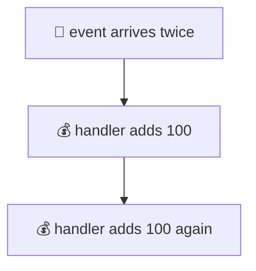
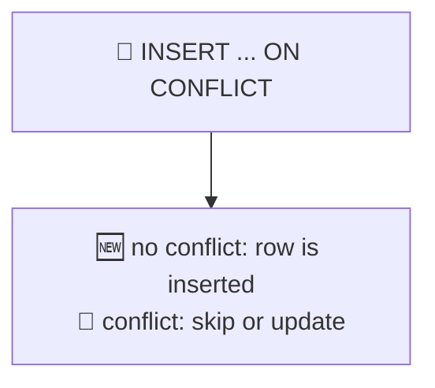
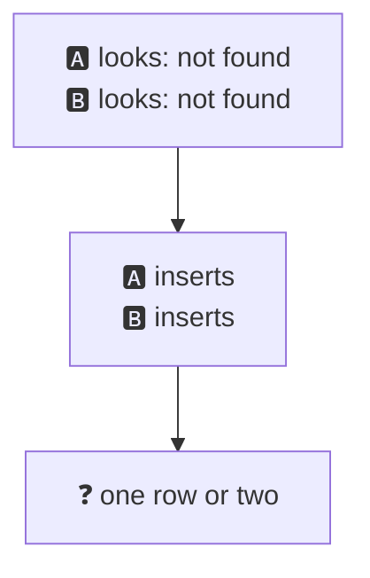
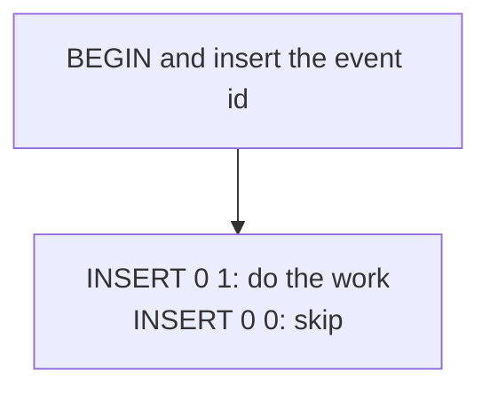
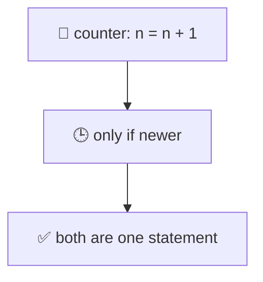
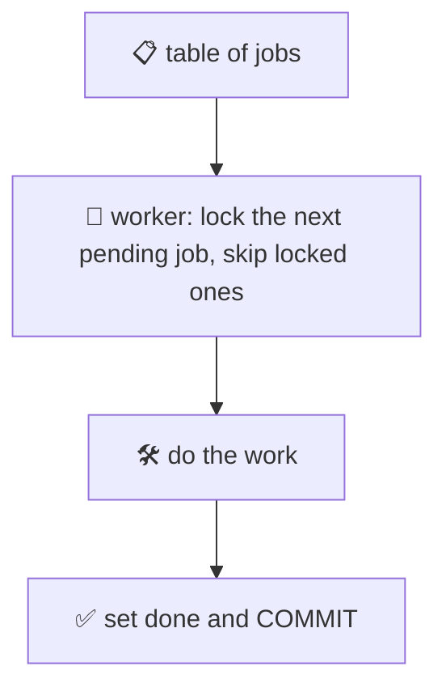
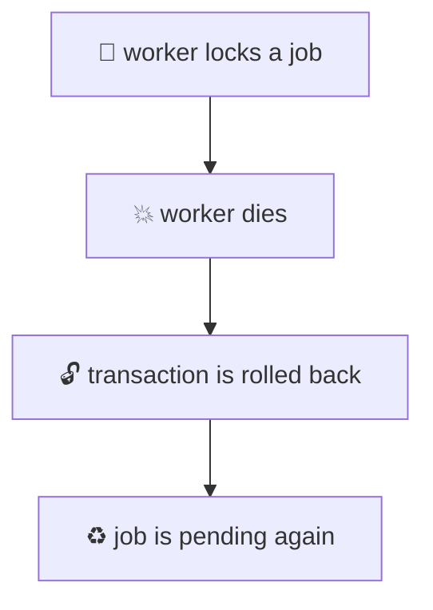

# 18. Upsert, idempotency and job queues

> **Subject:** Database · **Lesson:** 18 · **Made:** 2026-11-01 · **Status:** ready
>
> **You will be able to:** write an upsert with `ON CONFLICT`, explain why "check, then insert" breaks when two requests run at the same time, handle a webhook that arrives twice with an idempotency key, and build a safe job queue with `FOR UPDATE SKIP LOCKED`.
>
> **Before this:** [Pagination](17-pagination.md) · **Next:** [Zero-downtime migrations](19-zero-downtime-migrations.md)
>
> **How to read it:** one card is one idea. Look at the picture, guess, then press the orange bar to check. The blue bars (📖 More detail) hold the longer explanation with the why and a real example. Skip them on the first read, and open them when you want more. Every result was run with real connections on PostgreSQL 18.3. About 25 minutes for the cards.

## 1. The problem: the same thing arrives twice

A payment service tells you "user 1 paid 100" with a webhook. Networks are not perfect: if your server is slow to answer, the sender sends the **same event again**. A user double-clicks a button. A job is retried. Your code must give the same result whether it runs once or five times. That property has a name: **idempotent**.



<details class="guess"><summary>🤔 Guess: a handler first checks "did I see this event id?", and if not, adds 100 to a wallet. The same event arrives 5 times at the same moment. What is the balance? Press to check.</summary>

**500.** All five deliveries said "not seen yet", because they all checked before any of them wrote the event id. I ran it:

```text
naive handler: credited,credited,credited,credited,credited -> balance 500
```

The check was right for **one** delivery at a time. When requests overlap, "check first" is not enough (card 3).

</details>

> **Remember:** assume every event, request and job can arrive twice. The code must be safe when that happens, even at the same moment.

<details class="more"><summary>📖 More detail: where duplicates come from</summary>

- **Webhooks.** The Stripe docs say it plainly: "Webhook endpoints might occasionally receive the same event more than once", and tell you to log the event ids you have processed. Most services that send webhooks work this way: they send at least once.
- **Retries.** A client times out and tries again, but the first request actually worked.
- **Double clicks and two tabs.**
- **Queue workers.** A worker crashes after doing the work and before saying "done", so the job runs again.

You cannot stop the duplicates. You can make them harmless.

</details>

## 2. INSERT ... ON CONFLICT: insert, or do something else

"Insert this row. If a row with the same unique value exists, do **nothing**, or **update** it." This is called an **upsert** (update or insert), and it is **one** statement.



```sql
INSERT INTO l18_users (email, name) VALUES ('ana@example.com', 'Ana')
ON CONFLICT (email) DO NOTHING;
```

<details class="guess"><summary>🤔 Guess: you run this twice. The first time Postgres answers <code>INSERT 0 1</code>. What does it answer the second time, and what if there is no unique rule on <code>email</code>? Press to check.</summary>

The second time: **`INSERT 0 0`**. No error, no new row. The `0 0` means "0 rows inserted". And `ON CONFLICT (email)` needs a **unique rule** on `email` (a `UNIQUE` constraint or a unique index). Without one:

```text
ERROR:  there is no unique or exclusion constraint matching the ON CONFLICT specification
```

A plain `INSERT` of the same email (no `ON CONFLICT`) gives the normal error:

```text
ERROR:  duplicate key value violates unique constraint "l18_users_email_key"
DETAIL:  Key (email)=(ana@example.com) already exists.
```

</details>

> **Remember:** ON CONFLICT needs a unique rule. DO NOTHING skips the row (INSERT 0 0). DO UPDATE changes the old row.

<details class="more"><summary>📖 More detail: DO UPDATE, EXCLUDED and RETURNING</summary>

```sql
INSERT INTO l18_users (email, name) VALUES ('ana@example.com', 'Ana B')
ON CONFLICT (email) DO UPDATE
  SET name = EXCLUDED.name, visits = l18_users.visits + 1
RETURNING id, name, visits, (xmax = 0) AS inserted;
```

- **`EXCLUDED`** is the row you tried to insert. `l18_users` (the table name) is the row that is already there.
- **`RETURNING`** gives back the final row. Here the result was `Ana B, visits 2, inserted = f`.
- **`xmax = 0`** is a trick: it is true when the row was **inserted**, and false when it was **updated** (lesson 16: `xmax` marks a replaced version). I used it above. For a new email, it said `t`.
- With `DO NOTHING`, `RETURNING` gives **no row** when there is a conflict. Plan for that.

Two things that surprised me:

- **Ids are used up.** After some conflicts, the next new row (Budi) got id 4, not 2. Identity numbers are taken before the conflict is found. Gaps in ids are normal.
- **Same row twice in one statement** fails: `ON CONFLICT DO UPDATE command cannot affect row a second time`. Remove the duplicates before you insert.

Since Postgres 15 there is also `MERGE`, which is the SQL standard way for the same kind of job. `ON CONFLICT` is still the one most people use for a single unique key. I did not test `MERGE` here.

</details>

## 3. Check, then insert: the race

"Look first, then insert if it is missing" is the natural way to write it. When two requests run at the same time, both can look before either has inserted.



<details class="guess"><summary>🤔 Guess: two sessions both check for <code>ana@x.com</code> (not found), then both insert it. What happens with no unique rule? With a unique rule? With <code>ON CONFLICT DO NOTHING</code>? Press to check.</summary>

| Table | What happened |
|---|---|
| no unique rule | **2 rows.** Two Anas. No error at all. |
| unique rule, plain `INSERT` | B's insert **failed**: `23505 duplicate key value violates unique constraint`. 1 row. |
| unique rule, `ON CONFLICT DO NOTHING` | B **waited** for A, then got `INSERT 0 0`. No error. 1 row, with A's name. |

So the fix has two parts: a **unique rule** (the database enforces it, whatever your code does), and **`ON CONFLICT`** (so the loser is not an error).

</details>

> **Remember:** the database must enforce "only one". A unique rule stops the duplicate. ON CONFLICT makes the loser quiet.

<details class="more"><summary>📖 More detail: why B waited, and the old way</summary>

With `ON CONFLICT DO NOTHING`, B's insert had to wait to learn if A's row would stay. If A rolls back, B's insert goes through. If A commits, B skips. B waits for A's transaction to end, like the row lock wait in lesson 15. I saw B waiting while A was still open.

Before `ON CONFLICT` (Postgres 9.5), people caught the unique error in code and retried, or locked a parent row. You will still see that in old code. Catching `23505` also works, but `ON CONFLICT` is shorter and does not abort the transaction.

If you cannot add a unique rule (for example "only one **active** subscription per user"), use a **partial unique index** (lesson 10): `CREATE UNIQUE INDEX ... ON subs (user_id) WHERE active`. I did not test it here.

</details>

## 4. The idempotency key: remember what you did

For an event or a request, keep a table of **ids you have already handled**. Try to insert the id **in the same transaction** as the work. If the insert says "already there", skip the work.



```js
async function handle(pool, eventId) {
  const c = await pool.connect();
  try {
    await c.query('BEGIN');
    const ins = await c.query(
      'INSERT INTO l18_events (event_id) VALUES ($1) ON CONFLICT (event_id) DO NOTHING', [eventId]);
    if (ins.rowCount === 0) { await c.query('ROLLBACK'); return 'skipped'; }
    await c.query('UPDATE l18_wallet SET balance = balance + 100 WHERE user_id = 1');
    await c.query('COMMIT');
    return 'credited';
  } catch (e) { await c.query('ROLLBACK'); throw e; } finally { c.release(); }
}
```

<details class="guess"><summary>🤔 Guess: the same event arrives 5 times at once at this handler. What is the balance? What if two different events and one repeat arrive together? Press to check.</summary>

```text
idempotent handler: skipped,credited,skipped,skipped,skipped -> balance 100
two different events and one repeat: credited,credited,skipped -> balance 300
```

Exactly one delivery wins, and the others wait and skip. The balance is 100, not 500. (Compare card 1.)

</details>

> **Remember:** record the event id and do the work in one transaction. The unique id decides who goes first.

<details class="more"><summary>📖 More detail: why one transaction, and for HTTP APIs</summary>

**Why one transaction?** If you insert the event id and commit, and then crash before the wallet update, the event is marked "done" but the money was never added, and a retry is skipped. If you update the wallet first and crash before the id insert, a retry adds the money again. In one transaction, **both commit together or neither does** (lesson 13).

**Do not call another service inside the transaction** (lesson 13, card 6). If the work includes an outside call, write an outbox row inside the transaction and send it later.

**For your own HTTP API**, the same idea is an `Idempotency-Key` header. The client sends a unique key with a "create payment" request. The server stores the key (and the answer) on first use, and returns the stored answer if the key comes again. Stripe's API reference has a page called "Idempotent requests" for its own API. I did not build one here.

**Clean-up.** The `l18_events` table grows. Add a `processed_at` column (I did) and delete rows older than the longest time a sender may retry. Check how long your sender retries before you choose.

</details>

## 5. More upsert patterns

Two small patterns that appear everywhere: a counter, and "keep the newest".



<details class="guess"><summary>🤔 Guess: 100 requests at the same moment each run <code>INSERT INTO views (page, n) VALUES ('home', 1) ON CONFLICT (page) DO UPDATE SET n = views.n + 1</code>. What is <code>n</code> at the end? Press to check.</summary>

**100.** The row lock (lesson 15) makes the updates line up one after another, and each one adds to the **latest** value. No update was lost. I ran it with 100 parallel queries.

The second pattern, **only if newer**, adds a `WHERE` to the update:

```sql
INSERT INTO l18_prices VALUES ('rice', 90, '2026-11-01 09:00:00+00')
ON CONFLICT (sku) DO UPDATE
  SET price = EXCLUDED.price, updated_at = EXCLUDED.updated_at
  WHERE EXCLUDED.updated_at > l18_prices.updated_at;
```

An **older** message (09:00) changed nothing (`INSERT 0 0`, price stays 100). A **newer** one (11:00) updated it (`INSERT 0 1`, price 120). This makes the order of arrival not matter: late and repeated messages do no harm.

</details>

> **Remember:** a counter is one upsert with n = n + 1. For messages that can arrive out of order, update only when the new one is newer.

<details class="more"><summary>📖 More detail: why the read-then-write counter fails</summary>

The wrong version is: `SELECT n`, add 1 in code, `UPDATE n = <new value>`. That is the lost update from lesson 14. The upsert does the math **inside** the statement, so there is no gap.

If the counter is hit thousands of times per second on **one row**, that row becomes a single-file line (lesson 15). Then use several rows ("shards" of the counter) and add them up when you read, or count in Redis and write the total to Postgres now and then. I did not test that here.

A version number works too: `... DO UPDATE SET ... WHERE EXCLUDED.version > t.version`.

</details>

## 6. A job queue in the database: SKIP LOCKED

Many workers, many jobs. Each job must be taken by **one** worker. The classic trick: `SELECT ... FOR UPDATE SKIP LOCKED`.



```sql
BEGIN;
SELECT id FROM l18_jobs
WHERE status = 'pending'
ORDER BY id
LIMIT 1
FOR UPDATE SKIP LOCKED;
-- do the work, then:
UPDATE l18_jobs SET status = 'done' WHERE id = $1;
COMMIT;
```

<details class="guess"><summary>🤔 Guess: 3 workers, 30 jobs. Compare three versions of the SELECT: (a) plain, (b) <code>FOR UPDATE</code>, (c) <code>FOR UPDATE SKIP LOCKED</code>. What happens to each? Press to check.</summary>

I ran all three, each job taking about 10 ms:

| SELECT | Jobs done by each worker | Rows in the "done" log | Time |
|---|---|---|---|
| (a) plain | 30 / 30 / 30 | **90** (every job 3 times) | 375 ms |
| (b) `FOR UPDATE` | 10 / 12 / 8 | 30 (each once) | 413 ms |
| (c) `FOR UPDATE SKIP LOCKED` | 10 / 10 / 10 | 30 (each once) | **131 ms** |

(a) is **wrong**: nothing locks the job, so all three workers take the same job. (b) is **right but slow**: the workers wait in line for the same first job. (c) is right **and** fast: a worker skips jobs that another worker holds and takes the next one.

</details>

> **Remember:** FOR UPDATE makes the job yours. SKIP LOCKED makes the other workers look at the next job instead of waiting.

<details class="more"><summary>📖 More detail: the pieces of a real queue table</summary>

The lock lives only while the **transaction** is open. So the worker keeps the transaction open **while it works**, or it sets a status first (`running`) and commits, and then needs a way to rescue stuck `running` jobs.

A queue table usually has:

| Column | Why |
|---|---|
| `status` | `pending`, `running`, `done`, `failed` |
| `attempts` | how many tries, so a bad job is not retried for ever |
| `run_at` | do not take the job before this time (for a delay or a back-off) |
| `locked_at` / `worker` | who took it and when, to find stuck jobs |
| `payload` | the data for the job (often JSON, lesson 08) |

An index that matches the query helps: `CREATE INDEX ON l18_jobs (id) WHERE status = 'pending'` is a **partial index** (lesson 10), so the pending jobs stay easy to find when millions of old jobs are done. I did not test this index.

Ordering is **not strict**: with `SKIP LOCKED`, job 5 can finish before job 3. If you need strict order, use one worker, or a different tool.

</details>

## 7. When a worker dies, and when to use something else

If a worker crashes in the middle of a job, what happens to the job?



<details class="guess"><summary>🤔 Guess: a worker did <code>SELECT ... FOR UPDATE SKIP LOCKED</code> and <code>UPDATE ... SET status = 'running'</code>, and then its connection is killed before COMMIT. What is the job's status afterwards? Press to check.</summary>

**`pending`.** While the worker was alive, another worker did not see the job (it saw only jobs 2 and 3). I ended the worker's connection with `pg_terminate_backend`. The transaction was rolled back, the lock was gone, and all three jobs were `pending` again:

```text
dead worker holds job 1 | another worker sees pending: 2,3
after the connection is killed, job states: pending, pending, pending
```

That is the good side of keeping the work in **one transaction**: a crash is a rollback, and the job comes back by itself.

</details>

> **Remember:** a dead worker's transaction is rolled back, and the job returns to pending. Make the work safe to run twice, because it may run again.

<details class="more"><summary>📖 More detail: the limits of a Postgres queue</summary>

The job may have done **part** of its work before the crash (sent an email, called an API). It will run **again**, so the work must be idempotent (card 4). This is the same lesson: at-least-once delivery, and a safe handler.

A Postgres queue works well when:

- you already have Postgres and the load is modest (hundreds of jobs per second on one table is a common claim, but I did not measure the limit here),
- a job should commit **together with** other changes (the order and its "send the receipt" job in one transaction, which is the outbox idea from lesson 13),
- you want simple operations: a table you can query, count and fix by hand.

Think about a real queue (Redis with BullMQ, SQS, or similar) when you need very high throughput, delayed or repeated jobs with a rich API, or when polling the database every second is too much. I did not test those tools here.

**Polling.** Workers ask "any job?" in a loop, with a short sleep when the answer is no. `LISTEN` / `NOTIFY` can wake them up. I did not test it here.

</details>

## 8. Watch it run, step by step

Now watch two requests and two workers. **[Open the upsert and queue stepper](visuals/18-upsert-idempotency-and-job-queues.html).** It has three tabs: a webhook that arrives twice, two inserts for one email, and two workers with SKIP LOCKED. Guess first, then press Next.

<details><summary>Or read the webhook race as a table</summary>

Two deliveries of the event `evt_1` at the same moment, with the idempotent handler:

| Step | Delivery 1 | Delivery 2 |
|---|---|---|
| 1 | `BEGIN` | `BEGIN` |
| 2 | `INSERT event_id evt_1 ... DO NOTHING` gives `INSERT 0 1` | the same INSERT **waits** for delivery 1 |
| 3 | `UPDATE wallet SET balance = balance + 100` | (still waiting) |
| 4 | `COMMIT` | the INSERT answers `INSERT 0 0` |
| 5 | | `ROLLBACK`, skip the work |

The balance is 100 after both.

</details>

## 9. Why it matters and what it costs

Interview words: *idempotent*, *upsert*, *ON CONFLICT*, *idempotency key*, *at-least-once delivery*, *SKIP LOCKED*, *outbox*, *dead letter*.

|  | Naive | Safe |
|---|---|---|
| "Do I have it?" | SELECT then INSERT: race | unique rule + ON CONFLICT |
| Event twice | credited twice | event id table, one transaction |
| Many workers | same job taken many times | FOR UPDATE SKIP LOCKED |

- **With the map,** you can say why "we charged the user twice", "two users with the same email" and "the job ran three times" happen, and the one-line fix for each.
- **Without it,** the answer is "it only happens sometimes".

**The costs:**

- A table of event ids that you must clean.
- Workers that keep a transaction open while they work (a long one holds back VACUUM, lesson 16).
- A job can still run twice after a crash, so the work itself must be safe.

## 10. Watch and play

Links checked on 2026-11-01. Each page loaded (HTTP 200). For each video, the title and channel were confirmed through YouTube's oEmbed data. The video lengths were not checked.

- **Play with it:** [The upsert and queue stepper](visuals/18-upsert-idempotency-and-job-queues.html) in this folder. Guess first, then press Next.
- **Video:** [Idempotency - What it is and How to Implement it](https://www.youtube.com/watch?v=XAccGbtl3Z8) from the channel Alex Hyett. Cards 1 and 4.
- **Video:** [What is an UPSERT and how to do them in MySQL, Postgres, & CockroachDB](https://www.youtube.com/watch?v=pBlkfiELg7k) from the channel CockroachDB. Cards 2 and 5.
- **Video:** [Do You Really Need Redis? Building a Postgres-Native Job Queue with SKIP LOCKED](https://www.youtube.com/watch?v=dZNxn3FOYmw) from the channel myDBA. Cards 6 and 7.
- **Read:** [INSERT](https://www.postgresql.org/docs/current/sql-insert.html) in the PostgreSQL docs. The `ON CONFLICT` section (cards 2, 3 and 5).
- **Read:** [SELECT, the locking clause](https://www.postgresql.org/docs/current/sql-select.html). `FOR UPDATE`, `SKIP LOCKED` and `NOWAIT` (card 6).
- **Read:** [Receive Stripe events in your webhook endpoint](https://docs.stripe.com/webhooks). "Handle duplicate events" is the card 1 problem, from the sender's side.
- **Read:** [Idempotent requests](https://docs.stripe.com/api/idempotent_requests) in the Stripe API reference. The `Idempotency-Key` header (card 4, More).

<details><summary>More links (optional)</summary>

- **Read:** [MERGE](https://www.postgresql.org/docs/current/sql-merge.html). The SQL standard way, available in Postgres 15 and later.
- **Read (revision, dense):** [Database scaling and correctness](database-scaling-and-correctness.md). The outbox, the saga, and exactly-once talk.
- **Read (revision, dense):** [Advanced SQL workbook](advanced-sql-workbook.md). It has upsert and `SKIP LOCKED` examples.

</details>

## 11. Practice

**A. Predict.** A table has `UNIQUE (email)`. Two requests run `INSERT ... VALUES ('a@x.com') ON CONFLICT (email) DO NOTHING` at the same moment. How many rows are there after, and what does each request see?

<details class="guess"><summary>🤔 Press to see the answer</summary>

**One row.** One request gets `INSERT 0 1`. The other waits for the first to commit, then gets `INSERT 0 0`. Neither gets an error. If your code needs to know which one won, look at the number of rows inserted (`rowCount` in `pg`).

</details>

**B. What would you check?** A teammate wrote an order webhook handler: `SELECT` the order by `external_id`; if it is not there, `INSERT` it and send a "thank you" email. Customers sometimes get two emails and there are sometimes two orders for one `external_id`. What do you change?

<details class="guess"><summary>🤔 Press to see the answer</summary>

It is "check, then insert" (card 3). Two deliveries run at the same time and both see "not there".

1. Add a **unique rule** on `external_id`. Now the database stops the second row.
2. Use `INSERT ... ON CONFLICT (external_id) DO NOTHING RETURNING id`. If a row comes back, this delivery won.
3. Send the email **only for the winner**, and not inside the transaction: write an outbox row in the same transaction, and send the email from a worker after the commit (lesson 13, card 6).

Also clean up the existing duplicates before you add the unique rule, or the `ALTER TABLE` will fail.

</details>

**C. Write it yourself**

Open [`practice/18-upsert-idempotency-and-job-queues.sql`](practice/18-upsert-idempotency-and-job-queues.sql). It gives six tasks with the exact expected results: the unique rule and `DO NOTHING`, an upsert with `RETURNING`, an "only if newer" upsert, a webhook delivered twice, a race with two windows, and a job queue with `SKIP LOCKED` in two windows.

<details><summary>One possible answer</summary>

```sql
-- Task 1
ALTER TABLE l18_users ADD CONSTRAINT l18_users_email_key UNIQUE (email);
INSERT INTO l18_users (email, name) VALUES ('ana@example.com', 'Ana')
ON CONFLICT (email) DO NOTHING;

-- Task 2
INSERT INTO l18_users (email, name) VALUES ('ana@example.com', 'Ana B')
ON CONFLICT (email) DO UPDATE
  SET name = EXCLUDED.name, visits = l18_users.visits + 1
RETURNING id, name, visits, (xmax = 0) AS inserted;

-- Task 3
INSERT INTO l18_prices VALUES ('rice', 90, '2026-11-01 09:00:00+00')
ON CONFLICT (sku) DO UPDATE
  SET price = EXCLUDED.price, updated_at = EXCLUDED.updated_at
  WHERE EXCLUDED.updated_at > l18_prices.updated_at;

-- Task 4 (run it twice; the second time type ROLLBACK instead of the UPDATE)
BEGIN;
INSERT INTO l18_events (event_id) VALUES ('evt_1') ON CONFLICT (event_id) DO NOTHING;
UPDATE l18_wallet SET balance = balance + 100 WHERE user_id = 1;
COMMIT;

-- Task 6
BEGIN;
SELECT id FROM l18_jobs
WHERE status = 'pending'
ORDER BY id
LIMIT 1
FOR UPDATE SKIP LOCKED;
```

Results I got, on PostgreSQL 18.3: Task 1: `INSERT 0 1`, then `INSERT 0 0`. Task 2: `Ana B, visits 2, inserted f`, then `Budi, visits 1, inserted t` with id 4 (conflicts used up ids 2 and 3). Task 3: `INSERT 0 0` then `INSERT 0 1`, price 120. Task 4: the balance is 100. Task 5: the unique error in window B for part a, and `INSERT 0 0` after waiting for part b. Task 6: window A got job 1, window B got job 2 without waiting.

</details>

## 12. Interview question

**Q:** "A webhook can be delivered more than once. How do you make your handler safe? How would you build a job queue on Postgres?"

<details><summary>A strong answer, in four parts</summary>

1. **Problem:** senders deliver at least once, so the same event can arrive twice, even at the same moment. "Check if I saw it, then do the work" fails when two deliveries overlap: in my test, 5 overlapping deliveries credited a wallet 500 instead of 100.
2. **How it works:** I keep a table of handled event ids with a **unique** key. In one transaction I run `INSERT event_id ... ON CONFLICT DO NOTHING`. If it inserted a row, I do the work and commit. If it inserted 0 rows, someone already did, so I roll back and skip. The unique key decides who goes first, even when the deliveries run at the same moment (the balance was 100). For a queue, I use a jobs table and workers that run `SELECT ... FOR UPDATE SKIP LOCKED LIMIT 1` inside a transaction: each job goes to one worker, and a worker that dies rolls back, so the job returns to pending.
3. **Tradeoff:** the queue gives at-least-once, so the job work must also be idempotent. A long-running worker keeps a transaction open. A Postgres queue is simple and can commit with your data, but it polls and has a throughput limit. For very high volume or rich scheduling, I would consider Redis (BullMQ) or SQS.
4. **My example:** *This is an idea, not a fact. Replace it with a real story from DBO, Unloan, ZWS or Skyworx.* A partner sends a "points redeemed" webhook. It arrives twice after a timeout. I store the event id in a `processed_events` table in the same transaction as the points update, so the second delivery is skipped.

</details>

## 13. Explain it back

Close this file. Press the **Record my explanation** button under this heading and explain upserts, idempotency and queues, like to a new junior, in 4 parts: problem, how it works, tradeoff, my example. Use these numbers: balance 500 against 100, 90 rows against 30 in the done log, 375 ms against 131 ms. Then save the transcript into `my-learning/recordings/`, or write your best version below. Run `/explain-check postgres idempotency` or ask `coach my explanation`.

### My explanation

<write here>

### Coach feedback

<the explain-coach agent writes here>

## 14. Review questions (day 1, 3, 7, 21)

1. What does `ON CONFLICT (email) DO NOTHING` need on the table? What does Postgres answer when the row exists?
2. What is `EXCLUDED`? What does `(xmax = 0)` tell you in `RETURNING`?
3. Why does "SELECT, then INSERT if missing" fail when two requests overlap? What are the two fixes?
4. How do you make a webhook handler idempotent? Why must the event id and the work be in one transaction?
5. How do you write a counter that does not lose updates under load?
6. In a queue, what does `FOR UPDATE` do, and what does `SKIP LOCKED` add?
7. A worker crashes in the middle of a job. What happens to the job? What must the job code be able to do?

<details><summary>Answers</summary>

1. A unique rule (a `UNIQUE` constraint or unique index) on that column. If the row exists, Postgres answers `INSERT 0 0` with no error.
2. `EXCLUDED` is the row you tried to insert. `xmax = 0` is true when the row was inserted and false when it was updated.
3. Both requests look before either has inserted, so both see "missing". Fixes: a unique rule so the database refuses the second row, and `ON CONFLICT` so the loser is quiet.
4. Store the event id in a table with a unique key. In one transaction: `INSERT ... ON CONFLICT DO NOTHING`; if 0 rows, skip; else do the work and commit. One transaction, so the marker and the work commit together or not at all.
5. `INSERT ... ON CONFLICT (key) DO UPDATE SET n = t.n + 1`. The math happens inside the statement and the row lock lines the updates up (100 parallel upserts gave 100).
6. `FOR UPDATE` locks the job row so no other worker can take it. `SKIP LOCKED` makes other workers skip locked rows and take the next job instead of waiting.
7. The connection ends, the transaction rolls back, the lock is released, and the job is `pending` again. The work must be safe to run again (idempotent).

</details>

## 15. Go deeper (optional)

None of this is needed for the cards above.

<details><summary>Exactly once is a story</summary>

Messages are delivered **at least once**. "Exactly once" in practice means at-least-once delivery plus an idempotent handler. That is what card 4 builds.

</details>

<details><summary>LISTEN and NOTIFY</summary>

A worker can `LISTEN` on a channel, and the app can `NOTIFY` it after it inserts a job, so the workers do not need to poll. A notification is not stored. If a worker was offline, it misses it, so keep the polling as a fallback. I did not test it here.

</details>

<details><summary>Dead letters and poison jobs</summary>

A job that always fails will be retried for ever. Add `attempts`, give up after N tries, and move the job to `failed` (a "dead letter") for a human to look at. Add a back-off with `run_at = now() + interval`.

</details>

<details><summary>Upsert on two keys</summary>

`ON CONFLICT (a, b)` needs a unique rule on **both** columns together. `ON CONFLICT ON CONSTRAINT name` names the rule. I tried the wrong column and got the "no unique or exclusion constraint matching" error from card 2.

</details>

<details><summary>Hasura and Prisma</summary>

I did not test how Hasura or Prisma handle conflicts. Prisma Client has an `upsert` method, and its docs describe when it uses the database's `ON CONFLICT` and when it does a read and a write. Check that page and the SQL it sends before you rely on it under load. Hasura has `on_conflict` for inserts in its docs, and I did not run it.

</details>

<details><summary>Make the tables yourself</summary>

The practice file builds the small tables. The Node results in this lesson (500 against 100, 90 rows against 30, the dead worker) came from the same table definitions, with `pg` 8.23.1 and a throwaway Postgres 18.3. Times (375, 413 and 131 ms) include a 10 ms sleep per job that I added to my script, so your numbers will differ.

</details>

## Connected lessons

- [13. Transactions and ACID](13-transactions-and-acid.md): the marker and the work commit together. The outbox.
- [14. Isolation levels](14-isolation-levels.md): the lost update that an upsert counter avoids.
- [15. Locks and deadlocks](15-locks-and-deadlocks.md): `FOR UPDATE`, `SKIP LOCKED` and why B waited.
- [08. Constraints and data types](08-constraints-and-data-types.md): the UNIQUE rule that `ON CONFLICT` needs.
- [10. Composite, partial and covering indexes](10-composite-partial-and-covering-indexes.md): the partial index for pending jobs.
- [16. MVCC and VACUUM](16-mvcc-and-vacuum.md): `xmax`, and why a long-running worker transaction costs.
- [Database scaling and correctness](database-scaling-and-correctness.md): the long guide.
