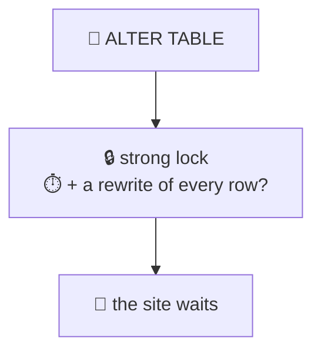
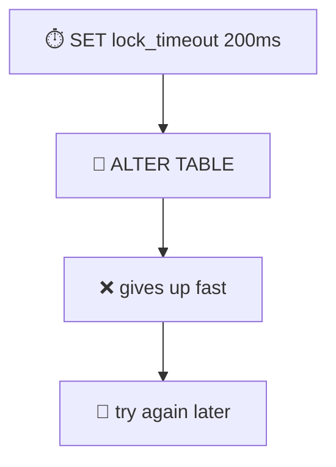
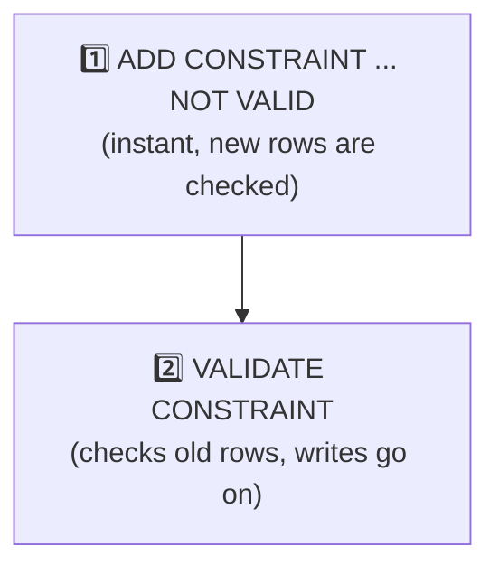
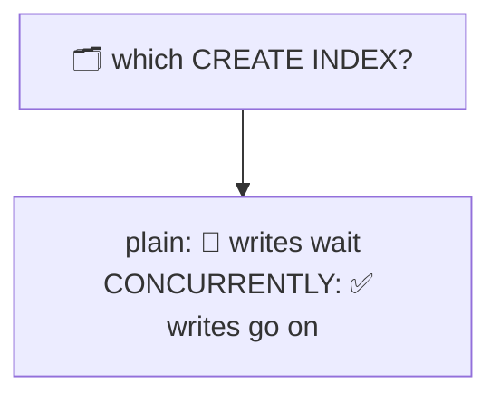
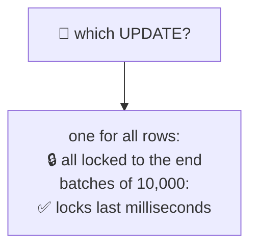
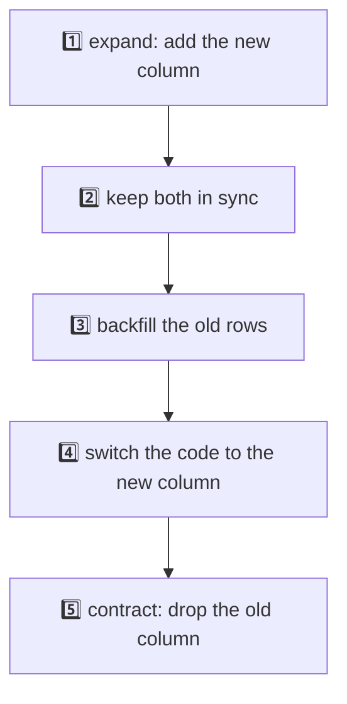
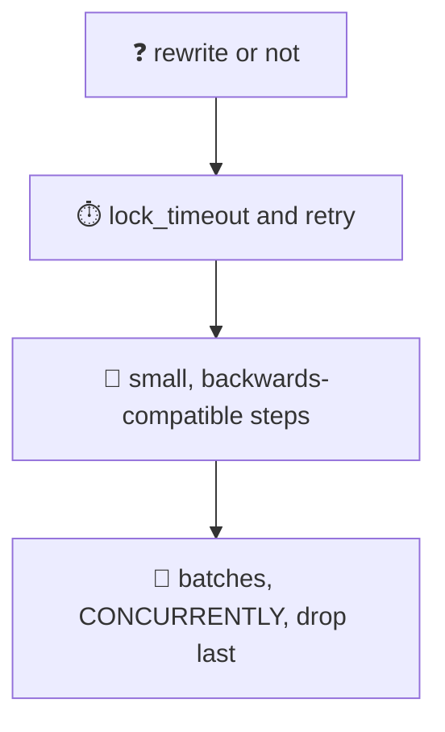

# 19. Zero-downtime migrations

> **Subject:** Database · **Lesson:** 19 · **Made:** 2026-11-01 · **Status:** ready
>
> **You will be able to:** tell which `ALTER TABLE` changes rewrite the whole table, protect a live site with `lock_timeout` and a retry, add a NOT NULL rule, a foreign key or an index without blocking writes, fill a new column in batches, and plan a rename with expand and contract.
>
> **Before this:** [Upsert, idempotency and job queues](18-upsert-idempotency-and-job-queues.md) · **Next:** Connection pooling (lesson 20, not written yet)
>
> **How to read it:** one card is one idea. Look at the picture, guess, then press the orange bar to check. The blue bars (📖 More detail) hold the longer explanation with the why and a real example. Skip them on the first read, and open them when you want more. Every number was run on PostgreSQL 18.3 on a table of 2 million rows. About 25 minutes for the cards.

## 1. The idea: a change must not stop the site

You have a table with millions of rows, and users are using it right now. You must change it. Two things can go wrong:

1. **The lock.** Most `ALTER TABLE` statements need a strong lock, and a waiting strong lock blocks everyone behind it (lesson 15, card 6).
2. **The work.** If the change **rewrites the whole table**, it holds that strong lock for the whole time.



<details class="guess"><summary>🤔 Guess: a table of 2 million rows (130 MB). Which of these take seconds, because they rewrite the table: (a) <code>ADD COLUMN status text NOT NULL DEFAULT 'new'</code>, (b) <code>ADD COLUMN token double precision DEFAULT random()</code>, (c) widen <code>varchar(100)</code> to <code>varchar(300)</code>, (d) <code>int</code> to <code>bigint</code>, (e) <code>DROP COLUMN</code>? Press to check.</summary>

| Change | Time | Rewrote the table? |
|---|---|---|
| (a) ADD COLUMN with a **constant** default | **6.7 ms** | no |
| (b) ADD COLUMN with `DEFAULT random()` | **4515 ms** | **yes** |
| (c) varchar(100) to varchar(300) | **0.6 ms** | no |
| (d) `int` to `bigint` | **4229 ms** | **yes** |
| (e) DROP COLUMN | **0.3 ms** | no |

I checked the rewrite with `pg_relation_filenode()`: a rewrite gives the table a new file. (b) and (d) did. The others kept the same file.

</details>

> **Remember:** a constant default, a wider varchar and a DROP COLUMN are instant. A volatile default and a type change of a different size rewrite the table.

<details class="more"><summary>📖 More detail: why (a) is instant and (e) leaves the size alone</summary>

- **(a)** Since Postgres 11, a **constant** default is stored once in the catalog. Old rows get it when they are read. Nothing is written per row. A **volatile** default like `random()` can be different for every row, so the rows must be written. I tested `random()`. (A stable default like `now()` is worked out once and stored like a constant. I did not test it.)
- **(c)** The same bytes can hold the longer limit, so only the catalog changes. Making a varchar **shorter** has to check every row.
- **(d)** `int` is 4 bytes and `bigint` is 8, so every row changes. I tested this one. `id` columns that must grow from `int` to `bigint` are a famous trouble: plan it long before the ids run out (an `int` stops at about 2.1 billion).
- **(e)** DROP COLUMN only marks the column as dropped. After it, the file was still the same size (178 MB). The space comes back only when the table is rewritten later.

While a rewrite runs, the strong lock (`ACCESS EXCLUSIVE`) is held, so even reads wait.

</details>

## 2. Make a migration give up politely

Even an instant `ALTER TABLE` can stop the site, if it has to **wait** for an old transaction (lesson 15, card 6). The fix: set a short `lock_timeout`, and run it again.



```js
async function migrate(client, sql, { tries = 10, lockTimeout = '200ms', pause = 300 } = {}) {
  await client.query(`SET lock_timeout = '${lockTimeout}'`);
  for (let attempt = 1; attempt <= tries; attempt++) {
    try { await client.query(sql); return attempt; }
    catch (e) {
      if (e.code !== '55P03') throw e;            // only the lock timeout
      await new Promise(r => setTimeout(r, pause));
    }
  }
  throw new Error('gave up: the table stayed busy');
}
```

<details class="guess"><summary>🤔 Guess: an old transaction has been open for 1.1 seconds. The migration above tries <code>ADD COLUMN</code> with a 200 ms limit. Meanwhile a reader asks for one row every 20 ms. How slow is the slowest read, and on which attempt does the migration work? Press to check.</summary>

```text
attempt 1 gave up waiting for the lock (55P03)
attempt 2 gave up waiting for the lock (55P03)
result: done on attempt 3 | reads during the migration: 30 | slowest read: 198 ms
```

The slowest read was **198 ms**, about the limit. Without the timeout, the reads would have waited for the whole 1.1 seconds, and for longer if the old transaction was a long one. The migration worked on attempt 3, after the old transaction ended.

</details>

> **Remember:** run every migration with a short lock_timeout, and retry. It is better to fail fast than to block the site.

<details class="more"><summary>📖 More detail: where to set it</summary>

- In the migration **session** (`SET lock_timeout = ...`) as above, or in the migration file's first line.
- Not in the database as a default for all sessions. A default `lock_timeout` would also cut your normal requests that wait on row locks.
- It limits the **wait for a lock**, not how long the statement runs. For the running time, use `statement_timeout`, which is a different setting (lesson 15, card 3).

A migration tool may run a whole file in **one transaction**. Then the first statement's lock is held until the last statement ends. Keep each file small and quick, and put slow steps (a big backfill, `CREATE INDEX CONCURRENTLY`) in their own steps. I did not test how Prisma runs its migration files. Look at the generated `migration.sql` and at the Prisma docs on production migrations before you use it on a big table.

</details>

## 3. Add a rule in two steps: NOT VALID and VALIDATE

`ALTER COLUMN ... SET NOT NULL` and `ADD FOREIGN KEY` have to **check every existing row**, while they hold a lock that blocks writes. The trick: add the rule **without** checking old rows, then check them later with a weaker lock.



<details class="guess"><summary>🤔 Guess: a direct <code>SET NOT NULL</code> on 2 million rows takes 267 ms and holds a lock. Which lock, and which one does <code>VALIDATE CONSTRAINT</code> use? Press to check.</summary>

I looked at `pg_locks` inside the transaction:

| Statement | Time | Lock held |
|---|---|---|
| `ALTER COLUMN name SET NOT NULL` (direct) | 267 ms | **`AccessExclusiveLock`** (everything waits) |
| `VALIDATE CONSTRAINT` on a `CHECK ... NOT VALID` | 96 ms | **`ShareUpdateExclusiveLock`** (reads and writes go on) |

The safe way for NOT NULL:

```sql
ALTER TABLE l19_orders ADD CONSTRAINT l19_name_nn CHECK (name IS NOT NULL) NOT VALID;
ALTER TABLE l19_orders VALIDATE CONSTRAINT l19_name_nn;
ALTER TABLE l19_orders ALTER COLUMN name SET NOT NULL;   -- 0.35 ms: Postgres trusts the validated CHECK
ALTER TABLE l19_orders DROP CONSTRAINT l19_name_nn;
```

</details>

> **Remember:** NOT VALID adds the rule fast. VALIDATE checks the old rows with a lock that lets writes through.

<details class="more"><summary>📖 More detail: the foreign key, measured</summary>

The same two steps work for a foreign key:

```sql
ALTER TABLE l19_orders ADD CONSTRAINT l19_fk_nv
  FOREIGN KEY (store_id) REFERENCES l19_stores (id) NOT VALID;      -- 0.3 ms
ALTER TABLE l19_orders VALIDATE CONSTRAINT l19_fk_nv;               -- 177 ms
```

What I saw in `pg_locks`:

| Statement | Time | Locks |
|---|---|---|
| `ADD FOREIGN KEY` (direct) | 182 ms | `ShareRowExclusiveLock` on **both** tables (writes wait) |
| `ADD FOREIGN KEY ... NOT VALID` | 0.3 ms | the same lock, but for a fraction of a millisecond |
| `VALIDATE CONSTRAINT` | 177 ms | `ShareUpdateExclusiveLock` on the orders table, `RowShareLock` on the stores table |

After step 1, new and changed rows are already checked. Only the old rows wait for step 2. A `CHECK` rule works the same way (`ADD CONSTRAINT ... CHECK (...) NOT VALID`, then `VALIDATE`). The docs describe this for `ALTER TABLE`. If `VALIDATE` finds a bad old row, it fails, and the rule stays "not valid" until you fix the data.

(Do not forget the index on the referencing column. Lesson 06, card 7.)

</details>

## 4. Create an index without blocking writes

A normal `CREATE INDEX` blocks every `INSERT`, `UPDATE` and `DELETE` on the table until it ends. `CREATE INDEX CONCURRENTLY` does not.



<details class="guess"><summary>🤔 Guess: the index build takes about 1 second on 2 million rows. An INSERT starts 60 ms after the build began. How long does it wait with a plain <code>CREATE INDEX</code>? With <code>CONCURRENTLY</code>? Press to check.</summary>

| Build | Index build time | The INSERT waited |
|---|---|---|
| plain `CREATE INDEX` | 1030 ms | **972 ms** |
| `CREATE INDEX CONCURRENTLY` | 942 ms | **2 ms** |

The plain build holds a `SHARE` lock, which blocks writes. The concurrent one takes more steps, and usually takes longer. On this quiet table it took about the same time.

</details>

> **Remember:** on a live table, always CREATE INDEX CONCURRENTLY. It cannot run inside BEGIN, and a failed build leaves an INVALID index to drop.

<details class="more"><summary>📖 More detail: the two traps</summary>

1. **Not in a transaction.** I tried it inside `BEGIN`:

   ```text
   ERROR:  CREATE INDEX CONCURRENTLY cannot run inside a transaction block
   ```

   So it needs its own migration step, outside a transaction. (This is a trap with tools that wrap every migration file in a transaction.)

2. **A failed build leaves an invalid index.** I made a unique index on a column with duplicates:

   ```text
   ERROR:  could not create unique index "l19_dups_v"
   ```

   The index stayed in the table, with `indisvalid = false`. It is not used for queries, but it **still slows every write**. Find them and drop them:

   ```sql
   SELECT indexrelid::regclass FROM pg_index WHERE NOT indisvalid;
   DROP INDEX l19_dups_v;
   ```

   (Lesson 26 says an unused index still costs on every write.)

`DROP INDEX CONCURRENTLY` also exists, for the same reason. I did not test it.

</details>

## 5. Fill a new column in batches

You added a column. Now it needs a value in 2 million old rows. One `UPDATE` for all of them is the obvious way, and it is the wrong one.



<details class="guess"><summary>🤔 Guess: one <code>UPDATE ... SET title = name</code> on 2 million rows, against batches of 10,000 rows with a COMMIT after each. While it runs, another session updates one single row (id 5). How long does that session wait in each case? Press to check.</summary>

| | Total time | The update of row 5 waited |
|---|---|---|
| one big UPDATE | 13,038 ms | **12,736 ms** |
| 201 batches of 10,000 | 6,133 ms | **4 ms** (the longest of 942 tries) |

The big UPDATE holds a row lock on **every row** until it commits, so the update of row 5 had to wait for all of it. A batch holds its locks for a few milliseconds. And, in my test, the batches were also **faster** in total.

</details>

> **Remember:** change big tables in small batches, each in its own transaction. Never one UPDATE for millions of rows.

<details class="more"><summary>📖 More detail: the loop, and the leftovers</summary>

In SQL only (Postgres 11 and later), a `DO` block can `COMMIT` inside a loop. It must run **outside** `BEGIN`:

```sql
DO $$
DECLARE last_id bigint := 0; max_id bigint;
BEGIN
  SELECT max(id) INTO max_id FROM l19_orders;
  WHILE last_id < max_id LOOP
    UPDATE l19_orders SET title = name
    WHERE id > last_id AND id <= last_id + 10000 AND title IS NULL;
    last_id := last_id + 10000;
    COMMIT;
  END LOOP;
END $$;
```

Inside a `BEGIN` it says `invalid transaction termination`. You can write the same loop in Node or any language. Walking by `id` ranges uses the primary key index, so every batch is fast.

**Dead rows.** Each updated row leaves a dead old version (lesson 16). After the big update, the table was 385 MB (from 178 MB). I ran `VACUUM FULL` (208 MB), and then the batches took it to 430 MB. Each pass over every row leaves about one dead copy of the table. Autovacuum will clean up and the space is reused, but plan for the extra space, and do not be surprised by it. A `VACUUM` after the backfill helps. You can also pause between batches so that replicas and autovacuum keep up.

**New rows during the backfill.** Rows written while you backfill must also get the value. Card 6 does it with a trigger.

</details>

## 6. Expand and contract: the safe way to rename

`ALTER TABLE ... RENAME COLUMN` is instant. But the old code that is still running (and every old server during a deploy) asks for the old name, and fails. A rename is a **breaking change**. So you do it in steps, where **every step works with both old and new code**.



<details class="guess"><summary>🤔 Guess: you add <code>full_name</code> next to <code>name</code>, and backfill it in batches while the old code keeps writing only <code>name</code> (378 writes during the test). At the end, how many rows have <code>full_name</code> different from <code>name</code>: (a) with a sync trigger, (b) without? Press to check.</summary>

| | Writes by old code | Rows where `full_name` differs from `name` |
|---|---|---|
| (b) without a trigger | 378 | **205** |
| (a) with the sync trigger | 384 | **0** |

Without the trigger, a row that the backfill had already passed was changed later by the old code, and the new column was **stale**. The trigger copies the value on every write, so nothing is missed:

```sql
CREATE FUNCTION l19_sync() RETURNS trigger LANGUAGE plpgsql AS $$
BEGIN NEW.full_name := NEW.name; RETURN NEW; END $$;
CREATE TRIGGER l19_sync_trg BEFORE INSERT OR UPDATE OF name ON l19_people
FOR EACH ROW EXECUTE FUNCTION l19_sync();
```

(The app can do the same job: write **both** columns for a while. Pick one.)

</details>

> **Remember:** expand (add), sync, backfill, switch, contract (drop). Each step must work with the old code and the new code.

<details class="more"><summary>📖 More detail: the order of a real change</summary>

For a rename `name` to `full_name`:

1. **Migration 1 (expand):** `ADD COLUMN full_name text` (instant, no default). Add the sync trigger (or make the app write both).
2. **Backfill** in batches (card 5). Check: no row where `full_name IS NULL`.
3. **Deploy new code** that reads and writes `full_name`. During the deploy, old and new servers run together. Both work, because the trigger or the dual write keeps the two columns equal.
4. Wait until **no old code** is running. Remove the trigger.
5. **Migration 2 (contract):** `DROP COLUMN name` (instant, card 1). Add `NOT NULL` with the NOT VALID trick if you want it (card 3).

The same shape works for: changing a type (new column, copy, switch), splitting a table, and `int` to `bigint`. The drop is the **last** step, and it is the one you cannot undo, so make a backup first and wait a few days if you can.

If the code deploy goes wrong, you can roll back the **code**, because the old column is still there and in sync. That is the point of keeping both.

</details>

## 7. A short checklist

Before you run a migration on a big, live table:



<details class="guess"><summary>🤔 Guess: a teammate's migration is <code>ALTER TABLE orders ADD COLUMN paid boolean NOT NULL DEFAULT false;</code> and then <code>CREATE INDEX ON orders (paid);</code>, in one transaction. Which parts are fine, and which are not? Press to check.</summary>

- `ADD COLUMN ... DEFAULT false` is **fine**. A constant default is instant (card 1).
- `CREATE INDEX` (not concurrent) is **not fine**: it blocks writes while it builds (card 4). Use `CREATE INDEX CONCURRENTLY`.
- **In one transaction**, `CONCURRENTLY` is not allowed (card 4), and the `ACCESS EXCLUSIVE` lock of the `ALTER` would be held until the end of the transaction, through the whole index build. Put them in **two** migration steps.
- Add `SET lock_timeout` and a retry (card 2).
- An index on a boolean with only two values is rarely useful anyway (lesson 26). Ask first if the query needs it, and consider a partial index (lesson 10).

</details>

> **Remember:** instant change, short lock_timeout, small steps, concurrent index, batches, drop last. When unsure, test on a copy with a lot of rows.

<details class="more"><summary>📖 More detail: how to test, and tools</summary>

- **Test on a copy** with about the same number of rows. A migration that takes 5 ms on 1,000 rows can take 5 seconds on 2 million (card 1: 4515 ms against 6.7 ms for different reasons).
- **Look at the locks.** The trick I used: run the statement inside `BEGIN`, then `SELECT mode FROM pg_locks WHERE relation = '...'::regclass AND pid = pg_backend_pid()`, then `ROLLBACK`.
- **Linters** can read migration SQL and warn about risky statements. One I know of is Squawk. I did not run it, so look at its page before you rely on it.
- **Off-peak time** helps, but it is not a fix. A migration at 3 a.m. still waits for the old transactions.
- **Hasura** and **Prisma** both generate migration SQL, and I did not test either. Read the SQL they generate for a big table, and apply this lesson to it.

</details>

## 8. Watch it run, step by step

Now watch the locks and the rewrites. **[Open the migration stepper](visuals/19-zero-downtime-migrations.html).** It has three tabs: an ADD COLUMN that is instant, an ADD COLUMN that rewrites the table, and a backfill in batches. Guess first, then press Next.

<details><summary>Or read the safe NOT NULL as a table</summary>

| Step | Statement | Time | Lock | Who waits |
|---|---|---|---|---|
| 1 | `ADD CONSTRAINT ... CHECK (name IS NOT NULL) NOT VALID` | 0.4 ms | brief | nobody |
| 2 | `VALIDATE CONSTRAINT` | 96 ms | `ShareUpdateExclusiveLock` | nobody (reads and writes go on) |
| 3 | `SET NOT NULL` | 0.35 ms | brief | nobody (no table scan) |
| 4 | `DROP CONSTRAINT` | 0.4 ms | brief | nobody |

The direct `SET NOT NULL` took 267 ms with `AccessExclusiveLock`.

</details>

## 9. Why it matters and what it costs

Interview words: *zero-downtime migration*, *expand and contract*, *backwards compatible*, *table rewrite*, *NOT VALID*, *CREATE INDEX CONCURRENTLY*, *lock_timeout*, *backfill*.

|  | The quick way | The safe way |
|---|---|---|
| New rule | direct (blocks writes for the scan) | `NOT VALID` then `VALIDATE` |
| New index | `CREATE INDEX` (blocks writes) | `CONCURRENTLY` |
| Fill a column | one huge UPDATE | batches with COMMIT |
| Rename | `RENAME` (breaks old code) | expand and contract |

- **With the map,** you can answer "how would you change this column on a table with 100 million rows without downtime?" and name the lock, the rewrite and the order.
- **Without it,** the answer is "at night, and hope".

**The costs:**

- More steps, more deploys, and more code for a while (the trigger, the dual write).
- Slower in total than the quick way, in some cases (concurrent builds, validate).
- Leftovers to clean: invalid indexes, old columns, the sync trigger, dead rows.

## 10. Watch and play

Links checked on 2026-11-01. Each page loaded (HTTP 200). For each video, the title and channel were confirmed through YouTube's oEmbed data. The video lengths were not checked.

- **Play with it:** [The migration stepper](visuals/19-zero-downtime-migrations.html) in this folder. Guess first, then press Next.
- **Video:** [Zero-downtime migrations | Postgres.FM 048](https://www.youtube.com/watch?v=mr_J5v398Qo) from the channel PostgresTV. A talk about cards 1 to 5.
- **Video:** [Every engineer should know this.. (Expand-Contract Pattern)](https://www.youtube.com/watch?v=ONSCQWLD9d0) from the channel Software Developer Diaries. Card 6.
- **Read:** [ALTER TABLE](https://www.postgresql.org/docs/current/sql-altertable.html) in the PostgreSQL docs. `NOT VALID`, `VALIDATE CONSTRAINT`, and which forms rewrite the table (cards 1 and 3).
- **Read:** [CREATE INDEX](https://www.postgresql.org/docs/current/sql-createindex.html). The "Building Indexes Concurrently" section (card 4).
- **Read:** [Explicit Locking](https://www.postgresql.org/docs/current/explicit-locking.html). The table lock modes (lesson 15, card 6).
- **Read:** [Modifying Tables](https://www.postgresql.org/docs/current/ddl-alter.html). Adding, removing and renaming columns.

<details><summary>More links (optional)</summary>

- **Read:** [Zero-downtime Postgres migrations: the hard parts](https://gocardless.com/blog/zero-downtime-postgres-migrations-the-hard-parts/) by GoCardless. A well-known write-up about the lock queue and `lock_timeout`. I only checked that the page loads.
- **Read:** [Squawk](https://squawkhq.com/). A linter for migration SQL. I only checked that the page loads.
- **Read:** [Prisma Migrate](https://www.prisma.io/docs/orm/prisma-migrate). How Prisma makes and runs migrations. I only checked that the page loads, and I did not run it.
- **Read (revision, dense):** [Database scaling and correctness](database-scaling-and-correctness.md) and [Database design and why](database-design-and-why.md).

</details>

## 11. Practice

**A. Predict.** A table has 50 million rows. Which of these is a quick change, and which needs a plan? (a) `ADD COLUMN notes text`, (b) `ADD COLUMN created_by int NOT NULL DEFAULT 0`, (c) `ALTER COLUMN price TYPE numeric(12,2)` (it is `numeric(10,2)` now), (d) `ALTER COLUMN id TYPE bigint` (it is `int` now).

<details class="guess"><summary>🤔 Press to see the answer</summary>

(a) **quick**: a new column with no default is only a catalog change.
(b) **quick**: a constant default is instant (card 1).
(c) **depends: test it**. Widening the precision of a `numeric` may not rewrite the table, but I did not test this one. Test it on a copy and check `pg_relation_filenode`. (I tested varchar, not numeric.)
(d) **needs a plan**: `int` to `bigint` rewrites the table (4229 ms for 2 million rows, so minutes for 50 million) under an exclusive lock. Use expand and contract: a new `bigint` column, a sync, a backfill in batches, then switch. Foreign keys that point to `id` also need to change.

</details>

**B. What would you check?** A migration `ALTER TABLE orders ADD CONSTRAINT orders_total_positive CHECK (total_cents >= 0);` ran during the day on a table of 80 million rows. The site was slow for a minute and some requests timed out. Why, and how do you do it next time?

<details class="guess"><summary>🤔 Press to see the answer</summary>

A plain `ADD CONSTRAINT ... CHECK` checks every existing row while it holds an `ACCESS EXCLUSIVE` lock, so reads and writes wait for the whole scan (like the 267 ms of `SET NOT NULL` on 2 million rows, but 40 times more rows).

Next time: `ADD CONSTRAINT ... CHECK (...) NOT VALID` (instant), then `VALIDATE CONSTRAINT` (a lock that lets writes go on). Put a `lock_timeout` on both and retry (card 2). If there are old rows that break the rule, fix them in batches first.

</details>

**C. Write it yourself**

Open [`practice/19-zero-downtime-migrations.sql`](practice/19-zero-downtime-migrations.sql). It builds a 200,000 row table and gives six tasks with the exact expected results: which ALTERs rewrite the table (`pg_relation_filenode`), a safe NOT NULL (you write it), a safe foreign key (you write it), an index on a live table and an invalid index (you write them), a backfill in batches with a `DO` block (you write it), and a migration that gives up politely (two windows).

<details><summary>One possible answer</summary>

```sql
-- Task 2
ALTER TABLE l19_orders ADD CONSTRAINT l19_name_nn CHECK (name IS NOT NULL) NOT VALID;
ALTER TABLE l19_orders VALIDATE CONSTRAINT l19_name_nn;
ALTER TABLE l19_orders ALTER COLUMN name SET NOT NULL;
ALTER TABLE l19_orders DROP CONSTRAINT l19_name_nn;

-- Task 3
ALTER TABLE l19_orders ADD CONSTRAINT l19_orders_store_fk
  FOREIGN KEY (store_id) REFERENCES l19_stores (id) NOT VALID;
ALTER TABLE l19_orders VALIDATE CONSTRAINT l19_orders_store_fk;

-- Task 4
CREATE INDEX CONCURRENTLY l19_orders_store_idx ON l19_orders (store_id);
-- Task 4b
SELECT indexrelid::regclass AS invalid_index FROM pg_index WHERE NOT indisvalid;

-- Task 5
ALTER TABLE l19_orders ADD COLUMN title text;
DO $$
DECLARE last_id bigint := 0; max_id bigint;
BEGIN
  SELECT max(id) INTO max_id FROM l19_orders;
  WHILE last_id < max_id LOOP
    UPDATE l19_orders SET title = name
    WHERE id > last_id AND id <= last_id + 10000 AND title IS NULL;
    last_id := last_id + 10000;
    COMMIT;
  END LOOP;
END $$;
```

Results I got, on PostgreSQL 18.3 with 200,000 rows: Task 1: `t, f, t, f` for (a) to (d). Task 2: `AccessExclusiveLock` for the direct `SET NOT NULL`, `ShareUpdateExclusiveLock` for `VALIDATE`. Task 3: `convalidated` false, then true, with `ShareUpdateExclusiveLock` during the validate. Task 4: `CREATE INDEX CONCURRENTLY cannot run inside a transaction block`, then the unique build failed, and the query listed `l19_dups_v`. Task 5: `missing = 0`. Task 6 is the same behaviour as in lesson 15, task 7.

</details>

## 12. Interview question

**Q:** "How would you add a NOT NULL column with a default to a table with 100 million rows, in production, without downtime? What about an index, and a rename?"

<details><summary>A strong answer, in four parts</summary>

1. **Problem:** most `ALTER TABLE` statements take an `ACCESS EXCLUSIVE` lock. If one waits for an old transaction, every other query queues behind it. If it rewrites the table, it holds the lock for minutes. Either way the site stops.
2. **How it works:** first I ask "does it rewrite?". A constant default is instant (6.7 ms in my test on 2 million rows), a volatile default or a type change like `int` to `bigint` rewrites (4.5 s and 4.2 s). Every migration runs with a short `lock_timeout` and a retry loop, so it fails fast instead of blocking. For a rule, I use `NOT VALID` then `VALIDATE` (a weaker lock: `ShareUpdateExclusiveLock` instead of `AccessExclusiveLock`). For an index, `CREATE INDEX CONCURRENTLY` in its own step (writes waited 2 ms, against 972 ms), and I check for invalid indexes after. To fill a column I update in batches of 10,000 with a COMMIT each (the update of a single row waited 4 ms, against 12.7 s for one big UPDATE). For a rename or a type change I use expand and contract: add the new column, keep it in sync (trigger or dual write), backfill, switch the code, drop the old column last.
3. **Tradeoff:** more steps and more deploys, a temporary trigger or dual write, and cleanup (invalid indexes, dead rows, the old column). But no outage, and every step can be rolled back until the drop.
4. **My example:** *This is an idea, not a fact. Replace it with a real story from DBO, Unloan, ZWS or Skyworx.* Changing `orders.total` from `int` to `bigint`, or splitting a `name` into two columns. I add the new column, write both, backfill in batches, switch reads, and drop the old one a week later.

</details>

## 13. Explain it back

Close this file. Press the **Record my explanation** button under this heading and explain zero-downtime migrations, like to a new junior, in 4 parts: problem, how it works, tradeoff, my example. Use these numbers: 6.7 ms against 4515 ms, 972 ms against 2 ms, 12.7 seconds against 4 ms, 205 rows against 0. Then save the transcript into `my-learning/recordings/`, or write your best version below. Run `/explain-check postgres migrations` or ask `coach my explanation`.

### My explanation

<write here>

### Coach feedback

<the explain-coach agent writes here>

## 14. Review questions (day 1, 3, 7, 21)

1. Name two `ALTER TABLE` changes that are instant on a big table, and two that rewrite it.
2. What does `lock_timeout` protect you from? What must your migration do when it fires?
3. How do you add `NOT NULL` to a big table in a way that does not block writes for long?
4. What is the difference between `CREATE INDEX` and `CREATE INDEX CONCURRENTLY`? Name two traps.
5. Why backfill in batches? What is wrong with one UPDATE of 2 million rows?
6. List the steps of expand and contract for a column rename.
7. A migration file runs in one transaction. Why can that be a problem?

<details><summary>Answers</summary>

1. Instant: `ADD COLUMN` with a constant default, widening a varchar, `DROP COLUMN`. Rewrites: a volatile default (`random()`), `int` to `bigint`.
2. It stops a waiting `ALTER TABLE` from blocking every query behind it. When it fires (error 55P03), the migration waits a bit and tries again, up to some limit.
3. `ADD CONSTRAINT ... CHECK (col IS NOT NULL) NOT VALID`, then `VALIDATE CONSTRAINT` (writes go on), then `SET NOT NULL` (instant, no scan), then drop the CHECK.
4. The plain one blocks writes while it builds (972 ms wait in my test). The concurrent one does not (2 ms). Traps: it cannot run in a transaction block, and a failed build leaves an INVALID index that still slows writes.
5. One UPDATE locks every row until it commits (the update of row 5 waited 12.7 s), writes a huge amount at once, and bloats the table. Batches hold locks for milliseconds.
6. Add the new column, keep both in sync (trigger or dual write), backfill in batches, deploy code that uses the new column, remove the sync, drop the old column.
7. Locks taken by the first statement are held until the end of the file. A strong lock plus a slow step later blocks the site. Also `CREATE INDEX CONCURRENTLY` is not allowed in a transaction.

</details>

## 15. Go deeper (optional)

None of this is needed for the cards above.

<details><summary>Rolling deploys make "backwards compatible" necessary</summary>

During a deploy, old and new servers run at the same time for a while. The database must work for both. This is why a migration must never break the **old** code, and why the drop comes after the new code is everywhere.

</details>

<details><summary>Changing an enum, a default, or a column order</summary>

`SET DEFAULT` and `DROP DEFAULT` are catalog changes. Adding a value to an enum (`ALTER TYPE ... ADD VALUE`) is quick, but a new value cannot be used in the same transaction in older versions. You cannot reorder columns. I did not test these here.

</details>

<details><summary>Online table changes with extensions</summary>

Tools like `pg_repack` rebuild a table with a short lock. They are for fixing bloat or doing a rewrite without a long lock. I did not test them here.

</details>

<details><summary>Reversible migrations</summary>

Write the "down" step before you run the "up", for every step except the final drop. A backfill is reversible by setting the column back to NULL. A drop is not, so it is last, and you keep a backup.

</details>

<details><summary>Make the tables yourself</summary>

The practice file builds a table of 200,000 rows. The times in the cards come from 2 million rows, built with `generate_series(1, 2000000)` and the same columns, on a throwaway Postgres 18.3. Your times will differ, and the SHAPE (instant against a rewrite, 2 ms against 972 ms) is what counts.

</details>

## Connected lessons

- [15. Locks and deadlocks](15-locks-and-deadlocks.md): the lock queue behind a waiting `ALTER TABLE`, and `lock_timeout`. This lesson builds on it.
- [08. Constraints and data types](08-constraints-and-data-types.md): the `CHECK`, `NOT NULL` and `FOREIGN KEY` rules, and `ADD CONSTRAINT ... NOT VALID`.
- [06. Keys and relationships](06-keys-and-relationships.md): the foreign key, and the index it needs.
- [09. Indexes and B-trees](09-indexes-and-b-trees.md) and [26. What an index costs](26-what-an-index-costs.md): what an index is, and what an unused or invalid index costs.
- [16. MVCC and VACUUM](16-mvcc-and-vacuum.md): the dead rows a backfill leaves behind.
- [Database scaling and correctness](database-scaling-and-correctness.md): the long guide.
