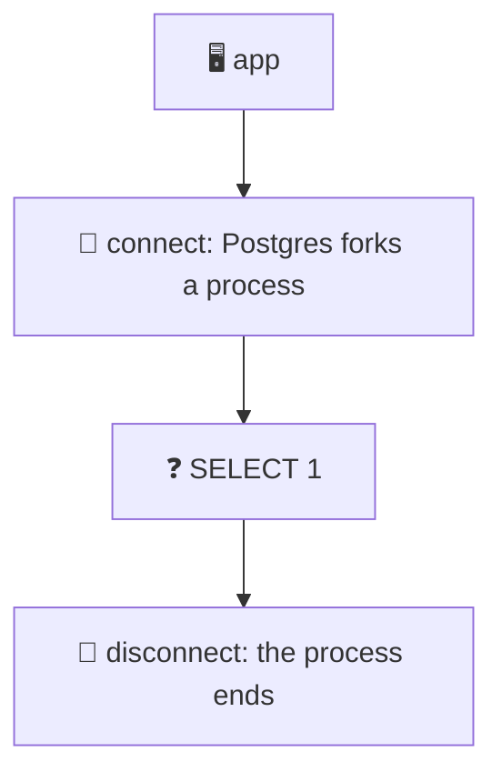
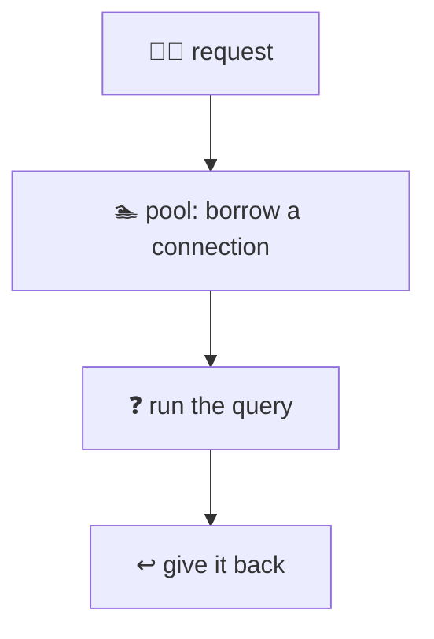
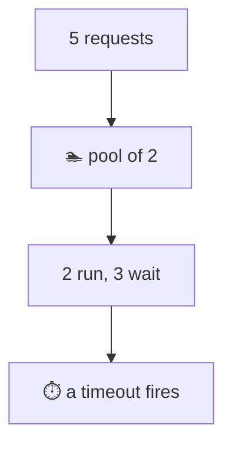
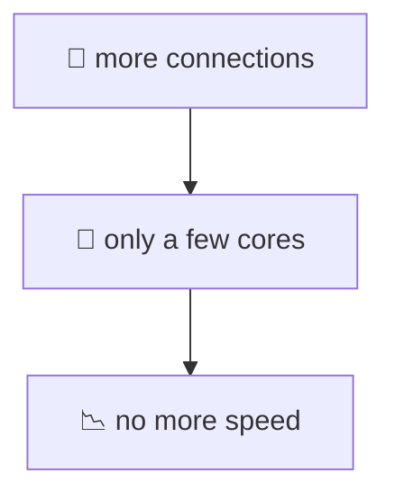
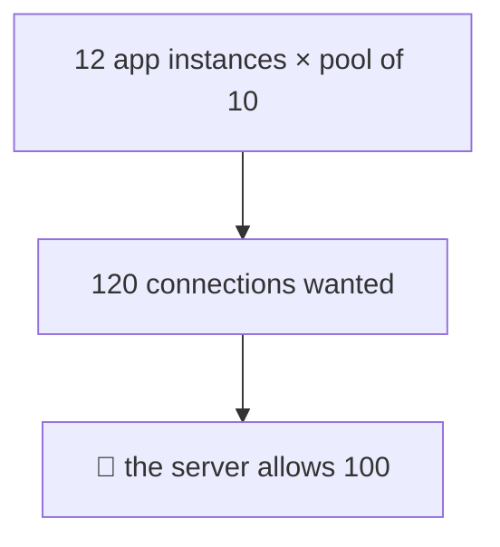
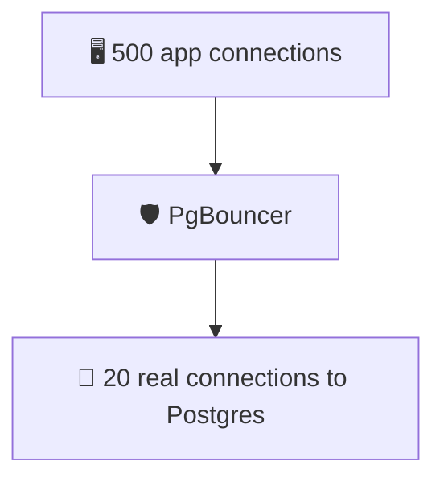
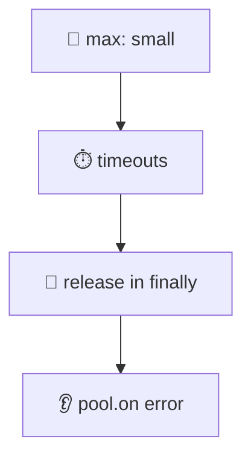

# 20. Connection pooling

> **Subject:** Database · **Lesson:** 20 · **Made:** 2026-11-01 · **Status:** ready
>
> **You will be able to:** say why a database connection is expensive, use a pool in Node, say what happens when all connections are busy, choose a pool size, work out how many connections a deployment really opens, and say what PgBouncer adds and what it breaks.
>
> **Before this:** [Zero-downtime migrations](19-zero-downtime-migrations.md) · **Next:** [Replication and read replicas](21-replication-and-read-replicas.md)
>
> **How to read it:** one card is one idea. Look at the picture, guess, then press the orange bar to check. The blue bars (📖 More detail) hold the longer explanation with the why and a real example. Skip them on the first read, and open them when you want more. Every number was run on PostgreSQL 18.3 on one laptop, with the `pg` library for Node. The PgBouncer facts come from its docs: I did not run PgBouncer. About 25 minutes for the cards.

## 1. The idea: a connection is a whole process

When your app connects to Postgres, the server **starts a new process** for you. The Postgres docs say it "forks" one for each connection. Setting it up takes time (and a password check, and maybe TLS). If you do it for every query, most of your time goes into connecting.



<details class="guess"><summary>🤔 Guess: 100 queries of <code>SELECT 1</code>. (a) each one opens a new connection and closes it. (b) all go through a pool of 10 connections that stay open. About how long does each take in total? Press to check.</summary>

| | Total for 100 queries |
|---|---|
| (a) a new connection every time | **288 ms** (I got 396 ms and 286 ms on two more runs) |
| (b) a pool of 10 | **10 ms** (9 ms on the other runs) |

About 30 times faster. This is on the same computer, with no network and no TLS. Over a real network, or with TLS, the new connection costs more.

</details>

> **Remember:** a new connection is slow, and a process on the server. Open a few, keep them, and reuse them.

<details class="more"><summary>📖 More detail: what a connection costs the server</summary>

Each connection is one server process. It takes memory, and it takes a slot in the process table. Postgres sizes some of its shared memory from `max_connections`. The docs say the default is typically 100, and that raising it allocates more.

The client side also has a cost: in my test (a), the numbers varied a lot between runs (396, 288, 286 ms). Opening a connection involves a few round trips (start-up, password), and these vary.

A connection also keeps **state**: the session settings, an open transaction, temp tables, prepared statements. This is why the same connection cannot be shared by two users at the same moment. It is lent out, one at a time (card 2).

</details>

## 2. A pool: keep connections open and lend them

A **pool** opens some connections and keeps them. When your code needs one, it **borrows** a connection, and gives it **back** when it is done.



```js
const { Pool } = require('pg');
const pool = new Pool({ connectionString: process.env.DATABASE_URL, max: 10 });

// one query: the pool borrows and returns for you
const { rows } = await pool.query('SELECT * FROM l17_posts WHERE id = $1', [id]);
```

<details class="guess"><summary>🤔 Guess: 100 queries run at the same moment through a pool of <code>max: 10</code>. How many different Postgres processes (backends) served them? Press to check.</summary>

**10.** I asked each query for `pg_backend_pid()` and counted the different numbers. The pool never opens more than `max` connections, so ten processes served all hundred queries. The other queries waited for a free one (card 3).

</details>

> **Remember:** the pool has a maximum. The queries share those connections, and extra queries wait in line.

<details class="more"><summary>📖 More detail: pool.query or pool.connect, and the defaults</summary>

- **`pool.query(sql)`** borrows a connection for **one** query and returns it. Use it for single statements.
- **`pool.connect()`** borrows a connection for **many** statements, for example a transaction (lesson 13, card 7). You must `release()` it in `finally`.

Defaults of `pg`'s Pool, read from its options object: `max` is **10**, `idleTimeoutMillis` is **10000** (a connection idle for 10 seconds is closed), and `connectionTimeoutMillis` is **not set**. So by default a request waits **as long as it takes** for a free connection (card 3).

Add an error listener on the pool: `pool.on('error', err => ...)`. An idle connection can be dropped by the server (for example by `idle_in_transaction_session_timeout` in lesson 15, or by a restart). Without a listener, that error can crash your Node process (lesson 15 showed the same with one client).

</details>

## 3. When all connections are busy: the line

A pool with 2 connections and 5 requests: 2 run, and 3 **wait in line**. If the line is too long, a request gives up.



<details class="guess"><summary>🤔 Guess: a pool of 2, <code>connectionTimeoutMillis: 700</code>, and 5 requests that each run a 500 ms query. How many requests finish, and when? Press to check.</summary>

```text
   21 ms  lines in use 2, waiting in line 3
  506 ms  request 1 done
  507 ms  request 2 done
  702 ms  request 5 FAILED: timeout exceeded when trying to connect
 1009 ms  request 3 done
 1009 ms  request 4 done
```

Requests 1 and 2 ran at once. Requests 3, 4 and 5 waited. At 500 ms the first two finished, and requests 3 and 4 got the connections (they finished at 1009 ms). Request 5 was **still waiting at 700 ms**, so it gave up with an error. It never ran.

</details>

> **Remember:** a pool is a queue. A long query makes the next ones wait. Set a connection timeout, so a request fails instead of hanging.

<details class="more"><summary>📖 More detail: the leak</summary>

A connection that is borrowed and **never returned** is a **leak**. It takes one of your slots for ever. I made one: a pool of 2, both clients borrowed with `pool.connect()` and never released, and a timeout of 500 ms:

```text
third request after 501 ms: timeout exceeded when trying to connect
```

Without a timeout, that third request would wait for ever, and so would the next one. The whole server looks frozen, while Postgres shows idle connections. The usual cause is a code path that returns or throws before `release()`. The cure is `try { ... } finally { client.release() }` (lesson 13, card 7).

To watch your pool: `pool.totalCount`, `pool.idleCount` and `pool.waitingCount`. If `waitingCount` is often above 0, requests are queuing.

A short **statement_timeout** and a short **idle_in_transaction_session_timeout** stop a slow or forgotten query from holding a connection for a long time (lessons 15 and 19).

</details>

## 4. How big should the pool be?

More connections is not faster. A computer with 8 cores can only do 8 things at the same moment. If a pool has 50 connections doing heavy work, they fight for the same cores.



<details class="guess"><summary>🤔 Guess: 240 queries that each use the CPU for about 15 to 40 ms, on a computer with 8 cores. Pools of 1, 2, 4, 8, 16 and 50 connections. Which pool gives the most queries per second? Press to check.</summary>

| Pool size | Queries per second |
|---|---|
| 1 | 27 |
| 2 | 50 |
| 4 | 90 |
| 8 | 101 |
| **16** | **110** |
| 50 | **83** |

It grows until about the number of cores, and then it **stops growing**. At 50 connections, it was **slower** than at 16. (Postgres and my test script ran on the same 8 core laptop, so the numbers are rough. The shape is what matters.)

</details>

> **Remember:** a pool should be small. A good start is a few times the number of CPU cores of the database, split across all your app servers.

<details class="more"><summary>📖 More detail: when waiting queries want a bigger pool</summary>

The test above used queries that burn CPU. Most web queries spend a lot of time **waiting** (for the disk, for a lock, for the network). To see this, I ran 200 queries of `pg_sleep(0.02)` (20 ms of waiting, no CPU):

| Pool size | Time for 200 queries |
|---|---|
| 1 | 4444 ms |
| 5 | 897 ms |
| 20 | 226 ms |
| 50 | 110 ms |

Here a bigger pool **does** help, because the connections are idle most of the time. Real queries are a mix. So there is no magic number. A common rule of thumb is about `(cores × 2) + number of disks` for the whole database, and then measure. The HikariCP wiki page "About Pool Sizing" explains it (see card 10). I did not test the formula.

Remember the other limit: all your app servers share the database. The pool size of **one** server times the number of servers must stay under the budget (card 5).

</details>

## 5. The connection limit: the sum of all pools

The database allows only `max_connections` connections in total (the docs say typically 100). Every pool of every app server counts.



<details class="guess"><summary>🤔 Guess: 12 "function instances", each with its own pool of 10, each sends 10 queries at once. The server has <code>max_connections = 100</code>. How many queries work, and what happens to the rest? Press to check.</summary>

```text
12 instances x pool of 10 = 120 connections wanted at once.
queries that worked: 100
failed 20 times: sorry, too many clients already
```

(I got the same result on all three runs.) 100 connections were available, and 20 queries got an error: `sorry, too many clients already`. The error comes from Postgres, not from your pool.

</details>

> **Remember:** total connections = app instances × pool size. Add them up, and keep the sum under max_connections, with room for admin work.

<details class="more"><summary>📖 More detail: the arithmetic, and why serverless hurts</summary>

Count **everything** that connects: every API server, every worker, the migration job, a cron script, your own psql. A few slots (`superuser_reserved_connections`, 3 by default on my server) are kept for superusers, so you can log in when the server is full. In my test the user was a superuser, so all 100 slots were usable. By the docs, a normal user gets 97.

**Serverless** (many short-lived functions) and **autoscaling** make this worse: each new instance makes its **own** pool, and 50 instances with a pool of 10 each is 500 connections. Two good habits:

- Make the pool **small per instance** (often `max: 1` to `3` for a function), and
- put a **pooler** in front, which gives many app connections a few real database connections (card 6).

Do not "fix" it by raising `max_connections` to 1000. Each connection costs memory, and as card 4 showed, more connections at once does not mean more work done.

</details>

## 6. A pooler in front: PgBouncer

**PgBouncer** is a small program that sits between your apps and Postgres. Your apps open many cheap connections **to PgBouncer**. PgBouncer keeps only a few real connections to Postgres, and lends them out.



<details class="guess"><summary>🤔 Guess: PgBouncer can give a real connection to a client for a whole session, for one transaction, or for one statement. Which mode lets the most clients share the fewest connections, and what do you lose with it? Press to check.</summary>

**Transaction pooling** (the middle one) is the usual choice for many clients. From the PgBouncer docs:

| Mode | The server connection goes back to the pool when |
|---|---|
| session (default) | the client disconnects |
| transaction | the transaction ends |
| statement | the statement ends (a multi-statement transaction is not allowed) |

In transaction mode, your next transaction may run on a **different** server connection. So anything that lives **inside a session** stops working. The docs list these as **never** working in transaction pooling: `SET` and `RESET`, `LISTEN`, `PREPARE` and `DEALLOCATE`, session-level advisory locks, `WITH HOLD` cursors, and `PRESERVE` / `DELETE ROWS` temp tables. The docs also say that this mode "breaks client expectations of the server by design".

</details>

> **Remember:** a pooler lets many clients share few connections. Transaction mode is the best for that, but session state does not survive between transactions.

<details class="more"><summary>📖 More detail: what to check in your app</summary>

Before you put your app behind a pooler in transaction mode, look for:

- **`SET`** at the start of a connection (time zone, `search_path`, a role). Use `SET LOCAL` inside the transaction instead. I did not test this one, but `SET LOCAL` lasts only to the end of the transaction by the Postgres docs.
- **Prepared statements.** The docs say protocol-level prepared statements work in transaction mode if `max_prepared_statements` is set to a non-zero value. Check the version of PgBouncer you use, and your driver's setting.
- **`LISTEN` / `NOTIFY`** and **session advisory locks** (lesson 15). Use a direct connection for those.
- **Long transactions** still hold a server connection for their whole length. A pooler does not help with a transaction that stays open (lesson 15).

PgBouncer's `default_pool_size` is 20 per user and database pair, by its docs. Managed Postgres services often offer a pooler of their own. I did not test those.

</details>

## 7. A checklist for your app

What to set, and where, in a Node app with `pg`:



<details class="guess"><summary>🤔 Guess: a teammate's app runs 6 API servers and 2 workers. Each uses <code>new Pool({ max: 20 })</code>, and the database has <code>max_connections = 100</code>. Is this safe? Press to check.</summary>

**No.** 8 processes × 20 = **160** connections possible, over the limit of 100. It works while the load is low and each process opens only a few. Under load, or during a deploy (old and new servers run together, and count twice), some requests fail with `too many clients already`.

A safer plan: decide the budget first, for example 100 total, minus 10 for admin, migrations and spikes, which leaves 90. Split it: 8 processes × 10 = 80, or fewer for the processes that do little. And check the numbers when you scale up.

</details>

> **Remember:** budget the connections first, then size each pool. Set a connection timeout, release in finally, listen for pool errors.

<details class="more"><summary>📖 More detail: the settings, and ORMs</summary>

```js
const pool = new Pool({
  connectionString: process.env.DATABASE_URL,
  max: 10,                        // from your budget, not a guess
  idleTimeoutMillis: 10_000,      // close connections that sit idle
  connectionTimeoutMillis: 2_000, // fail fast instead of waiting for ever
});
pool.on('error', err => console.error('idle client error', err.message));
```

And in the database, per role or per database: `statement_timeout`, `lock_timeout` and `idle_in_transaction_session_timeout` (lessons 15 and 19).

**ORMs.** Most ORMs have their own pool. In Prisma the pool size is a setting in the connection URL or the client options, and its docs have a page on the connection pool (see card 10). Hasura has its own pool setting too. I did not test either, so read the defaults for your version. The rules above still apply: the pool of one process, times the number of processes, must stay under the budget.

**Watch it.** In the database: `SELECT count(*), state FROM pg_stat_activity GROUP BY state;` shows how many connections are active, idle, and `idle in transaction`. A lot of `idle in transaction` means a leak or a slow transaction (lessons 15 and 16).

</details>

## 8. Watch it run, step by step

Now watch the pool and the line. **[Open the connection pool stepper](visuals/20-connection-pooling.html).** It has three tabs: a pool of 2 with 5 requests, 12 instances against the limit of 100, and a pooler in front. Guess first, then press Next.

<details><summary>Or read the pool of 2 as a table</summary>

A pool of 2, `connectionTimeoutMillis: 700`, five requests of 500 ms:

| Time | Connection 1 | Connection 2 | In line |
|---|---|---|---|
| 0 ms | request 1 | request 2 | 3, 4, 5 |
| 500 ms | request 3 | request 4 | 5 |
| 700 ms | (busy) | (busy) | request 5 gives up: timeout |
| 1000 ms | free | free | nobody |

</details>

## 9. Why it matters and what it costs

Interview words: *connection pool*, *max_connections*, *PgBouncer*, *transaction pooling*, *connection leak*, *pool exhaustion*, *serverless connections*.

|  | No pool | A small pool | A pooler in front |
|---|---|---|---|
| Time per query | connect time every time | no connect time | no connect time |
| Connections on the server | as many as clients | at most the pool size | a few |
| Many app instances | breaks the limit | pools add up | works |

- **With the map,** you can explain "too many clients already", a frozen server with idle connections, and why a bigger pool made things slower.
- **Without it,** the answer is "raise max_connections".

**The costs:**

- A pool is a queue: a slow query makes others wait.
- You must budget connections across all servers.
- A pooler is one more thing to run, and in transaction mode some session features stop working.

## 10. Watch and play

Links checked on 2026-11-01. Each page loaded (HTTP 200). For each video, the title and channel were confirmed through YouTube's oEmbed data. The video lengths were not checked.

- **Play with it:** [The connection pool stepper](visuals/20-connection-pooling.html) in this folder. Guess first, then press Next.
- **Run it:** [`practice/20-connection-pooling.js`](practice/20-connection-pooling.js). A 4 part script that makes the numbers of cards 1, 2, 3 and 5 on your own database.
- **Video:** [Database Connection Pooling: Why It Matters? Essential OS-Level Insights](https://www.youtube.com/watch?v=Vq34xPYZwXg) from the channel Denis Magda. Cards 1 to 3.
- **Video:** [PgBouncer Tutorial](https://www.youtube.com/watch?v=ddKm7a7xOpk) from the channel Code with Lucian. Card 6.
- **Read:** [node-postgres: Pooling](https://node-postgres.com/features/pooling). `Pool`, `pool.query`, `pool.connect` and the options of cards 2, 3 and 7.
- **Read:** [Connection Settings](https://www.postgresql.org/docs/current/runtime-config-connection.html) in the PostgreSQL docs. `max_connections` and the reserved slots (card 5).
- **Read:** [Architectural Fundamentals](https://www.postgresql.org/docs/current/tutorial-arch.html). "Forks a new process for each connection" (card 1).
- **Read:** [PgBouncer features](https://www.pgbouncer.org/features.html) and [config](https://www.pgbouncer.org/config.html). The pooling modes and the table of what works in each mode (card 6).

<details><summary>More links (optional)</summary>

- **Read:** [About Pool Sizing](https://github.com/brettwooldridge/HikariCP/wiki/About-Pool-Sizing) in the HikariCP wiki. Why a small pool is often faster (card 4). It is about Java, and the idea is the same.
- **Read:** [Connection pool in Prisma](https://www.prisma.io/docs/orm/prisma-client/setup-and-configuration/databases-connections/connection-pool). I only checked that the page loads.
- **Read (revision, dense):** [Database scaling and correctness](database-scaling-and-correctness.md), "Step 2: Connection pooling".

</details>

## 11. Practice

**A. Predict.** A pool has `max: 5`. 20 requests arrive at once, each runs a 100 ms query. How long until the last one finishes? How long does the last one wait for a connection?

<details class="guess"><summary>🤔 Press to see the answer</summary>

20 requests ÷ 5 connections = 4 rounds of 100 ms, so about **400 ms** in total. The last 5 requests wait about **300 ms** for a connection and then run for 100 ms. (My test of 200 queries of 20 ms with a pool of 5 took 897 ms: 40 rounds of 20 ms = 800 ms plus some overhead.)

</details>

**B. What would you check?** In production the API stops answering for a minute at a time. Postgres CPU is low. In `pg_stat_activity` there are 10 connections, all `idle`. What do you suspect, and what do you look at in the app?

<details class="guess"><summary>🤔 Press to see the answer</summary>

A **connection leak**: the app borrowed all 10 connections of the pool and never gave them back, so new requests wait for ever in the line. Postgres sees nothing to do (the connections are idle), which is why its CPU is low.

Look at: `pool.waitingCount` (high) and `pool.idleCount` (0). Search the code for `pool.connect()` without a `finally { client.release() }`, especially early `return` and `throw` paths. Add `connectionTimeoutMillis`, so a request fails with an error you can see instead of hanging.

</details>

**C. Write it yourself**

Open [`practice/20-connection-pooling.js`](practice/20-connection-pooling.js). It is a Node script with four parts. Before you run it, write down the five guesses at the top. Then run it against the Docker playground and compare your guesses with the cards. Then change two things and run it again: make the pool of Part 3 bigger (`max: 5`), and make Part 4 use `max: 5` for each of the 12 instances.

<details><summary>One possible answer</summary>

On my run (PostgreSQL 18.3 on a laptop, `max_connections = 100`, three runs):

```text
Part 1. 100 new connections, one query each: 288 ms   (396 and 286 ms on the other runs)
Part 2. 100 queries through a pool of 10: 10 ms
        different Postgres processes used: 10
Part 3. Pool of 2. Five requests, each runs a 500 ms query.
        lines in use 2, waiting in line 3
        request 1 and 2 done at about 506 ms, request 3 and 4 at about 1009 ms
        request 5 FAILED at 702 ms: timeout exceeded when trying to connect
Part 4. 12 instances x pool of 10 = 120 connections wanted at once.
        queries that worked: 100
        failed 20 times: sorry, too many clients already
```

Guesses: 1) one new connection costs about 3 ms here, so 100 take about 300 ms. 2) The pool is about 30 times faster. 3) 10. 4) Three requests wait in line, and one of them times out. 5) The server runs out of connections: 100 work, 20 fail.

I ran both changes. With `max: 5` in Part 3, all five requests ran at once and finished at about 505 ms, and nobody waited. With `max: 5` per instance in Part 4, 12 × 5 = 60 connections were open, and **all 120 queries worked** (the extra queries waited in line inside each pool). The same work, with a smaller pool per instance, and no errors.

</details>

## 12. Interview question

**Q:** "Why do we use a connection pool? What happens when it runs out? How would you size it, and what changes with serverless?"

<details><summary>A strong answer, in four parts</summary>

1. **Problem:** every Postgres connection is a server process, and opening one costs time: 100 queries with a new connection each took 288 ms, and through a pool of 10 only 10 ms. And the server has a hard limit, `max_connections` (about 100 by default).
2. **How it works:** a pool opens a few connections and lends them out. A request borrows one, runs, and gives it back (always in `finally`). When all are busy, requests wait in a queue, and with `connectionTimeoutMillis` they fail instead of hanging. The total is instances × pool size, and it must stay under `max_connections`: 12 instances × 10 gave 100 working queries and 20 errors, `sorry, too many clients already`.
3. **Tradeoff:** a bigger pool is not faster. On my 8 core laptop, throughput stopped growing at about 8 to 16 connections, and 50 was slower. I start small and measure. For serverless or many instances, I keep each pool small and put PgBouncer in front, in transaction pooling mode. In that mode, session features stop working (`SET`, `LISTEN`, `PREPARE`, session advisory locks).
4. **My example:** *This is an idea, not a fact. Replace it with a real story from DBO, Unloan, ZWS or Skyworx.* An API that froze after a deploy. The cause was a code path that borrowed a client and returned before `release()`. I found it with `pool.waitingCount`, added the `finally`, and set a connection timeout.

</details>

## 13. Explain it back

Close this file. Press the **Record my explanation** button under this heading and explain connection pooling, like to a new junior, in 4 parts: problem, how it works, tradeoff, my example. Use these numbers: 288 ms against 10 ms, 100 working and 20 failed, 110 queries per second at 16 against 83 at 50. Then save the transcript into `my-learning/recordings/`, or write your best version below. Run `/explain-check postgres connection pooling` or ask `coach my explanation`.

### My explanation

<write here>

### Coach feedback

<the explain-coach agent writes here>

## 14. Review questions (day 1, 3, 7, 21)

1. Why is opening a new Postgres connection for every query slow? What does the server do for each connection?
2. What is the difference between `pool.query` and `pool.connect`? What must you always do after `pool.connect`?
3. A pool of 2 has 5 requests. What happens to requests 3, 4 and 5? What does `connectionTimeoutMillis` change?
4. Is a bigger pool always faster? What happened in the test?
5. What does "sorry, too many clients already" mean? How do you work out the connections of a deployment?
6. What does PgBouncer do? What is transaction pooling, and name two things that stop working in it.
7. The API freezes, Postgres CPU is low, and `pg_stat_activity` shows idle connections. What is the likely cause?

<details><summary>Answers</summary>

1. Postgres starts a new server process for each connection, and there is the setup (and a password check, maybe TLS). It adds up: 288 ms for 100 connections against 10 ms through a pool.
2. `pool.query` borrows a connection for one query and returns it for you. `pool.connect` gives you a client for many statements (a transaction), and you must `release()` it, in `finally`.
3. Requests 1 and 2 run, and 3, 4 and 5 wait in line. With a 700 ms timeout, request 5 failed at 702 ms. Without a timeout it would wait as long as it takes.
4. No. Throughput grew up to about the number of cores (8 to 16 connections) and then stopped. With 50 connections it was lower (83 against 110 queries per second). Queries that mostly wait do gain from a bigger pool.
5. The server is at `max_connections`. Add up instances × pool size for every API server, worker and job (also during a deploy). Keep the sum under the limit, with room for admin.
6. It sits in front of Postgres and shares a few real connections among many clients. In transaction pooling a server connection is lent for one transaction. `SET` / `RESET`, `LISTEN`, `PREPARE`, and session advisory locks do not work.
7. A connection leak: clients were borrowed and not released, so new requests wait in the line. Check `pool.waitingCount` and the code paths without `release()`.

</details>

## 15. Go deeper (optional)

None of this is needed for the cards above.

<details><summary>Why processes, and what about threads?</summary>

Postgres uses one process per connection. Some other databases use threads. The docs describe the process model in "Architectural Fundamentals". Because of it, connection setup is heavier, and a pooler is more important. I did not measure the memory cost per connection here.

</details>

<details><summary>Health checks and dropped connections</summary>

A pooled connection can die while it is idle (a restart, a firewall, a failover). The pool then hands out a broken one, and the first query fails. `pg` removes broken clients when it sees an error, and you can add a retry for a failed first query. This matters most for idle-heavy apps.

</details>

<details><summary>Read replicas have their own limits</summary>

Each replica has its own `max_connections`. If you send reads to a replica (lesson 21), give it its own pool and budget.

</details>

<details><summary>Hasura and Prisma</summary>

I did not test the pools of Hasura or Prisma. Both keep a pool inside their process. Check the default size for your version and add it to your connection budget.

</details>

<details><summary>Make the numbers yourself</summary>

Parts 1 to 4 of the numbers come from `practice/20-connection-pooling.js`. The pool size test (card 4) used a pool of 1, 2, 4, 8, 16 and 50 on 240 queries of `select count(*) from generate_series(1, 300000) g where g % 7 = 0`, on an 8 core laptop where Postgres and the Node script both ran. The waiting test (card 4, More) used `pg_sleep(0.02)`. The playground in this repo runs Postgres 16 with the default `max_connections` of 100. My server was PostgreSQL 18.3, set to 100.

</details>

## Connected lessons

- [13. Transactions and ACID](13-transactions-and-acid.md): `pool.connect`, the transaction on one client, and `release()` in finally.
- [15. Locks and deadlocks](15-locks-and-deadlocks.md): `idle in transaction`, and the timeouts.
- [19. Zero-downtime migrations](19-zero-downtime-migrations.md): `lock_timeout` for the migration connection.
- [16. MVCC and VACUUM](16-mvcc-and-vacuum.md): a long transaction on a pooled connection holds back the cleanup.
- [21. Replication and read replicas](21-replication-and-read-replicas.md): more servers, more pools.
- [Database scaling and correctness](database-scaling-and-correctness.md): the long guide, "Step 2: Connection pooling".
