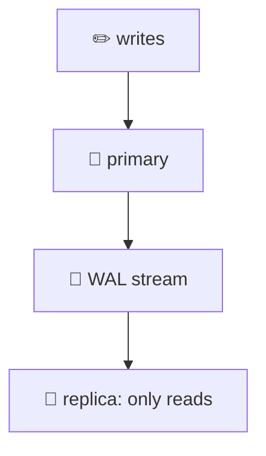
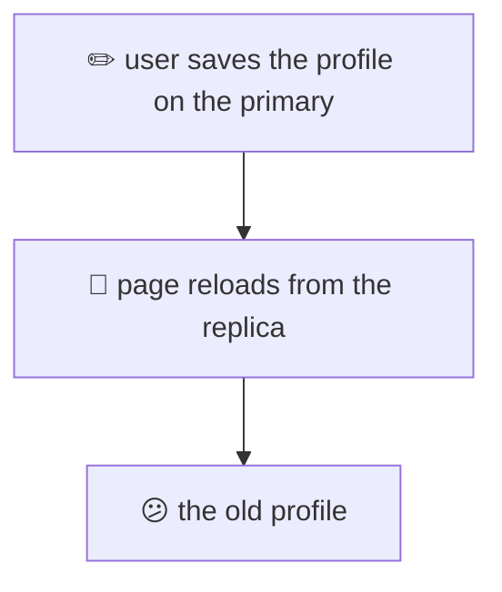
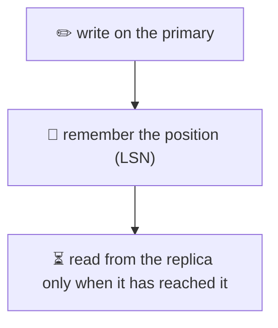
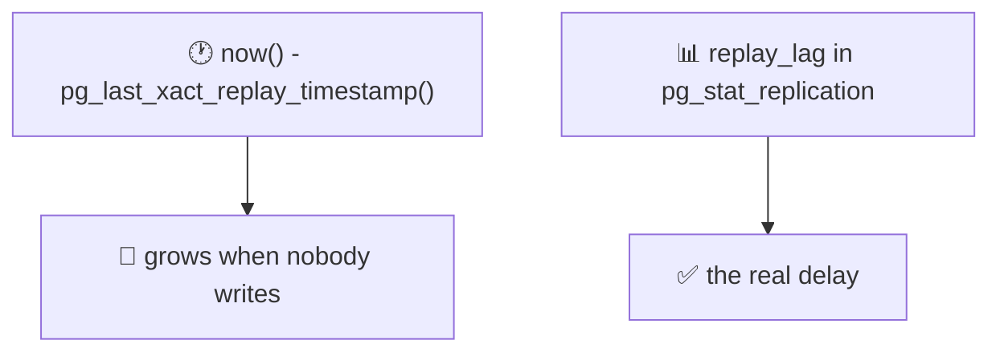
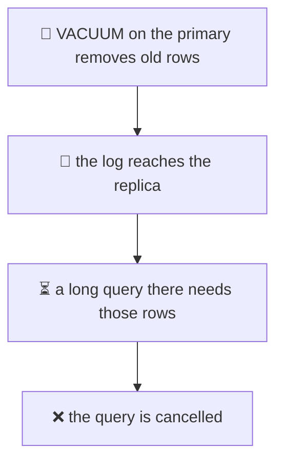
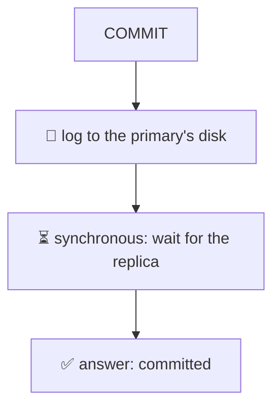
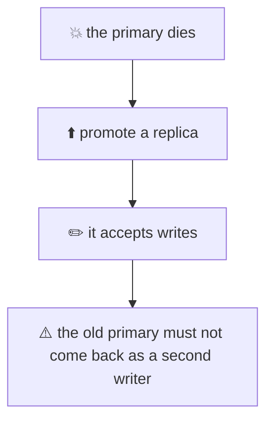

# 21. Replication and read replicas

> **Subject:** Database · **Lesson:** 21 · **Made:** 2026-11-01 · **Status:** ready
>
> **You will be able to:** explain how a replica copies the primary, send reads to a replica, explain replication lag and the "my write disappeared" bug, fix it with read-your-writes, say why a long query on a replica can be cancelled, and say what synchronous replication, failover and replication slots cost.
>
> **Before this:** [Connection pooling](20-connection-pooling.md) · **Next:** [Partitioning and sharding](22-partitioning-and-sharding.md)
>
> **How to read it:** one card is one idea. Look at the picture, guess, then press the orange bar to check. The blue bars (📖 More detail) hold the longer explanation with the why and a real example. Skip them on the first read, and open them when you want more. Every result was run on a real primary and a real streaming replica on one laptop, with PostgreSQL 18.3. About 25 minutes for the cards.

## 1. The idea: a copy that follows the primary

One database server does all the work: writes and reads. When it is too busy, or when you want a spare, you make a **replica**: a second server that keeps a copy of everything. The primary sends it every change, as the **write-ahead log** (lesson 13). The replica replays the log, over and over.



<details class="guess"><summary>🤔 Guess: a write is committed on the primary. How long until it can be read on the replica, on the same laptop? And what happens when you try to INSERT on the replica? Press to check.</summary>

I made 50 writes, each time waiting until the replica returned the row:

```text
write + commit + first successful read on the replica: min 0.3 | median 0.6 | max 8.0 ms
```

About half a millisecond, with both servers on one machine. Over a real network it is more. And a write on the replica is refused:

```text
25006  cannot execute INSERT in a read-only transaction
```

The replica is **read only**. All writes go to the primary.

</details>

> **Remember:** a replica replays the primary's log. It is read only, and it is a little behind.

<details class="more"><summary>📖 More detail: how I made the replica</summary>

```sh
pg_basebackup -h primary-host -p 5432 -D /path/to/replica -R -X stream --checkpoint=fast
pg_ctl -D /path/to/replica start        # on another port or another machine
```

- `pg_basebackup` copies all the files of the primary while it is running.
- **`-R`** writes a file `standby.signal` (this server starts as a standby) and `primary_conninfo` (where to get the log from).
- The replica connects to the primary, and receives the log as it is written. This is **streaming replication**.

On the primary, the view `pg_stat_replication` shows each replica:

```text
state | streaming     sync_state | async
write_lag | 15 ms   flush_lag | 15 ms   replay_lag | 15 ms      (right after it started)
```

`pg_is_in_recovery()` is `true` on a replica and `false` on the primary. The practice folder has a script that makes both servers on your computer (card 11).

</details>

## 2. The write that disappeared

The replica is a little behind. Most of the time you do not see it. But a user who saves a form, and then sees the page **from the replica**, may see the old data.



<details class="guess"><summary>🤔 Guess: the replica is 2 seconds behind (I forced it with <code>recovery_min_apply_delay = '2s'</code>). A row is saved on the primary, and read on the replica every 0.5 seconds. When does the replica show it? Press to check.</summary>

```text
    5 ms after the write: NOT found
  507 ms after the write: NOT found
 1009 ms after the write: NOT found
 1513 ms after the write: NOT found
 2016 ms after the write: found
```

For two seconds, the user's own write was **invisible**. A real replica is rarely 2 seconds behind. But under load, during a big write, or after a network problem, lag of seconds (or minutes) is normal.

</details>

> **Remember:** a replica can be behind. A user may not see their own write there. This bug is called a read-your-writes failure.

<details class="more"><summary>📖 More detail: why it is hard to catch</summary>

On a quiet system the lag is a millisecond, so the bug does not show in testing. It shows when the primary is busy, or the replica runs a heavy query, or the link is slow. A user clicks "Save", the page reloads, and the old value is back. They save again, and again.

The same problem hits **any** flow that writes then reads right away: create an order then show the order list, post a comment then show the thread, change a password then log in.

It also hits two different pages: a write through page A (primary) and a read for page B (replica), a second later.

</details>

## 3. Fixing it: read your own writes

You do not need the replica to be perfect. You need **this user** to see **their own** write.



<details class="guess"><summary>🤔 Guess: after a write, which of these gives the user their own data: (a) read from the primary for a few seconds after a write, (b) read from the replica, but first wait until the replica has replayed up to the write's position, (c) both? Press to check.</summary>

**Both work.** Three common fixes:

1. **Read from the primary** for this user for some seconds after they write ("sticky" reads), or for the pages that need fresh data. Simple, and uses the primary.
2. **Wait for the position.** After the write, ask the primary for its log position (`pg_current_wal_lsn()`). On the replica, wait until `pg_last_wal_replay_lsn()` is at least that position, then read:

   ```js
   const lsn = (await primary.query('SELECT pg_current_wal_lsn() AS lsn')).rows[0].lsn;
   for (;;) {
     const ok = (await replica.query('SELECT pg_last_wal_replay_lsn() >= $1::pg_lsn AS ok', [lsn])).rows[0].ok;
     if (ok) break;
     await new Promise(r => setTimeout(r, 50));
   }
   ```

   In my test, with the replica 2 seconds behind, the wait took **2006 ms**, and then the row was found.
3. **Send a version or a timestamp** with the user session ("I have seen up to here"), and let the replica refuse (or the app fall back to the primary) if it is behind.

</details>

> **Remember:** after a write, either read from the primary, or wait until the replica has reached the write's LSN.

<details class="more"><summary>📖 More detail: which to choose</summary>

- **Sticky reads** need one rule in the code and no waiting. Choose a window longer than your normal lag, for example 5 seconds. The cost is more load on the primary.
- **LSN waiting** is exact, but each read can wait. Put a **limit** on the wait (say 200 ms), then fall back to the primary.
- Some flows should **never** use a replica: anything that must be correct, such as checking a balance before a payment, or reading a row to decide whether to update it. Use the primary and `FOR UPDATE` (lesson 15) there. A replica is for reads where a slightly old answer is fine: lists, dashboards, search, reports.

</details>

## 4. How far behind is the replica? Measure it right

You want a number for "how far behind". There are two common ways, and one of them lies when the system is quiet.



<details class="guess"><summary>🤔 Guess: the primary is idle (no writes) and the replica is fully up to date. After 3 seconds, what does <code>now() - pg_last_xact_replay_timestamp()</code> say on the replica? And <code>replay_lag</code> on the primary? Press to check.</summary>

```text
on the replica:  now() - pg_last_xact_replay_timestamp() = 3.0 seconds
on the primary:  replay_lag = 0.4 milliseconds
```

The first number says "3 seconds behind". It is **not** behind at all. `pg_last_xact_replay_timestamp()` is the time of the **last replayed transaction**, and if nobody writes, it stays where it was, so the difference just grows with the clock. (On an earlier run, 20 seconds of silence gave 20 seconds, and `replay_lag` was `NULL`.)

`replay_lag`, `write_lag` and `flush_lag` in `pg_stat_replication` measure how long the log really took to arrive and be replayed.

</details>

> **Remember:** use replay_lag on the primary for the delay. Do not alarm on now() minus the last replay time, because it grows when nobody writes.

<details class="more"><summary>📖 More detail: what to watch</summary>

| What | Where | Meaning |
|---|---|---|
| `write_lag`, `flush_lag`, `replay_lag` | `pg_stat_replication` on the primary | time for the replica to write, flush and replay the log |
| `sent_lsn`, `replay_lsn` | the same view | how many **bytes** the replica is behind: `pg_wal_lsn_diff(sent_lsn, replay_lsn)` |
| `state` | the same view | `streaming` is healthy. `catchup` or missing means trouble |
| `pg_last_wal_replay_lsn()` | on the replica | how far it has replayed (card 3) |

Alert on the lag **in seconds and in bytes**, and on a replica that is missing from the view. If the primary writes in bursts, a lag of a few seconds can be normal.

</details>

## 5. A long query on a replica can be cancelled

The primary cleans up old row versions with VACUUM (lesson 16). That cleaning is also sent to the replica. But a long query on the replica might **still need** those rows. The replica must choose: wait, or cancel the query.



<details class="guess"><summary>🤔 Guess: a 4 second query runs on the replica. The primary deletes half of a table and runs VACUUM. The replica waits at most 1 second for the query (<code>max_standby_streaming_delay = '1s'</code>). What happens to the query? Press to check.</summary>

It is **cancelled**:

```text
ERROR  40001  canceling statement due to conflict with recovery
DETAIL: User query might have needed to see row versions that must be removed.
```

A **transaction that is open but idle** on the replica (a `REPEATABLE READ` one) is worse: the whole **connection** was terminated: `FATAL terminating connection due to conflict with recovery`. The error code is `40001`, the same as a serialization failure (lesson 14), so a retry makes sense.

The default wait is 30 seconds (`max_standby_streaming_delay`). So reports that run longer than that on a busy replica can fail at random.

</details>

> **Remember:** the replica applies the primary's cleanup. A long query there can be cancelled (error 40001). Retry, or give long reports their own replica.

<details class="more"><summary>📖 More detail: hot_standby_feedback, and its price</summary>

A setting on the replica, **`hot_standby_feedback = on`**, tells the primary "do not remove rows that my queries still need". With it on, the same test did **not** cancel: the second read in the open transaction worked (20,000 rows both times).

The price shows on the primary. In the same run, the primary's `VACUUM` said:

```text
tuples: 0 removed, 20000 remain, 10000 are dead but not yet removable
```

The replica's old transaction held back the cleanup **on the primary**, which is the long transaction problem from lesson 16, now across servers. A forgotten transaction on the replica can make the primary's tables grow.

So the choice is: cancel the replica's long queries (default), or let them hold back the primary's cleanup (`hot_standby_feedback`), or raise `max_standby_streaming_delay` (the replica falls behind while it waits). Many teams run long reports on a **separate** replica for this reason.

</details>

## 6. Synchronous or asynchronous: safe, or available?

By default replication is **asynchronous**: the primary says "committed" without waiting for the replica. If the primary dies a moment later, the last few commits may not have reached the replica. In **synchronous** mode the primary waits for the replica to confirm.



<details class="guess"><summary>🤔 Guess: <code>synchronous_standby_names</code> is set, so every COMMIT waits for the replica. Then the replica server stops. What happens to the next INSERT on the primary? Press to check.</summary>

With the replica running, a sync commit took **1 ms** (async took 2 ms, so almost no difference on one laptop). But with the replica **down**, the INSERT did **not return**. After 2.5 seconds it was still waiting, and `pg_stat_activity` showed:

```text
active / IPC / SyncRep
```

I cancelled the wait. Postgres answered with a warning, and the row was on the primary:

```text
WARNING  canceling wait for synchronous replication due to user request
DETAIL   The transaction has already committed locally, but might not have been replicated to the standby.
```

So: **a dead sync replica can freeze every write on the primary.**

</details>

> **Remember:** async can lose the last commits if the primary dies. Sync cannot, but it makes writes wait for the replica, and they stop if the replica is gone.

<details class="more"><summary>📖 More detail: the choices in the middle</summary>

- **`synchronous_standby_names = 'FIRST 1 (a, b)'`** or **`ANY 1 (a, b)`**: wait for one of several replicas. With two replicas, one can be down and writes go on.
- **`synchronous_commit`** can be set **per transaction**. A payment can use `on` (wait), and a log write can use `off` (do not even wait for the local disk). (Lesson 13, card 5.)
- **Remote apply** and levels like `remote_write` wait for different steps (written, flushed, or replayed). The default sync level waits for the flush. I did not test the other levels.
- Even a sync replica is **not** instantly readable on the replica side: the primary waits for the log to be **flushed**, not for the replay (unless you ask for `remote_apply`). So read-your-writes (card 3) still matters.

The trade is the classic one: **safety** against **availability and speed**.

</details>

## 7. Failover and what a replica keeps

When the primary dies, you **promote** a replica: it stops following, and starts accepting writes. This is **failover**. Two more things to know: what promotion does, and what an idle **replication slot** costs.



<details class="guess"><summary>🤔 Guess: you promote the replica while the old primary is still running, and write a row on the promoted copy. Does the old primary get that row? And what does a replication slot that nobody reads do to the primary's disk? Press to check.</summary>

**No**, the old primary never gets it. After `pg_ctl promote`:

```text
before: in recovery = true      after: in recovery = false
INSERT on the promoted copy: works     rows on the old primary: 0
the old primary sees 0 replicas
```

Two servers now accept writes, and their data **differs**. This is **split brain**. After a real failover you must stop the old primary for good (or rebuild it as a replica of the new one).

A **replication slot** tells the primary: "keep the log until this replica has it". If the replica is gone, the slot is still there, and the log **piles up**. I made a slot and did not read it, then wrote a million rows:

```text
wal_kept | 29 MB     (at the start)
wal_kept | 121 MB    (after the write)
```

The log keeps growing until the disk is full, unless you set a limit.

</details>

> **Remember:** promote one replica, and make sure the old primary can never write again. Check for slots nobody reads.

<details class="more"><summary>📖 More detail: who does failover, and the limit</summary>

Failover by hand is slow and risky. Most teams use a tool (Patroni, a cloud provider's managed failover, or similar) that watches the primary, promotes the best replica, and moves the traffic. I did not test any of those tools.

A setting called `max_slot_wal_keep_size` can limit how much log a slot may hold. A slot that goes over the limit is dropped, and its replica has to be rebuilt. I did not test the limit. In the view `pg_replication_slots`, look at `active`, `wal_status` and the size kept (`pg_wal_lsn_diff(pg_current_wal_lsn(), restart_lsn)`). I dropped my test slot after the test.

Also remember that your app needs a way to find the new primary (a DNS name, a proxy, or the pooler of lesson 20), and that the connections to the old one will break. Use a retry in the app (lesson 13).

**RPO and RTO.** How much data can you lose (RPO: with async replication, the last few commits) and how long can you be down (RTO: the time to notice and promote). The long guide, "Part C", has this.

</details>

## 8. Watch it run, step by step

Now watch the log and the lag. **[Open the replica stepper](visuals/21-replication-and-read-replicas.html).** It has three tabs: a write that reaches the replica, a replica 2 seconds behind, and a synchronous commit with the replica down. Guess first, then press Next.

<details><summary>Or read the "write that disappeared" as a table</summary>

| Time | Primary | Replica (2 s behind) | User sees |
|---|---|---|---|
| 0 ms | `INSERT` profile, `COMMIT` | not yet | "Saved" |
| 5 ms | | log received, waiting to replay | old profile (from the replica) |
| 1000 ms | | still waiting | old profile |
| 2016 ms | | replayed | new profile |

</details>

## 9. Why it matters and what it costs

Interview words: *read replica*, *streaming replication*, *replication lag*, *read-your-writes*, *synchronous replication*, *failover*, *split brain*, *replication slot*, *RPO and RTO*.

|  | One server | Primary and replicas |
|---|---|---|
| Read capacity | one machine | add replicas |
| Server dies | down until repair | promote a replica |
| Data is always fresh | yes | not on a replica |

- **With the map,** you can answer "how do we scale reads?" and "what happens if the database dies?", and name the bug that appears when you add a replica.
- **Without it,** "add a replica" is the answer to every slow page, and users start to lose their own writes.

**The costs:**

- Lag: a user can miss their own write (card 2), so the code needs a rule (card 3).
- Long queries on a replica can be cancelled, or they hold back the primary's cleanup (card 5).
- Writes still go to one primary. A replica does not scale writes ([lesson 22](22-partitioning-and-sharding.md) is about that).
- More servers, more connections to budget (lesson 20), more to monitor.

## 10. Watch and play

Links checked on 2026-11-01. Each page loaded (HTTP 200). For each video, the title and channel were confirmed through YouTube's oEmbed data. The video lengths were not checked.

- **Play with it:** [The replica stepper](visuals/21-replication-and-read-replicas.html) in this folder. Guess first, then press Next.
- **Run it:** [`practice/21-make-a-replica.sh`](practice/21-make-a-replica.sh) makes a primary and a replica on your computer, and [`practice/21-replication-and-read-replicas.js`](practice/21-replication-and-read-replicas.js) runs the tests of cards 1 to 5.
- **Video:** [Postgres Replicas Explained](https://www.youtube.com/watch?v=dJ_MeKWdeVQ) from the channel Web Dev Cody. Cards 1 and 2.
- **Video:** [Read Replicas and Replication Lag: Read-Your-Writes, Failover | System Design Masterclass](https://www.youtube.com/watch?v=BaluKlE2Gdk) by Prateek Goel (GrowAsEngineers). Cards 2, 3 and 7.
- **Read:** [High Availability, Load Balancing, and Replication](https://www.postgresql.org/docs/current/high-availability.html) in the PostgreSQL docs. The map of all the choices.
- **Read:** [Log-Shipping Standby Servers](https://www.postgresql.org/docs/current/warm-standby.html). Streaming replication, replication slots and synchronous replication (cards 1, 6 and 7).
- **Read:** [Hot Standby](https://www.postgresql.org/docs/current/hot-standby.html). Queries on a replica, and the "Handling Query Conflicts" section (card 5).
- **Read:** [pg_basebackup](https://www.postgresql.org/docs/current/app-pgbasebackup.html) (the `-R` flag of card 1), and [Replication settings](https://www.postgresql.org/docs/current/runtime-config-replication.html) (`synchronous_standby_names`, `hot_standby_feedback`, `max_slot_wal_keep_size`).

<details><summary>More links (optional)</summary>

- **Read:** [The Cumulative Statistics System](https://www.postgresql.org/docs/current/monitoring-stats.html). The `pg_stat_replication` view of cards 1 and 4.
- **Read (revision, dense):** [Database scaling and correctness](database-scaling-and-correctness.md), "Step 4: Read replicas" and "Part C: Not Losing Data".

</details>

## 11. Practice

**A. Predict.** A shop shows "My orders" from a read replica. A customer pays, is sent to "My orders", and the new order is missing. They pay again. What is the bug, and what is the cheapest fix?

<details class="guess"><summary>🤔 Press to see the answer</summary>

The replica was a little behind, so the new order was not there yet (a read-your-writes failure). The page asked a replica right after a write. The cheapest fix: for a few seconds after the user writes, read their orders from the **primary** (sticky reads), or read it from the primary on that one page. A better fix for the double payment: make the payment **idempotent** (lesson 18), so a second click cannot charge twice.

</details>

**B. What would you check?** A nightly report on the replica fails at random with `canceling statement due to conflict with recovery`. The report takes 8 minutes. What are your options, and what does each cost?

<details class="guess"><summary>🤔 Press to see the answer</summary>

The primary's cleanup reached the replica while the report still needed the old rows (card 5). Options:

1. Raise `max_standby_streaming_delay` on that replica (to more than 8 minutes). Cost: the replica falls behind while it waits.
2. Turn on `hot_standby_feedback`. Cost: the replica's old transaction holds back the cleanup on the primary, and tables there can grow (lesson 16).
3. Run the report on a **separate** replica made for reports, with option 1 or 2 only there.
4. Retry the report on error 40001, or run it in smaller chunks.

</details>

**C. Write it yourself**

Run [`practice/21-make-a-replica.sh`](practice/21-make-a-replica.sh) to make a primary and a replica on your computer (it needs the Postgres programs, set `PGBIN`). Then open [`practice/21-replication-and-read-replicas.js`](practice/21-replication-and-read-replicas.js), write down the five guesses at the top, and run it. Then change two things: make the delay of Part 3 `'5s'`, and make Part 5 wait for `max_standby_streaming_delay = '10s'`. Predict first.

<details><summary>One possible answer</summary>

On my run (PostgreSQL 18.3, both servers on one laptop):

```text
Part 1. 30 writes, each read back on the replica. min 0.3 ms, median 0.4 ms, max 5.2 ms
Part 2. INSERT on the replica: 25006 cannot execute INSERT in a read-only transaction
Part 3. A replica that is 2 seconds slow. A row is saved on the primary, then read on the replica:
            4 ms after the write: NOT found
          ... NOT found at 509, 1011 and 1515 ms
         2018 ms after the write: found
        waiting for LSN 0/302F108 took 2006 ms, then the row was found
Part 4. Idle primary, replica up to date. now() - pg_last_xact_replay_timestamp() = 3 seconds
        replay_lag on the primary = 0.4 milliseconds
Part 5. A 4 second query on the replica, while the primary deletes and VACUUMs: 40001 canceling statement due to conflict with recovery
```

Guesses: 1) under a millisecond, with a few ms at most. 2) The error `cannot execute INSERT in a read-only transaction`. 3) You see "NOT found" for 2 seconds, and waiting for the LSN takes about 2 seconds. 4) About 3 seconds, although the replica is fully up to date. 5) The query is cancelled.

With the delay at `'5s'`, the "found" would come at about 5 seconds, and the LSN wait would take about 5 seconds. With `max_standby_streaming_delay = '10s'`, a 4 second query would finish (the replica waits up to 10 seconds), but I did not run these two changes, so they are predictions from the settings.

</details>

## 12. Interview question

**Q:** "How do you scale reads in Postgres? What problems come with read replicas, and what do you do about them?"

<details><summary>A strong answer, in four parts</summary>

1. **Problem:** one server has a limit for reads, and one server is one failure. Most apps read much more than they write.
2. **How it works:** a streaming replica copies the primary's write-ahead log and replays it. It is read only. I send reads that can be a little old (lists, dashboards, reports) to replicas, and everything else to the primary. Writes still go to one primary. A replica is made with `pg_basebackup -R`, and I watch `replay_lag` in `pg_stat_replication`. In my test, the delay was about half a millisecond on one laptop.
3. **Tradeoff:** lag. A user may not see their own write (I forced 2 seconds and the row was "not found" for 2 seconds). Fixes: read from the primary for a few seconds after a write, or wait for the write's LSN. A long query on a replica can be cancelled by recovery conflicts (error 40001), or with `hot_standby_feedback` it holds back the primary's VACUUM. Synchronous replication avoids losing commits, but it freezes writes if the replica goes away. Failover needs a plan: one promoted writer, and a way to stop the old primary. A replication slot that nobody reads fills the disk with log (29 MB to 121 MB in my test).
4. **My example:** *This is an idea, not a fact. Replace it with a real story from DBO, Unloan, ZWS or Skyworx.* A dashboard and a report page read from a replica, and the order-create flow reads from the primary for 5 seconds after a write. The nightly report runs on its own replica, with a higher `max_standby_streaming_delay`.

</details>

## 13. Explain it back

Close this file. Press the **Record my explanation** button under this heading and explain read replicas, like to a new junior, in 4 parts: problem, how it works, tradeoff, my example. Use these numbers: 0.6 ms against 2 seconds, 2006 ms for the LSN wait, 29 MB to 121 MB, 1 ms against a hanging INSERT. Then save the transcript into `my-learning/recordings/`, or write your best version below. Run `/explain-check postgres replication` or ask `coach my explanation`.

### My explanation

<write here>

### Coach feedback

<the explain-coach agent writes here>

## 14. Review questions (day 1, 3, 7, 21)

1. How does a streaming replica get its data? Can you write to it?
2. What is a read-your-writes failure? Give an example, and two fixes.
3. Which number tells the real replication delay, and which number lies when the system is quiet?
4. A long query on a replica is cancelled with `conflict with recovery`. Why? Name two ways to avoid it, and the price of each.
5. What is the difference between asynchronous and synchronous replication? What happens to writes if a sync replica goes away?
6. What is split brain? What do you do after you promote a replica?
7. What does a replication slot do, and what is the danger of one that nobody reads?

<details><summary>Answers</summary>

1. It receives the primary's write-ahead log over a connection and replays it (streaming replication). No: it is read only (`cannot execute INSERT in a read-only transaction`).
2. A user writes, then reads from a replica that has not replayed it yet, and does not see their write. Fixes: read from the primary for a few seconds after a write, or wait until the replica has replayed the write's LSN, or send a version with the session.
3. `replay_lag` in `pg_stat_replication` on the primary is the real delay. `now() - pg_last_xact_replay_timestamp()` grows when nobody writes (3 seconds with no lag at all in my test).
4. The primary's VACUUM removed rows that the replica's query still needed, and the replica waited `max_standby_streaming_delay` and then cancelled it. Raise the delay (the replica falls behind), or turn on `hot_standby_feedback` (the replica's old transaction holds back the primary's cleanup), or use a separate replica for reports.
5. Async: the primary commits without waiting, and the last commits can be lost if it dies. Sync: it waits for the replica, so nothing confirmed is lost, but if the replica is gone, writes wait (and freeze) until you cancel, or until another sync replica is available.
6. Two servers accept writes and their data differs. After you promote, stop the old primary for good, or rebuild it as a replica of the new one, and point the app to the new primary.
7. It makes the primary keep the log until a replica has received it. If nobody reads it, the log piles up and fills the disk (29 MB to 121 MB in my test).

</details>

## 15. Go deeper (optional)

None of this is needed for the cards above.

<details><summary>Logical replication</summary>

Streaming replication copies **everything**, byte by byte, and the replica has the same major version. **Logical replication** sends row changes for chosen tables, and can go to a different version or a different kind of system. It is used for upgrades and for feeding other systems. I did not test it here.

</details>

<details><summary>Cascading replicas and delayed replicas</summary>

A replica can feed another replica. A replica can also be kept **on purpose** behind (`recovery_min_apply_delay`, the setting I used to make 2 seconds of lag) as a safety net: if someone drops a table by mistake, the delayed copy still has it for a while. I used it only to force lag in this lesson.

</details>

<details><summary>Backups and replicas are not the same</summary>

A replica copies a mistake too: `DROP TABLE` on the primary is replayed on the replica a moment later. A replica protects against a **dead server**, not against a **bad query**. For that you need backups and point-in-time recovery. The long guide, "Part C", covers backups.

</details>

<details><summary>Hasura and Prisma</summary>

I did not test how Hasura or Prisma use read replicas. Check their docs for your version, and test the read-your-writes cases of card 2 before you rely on them.

</details>

<details><summary>Make the servers yourself</summary>

`practice/21-make-a-replica.sh` builds the two servers, in a new folder, on ports 56432 and 56433, and `stop` removes them. The numbers in this lesson came from a primary and a replica made the same way (ports 55432 and 55433). Your numbers will differ.

</details>

## Connected lessons

- [13. Transactions and ACID](13-transactions-and-acid.md): the write-ahead log that the replica replays, and `synchronous_commit`.
- [14. Isolation levels](14-isolation-levels.md): error 40001, and why a retry makes sense.
- [16. MVCC and VACUUM](16-mvcc-and-vacuum.md): why the primary's cleanup conflicts with a replica's query, and `hot_standby_feedback`.
- [18. Upsert, idempotency and job queues](18-upsert-idempotency-and-job-queues.md): make the retry after a lost write safe.
- [20. Connection pooling](20-connection-pooling.md): each replica has its own connection budget.
- [22. Partitioning and sharding](22-partitioning-and-sharding.md): replicas do not scale writes.
- [Database scaling and correctness](database-scaling-and-correctness.md): the long guide, "Step 4: Read replicas".
