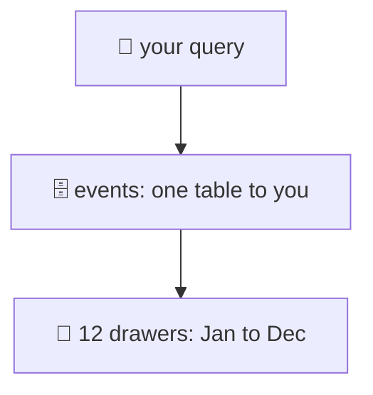
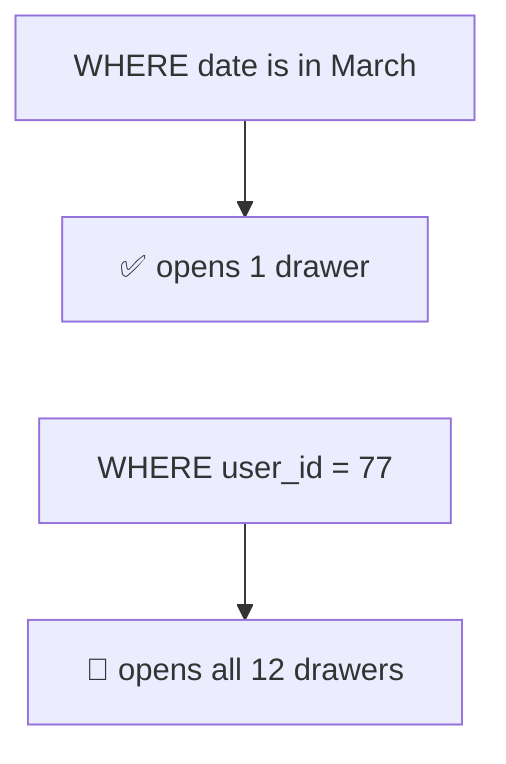
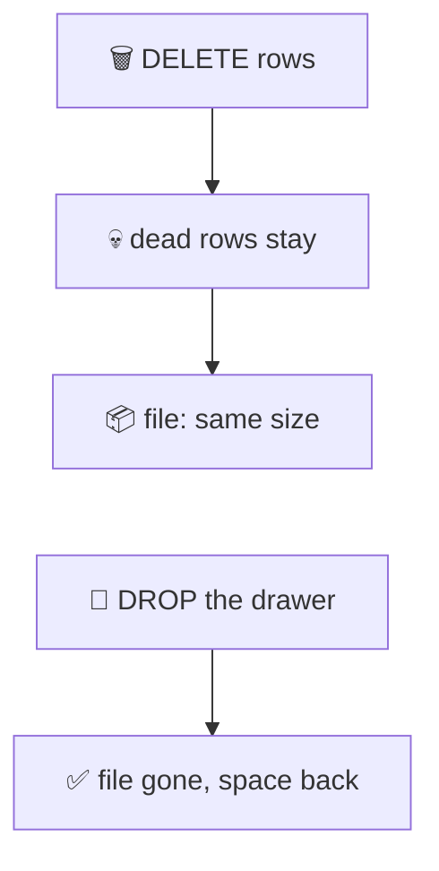
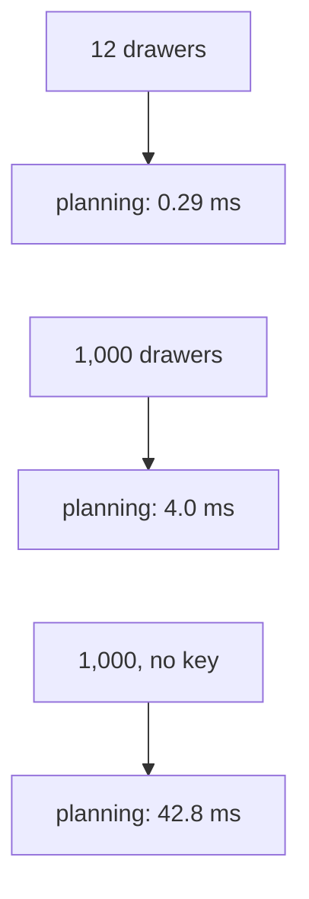
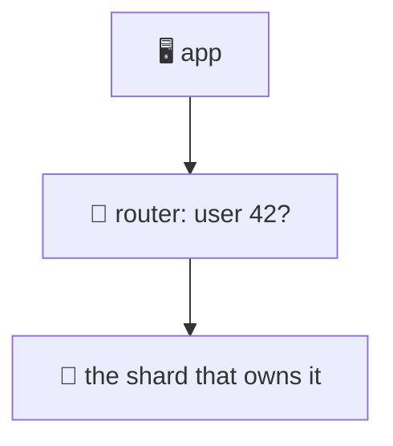

# 22. Partitioning and sharding

> **Subject:** Database · **Lesson:** 22 · **Made:** 2026-11-03 · **Status:** ready
>
> **You will be able to:** split one big table into partitions by date, say when Postgres opens one partition and when it opens all of them, remove old data with one command, name the three partitioning mistakes and their errors, say what sharding is, why it is the last step, and what you lose when you shard.
>
> **Before this:** [Replication and read replicas](21-replication-and-read-replicas.md) · **Next:** [SQL vs NoSQL and Redis](23-sql-vs-nosql-and-redis.md)
>
> **How to read it:** one card is one idea. Look at the picture, guess, then press the orange bar to check. The blue bars (📖 More detail) hold the longer explanation with the why and a real example. Skip them on the first read, and open them when you want more. Every Postgres result was run on PostgreSQL 18.3 on one laptop. Sharding is explained, not run on a real cluster: I did not build one. About 25 minutes for the cards.

## 1. The idea: one filing cabinet, one drawer for each month

A table with 1.2 million rows is one big pile. You can split it into **drawers**, one for each month. Postgres calls a drawer a **partition**. Your queries still talk to one table. Postgres decides which drawers to open.



<details class="guess"><summary>🤔 Guess: 12 monthly drawers, 1.2 million rows. A query asks for March only. How many drawers does Postgres open? Press to check.</summary>

**One.** I made the table and asked for March. The plan has one scan:

```text
Aggregate
  ->  Seq Scan on l22_events_2026_03 l22_events
        Filter: created_at >= '2026-03-01' AND created_at < '2026-04-01'
```

The other 11 drawers are not even in the plan. Postgres left them out before it started. This is called **partition pruning**.

</details>

> **Remember:** a partitioned table looks like one table. Under it are many small tables, and a query that names the right column opens only the drawers it needs.

<details class="more"><summary>📖 More detail: the SQL that makes it</summary>

```sql
CREATE TABLE l22_events (
  id bigint GENERATED ALWAYS AS IDENTITY,
  user_id int NOT NULL,
  created_at timestamptz NOT NULL,
  payload text
) PARTITION BY RANGE (created_at);

CREATE TABLE l22_events_2026_03 PARTITION OF l22_events
  FOR VALUES FROM ('2026-03-01') TO ('2026-04-01');
```

- `PARTITION BY RANGE (created_at)` says: the column `created_at` decides the drawer. This column is the **partition key**.
- Each `PARTITION OF ... FOR VALUES FROM ... TO ...` makes one drawer. The start is included, the end is not.
- An `INSERT` goes to the right drawer by itself. A `SELECT` from `l22_events` reads all the drawers it needs, as one table.
- To see which drawer holds a row: `SELECT tableoid::regclass, count(*) FROM l22_events GROUP BY 1`.
- Each drawer is a real table. It has its own file, its own indexes and its own VACUUM.

</details>

## 2. Name the key, or every drawer opens

The drawers are split by date. Pruning works only when the query **names that column**. A query about something else cannot skip a drawer, because any month might hold the rows.



<details class="guess"><summary>🤔 Guess: <code>WHERE user_id = 77</code> on the partitioned table. Each drawer has an index on <code>user_id</code>. How many drawers open, and is it faster or slower than the plain table? Press to check.</summary>

**All 12.** The plan has 24 scan lines: an index lookup and a table read in each drawer. I ran each query 9 times and took the middle one:

| Query | Plain table | Partitioned table |
|---|---|---|
| one month (`created_at` in March) | 18.1 ms | **10.8 ms** |
| one user (`user_id = 77`) | **0.18 ms** | 0.44 ms |
| planning time for the user query | 0.24 ms | 1.7 ms |

The query that names the date got faster. The query that does not got **a little slower**, because Postgres plans and runs 12 small lookups instead of one.

</details>

> **Remember:** partitioning helps the queries that name the partition column. For the others, it is 12 small tables that all get asked.

<details class="more"><summary>📖 More detail: why the month query was faster</summary>

The plain table used its index on `created_at`: a Bitmap Index Scan, then the table pages. The partitioned table read the whole March drawer in order, and nearly every row in it matched. A drawer that holds almost only what you want can be read without an index.

Do not expect this to be a big win by itself. The first plain-table run was also slower because the data was not in memory yet. The numbers above are the median of 9 runs. A partitioned table does **not** make the same query faster for free: a good index (lesson 09) is often enough. The strong reason to partition is the next card.

Pruning also works for `=`, `IN` and ranges on the partition key. It does **not** work when you wrap the key in a function. I ran `date_trunc('month', created_at) = '2026-05-01'` and the plan had a scan on **every** drawer, while a plain range on `created_at` had one. It is the same reason an index fails there (lesson 10). Compare the plain column.

</details>

## 3. The best reason: remove old data in one command

Old rows must go: logs, events, sessions. On one big table that is a huge `DELETE`. With drawers, you throw away a whole drawer.



<details class="guess"><summary>🤔 Guess: remove all of January (101,927 rows). A <code>DELETE</code> on the plain table, or <code>DETACH</code> and <code>DROP</code> on the January drawer. Which is faster, and which gives the disk space back? Press to check.</summary>

```text
DELETE 101927            80 ms on one run, 480 ms on another
file size                107 MB before, 107 MB after
n_dead_tup               101927   (the deleted rows wait for VACUUM)
VACUUM, then file size   107 MB   (still)

ALTER TABLE ... DETACH PARTITION l22_events_2026_01     about 2 to 4 ms
DROP TABLE l22_events_2026_01                            about 3 to 4 ms
```

The `DELETE` is slower and its time **jumps around**. It leaves dead rows (lesson 16), and a normal `VACUUM` does not make the file smaller. Dropping the drawer deletes the whole file at once. I expect the gap to grow with the size of the table, but I did not test a bigger one.

</details>

> **Remember:** to remove old data, drop the old drawer. It takes milliseconds and gives the space back. A big DELETE leaves dead rows and a file that stays big.

<details class="more"><summary>📖 More detail: DETACH first, and the new drawer</summary>

- **`DETACH PARTITION`** turns a drawer into a normal table, out of the big one. You can back it up, move it to cheap storage, and then `DROP` it. The Postgres docs also show `DETACH PARTITION ... CONCURRENTLY`, which blocks less. I used the plain form and did not test `CONCURRENTLY`.
- `DROP TABLE l22_events_2026_01` alone also works. I did not check which locks it takes, so on a busy table read the docs first.
- You need a drawer for the **future** too. A cron job (or a tool such as `pg_partman`, which I did not test) makes next month's drawer before the month starts. Card 4 shows what happens if nobody does.
- In the stepper, tab 3 shows the DELETE and the DROP side by side.

</details>

## 4. Three mistakes, three errors

Each of these breaks on the first try. Know the messages.

| Mistake | What Postgres says |
|---|---|
| `PRIMARY KEY (id)` without the partition column | `unique constraint on partitioned table must include all partitioning columns` |
| A row that fits no drawer | `no partition of relation "l22_events" found for row` |
| A `UNIQUE` on another column | the same "must include all partitioning columns" error |

<details class="guess"><summary>🤔 Guess: <code>INSERT ... VALUES (1, '2027-03-05', 'x')</code>, and there are only drawers for 2026. What happens, and what are two ways to fix it? Press to check.</summary>

The insert **fails**:

```text
ERROR:  no partition of relation "l22_events" found for row
DETAIL:  Partition key of the failing row contains (created_at) = (2027-03-05 00:00:00+07).
```

Fix 1: **make the drawer before you need it** (a monthly job). Fix 2: add a **default drawer**, which takes every row with no other drawer:

```sql
CREATE TABLE l22_events_other PARTITION OF l22_events DEFAULT;
```

After that the row goes there (`l22_events_other | 1`). But a default drawer that fills up is a sign that your monthly job stopped. Watch it.

</details>

> **Remember:** a primary key or unique rule must include the partition column. Make next month's drawer early. A default drawer is a safety net, not a plan.

<details class="more"><summary>📖 More detail: why the key must include the date</summary>

A unique rule is checked by an index. Each drawer has its **own** index, so Postgres can only promise "unique" inside one drawer. If the partition column is part of the key, two rows with the same key must be in the same drawer, so the per-drawer check is enough. That is the rule in the docs: the constraint's columns must include all the partition key columns.

What you give up: `id` alone can no longer be a primary key on this table. You use `PRIMARY KEY (id, created_at)`. Your foreign keys **to** this table must then use both columns, which is awkward: a foreign key to `(id)` alone gave `there is no unique constraint matching given keys for referenced table`, and one to `(id, created_at)` worked. Many teams keep a log or events table partitioned and point nothing at it.

After the fix, `ALTER TABLE l22_events ADD PRIMARY KEY (id, created_at)` worked.

</details>

## 5. How many drawers? Not too many

If 12 drawers are good, are 1,000 better? No. Postgres must look at every drawer's rules when it plans a query.



<details class="guess"><summary>🤔 Guess: 12 drawers against 1,000 daily drawers. Both queries name the partition column and open one drawer. Does the number of drawers change anything? Press to check.</summary>

It does, even when only one drawer opens:

| Table | Drawers | Query | Planning | Run |
|---|---|---|---|---|
| few | 12 | one day, names the key | 0.29 ms | 0.035 ms |
| many | 1,000 | one day, names the key | **4.0 ms** | 0.031 ms |
| many | 1,000 | `WHERE id = 5` (no key) | **42.8 ms** | 29.6 ms |

The run time is the same. The **planning** time is 14 times bigger with 1,000 drawers. And a query that cannot prune must plan and open all 1,000. (Medians of 9 runs, empty tables for the first two rows.)

</details>

> **Remember:** hundreds of drawers are fine. Thousands cost you in planning, and in every query that does not name the key. Make drawers big enough to matter.

<details class="more"><summary>📖 More detail: how to choose the size</summary>

A drawer for each **month** is a good start for a log that you keep one or two years. A drawer for each **day** only makes sense if you drop old days and keep a small number. The Postgres docs say that too many partitions can mean longer planning times and more memory use while planning and running.

A common rule of thumb (not a Postgres rule): partition when one table is **very big** (tens of millions of rows or more, or hundreds of GB), and when you have a clear reason: removing old data, or most queries asking for a time range. A table of 200,000 rows does not need drawers.

</details>

## 6. Other ways to split: list and hash

Dates are not the only choice. Three kinds, one question each.

| Kind | You say | Good for |
|---|---|---|
| **RANGE** | `FROM '2026-03-01' TO '2026-04-01'` | dates, ids that grow. Dropping old data |
| **LIST** | `FOR VALUES IN ('SG', 'MY')` | a small fixed set: country, region |
| **HASH** | `WITH (MODULUS 4, REMAINDER 2)` | spread rows evenly when there is no natural range |

<details class="guess"><summary>🤔 Guess: 400,000 rows go into 4 hash drawers by <code>user_id</code>. About how many rows in each drawer? And <code>WHERE user_id = 42</code>: how many drawers open? Press to check.</summary>

```text
l22_h_0 | 100547
l22_h_1 |  99942
l22_h_2 |  99829
l22_h_3 |  99682

EXPLAIN WHERE user_id = 42:   Seq Scan on l22_h_2   (one drawer)
```

About **100,000 each**, and **one drawer** opens, because hash pruning works for `=`. A hash cannot do a range: I ran `user_id BETWEEN 1 AND 100` and it opened all four. And you cannot drop "the old ones", because hashing has no order.

For a list: `WHERE country = 'SG'` gave one scan, on the drawer that holds `'SG'`.

</details>

> **Remember:** RANGE for time and dropping old data. LIST for a small set of known values. HASH to spread the load evenly, for lookups by one key.

<details class="more"><summary>📖 More detail: hash drawers are a small version of sharding</summary>

A hash drawer is the same idea as a shard (next card): a rule on a key decides where the row lives. The difference is that every hash drawer is on the **same server**, so a JOIN, a transaction and a unique rule (with the key in it) all still work. That is why hash partitioning is a safe way to learn the idea.

</details>

## 7. Sharding: drawers on many servers

Partitioning keeps all drawers on **one** server. When one server cannot take the writes or the data any more, you can put the drawers on **different servers**. Each server is a **shard** and holds a part of the rows. The app (or a router) decides which shard to ask.



<details class="guess"><summary>🤔 Guess: 4 shards. The rule is <code>hash(user id) % number of shards</code>. You add a 5th shard, so the rule becomes <code>% 5</code>. Out of 100,000 users, about how many must move to another server? Press to check.</summary>

```text
hash % n, 4 -> 5 shards:           80,017 of 100,000 rows change shard
1024 buckets with an owner list:   19,979 of 100,000 rows change shard
```

With `hash % n`, **8 rows in 10 move**, because the remainder changes for almost every id. A better way: hash the id into one of **1,024 buckets** first, and keep a small table that says which shard owns each bucket. Adding a shard means giving it some buckets (every 5th one): only about 1 row in 5 moves, and the spread stays even (about 20,000 each). The practice file `22-shard-routing.js` makes you write this.

</details>

> **Remember:** a shard is a separate server with part of the rows. Never use `hash % n` directly: it moves most rows when n changes. Use buckets and a table of owners.

<details class="more"><summary>📖 More detail: what Postgres cannot do across servers</summary>

Even two **databases** on the same Postgres server cannot be joined. I made `l22_shard_a` with `users` and `l22_shard_b` with `orders`, and joined them:

```text
ERROR:  cross-database references are not implemented: "l22_shard_a.public.users"
```

Shards on different servers are the same, or harder. So after you shard:

- A **JOIN across shards** is not possible in SQL. You join in the app, or you put rows that are used together on the **same shard** (for example all the data of one store, with `store_id` as the key).
- A **transaction across shards** is not one transaction any more. Lesson 13's "all or none" needs extra work, or you accept that it can half-finish.
- A **unique rule** (an email, an order number) holds only inside one shard. You need another way to make ids unique.
- **Reports** that look at everything must ask every shard and add up the answers.
- **Moving data** to add shards is slow and risky, even with buckets.

Tools exist to do some of this for you. Citus is an extension that makes Postgres spread a table over several servers: its docs say you choose a **distribution column**, rows are hashed by it into shards, and tables with the same column can be **co-located** so joins stay on one node. I read its docs and did not run it.

</details>

## 8. The ladder: shard last

Sharding is real work and cannot be undone easily. Try the cheaper steps first. Each one fixes a different problem.

| Step | Fixes | Lesson |
|---|---|---|
| 1. Fix the slow queries and add indexes | one slow query | [9](09-indexes-and-b-trees.md), [10](10-composite-partial-and-covering-indexes.md), [11](11-reading-explain.md), [12](12-n-plus-1-queries-and-orms.md) |
| 2. Use a connection pool | too many connections | [20](20-connection-pooling.md) |
| 3. Cache what is read again and again | repeated reads | [23](23-sql-vs-nosql-and-redis.md) |
| 4. Add read replicas | too many reads | [21](21-replication-and-read-replicas.md) |
| 5. Partition the big tables | old data, huge tables, big indexes | this lesson |
| 6. Use a bigger machine | everything, for a while | the cloud console |
| 7. **Shard** | too many writes, or more data than one server can hold | this lesson |

<details class="guess"><summary>🤔 Guess: a table has 800 GB and one slow query. Do you shard? Press to check.</summary>

**No, not yet.** One slow query is step 1: read the plan (lesson 11), add the right index. Even 800 GB of data fits on one big server. You consider sharding only when the writes are more than **one primary** can do, or the data is more than one server can hold, **after** steps 1 to 6. Partitioning that 800 GB table by date (step 5) often solves the size problem.

</details>

> **Remember:** index, pool, cache, replicas, partition, bigger machine, and only then shard. Sharding is the last step because it takes away JOINs, transactions and unique rules across shards.

<details class="more"><summary>📖 More detail: what to say in an interview</summary>

Start with the number: "How many writes per second, and how big is the data?" A single Postgres primary on a good machine can take a lot. If the answer is still "too many writes", pick the **shard key** first, because it decides everything. A good key is used in almost every query (so most queries hit one shard), spreads rows evenly, and keeps related rows together. `user_id` or `tenant_id` often fit. `created_at` does not: all new writes would hit the newest shard.

The honest tradeoff is: partitioning is cheap and keeps SQL working. Sharding scales writes and takes away JOINs, transactions and unique rules across shards.

</details>

## 9. Watch it run, step by step

Now open the drawers yourself. **[Open the partitioning stepper](visuals/22-partitioning-and-sharding.html).** It has three tabs: a query for one month, a query with no date, and removing a month of data. Guess first, then press Next.

<details><summary>Or read the "no key" query as a table</summary>

| Step | What Postgres does | Drawers opened |
|---|---|---|
| 1 | reads `WHERE user_id = 77` | 12 of 12 |
| 2 | looks for drawers to leave out: the date is not in the WHERE | 12 of 12 |
| 3 | one index lookup in each drawer | 12 |
| 4 | adds up: 121 rows | 12 |

</details>

## 10. Why it matters and what it costs

Interview words: *partitioning*, *partition key*, *partition pruning*, *range, list and hash*, *DETACH*, *sharding*, *shard key*, *rebalancing*, *cross-shard join*, *hot shard*.

|  | One big table | Partitioned | Sharded |
|---|---|---|---|
| Drop old data | big DELETE, dead rows | DROP a drawer, ms | DROP in each shard |
| Queries with the key | fine | open fewer drawers | go to one server |
| JOIN, transaction, unique rule | all work | work, with the key in the rule | break across shards |
| Servers | one | one | many |

- **With the map,** you can answer "the table is huge, what do you do?" in steps, and say why sharding comes last.
- **Without it,** "shard it" is the answer to everything, and a team loses its JOINs for a problem an index would have fixed.

**The costs:**

- Partition key rules: a primary key must include the key, and queries without the key open every drawer (cards 2 and 4).
- You must **make drawers ahead of time** and watch the default drawer (card 4).
- Too many drawers slow planning (card 5).
- Sharding takes away cross-shard JOINs, transactions and unique rules, and moving data is slow (card 7).

## 11. Watch and play

Links checked on 2026-11-03. Each page loaded. For each video, the title and channel were confirmed through YouTube's oEmbed data. The video lengths and the contents were not checked.

- **Play with it:** [The partitioning stepper](visuals/22-partitioning-and-sharding.html) in this folder. Guess first, then press Next.
- **Run it:** [`practice/22-partitioning.sql`](practice/22-partitioning.sql) makes the tables of cards 1 to 6 on your own Postgres, and [`practice/22-shard-routing.js`](practice/22-shard-routing.js) is the sharding exercise of card 7.
- **Video:** [PostgreSQL Partitioning Tutorial](https://www.youtube.com/watch?v=oJj-pltxBUM) from the channel Code with Lucian. Cards 1 and 3.
- **Video:** [5mins of Postgres E22: Reduce Aurora I/O costs with table partitioning, understand partition pruning](https://www.youtube.com/watch?v=i1iRFBizeFY) from pganalyze. Card 2 (pruning).
- **Video:** [Database Sharding Explained — System Design Basics](https://www.youtube.com/watch?v=pgxfQJjO86c) from Destination FAANG. Card 7.
- **Video:** [Database Sharding vs Partitioning (Explained)](https://www.youtube.com/watch?v=KWyVn0aC3kc) from Brendan Metcalfe. The difference between card 1 and card 7.
- **Read:** [Table Partitioning](https://www.postgresql.org/docs/current/ddl-partitioning.html) in the PostgreSQL docs. Range, list and hash, pruning, the unique rule and the too-many-partitions note (cards 1 to 6).
- **Read:** [Citus concepts](https://docs.citusdata.com/en/stable/get_started/concepts.html). Distributed tables, shards, the distribution column and co-location (card 7).

<details><summary>More links (optional)</summary>

- **Read (revision, dense):** [Database scaling and correctness](database-scaling-and-correctness.md), the steps on partitioning and sharding.

</details>

## 12. Practice

**A. Predict.** A table `logs` is partitioned by month on `created_at`. Which of these queries opens one drawer, and which opens all of them? (1) `WHERE created_at >= '2026-05-01' AND created_at < '2026-06-01'` (2) `WHERE user_id = 5` (3) `WHERE date_trunc('month', created_at) = '2026-05-01'`

<details class="guess"><summary>🤔 Press to see the answer</summary>

(1) One drawer: it names the partition column in a range. (2) All of them: no date. (3) All of them: the key is wrapped in a function, so Postgres cannot match it to the drawer ranges (the same reason an index fails, lesson 10). I tested all three: the plan for (3) had a scan on every drawer.

</details>

**B. What would you do?** An `events` table has 3 billion rows and 40 slow queries a day. 90% of them ask for the last 7 days. The team wants to shard. What do you say?

<details class="guess"><summary>🤔 Press to see the answer</summary>

Do not shard yet. Most queries ask for **recent** data, which is a perfect fit for **range partitioning by day or week**: they open a few small drawers, and old drawers can be dropped or moved to cheap storage. Check the slow queries with `EXPLAIN` (lesson 11): they may need an index that includes the date (lesson 10). Add a read replica for the dashboards (lesson 21). Shard only if one primary cannot take the writes after that, and then pick the shard key first.

</details>

**C. Write it yourself**

Run [`practice/22-partitioning.sql`](practice/22-partitioning.sql) in a scratch database. Write down the five guesses at the top. Then open [`practice/22-shard-routing.js`](practice/22-shard-routing.js), write the three functions, and run `node --test learn/database/practice/22-shard-routing.test.js`.

<details><summary>One possible answer</summary>

The routing functions:

```js
function shardOf(id, shardCount) {
  return hash(id) % shardCount;
}

function makeBucketRouter(owners) {
  return id => owners[hash(id) % owners.length];
}

function addShard(owners, newShard) {
  const n = newShard + 1;
  return owners.map((owner, b) => (b % n === n - 1 ? newShard : owner));
}
```

I ran the test file against this code: all 10 tests pass. Against the empty stub, all 10 fail.

The SQL file, on my run (PostgreSQL 18.3, one laptop): 12 drawers with 92,064 to 101,928 rows. One month opened one drawer. `user_id = 77` opened 12 (24 scan lines). `DELETE` of January took 80 ms on one run and 480 ms on another, and left 101,927 dead rows. `DETACH` and `DROP` took a few milliseconds each. The primary key and the unique index errors, and the "no partition found" error, are as in card 4.

Guesses: 1) one. 2) all 12. 3) DETACH and DROP is faster, and gives the space back. 4) `unique constraint on partitioned table must include all partitioning columns`. 5) `no partition of relation ... found for row`.

</details>

## 13. Interview question

**Q:** "A table has grown to billions of rows and queries are slow. How do you scale it? When would you shard?"

<details><summary>A strong answer, in four parts</summary>

1. **Problem:** one huge table is slow to query, slow to clean, and hard to remove old data from. One server also has a limit for writes and for disk.
2. **How it works:** first I look at the queries (`EXPLAIN`, indexes). Then I **partition** the big table by the column most queries use, usually a date: `PARTITION BY RANGE (created_at)`. A query that names the date opens only some drawers (partition pruning), and old data goes away with `DROP`, in milliseconds, with no dead rows. A drawer for each month is a good start. Sharding puts the drawers on different servers, with a shard key and a router.
3. **Tradeoff:** a partitioned table needs the partition column in every primary key and unique rule, queries without the date open every drawer (in my test, 12 drawers, and planning went from 0.24 ms to 1.7 ms), and too many drawers slow planning (0.29 ms with 12, 4.0 ms with 1,000). I make next month's drawer ahead of time. Sharding is the **last** step, after indexes, a pool, a cache, replicas, partitioning and a bigger machine, because it breaks cross-shard JOINs, transactions and unique rules, and moving data is slow. I never use `hash % n`: adding a shard moves 80% of the rows (in my test). I use buckets with an owner table (20% moved).
4. **My example:** *This is an idea, not a fact. Replace it with a real story from DBO, Unloan, ZWS or Skyworx.* An audit log or events table partitioned by month, with a job that creates next month's drawer and drops drawers older than 13 months.

</details>

## 14. Explain it back

Close this file. Press the **Record my explanation** button under this heading and explain partitioning and sharding, like to a new junior, in 4 parts: problem, how it works, tradeoff, my example. Use these numbers: 1 drawer against 12, 80 ms and 480 ms against 3 ms, 0.29 ms against 4.0 ms, 80% against 20%. Then save the transcript into `my-learning/recordings/`, or write your best version below. Run `/explain-check partitioning and sharding` or ask `coach my explanation`.

### My explanation

<write here>

### Coach feedback

<the explain-coach agent writes here>

## 15. Review questions (day 1, 3, 7, 21)

1. What is a partition? What does your query have to look like for Postgres to open only one drawer?
2. A query without the partition column in its WHERE runs on a table with 12 partitions. What happens?
3. Why is `DROP` of a drawer better than a big `DELETE` to remove old data? Name two things the DELETE leaves behind.
4. A `PRIMARY KEY (id)` on a partitioned table fails. Why, and what is the fix? What does it cost you?
5. An insert fails with `no partition of relation ... found for row`. Give two fixes.
6. What are range, list and hash partitioning good for? Which one cannot help to drop old data?
7. What is the difference between partitioning and sharding? Name three things you lose when you shard.
8. Why is `hash(id) % number_of_shards` a bad rule? What is better?

<details><summary>Answers</summary>

1. One of the smaller tables a partitioned table is stored as. The WHERE must name the partition column (for example a date range). Then the other drawers are left out of the plan (pruning).
2. Nothing can be left out. Postgres opens all 12 (an index lookup in each: 24 scan lines in my test). It works, but planning and running cost more than on one table.
3. The drawer file is deleted at once and the space comes back, in a few milliseconds. A DELETE marks rows dead (they wait for VACUUM), the file stays the same size even after a normal VACUUM, and the time jumps around (80 ms and 480 ms in my test).
4. Each drawer has its own index, so Postgres can only promise "unique" inside one drawer. A key that includes the partition column keeps equal keys in one drawer. Fix: `PRIMARY KEY (id, created_at)`. Cost: `id` alone is no longer unique for the database, and foreign keys that point to the table must use both columns.
5. Make the drawer before it is needed (a monthly job). Or add a DEFAULT drawer that catches everything else, and watch that it does not fill up.
6. Range: dates and growing ids, and dropping old data. List: a small fixed set of values like countries. Hash: spread rows evenly for lookups by one key. Hash cannot help to drop old data, because it has no order.
7. Partitioning splits a table into drawers on one server, so JOINs and transactions still work. Sharding puts the parts on different servers. You lose cross-shard JOINs, transactions across shards, unique rules across shards (and moving data is hard).
8. Changing n changes the remainder for almost every id: from 4 to 5 shards, 80,017 of 100,000 rows moved. Better: hash into many buckets (1,024), and keep a table of which shard owns each bucket. Adding a shard moves only its buckets: 19,979 of 100,000.

</details>

## 16. Go deeper (optional)

None of this is needed for the cards above.

<details><summary>pg_partman and making drawers ahead</summary>

`pg_partman` is a common extension that creates and drops time drawers for you. I did not test it. A plain cron job that runs `CREATE TABLE ... PARTITION OF ...` for next month does the same thing.

</details>

<details><summary>Partition-wise joins and indexes</summary>

An index on the partitioned table makes an index in every drawer (I made one with `CREATE INDEX ON l22_events (user_id)`, and the plan showed one index per drawer). Postgres can also join two tables partitioned the same way drawer by drawer. I did not test that.

</details>

<details><summary>Hot shards and shard keys</summary>

If one shard gets much more traffic than the others (a very big customer, or `created_at` as a key where the newest shard takes all writes), it is a **hot shard**. Choose a key that spreads writes. A big tenant may need a shard of its own.

</details>

<details><summary>Hasura and Prisma</summary>

I did not test how Hasura or Prisma work with partitioned tables or shards. Check their docs for your version. In particular, a primary key of `(id, created_at)` can make mappings and relations harder: test it before you commit.

</details>

<details><summary>Make the tables yourself</summary>

`practice/22-partitioning.sql` builds everything in one go on a scratch database. The numbers in this lesson came from a throwaway Postgres 18.3 on port 55432, made the same way. Your numbers will differ.

</details>

## Connected lessons

- [9. Indexes and B-trees](09-indexes-and-b-trees.md) and [10. Composite, partial and covering indexes](10-composite-partial-and-covering-indexes.md): try these before partitioning, and why a function around the key stops pruning.
- [11. Reading EXPLAIN](11-reading-explain.md): how to see which drawers a query opens.
- [16. MVCC and VACUUM](16-mvcc-and-vacuum.md): why a DELETE leaves dead rows and a file that stays big.
- [20. Connection pooling](20-connection-pooling.md): each shard has its own connection budget.
- [21. Replication and read replicas](21-replication-and-read-replicas.md): replicas scale reads. Partitioning and sharding are about size and writes.
- [23. SQL vs NoSQL and Redis](23-sql-vs-nosql-and-redis.md): caching, the step before replicas on the ladder.
- [Database scaling and correctness](database-scaling-and-correctness.md): the long guide.
