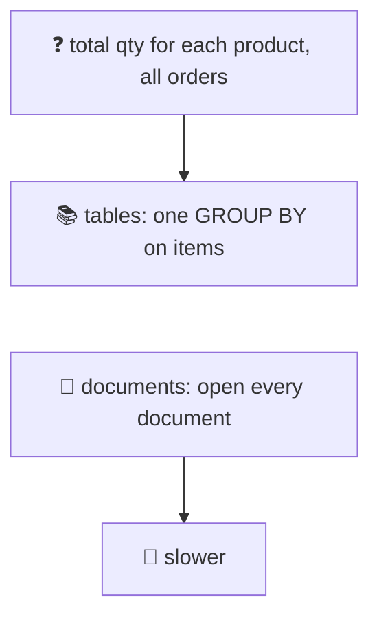
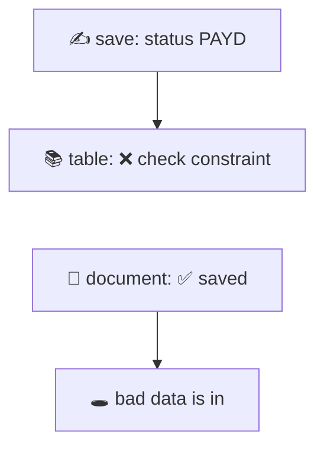
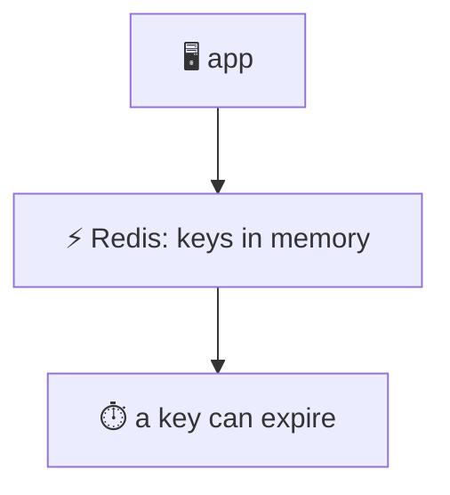
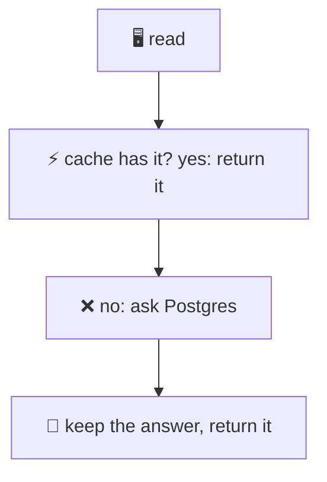
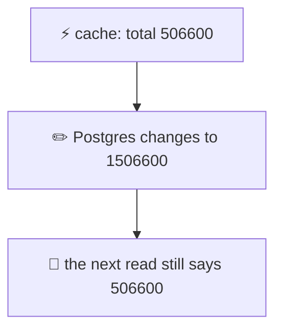
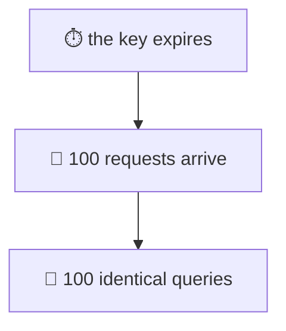

# 23. SQL vs NoSQL and Redis

> **Subject:** Database · **Lesson:** 23 · **Made:** 2026-11-03 · **Status:** ready
>
> **You will be able to:** say when tables, documents or a key-value store fit, show that Postgres can keep documents too, say what Redis is and what it can lose, build a cache in front of Postgres (cache-aside), and name its three problems: stale data, stampede, and caching the wrong thing.
>
> **Before this:** [Partitioning and sharding](22-partitioning-and-sharding.md) · **Next:** the database map is complete. Take the quizzes, then review.
>
> **How to read it:** one card is one idea. Look at the picture, guess, then press the orange bar to check. The blue bars (📖 More detail) hold the longer explanation with the why and a real example. Skip them on the first read, and open them when you want more. The Postgres results and the cache results were run on PostgreSQL 18.3 on one laptop. **I did not run Redis** (it is not installed here). The cache in my tests is a Map inside the program. What I say about Redis comes from its docs, read on 2026-11-03. About 30 minutes for the cards.

## 1. The idea: pick the box for the job

"SQL or NoSQL?" is not one question. NoSQL is a name for many different boxes. Each box keeps data in a different shape, and is good at a different job.

| Box | How it keeps data | Example product (names only, I did not run them) |
|---|---|---|
| **Tables** (SQL) | rows in tables that point to each other, with rules | PostgreSQL |
| **Documents** | one JSON blob for each thing | MongoDB |
| **Key and value** | a name, and what is stored under that name | Redis |

<details class="guess"><summary>🤔 Guess: an order with 3 items, kept as three linked tables, or as one JSON document. You want ONE order by its id, with its items. Which is faster? Press to check.</summary>

About the same. Both are far under 1 millisecond. I ran each 9 times and took the middle:

```text
tables (a join of orders and items):   0.068 ms
one document (a lookup by id):         0.038 ms
```

The document is a little faster because it needs no join: the items are inside. For "give me this one thing", both are fine. The differences show up in the next cards.

</details>

> **Remember:** each box is good at a job. Asking for one thing by its id is easy in all of them. The questions that cut across many things are where they differ.

<details class="more"><summary>📖 More detail: the data I used</summary>

200,000 orders, with 600,000 items (3 for each order). As tables: `l23_orders` and `l23_items`, with rules (a check on the status, a foreign key from the item to the order). As documents: one `l23_docs` row for each order, with a JSONB column like this:

```json
{"status": "PAID", "customer_id": 872,
 "items": [{"qty": 1, "product": "product-8", "price_cents": 1200}, ...]}
```

Size on disk: the tables 73 MB, the documents 78 MB, and the GIN index on the documents 16 MB. The file `practice/23-json-vs-tables.sql` builds both.

</details>

## 2. Documents are a table with one JSON column

You do not need another database to keep documents. Postgres has `jsonb`: a column that holds a JSON document, which you can search and index. A "document store" is, in this picture, a table with an `id` and a `doc`.



<details class="guess"><summary>🤔 Guess: total quantity sold for each product, over all 200,000 orders. Tables (one GROUP BY), or documents (open each one)? How many times slower are the documents? Press to check.</summary>

```text
tables:     100 ms     SELECT product, sum(qty) FROM l23_items GROUP BY 1
documents:  338 ms     ... FROM l23_docs, jsonb_array_elements(doc->'items') i GROUP BY 1
```

The documents are **3.4 times slower**, because Postgres must open and unpack every document. A question that cuts across all the things is what tables are made for. And "all orders of customer 872" was fast in both: 0.078 ms with an index on the table, 0.155 ms with a GIN index on the document. At that size the two are the same.

</details>

> **Remember:** one thing by id, or a search with an index: documents and tables are both fast. A question across everything (totals, joins, reports) is faster with tables.

<details class="more"><summary>📖 More detail: the GIN index on a document</summary>

```sql
CREATE INDEX l23_docs_gin ON l23_docs USING gin (doc jsonb_path_ops);
SELECT count(*) FROM l23_docs WHERE doc @> '{"customer_id": 872}';
```

`@>` means "contains". The GIN index makes it fast. The Postgres docs say `jsonb_path_ops` makes a smaller index than the default, but it does not support the key-exists operators (`?`, `?|`, `?&`). Costs: the index was 16 MB for 78 MB of documents, and it must be updated on every write (lesson 26).

Lesson 8, card 7, said the same thing from the other side: if you filter, sort, join or add up a field, use a normal column. JSONB is for shapes that change.

</details>

## 3. Rules: a document says yes to anything

A table can say no. A document column accepts any JSON. That is flexible, and it is also how a typo gets into your data.



<details class="guess"><summary>🤔 Guess: save a document with the key typed wrong (<code>"stauts"</code> instead of <code>"status"</code>), and another with the value typed wrong (<code>"PAYD"</code>). Then the same value in the table. What does Postgres say each time? Press to check.</summary>

The documents are **both saved**, with no error:

```text
INSERT INTO l23_docs VALUES (900001, '{"customer_id": 1, "stauts": "PAID", "items": []}');   -- works
SELECT doc->>'status' FROM l23_docs WHERE id = 900001;                                        -- empty (NULL)
```

The table says no, twice:

```text
ERROR:  new row for relation "l23_orders" violates check constraint "l23_orders_status_check"
ERROR:  insert or update on table "l23_items" violates foreign key constraint "l23_items_order_id_fkey"
```

A count of documents with status `PAYD` gave 1: the bad value was now in my data. In a document store, **your app** must do these checks, in every place that writes.

</details>

> **Remember:** tables enforce rules (lesson 8) for every writer. A plain document store trusts every writer. That is the price of the flexible shape.

<details class="more"><summary>📖 More detail: schema checks for documents</summary>

Many document databases (and Postgres, with a `CHECK` on a `jsonb` column) can validate documents if you ask. I did not test any of them. The point stays: the checks are **yours to write**, and they only protect what goes through them. Also, with documents the same fact is often **copied** into many documents (a product name inside each order). Lesson 7 shows what that costs when the fact changes.

</details>

## 4. What "NoSQL" really means: four families

The word NoSQL covers four quite different kinds of database. Do not talk about "NoSQL" as one thing in an interview. Name the family.

| Family | Good at | Gives up (usually) |
|---|---|---|
| **Document** (MongoDB) | things with a changing shape, read as a whole | JOINs, rules across documents |
| **Key and value** (Redis) | very fast lookup by a name | any question except "give me this key" |
| **Wide column** (Cassandra) | huge write volume, spread over many servers | ad hoc queries, joins |
| **Graph** (Neo4j) | "who is connected to whom" | plain table-like reports |

I did not run any of these. The table is the usual summary, not a measurement.

<details class="guess"><summary>🤔 Guess: pick the box. (a) Users, orders and refunds, with money reports. (b) A login token, looked up by its text on every request. (c) A top 10 leaderboard that changes all the time. Press to check.</summary>

(a) **Tables (Postgres).** Related data, rules and reports across everything: all the things tables are good at. (b) **Key and value.** It is only ever "give me this key", and it must be fast. (c) **Redis**: the docs say a sorted set keeps strings in order by their score, which is a leaderboard. Many apps keep the **truth in Postgres** and use the other box to be fast, not to replace it.

</details>

> **Remember:** name the family, not "NoSQL". Related data with rules and reports: tables. A fast lookup by a name: key and value. Shape changes and read whole: documents.

<details class="more"><summary>📖 More detail: what you give up when you leave tables</summary>

These are the usual costs. Check each one for the product you pick, because they differ:

- **JOINs and reports across things.** Card 2 showed it: 3.4 times slower even inside Postgres.
- **Rules.** Card 3: the database will not stop a bad value.
- **Transactions across several records.** (Lesson 13.) Some products have them and some do not, and the rules differ. Read the docs before you rely on it.
- **Easy changes.** A new question can need a new copy of the data in a new shape.

What you can gain: a shape that changes without a migration (lesson 19), and spreading data over many servers by a key (lesson 22), which is exactly why many of them exist.

</details>

## 5. How to choose: ask these questions

Ask these in order. They are the questions an interviewer is waiting for.

| Question | If yes | If no |
|---|---|---|
| Is the data **related**, and will you need JOINs and reports? | tables | go on |
| Must **rules** hold for every writer (unique, not null, foreign keys)? | tables | go on |
| Do you need **transactions** over several things? | tables | go on |
| Do you only ever read a thing **by its key**, and it must be very fast? | key and value | go on |
| Does the shape change a lot, and you read a thing **whole**? | documents (or JSONB) | tables |

<details class="guess"><summary>🤔 Guess: a new app: users, orders, payments, an admin dashboard. The team says "NoSQL scales better, so let's use MongoDB". What do you say? Press to check.</summary>

Start from the **questions**, not from the word "scale". This app has related data (users, orders, payments), needs rules (a payment must point to an order), needs transactions (an order and its payment must happen together), and needs reports. That is **tables**. Postgres handles this kind of app for a long time (lesson 22 and 21 showed the steps before you ever need to shard). If one part has a flexible shape (for example, a settings blob), put it in a `jsonb` column. Add a key and value box (cache, sessions) later, **beside** Postgres, when you have a slow read to fix.

</details>

> **Remember:** the default is Postgres, with `jsonb` for the parts that change shape. Add another box when a clear problem needs it, and keep the truth in one place.

<details class="more"><summary>📖 More detail: the stack in your own work</summary>

*This is about your stack, not a claim about any past project.* A React or Next.js app with Express or GraphQL, Prisma or Hasura, and PostgreSQL is already the "tables" answer. The natural next box to add is a **cache** (cards 7 to 10) for reads you repeat, or Redis for sessions and rate limits. I did not test how Hasura or Prisma work with Redis. Check their docs for your version.

</details>

## 6. Redis: a fast box that lives in memory

Redis is an in-memory store. Its docs call it "a data structure server": it keeps more than strings. It has hashes, lists, sets, sorted sets, streams and more. A key can also have a **time to live**: after that time, Redis deletes it for you.



I did not run Redis. These facts come from the Redis docs (data types, persistence, eviction and the EXPIRE command), read on 2026-11-03.

<details class="guess"><summary>🤔 Guess: Redis keeps its data in memory. The power is cut. Redis was set to take snapshots only (RDB). What can you lose? Press to check.</summary>

**The latest writes since the last snapshot.** The Redis persistence docs list four choices:

| Choice | What it does | What you can lose |
|---|---|---|
| **RDB** | a snapshot of all data at set times | the latest minutes (the docs say to be ready to lose them) |
| **AOF** | a log of every write, replayed on start | with the default (fsync every second): about one second |
| **Both** | RDB and AOF together | the docs: for safety comparable to PostgreSQL, use both |
| **None** | nothing is written to disk | everything, on a restart. The docs say this is sometimes used for a cache |

So Redis can be a safe store if you set it up for that. But the usual job is a **cache**, where losing it is fine because Postgres still has the truth.

</details>

> **Remember:** Redis keeps data in memory, with optional snapshots or a log on disk. Used as a cache, it can be thrown away at any time. Do not keep the only copy of important data in a cache.

<details class="more"><summary>📖 More detail: expiry and what happens when memory is full</summary>

- **Time to live.** The `EXPIRE` docs show `SET mykey "Hello"`, then `EXPIRE mykey 10`: after 10 seconds the key is deleted. (`SET` also has an option to set the time in one command. I did not read that page, so check it.) Setting the key again with a plain `SET` **clears** the time to live (the docs show the TTL going back to `-1`), so set it again each time.
- **How keys expire.** The docs say a key expires when you ask for it after its time ran out, and also Redis checks a few keys at random in the background.
- **Memory limit.** `maxmemory` sets the limit. On a 64-bit system the default is no limit. When the limit is reached, the policy decides. The `noeviction` policy makes Redis return an error for commands that add data. The `allkeys-lru` policy removes the keys used least recently, and the docs call it a good default for a cache when a few keys are read much more than the rest.
- Redis is **not** the same as Postgres for rules and queries. It does not make a join or a foreign key for you.

</details>

## 7. Cache-aside: the pattern in three lines

The most common way to use a cache is **cache-aside**. The app looks in the cache first. If the answer is there (a **hit**), use it. If not (a **miss**), ask Postgres, keep the answer in the cache for a while, and return it.



<details class="guess"><summary>🤔 Guess: 2,000 reads ask for one of 100 categories (a few are very popular). The query is a slow report with no index. A cache keeps each answer for 30 seconds. About how many reads reach Postgres, and how long does it all take? Press to check.</summary>

```text
Part 1a. 2000 reads, no cache:     9282 ms, 2000 queries to Postgres
Part 1b. 2000 reads, with cache:    473 ms,  100 queries to Postgres, hit rate 95%
```

Only the **first** read of each category went to Postgres: 100 queries, one for each. The other 1,900 were hits. About **20 times faster** (the three runs gave 473, 407 and 476 ms with the cache, and 9,155 to 9,339 ms without). The cache here is a `Map` in my program. A real Redis is another server, so each hit costs a network trip. I did not measure that.

</details>

> **Remember:** cache-aside is: look in the cache, on a miss ask the database, keep the answer with a time to live. It pays when the same answer is read many times.

<details class="more"><summary>📖 More detail: the code</summary>

```js
async function cachedLoad(cache, category, ttlMs = 30000) {
  const key = "category:" + category;
  const hit = cache.get(key);
  if (hit !== undefined) return hit;      // hit
  const value = await loadCategory(category); // miss: ask Postgres
  cache.set(key, value, ttlMs);           // keep it for a while
  return value;
}
```

With Redis, `cache.get` is `GET key`, and `cache.set` is `SET key value` followed by `EXPIRE key 30`, with the value saved as text (for example `JSON.stringify`). I did not run these. The hit rate was 95% because there were only 100 different keys: at most 100 reads can be misses. Redis gives you the numbers to watch: the docs say `INFO stats` shows `keyspace_hits` and `keyspace_misses`.

</details>

## 8. The cache can lie: stale data

The cache is a **copy**. When Postgres changes, the copy does not know. It keeps the old answer until its time runs out.



<details class="guess"><summary>🤔 Guess: the answer for category 7 is cached (30 seconds to live). Then the prices in Postgres change. What does the next read return? And after you delete the cache key? Press to check.</summary>

```text
total before the update: 506600
read right after the update (cache not told):  506600   same as before? true
read after deleting the cache key:             1506600
```

The cache returned the **old** number, with no error. After `cache.del(...)`, the next read was a miss, loaded from Postgres, and gave the right number.

</details>

> **Remember:** a cache is fast and can be out of date. After you write to Postgres, delete the cache key. A short time to live is the safety net, not the plan.

<details class="more"><summary>📖 More detail: the choices, and a rule</summary>

- **Delete after the write.** Write to Postgres first, then delete the key. The next read loads the new value. There is still a small race: a read that started before your write can put the old value in after you deleted it. A short time to live limits how long it stays.
- **Short time to live.** Choose it from the question "how old may this answer be?" A product list may be 60 seconds old. A balance may be 0 seconds old, so do not cache it.
- **Never decide a write from the cache.** If you read a value to decide what to write (stock, balance), read it from Postgres with a lock (lesson 15). A cache is for reads where "a little old" is fine, the same rule as for a replica (lesson 21).

</details>

## 9. The stampede: 100 requests, one missing key

A popular key expires. In the same moment, 100 requests ask for it. Each one looks in the cache, finds nothing, and starts the same slow query.



<details class="guess"><summary>🤔 Guess: 100 requests ask for a missing key at the same moment. Nothing shares the load. How many queries reach Postgres? And if the requests share one load? Press to check.</summary>

```text
Part 3a. 100 requests at once, the key is missing:  100 queries to Postgres, 83 ms
Part 3b. the same, but sharing the load:              1 query  to Postgres,  5 ms
```

Three runs gave 83, 93 and 88 ms for 3a, and 5 ms for 3b every time. Sharing the load means: keep a list of loads that are running. The first request starts the load. The other 99 see it in the list and **wait for its answer**.

</details>

> **Remember:** when a hot key is missing, only one request should go to the database. The rest wait for its answer (this is called single flight, or request coalescing).

<details class="more"><summary>📖 More detail: the code, and other ways</summary>

```js
function makeSharedLoader(cache, ttlMs) {
  const inFlight = new Map();
  return async function (category) {
    const key = "category:" + category;
    const hit = cache.get(key);
    if (hit !== undefined) return hit;
    if (inFlight.has(key)) return inFlight.get(key);     // someone is already loading
    const promise = loadCategory(category)
      .then(value => { cache.set(key, value, ttlMs); return value; })
      .finally(() => inFlight.delete(key));              // clear it, also on an error
    inFlight.set(key, promise);
    return promise;
  };
}
```

This works inside **one** server process. With 10 app servers, each one starts its own load, so you can still get 10 queries. Other fixes: give each key a slightly different time to live, so popular keys do not all expire together, or refresh a hot key **before** it expires. I did not test those.

</details>

## 10. What to cache, and what not to

A cache is a good fit for a read that is **repeated**, **slow to make**, and **fine if a little old**. It is a bad fit for the rest.

| Cache it | Do not cache it |
|---|---|
| a product list, a dashboard total, a profile page | a balance, stock to be decided on, a payment state |
| an answer that many users share | an answer that is different for every user and never repeats |
| an answer that is slow (a report, a big join) | an answer that is already fast with an index |
| data where the **truth** stays in Postgres | the **only** copy of something important |

<details class="guess"><summary>🤔 Guess: a page runs a query in 3 ms, and it is read once a minute. Should you cache it? And a report that takes 4 seconds and 500 users read it every minute? Press to check.</summary>

**The first: no.** It is already fast, and it is rarely read, so a cache adds a thing to run, a stale answer to fix, and a stampede to guard against, for no gain. **The second: yes.** A slow query that many people repeat is exactly the job: one query for 500 reads. Even then, give it a time to live that matches how old the report may be, and guard it against a stampede (card 9).

</details>

> **Remember:** cache the slow, repeated, can-be-old read. Do not cache what you decide a write from, and never keep the only copy of important data in a cache.

<details class="more"><summary>📖 More detail: other jobs for Redis</summary>

From the Redis docs (I did not run these):

- **A counter with a time limit.** The `EXPIRE` docs show a "navigation session" pattern: add to a list and `EXPIRE` the key after 60 seconds. They say it is easily changed to `INCR` for counters. A rate limit (count the requests of a user in a minute) is my idea of how to use that, not something the docs describe.
- **Sessions or tokens**, looked up by key, with an expiry.
- **A queue**, using a list or a stream.

For a queue, remember lesson 18: a Postgres table with `SKIP LOCKED` already gives you a safe queue with no new server. Add Redis for queues when the volume or the features need it. And every new box is one more thing to run, watch and back up.

</details>

## 11. Watch it run, step by step

Now watch a cache answer, go stale, and get hit by a stampede. **[Open the cache stepper](visuals/23-sql-vs-nosql-and-redis.html).** It has three tabs: a miss and then hits, a stale answer after a write, and a stampede. Guess first, then press Next.

<details><summary>Or read the "stale" case as a table</summary>

| Step | What happens | The user sees |
|---|---|---|
| 1 | read category 7: miss, load, keep | 506600 |
| 2 | `UPDATE` in Postgres | (the cache is not told) |
| 3 | read again: hit | **506600** (old) |
| 4 | `cache.del("category:7")` | |
| 5 | read again: miss, load | 1506600 |

</details>

## 12. Why it matters and what it costs

Interview words: *relational*, *document store*, *key-value store*, *polyglot persistence*, *cache-aside*, *hit rate*, *TTL*, *invalidation*, *stale data*, *cache stampede*, *eviction*.

|  | Postgres only | Postgres and a cache |
|---|---|---|
| Repeated slow read | runs every time | once for each time to live |
| Data is always fresh | yes | not in the cache |
| Things to run | one | two |
| When the cache dies | not applicable | slower, but still correct (if Postgres can take it) |

- **With the map,** you can answer "SQL or NoSQL?" with questions instead of a brand, and say how a cache helps and how it can hurt.
- **Without it,** "add Redis" is the answer to every slow page, and users see old data or the database falls over at the worst moment.

**The costs:**

- Stale data (card 8), and the small race after a delete.
- A stampede when a hot key expires (card 9).
- One more server to run, watch and secure, and a network trip on every hit.
- If the cache is empty after a restart, all the reads reach Postgres at once. Plan for that load.

## 13. Watch and play

Links checked on 2026-11-03. Each page loaded. For each video, the title and channel were confirmed through YouTube's oEmbed data. The video lengths and the contents were not checked.

- **Play with it:** [The cache stepper](visuals/23-sql-vs-nosql-and-redis.html) in this folder. Guess first, then press Next.
- **Run it:** [`practice/23-json-vs-tables.sql`](practice/23-json-vs-tables.sql) is cards 1 to 3, [`practice/23-cache-demo.js`](practice/23-cache-demo.js) is cards 7 to 9, and [`practice/23-cache-aside.js`](practice/23-cache-aside.js) is the exercise.
- **Video:** [SQL vs NoSQL - System Design Interview](https://www.youtube.com/watch?v=mWdQmYYYr9g) from the channel LeetJourney. Cards 1, 4 and 5.
- **Video:** [4 Types of NoSQL Databases Explained | System Design Interview #9](https://www.youtube.com/watch?v=vosF_JpTV2I) from Learn with Manoj. Card 4.
- **Video:** [Caching For System Design: Redis, CDN, Cache Patterns Explained](https://www.youtube.com/watch?v=ETvLl-8bPbo) from System Design Lab. Cards 7 to 10.
- **Video:** [Caching Strategies With Redis](https://www.youtube.com/watch?v=8A6s9d0jnWI) from Software With Shawn. Card 7.
- **Read:** [JSON types](https://www.postgresql.org/docs/current/datatype-json.html) in the PostgreSQL docs. `json` against `jsonb`, and the GIN index classes (card 2).
- **Read:** [Redis data types](https://redis.io/docs/latest/develop/data-types/) (card 6) and [Redis persistence](https://redis.io/docs/latest/operate/oss_and_stack/management/persistence/) (card 6).
- **Read:** [Key eviction](https://redis.io/docs/latest/develop/reference/eviction/) (maxmemory and the policies, card 6) and [EXPIRE](https://redis.io/docs/latest/commands/expire/) (card 6 and card 10).

<details><summary>More links (optional)</summary>

- **Read (revision, dense):** [Database scaling and correctness](database-scaling-and-correctness.md), the steps on caching.

</details>

## 14. Practice

**A. Predict.** A shop caches the product page for 10 minutes. A seller lowers a price, and a customer still sees the old price for a few minutes and orders at the old price. What went wrong, and what are two fixes?

<details class="guess"><summary>🤔 Press to see the answer</summary>

The cache was stale (card 8): the seller's update went to Postgres, and the cache was not told. Two fixes: **delete the cache key** when the price is changed, so the next read loads the new price, and use a **shorter time to live** for pages with a price. The most important fix: the **order** must read the price from Postgres, not from the cache, because it decides a write (card 8).

</details>

**B. What would you do?** Your homepage runs a 3-second query for a "top products" list. A marketing email makes 5,000 users open it in one minute. The cache key expires at the worst moment and the database is overloaded. Why, and what do you change?

<details class="guess"><summary>🤔 Press to see the answer</summary>

A stampede (card 9): when the key expired, many requests missed together and each ran the 3-second query. Changes: share one load for a missing key, so only one request runs the query (and the others wait for it). Refresh the key in the background **before** it expires, or keep an older answer to serve while one request refreshes. Give the list a longer time to live, since "top products" can be a minute old. And add an index or make the query lighter (lesson 11), because a 3-second query is a problem on its own.

</details>

**C. Write it yourself**

Run [`practice/23-json-vs-tables.sql`](practice/23-json-vs-tables.sql) in a scratch database, and [`practice/23-cache-demo.js`](practice/23-cache-demo.js) against a scratch database (write your guesses first). Then open [`practice/23-cache-aside.js`](practice/23-cache-aside.js), write the three TODO parts, and run `node --test learn/database/practice/23-cache-aside.test.js`.

<details><summary>One possible answer</summary>

```js
function makeCache(now) {
  const map = new Map();
  return {
    get(key) {
      const hit = map.get(key);
      if (!hit) return undefined;
      if (now() >= hit.expires) { map.delete(key); return undefined; }
      return hit.value;
    },
    set(key, value, ttlMs) { map.set(key, { value, expires: now() + ttlMs }); },
    del(key) { map.delete(key); },
  };
}

async function cachedGet(cache, key, ttlMs, load) {
  const hit = cache.get(key);
  if (hit !== undefined) return hit;
  const value = await load(key);
  if (value !== undefined) cache.set(key, value, ttlMs);
  return value;
}

function makeSharedGetter(cache, ttlMs, load) {
  const inFlight = new Map();
  return function get(key) {
    const hit = cache.get(key);
    if (hit !== undefined) return Promise.resolve(hit);
    if (inFlight.has(key)) return inFlight.get(key);
    const promise = cachedGet(cache, key, ttlMs, load).finally(() => inFlight.delete(key));
    inFlight.set(key, promise);
    return promise;
  };
}
```

I ran the test file against this code: all 12 tests pass. Against the empty stub, all 12 fail.

The SQL file, on my run: one order by id 0.068 ms (tables) and 0.038 ms (document). The total per product 100 ms (tables) and 338 ms (documents). Customer 872: 0.078 ms and 0.155 ms (the same, within noise). The typo document is saved with no error, and the table refuses `'PAYD'`. The demo: 2,000 reads 9,282 ms with 2,000 queries, against 473 ms with 100 queries (95% hit rate). A stale read returns 506600 until the key is deleted, then 1506600. 100 requests at once: 100 queries (83 ms) against 1 query (5 ms).

Guesses: 1) about the same, a few hundredths of a millisecond. 2) about 3 times slower. 3) the same. 4) the document saves, the table refuses. 5) 100 queries and a 95% hit rate. 6) the old value, then the new one. 7) 100 queries, and 1.

</details>

## 15. Interview question

**Q:** "SQL or NoSQL for a new product? And when would you add a cache like Redis?"

<details><summary>A strong answer, in four parts</summary>

1. **Problem:** "NoSQL" is four different kinds of database, not one. And a slow page is not always a database problem.
2. **How it works:** I start from the questions: is the data related, do I need rules and transactions, do I need reports? If yes, tables, which means **Postgres** by default, with `jsonb` for the parts that change shape (in my test, a lookup by id was 0.068 ms as tables and 0.038 ms as a document, so both are fast). I add a key and value box only for a clear job. For a slow, repeated read I add a **cache-aside** layer: look in the cache, on a miss ask Postgres and keep the answer with a time to live. In my test, 2,000 reads fell from 2,000 queries (9,282 ms) to 100 queries (473 ms).
3. **Tradeoff:** documents are 3.4 times slower for a question across all of them (338 ms against 100 ms), and they accept bad data that a table refuses. A cache can be **stale** (I read the old total until I deleted the key), so I delete the key after a write and use a short time to live. A hot key that expires makes a **stampede** (100 queries instead of 1), so I share one load. I never decide a write from the cache, and I never keep the only copy of important data in it. Redis keeps data in memory, and, from its docs, can lose the latest minutes with snapshots only, or about a second with an append-only log, so it is a cache or a helper, and Postgres keeps the truth.
4. **My example:** *This is an idea, not a fact. Replace it with a real story from DBO, Unloan, ZWS or Skyworx.* A Postgres app with Prisma, where the "top products" and the dashboard totals are cached for 60 seconds with the key deleted when the data changes, while payments and balances always read from Postgres.

</details>

## 16. Explain it back

Close this file. Press the **Record my explanation** button under this heading and explain "SQL or NoSQL, and when a cache", like to a new junior, in 4 parts: problem, how it works, tradeoff, my example. Use these numbers: 100 ms against 338 ms, 2,000 queries against 100, 506600 against 1506600, 100 queries against 1. Then save the transcript into `my-learning/recordings/`, or write your best version below. Run `/explain-check sql vs nosql and caching` or ask `coach my explanation`.

### My explanation

<write here>

### Coach feedback

<the explain-coach agent writes here>

## 17. Review questions (day 1, 3, 7, 21)

1. Name the four NoSQL families, and one job each is good at.
2. Postgres can keep documents. How? When are documents a poor fit, and what did the numbers show?
3. What can a table do that a document column does not, and what happened in the test?
4. You have a new app with users, orders and payments. What database do you choose, and why?
5. What is cache-aside? Say the three steps.
6. After you update Postgres, the cache still returns the old value. Why? What are two fixes?
7. What is a cache stampede? How do you stop it?
8. What can Redis lose if the power is cut, with the different persistence choices? What should you never keep only in a cache?

<details><summary>Answers</summary>

1. Document (a changing shape, read as a whole), key and value (very fast lookup by a name), wide column (huge write volume over many servers), graph (who is connected to whom).
2. A `jsonb` column holds a document, and a GIN index makes `@>` searches fast. Documents are a poor fit for a question across all of them: 338 ms against 100 ms with tables (3.4 times slower), and they have no rules.
3. A table refuses bad data (a check constraint, a foreign key). A document column accepts anything: the typo `"stauts"` and the value `"PAYD"` were both saved, and a count found the bad value in my data.
4. Tables: Postgres. The data is related, it needs rules and transactions, and it needs reports. Use `jsonb` for a part that changes shape. Add other boxes later for a clear job.
5. Look in the cache. On a miss, ask the database. Keep the answer in the cache with a time to live, and return it.
6. The cache is a copy and nobody told it about the change, so it keeps the old answer until its time runs out. Fixes: delete the cache key after the write, and use a short time to live.
7. A popular key expires and many requests miss at the same moment, and each runs the same slow query (100 queries in my test). Share one load: the first request loads, the others wait for its answer (1 query).
8. With snapshots only (RDB): the latest minutes. With the append-only log (AOF) and the default: about one second. With no persistence: everything on a restart. Never keep the only copy of important data in a cache: the truth stays in Postgres.

</details>

## 18. Go deeper (optional)

None of this is needed for the cards above.

<details><summary>Write-through and write-behind</summary>

Cache-aside fills the cache on a **read**. In **write-through**, every write goes to the cache and to the database together. In **write-behind**, the write goes to the cache first and to the database later, which is fast but can lose data if the cache dies. I did not test either. Cache-aside is the simplest and the most common, and it is the one to know first.

</details>

<details><summary>Hit rate and the size of the cache</summary>

The hit rate depends on how many different keys there are, how long they stay, and how much memory the cache has. If the hit rate is low, check whether keys expire too fast, or are evicted too often. The Redis docs show two numbers in `INFO stats`: `keyspace_hits` and `keyspace_misses`, and `evicted_keys`. I did not run them.

</details>

<details><summary>Hasura and Prisma</summary>

I did not test how Hasura or Prisma cache results. Hasura documents its own caching feature, and Prisma has options for caching with its own tools. Check their docs for your version, and test the stale-data case of card 8 before you rely on any of them.

</details>

<details><summary>Make the tables and the cache yourself</summary>

`practice/23-json-vs-tables.sql` builds the tables and the documents on a scratch database. `practice/23-cache-demo.js` makes its own small table (`l23_prices`, 100,000 rows) and needs only the `pg` package. The numbers in this lesson came from a throwaway Postgres 18.3 on port 55432. Your numbers will differ.

</details>

## Connected lessons

- [7. Normalization](07-normalization.md): a copy has an owner. A cache is a copy on purpose.
- [8. Constraints and data types](08-constraints-and-data-types.md): the rules a table has and a document does not, and JSONB or normal columns.
- [13. Transactions and ACID](13-transactions-and-acid.md): what you may lose when you leave tables.
- [15. Locks and deadlocks](15-locks-and-deadlocks.md): decide a write from Postgres with a lock, not from a cache.
- [18. Upsert, idempotency and job queues](18-upsert-idempotency-and-job-queues.md): a queue in Postgres, before you add Redis.
- [21. Replication and read replicas](21-replication-and-read-replicas.md): the same rule: reads that may be a little old.
- [22. Partitioning and sharding](22-partitioning-and-sharding.md): the next steps on the scaling ladder.
- [Database scaling and correctness](database-scaling-and-correctness.md): the long guide.
